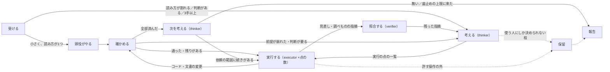

# 重い版のハーネス（考える係と実行する係のグラフ）

**使う人が「重い版で」「係を出して」と言ったときだけ使う。** ふだんは `light.md`。

- 係（サブエージェント）は、1体ごとに決まりと文書を読み直すので、使う量がふだんの数倍になる。見直しの係は1体で約30分・25〜60万トークン、6体を同時に動かしたら24分で5時間枠の41%を使った
- `light.md` の決まり（聞かずに決める／止まって聞く・許す操作・報告の形）は、そのまま効く。ここに書くのは、係の出し方だけ
- このリポジトリの `AGENTS.md`・`CLAUDE.md` が先に立つ

## 4つの役

| 役 | 誰が | すること | しないこと |
| :-- | :-- | :-- | :-- |
| 頭役 | メインのセッション | 受ける・仕分ける・係を出す・確かめる・記録する・報告する。グラフの状態を持つ | 長い作業を自分で抱え込む |
| 考える係 | `thinker`（`roles/thinker.md`） | 使う人の言葉の読み方を決め、案を比べて1つに決め、実行の点に割る | ファイルを書き換える |
| 実行する係 | `executor`（`roles/executor.md`） | 点を1つだけやり、確かめて報告する | 計画を変える・新しい判断をする（考える係へ戻す） |
| 照合する係 | `verifier`（`roles/verifier.md`） | 複数の係が出した指摘を、原文に当たって確かめ、誤り・重なり・既知を落とす | 指摘を直す（直すのは実行する係） |

### 係の呼び方

- Claude Code で `roles/*.md` を `~/.claude/agents/` に写してあれば、係の種類にその名前（`thinker` など）を指定する
- 写していないとき・ほかのエージェントでは、汎用の係（Claude Code なら `general-purpose`）を出し、プロンプトの最初に「`agent-harness/roles/<役>.md` を読み、その決まりと返す形に従う」と書く。読むだけの役（考える・照合する）には、「ファイルを書き換えない、git を操作しない」と念を押す

## 使う量の歯止め（係を出す前に読む）

- **係は同時に1体まで。** 使う人が数を言ったら従う（多くても4体）
- **1つの依頼で出す係は、合わせて5体まで。** 越えそうなら、そこまでの結果を報告して、続けるかを聞く
- 同じブランチ・同じ文書の続きは、新しい係を出さずに、終えた係へ続けて頼む（Claude Code なら SendMessage）。決まりと文書を読み込み済みなので安く済む
- 使う人が線（「5時間枠の50%まで」など）を言ったら、そこで止める。枠の使用率は、使う人が Claude Code の `/usage` で見られる

## グラフ



状態はすべて状態ファイル（下）に書く。点と矢印を通るたびに1行足す。**時刻はコマンド（`date`）で取る。** 勘で書くと1時間ずれたことがある。

## 点ごとの決まり

### 受ける

- `light.md`「受ける」のとおり。使う人の言葉は、原文のまま状態ファイルに残す
- 時間の言葉（「4時間後に」など）があれば、終わる時刻を状態ファイルに書く

### 考える

- `thinker` を呼ぶ。結果が次の点に要るので、待ってよい
- 渡すもの：原文、リポジトリの場所、状態ファイルのパス、前の点の結果（戻ってきたときは、何が崩れたか）
- 返ってきた「決めたこと」を、使う人に聞き返してから進めることはしない。そのまま進め、報告に「代わりに決めたこと」として書く

### 実行する

- 点1つにつき `executor` を1体、新しく作る。数は「使う量の歯止め」に従う
- 同じファイルを書き換える点は、同時に出さない
- コードを直す点は、係用の worktree を用意して渡す
- 並べて動いている係どうしで主題が重なると分かったら、頭役が片方へ伝える（Issue の番号・直す場所）。同じ Issue を二重に立てさせない
- 係が「考え直し」で頭役に判断を回してきたら、頭役が決めて返す。決めたことは状態ファイルと報告の「代わりに決めたこと」に書く
- プロンプトに入れるもの：点の id、やること、終わりの条件、許す操作、作業場所（ブランチ・worktree）、関係する決定
- **書き出しの場所は係ごとにフォルダを分けさせる**（`<一時フォルダ>/<点の id>/`）。2体が同じ名前のファイルを書き、上書きし合ったことがある

### 照合する

- 見直しを係に割るときは、`review-template.md` の形で頼む（観点で割る・既知を重ねない・出力の形をそろえる）
- 見直し・調べものを複数の係に割ったら、指摘で手を動かす前に `verifier` を1体出す。渡すもの：指摘のファイル全部、既知の一覧（docs ブランチの `ナレッジ/決定事項.md`・`要決定事項.md`、前の洗い出し）、書き出し先
- 残った指摘は「考える」へ戻し、「直せる（既にある規定・決定から導ける）」と「人が決める」に分けて実行の点にする。人が決めるものは、直さずに Issue か PR に書く点にする

### 確かめる

- 係の報告をそのまま信じない（係の言葉であって、確かめた事実ではない）。差分・テストの結果・CI を頭役が自分で見る
- 係が「考え直し」を返した、または前提が崩れた → 「考える」へ戻す

### 次を考える

- 依頼の範囲に残りがあれば続ける
- 依頼の範囲の外の新しい仕事は、使う人が「任せる」「回しといて」などと言ったときだけ作る。それ以外は報告の「次にやるなら」に1〜3件書いて止まる

### 報告

`light.md`「報告する」の形。使う人が後で開く場所（状態ファイルのパス・PR・Issue）を頭に書く。

## 使う人がいないとき（「回しといて」「寝る」）

- 使う人の答えを待って止まらない。使う人にしか決められない枝だけを保留にし、ほかの点を進める
- 「使う量の歯止め」は、いないときも変わらない。上限に来たら新しい係を出さず、状態ファイルの「経過」と「次にやるなら」を書いてから報告する

## 状態ファイル（グラフのいま）

- リポジトリの外に置く（例：`~/.claude/harness-runs/YYYY-MM-DD-<短い名前>.md`）。セッションが切れても続きを拾えるように、消える一時フォルダには置かない
- 使う人が「続き」と言ったら、いちばん新しい状態ファイルを開き、済んでいない点から再開する
- 書式：

```markdown
# （依頼の短い名前）（YYYY-MM-DD HH:MM〜）

- リポジトリ：（パス）
- 歯止め：同時 1 体・合わせて 5 体（使う人が別の数を言ったら書き換える）

## 使う人の言葉（原文）

## 読み方と決めたこと（考える係）

- 読み方：
- 決めたこと：
- 違ったときの戻し方：

## 点

| id | やること | 状態（待ち／実行中／済み／保留） | 係 | 結果（PR・commit） | 依存 |
| :-- | :-- | :-- | :-- | :-- | :-- |

## 経過（時刻をつけて足していく）

## 使う人に回すこと

## 次にやるなら
```

## このリポジトリで係を回すときの落とし穴

- 土台が本線でない PR（base が `feat/*` など）では、CI（`ci.yml`）が PR では走らない。`gh workflow run ci.yml --ref <ブランチ>` で手で走らせ、`gh run view <番号>` で結果を見る
- Codex に作業を頼むときは commit させない（sandbox で `.git` に書けない）。差分を見て、頭役が commit・push する
