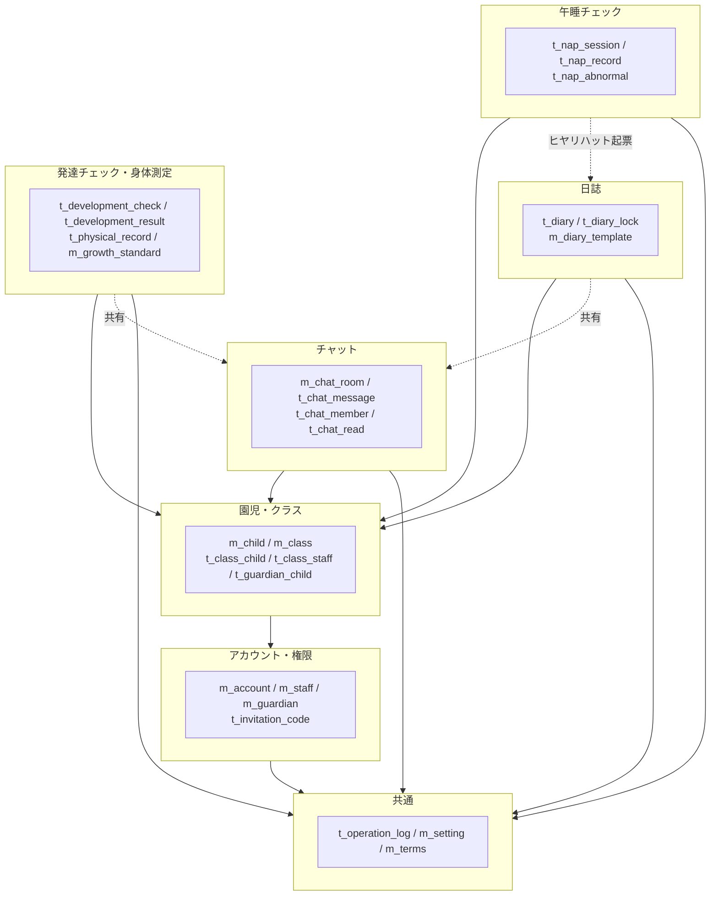
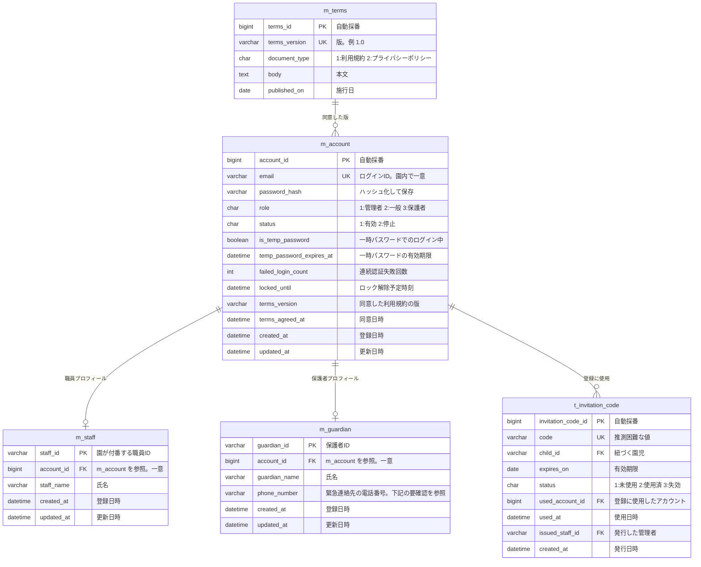
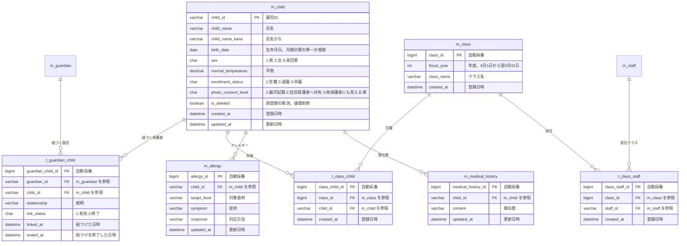
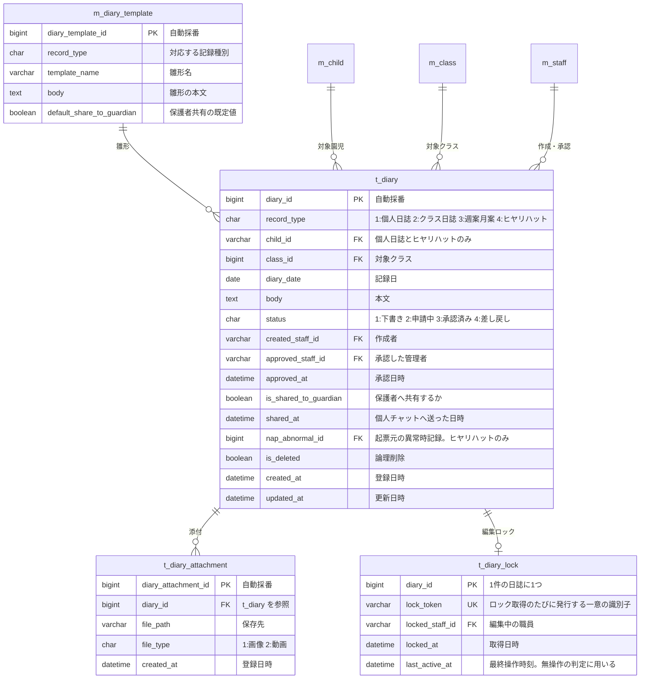
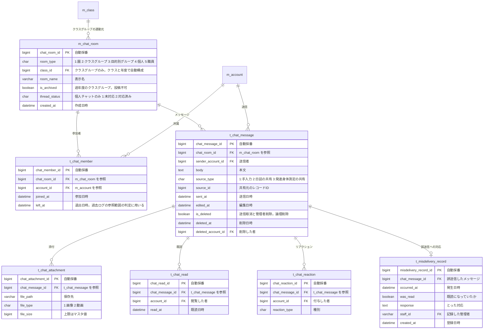
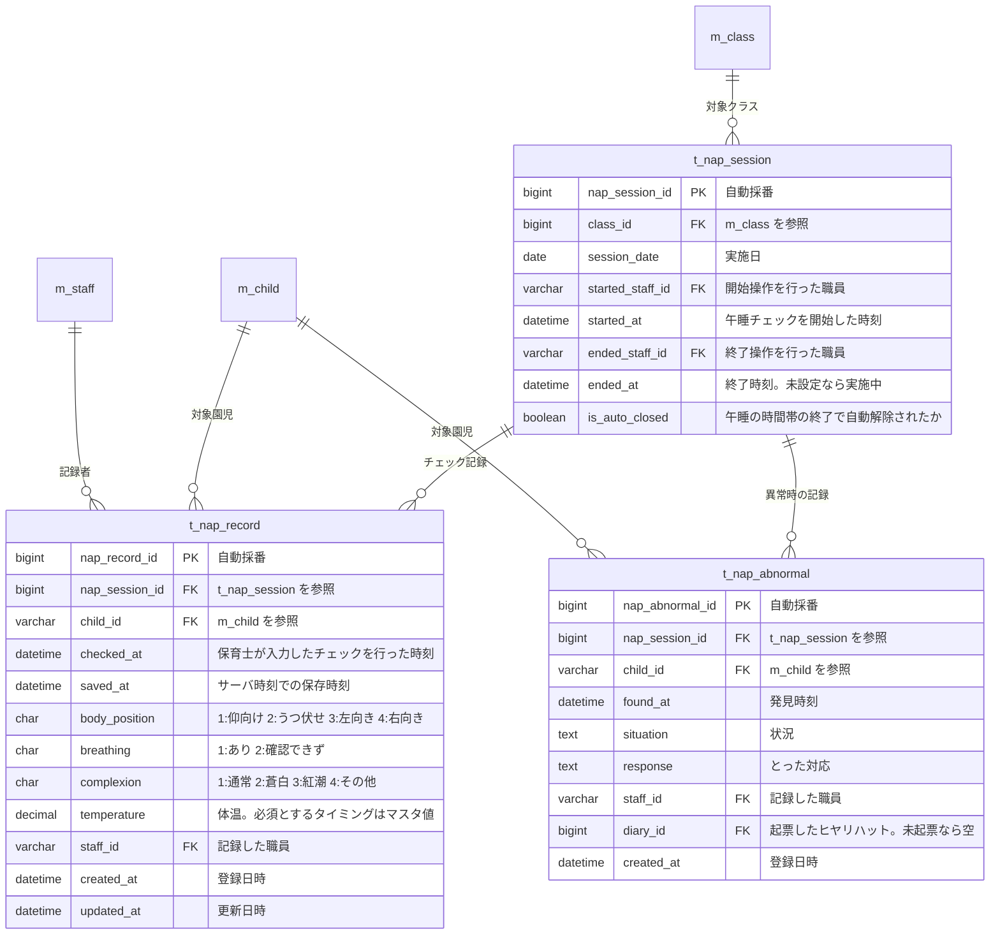
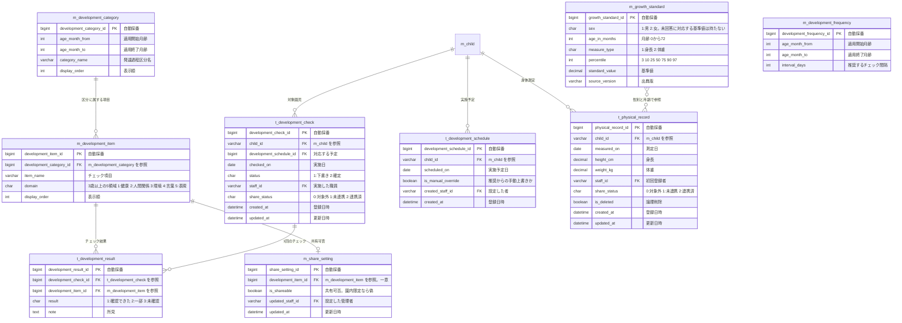
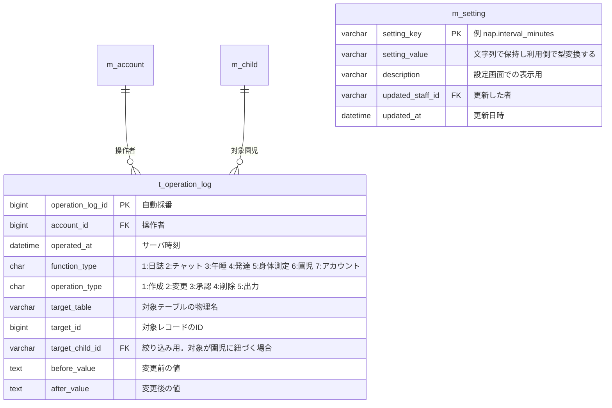

# 保育支援システム ER図

| 項目 | 内容 |
| :-- | :-- |
| 対象システム | 保育支援システム（すくすくシステム） |
| 版数 | 第 1.0 版 |
| 作成日 | 2026 年 8 月 4 日 |
| 典拠 | `HFD_要件定義書02_レビュー編集済み.md` 第1.7版 |
| 作成区分 | チーム開発演習 基本設計 |

## 改訂履歴

| 版 | 日付 | 変更内容 |
| :-: | :-: | :-- |
| 1.0 | 2026/08/04 | 新規作成。全体要件定義書 第1.7版の全機能からエンティティを抽出し、6つのサブジェクトエリアに分けて図示 |

# 0 本書の位置づけ

- 本書は**図**であり、エンティティとその関連、および各エンティティの主要な属性を示す。**列の完全な定義（型・制約・既定値・チェック仕様）は基本設計書が保持する。**
- 既に作成済みの `基本設計書（身体記録のみ）.md` 第3.0版が定義しているエンティティ（`m_child` / `t_physical_record` / `m_growth_standard` / `m_setting`）は、その定義を正としてそのまま取り込んでいる。
- 全体要件定義書と本書の記述が食い違った場合は、**全体要件定義書を正とし、本書を追随させる。**

## 0-1 命名規則

`基本設計書（身体記録のみ）.md` 5章およびマスタ文書の書式に統一する。

| 区分 | 接頭辞 | 例 |
| :-- | :-- | :-- |
| マスタ（変更頻度が低く、参照される側） | `m_` | `m_child`、`m_class`、`m_setting` |
| トランザクション（業務の実行に伴い増える） | `t_` | `t_diary`、`t_nap_record` |

| 項目 | 規則 |
| :-- | :-- |
| 代理キー | `BIGINT` 自動採番。列名は `<テーブル名の主語>_id` |
| 園児ID・職員ID・保護者ID | `VARCHAR(20)`。園が付番する業務上のIDを想定する |
| 論理削除 | `is_deleted BOOLEAN`（全体要件定義書 7-3 No.6）。削除者・削除日時は共通操作ログ側で保持する |
| 時刻列 | `created_at` / `updated_at`（`DATETIME`）。**サーバの時刻**を用いる（同 4-2 (3)） |
| 区分値 | `CHAR(1)` の数字コード。意味は各図の備考に記す |

# 1 全体像

サブジェクトエリアの関係を示す。園児マスタ（`m_child`）が全機能の基盤であり、アカウント（`m_account`）が権限判定の起点となる。

- 実線は参照（外部キーを伴う関連）、点線は**機能間のデータの引き渡し**を示す。
- 日誌・発達チェックからチャットへの点線は、共有可否フラグを付けて個人チャットへ引き渡す連携（4-2 (1)・4-2 (4)）。
- 午睡チェックから日誌への点線は、異常時の記録からヒヤリハットを下書き起票する連携（4-2 (1)）。

# 2 エリア別ER図

## 2-1 アカウント・権限

**設計上の判断**

- **認証情報を `m_account` に集約し、職員・保護者のプロフィールを別テーブルに分けた。** ログインIDであるメールアドレスは**ロールをまたいで園内で一意**でなければならない（4-1-1。職員が自児の保護者アカウントを取る場合に別のメールアドレスを要する根拠）。職員表・保護者表に別々に持つと、この一意性をデータベースの制約で担保できない。
- `m_staff.staff_id` は既存の `t_physical_record.staff_id`（基本設計書 5-1）が参照しているため、`VARCHAR(20)` の業務IDとして維持する。
- 一時パスワードは `password_hash` を上書きし、`is_temp_password` と `temp_password_expires_at` で状態を表す。**再発行のたびに旧パスワードは無効になる**（4-1-1）。期限切れ後はどのパスワードでもログインできない状態となり、`locked_until` によるロックとは区別する。
- 規約改定時の再同意は `m_account.terms_version` の更新で表す。**過去に同意した版の履歴を残す必要がある場合は、`t_terms_agreement`（account_id + terms_version + agreed_at）を別に設ける**（下記 6-2 No.1）。

> **【要確認】** `m_guardian.phone_number` は要件定義書に明示的な根拠がない。4-2 (2) は緊急連絡の経路を「園から保護者への電話（**園児マスターの連絡先による**）」としているが、4-1-3 の園児マスターの登録項目に連絡先（電話番号）が存在しない。一方 4-1-1 は「保護者のメールアドレスは……**園からの緊急時の連絡先**として保持する」としており、2か所で連絡先の所在が食い違っている。本図では保護者に電話番号を持たせる形で仮置きした。要件定義書側での確定を要する（下記 6-1 No.1）。

## 2-2 園児・クラス

**設計上の判断**

- **クラスは年度ごとに別レコードとする**（`m_class.fiscal_year`）。年度更新は新年度の `m_class` を作成し、`t_class_child` と `t_class_staff` を新年度分として作り直す操作になる（4-1-3）。過年度の割り当てが残るため、**「過去にどのクラスの担任だったか」を後から判定できる**。
- 「自クラス」の判定は `t_class_staff`（現在年度）→ `t_class_child` → `m_child` の経路をたどる。**参照範囲は園児単位で判定する**ため、記録側の年度は判定に用いない（4-1-2）。
- **引き継ぎ猶予期間**（4-1-2）は、前年度の `t_class_staff` と、年度更新の実行日時＋猶予期間から判定する。年度更新の実行日時を保持する必要がある（下記 6-2 No.2）。
- `t_guardian_child.link_status` を「終了」にすることで退園・卒園を表す。**アカウントの停止は、有効な紐づけが1件も無くなった時点で `m_account.status` を停止に変える**（4-1-2）。
- アレルギーは1園児に複数登録できるよう別テーブルとした（対象食材ごとに症状・対応方法が異なるため）。

## 2-3 日誌

**設計上の判断**

- **記録種別を `record_type` の区分値で持ち、テーブルは分けない。** 個人日誌・クラス日誌・週案／月案・ヒヤリハットは保持する項目がほぼ共通であり、保護者共有の既定値だけが種別によって変わるため（4-2 (1)）。
- **編集ロックは `lock_token` を保存時に照合する**（4-1-4 (3)）。管理者が強制解除するとレコードを削除するため、保存時にトークンが一致せず、**他者の更新が無くても保存が拒否される**。
- ヒヤリハットは `nap_abnormal_id` で起票元の異常時記録と相互に参照できる（4-2 (1)）。**集計はヒヤリハット側を正とする**。
- 雛形はマスタとして園が追加・変更できる（4-2 (1)）。保護者共有の既定値も雛形側に持たせ、コードに書かない（7-1 No.7）。

## 2-4 チャット

**設計上の判断**

- **過去ログの参照範囲は `t_chat_member` で判定する**（4-2 (2) (c)）。園児単位ではなく「そのグループにメンバーとして所属していたか」で判定するため、`left_at` を保持して**過去に所属していた期間**を追えるようにした。
- 職員は `left_at` が入っていても参照できる。**保護者は `left_at` が入った時点で参照できなくなる**（現在所属しているグループのみ）。退園・卒園により紐づけが終了した時点で `left_at` を設定する。
- クラスグループは `class_id` を持ち、`m_class` が年度ごとに別レコードであるため、**年度が変わると別のチャットルームになる**。過年度分は `is_archived` を立てて投稿不可のアーカイブとして残す。
- **日誌・発達チェックからの共有は `t_chat_message` のレコードとして表す**（`source_type` / `source_id`）。保護者向けの表示は共有可のフラグが立った項目のみを本文に含めた状態で生成するため、チャット側に共有可否の判定を持たせない。
- `thread_status` は個人チャットのスレッド単位の状態（4-2 (2)）。**保護者の画面には表示しない**。

## 2-5 午睡チェック

**設計上の判断**

- **`t_nap_session` は、午睡チェックの「開始する／終了する」操作を保持するために設けた**（4-1-4 (4)）。自動ログアウトの例外の適用範囲がこのレコードで決まるほか、**誰がどの時間帯の午睡チェックを担当したか**を追跡できる。
- `checked_at` と `saved_at` を**両方保持する**（4-2 (3)）。後追い入力を許容しつつ、帳票に両方を出力して監査に耐えるようにするため。両者の乖離は一括確認画面で識別する。
- **`t_nap_record` に削除フラグを持たせない。** 保存済み記録の削除は行わず、誤記録は修正で対応する方針のため（4-2 (3)）。修正履歴は共通操作ログが保持する。
- `t_nap_abnormal.diary_id` が空のレコードが「異常を記録したがヒヤリハットを起票していない」状態を表す。**システムは起票の要否を判定しない**（4-2 (1)）。

## 2-6 発達チェック・身体測定

**設計上の判断**

- **「未入力」は `t_development_result` にレコードが存在しない状態で表す。** 「未確認」は `result = 3` として明示的に保持する。両者は別の状態であり、チェック漏れの判定対象になるのは「未入力」のみ（4-2 (4)）。
- チェック項目・発達過程区分・推奨頻度をすべてマスタ化し、**保育所保育指針の改定にコード変更なしで追従する**（7-1 No.7）。
- `t_physical_record` と `m_growth_standard` は `基本設計書（身体記録のみ）.md` 第3.0版の定義をそのまま用いる。**`m_growth_standard` は男女のみを保持し、`m_child.sex = 9`（未回答）の園児には基準値の帯を描画しない**（4-1-3）。
- `t_development_check.share_status` は `t_physical_record.share_status` と同じ区分値とし、未連携記録の抽出と再連携に用いる。

# 3 共通エリア

- **操作ログは追記のみとし、更新・削除の手段を設けない**（4-1-4 (2)）。`updated_at` を持たないのはこのため。
- `before_value` / `after_value` を保持することで、午睡チェックの修正履歴（4-2 (3)）と身体測定の更新履歴を共通操作ログに統合できる（基本設計書 5-4 の方針）。
- `m_setting` に保持する主なマスタ値は次のとおり。**いずれもコードに直接書かない**（7-1 No.7）。

| 分類 | 保持する値 | 典拠 |
| :-- | :-- | :-- |
| 午睡チェック | チェック間隔（年齢別）、体温の必須タイミング、午睡の時間帯 | 4-2 (3)、4-1-4 (4) |
| 認証 | ログイン失敗回数、待機時間、ログイン情報の記憶の保存期間、一時パスワードの有効期限 | 4-1-1 |
| 画面 | 職員向け画面の自動ログアウトまでの無操作時間、日誌の編集ロックの無操作時間 | 4-1-4 (3)(4) |
| 参照範囲 | 年度更新に伴う引き継ぎ猶予期間、年度更新の実行日時 | 4-1-2 |
| 添付 | 対応形式、1ファイルあたりの上限サイズ | 4-2 (2) |
| データ保持 | 記録の保持年数、添付ファイルの保持期間 | 7-3 |

# 4 要件定義書との対応

| 要件定義書の節 | 対応するエンティティ |
| :-- | :-- |
| 4-1-1 アプリのログイン | `m_account`、`m_terms` |
| 4-1-2 アカウントの管理 | `m_account`、`m_staff`、`m_guardian`、`t_invitation_code`、`t_guardian_child`、`m_class`、`t_class_staff` |
| 4-1-3 園児マスターの管理 | `m_child`、`t_class_child`、`m_allergy`、`m_medical_history` |
| 4-1-4 全機能に共通する扱い | `t_operation_log`、`t_diary_lock`、`t_nap_session`、`m_setting` |
| 4-2 (1) 日誌システム | `t_diary`、`t_diary_attachment`、`m_diary_template` |
| 4-2 (2) チャットツール | `m_chat_room`、`t_chat_member`、`t_chat_message`、`t_chat_read`、`t_chat_reaction`、`t_chat_attachment`、`t_misdelivery_record` |
| 4-2 (3) 午睡チェック | `t_nap_session`、`t_nap_record`、`t_nap_abnormal` |
| 4-2 (4) 発達チェック | `m_development_category`、`m_development_item`、`m_development_frequency`、`t_development_schedule`、`t_development_check`、`t_development_result`、`m_share_setting`、`t_physical_record`、`m_growth_standard` |

# 5 参照範囲の判定経路

権限チェックはサーバ側で強制する（8 セキュリティ要求 No.2）。判定に用いる経路を示す。

| 判定 | 経路 |
| :-- | :-- |
| 一般が園児を参照できるか（通常） | `m_account` → `m_staff` → `t_class_staff`（現在年度の `m_class`）→ `t_class_child` → `m_child` |
| 一般が園児を参照できるか（猶予期間中） | 上記に加え、`t_class_staff`（前年度の `m_class`）→ `t_class_child`。年度更新の実行日時＋猶予期間内であり、かつ**閲覧のみ** |
| 保護者が園児を参照できるか | `m_account` → `m_guardian` → `t_guardian_child`（`link_status = 1`）→ `m_child` |
| アレルギー情報の参照（例外①） | クラスによる絞り込みを行わない。一般も全園児を閲覧できる（8 No.6 の例外） |
| チャット過去ログの参照（例外②） | `t_chat_member` による。職員は `left_at` が入っていても可、保護者は現在所属しているルームのみ（8 No.6 の例外） |

# 6 要確認・要決定事項

## 6-1 要件定義書側での確定を要する事項

| No | 内容 |
| :-: | :-- |
| 1 | **保護者の電話番号の保持先が定義されていない。** 4-2 (2) は緊急連絡を「園から保護者への電話（園児マスターの連絡先による）」としているが、4-1-3 の園児マスターに連絡先の項目がない。一方 4-1-1 は保護者のメールアドレスを緊急時の連絡先としている。緊急連絡を電話に一本化した以上、電話番号を保持する場所（保護者アカウント／園児マスター）と、複数の保護者がいる場合の連絡順を要件定義書で確定する必要がある |
| 2 | 職員チャット（`room_type = 5`）の位置づけ。4-2 (2) の権限表に「職員チャット」があるが、グループチャットとの違い（全職員が自動的に参加するのか、任意編成か）が本文に記述されていない |

## 6-2 基本設計で確定する事項

| No | 内容 |
| :-: | :-- |
| 1 | 利用規約の同意履歴を、アカウントの最新版のみ保持するか（`m_account.terms_version`）、履歴テーブル（`t_terms_agreement`）を設けるか |
| 2 | 年度更新の実行日時の保持先。引き継ぎ猶予期間の判定に必要となる（`m_setting` に持たせるか、年度更新の実行履歴テーブルを設けるか） |
| 3 | 添付ファイルの実体の保存先（データベース内か、ファイルシステム上か）。`file_path` の解釈が変わる |
| 4 | 個人チャットのルームを保護者アカウント単位で作るか、園児単位で作るか。兄弟姉妹がいる場合にスレッドを分けるかで変わる |
| 5 | `t_operation_log` の `before_value` / `after_value` の保持形式（JSON か、項目名と値の組を別テーブルに正規化するか） |
| 6 | 論理削除した記録に対する一意制約の扱い。`t_physical_record` では部分一意インデックスで解決済み（基本設計書 5-1）。同種の制約が必要なテーブル（`t_class_child`、`m_share_setting` など）を洗い出す |
