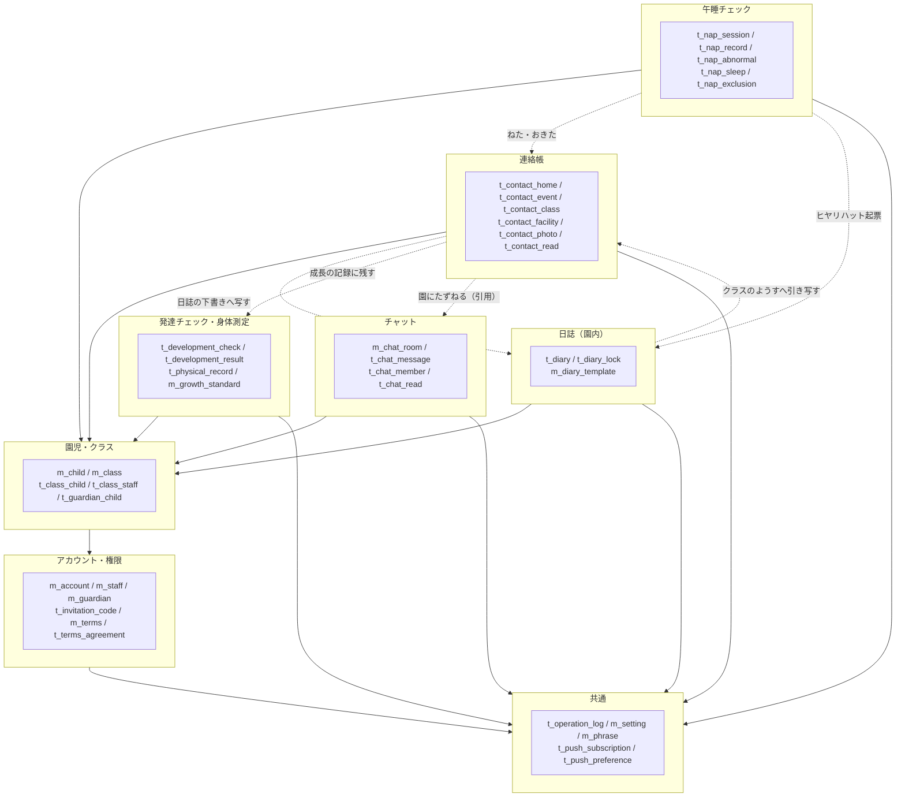
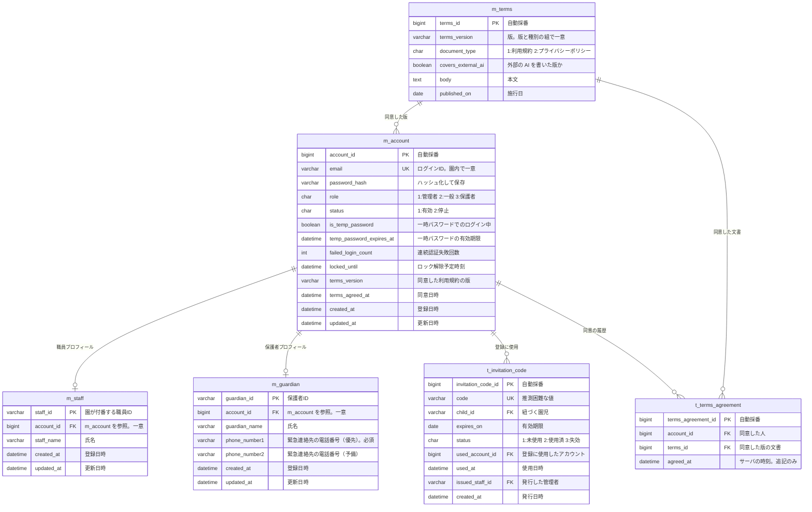
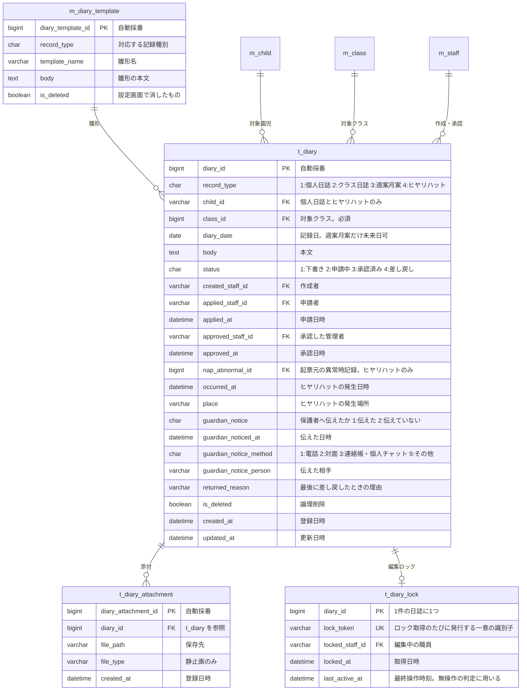
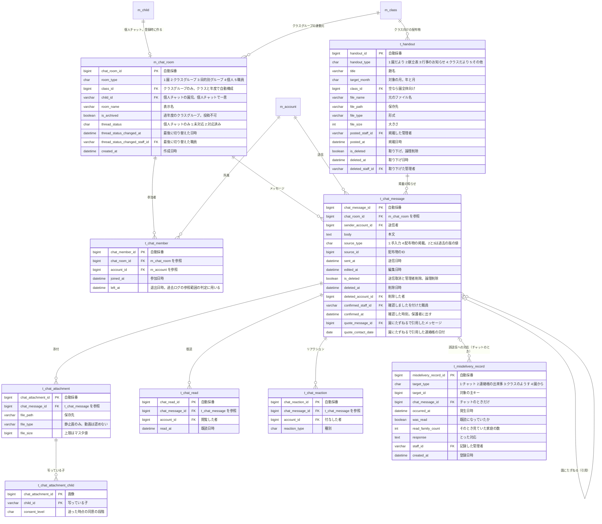
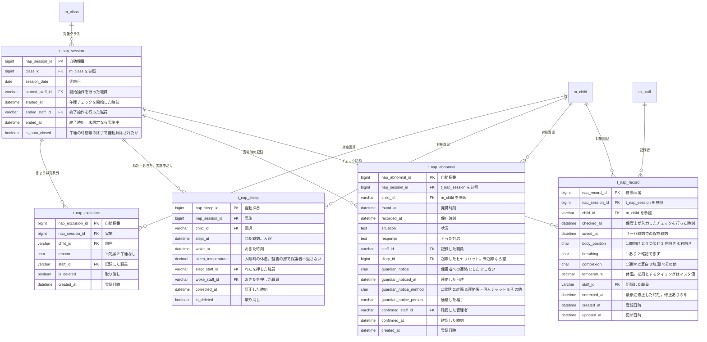
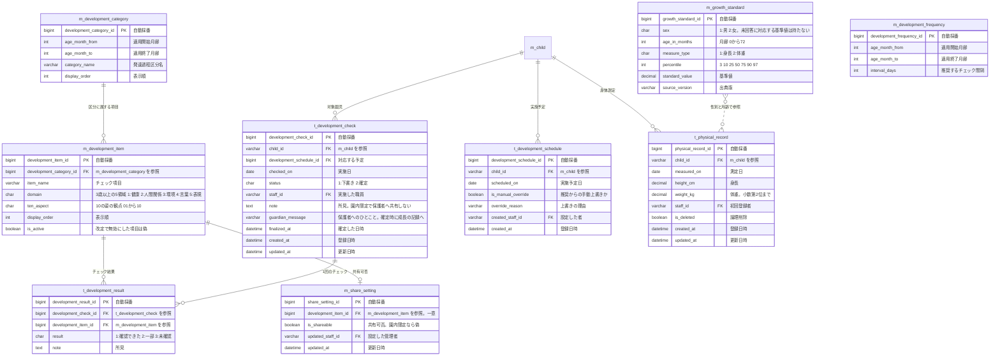
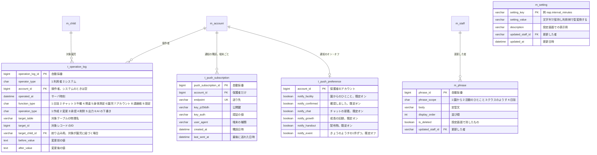

# 保育支援システム ER図

| 項目 | 内容 |
| :-- | :-- |
| 対象システム | 保育支援システム（すくすくシステム） |
| 版数 | 第 2.0 版 |
| 作成日 | 2026 年 8 月 4 日 |
| 典拠 | `要件定義書.md` 第3.0版、`基本設計書.md` 第3.0版「データベース設計」(5) |
| 作成区分 | チーム開発演習 基本設計 |

## 改訂履歴

| 版 | 日付 | 変更内容 |
| :-: | :-: | :-- |
| 2.0 | 2026/10/17 | **`要件定義書.md` 第3.0版と `基本設計書.md` 第3.0版に合わせ、「連絡帳」のエリア（2-3）を足した。** 連絡帳の7つの表（`t_contact_home`・`t_contact_event`・`t_contact_class`・`t_contact_facility`・`t_contact_photo`・`t_contact_photo_child`・`t_contact_read`）、午睡の `t_nap_sleep`（ねた・おきた）と `t_nap_exclusion`（きょうは対象外）、チャットの `t_chat_attachment_child`（写っている子）、共通の `m_phrase`（定型文）・`t_push_subscription`（通知の購読）・`t_push_preference`（通知のオン・オフ）の13の表を足した。日誌の保護者共有の列（`is_shared_to_guardian`・`shared_at`）、雛形の共有の既定（`default_share_to_guardian`）、発達チェック・身体測定の `share_status` を外した。個人チャットの園児の列、「確認しました」の列、日誌の申請者・申請日時とヒヤリハットの発生日時・場所、異常時の記録の保護者への連絡と管理者の確認、発達の保護者へのひとこと・確定日時、保護者の猶予中の紐づけ、外部の AI を断った印を足した。全体像から「共有」の点線を外し、連絡帳への引き渡しに改めた。エリアの番号を送った（日誌 2-3→2-4、チャット 2-4→2-5、午睡 2-5→2-6、発達 2-6→2-7） |
| 1.3 | 2026/10/06 | **配布物（`t_handout`）を加えた。** メッセージの種別に「4:配布物の掲載」を足し、掲載の知らせとの関連を示した（`基本設計書.md` 第2.4版、GitHub Issue #94） |
| 1.2 | 2026/10/06 | **`基本設計書.md` 第2.3版に合わせて3つの列を足した。** クラス（`m_class`）の年齢児 `age_class`、日誌（`t_diary`）の差し戻す理由 `returned_reason`、発達チェック（`t_development_check`）の所見 `note`（GitHub Issue #57・#58・#59） |
| 1.1 | 2026/09/07 | **「要確認・要決定事項」(6) の8件をすべて決着させ、「決着した事項」(6) へ書き改めた。** 緊急連絡先は保護者が持つ形に確定し（`phone_number1` / `phone_number2`）、連絡順は `t_guardian_child.contact_order` が持つこととした。同意履歴テーブル（`t_terms_agreement`）の新設、添付の保存先、個人チャットのルーム単位、操作ログの保持形式、年度更新の実行日時の保持先、部分一意インデックスの適用範囲を反映した |
| 1.0 | 2026/08/04 | 新規作成。要件定義書 第1.7版の全機能からエンティティを抽出し、6つのサブジェクトエリアに分けて図示 |

# 0 本書の位置づけ

- 本書は**図**であり、エンティティとその関連、および各エンティティの主要な属性を示す。**列の完全な定義（型・制約・既定値・チェック仕様）は基本設計書が保持する。**
- **列の正は `基本設計書.md`「データベース設計」(5) である。** 本図は第3.0版の同章に合わせている。図に描くのは主要な列で、型・桁・CHECK の細部は同章が持つ。
- 要件定義書と本書の記述が食い違った場合は、**要件定義書を正とし、本書を追随させる。**

## 0-1 命名規則

`基本設計書.md` 5章およびマスタ文書の書式に統一する。

| 区分 | 接頭辞 | 例 |
| :-- | :-- | :-- |
| マスタ（変更頻度が低く、参照される側） | `m_` | `m_child`、`m_class`、`m_setting` |
| トランザクション（業務の実行に伴い増える） | `t_` | `t_diary`、`t_nap_record` |

| 項目 | 規則 |
| :-- | :-- |
| 代理キー | `BIGINT` 自動採番。列名は `<テーブル名の主語>_id` |
| 園児ID・職員ID・保護者ID | `VARCHAR(20)`。園が付番する業務上のIDを想定する |
| 論理削除 | `is_deleted BOOLEAN`（要件定義書 7-3 No.6）。削除者・削除日時は共通操作ログ側で保持する |
| 時刻列 | `created_at` / `updated_at`（`DATETIME`）。**サーバの時刻**を用いる（同 4-2 (3)） |
| 区分値 | `CHAR(1)` の数字コード。意味は各図の備考に記す |

# 1 全体像

サブジェクトエリアの関係を示す。園児マスタ（`m_child`）が全機能の基盤であり、アカウント（`m_account`）が権限判定の起点となる。

- 実線は参照（外部キーを伴う関連）、点線は**機能間のデータの引き渡し**を示す（要件定義書「機能間のデータの引き渡し」(4-7-3)）。
- **日誌・発達チェックからチャットへの「共有」の点線は外した。** 日誌は保護者へ共有せず、保護者へは連絡帳で届ける。発達・身体の記録は、保護者が成長の記録画面で**開いた時点の共有範囲**で読む（表を介した引き渡しを持たない）。
- 午睡チェックから連絡帳への点線は、`t_nap_sleep`（ねた・おきた）をきょうのようすが読むこと。**監査の層（`t_nap_record`・`t_nap_abnormal`・`t_nap_exclusion`）からは線を引かない。**
- 連絡帳から日誌への点線は、個人日誌の午睡・食事の欄へ**写しとして**下書きに入れること（参照の列を持たない。`基本設計書.md`「連絡帳」(5-4)）。
- 午睡チェックから日誌への点線は、異常時の記録からヒヤリハットを下書き起票する連携。

# 2 エリア別ER図

## 2-1 アカウント・権限

**設計上の判断**

- **認証情報を `m_account` に集約し、職員・保護者のプロフィールを別テーブルに分けた。** ログインIDであるメールアドレスは**ロールをまたいで園内で一意**でなければならない（4-1-1。職員が自児の保護者アカウントを取る場合に別のメールアドレスを要する根拠）。職員表・保護者表に別々に持つと、この一意性をデータベースの制約で担保できない。
- `m_staff.staff_id` は既存の `t_physical_record.staff_id`（基本設計書 5-1）が参照しているため、`VARCHAR(20)` の業務IDとして維持する。
- 一時パスワードは `password_hash` を上書きし、`is_temp_password` と `temp_password_expires_at` で状態を表す。**再発行のたびに旧パスワードは無効になる**（4-1-1）。期限切れ後はどのパスワードでもログインできない状態となり、`locked_until` によるロックとは区別する。
- 規約改定時の再同意の要否は `m_account.terms_version` で判定し、**同意の履歴は `t_terms_agreement` に追記する**（下記 6-2 No.1）。**利用規約とプライバシーポリシーは1つの版にまとめる**（第3.0版）。`m_terms` は版と種別の組で一意とし、1回の同意で2つの文書それぞれに1行ずつ残す。外部の AI への送信を書き足す改定でも、2つをそろえて新しい版にする。

> **緊急連絡先は保護者が持つ**（2026/09/07 に確定。要件定義書「緊急連絡先の保持」(4-1-1)）。園児マスターには持たせない。連絡する相手は保護者であり、園児ではないためである。
>
> - **1人の保護者につき2つまで**保持する（携帯・勤務先など）。項目は `phone_number1` `phone_number2` とし、**1が優先**
> - **複数の保護者が同じ園児に紐づく場合の連絡順は、`t_guardian_child` が持つ**（紐づけごとに順位を持たせ、1から順にかける）
> - **演習上の想定である。** 実際の導入時には、園の緊急連絡の運用を確認して確定する

## 2-2 園児・クラス

```mermaid
erDiagram
    m_child ||--o{ t_guardian_child : "紐づく保護者"
    m_guardian ||--o{ t_guardian_child : "紐づく園児"
    m_class ||--o{ t_class_child : "在籍"
    m_child ||--o{ t_class_child : "所属"
    m_class ||--o{ t_class_staff : "担任"
    m_staff ||--o{ t_class_staff : "担任クラス"
    m_child ||--o{ m_allergy : "アレルギー"
    m_child ||--o{ m_medical_history : "既往歴"

    m_child {
        varchar child_id PK "園児ID"
        varchar child_name "氏名"
        varchar child_name_kana "氏名かな。必須"
        varchar nickname "呼び名。他児の名前の注意と AI の置き換えに使う"
        date birth_date "生年月日。月齢計算の単一の根拠"
        char sex "1:男 2:女 9:未回答"
        decimal normal_temperature "平熱"
        varchar face_photo_path "顔写真。職員の宛先表示だけ"
        int nap_interval_minutes "午睡の間隔の上書き。空ならクラスの年齢児の値"
        char enrollment_status "1:在籍 2:退園 3:卒園"
        date withdrawn_on "退園日"
        char photo_consent_level "1:園内記録 2:自児保護者へ共有 3:他保護者にも見える場"
        boolean is_deleted "誤登録の取消。論理削除"
        datetime created_at "登録日時"
        datetime updated_at "更新日時"
    }
    m_class {
        bigint class_id PK "自動採番"
        int fiscal_year "年度。4月1日から翌3月31日"
        varchar class_name "クラス名"
        int age_class "年齢児 0から5。午睡チェックの間隔を引く"
        datetime created_at "登録日時"
    }
    t_class_child {
        bigint class_child_id PK "自動採番"
        bigint class_id FK "m_class を参照"
        varchar child_id FK "m_child を参照"
        datetime created_at "登録日時"
    }
    t_class_staff {
        bigint class_staff_id PK "自動採番"
        bigint class_id FK "m_class を参照"
        varchar staff_id FK "m_staff を参照"
        datetime created_at "登録日時"
    }
    t_guardian_child {
        bigint guardian_child_id PK "自動採番"
        varchar guardian_id FK "m_guardian を参照"
        varchar child_id FK "m_child を参照"
        varchar relationship "続柄"
        int contact_order "緊急時にかける順"
        char link_status "1:有効 2:終了 3:猶予中"
        datetime linked_at "紐づけた日時。連絡帳の参照はこれで切らない"
        date grace_ends_on "保護者の猶予期間の終わり。起点は操作を実行した日"
        datetime ended_at "紐づけを終了した日時"
        boolean ai_opt_out "外部の AI を断った"
    }
    m_allergy {
        bigint allergy_id PK "自動採番"
        varchar child_id FK "m_child を参照"
        varchar target_food "対象食材"
        varchar symptom "症状"
        varchar response "対応方法"
        datetime updated_at "更新日時"
    }
    m_medical_history {
        bigint medical_history_id PK "自動採番"
        varchar child_id FK "m_child を参照"
        varchar content "既往歴"
        datetime updated_at "更新日時"
    }
```

**設計上の判断**

- **クラスは年度ごとに別レコードとする**（`m_class.fiscal_year`）。年度更新は新年度の `m_class` を作成し、`t_class_child` と `t_class_staff` を新年度分として作り直す操作になる（4-1-3）。過年度の割り当てが残るため、**「過去にどのクラスの担任だったか」を後から判定できる**。
- 「自クラス」の判定は `t_class_staff`（現在年度）→ `t_class_child` → `m_child` の経路をたどる。**参照範囲は園児単位で判定する**ため、記録側の年度は判定に用いない（4-1-2）。
- **引き継ぎ猶予期間**（4-1-2）は、前年度の `t_class_staff` と、年度更新の実行日時＋猶予期間から判定する。年度更新の実行日時を保持する必要がある（下記 6-2 No.2）。
- 卒園・退園で `t_guardian_child.link_status` を**猶予中（3）**にし、`grace_ends_on`（保護者の猶予期間の終わり）を過ぎたら**終了（2）**にする。猶予中は連絡帳・成長の記録・個人チャットの過去ログを読めるが書けない。**アカウントの停止は、有効・猶予中の紐づけが1件も無くなった時点でシステムが行う**（要件定義書「保護者アカウントの停止単位」(4-1-2)）。
- **連絡帳・成長の記録は紐づけで判定し、`linked_at` より前の日の分も読める。** 個人チャット（参加した時点以降）とは判定が違う（下記 5）。
- `ai_opt_out` は紐づけごとに持つ。有効な紐づけの1つでも断っていれば、その園児に外部の AI を使わない。
- アレルギーは1園児に複数登録できるよう別テーブルとした（対象食材ごとに症状・対応方法が異なるため）。

## 2-3 連絡帳

```mermaid
erDiagram
    m_child ||--o{ t_contact_home : "家庭から。1日1行"
    m_guardian ||--o{ t_contact_home : "書いた保護者"
    m_child ||--o{ t_contact_event : "出来事。1件1行"
    m_class ||--o{ t_contact_event : "記録時のクラス"
    m_class ||--o{ t_contact_class : "クラスのようす"
    m_child ||--o{ t_contact_facility : "園から。1日1つ"
    t_contact_photo ||--o{ t_contact_event : "写真を指す"
    t_contact_photo |o--o{ t_contact_class : "添える"
    t_contact_photo ||--o{ t_contact_photo_child : "写っている子"
    m_child ||--o{ t_contact_photo_child : "写っている"
    m_child ||--o{ t_contact_read : "ページ"
    m_account ||--o{ t_contact_read : "開いた保護者"
    t_diary |o--o{ t_contact_class : "引き写し元"
    m_staff ||--o{ t_contact_event : "記録した職員"

    t_contact_home {
        bigint contact_home_id PK "自動採番"
        varchar child_id FK "園児"
        date contact_date "ページの日付。園児と日付で一意"
        varchar guardian_id FK "最後に送った保護者"
        decimal temperature "体温。判定しない"
        varchar night_sleep_from "夜の睡眠 寝た"
        varchar night_sleep_to "夜の睡眠 起きた"
        char breakfast "朝ごはん 1:ぜんぶ 2:半分 3:少し 4:食べていない"
        varchar mood_label "きげん。選んだ時点の文字"
        char pickup_type "お迎え 1:いつもどおり 2:変更あり"
        varchar pickup_person "お迎えの人"
        varchar pickup_time "お迎えの時刻"
        varchar message "連絡事項"
        datetime submitted_at "送った時刻"
        varchar confirmed_staff_id FK "確認しましたを押した職員"
        datetime confirmed_at "確認した時刻"
        datetime revised_at "確認のあとに直した時刻。更新の印"
    }
    t_contact_event {
        bigint contact_event_id PK "自動採番"
        varchar child_id FK "届く先の園児"
        bigint class_id FK "記録した時点のクラス"
        date contact_date "ページの日付"
        char event_type "1:食事 2:排せつ 3:体温 4:活動のひとこと 5:写真"
        datetime recorded_at "サーバの時刻。保護者に出す"
        char meal_kind "1:給食 2:おやつ"
        char meal_amount "1:ぜんぶ 2:半分 3:少し 4:食べていない"
        varchar toilet_label "排せつ。選んだ時点の文字"
        decimal temperature "体温。判定の言葉を付けない"
        varchar body "活動のひとこと"
        bigint contact_photo_id FK "写真"
        boolean keep_in_growth "成長の記録に残す"
        varchar staff_id FK "記録した職員"
        datetime corrected_at "訂正した時刻"
        boolean is_deleted "取り消し"
    }
    t_contact_class {
        bigint contact_class_id PK "自動採番"
        bigint class_id FK "届く先のクラス"
        date contact_date "ページの日付"
        varchar body "文"
        bigint contact_photo_id FK "添えた写真"
        bigint source_diary_id FK "引き写し元のクラス日誌"
        varchar staff_id FK "記録した職員"
        datetime recorded_at "記録した時刻"
        datetime corrected_at "訂正した時刻"
        boolean is_deleted "取り消し"
    }
    t_contact_facility {
        bigint contact_facility_id PK "自動採番"
        varchar child_id FK "園児"
        bigint class_id FK "記録した時点のクラス"
        date contact_date "取り消していない行で園児と日付が一意"
        varchar body "園からのひとこと"
        varchar staff_id FK "送った職員"
        datetime recorded_at "送った時刻"
        datetime corrected_at "訂正した時刻"
        boolean is_deleted "取り消し"
    }
    t_contact_photo {
        bigint contact_photo_id PK "自動採番"
        bigint class_id FK "撮ったクラス"
        date contact_date "ページの日付"
        varchar file_path "保存先。公開ディレクトリに置かない"
        varchar file_type "静止画のみ"
        int file_size "大きさ"
        varchar staff_id FK "送った職員"
        boolean is_deleted "取り消し"
    }
    t_contact_photo_child {
        bigint contact_photo_id PK "写真"
        varchar child_id PK "写っている子"
        char consent_level "送った時点の同意の段階"
    }
    t_contact_read {
        varchar child_id PK "園児"
        date contact_date PK "ページの日付"
        bigint account_id PK "保護者のアカウント"
        datetime read_at "最後に開いた時刻"
    }
```

**設計上の判断**

- **連絡帳は園児1人・1日1ページ**（`contact_date`）。家庭から・園からは園児×日に1行、きょうのようすの出来事は1件1行・園児1人で持つ（`基本設計書.md`「連絡帳」(5-4)）。
- **午睡（ねた・おきた）は連絡帳の表に持たない。** 午睡チェックの実施に結び付けた `t_nap_sleep` に持ち、きょうのようすはそれを読む（2-6）。同じ打刻を2か所に書くと食い違う。
- **保護者が読めるかは `child_id` の1列と紐づけで判定する。** 2人以上が写った写真は写っている子ごとに出来事を1行作り、同じ写真を指す。クラスのようすはクラスに1行とし、その日にそのクラスに在籍する園児のページに出す。
- **写っている子（`t_contact_photo_child`）と届く先（`t_contact_event` の行・クラス）を別に持つ。** 同意を確かめた相手と、見る家庭とは意味が違う。送った時点の同意の段階を写して残し、なぜ送れたかを後から示す。
- **取り消し（`is_deleted`）と訂正（`corrected_at`）だけを表に持ち、元の値は操作ログに残す。** 保護者には「訂正しました（時刻）」を出し、取り消したものは全画面から消す。
- **AI を使ったかは表に持たない**（操作ログだけ。保護者の画面に AI の印を出さない）。
- `t_contact_read` は1日のページ単位で、保護者ホームの未読の数と、誤送信のときに何家庭が見ていたかを数えるのに使う。保護者に既読を見せない。

## 2-4 日誌

**設計上の判断**

- **日誌は園内の記録であり、保護者へ共有しない**（要件定義書「日誌システム」(4-3)）。第2.x版の `is_shared_to_guardian`・`shared_at`・`default_share_to_guardian` は外した。
- **記録種別を `record_type` の区分値で持ち、テーブルは分けない。** 保持する項目がほぼ共通であるため。ヒヤリハットだけの列（発生日時・場所・保護者へ伝えたこと）は、ほかの種別では空とする。
- **申請者（`applied_staff_id`）を作成者と別に持つ。** 「自分が申請した日誌は承認できない」を申請者で判定し、承認待ちの一覧を申請日時で並べる。申請の取り下げ・承認の取り消しは状態と申請・承認の列の変化で表す。
- **編集ロックは `lock_token` を保存時に照合する**（4-1-4 (3)）。管理者が強制解除するとレコードを削除するため、保存時にトークンが一致せず、**他者の更新が無くても保存が拒否される**。
- ヒヤリハットは `nap_abnormal_id` で起票元の異常時記録と相互に参照できる（4-2 (1)）。**集計はヒヤリハット側を正とする**。
- 雛形は管理者が設定画面で足す・直す・消す。定型文は連絡帳と共通の `m_phrase`（3 共通エリア）に持つ。

## 2-5 チャット

**設計上の判断**

- **過去ログの参照範囲は `t_chat_member` で判定する**（4-2 (2) (c)）。園児単位ではなく「そのグループにメンバーとして所属していたか」で判定するため、`left_at` を保持して**過去に所属していた期間**を追えるようにした。
- グループの過去ログは、職員は `left_at` が入っても所属していた間の投稿を参照できる。**保護者は `left_at` が入った時点で参照できなくなる**（現在所属しているグループのみ）。
- **個人チャットは園児の登録時に作る**（`child_id`。個人チャットの行で一意）。保護者が読めるのは参加した時点（`joined_at`）以降。**職員は参加の行ではなく園児単位で判定する**（いまの担任と管理者、前の担任は引き継ぎ猶予期間のあいだ閲覧のみ）。
- クラスグループは `class_id` を持ち、`m_class` が年度ごとに別レコードであるため、**年度が変わると別のチャットルームになる**。過年度分は `is_archived` を立てて投稿不可のアーカイブとして残す。
- **チャットは会話の窓口に絞る。** 日誌・発達身体の共有の知らせ（`source_type` 2・3）は新しく作らない。記録は連絡帳と成長の記録が届ける。
- **「確認しました」はメッセージの列に持つ**（既読とは別の、人が確かめた印。保護者に出す）。**外す操作は設けない。**既読（`t_chat_read`）は保護者に出さず、職員に保護者の既読の人数とまだ読んでいない家庭を出す。
- **誤送信への対応の記録は連絡帳も対象**とし、種類と ID（`target_type`・`target_id`）で対象を指す。
- `thread_status` は個人チャットのスレッド単位の状態。最後に切り替えた職員と日時を見出しに出す。**保護者の画面には表示しない**。

## 2-6 午睡チェック

**設計上の判断**

- **`t_nap_session` は、午睡チェックの「開始する／終了する」操作を保持するために設けた**（4-1-4 (4)）。自動ログアウトの例外の適用範囲がこのレコードで決まるほか、**誰がどの時間帯の午睡チェックを担当したか**を追跡できる。
- `checked_at` と `saved_at` を**両方保持する**（4-2 (3)）。後追い入力を許容しつつ、帳票に両方を出力して監査に耐えるようにするため。両者の乖離は一括確認画面で識別する。
- **`t_nap_record` に削除フラグを持たせない。** 保存済み記録の削除は行わず、誤記録は修正で対応する方針のため（4-2 (3)）。修正履歴は共通操作ログが保持する。
- `t_nap_abnormal.diary_id` が空のレコードが「異常を記録したがヒヤリハットを起票していない」状態を表す。**システムは起票の要否を判定しない**。
- **監査の層と伝える層を表で分ける。** 保護者に届くのは `t_nap_sleep` の `slept_at`・`woke_at` だけで、5分ごとの確認の記録（`t_nap_record`）・異常時の記録・対象外は園内に留める。確認の回数や間隔も保護者へ返さない。
- `t_nap_sleep` は実施に結び付け、実施中にだけ作れる。1人の園児が同時に2つ「おひるね中」にならないよう、`woke_at` が空で取り消していない行で実施と園児を一意にする。
- 異常時の記録の保護者への連絡は**電話で伝えたことの記録**であり、伝える手段ではない（設計原則4）。管理者の「確認した」が入るまで、管理者の画面に件数を出して音を鳴らす。

## 2-7 発達チェック・身体測定

**設計上の判断**

- **「未入力」は `t_development_result` にレコードが存在しない状態で表す。** 「未確認」は `result = 3` として明示的に保持する。両者は別の状態であり、チェック漏れの判定対象になるのは「未入力」のみ（4-2 (4)）。
- チェック項目・発達過程区分・推奨頻度をすべてマスタ化し、**保育所保育指針の改定にコード変更なしで追従する**（7-1 No.7）。
- `t_physical_record` と `m_growth_standard` は `基本設計書.md` 第1.0版の定義をそのまま用いる。**`m_growth_standard` は男女のみを保持し、`m_child.sex = 9`（未回答）の園児には基準値の帯を描画しない**（4-1-3）。
- **共有の状態を記録の側に持たない。** 第2.x版の `share_status`（未連携・連携済）は個人チャットへ引き渡すための列だった。第3.0版は保護者が成長の記録画面で**開いた時点の共有範囲**（`m_share_setting` と設定 `growth.share_physical`）で読むため外した。保護者へ届くのは、確定した「確認できた」項目と保護者へのひとこと、身体測定の値だけ。
- **所見（`note`）と保護者へのひとこと（`guardian_message`）を別の列にする。** 所見を保護者へ出すと、項目ごとの共有の設定を素通りできてしまうため。

# 3 共通エリア

- **操作ログは追記のみとし、更新・削除の手段を設けない**（4-1-4 (2)）。`updated_at` を持たないのはこのため。システムが行った変更（猶予の経過による紐づけの終了・保護者アカウントの停止）は `operator_type = 2` で表し、`account_id` を空にする。
- `before_value` / `after_value` を保持することで、午睡チェックの修正履歴、身体測定の更新履歴、**連絡帳の訂正・取り消しの元の値**を共通操作ログに統合できる。
- **AI の下書きを使ったことは、表を足さずに操作ログに残す**（`operation_type = 6`）。誰が・どの園児・いつ・用途・成否だけで、送った文・返った文は残さない。1日の上限回数はこの行を数える。
- **定型文（`m_phrase`）は連絡帳と日誌で共通**に持ち、管理者が設定画面で直す。
- **通知の購読（`t_push_subscription`）は保護者の端末ごと**、通知のオン・オフ（`t_push_preference`）はアカウントごとに持つ。使えなくなった購読・ログアウト・停止で行を消す。文面は持たない（園児の名前と中身を出さない）。
- `m_setting` に保持する主なマスタ値は次のとおり。**いずれもコードに直接書かない**（7-1 No.7）。

| 分類 | 保持する値 | 典拠 |
| :-- | :-- | :-- |
| 連絡帳 | 保護者へ出すきょうのようすの項目、「家庭から」の項目、排せつ・きげんの選択肢 | 4-1-4 (5)、4-2 |
| 通知 | Web Push を送らない時間帯 | 4-1-7 |
| AI | 文章の下書き（AI）を使うか（既定は使わない）、1日の上限回数 | 4-1-8 |
| 成長の記録・発達チェック | 身体測定を共有するか、健診の節目、予定日が近いとする日数 | 4-6-3、4-6-5 |
| 午睡チェック | チェック間隔（年齢別）、体温の必須タイミング（入眠＝ねた）、午睡の時間帯 | 4-5、4-1-4 (4) |
| 認証 | ログイン失敗回数、待機時間、ログイン情報の記憶の保存期間、一時パスワードの有効期限 | 4-1-1 |
| 画面 | 職員向け画面の自動ログアウトまでの無操作時間、日誌の編集ロックの無操作時間 | 4-1-4 (3)(4) |
| 参照範囲 | 年度更新に伴う引き継ぎ猶予期間（職員）、**保護者の猶予期間**、年度更新の実行日時 | 4-1-2 |
| 添付 | 対応形式、1ファイルあたりの上限サイズ | 4-4 |
| データ保持 | 記録の保持年数、**連絡帳の保持年数（【要決定】）**、添付ファイルの保持期間 | 7-3 |

# 4 要件定義書との対応

| 要件定義書の節 | 対応するエンティティ |
| :-- | :-- |
| 4-1-1 アプリのログイン | `m_account`、`m_terms`、`t_terms_agreement` |
| 4-1-2 アカウントの管理 | `m_account`、`m_staff`、`m_guardian`、`t_invitation_code`、`t_guardian_child`、`m_class`、`t_class_staff` |
| 4-1-3 園児マスターの管理 | `m_child`、`t_class_child`、`m_allergy`、`m_medical_history` |
| 4-1-4 全機能に共通する扱い | `t_operation_log`、`t_diary_lock`、`t_nap_session`、`m_setting`、`m_phrase` |
| 4-1-6 保護者へ届けるときの関所 | `t_contact_photo_child`、`t_chat_attachment_child`（写っている子と送った時点の同意）、`m_child.nickname`（他児の名前の注意） |
| 4-1-7 リアルタイムの反映と通知 | `t_push_subscription`、`t_push_preference`（SSE は表を持たない） |
| 4-1-8 文章の下書き（AI） | `t_operation_log`（`operation_type = 6`）、`t_guardian_child.ai_opt_out`、`m_setting`（`ai.*`） |
| 4-2 連絡帳 | `t_contact_home`、`t_contact_event`、`t_contact_class`、`t_contact_facility`、`t_contact_photo`、`t_contact_photo_child`、`t_contact_read`、`t_nap_sleep`（午睡の表示） |
| 4-3 日誌システム | `t_diary`、`t_diary_attachment`、`m_diary_template`、`m_phrase` |
| 4-4 チャットツール | `m_chat_room`、`t_chat_member`、`t_chat_message`、`t_chat_read`、`t_chat_reaction`、`t_chat_attachment`、`t_chat_attachment_child`、`t_misdelivery_record`、`t_handout` |
| 4-5 午睡チェック | `t_nap_session`、`t_nap_record`、`t_nap_abnormal`、`t_nap_sleep`、`t_nap_exclusion` |
| 4-6 発達チェック | `m_development_category`、`m_development_item`、`m_development_frequency`、`t_development_schedule`、`t_development_check`、`t_development_result`、`m_share_setting`、`t_physical_record`、`m_growth_standard` |

# 5 参照範囲の判定経路

権限チェックはサーバ側で強制する（要件定義書「権限チェック」(8 No.2)）。判定に用いる経路を示す。**連絡帳・成長の記録（紐づけ）と個人チャット（参加の時点）で経路が違う**ことに注意する（`基本設計書.md`「権限チェックの実装方針」(6-2)）。

| 判定 | 経路 |
| :-- | :-- |
| 一般が園児を参照できるか（通常） | `m_account` → `m_staff` → `t_class_staff`（現在年度の `m_class`）→ `t_class_child` → `m_child` |
| 一般が園児を参照できるか（猶予期間中） | 上記に加え、`t_class_staff`（前年度の `m_class`）→ `t_class_child`。年度更新の実行日時＋猶予期間内であり、かつ**閲覧のみ** |
| 保護者が連絡帳・成長の記録を参照できるか | `m_account` → `m_guardian` → `t_guardian_child`（`link_status` が 1:有効 か 3:猶予中）→ `m_child`。**`linked_at` で切らない**（紐づけより前の日の分も読める）。書けるのは 1:有効 だけ |
| 保護者がクラスのようすを参照できるか | 上記の `m_child` → `t_class_child`（`contact_date` の年度）→ `m_class` → `t_contact_class` |
| 保護者が個人チャットを参照できるか | 上記に加え、`t_chat_member` の `joined_at` 以降のメッセージだけ |
| 職員が個人チャットを参照できるか | `m_chat_room.child_id` の園児について、一般が園児を参照できるか（通常・猶予期間中）と同じ。参加の行（`t_chat_member`）では判定しない |
| クラスに属さない職員（例外③） | 今年度の `t_class_staff` に行が無い職員は、全クラスを閲覧のみ |
| アレルギー情報の参照（例外①） | クラスによる絞り込みを行わない。一般も全園児を閲覧できる（8 No.6 の例外） |
| グループチャット過去ログの参照（例外②） | `t_chat_member` による。職員は所属していた間の投稿を `left_at` 後も参照できる、保護者は現在所属しているルームのみ（8 No.6 の例外） |

# 6 決着した事項

**本図の作成時に挙げた未確定事項は、2026/09/07 にすべて決着した。** 決定の理由は `ナレッジ/決定事項.md` が持つ。

## 6-1 要件定義書側で確定したもの

| No | 内容 | 決定 |
| :-: | :-- | :-- |
| 1 | 保護者の電話番号の保持先と連絡順 | **保護者が持つ**（`m_guardian.phone_number1` / `phone_number2`、1が優先）。**連絡順は `t_guardian_child` が持つ**。園児マスターには持たせない（要件定義書「緊急連絡先の保持」(4-1-1)、GitHub Issue #52）。**演習上の想定であり、導入時に園へ確認する** |
| 2 | 職員チャット（`room_type = 5`）の位置づけ | **全職員が参加する常設のルームを園に1つ持つ。** 職員アカウントの作成・停止に連動し、**年度更新の対象外**とする（基本設計書「チャット」(5-6)、GitHub Issue #53） |

## 6-2 基本設計で確定したもの

| No | 内容 | 決定 |
| :-: | :-- | :-- |
| 1 | 利用規約の同意履歴の保持方式 | **履歴テーブル `t_terms_agreement` を設ける。** 同意は要配慮個人情報を扱う根拠であり、最新版だけ持つと前の版に同意した事実が消える（基本設計書「同意履歴」(5-2)）。**モックアップは未実装**（GitHub Issue #67） |
| 2 | 年度更新の実行日時の保持先 | **`m_setting` に持たせる。** 引き継ぎ猶予期間の起点は実行日であり、判定に要るのは**最後の1回だけ**である。履歴テーブルを設けても引く先は常に最新の1件になる |
| 3 | 添付ファイルの実体の保存先 | **ファイルシステム上に置き、`file_path` だけを持つ。** 写真・動画は1件で数MBあり、DB へ入れるとバックアップと復旧が重くなる。**公開ディレクトリへ直接置かず、権限の判定を通して配信する**（基本設計書「添付ファイルの実体の保存先」(5-6)） |
| 4 | 個人チャットのルームの単位 | **園児単位。** 園児1人についての会話であり、保護者単位だと**きょうだいについての会話が混ざる**。第3.0版で**園児の登録時に作る**ことにした（同「チャット」(5-6)） |
| 5 | `before_value` / `after_value` の保持形式 | **JSON 文字列。** 変更のあった項目だけを入れる。対象テーブルが多く列構成が違い、正規化すると1操作の復元に毎回結合が要る（同「操作ログ」(5-9)） |
| 6 | 論理削除した記録に対する一意制約 | **`is_deleted = false` の行のみを対象とする部分一意インデックス**を用いる。`t_physical_record` で採用済み。`t_class_child`・`m_share_setting` も同じ扱いとする。第3.0版で `t_contact_facility`・`t_nap_sleep`・`t_nap_exclusion` にも用いた（同「発達チェック・身体測定」(5-8)） |

