# 保育支援システム アクティビティ図

| 項目 | 内容 |
| :-- | :-- |
| 対象システム | 保育支援システム（すくすくシステム） |
| 版数 | 第 1.1 版 |
| 作成日 | 2026 年 8 月 4 日 |
| 典拠 | `HFD_要件定義書02_レビュー編集済み.md` 第2.0版、`要件定義書.md`（統合版）第1.1版 |
| 作成区分 | チーム開発演習 基本設計 |

## 改訂履歴

| 版 | 日付 | 変更内容 |
| :-: | :-: | :-- |
| 1.1 | 2026/08/27 | 認証まわりの確定方針（全体要件定義書 第2.0版）を反映。**「ログアウト」(2-3) のフローを新規追加**（保存していない入力の確認、セッション無効化、系統別のトップへの遷移）。「ログイン」(2-2) に**入口の系統とアカウントのロールが一致するかの判定**を追加し、起点を「自分の系統のトップを開く」に改めた。「保護者アカウントの自己登録」(2-1) の起点を保護者用トップからの新規登録に改めた |
| 1.0 | 2026/08/04 | 新規作成。全体要件定義書 第1.7版から主要11業務のフローを図示 |

# 0 本書の位置づけ

- 本書は、`図/ユースケース図.md` の各ユースケースについて**処理の手順と分岐**を示す。誰が何をできるかはユースケース図が、扱うデータは `図/ER図.md` が保持する。
- **図は業務フロー単位で作成し、利用者種別ごとの一覧は 1 章に対応表として示す。** 同じフローに複数のロールが登場するため（申請は一般、承認は管理者など）、ロール単位に図を分けると1つの業務が分断されてしまうためである。図中では各アクティビティの先頭にロールを付す。
- 全体要件定義書と本書の記述が食い違った場合は、**全体要件定義書を正とし、本書を追随させる。**

## 0-1 図の凡例

| 記法 | 意味 |
| :-- | :-- |
| 角丸の枠 | 開始・終了 |
| 四角 | アクティビティ（処理） |
| ひし形 | 分岐（条件判断） |
| `【管理者】` などの接頭辞 | そのアクティビティを行うロール。`【システム】` は自動処理 |
| 枠で囲んだ範囲 | システムが判断せず、**園の運用に委ねる**部分 |

# 1 利用者種別とフローの対応

| 利用者種別 | 主に関わるフロー |
| :-- | :-- |
| 未ログイン利用者 | 2-1 保護者アカウントの自己登録、2-2 ログイン |
| 保護者 | 2-1、2-2、3-4 記録の共有（受け取り側）、3-5 園児の追加紐づけ |
| 一般（保育士） | 2-2、3-1 日誌の作成・申請、3-2 午睡チェックの実施、3-3 発達チェックの実施、3-4 |
| 管理者（園長・主任） | 上記すべてに加え、3-1（承認・共有指定）、4-1 年度更新、4-2 アカウントの発行と停止、4-3 パスワードの再設定、4-4 監査対応 |

# 2 ログイン・登録

## 2-1 保護者アカウントの自己登録

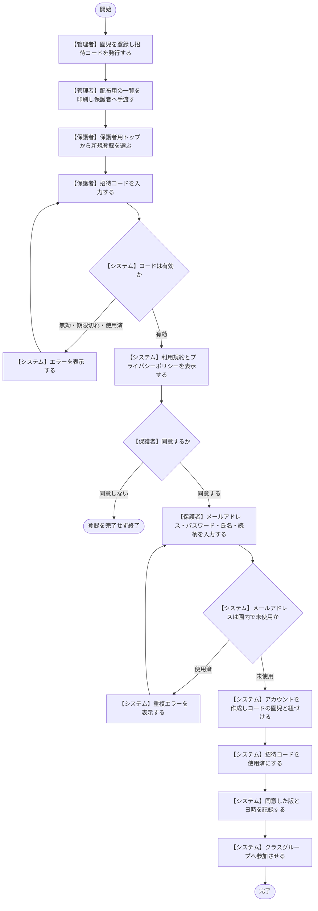

- 新規登録の導線は**保護者用トップにのみ置く**。職員用トップには置かない（「アプリのログイン」(4-1-1)）。
- **1枚のコードは1アカウントの登録にのみ使える**（4-1-2）。父母それぞれが登録する場合は、同一園児に対して必要な枚数を発行する。
- メールアドレスは**ロールをまたいで園内で一意**。職員が自児の保護者アカウントを作る場合は別のメールアドレスが必要になる（4-1-1）。
- 園は恒久パスワードを保持しない（8 No.3）。

## 2-2 ログイン

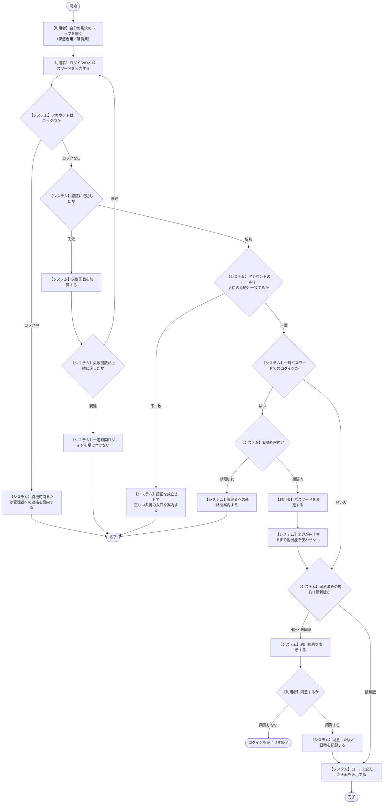

- 失敗回数・待機時間はマスタ値（4-1-1）。**管理者は待機時間の経過を待たずに即時解除できる**。
- 一時パスワードの期限切れは、**ログイン試行の制限によるロックとは区別する**。待機時間の経過では解消せず、管理者による再発行が必要（4-1-1）。
- 職員向け画面は無操作が続くと自動ログアウトする。**「ログイン情報の記憶」より自動ログアウトを優先する**（4-1-4 (4)）。
- **ロールの判定は入口ではなくアカウントで行う。** 職員用の入口から保護者アカウントではログインできず、その逆もできない（「アプリのログイン」(4-1-1)）。

## 2-3 ログアウト

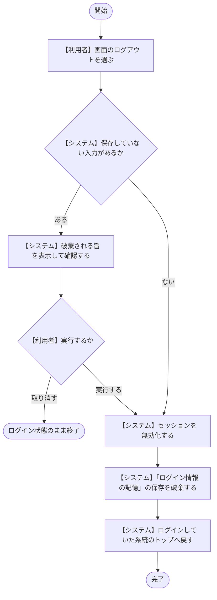

- 遷移先は**ログインしていた系統のトップ**。保護者用なら保護者用トップ、職員用なら職員用トップへ戻る（「アプリのログイン」(4-1-1)）。
- セッションの無効化は 8 セキュリティ要求 No.9「セッションの保護」と整合する。
- **ログアウトは操作ログの対象としない。** 誰が記録したかの追跡は各操作の記録（「操作ログの参照」(4-1-4 (2))）で満たされる。
- 共有端末で担当を交代する場合の起点となる。**午睡チェックの実施中は、先に「午睡チェックを終了する」を行ってからログアウトする**（「端末の利用形態と本人特定」(4-1-4 (4))、本書「午睡チェックの実施」(3-2)）。
- 無操作による自動ログアウトは別の仕組みだが、遷移先とセッションの扱いは本フローに従う。

# 3 日々の業務

## 3-1 日誌の作成から保護者への共有

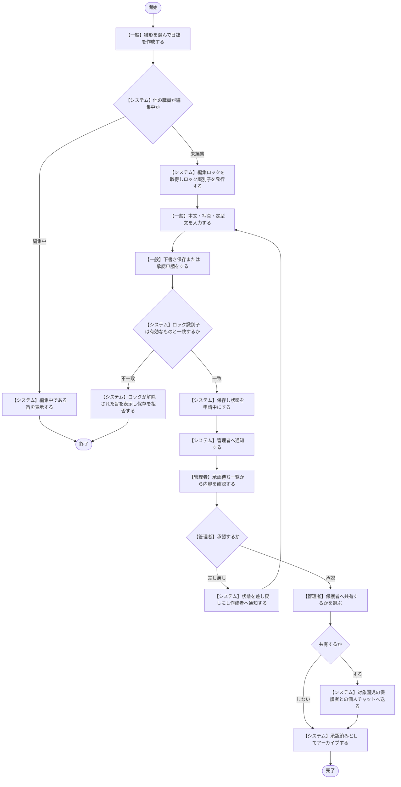

- 共有の**既定値は記録種別ごとのマスタ値**（個人日誌＝共有する、クラス日誌・週案月案・ヒヤリハット＝共有しない）。管理者が個別に変更できる（4-2 (1)）。
- 共有済みの日誌が修正された場合は、**再度の承認と共有指定を経て**改めて送られ、チャット上に「内容が更新されました」と表示される。
- 承認済みであっても**参照範囲は広がらない**。一般が閲覧できるのは自クラスの園児に紐づく日誌のみ（8 No.6）。
- 管理者による強制解除でロックが失われた場合、**他者の更新が無くても保存は拒否される**（4-1-4 (3)）。入力中の内容は画面に残す。

## 3-2 午睡チェックの実施

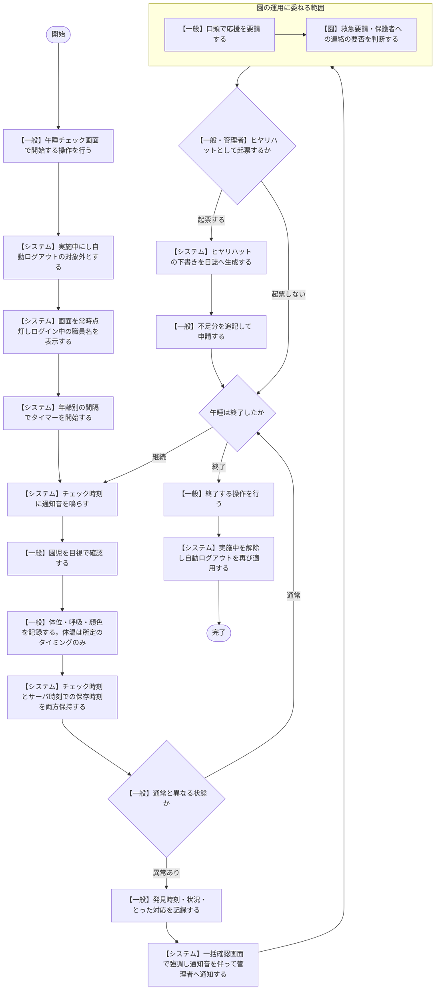

- 終了操作を忘れた場合は、**午睡の時間帯（マスタ値）の終了時刻で自動的に解除される**（4-1-4 (4)）。
- 担当を交代する場合は、実施中であっても「終了する」→ログアウト→次の職員がログイン→「開始する」の順で引き継ぐ。
- **システムは異常の有無を判定しない。** 平熱は画面に並べて表示するのみで、発熱の判定はしない（4-2 (3)）。
- **ヒヤリハットに該当するかの判定も自動起票も行わない**（4-2 (1)）。起票していない異常時の記録は一括確認画面で把握できる状態を保つ。
- 本機能は**保育士による目視確認の代替ではない**。通知が届かなかった場合も巡回で担保する（4-2 (3)）。

## 3-3 発達チェックの実施

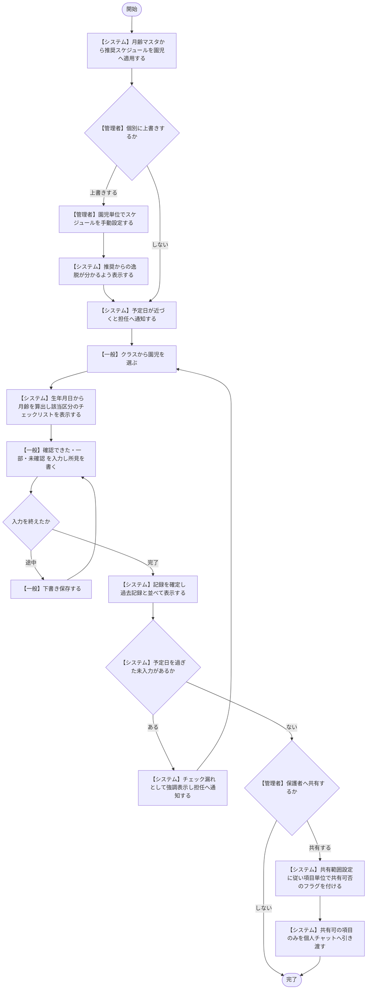

- **「未入力」と「未確認」は別の状態**として保持する。チェック漏れの対象になるのは「未入力」のみで、「未確認」は**その回に観察できなかったという事実の記録**であり評価ではない（4-2 (4)）。
- チェック項目・発達過程区分・推奨頻度はすべてマスタ。**保育所保育指針の改定にコード変更なしで追従する**（7-1 No.7）。
- **伸びの停滞・後退の可視化は行うが、判定・診断は行わない。** 判定・診断ではない旨を画面上に明示する。

## 3-4 記録の共有と保護者の閲覧

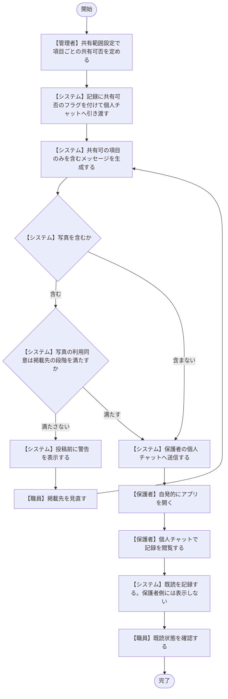

- **通知は画面内表示が基本であり、保護者がアプリを開かない限り届かない**（4-1-4 (1)）。したがって**緊急を要する連絡はこの経路に載せず、園から電話で行う**（4-2 (2)）。
- 既読が付かないことをもって、システムが再送・エスカレーションを行うことはない。未読の一覧を職員が確認できる状態までが本システムの責務。
- 写真の利用同意は3段階（園内記録／自児の保護者へ共有／他の保護者にも見える場）。**同意が未取得・不明の園児は最も狭い段階のみを許可する**（4-1-3）。

## 3-5 園児の追加紐づけ

```mermaid
flowchart TD
    S(["開始"]) --> A1["【管理者】下の子の招待コードを発行し手渡す"]
    A1 --> A2["【保護者】ログイン済みの状態で招待コードを入力する"]
    A2 --> D1{"【システム】コードは有効か"}
    D1 -->|無効| A3["【システム】エラーを表示する"]
    A3 --> A2
    D1 -->|有効| A4["【システム】コードの園児をアカウントへ紐づける"]
    A4 --> A5["【システム】当該園児のクラスグループへ参加させる"]
    A5 --> A6["【システム】自児の範囲に加える"]
    A6 --> E(["完了"])
```

- **紐づけの解除は管理者のみが行える**（誤入力・親権の変更に対応）。解除は操作ログに記録する（4-1-2）。

# 4 管理業務

## 4-1 年度更新

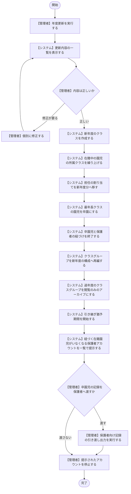

- **引き継ぎ猶予期間**は年度更新の実行日を起点とする。期間中、前担任は前年度に担任していたクラスの在籍園児の記録を**閲覧のみ**できる（4-1-2）。
- 卒園児は在籍していないため、猶予期間中も参照の対象に含めない。
- **個人チャットへ添付して渡す場合は、紐づけの終了前に行う**（4-1-3）。

## 4-2 アカウントの発行

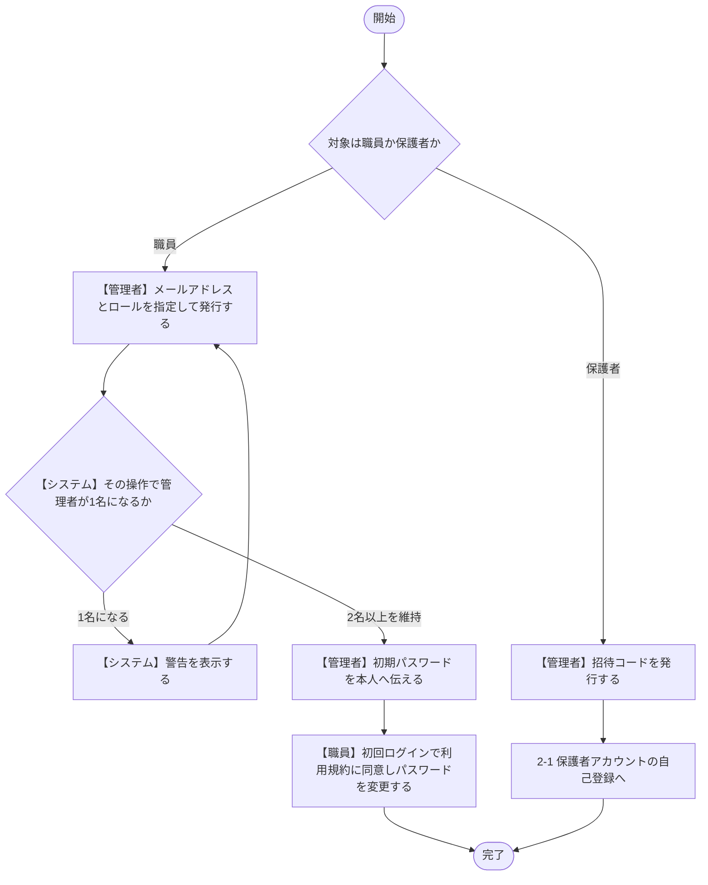

## 4-3 アカウントの停止

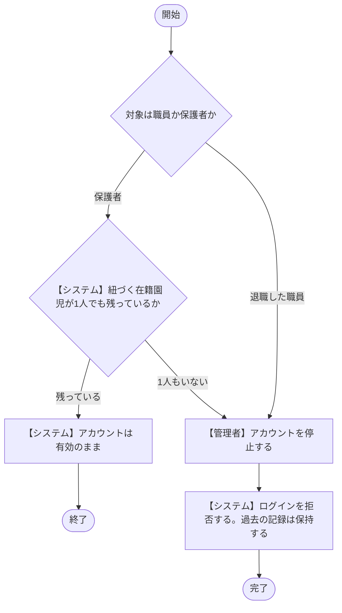

- **管理者ロールは常に2名以上**とすることを運用要件とする。管理者が1名になる操作（停止・削除・ロールの変更）にはシステムが警告を出す（4-1-1）。
- 停止したアカウントはログインできないが、**過去の記録は保持する**（4-1-2、7-3）。

## 4-4 パスワードの再設定

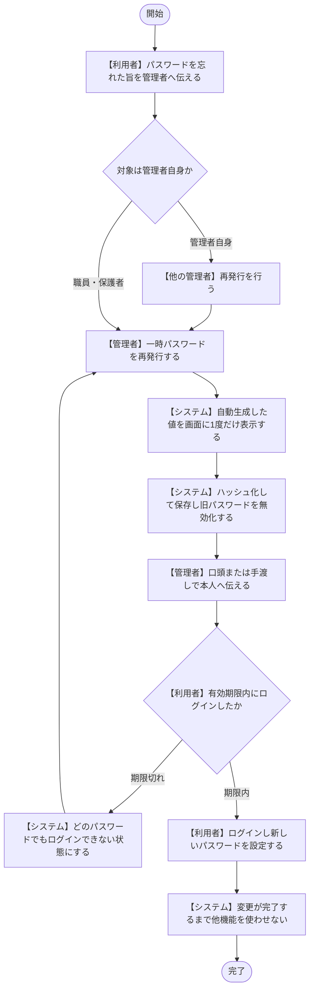

- 一時パスワードは**再表示・再閲覧の手段を持たない**。伝え損ねた場合は再発行からやり直す（4-1-1）。
- **管理者が1名しか存在しない状態でその管理者が失念した場合、システム上の復旧手段はない。** 管理者2名以上の運用で回避する。

## 4-5 監査（実地指導）への対応

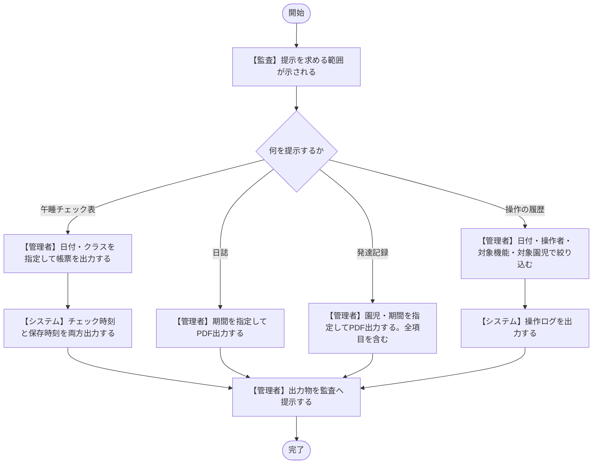

- 午睡チェック記録は**サーバ時刻を記録時刻とし、修正は上書きせず履歴を残す**。削除は行わない（4-2 (3)）。
- 操作ログは**追記のみ**で、画面からの編集・削除の手段を持たない（4-1-4 (2)）。
- 発達記録のPDF出力は**園内利用が前提で、共有範囲設定にかかわらず全項目を含む**。保護者へ渡す出力は共有可の項目のみを含む別の機能（4-2 (4)、4-1-3）。

# 5 要件定義書との対応

| 本書の節 | 要件定義書の該当箇所 |
| :-- | :-- |
| 2-1 保護者アカウントの自己登録 | 4-1-1、4-1-2 |
| 2-2 ログイン | 4-1-1、4-1-4 (4) |
| 3-1 日誌の作成から保護者への共有 | 4-2 (1)、4-1-4 (1)(3) |
| 3-2 午睡チェックの実施 | 4-2 (3)、4-1-4 (1)(4)、4-2 (1)（ヒヤリハット起票） |
| 3-3 発達チェックの実施 | 4-2 (4) |
| 3-4 記録の共有と保護者の閲覧 | 4-2 (1)(2)(4)、4-1-3（写真の利用同意） |
| 3-5 園児の追加紐づけ | 4-1-2 |
| 4-1 年度更新 | 4-1-3、4-1-2、4-2 (2) |
| 4-2 アカウントの発行 | 4-1-1、4-1-2 |
| 4-3 アカウントの停止 | 4-1-2、7-3 |
| 4-4 パスワードの再設定 | 4-1-1 |
| 4-5 監査への対応 | 4-1-4 (2)、4-2 (1)(3)(4) |

# 6 本書で扱っていないフロー

以下は要件として定義済みだが、分岐が単純で図示の必要が薄いか、他のフローに内包されるため独立した図にしていない。基本設計の段階で必要になれば追加する。

| フロー | 扱い |
| :-- | :-- |
| 園児情報のCSV一括登録 | 取込前の確認とエラー行の一覧表示という単純な流れ。4-1-3 の本文で足りる |
| 誤送信への対応 | 削除→既読の有無の確認→対応の記録という流れ。判断はすべて園が行うため、システム側の分岐がない（4-2 (2)） |
| 編集ロックの強制解除 | 3-1 のロック識別子の照合に内包される |
| 未対応スレッドの処理 | 状態の切り替えのみ。担当者の割り当てはシステムで行わない（4-2 (2)） |
| 利用規約の改定と再同意 | 2-2 ログインの分岐に内包される |
