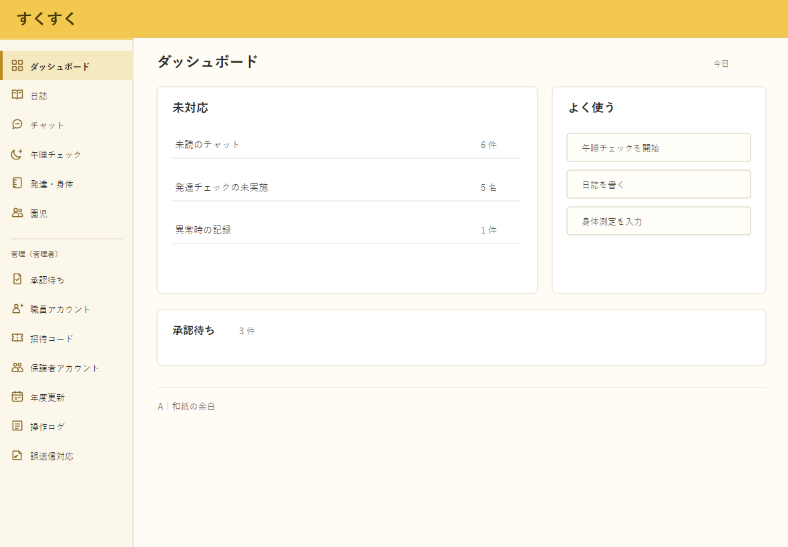
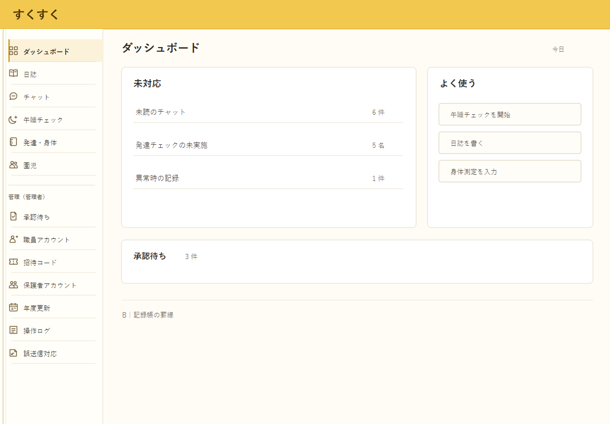
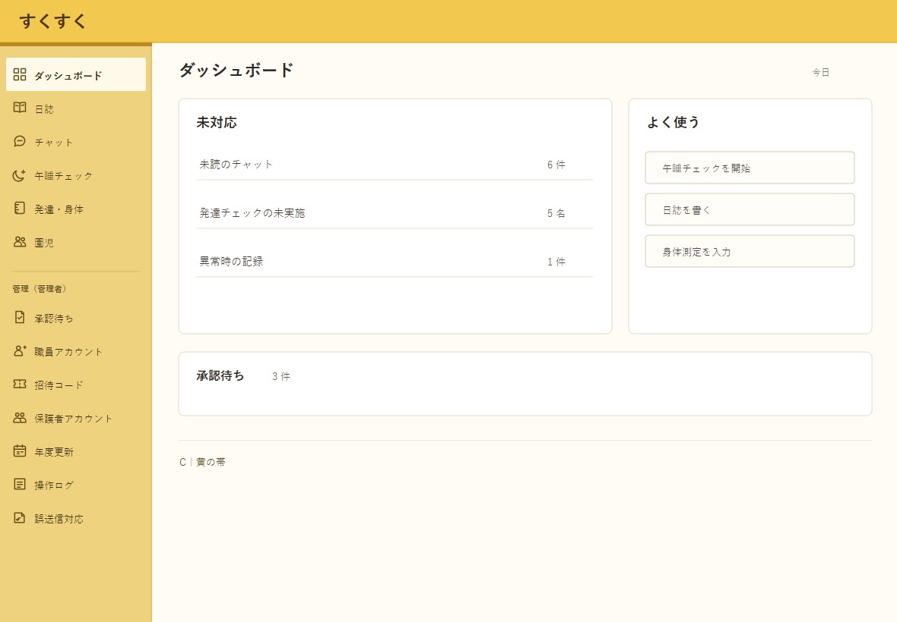
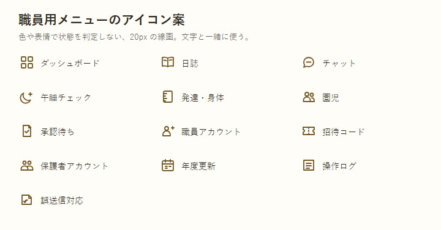

# すくすく 職員用サイドバー素材案

| 項目 | 内容 |
| :-- | :-- |
| 状態 | 比較用の3案。モックアップへの適用は未実施 |
| 作成日 | 2026-10-06 |
| 対象 | ログイン後の職員用サイドバー。保護者画面はサイドバーを持たず、別のメニューを使う |
| 前提 | ログイン背景は選定済みの「A：和紙」。ワンポイントのマークは含めない |

## A：和紙の余白

ログイン背景から淡い色だけを引き継ぐ。選択中の行を薄い黄色の面と左端の細線で示す。長い管理メニューを読んでも背景が主張しにくい。

## B：記録帳の罫線

記録帳のように項目を細い罫線で区切る。項目の境目が分かりやすい一方、線が増えて少し硬い印象になる。

## C：黄の帯

サイドバー全体を黄色の面とし、選択中の行を白に近い色で抜く。場所は一目で分かるが、情報が多い画面では黄色が強く見える可能性がある。

## 共通アイコン案

ダッシュボード、日誌、チャット、午睡チェック、発達・身体、園児と、管理者用の7項目にそれぞれ対応する。SVG の元データは [`アイコンセット.svg`](デザイン案/サイドバー素材/アイコンセット.svg)。すべて線画で、状態や園児の評価を表情・色で示さない。意味は必ず文字ラベルと一緒に伝える。

## 適用するとき

- 3案はいずれも現在のメニュー名と並び、PC・タブレット横向きでの幅200pxを保った静止画。採用案が決まってから実画面へ適用する。
- 選択状態は背景色だけに頼らず、太さ・線・位置でも分かるようにする。
- タブレット縦向きで文字が詰まらないか、管理者用メニューの最下部まで操作できるかを確認する。
- 背景やアイコンは午睡チェックの警告、発達チェックの記録値を装飾しない。
