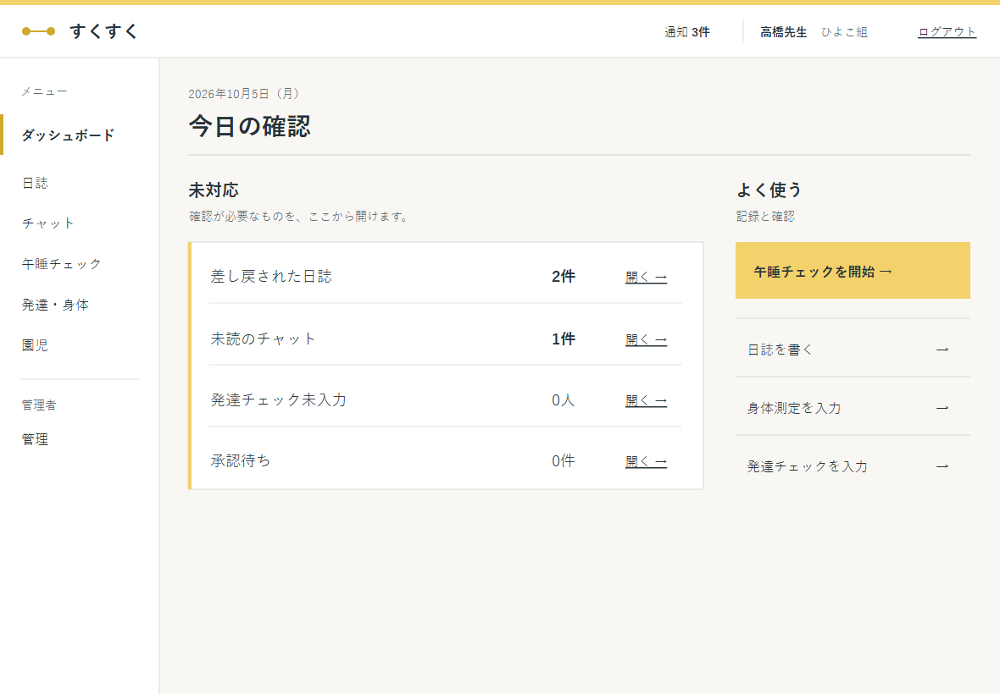
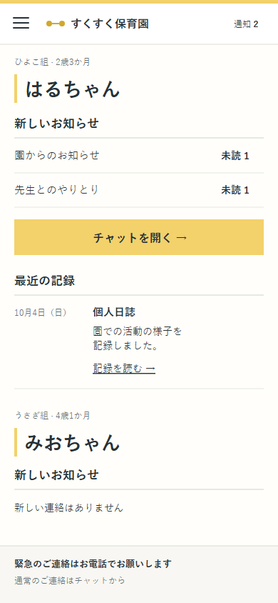

# すくすくシステム デザインアーキテクチャ案

| 項目 | 内容 |
| :-- | :-- |
| 状態 | チーム確認用のたたき台。要件・基本設計の確定事項は変更しない |
| 作成日 | 2026-10-05 |
| 改訂日 | 2026-10-05。GitHub Issue #72 を受け、初稿の均等なカード配置と飾りの線画を見直した |
| 対象 | 職員ダッシュボード、保護者ホームを起点とする全画面の視覚表現 |
| 典拠 | `README.md`「背景・コンセプト」「設計原則」、`要件定義書.md`「コンセプトとターゲット層」(1-1)、`基本設計書.md`「画面基本構成」(3-5)、`図/画面詳細図.md`「共通レイアウト」(1)・「職員ダッシュボード」(2-6)・「保護者ホーム」(2-7) |

## ねらい

**「つながる線」「記録帳」「作業台」を1つの仕組みとして扱う。** 保護者と保育士に共通する色・文字・アイコンを持ち、見ることが中心の画面には記録帳の読みやすさ、入力と確認が中心の画面には作業台の素早さを適用する。「つながる線」はサービス名の脇にある小さな印に留める。園児の情報や写真より目立つ装飾にはしない。

初稿の画面見本は、**同じ大きさの角丸カードを繰り返し、意味のない曲線を飾ったため、実際の連絡や作業から離れた見た目になった。** 改訂版では未対応を行の一覧にし、保護者の記録は日付・種類・本文の順に読む構成へ変えた。黄色を画面全面に敷かず、現在地と主な操作に絞る。

| 層 | 共通するもの | 職員向け | 保護者向け |
| :-- | :-- | :-- | :-- |
| ブランド | 優しい黄色、2点をつなぐ小さな印、同じアイコンの意味 | 現在地と主な操作に使う | サービス名と主な操作に使う |
| 情報 | 日付、園児名、共有状態、行き先を文字で示す | 件数と操作を先に置く | 園児ごとの記録と連絡を先に置く |
| 画像 | UI素材と園児写真を分離する | 業務中の挿絵を抑える | 写真がある記録では写真を主役にする |
| 操作 | 44×44px以上の操作領域と明確なラベル | 12カラム、サイドナビ | シングルカラム、メニュー |

## 視覚ルール

### 色

次の具体値は**画面案を比較するための仮値**であり、確定した設計値ではない。既存モックアップの `web/src/styles/tokens.css` とは異なる候補色を試している。採用時は `web/仮置き値.md` の扱いを確認し、実画面で文字の読みやすさを検証する。

| 役割 | 仮の色 | 使い方 |
| :-- | :-- | :-- |
| 主色 | `#F3D16B` | 画面上端の細い線、主要ボタン、現在地。黄色の上の文字は濃い色にする |
| 地の色 | `#F8F7F3` | 職員画面の背景。情報のある面は白で分ける |
| 保護者画面の背景 | `#FFFEFA` | 記録を読む面。区切りは細い線で示す |
| 本文 | `#263238` | 日付、園児名、本文、ボタン名 |
| 警告 | 既存設計の警告色を使用 | 午睡の異常・エラーなど、対処が必要な情報に使う。今回の見本には警告状態を含めない |

黄色を「安心」「正常」の判定には使わない。警告は色だけに依存せず、対象・状態・必要な操作を文字で示す。日誌の下書き・申請・差し戻し・承認済みも、色と状態名を一緒に表示する。

### 形・文字・アイコン

- すべての情報をカードに入れない。職員の未対応は**1行に1件の一覧**、保護者の記録は**日付を添えた段落**で表す。区切り線と余白で関係を示す。
- 角丸、影、背景模様を装飾として重ねない。ボタンと情報の領域を、色だけでなく位置と文字で区別する。
- アイコンは同じ太さの線画で統一する。意味が必要な操作には「チャットを開く」「日誌を書く」などの文字を添える。アイコンだけの操作は共通ヘッダのメニュー・通知などに限る。
- 「つながる線」はサービス名の脇の小さな印に使う。園児の写真、入力欄、件数、警告の上には重ねない。空の状態も、まず「新しい連絡はありません」のような文で示す。
- 装飾的な子どもの絵は年齢・性別・発達段階を推測させる記号として使わない。発達チェックの結果を表情や色で評価しない。

## 画像素材の構成

| 種類 | 用途と配置 | 管理・表示 |
| :-- | :-- | :-- |
| ブランドの線画 | サービス名の脇に置く「2点をつなぐ線」の小さな印 | アプリに同梱する共通素材。空の状態や業務画面を無理に絵で埋めない |
| 機能アイコン | 日誌、チャット、午睡、発達、園児管理、通知 | 同じ意味に同じ絵を使い、文字ラベルを併記する |
| 園児が写る写真 | 日誌とチャットの添付 | UI素材と混ぜず、`基本設計書.md`「添付ファイルの実体の保存先」(5-5) の権限判定を経て配信する。共有された記録のみ保護者に見せる |
| 画面画像 | 設計・提出用の実画面 | `図/画面画像/` で管理し、実装が変われば撮り直す（`図/画面詳細図.md`「表記ルール」(0-1)） |

写真がない記録でも、日付・本文・記入者・共有状態だけで読める構成にする。挿絵で写真の不在を補う必要はない。写真の利用同意は `要件定義書.md`「写真の利用同意」(4-1-3) に従い、掲載先の段階を超えるときは既存の警告を表示する。

## 代表画面案

以下は**表示順と視線の流れを確かめるワイヤーフレーム**であり、新しい機能や画面の追加案ではない。項目と動作は `図/画面詳細図.md` の各画面定義を優先する。

画面見本はこの案の色と配置を可視化した**静的な試作**であり、現在のモックアップ画面の撮影画像ではない。園児名・件数・日付は説明用の例である。編集可能な元データは同じ `図/デザイン案/` の SVG、閲覧用は PNG とする。

### 職員ダッシュボード：作業台



この画像は**管理者がログインした場合の例**である。

```text
┌ すくすく ───────────── 通知 3件 ─ ○○先生／ひよこ組 ─ ログアウト ┐
│ ダッシュボード │ 10月5日（月）  今日の作業                         │
│ 日誌           │ ┌ 未対応 ───────────────────────────────┐ │
│ チャット       │ │ 差し戻された日誌 2件 → 日誌一覧       │ │
│ 午睡チェック   │ │ 未読のチャット   1件 → チャット       │ │
│ 発達・身体     │ │ 発達チェック未入力 0人               │ │
│ 園児           │ └────────────────────────────────────────┘ │
│ 管理※         │ よく使う                                   │
│                │ [午睡チェックを開始] [日誌を書く]            │
│                │ [身体測定を入力]                           │
└────────────────┴────────────────────────────────────────────┘
※「管理」と「承認待ち」は管理者にだけ表示する。
```

- 未対応の件数を最上部に置く。0件は警告の見た目にしない。「本日の発達チェック未実施」は**未入力のみ**を数え、未確認を含めない。
- 主要な操作は大きいボタンで示す。午睡チェックのタイマーと異常表示は、この画面の装飾ルールより視認性を優先する。
- 未対応の各項目から該当画面へ進む。ヘッダの通知は総件数のみ示し、詳細な行き先はダッシュボードが持つ。

### 保護者ホーム：記録帳



```text
┌ メニュー ─ すくすく保育園 ─ 通知 2件 ┐
│ ○○ちゃん  2歳3か月／ひよこ組        │
│ ┌ 新しいお知らせ ────────────────┐ │
│ │ 園チャット 1件・個人チャット 1件 │ │
│ │ [チャットを開く]                │ │
│ └─────────────────────────────────┘ │
│ 最近の記録                         │
│ ┌ 10月4日（日） 個人日誌 ─────────┐ │
│ │ 活動の様子…  [記録を開く]       │ │
│ └─────────────────────────────────┘ │
│ （きょうだいがいる場合は次の園児の区画）│
│ 緊急のご連絡はお電話でお願いします   │
└──────────────────────────────────────┘
```

- 園児の区画を縦に並べ、きょうだいを切り替え式にしない。表示する記録は、その時点で共有が許可されたものに限る。
- 新しいお知らせはチャットへの導線とし、共有された日誌は専用の閲覧画面へ進む。写真はその閲覧画面で本文とともに表示する。
- 緊急連絡の電話案内は常時見える位置に置く。未読表示は保護者に見せるが、メッセージの既読人数は表示しない。

## 4つの機能への適用

| 機能 | 適用する表現 | 避ける表現 |
| :-- | :-- | :-- |
| 日誌システム | 日付で区切る記録帳、共有写真、状態名付きの印 | 写真がない記録を劣って見せる装飾 |
| チャットツール | 送信者・時刻・共有記録の行き先を明確にする | 会話の流れを遮る大きな挿絵 |
| 午睡チェック | 時刻と未記録の対象を最優先にする | 警告をかわいい絵や黄色だけで示すこと |
| 発達チェック | 記録の推移と入力状態を文字・数値で示す | 子どもの発達を絵で優劣判定すること |

## 確認ポイント

1. 職員がダッシュボードを開いて、未対応と次の操作を迷わず見つけられるか。
2. 保護者が自児の記録とチャットの入口を見つけ、きょうだいの情報を取り違えないか。
3. 写真がない状態、複数の園児がいる状態、通知が0件の状態でも画面が成立するか。
4. 黄色・警告色・状態色を使わなくても、文字と形で情報を読めるか。
5. 実装前に具体色と素材のライセンスを確認し、実画面で文字と操作領域を検証できるか。

## 次の段階

- 本案の方向をチームで確認する。確定した内容だけを `基本設計書.md`「画面基本構成」(3-5) と `図/画面詳細図.md` の該当画面へ反映する。
- 職員ダッシュボードと保護者ホームの試作画面を作り、実際の文言・件数・写真あり／なし・きょうだいありを並べて比較する。
- 採用したアイコン・挿絵の元データ、権利関係、代替テキストを一覧化する。
