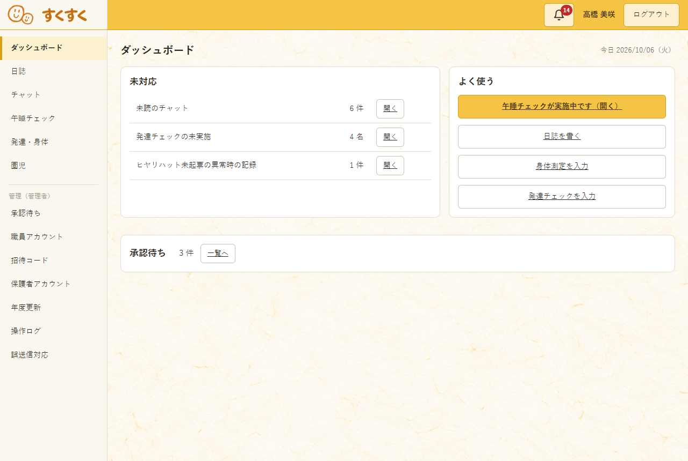
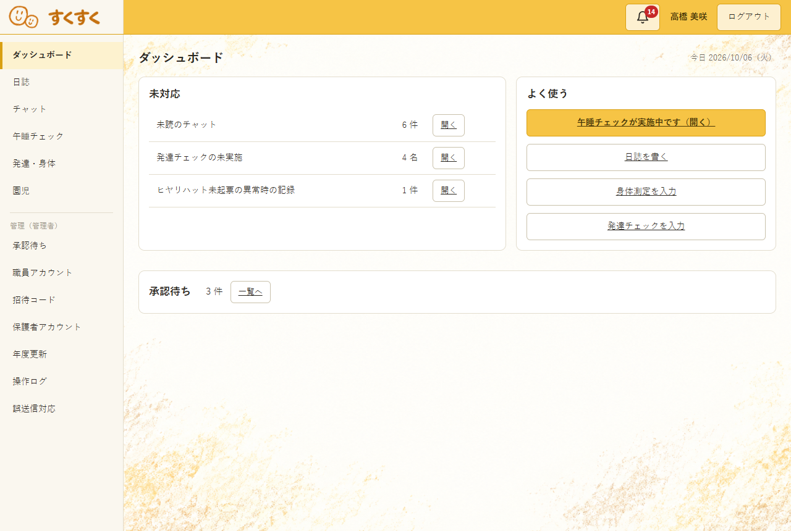
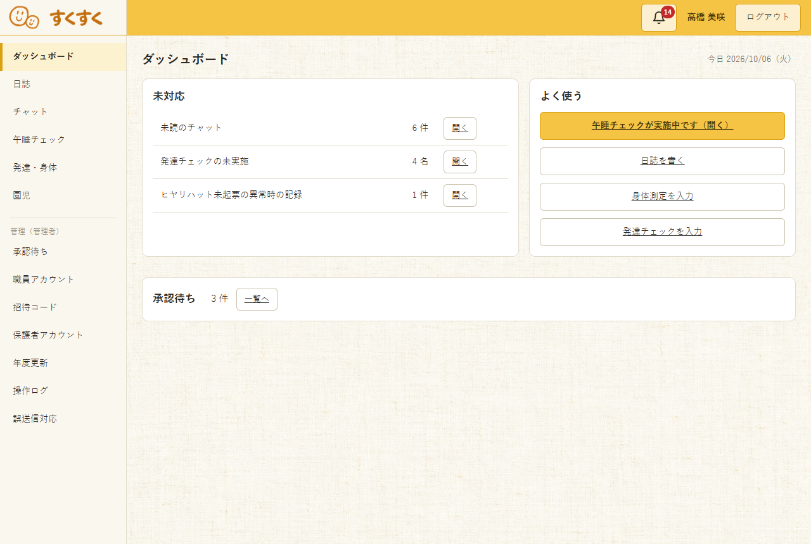

# すくすく ログイン後のボディ背景案

| 項目 | 内容 |
| :-- | :-- |
| 状態 | **A・B・C の比較用。未選定・未実装** |
| 作成日 | 2026-10-06 |
| 対象 | ログイン後の職員画面の本文領域と、保護者画面の本文領域 |
| 前提 | 白いカードと文字の読みやすさを保つ。ヘッダーとサイドバーには敷かない |

## A：淡い和紙

[保護者画面での表示](デザイン案/ボディ背景/A_適用例_保護者.png) ／ [背景素材](デザイン案/ボディ背景/A_淡い和紙.png)

ログイン画面の和紙背景とつながるが、本文で長時間使うため色と模様を大幅に薄くした案。

## B：クレヨンの縁

[保護者画面での表示](デザイン案/ボディ背景/B_適用例_保護者.png) ／ [背景素材](デザイン案/ボディ背景/B_クレヨンの縁.png)

クレヨン調の見出しと印に合わせ、背景の四隅だけに薄い粒子を置いた案。中央はほぼ無地。

## C：布目

[保護者画面での表示](デザイン案/ボディ背景/C_適用例_保護者.png) ／ [背景素材](デザイン案/ボディ背景/C_布目.png)

全体に細い織り目が見える案。最も均一だが、画面全体で質感が続く。

## 比較時の確認

- 3案とも文字・人物・アイコン・カードを含まない背景素材。職員ダッシュボード（1280×860px）と保護者ホーム（390×844px）の本文領域へ一時的に敷いて、実画面の表示を撮影した。
- プレビューではカードの背景色と、ヘッダー・サイドバーの色は変更していない。実装コードは変更していない。
- 実際に採用する案が決まったら、スクロールする画面や入力画面でも、文字の読みやすさと背景の表示方法を確かめる。
