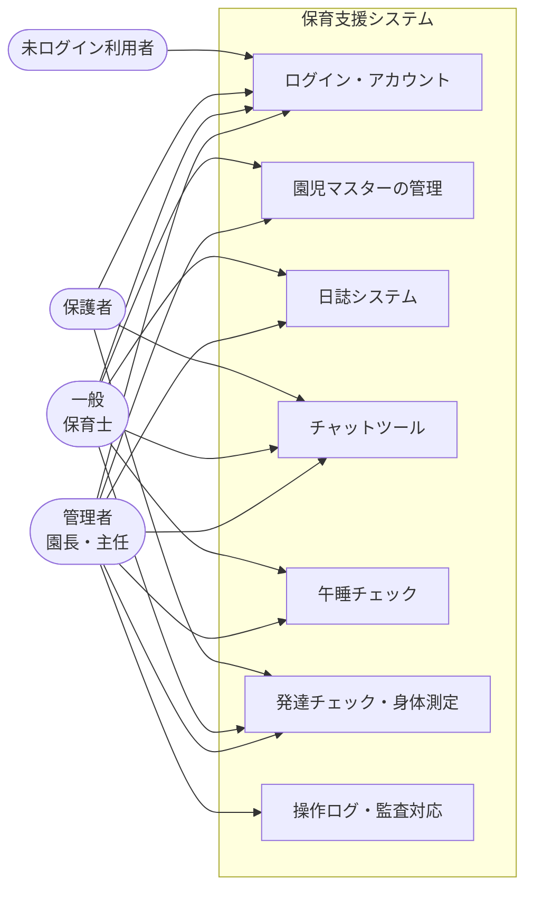
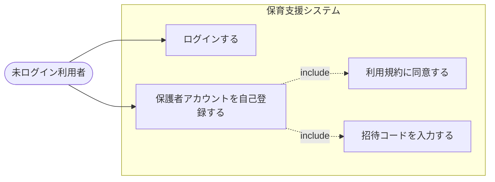
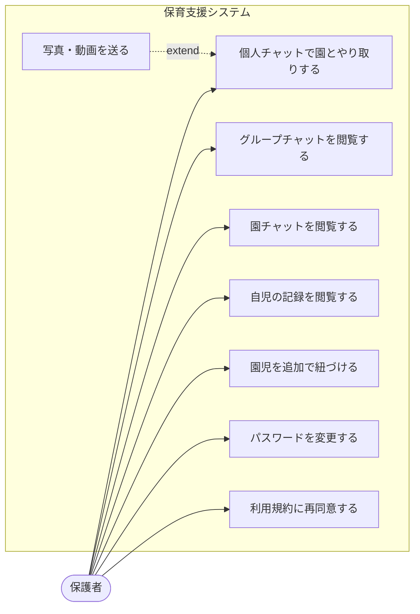
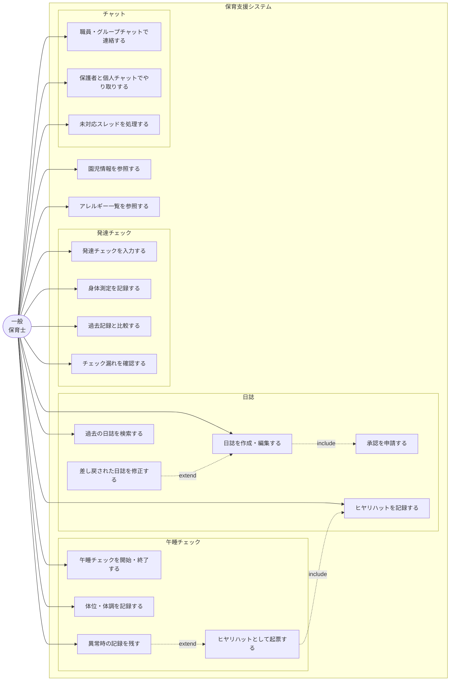
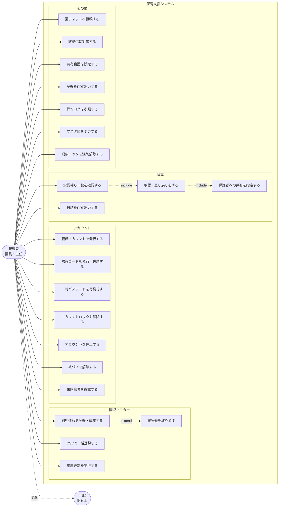

# 保育支援システム ユースケース図

| 項目 | 内容 |
| :-- | :-- |
| 対象システム | 保育支援システム（すくすくシステム） |
| 版数 | 第 1.0 版 |
| 作成日 | 2026 年 8 月 4 日 |
| 典拠 | `HFD_要件定義書02_レビュー編集済み.md` 第1.7版 |
| 作成区分 | チーム開発演習 基本設計 |

## 改訂履歴

| 版 | 日付 | 変更内容 |
| :-: | :-: | :-- |
| 1.0 | 2026/08/04 | 新規作成。全体要件定義書 第1.7版の機能表・権限表から、利用者種別ごとにユースケースを抽出 |

# 0 本書の位置づけ

- 本書は**利用者種別ごとに「誰が何をできるか」を示す図**である。各ユースケースの処理手順は `図/アクティビティ図.md` が、扱うデータは `図/ER図.md` が、画面の項目は画面詳細図（未作成）が保持する。
- ユースケースの粒度は、**要件定義書 4-1・4-2 の機能表の1行**を基本単位とする。表に無い操作を本書で新たに起こすことはしない。
- 全体要件定義書と本書の記述が食い違った場合は、**全体要件定義書を正とし、本書を追随させる。**

## 0-1 アクターの定義

| アクター | 対応するロール | 備考 |
| :-- | :-- | :-- |
| 管理者 | 管理者（園長・主任） | 一般の全操作に加え、承認・アカウント発行・全クラス参照ができる |
| 一般 | 一般（保育士） | 扱えるのは**自クラスの園児に限る**（8 セキュリティ要求 No.6） |
| 保護者 | 保護者 | 自児のみを対象とし、閲覧に限る（個人チャットの送受信を除く） |
| 未ログイン利用者 | ― | ログインと、招待コードによる保護者アカウントの自己登録のみ行える |

- **ロールはアカウントに固定される。** 職員が自児の保護者としてシステムを使う場合は、別のアカウントでログインし直して「保護者」アクターとして操作する（4-1）。
- 管理者は一般のユースケースをすべて包含する（汎化）。以降の図では、管理者固有のユースケースのみを管理者の図に示す。

# 1 システム全体のユースケース

アクターと機能領域の関係を示す。

- 保護者が発達チェック・身体測定に線を持つのは、**共有可に設定された記録を個人チャット経由で閲覧する**ためであり、入力は行わない（4-2 (4)）。
- 一般が園児マスターに線を持つのは**参照のみ**。登録・編集は管理者が行う（4-1-3）。
- 操作ログの参照は管理者のみ（4-1-4 (2)）。

# 2 未ログイン利用者

| ユースケース | 内容 | 典拠 |
| :-- | :-- | :-- |
| ログインする | ログインID（メールアドレス）とパスワードで認証する。連続して失敗するとロックされる | 4-1-1 |
| 保護者アカウントを自己登録する | 招待コードを入力し、ログインID・パスワード・氏名・続柄を登録する。コードに紐づく園児と自動的に紐づけられる | 4-1-2 |
| 利用規約に同意する | 登録時に利用規約とプライバシーポリシーを表示し、同意を得る。**同意しない場合は登録を完了しない** | 4-1-1 |

- 未ログイン状態で閲覧できる情報は持たない。ログイン画面がトップページを兼ねる（4-1-1）。

# 3 保護者

| ユースケース | 内容と制約 | 典拠 |
| :-- | :-- | :-- |
| 個人チャットで園とやり取りする | 園（職員）との1対1の連絡。**既読状態は保護者側に一切表示しない** | 4-2 (2) |
| グループチャットを閲覧する | **閲覧のみ（投稿不可）。現在所属しているグループのみ**参照でき、過年度のクラスグループは参照できない | 4-2 (2) (c) |
| 園チャットを閲覧する | 園全体のお知らせ。閲覧のみ | 4-2 (2) |
| 自児の記録を閲覧する | 共有された日誌、共有可に設定された発達記録・身体測定・成長グラフを個人チャット上で閲覧する。**自児のみ** | 4-2 (1)(4) |
| 写真・動画を送る | **個人チャットのみ**。グループチャット・園チャットには投稿できない | 4-2 (2) |
| 園児を追加で紐づける | 兄弟姉妹の招待コードを入力し、自身のアカウントに紐づける。**紐づけの解除は管理者のみ** | 4-1-2 |
| パスワードを変更する | 一時パスワードでのログイン後は、変更を完了するまで他の機能を利用できない | 4-1-1 |
| 利用規約に再同意する | 規約の改定後、次回ログイン時に求められる。**同意しない場合はログインを完了しない** | 4-1-1 |

**保護者が行えないこと（明示）**

- 記録の入力・編集（すべて閲覧のみ）
- グループチャット・園チャットへの投稿
- 既読状態の確認（職員のみが利用できる）
- 過年度のクラスグループの過去ログ参照
- 緊急連絡の受信 … **本システムは緊急連絡の到達手段ではない。** 緊急時は園から電話で連絡する（4-2 (2)）

# 4 一般（保育士）

| ユースケース | 内容と制約 | 典拠 |
| :-- | :-- | :-- |
| 日誌を作成・編集する | 雛形（クラス日誌・個人日誌・週案月案・ヒヤリハット）から呼び出して入力する。**1件の日誌を編集できるのは1人**（編集ロック） | 4-2 (1)、4-1-4 (3) |
| 承認を申請する | 作成後に承認申請を行う。申請は管理者へ通知される | 4-2 (1) |
| 差し戻された日誌を修正する | 差し戻された日誌は自身の一覧に表示される | 4-2 (1) |
| ヒヤリハットを記録する | 記録種別のひとつ。**原因の判定・過失の評価はシステムが行わない** | 4-2 (1) |
| 過去の日誌を検索する | 日付・クラス・園児名・キーワードで検索する。**参照できるのは自クラスの園児に紐づく日誌のみ** | 4-2 (1) |
| 午睡チェックを開始・終了する | 明示的な開始・終了の操作。実施中は自動ログアウトの対象外となる | 4-1-4 (4) |
| 体位・体調を記録する | 体位、呼吸、顔色、体温を記録する。**平熱との比較は表示のみで、発熱の判定はしない** | 4-2 (3) |
| 異常時の記録を残す | 発見時刻・状況・対応を記録する。**通知音を伴って管理者へ通知される** | 4-2 (3) |
| ヒヤリハットとして起票する | 異常時の記録から日誌のヒヤリハットの下書きを生成する。**起票するかどうかは人が判断する** | 4-2 (1) |
| 発達チェックを入力する | 月齢に応じた区分のチェックリストに、確認できた／一部／未確認を入力する。下書き保存ができる | 4-2 (4) |
| 身体測定を記録する | 測定日・身長・体重を記録する | 4-2 (4) |
| 過去記録と比較する | 同一園児の過去チェック結果を時系列で並べる。**判定・診断ではない旨を画面に明示する** | 4-2 (4) |
| チェック漏れを確認する | 実施予定日を過ぎて**未入力**の項目・園児を強調表示する（「未確認」は対象外） | 4-2 (4) |
| 職員・グループチャットで連絡する | 職員チャット、クラスグループ、目的別グループで送受信する | 4-2 (2) |
| 保護者と個人チャットでやり取りする | 未対応／対応済みの状態を切り替える。**既読確認は職員のみ利用できる** | 4-2 (2) |
| 未対応スレッドを処理する | 未対応を上位に表示し、クラス・園児名で絞り込む。**担当者の指定はシステムでは行わない** | 4-2 (2) |
| 園児情報を参照する | **閲覧のみ。登録・編集は管理者が行う**（園児マスターは 4-1-3 に一本化） | 4-1-3 |
| アレルギー一覧を参照する | **全園児を参照できる（8 No.6 の例外）。** 表示項目は氏名・クラス・アレルギー情報に限る | 4-1-3 |

**参照範囲の原則**

- アレルギー情報を除き、**扱えるのは自クラスの園児に限る**。判定は園児単位で行い、**現在の担任クラスに在籍する園児であれば過年度の記録も参照できる**（4-1-2）。
- 年度更新の直後は**引き継ぎ猶予期間**があり、前年度に担任していたクラスの在籍園児の記録を**閲覧のみ**できる（4-1-2）。
- グループチャットの過去ログだけは判定軸が異なり、「そのグループに所属していたか」で判定する（4-2 (2) (c)）。

# 5 管理者（園長・主任）

一般のユースケースをすべて含む。ここでは**管理者固有のもの**を示す。

| ユースケース | 内容 | 典拠 |
| :-- | :-- | :-- |
| 職員アカウントを発行する | ロール（管理者／一般）を付与して発行する。**管理者は常に2名以上とする運用要件**があり、1名になる操作には警告が出る | 4-1-2、4-1-1 |
| 招待コードを発行・失効する | 園児ごとに必要枚数を発行する（1枚＝1アカウント）。クラス単位の一括発行と配布用の印刷に対応 | 4-1-2 |
| 一時パスワードを再発行する | 発行画面で1度だけ表示し、口頭または手渡しで伝える。**再発行と同時に旧パスワードが無効になる** | 4-1-1 |
| アカウントロックを解除する | 待機時間の経過を待たずに即時解除する。**管理者自身のロックは他の管理者が解除する** | 4-1-1 |
| アカウントを停止する | 退職した職員、および**紐づく在籍園児がいなくなった保護者**のアカウントを停止する | 4-1-2 |
| 紐づけを解除する | 誤入力・親権の変更により、保護者アカウントと園児の紐づけを解除する | 4-1-2 |
| 未同意者を確認する | 規約改定後にまだ同意していない利用者を一覧で確認する | 4-1-1 |
| 園児情報を登録・編集する | 氏名・生年月日・性別・クラス・アレルギー・既往歴・平熱・写真の利用同意を登録する | 4-1-3 |
| CSVで一括登録する | 導入時・入園時に一括登録する。**アレルギー・既往歴は取込対象に含めない** | 4-1-3 |
| 年度更新を実行する | クラスの繰り上げ、卒園処理、**クラスグループの再編**、停止対象アカウントの提示を行う | 4-1-3 |
| 誤登録を取り消す | **記録が1件も紐づいていない場合に限り**実行できる。在籍の終了は在籍状態の変更で行う | 4-1-3 |
| 承認待ち一覧を確認する | 申請日・クラス・作成者とともに一覧で確認する | 4-2 (1) |
| 承認・差し戻しをする | 内容を確認し、承認または修正差し戻しを行う。結果は作成者へ通知される | 4-2 (1) |
| 保護者への共有を指定する | 承認画面で「共有する／しない」を選ぶ。**既定値は記録種別ごとのマスタ値** | 4-2 (1) |
| 日誌をPDF出力する | 監査提出用に、指定期間の日誌を出力する | 4-2 (1) |
| 園チャットへ投稿する | 園全体のお知らせ。**投稿・編集できるのは管理者のみ** | 4-2 (2) |
| 誤送信に対応する | メッセージを削除し、**既読になっていたかを確認**して対応を記録する。漏えいの該当性はシステムが判断しない | 4-2 (2) |
| 共有範囲を設定する | 発達チェック項目ごとに保護者への共有可否をチェックリストで設定する | 4-2 (4) |
| 記録をPDF出力する | **園内利用（全項目）と、卒園時の保護者向け引き渡し（共有可のみ）の2種類**がある | 4-2 (4)、4-1-3 |
| 操作ログを参照する | 日付・操作者・対象機能・対象園児で絞り込む。監査で求められた範囲を出力する | 4-1-4 (2) |
| マスタ値を変更する | チェック頻度・通知間隔・添付上限・保持年数などを、コード変更なしで変更する | 7-1 No.7 |
| 編集ロックを強制解除する | ロックが残った日誌のロックを解除する。**解除された編集者の保存は拒否される** | 4-1-4 (3) |

# 6 システムが行わないこと

要件定義書の最重要設計原則にあたる部分であり、ユースケースとして**存在しない**ことを明示する。

| 領域 | システムが行わない判断 | 誰が行うか | 典拠 |
| :-- | :-- | :-- | :-- |
| 発達チェック | 発達の遅速の判定、医療的診断、療育要否の判断 | 保育士・園（必要に応じて医療機関） | 4-2 (4)、7-1 No.5 |
| 身体測定 | 肥満・やせ等の発育の良否判定 | 同上 | 7-1 No.5 |
| 午睡チェック | 平熱との差による発熱の判定、異常の有無の判定、救急要請・保護者連絡の要否 | 保育士・園の手順 | 4-2 (3) |
| 日誌 | ヒヤリハットに該当するかの判定、原因の判定、過失の評価 | 保育士・管理者 | 4-2 (1) |
| チャット | 個人情報の漏えいに該当するかの判断、外部への報告要否 | 園 | 4-2 (2) |
| アレルギー | 登録内容の妥当性の判断・診断、配膳時のチェック | 保護者からの提出情報をそのまま記録。配膳は園の手順 | 4-1-3 |
| 通知 | 緊急連絡の到達保証、既読が付かない場合の再送・エスカレーション | 園（電話・口頭連絡） | 4-1-4 (1)、4-2 (2) |

# 7 要件定義書との対応

| 要件定義書の節 | 本書の節 |
| :-- | :-- |
| 4-1-1 アプリのログイン | 2（未ログイン利用者）、3・5（パスワード・規約） |
| 4-1-2 アカウントの管理 | 2、3（園児の追加紐づけ）、5（発行・停止・解除） |
| 4-1-3 園児マスターの管理 | 4（参照）、5（登録・一括登録・年度更新・取消） |
| 4-1-4 全機能に共通する扱い | 4（午睡チェックの開始終了）、5（操作ログ・強制解除） |
| 4-2 (1) 日誌システム | 4（作成・申請）、5（承認・共有・出力） |
| 4-2 (2) チャットツール | 3（保護者）、4（職員）、5（園チャット・誤送信） |
| 4-2 (3) 午睡チェック | 4 |
| 4-2 (4) 発達チェック | 3（閲覧）、4（入力）、5（共有範囲・出力） |
| 7-1 No.5 判断を行わないことの担保 | 6 |
