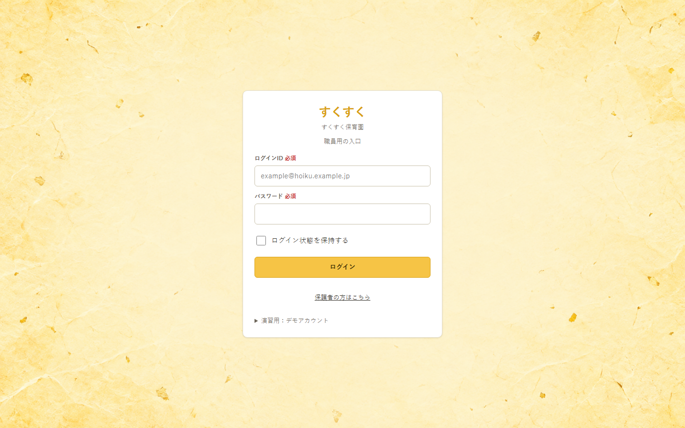
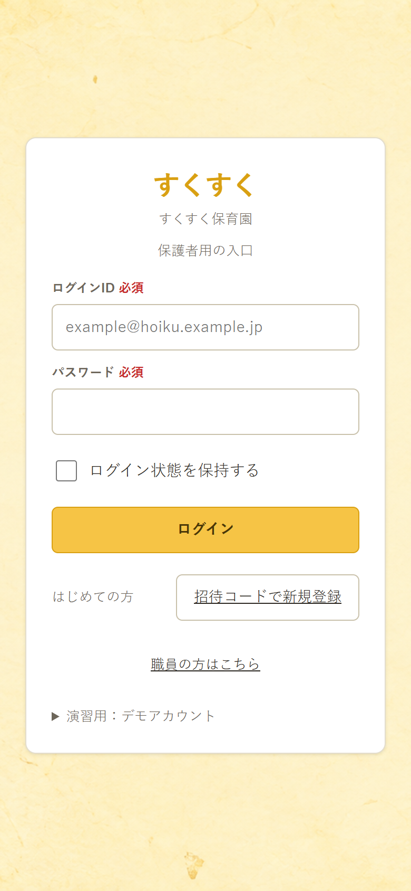
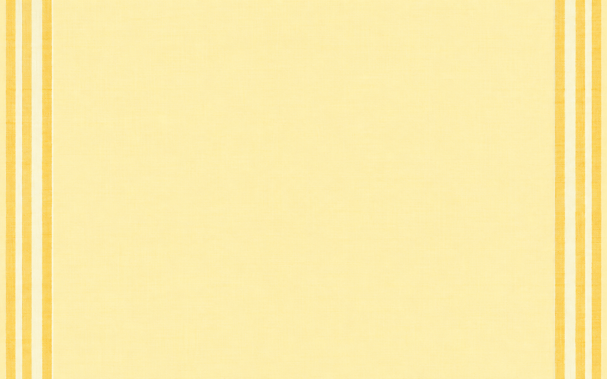

# すくすく ログイン画面の黄色い背景案

| 項目 | 内容 |
| :-- | :-- |
| 状態 | **A：和紙を選択**。モックアップの `codex/login-bg-a` ブランチに適用済み |
| 作成日 | 2026-10-05 |
| 対象 | 保護者用トップ・職員用トップのログインフォームの外側 |
| 前提 | 中央の白いフォームと文字の読みやすさを保つ。ワンポイントデザインは含めない |

## A：和紙

細かな紙の繊維と濃淡。現状の淡い黄色からの変化が小さく、静かな印象。周辺の紙片状の濃い箇所が古い紙に見える可能性がある。

選定後の実画面確認：

## B：光の面

大きな黄色の面を外周に寄せ、中央は明るく空けた案。明快だが、曲線が一般的なグラデーション装飾に見える可能性がある。

## C：図形

黄色の大きな図形と細線を外周に置く。4案の中では最も模様が強く、フォームから視線を奪わないか実画面で確認が必要。

## D：布の縞

淡い黄色の布地を基調に、左右の縁だけ細い縞を入れる。中央の余白が広く、職員用・保護者用の両方へ合わせやすい。

## 生成条件と適用時の確認

- 4案とも画像生成で作成した **1586×992px の PNG**。プロンプトは共通して「日本の保育園向けWebアプリのログイン背景、黄色主体、中央約60～65%は白いフォームを置くため静かに、文字・UI・人物・ロゴを描かない」と指定し、各案で和紙、光の面、編集的な図形、布地と縞を指定した。
- 選択した A を職員用・保護者用の共通ログイン背景に適用した。PC 1440×900px とスマートフォン 390×844px の表示で、フォームとの重なり・トリミング・文字の読みやすさを確認した。実機の Safari では未確認。
- 画像はログイン画面専用とし、記録・入力画面へ流用しない。
