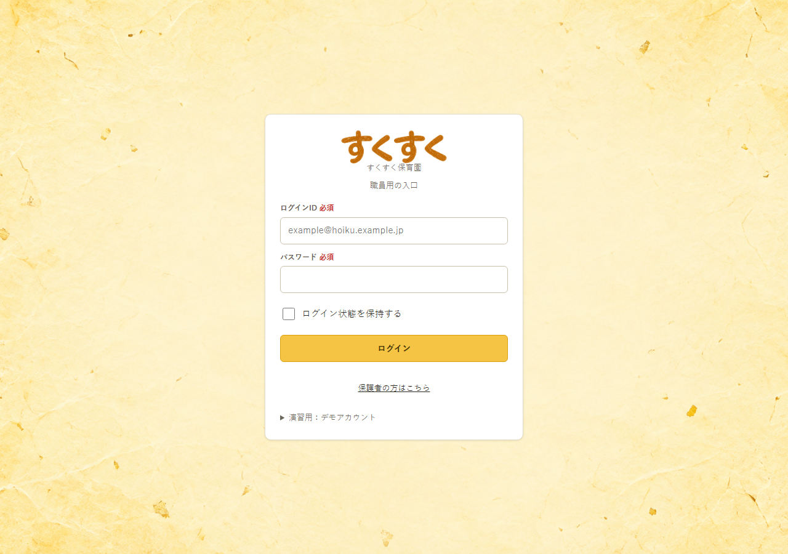
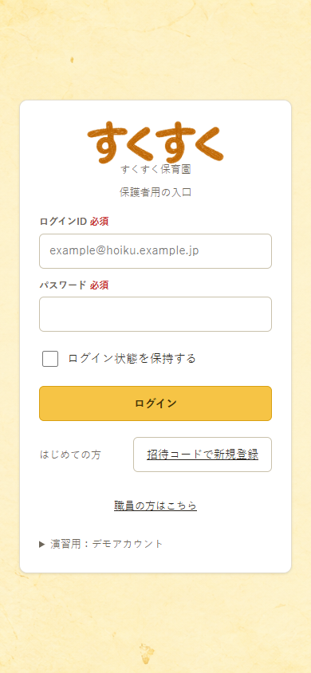

# ログイン見出し「すくすく」

| 項目 | 内容 |
| :-- | :-- |
| 方向 | 温かみのあるクレヨン調の手描き文字 |
| 対象 | 職員用トップ・保護者用トップ共通の見出し |
| 文字 | `すくすく`。読み上げ用の代替テキストも同じ文字にする |
| 素材 | `図/デザイン案/ログイン見出し/すくすく_クレヨン.png` |
| 実装 | `codex/login-crayon-heading` ブランチの `e72c1f5`。`PublicLayout` で共通表示 |

## 実画面での確認

黄色い和紙背景と白いログインフォームに対して、茶橙色のクレヨン文字を置く。文字の太さと輪郭に小さな揺れを残し、濃い縁取りや影は付けない。見出しは画像として表示するが、代替テキスト `すくすく` を設定している。

素材は透明背景の PNG。実画面での幅は 230px で、画像の透明な余白も含む。職員用の PC 幅と保護者用のスマートフォン幅で、文字と入力欄の重なりがないことを確認した。
