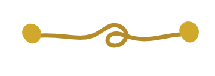
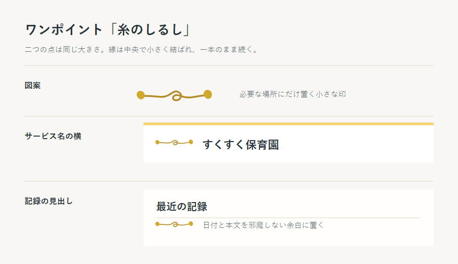

# すくすくシステム ワンポイントデザイン案

| 項目 | 内容 |
| :-- | :-- |
| 状態 | チーム確認用のたたき台。アプリの正式なロゴや機能アイコンにはまだしない |
| 作成日 | 2026-10-05 |
| 仮の名前 | 糸のしるし |
| 典拠 | `README.md`「背景・コンセプト」、`図/デザインアーキテクチャ案.md`「ねらい」「形・文字・アイコン」 |

## 図案

二つの点を同じ重さで描き、保護者と保育士の双方を表す。間の線は中央で小さく結び、一本のまま続ける。人や園児を絵にせず、`README.md` の「点を線でつなぐ」コンセプトだけを小さな印にした。

点の形は完全な円から少しずらし、線も左右対称にしない。画面見本の初稿で使った単純な丸と直線より、描き手の選択が見える形を目指す。色は**仮値**で、線を `#B58C2A`、点を `#D0A82C` とした。

## 置き方の例

| 場所 | 使い方 |
| :-- | :-- |
| サービス名の横 | 小さく1つ置き、名称の読みやすさを優先する |
| 保護者の記録見出し | 本文と重ねず、見出しの下の余白に1つ置く |

現時点では**配置の比較用**であり、同じ画面の両方には置かない。画面ごとに多用すると、見せたい連絡や記録より印が目立つため。

## 使用上のルール案

- SVG を元データとし、拡大縮小しても線が崩れないようにする。PNG は閲覧用の画像である。
- 小さすぎると形の差が消えるため、表示幅は**72px以上**を目安にする。最終値は実画面で確認する。
- 写真、入力欄、警告、午睡チェックの時刻、発達チェックの記録値には重ねない。
- 情報を伝えるアイコンではなく装飾として使う。実装する場合、読み上げには同じ意味を繰り返さないよう扱う。
- この図案で発達の程度や園児の状態を表さない。

## 確認すること

- サービス名の横と、保護者の記録見出しのどちらが自然か。
- 黄色の濃さと線の太さが、既存の画面と並んでも浮かないか。
- 印を置かない画面でも、同じアプリと分かるか。
