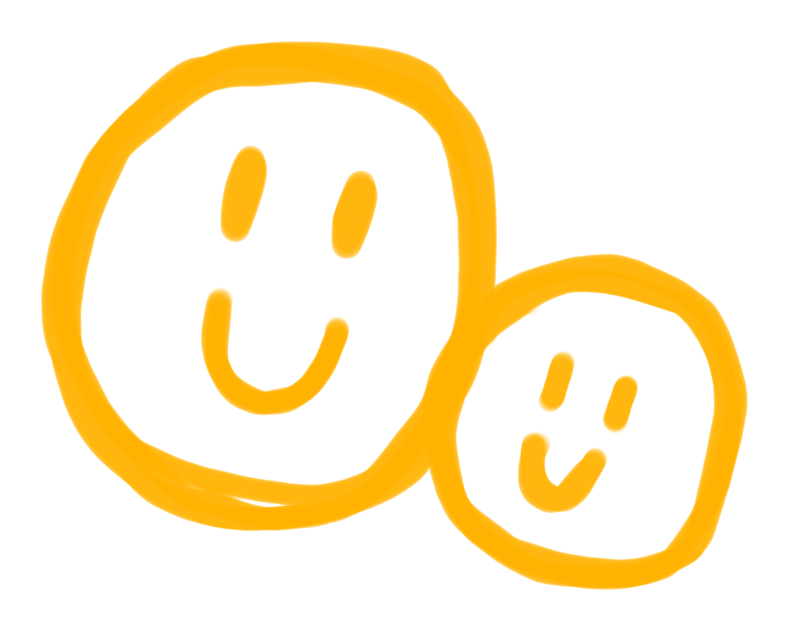
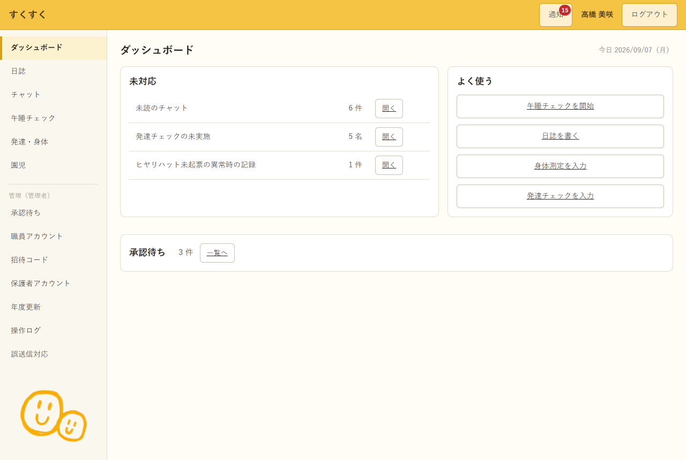

# すくすくシステム ワンポイントデザイン

| 項目 | 内容 |
| :-- | :-- |
| 状態 | **ユーザー制作の手描き画像をワンポイントに選定**。画面上の配置は未決定 |
| 選定日 | 2026-10-06 |
| 原画 | `図/デザイン案/採用ワンポイント/原画.png` |
| 向き | 原画を右へ90度回転。線と表情は描き直さない |

## 選定した図案

大きさの違う二つの笑顔が重なる手描きの印。**ユーザーの原画を右へ90度回転したものを採用**する。二つの顔は人と人のつながりを連想させるが、保護者・保育士などの役割や園児の状態を顔ごとに割り当てない。

`右90度.png` は元画像の画素をそのまま回転した全体画像（2622×1206px）。上の `右90度_表示用.png` は線に触れず、周囲の白い余白だけを切った閲覧用画像である。両方とも白背景を含む。生成ツールが描き直した画像は採用しない。

## 職員画面での配置デモ

`図/デザイン案/採用ワンポイント/配置デモ_職員.png` は、既存の職員ダッシュボード画像に手描きの印を仮配置した確認用画像。配置はサイドバー下部、表示幅は約138px。合成元の SVG も同じ場所に置く。白い余白はデモ内の乗算合成で背景になじませており、元の画像ファイルは変更していない。この配置は未確定で、アプリの実装にはまだ反映していない。

## 画面で使うときの確認

- 具体的な配置・大きさは実画面で確認して決める。入力欄、警告、午睡チェックの時刻、発達チェックの記録値には重ねない。
- 白背景を含むため、黄色や和紙の背景に置くと白い四角が見える。配置が決まったら手描きの線を保つ透過版を用意して確認する。
- 情報を伝えるアイコンではなく装飾として扱い、園児の発達や体調、連絡の状態を表さない。

## 以前の試作

`図/デザイン案/糸のしるし.svg` とその配置例は、選定前の試作として残す。**採用画像ではない。**
