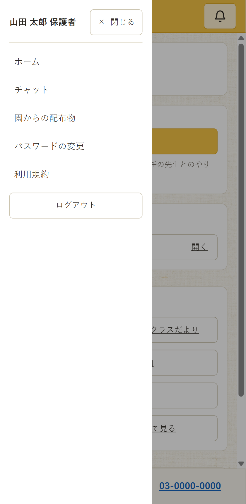
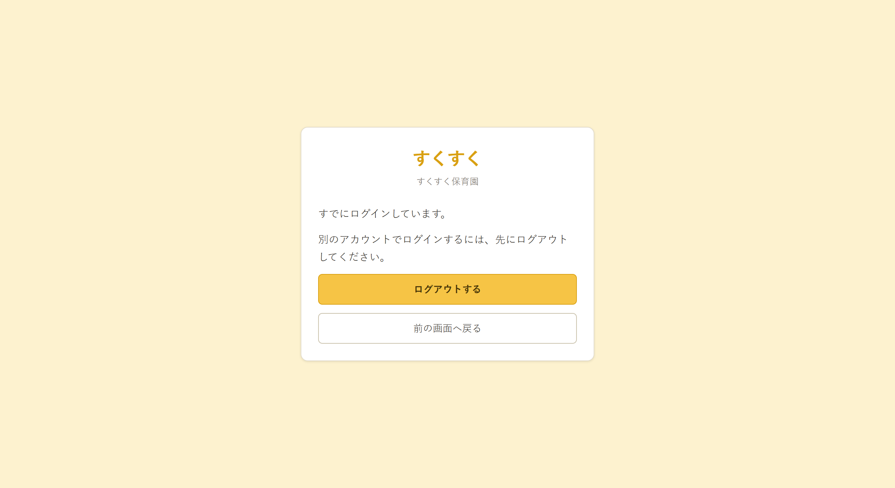
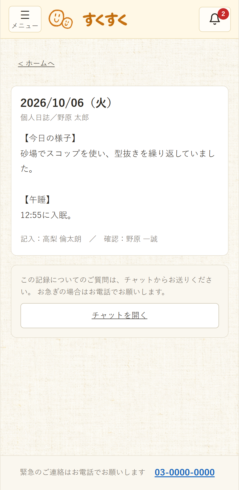
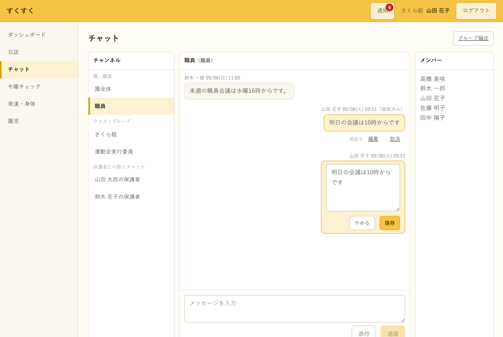
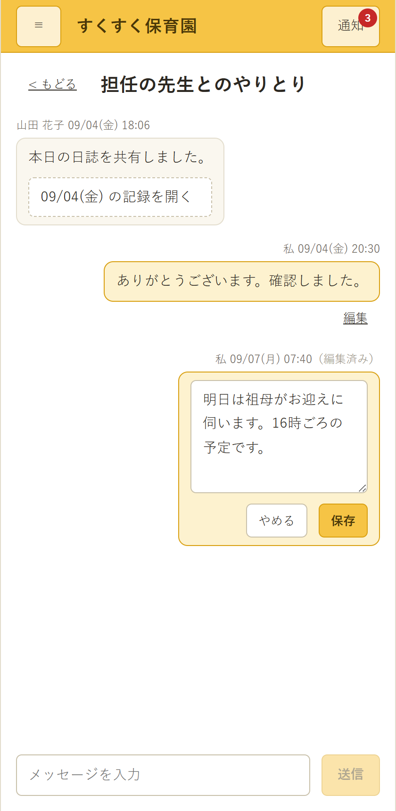

# 保育支援システム 画面詳細図

| 項目 | 内容 |
| :-- | :-- |
| 対象システム | 保育支援システム（すくすくシステム） |
| 版数 | 第 1.7 版 |
| 作成日 | 2026 年 9 月 1 日 |
| 典拠 | `基本設計書.md` 第1.6版「画面の一覧」(3-2)・「画面基本構成」(3-5)・「画面詳細」(3-6)、`要件定義書.md` 第2.4版 |
| 作成区分 | チーム開発演習 基本設計 |

## 改訂履歴

| 版 | 日付 | 変更内容 |
| :-: | :-: | :-- |
| 1.7 | 2026/10/05 | **「全画面に共通する規定」(0-2) に「端末と向き」を加えた。** `基本設計書.md` 第2.2版「想定する端末と向き」(3-5) の新設による。職員向けの画面イメージが横向きのものであることを明記した。画面イメージと項目表は変えていない |
| 1.6 | 2026/09/08 | **チャット2画面に「メッセージの編集」の項目を追記した。** `基本設計書.md` 第2.0版「メッセージの編集」(4-6) の追記による。職員(4-1)へ編集・編集の入力欄・保存/やめる・編集済みの印・取消の5項目、保護者(4-2)へ編集・編集の入力欄・保存/やめる・編集済みの印の4項目を足し、**編集中の画面を撮って貼った**（40・41）。保護者側は既読を表示しないが**編集済みの印は表示する**（編集の有無は読み手が知るべき情報であるため） |
| 1.5 | 2026/09/07 | **画面イメージを等幅テキストのワイヤーフレームから、実装のスクリーンショットへ差し替えた（全36画面）。** 作成当初は実装が無かったため描いていたが、全画面の実装がそろい、**描いた図より実物のほうが正確**になったため。撮影に足りなかった2画面（ログイン中に入口を開いたとき、保護者のメニューを開いた状態）を新たに撮った。項目表はそのまま残し、**項目表が仕様の正である**ことを「表記ルール」(0-1) に明記した。「残る作業」(10) は画面ID対応表の1件だけになった |
| 1.4 | 2026/09/07 | **共有日誌閲覧画面 (2-8) を追加し、【要決定】【要確認】を 68件から11件へ減らした。** 設定マスタの既定値と入力項目の制約値が `基本設計書.md`「設定マスタ」(5-8)・「入力項目の制約値」(4-9) で確定したため、各画面の補足欄へ反映した。あわせて、保護者側チャットの画面分割・共有記録を開く画面・通知からの導線・きょうだいの切り替え・招待コードの入力形式・日誌の雛形の適用・パスワード変更時のセッション・保護者の表し方・規約改定時の差分表示が決着したため、該当の記述を確定に置き換えた。**残る11件は園またはチームの判断を要するもの**（園情報の記入、保護者への共有の既定値、保護者を目的別グループへ入れてよいか、年度更新の取り消し、卒園児の保護者の参照範囲） |
| 1.3 | 2026/09/01 | **「本書で明らかになった要確認事項」(8) が持っていた13件の表を `要決定事項.md` へ移し、同項を案内に置き換えた。** 同じ事項を `図/画面遷移図.md` とも重複して持っており（3件）、一覧が3か所に分かれていたため。`CLAUDE.md`「要決定事項の扱い」に従い、未確定事項の一覧は同書1本が持つ。本文の【要確認】表記は残し、**番号での参照（「要確認事項」(8) No.8 など）を項目名での参照へ改めた** |
| 1.2 | 2026/09/01 | **未着手だった19画面を作成し、全36画面がそろった。** 追加したのは、パスワード変更／利用規約同意／保護者ホーム／日誌確認／承認待ち一覧／園児タイムライン／グループ編成／誤送信対応記録／異常時記録／午睡記録検索／発達チェック一覧／スケジュール設定／共有範囲設定／CSV一括登録／アレルギー一覧／年度更新／職員アカウント管理／保護者アカウント管理／操作ログ参照の19画面。あわせて**節の並びを `基本設計書.md`「画面の一覧」(3-2) の順に整えた**（職員ダッシュボードは 2-4→2-6、日誌承認画面は 3-3→3-5、発達チェック入力画面は 6-1→6-2、身体記録画面は 6-2→6-4、招待コード管理画面は 7-3→7-7）。「チャット画面（職員・タブレット／PC）」(4-1) がグループ編成を管理者のみとしていたのを、同項の利用者（管理者・一般）に合わせて訂正した。「未着手の画面」(10) は「残る作業」(10) に改めた |
| 1.1 | 2026/09/01 | **ワイヤーフレームと項目表を対にする様式へ改めた。** 学校提供テンプレート「(PRGDE004)06_基本設計書_画面詳細_2.0.2」は**画面イメージと項目表（番号／表示名／部品種別／補足）の両方**を求めるが、第1.0版は画面イメージしか持っていなかった。共通レイアウト2種と14画面すべてに項目表を追加し、「部品種別の語彙」(0-1) と「画面イメージの扱い」(0-1) を定めた。あわせて、項目の一覧をどちらが持つかで `基本設計書.md`「画面詳細」(3-6) と**相互に相手を正としていた循環参照**を解消し（項目は本書が正）、「日誌一覧画面」(3-1) のページング件数を同書「一覧表示とページング」(3-7) の既定50件に合わせた |
| 1.0 | 2026/09/01 | 新規作成。共通レイアウト2種と、全36画面のうち**14画面**のワイヤーフレームを作成した。残りの画面と着手順は「未着手の画面」(10) に示す |

---

# 0 本書の位置づけ

- 本書は**図**であり、1画面ごとに**画面イメージ**（どこに何が置かれるか）と**項目の一覧**（番号／表示名／部品種別／補足）を**対にして**示す。学校提供テンプレート「(PRGDE004)06_基本設計書_画面詳細_2.0.2」がユーザインターフェイス設計の章で求める**画面詳細（別紙）**にあたる。同テンプレートは画面イメージと項目表の**両方**を求める。
- **1画面の中に何があるかは本書が正**である。`基本設計書.md`「画面詳細」(3-6) は担当範囲の切り分けと本書への参照に留め、項目を重複して持たない。
- **入力項目の制約値**（必須・桁数・形式・範囲）は、確定したものを本書の補足欄に書く。ただし**エラー時の文言**は `基本設計書.md`「メッセージ一覧」(4-9)、**データ型・桁**は同書「テーブル定義」(5) が正であり、食い違った場合は同書へ追随させる。
- **画面のつながり**は `図/画面遷移図.md` が持つ。
- 記述が食い違った場合は、**要件定義書 → 基本設計書 → 本書**の順で正とし、本書を追随させる。
- 掲載している氏名・メールアドレス・招待コード・測定値は**すべて架空**である。実在の園児・保護者の情報は含まない。

## 0-1 表記ルール

**画面イメージは、実装した画面のスクリーンショットを貼る**（2026/09/07 に等幅テキストのワイヤーフレームから差し替えた）。

作成当初は実装が無かったため等幅テキストで描いていた。全36画面の実装がそろい、**描いた図より実物のほうが正確**になったため差し替えた。ワイヤーフレームは git の履歴に残る。

| 項目 | 内容 |
| :-- | :-- |
| 出典 | Go + React 版モックアップ（`mockup-go-react` ブランチ）を 2026/09/07 に動かして撮影 |
| データ | 起動時に作られるデモデータ。**実在の園児・保護者ではない** |
| 画像の置き場所 | `図/画面画像/` |
| 画面の幅 | 職員（タブレット／PC）1280px、保護者（スマートフォン）420px（`基本設計書.md`「画面基本構成」(3-5) の前提に合わせた） |

- **画面に出ている値は、デモ用の仮置きである。** 制約値の正は `基本設計書.md`「入力項目の制約値」(4-9)、設定値の正は同「設定マスタ」(5-8) が持つ
- **項目表が仕様の正である。** スクリーンショットは実装の現状を写したものであり、実装が仕様と食い違っていれば実装を直す
- 実装が変われば撮り直す。**撮り直しの手順は `図/画面遷移図.md`「画面画像の出典」(0-2) と同じ**
- 画面名は `基本設計書.md`「画面の一覧」(3-2) の名称と一致させる

### 画面イメージの扱い

- **モックアップができた画面から、スクリーンショットへ差し替える予定**である。等幅テキストのワイヤーフレームは、モックアップがない間の暫定として置く
- **差し替えても項目表は残す。** テンプレートが求めるのは画面イメージと項目表の両方であり、画像だけでは番号・部品種別・制約が読めない
- 画像は `図/画像/` に置き、相対リンクで貼る。ファイル名は画面名に対応させる（例：`午睡チェック画面.png`）。差し替えた画面は「一覧に対する作成状況」(9) に印を付ける

### 部品種別の語彙

補足欄に何を書くかは**部品種別で決まる**ため、次の語だけを使う。表記がゆれると、項目表を画面をまたいで読めなくなる。

| 部品種別 | 用途 | 補足欄に書くこと |
| :-- | :-- | :-- |
| ラベル | 表示専用の文字 | 表示：何を出すか |
| テキスト入力／パスワード入力／数値入力／日付入力 | 1行の入力 | 初期値／入力（必須・任意）／制限（形式・桁数・範囲） |
| テキストエリア | 複数行の入力 | 同上 |
| プルダウン／ラジオボタン／チェックボックス | 選択 | 初期値／入力／制限（選択肢） |
| ボタン／リンク | 操作 | 処理：何をするか／処理結果：どうなるか |
| 一覧（テーブル）／カード | 複数件の表示 | 表示：列と並び順／制限：ページング |
| ファイル選択 | 写真・添付 | 初期値／入力／制限（枚数・形式・容量） |
| 領域 | 他の部品をまとめる枠 | 表示：何をまとめるか |
| ナビゲーション | 画面間の導線 | 表示：項目／処理：遷移先 |
| アイコン／画像／タイマー／グラフ | 上記に当てはまらないもの | 表示：何を出すか |

- **未確定の値を空欄にしない。** 空欄は「制約なし」と読めてしまい、決め忘れが埋もれる。**2026/09/07 時点で未確定の値は残っていない**
- 全画面に効く規定は各画面で繰り返さず、「全画面に共通する規定」(0-2) を参照する

## 0-2 全画面に共通する規定

`基本設計書.md`「画面基本構成」(3-5) より、レイアウトに影響するものを再掲する。**本書の全画面がこれに従う。**

| 規定 | 内容 |
| :-- | :-- |
| テーマカラー | 優しい黄色。警告色は黄色と対比の付く色を用いる |
| グリッド | 職員（タブレット／PC）＝12カラム、保護者（スマートフォン）＝シングルカラム |
| タップ領域 | **44×44px 以上**。タブレットでの操作を前提とする |
| 端末と向き | 職員のタブレットは**横向きが基本**。**縦向きでも構成を変えず**、各領域の幅だけを詰める。PC はタブレット横向きの縦横比のまま中央に表示する。**本書の職員向けの画面イメージは横向きのもの**である（`基本設計書.md`「想定する端末と向き」(3-5)） |
| ヘッダ | ログイン中の利用者名を**常時表示**する（職員は所属クラスも） |
| ログアウト | 職員はヘッダに常時表示。保護者はメニュー内 |
| 免責表示 | 成長グラフ・発達チェックの比較には「判定・診断を行うものではありません」を**固定表示**する |
| サイドナビ | **保護者向け画面は持たない** |

---

# 1 共通レイアウト

## 1-1 職員（タブレット／PC）

*職員（タブレット／PC）の共通レイアウト。ヘッダ・サイドナビ・メインコンテンツ*

**項目**

| 番号 | 表示名 | 部品種別 | 補足 |
| :-: | :-- | :-- | :-- |
| 1 | サービス名（すくすく） | ラベル | 表示：全画面のヘッダ左端に固定する |
| 2 | 通知 | アイコン | 表示：未対応の**総件数**を添える。0件のときは件数を出さない／処理：職員は職員ダッシュボード (2-6) の「未対応」へ、保護者はチャット画面（保護者） (4-2) へ移る |
| 3 | 利用者名・所属クラス | ラベル | 表示：ログイン中の職員名と所属クラス。**常時表示**（要件定義書「端末の利用形態と本人特定」(4-1-4 (4))） |
| 4 | ログアウト | ボタン | 処理：セッションを破棄する／処理結果：職員用トップへ遷移する |
| 5 | サイドナビゲーション | ナビゲーション | 表示：ダッシュボード／日誌／チャット／午睡チェック／発達・身体／園児／管理。現在地を強調する。**管理は管理者にのみ表示**する |
| 6 | メインコンテンツ | 領域 | 表示：各画面の内容。12カラムグリッド |
| 7 | メッセージ表示領域 | 領域 | 表示：完了・警告・エラーの文言。文言は `基本設計書.md`「メッセージ一覧」(4-9) に従う |

- **ログイン中の職員名と所属クラスをヘッダに常時置く。** 共有端末での記録者の取り違えを防ぐため（要件定義書「端末の利用形態と本人特定」(4-1-4 (4))）
- サイドナビは**現在地を強調**する。「管理」は管理者にのみ表示し、一般には項目自体を出さない
- 通知には未対応の**総件数**を添える。**項目ごとに該当画面へ入る導線は、職員ダッシュボードの側が持つ**（`基本設計書.md`「画面基本構成」(3-5)）。ヘッダに項目一覧を出すと、全画面に載る部品が重くなり、午睡チェック中の画面でも視線を奪うため

## 1-2 保護者（スマートフォン）

| メニューを閉じた状態 | メニューを開いた状態 |
| :--: | :--: |
|  |  |

**項目**

| 番号 | 表示名 | 部品種別 | 補足 |
| :-: | :-- | :-- | :-- |
| 1 | メニュー | ボタン（アイコン） | 処理：メニューを開閉する／処理結果：同じ画面の中にメニューを重ねて表示する |
| 2 | 園名 | ラベル | 表示：園名。**演習では「すくすく保育園」を仮に置く。** 導入時に園の名称へ差し替える |
| 3 | 通知 | アイコン | 表示：未読の件数 |
| 4 | 利用者名 | ラベル | 表示：「〇〇ちゃんの保護者」。メニュー内に表示する |
| 5 | ホーム | リンク | 処理：保護者ホームへ遷移する |
| 6 | チャット | リンク | 処理：チャット画面へ遷移する |
| 7 | パスワードの変更 | リンク | 処理：パスワード変更画面へ遷移する |
| 8 | 利用規約 | リンク | 処理：利用規約を表示する（`利用規約・プライバシーポリシー.md`） |
| 9 | ログアウト | リンク | 処理：セッションを破棄する／処理結果：保護者用トップへ遷移する |
| 10 | メインコンテンツ | 領域 | 表示：各画面の内容。シングルカラム。**サイドナビゲーションは持たない** |

- **サイドナビを持たず、ホームからの導線に絞る。** 片手操作を前提とするため
- ログアウトはメニュー内に置く

---

# 2 共通・認証

## 2-1 職員用トップ／保護者用トップ

| 職員用トップ | 保護者用トップ |
| :--: | :--: |
|  |  |

**項目**

| 番号 | 表示名 | 部品種別 | 補足 |
| :-: | :-- | :-- | :-- |
| 1 | 園のロゴ・園名 | 画像・ラベル | 表示：園のロゴと園名。**演習では「すくすく保育園」を仮に置き、ロゴは置かない。** 導入時に園のものへ差し替える |
| 2 | ログインID | テキスト入力 | 初期値：空／入力：必須／制限：メールアドレス形式、**254文字以内**（`基本設計書.md`「入力項目の制約値」(4-9)） |
| 3 | パスワード | パスワード入力 | 初期値：空／入力：必須／制限：伏字で表示する。**8文字以上。文字種の組み合わせは求めない**（`基本設計書.md`「パスワードの要件」(6-3)） |
| 4 | ログイン状態を保持する | チェックボックス | 初期値：**オフ**／入力：任意／制限：有効にすると保存期間（既定30日）まで再認証を求めない。**共有端末では既定をオフにしておく**必要があるため、初期値はオフとする |
| 5 | ログイン | ボタン | 処理：認証し、サーバー側でロールを判定する／処理結果：職員は職員ダッシュボード、保護者は保護者ホームへ。**誤った系統の入口では成立させず、正しい入口を案内する** |
| 6 | 招待コードで新規登録 | ボタン | 処理：新規登録画面へ遷移する／制限：**保護者用トップにのみ表示**する |
| 7 | エラーメッセージ | ラベル | 表示：認証の失敗と残りの試行回数。文言は「メッセージ一覧」(4-9) に従う |
| 8 | ロック中の案内 | ラベル | 表示：ロック中である旨と解除の方法。**既定は5回の失敗で30分**。管理者は待機を待たずに解除できる（`基本設計書.md`「設定マスタ」(5-8)） |

- **表示するのは認証の導線のみ。** 園児情報・記録などの実データも、サービス紹介コンテンツも置かない（`基本設計書.md`「画面詳細」(3-6)）
- **新規登録の導線は保護者用トップにのみ置く。** 職員アカウントは管理者が発行するため（要件定義書「アカウントの管理」(4-1-2)）
- 職員用と保護者用は**同じ様式で、入口だけが異なる**。誤った系統でのログインは成立させず、正しい入口を案内する

## 2-2 ログイン中に入口を開いたとき

*保護者でログイン中に職員用の入口を開いたとき*

**項目**

| 番号 | 表示名 | 部品種別 | 補足 |
| :-: | :-- | :-- | :-- |
| 1 | 案内文 | ラベル | 表示：すでにログインしている旨と、先にログアウトを求める旨。**ログイン中の氏名・ロールは表示しない** |
| 2 | ログアウトする | ボタン | 処理：セッションを破棄する／処理結果：開こうとした側の入口のトップへ遷移する |
| 3 | 前の画面へ戻る | ボタン | 処理：直前の画面へ戻る／処理結果：ログイン中の系統の画面へ戻る |

- **ログインフォームを表示しない。** ログイン中は系統・アカウントを問わず新しいログインを成立させないため（要件定義書「同時ログインの扱い」(4-1-1)）
- **案内にログイン中の氏名・ロールを出さない。** 共有端末で、前の利用者が誰であったかを第三者に示さないため

## 2-3 新規登録画面（保護者）

**項目**

| 番号 | 表示名 | 部品種別 | 補足 |
| :-: | :-- | :-- | :-- |
| 1 | 戻る | ボタン | 処理：保護者用トップへ戻る／処理結果：入力中の内容は保持しない |
| 2 | 招待コード | テキスト入力 | 初期値：空／入力：必須／制限：`ABCD-1234-EFGH` 形式。**大文字小文字を区別せず、ハイフンは省略してもよい**（`基本設計書.md`「招待コード」(5-2)） |
| 3 | コードを確認する | ボタン | 処理：招待コードの有効性を照会する／処理結果：有効なら (2)(3) を操作できるようにする。無効・使用済・期限切れはメッセージを表示する |
| 4 | 利用規約 | 領域（スクロール） | 表示：`利用規約・プライバシーポリシー.md` の本文 |
| 5 | 利用規約に同意します | チェックボックス | 初期値：未チェック／入力：必須／制限：未チェックのままでは登録できない |
| 6 | メールアドレス | テキスト入力 | 初期値：空／入力：必須／制限：メールアドレス形式。既存アカウントとの重複を認めない |
| 7 | パスワード | パスワード入力 | 初期値：空／入力：必須／制限：**8文字以上。文字種の組み合わせは求めない** |
| 8 | パスワード（確認） | パスワード入力 | 初期値：空／入力：必須／制限：7と一致すること |
| 9 | 登録する | ボタン | 処理：アカウントを作成し、招待コードを使用済にする／処理結果：保護者ホームへ遷移する。**1枚のコードで作成できるのは1アカウント**（要件定義書「招待コードの発行」(4-1-2)） |

- 段階を1画面の中で上から順に踏ませる。**招待コードが確認できるまで (2)(3) を操作できない**
- **園児名を画面に表示しない。** 招待コードだけでは、誰の保護者かを名乗る前の段階であるため。紐づく園児は登録完了後のホームで確認する
- 招待コードは `ABCD-1234-EFGH` 形式とし、**大文字小文字を区別せず、ハイフンは省略してもよい**。紙に印刷して手渡すため、読み違えやすい文字（`0` `O` `1` `I` `l`）は使わない（`基本設計書.md`「招待コード」(5-2)）

## 2-4 パスワード変更画面

*一時パスワードでのログイン後（強制）*

**項目**

| 番号 | 表示名 | 部品種別 | 補足 |
| :-: | :-- | :-- | :-- |
| 1 | 案内 | ラベル | 表示：一時パスワードでログインした直後は、変更を促す案内を出す。任意の変更のときは出さない |
| 2 | 現在のパスワード | パスワード入力 | 初期値：空／入力：必須／制限：伏字で表示する |
| 3 | 新しいパスワード | パスワード入力 | 初期値：空／入力：必須／制限：**8文字以上。文字種の組み合わせは求めない。現在のパスワードと同じ値は認めない**（変更した意味が無くなるため） |
| 4 | 新しいパスワード（確認） | パスワード入力 | 初期値：空／入力：必須／制限：3と一致すること |
| 5 | 条件の表示 | ラベル | 表示：使える長さと文字種。**入力する前に示す**（弾かれてから知らせない） |
| 6 | 変更する | ボタン | 処理：現在のパスワードを照合し、新しい値をハッシュ化して保存する／処理結果：ロールに応じて職員ダッシュボードまたは保護者ホームへ。一時パスワードは無効になる |
| 7 | やめる | ボタン | 処理：直前の画面へ戻る／制限：**一時パスワードでのログイン直後は表示しない**（変更せずに先へ進ませないため） |

- 一時パスワードは**二度と表示できない**（`基本設計書.md`「一時パスワードの再発行」(4-3)）。この画面で変更できなかった場合は、管理者に再発行を依頼する
- 一時パスワードの期限切れは、**ログイン試行によるロックとは別**に扱う。待っても解消しない旨を案内する
- **変更したときは、変更した端末以外のセッションをすべて無効化する。** 変更する動機の多くは「他人に知られたかもしれない」であり、そのとき他の端末のログインが生き続けるのは目的に反する（`基本設計書.md`「認証情報の保持方式」(6-3)）

## 2-5 利用規約同意画面

**項目**

| 番号 | 表示名 | 部品種別 | 補足 |
| :-: | :-- | :-- | :-- |
| 1 | 表題 | ラベル | 表示：改定にともなう同意である旨。初回ログイン時は初めての同意である旨 |
| 2 | 版と施行日 | ラベル | 表示：版と施行日（`基本設計書.md`「利用規約（m_terms）」(5)） |
| 3 | 利用規約の本文 | 領域（スクロール） | 表示：`利用規約・プライバシーポリシー.md` の第1部 |
| 4 | プライバシーポリシーの本文 | 領域（スクロール） | 表示：同第2部。**種別ごとに分けて表示する** |
| 5 | 利用規約に同意します | チェックボックス | 初期値：未チェック／入力：必須 |
| 6 | プライバシーポリシーに同意します | チェックボックス | 初期値：未チェック／入力：必須 |
| 7 | 同意して進む | ボタン | 処理：同意した版と日時を記録する／処理結果：ロールに応じたトップへ。**同意するまで他の画面へ進ませない** |
| 8 | ログアウト | ボタン | 処理：同意せずセッションを破棄する／処理結果：ログインしていた系統のトップへ戻る |

- ログイン時に**同意済みの版が最新かを判定**し、旧版・未同意ならこの画面へ進める（`基本設計書.md`「ログイン」(4-3)）
- **同意しない場合は利用を続けられない。** 保護者の新規登録では登録自体を完了させない（同「保護者アカウントの自己登録」(4-3)）
- **職員・保護者の双方が対象**である（`利用規約・プライバシーポリシー.md`「本書について」）
- **前の版からの差分は示さず、本文全体を再提示する。** 差分を出すには版ごとの本文を保持して比較する仕組みが要り、規約の改定はまれである。**改定の要点は本文の冒頭に文章で添える**ほうが、保育士・保護者には読みやすい

## 2-6 職員ダッシュボード

**項目**

| 番号 | 表示名 | 部品種別 | 補足 |
| :-: | :-- | :-- | :-- |
| 1 | 本日の日付 | ラベル | 表示：サーバー時刻の日付と曜日 |
| 2 | 差し戻された日誌 | ラベル＋ボタン | 表示：件数／処理：日誌一覧画面へ遷移する（状態＝差し戻しで絞る） |
| 3 | 未読のチャット | ラベル＋ボタン | 表示：件数／処理：チャット画面へ遷移する |
| 4 | 本日の発達チェック未実施 | ラベル＋ボタン | 表示：**未入力**の人数。**「未確認」は含めない**／処理：発達チェック一覧画面へ遷移する |
| 5 | 午睡チェックを開始 | ボタン | 処理：午睡チェック画面へ遷移する |
| 6 | 日誌を書く | ボタン | 処理：日誌作成・編集画面を新規で開く |
| 7 | 身体測定を入力 | ボタン | 処理：身体記録画面へ遷移する |
| 8 | 承認待ち | ラベル＋ボタン | 表示：件数。**管理者にのみ表示**する／処理：承認待ち一覧画面へ遷移する |

- **未対応の件数を最上部に置く。** 出勤直後に「何が残っているか」を1画面で把握させるため
- 「よく使う」は**その時間帯に使う機能**を出す。午睡の時間帯は午睡チェックを先頭にする
- 承認待ちの区画は**管理者にのみ表示**する

## 2-7 保護者ホーム

**項目**

| 番号 | 表示名 | 部品種別 | 補足 |
| :-: | :-- | :-- | :-- |
| 1 | 園児名・月齢・クラス | ラベル | 表示：紐づく園児。月齢は応当日基準。**複数の園児が紐づく場合は、園児ごとの区画を縦に並べて同時に表示する**（切り替えは設けない。`基本設計書.md`「画面体系図」(3-3)） |
| 2 | 新しいお知らせ | 一覧 | 表示：チャンネルごとの未読件数。**参照できないチャンネルは出さない**（`基本設計書.md`「メッセージの送受信」(4-6)） |
| 3 | チャットを開く | ボタン | 処理：チャット画面（保護者）へ遷移する |
| 4 | 最近の記録 | 一覧 | 表示：**共有された記録のみ**。表示の可否は**参照した時点の共有範囲の設定**で判定する（同「記録の共有」(4-8)） |
| 5 | 開く | ボタン | 処理：**共有日誌閲覧画面**(2-8) へ遷移する |
| 6 | 緊急連絡の案内 | ラベル | 表示：「緊急のご連絡はお電話でお願いします」。**常時表示**する |

- 保護者が見られるのは**自児に紐づく情報のみ**である
- **既読状態は保護者側に一切表示しない**（`基本設計書.md`「既読確認」(4-6)）
- 通知は**画面内の表示が基本**であり、届かないことがある。緊急の連絡をこの画面に依存させない
- **園児を切り替える操作は設けない。** きょうだいが在籍する場合、切り替え式では**いま誰の情報を見ているのかを取り違える**恐れがある。在籍するのは多くて数名であり、並べて置いても画面が破綻しない

---

## 2-8 共有日誌閲覧画面（保護者）

**項目**

| 番号 | 表示名 | 部品種別 | 補足 |
| :-: | :-- | :-- | :-- |
| 1 | ホームへ | リンク | 処理：保護者ホーム (2-7) へ戻る |
| 2 | 日付 | ラベル | 表示：日誌の対象日（曜日を添える） |
| 3 | 記録種別・園児名 | ラベル | 表示：個人日誌／クラス日誌の別と、対象の園児名 |
| 4 | 本文 | ラベル | 表示：**改行をそのまま保つ**。編集はできない |
| 5 | 写真 | 画像 | 表示：添付された写真。**共有が指定された日誌の添付のみ**（`基本設計書.md`「添付ファイルの実体の保存先」(5-5)） |
| 6 | 記入者・確認者 | ラベル | 表示：作成した職員と承認した職員。**誰が書いた記録かを保護者に示す** |
| 7 | 問い合わせの案内 | ラベル | 表示：質問はチャットから、急ぎは電話で、という切り分けを添える |
| 8 | チャットを開く | ボタン | 処理：チャット画面（保護者） (4-2) へ遷移する |

- **読み取り専用の画面である。** 保護者が記録を編集・削除する手段は設けない
- **承認済みかつ共有が指定された日誌だけを表示する。** 承認と共有は別の指定であり（`基本設計書.md`「日誌」(5-4)）、どちらかが欠けていれば「この記録は共有されていません」と示す
- 判定は**参照した時点**で行う。共有を取り消した後は、同じ経路を開いても表示しない
- 保護者ホーム (2-7) とチャット画面（保護者） (4-2) の**どちらからも入れる**。チャットを遡らずに記録へ届く導線を確保するため

---

# 3 日誌システム

## 3-1 日誌一覧画面

**項目**

| 番号 | 表示名 | 部品種別 | 補足 |
| :-: | :-- | :-- | :-- |
| 1 | 種別 | プルダウン | 初期値：すべて／入力：任意／制限：個人日誌・クラス日誌・週案／月案・ヒヤリハット |
| 2 | クラス | プルダウン | 初期値：自クラス／入力：任意／制限：**一般（保育士）は自クラスのみ**。管理者は全クラス |
| 3 | 状態 | プルダウン | 初期値：すべて／入力：任意／制限：下書き・申請中・差し戻し・承認済 |
| 4 | 期間（開始・終了） | 日付入力 | 初期値：**直近1か月**（開始＝当日の30日前、終了＝当日）／入力：任意／制限：開始日 ≦ 終了日 |
| 5 | 絞り込む | ボタン | 処理：条件を付けて再検索する／処理結果：一覧を1ページ目から表示する |
| 6 | 新しく書く | ボタン | 処理：日誌作成・編集画面を新規で開く |
| 7 | 一覧 | 一覧（テーブル） | 表示：記録日・種別・対象・作成者・状態。**差し戻しは他の状態と区別できる色**にする |
| 8 | 開く | ボタン | 処理：状態に応じて日誌作成・編集画面または日誌確認画面へ遷移する |
| 9 | ページング | ナビゲーション | 表示：現在のページと総件数／制限：既定50件（`基本設計書.md`「一覧表示とページング」(3-7)） |

- **状態を列として持つ**（下書き／申請中／差し戻し／承認済）。差し戻しは他と区別できる色にする
- 一覧は**既定50件**でページングする（`基本設計書.md`「一覧表示とページング」(3-7)）
- 一般（保育士）の既定の絞り込みは**自クラス**。他クラスは選べない（要件定義書「対象権限列の読み方」(4-2 冒頭)）

## 3-2 日誌作成・編集画面

**項目**

| 番号 | 表示名 | 部品種別 | 補足 |
| :-: | :-- | :-- | :-- |
| 1 | 日誌一覧へ | ボタン | 処理：日誌一覧画面へ戻る／処理結果：未保存の内容がある場合は確認する |
| 2 | 状態 | ラベル | 表示：下書き／申請中／差し戻し／承認済 |
| 3 | 編集中の警告 | ラベル | 表示：他の職員が開いている旨（要件定義書「同時編集」(4-1-4)）。解除は `基本設計書.md`「編集ロックの解除」(4-5) に従う |
| 4 | 記録種別 | ラジオボタン | 初期値：個人日誌／入力：必須／制限：個人日誌・クラス日誌・週案／月案・ヒヤリハット |
| 5 | 対象 | プルダウン | 初期値：空／入力：必須／制限：個人日誌は園児、クラス日誌・週案／月案は**自クラス**を選ぶ |
| 6 | 記録日 | 日付入力 | 初期値：本日（サーバー時刻）／入力：必須／制限：**未来日は認めない**（当日まで）。記録は起きたことを書くものであるため |
| 7 | 雛形を呼び出す | ボタン | 処理：記録種別に応じた雛形を本文へ入れる／処理結果：**本文が空なら入れ、入力済みなら末尾へ足す**。置き換えると書きかけを失うため（`基本設計書.md`「日誌の作成と承認」(4-4)） |
| 8 | 定型文を入れる | ボタン | 処理：定型文を選び、カーソル位置へ挿入する |
| 9 | 本文 | テキストエリア | 初期値：空または雛形／入力：必須／制限：**2,000文字以内**。残り文字数を示す |
| 10 | 写真 | ファイル選択 | 初期値：なし／入力：任意／制限：**3枚まで**。上限に達したら追加を無効にする。**形式は JPEG・PNG、1ファイル10MB まで**（`基本設計書.md`「設定マスタ」(5-8)） |
| 11 | この園児の過去の記録 | 一覧 | 表示：同じ園児の直近の記録／処理：開くで日誌確認画面へ遷移する |
| 12 | 下書き保存 | ボタン | 処理：状態を下書きのまま保存する／処理結果：同じ画面に留まる |
| 13 | 確認へ進む | ボタン | 処理：入力を検証し、日誌確認画面へ遷移する／処理結果：確認画面で確定すると状態が申請中になる |

- **他の職員が開いている場合は、その旨をヘッダ直下に出す**（要件定義書「同時編集」(4-1-4)）。ロックの解除は `基本設計書.md`「編集ロックの解除」(4-5) に従う
- 過去の記録を同じ画面に並べる。**前回の記述を見ながら書けるようにするため**
- 写真は**3枚まで**。上限に達したら追加を無効にする

## 3-3 日誌確認画面

**項目**

| 番号 | 表示名 | 部品種別 | 補足 |
| :-: | :-- | :-- | :-- |
| 1 | 編集へ戻る／戻る | ボタン | 処理：日誌作成・編集画面へ戻る／処理結果：**入力内容を保持する** |
| 2 | 差し戻し理由 | ラベル | 表示：差し戻された日誌のみ、理由を上部に出す。**何を直すのかを見ながら確認させる**ため |
| 3 | 日誌の内容 | 領域（読み取り専用） | 表示：種別・対象・記録日・作成者・本文・写真 |
| 4 | 申請する | ボタン | 処理：状態を申請中にし、管理者へ通知する／処理結果：日誌一覧画面へ戻る |

- **申請の前に一度だけ挟む画面**である。保護者へ渡りうる記録であり、取り違えの影響が大きいため（`基本設計書.md`「画面の洗い出しの考え方」(3-1) の基準2）
- 差し戻された日誌の再申請も同じ画面を通す
- 承認済みの日誌を開いたときは**閲覧のみ**とし、申請の操作を出さない

## 3-4 承認待ち一覧画面（管理者）

**項目**

| 番号 | 表示名 | 部品種別 | 補足 |
| :-: | :-- | :-- | :-- |
| 1 | クラス | プルダウン | 初期値：すべて／入力：任意／制限：管理者は全クラスを選べる |
| 2 | 種別 | プルダウン | 初期値：すべて／入力：任意／制限：個人日誌・クラス日誌・週案／月案・ヒヤリハット |
| 3 | 絞り込む | ボタン | 処理：条件を付けて再検索する |
| 4 | 一覧 | 一覧（テーブル） | 表示：申請日時（サーバー時刻）・種別・対象・作成者・経過。並び順の既定は**申請の古い順** |
| 5 | 経過 | ラベル | 表示：申請からの経過日数。**滞留を見つけるための表示であって、期限の判定ではない**／制限：**3日**を超えると警告色を付ける（マスタ値。`基本設計書.md`「設定マスタ」(5-8)） |
| 6 | 開く | ボタン | 処理：日誌承認画面へ遷移する |
| 7 | ページング | ナビゲーション | 表示：現在のページと総件数／制限：既定50件（`基本設計書.md`「一覧表示とページング」(3-7)） |

- **管理者だけが使う画面**である。一般（保育士）にはサイドナビにも出さない
- ヒヤリハットは他の種別と**区別できる色**にする。異常時の記録から起票された下書きもここへ並ぶ（同「異常時の記録」(4-7)）
- 承認の順序をシステムが決めることはしない。**並び順は目安**であり、どれを先に見るかは管理者が決める

## 3-5 日誌承認画面（管理者）

**項目**

| 番号 | 表示名 | 部品種別 | 補足 |
| :-: | :-- | :-- | :-- |
| 1 | 承認待ち一覧へ | ボタン | 処理：承認待ち一覧画面へ戻る |
| 2 | 申請日時・作成者 | ラベル | 表示：申請の日時（サーバー時刻）と作成者名 |
| 3 | 日誌の内容 | 領域（読み取り専用） | 表示：種別・対象・記録日・本文・写真。**承認者は本文を書き換えない**（直すのは作成者） |
| 4 | 保護者への共有 | ラジオボタン | 初期値：**しない**（雛形に既定があればそれに従う）／入力：必須。**誤共有は取り返せない**ため、既定は共有しない側に倒す（`基本設計書.md`「日誌の作成と承認」(4-4)） |
| 5 | 共有先 | ラベル | 表示：対象園児に紐づく保護者（個人チャット） |
| 6 | 差し戻す理由 | テキストエリア | 初期値：空／入力：**差し戻すときは必須**／制限：**500文字以内** |
| 7 | 差し戻す | ボタン | 処理：状態を差し戻しにし、作成者へ通知する／処理結果：承認待ち一覧画面へ戻る |
| 8 | 承認する | ボタン | 処理：状態を承認済にし、共有の指定に従って個人チャットへ配信する／処理結果：承認待ち一覧画面へ戻る |

- **共有の指定を承認と同じ画面に置く。** 承認後に別画面で指定させると、共有し忘れが起きるため
- 差し戻しは理由の入力を必須とする。**何を直せばよいかが作成者に伝わらないため**
- **共有するの既定値は「しない」。** 共有し忘れは保護者から「見えない」と言われて気づけるが、**誤共有は取り返せない**。園内限定のつもりで書いた記述が保護者に届くと信頼を損なう。**演習上の想定であり、導入時に園へ確認する**

## 3-6 園児タイムライン画面

**項目**

| 番号 | 表示名 | 部品種別 | 補足 |
| :-: | :-- | :-- | :-- |
| 1 | 園児一覧へ | ボタン | 処理：園児一覧画面へ戻る |
| 2 | 園児名・月齢・クラス | ラベル | 表示：氏名と月齢。月齢は**各記録の対象日を基準**に算出する（要件定義書「記録の一貫性」(7-1 No.6)） |
| 3 | 種別 | プルダウン | 初期値：すべて／入力：任意／制限：日誌・午睡チェック・発達チェック・身体測定 |
| 4 | 期間（開始・終了） | 日付入力 | 初期値：**直近1か月**（開始＝当日の30日前、終了＝当日）／入力：任意／制限：開始日 ≦ 終了日 |
| 5 | 絞り込む | ボタン | 処理：条件を付けて再検索する |
| 6 | タイムライン | 一覧 | 表示：日付ごとに時刻・種別・要約。時刻は**記録が対象とする時刻**（後追い入力は保存時刻を別に持つ。`基本設計書.md`「記録の修正と改ざん防止」(4-7)） |
| 7 | 開く | ボタン | 処理：種別に応じた画面へ遷移する |
| 8 | さらに読み込む | ボタン | 処理：古い記録を追加で読み込む／制限：ページングではなく**追加読み込み**とする |

- **一般（保育士）は自クラスの園児のみ**参照できる
- **職員が使う画面**であり、共有範囲の設定にかかわらず全件を並べる。保護者向けの画面ではない
- チャットのメッセージは並べない。**記録ではなくやりとり**であり、チャット画面で追う
- 並べるだけで、**傾向の判定や要注意の指摘は行わない**

---

# 4 チャットツール

## 4-1 チャット画面（職員・タブレット／PC）

| 通常の表示 | 編集中 |
| :--: | :--: |
|  |  |

**項目**

| 番号 | 表示名 | 部品種別 | 補足 |
| :-: | :-- | :-- | :-- |
| 1 | チャンネル一覧 | ナビゲーション | 表示：園全体・職員・クラス・個人。未読は件数を添える／処理：**選択してもメッセージ領域が入れ替わるだけで画面遷移しない** |
| 2 | グループ編成 | ボタン | 処理：グループ編成画面へ遷移する／制限：管理者・一般が使える（`基本設計書.md`「画面の一覧」(3-2)）。クラスグループの再編は年度更新が行う |
| 3 | チャンネル名 | ラベル | 表示：選択中のチャンネル名と種別 |
| 4 | メッセージ | 一覧 | 表示：送信者・時刻・本文・既読人数。時刻はサーバー時刻／制限：直近から遡って追加読み込みする（「一覧表示とページング」(3-7)） |
| 5 | メンバー | 一覧 | 表示：チャンネルの参加者 |
| 6 | 追加 | ボタン | 処理：メンバーを追加する／制限：**目的別グループのみ**。クラスグループの構成は変えられない |
| 7 | メッセージを入力 | テキストエリア | 初期値：空／入力：任意／制限：**1,000文字以内**。**園全体（園チャット）では一般に表示しない**（閲覧のみ） |
| 8 | 添付 | ファイル選択 | 初期値：なし／入力：任意／制限：**形式は JPEG・PNG、1ファイル10MB まで**（`基本設計書.md`「設定マスタ」(5-8)） |
| 9 | 送信 | ボタン | 処理：メッセージを送信する／処理結果：**送信の取り消しは行えない**。誤送信は `基本設計書.md`「誤送信への対応」(4-6) に従う |
| 10 | 編集 | ボタン | 処理：本文を編集できる状態にする／制限：**送信者本人の、手入力のメッセージにのみ表示する**。共有された記録や取り消し済みのものには出さない（`基本設計書.md`「メッセージの編集」(4-6)） |
| 11 | 編集の入力欄 | テキストエリア | 初期値：**編集前の本文**／入力：必須（空にはできない）／制限：**1,000文字以内**。新規送信と同じ |
| 12 | 保存・やめる | ボタン | 処理：保存すると本文を上書きし、編集日時を記録する。やめると編集前の本文に戻す |
| 13 | 編集済みの印 | ラベル | 表示：編集されたメッセージに「（編集済み）」を添える。**送信者・受信者の双方に表示する** |
| 14 | 取消 | ボタン | 処理：メッセージを取り消す／制限：送信者本人のみ。取り消したものは編集できない |

- **チャンネルの切替は画面遷移ではない**（`図/画面遷移図.md`「チャットツール」(4)）。メッセージ領域が入れ替わるだけ
- 未読はチャンネル一覧に件数で示す。**既読はメッセージ側に人数で示す**
- 園全体（園チャット）は、一般には**投稿欄を表示しない**（閲覧のみ）
- **編集の回数・期限は設けない。** 編集前の本文は操作ログへ記録する（`基本設計書.md`「メッセージの編集」(4-6)）
- **既読状態とリアクションは編集の影響を受けない。** そのまま維持する
- 添付ファイルは編集の対象外。差し替えが必要なときは**取消のうえ再送信**する

## 4-2 チャット画面（保護者・スマートフォン）

| チャンネル一覧 | 会話（同じ画面の中で入れ替える） | 編集中 |
| :--: | :--: | :--: |
|  |  |  |

**項目**

| 番号 | 表示名 | 部品種別 | 補足 |
| :-: | :-- | :-- | :-- |
| 1 | チャンネル一覧 | 一覧 | 表示：園からのお知らせ・クラス・担任とのやりとり。未読は件数を添える／処理：選択でメッセージを表示する |
| 2 | 戻る | ボタン | 処理：チャンネル一覧へ戻る |
| 3 | メッセージ | 一覧 | 表示：送信者・時刻・本文 |
| 4 | 共有された日誌 | カード（リンク） | 処理：**共有日誌閲覧画面** (2-8) へ遷移する |
| 5 | メッセージを入力 | テキストエリア | 初期値：空／入力：任意／制限：**個人チャットにのみ表示**する。園全体・グループには表示しない |
| 6 | 添付 | ファイル選択 | 初期値：なし／入力：任意／制限：**形式は JPEG・PNG、1ファイル10MB まで** |
| 7 | 送信 | ボタン | 処理：メッセージを送信する／処理結果：送信の取り消しは行えない |
| 8 | 編集 | ボタン | 処理：本文を編集できる状態にする／制限：**自分が送った、手入力のメッセージにのみ表示する**（`基本設計書.md`「メッセージの編集」(4-6)） |
| 9 | 編集の入力欄 | テキストエリア | 初期値：編集前の本文／入力：必須（空にはできない）／制限：**1,000文字以内** |
| 10 | 保存・やめる | ボタン | 処理：保存すると本文を上書きする。やめると編集前の本文に戻す |
| 11 | 編集済みの印 | ラベル | 表示：編集されたメッセージに「（編集済み）」を添える。**園から送られたものにも表示する**（編集の有無は隠さない） |

- **一覧と各チャンネルは、同じ画面の中で入れ替えて表示する。** 別々の画面には分けない。シングルカラムでも戻る操作で一覧へ帰るだけであり、画面を分けても表示項目は増えないため（`基本設計書.md`「画面の一覧」(3-2)）
- 共有された日誌は**共有日誌閲覧画面** (2-8) で開く
- 保護者は**個人チャットのみ送受信**。園全体・グループには投稿欄を表示しない
- **編集できるのは自分が送ったものだけ。** 園から送られたメッセージは編集できない
- **既読は保護者側に一切表示しない**が、**編集済みの印は表示する**。既読は園内の運用の情報であるのに対し、編集の有無は**読み手が知るべき情報**であるため

## 4-3 グループ編成画面

**項目**

| 番号 | 表示名 | 部品種別 | 補足 |
| :-: | :-- | :-- | :-- |
| 1 | 新しいグループ | ボタン | 処理：目的別グループを作る／制限：**クラスグループは手で作らない**（年度更新が再編する。`基本設計書.md`「年度更新」(4-4)） |
| 2 | 一覧 | 一覧（テーブル） | 表示：グループ名・種別（クラス／目的別）・人数・年度。**過年度のクラスグループはアーカイブとして区別**する |
| 3 | 編成 | ボタン | 処理：同じ画面の中に編成の領域を開く／制限：アーカイブには表示しない |
| 4 | 終了 | ボタン | 処理：目的別グループを終了する／処理結果：**過去ログは残す**。以後の投稿はできない |
| 5 | グループ名 | テキスト入力 | 初期値：現在の名称／入力：必須／制限：**50文字以内** |
| 6 | 参加者 | チェックボックス（一覧） | 初期値：現在の参加者／入力：任意／制限：**候補に出すのは職員のみ。保護者は入れない**（`基本設計書.md`「チャット」(5-5)） |
| 7 | 候補 | 一覧 | 表示：追加できる職員・保護者 |
| 8 | 保存する | ボタン | 処理：編成を保存し、操作ログへ記録する／処理結果：**外した参加者は以後の投稿を参照できない。所属していた期間の過去ログは職員のみ参照できる**（同「メッセージの送受信」(4-6)） |
| 9 | やめる | ボタン | 処理：編成の領域を閉じる／処理結果：変更しない |

- クラスグループの再編は**年度更新が行う**。この画面では過年度分を閲覧のみのアーカイブとして扱う
- 保護者は**現在所属しているグループのみ**参照できる。職員は過去に所属していたグループも参照できる
- 参照できないグループは**チャンネル一覧に出さない**
- この画面は**管理者・一般の双方が使える**（`基本設計書.md`「画面の一覧」(3-2)）

## 4-4 誤送信対応記録画面（管理者）

**項目**

| 番号 | 表示名 | 部品種別 | 補足 |
| :-: | :-- | :-- | :-- |
| 1 | 対象メッセージ | 領域（読み取り専用） | 表示：送信日時・送信者・宛先。**論理削除のため本文は表示せず、取り消された痕跡のみを示す**（`基本設計書.md`「誤送信への対応」(4-6)） |
| 2 | 既読の表示 | ラベル | 表示：削除した時点で既読になっていたか。**園が影響範囲を判断するための材料**である |
| 3 | 発生日時 | 日付入力（時刻を含む） | 初期値：対象メッセージの送信日時／入力：必須 |
| 4 | 対象 | プルダウン | 初期値：対象メッセージの宛先／入力：必須 |
| 5 | 既読の有無 | ラジオボタン | 初期値：システムが保持する値／入力：必須／制限：**初期値から変えた場合はそれが分かるようにする** |
| 6 | とった対応 | テキストエリア | 初期値：空／入力：必須／制限：**1,000文字以内**。事故の記録は後から経緯を追うため短く切り詰めない |
| 7 | 記録する | ボタン | 処理：記録を保存し、操作ログへ記録する／処理結果：チャット画面へ戻る |
| 8 | 注意書き | ラベル | 表示：**漏えいに該当するかの判断、外部への報告の要否をシステムは行わない**旨 |

- **画面から消すことを回復手段とは位置づけない。** すでに読まれていれば、情報が伝わったこと自体は取り消せない（同 (4-6)）
- メッセージの削除は**論理削除**であり、実データと操作履歴は保持する
- 削除の操作も、この記録も**管理者が行う**

---

# 5 午睡チェック

## 5-1 午睡チェック画面

**項目**

| 番号 | 表示名 | 部品種別 | 補足 |
| :-: | :-- | :-- | :-- |
| 1 | クラス | ラベル | 表示：対象のクラス。一般（保育士）は自クラス |
| 2 | 記録者 | ラベル | 表示：ログイン中の職員名（要件定義書「端末の利用形態と本人特定」(4-1-4 (4))） |
| 3 | 次のチェックまで | タイマー | 表示：次のチェックまでの残り時間。**画面上部に固定**する／制限：間隔はマスタから読む（園児単位の上書きを含む） |
| 4 | 開始時刻・経過時間 | ラベル | 表示：実施の開始時刻と経過時間。いずれもサーバー時刻 |
| 5 | 記録済み件数 | ラベル | 表示：記録済み人数／対象人数 |
| 6 | 午睡チェックを終了 | ボタン | 処理：実施を終了する／処理結果：未記録が残っている場合は警告する |
| 7 | 園児カード | 一覧（カード） | 表示：氏名・平熱・直近の記録時刻と体位。**未記録は警告色**で示す |
| 8 | 記録 | ボタン | 処理：同じ画面の中に入力領域を開く／処理結果：**確認画面を挟まない**（「画面の洗い出しの考え方」(3-1) の基準2） |
| 9 | 体位 | ラジオボタン | 初期値：未選択／入力：必須／制限：仰向け・うつ伏せ・左向き・右向き |
| 10 | 呼吸 | ラジオボタン | 初期値：未選択／入力：必須／制限：あり・なし |
| 11 | 顔色 | ラジオボタン | 初期値：未選択／入力：必須／制限：良好・不良 |
| 12 | 体温 | 数値入力 | 初期値：空／入力：**入眠時のみ必須**（マスタ値）／制限：**30.0〜43.0℃、小数第1位まで**。**範囲外でも入力は妨げず、確認を促すだけ**とする |
| 13 | 平熱 | ラベル | 表示：園児マスターの平熱。**比較の材料として並べるだけで、発熱の判定は行わない** |
| 14 | 注意喚起 | ラベル | 表示：うつ伏せを選んだときに表示する。**注意喚起であって判定ではなく、記録自体は妨げない** |
| 15 | 記録する | ボタン | 処理：記録を保存する／処理結果：園児カードの表示を更新し、入力領域を閉じる |
| 16 | やめる | ボタン | 処理：入力領域を閉じる／処理結果：記録しない |
| 17 | 異常を記録する | ボタン | 処理：異常時記録画面へ遷移する |

- **タイマーを画面の上部に固定する。** スクロールしても視界から外さない（`基本設計書.md`「画面基本構成」(3-5)）
- **平熱は比較の材料として並べて表示するのみ**であり、発熱の判定は行わない（同「画面詳細」(3-6)）
- うつ伏せを選んだときの警告は**注意喚起であって判定ではない**。記録自体は妨げない
- 記録は**園児カードから1件ずつ**行い、確認画面を挟まない。連続入力を前提とするため（同「画面の洗い出しの考え方」(3-1) の基準2）
- この画面は**開いたまま運用**し、実施中は自動ログアウトの対象外とする

## 5-2 異常時記録画面

**項目**

| 番号 | 表示名 | 部品種別 | 補足 |
| :-: | :-- | :-- | :-- |
| 1 | クラス・記録者 | ラベル | 表示：対象クラスとログイン中の職員名（要件定義書「端末の利用形態と本人特定」(4-1-4 (4))） |
| 2 | 対象園児 | プルダウン | 初期値：午睡チェック画面で選んでいた園児／入力：必須 |
| 3 | 発見時刻 | 時刻入力 | 初期値：現在時刻（サーバー時刻）／入力：必須／制限：**保存時刻とは別に保持する**（`基本設計書.md`「記録の修正と改ざん防止」(4-7)） |
| 4 | 保存時刻 | ラベル | 表示：保存操作を行ったサーバー時刻。**発見時刻と離れている記録は識別できる**ようにする |
| 5 | 状況 | テキストエリア | 初期値：空／入力：必須／制限：**1,000文字以内** |
| 6 | とった対応 | テキストエリア | 初期値：空／入力：必須／制限：**1,000文字以内** |
| 7 | 記録する | ボタン | 処理：記録を保存し、午睡チェック画面で強調表示し、**通知音を伴って管理者へ通知する**／処理結果：起票の確認を表示する |
| 8 | 注意書き | ラベル | 表示：**通知の到達は保証されない**旨と、園内で口頭の応援要請を並行する旨 |
| 9 | 起票する（下書きを作る） | ボタン | 処理：発生日時・対象園児・状況・とった対応を引き継いだ**ヒヤリハットの下書きを日誌側に作る**／処理結果：日誌作成・編集画面へ遷移する |
| 10 | 起票しない | ボタン | 処理：確認を閉じる／処理結果：午睡チェック画面へ戻る |

- **システムはヒヤリハットに該当するかを判定せず、自動では起票しない**（同「異常時の記録」(4-7)）。起票するかは保育士・管理者が判断する
- 起票しなかった記録も、午睡チェック画面の強調表示と管理者への通知で**把握できる状態を保つ**
- **救急要請や保護者への連絡の要否をシステムは判断しない**
- 保存済みの記録は**削除できない**。誤記録は修正で対応し、修正履歴を残す（同「記録の修正と改ざん防止」(4-7)）

## 5-3 午睡記録検索画面

**項目**

| 番号 | 表示名 | 部品種別 | 補足 |
| :-: | :-- | :-- | :-- |
| 1 | 日付（開始・終了） | 日付入力 | 初期値：本日／入力：必須／制限：開始日 ≦ 終了日 |
| 2 | クラス | プルダウン | 初期値：自クラス／入力：任意／制限：一般（保育士）は自クラスのみ |
| 3 | 園児 | テキスト入力 | 初期値：空／入力：任意／制限：部分一致で絞り込む |
| 4 | 異常時の記録のみ | チェックボックス | 初期値：未チェック／入力：任意 |
| 5 | 検索する | ボタン | 処理：条件で検索する／処理結果：一覧を1ページ目から表示する |
| 6 | 一覧 | 一覧（テーブル） | 表示：日付・園児・時刻・体位・呼吸・顔色・体温・記録者。**修正された記録はそれと分かるようにする** |
| 7 | 印（*） | ラベル | 表示：**チェックした時刻と保存した時刻が離れている記録**を識別できるようにする（`基本設計書.md`「記録の修正と改ざん防止」(4-7)） |
| 8 | ページング | ナビゲーション | 表示：現在のページと総件数／制限：既定50件（同「一覧表示とページング」(3-7)） |
| 9 | 出力する | ボタン | 処理：検索結果を帳票として出力する／制限：**チェック時刻と保存時刻の両方を出力する**。出力は操作ログに記録する。**出力できるのは管理者のみ**（`基本設計書.md`「権限マトリクス」(6-1)） |

- 一覧は**閲覧のみ**であり、この画面から記録を書き換えない
- 体温は記録された値を並べるだけで、**発熱の判定は行わない**
- **保存済みの記録は削除できない**。誤記録は修正で対応する

---

# 6 発達チェック・身体測定

## 6-1 発達チェック一覧画面

**項目**

| 番号 | 表示名 | 部品種別 | 補足 |
| :-: | :-- | :-- | :-- |
| 1 | クラス | プルダウン | 初期値：自クラス／入力：任意／制限：一般（保育士）は自クラスのみ |
| 2 | 未実施のみ | チェックボックス | 初期値：未チェック／入力：任意 |
| 3 | 絞り込む | ボタン | 処理：条件を付けて再検索する |
| 4 | 一覧 | 一覧（テーブル） | 表示：園児・月齢・前回実施日・次回予定日・状態。**実施予定日を過ぎた未入力は強調表示**する（`基本設計書.md`「発達チェックの実施」(4-8)） |
| 5 | 状態 | ラベル | 表示：未実施／予定／実施済。**「未実施」は未入力を指し、記録の中の「未確認」は含めない** |
| 6 | 上書きの印（※） | ラベル | 表示：推奨スケジュールを園児単位で上書きしている園児。**推奨からの逸脱が分かるようにする** |
| 7 | 入力 | ボタン | 処理：発達チェック入力画面へ遷移する |
| 8 | 開く | ボタン | 処理：実施済みの記録を開く（閲覧・修正） |

- **チェック漏れの対象は未入力のみ。**「未確認」は、できないという評価ではなく**その回に観察できなかったという事実の記録**であり、漏れとして扱わない（同 (4-8)）
- 予定日が近づくと担任へ通知する。**通知は画面内の表示が基本**であり、届かないことがある
- 一覧に**判定は出さない**。並ぶのは予定と実施の有無だけである

## 6-2 発達チェック入力画面

**項目**

| 番号 | 表示名 | 部品種別 | 補足 |
| :-: | :-- | :-- | :-- |
| 1 | 発達チェック一覧へ | ボタン | 処理：発達チェック一覧画面へ戻る |
| 2 | 園児名・月齢 | ラベル | 表示：氏名と月齢。月齢は**応当日基準**で算出する（要件定義書「記録の一貫性」(7-1 No.6)） |
| 3 | 実施日 | 日付入力 | 初期値：本日（サーバー時刻）／入力：必須 |
| 4 | 発達過程区分 | ラベル | 表示：月齢から該当する区分を表示する。**区分の表示であって発達の判定ではない** |
| 5 | チェック項目 | ラジオボタン | 初期値：**未入力**／入力：任意／制限：確認できた・一部・未確認。**「未入力」と「未確認」は別の状態**として保持する |
| 6 | 所見 | テキストエリア | 初期値：空／入力：任意／制限：**1,000文字以内** |
| 7 | 前回の記録と並べて表示する | チェックボックス | 初期値：**オン**／入力：任意。前回との違いに気づくための機能であり、既定で見えている方が目的に合う |
| 8 | 前回の記録 | 領域 | 表示：前回の実施日・月齢と、項目ごとの変化 |
| 9 | 免責表示 | ラベル | 表示：「本機能は発達の判定・診断を行うものではありません」。**保存操作の直上に固定**する |
| 10 | 下書き保存 | ボタン | 処理：入力途中の内容を保存する／処理結果：同じ画面に留まる |
| 11 | 確定する | ボタン | 処理：記録を確定する／処理結果：一覧へ戻る。**未入力の項目が残る場合は警告する** |

- **免責表示を保存操作の直上に固定する。** 比較を見ながら入力する画面であり、判断と取り違えられやすいため
- **「未入力」と「未確認」は別の状態。** 未確認は結果として保持し、未入力はチェック漏れの対象となる（`基本設計書.md`「画面詳細」(3-6)）
- 区分は**月齢から自動で表示**するが、項目はマスタから読む。園が調整できるため

## 6-3 スケジュール設定画面（管理者）

**項目**

| 番号 | 表示名 | 部品種別 | 補足 |
| :-: | :-- | :-- | :-- |
| 1 | クラス | プルダウン | 初期値：自クラス／入力：任意 |
| 2 | 園の推奨（マスタ） | 領域 | 表示：月齢区分ごとのチェック間隔。**ハードコードせずマスタで持つ**（要件定義書「発達チェック」(4-5)） |
| 3 | マスタを編集 | ボタン | 処理：設定マスタを編集する／制限：管理者のみ |
| 4 | 一覧 | 一覧（テーブル） | 表示：園児・月齢・推奨・設定・次回予定日。**上書きしている園児は推奨からの逸脱が分かるようにする** |
| 5 | 上書き／変更 | ボタン | 処理：同じ画面の中に入力領域を開く |
| 6 | 戻す | ボタン | 処理：上書きを解除する／処理結果：推奨値で次回予定日を計算し直す |
| 7 | 間隔 | 数値入力 | 初期値：推奨値／入力：必須／制限：単位はか月、**1〜24**。24か月を超える間隔は、記録として意味をなさない |
| 8 | 次回予定日 | 日付入力 | 初期値：間隔から算出した日／入力：必須／制限：**過去日は認めない**（当日以降）。予定日であるため |
| 9 | 理由 | テキストエリア | 初期値：空／入力：**推奨値から変えたときは必須**／制限：500文字以内。**なぜ推奨と変えたかを残す欄**であり、後任の職員が経緯をたどれるようにする |
| 10 | 保存する | ボタン | 処理：園児単位の上書きを保存し、操作ログへ記録する |
| 11 | やめる | ボタン | 処理：入力領域を閉じる／処理結果：変更しない |

- **チェック頻度はハードコードせず、園が変更できるマスタとして持つ**。そのうえで**園児単位の手動の上書き**を認める（要件定義書「発達チェック」(4-5)）
- 上書きの理由を残すのは、**推奨と違う運用にした経緯を後から追えるようにする**ためである
- 間隔を変えることは**発達の判定ではない**。園の運営上の都合や園医の助言といった、園側の判断を記録する

## 6-4 身体記録画面

**項目**

| 番号 | 表示名 | 部品種別 | 補足 |
| :-: | :-- | :-- | :-- |
| 1 | クラス | プルダウン | 初期値：自クラス／入力：任意／制限：一般（保育士）は自クラスのみ |
| 2 | 測定日 | 日付入力 | 初期値：本日（サーバー時刻）／入力：必須 |
| 3 | クラスの実施状況 | 領域 | 表示：対象人数・記録済み人数・未実施人数と、**未実施の園児名** |
| 4 | 園児一覧 | 一覧 | 表示：記録済みを [x] で示す／処理：選択すると右側の入力領域だけが入れ替わる |
| 5 | 園児名・月齢 | ラベル | 表示：氏名と月齢（応当日基準） |
| 6 | 身長 | 数値入力 | 初期値：空／入力：必須／制限：単位 cm、**小数第1位まで**。しきい値（既定 40〜140）を外れても**入力は妨げず確認を促すだけ**とする |
| 7 | 体重 | 数値入力 | 初期値：空／入力：必須／制限：単位 kg、**小数第2位まで**。しきい値（既定 2〜40）を外れても**入力は妨げず確認を促すだけ**とする |
| 8 | 前回値 | ラベル | 表示：前回の測定値。**比較の材料であり、発育の判定は行わない** |
| 9 | 登録する | ボタン | 処理：測定値を保存する／処理結果：**確認画面を挟まず**、園児一覧の記録済み表示を更新する |
| 10 | 成長グラフ | ボタン（タブ） | 処理：推移を表示する／表示：基準値の帯を背景に置く |
| 11 | 過去の記録 | ボタン（タブ） | 表示：直近12件を既定とし、以降は追加読み込み（「一覧表示とページング」(3-7)） |
| 12 | 免責表示 | ラベル | 表示：「本グラフは発育の判定・診断を行うものではありません」。**グラフの直下に固定**する |
| 13 | PDF出力 | ボタン | 処理：出力種別（園内利用／保護者引き渡し）を選ばせて出力する／制限：**管理者のみ**。既定値を置かず毎回選ばせる。出力は操作ログに記録する |

- **クラスの実施状況を上部に置き、未実施の園児名を出す。** 誰が残っているかを数えさせないため
- 園児を選ぶと右側だけが入れ替わる。**確認画面を挟まず連続して入力できる**
- 免責はグラフの直下に固定する
- PDF出力は管理者のみ。**出力種別（園内利用／保護者引き渡し）に既定値を置かず、毎回選ばせる**（`基本設計書.md`「画面詳細」(3-6)）

## 6-5 共有範囲設定画面（管理者）

**項目**

| 番号 | 表示名 | 部品種別 | 補足 |
| :-: | :-- | :-- | :-- |
| 1 | クラス | プルダウン | 初期値：すべて／入力：任意／制限：**クラス単位で変えられる**。年齢によって保護者へ伝える内容が変わるため（園児単位の上書きは「発達チェック」(4-5) の手動上書きで行う） |
| 2 | 項目一覧 | 一覧（テーブル） | 表示：共有可否を設定できる項目。**項目単位の粒度**で持つ（要件定義書「発達チェック」(4-5)） |
| 3 | 共有可否 | ラジオボタン | 初期値：**共有する**／入力：必須。発達の記録は保護者と共有することが本機能の目的であり、**共有しない項目を園が個別に外す**形にする |
| 4 | 保存する | ボタン | 処理：設定を保存し、操作ログへ記録する／処理結果：以後の参照はこの設定で判定される |
| 5 | 引き渡しに失敗した記録 | 一覧 | 表示：保護者との個人チャットへの引き渡しに失敗した記録 |
| 6 | 再実行 | ボタン | 処理：引き渡しをやり直す／制限：管理者のみ |
| 7 | 注意書き | ラベル | 表示：**渡した後に取り消して回る方式は採らない**旨と、**参照した時点の設定で判定する**旨（`基本設計書.md`「記録の共有」(4-8)） |

- 記録には**項目単位の共有フラグ**を付与し、対象園児に紐づく保護者との個人チャットへ引き渡す
- **表示するかどうかの最終判定はチャットツール側が行う**
- 引き渡しに失敗しても**元の記録の保存は取り消さない**。測定値そのものが失われることを避けるため
- **発達記録のPDF出力は共有範囲にかかわらず全項目**を含む。共有可の項目に限るのは保護者向けの引き渡し出力だけである（同「記録の出力」(4-8)）

---

# 7 園児マスター・アカウント管理

## 7-1 園児一覧画面

**項目**

| 番号 | 表示名 | 部品種別 | 補足 |
| :-: | :-- | :-- | :-- |
| 1 | クラス | プルダウン | 初期値：自クラス／入力：任意／制限：一般（保育士）は自クラスのみ |
| 2 | 氏名 | テキスト入力 | 初期値：空／入力：任意／制限：部分一致で絞り込む |
| 3 | 絞り込む | ボタン | 処理：条件を付けて再検索する |
| 4 | 新規登録 | ボタン | 処理：園児情報入力画面へ遷移する／制限：**管理者にのみ表示**する |
| 5 | CSV一括登録 | ボタン | 処理：CSV一括登録画面へ遷移する／制限：**管理者にのみ表示**する |
| 6 | 一覧 | 一覧（テーブル） | 表示：氏名・よみ・生年月日・クラス・アレルギー／制限：**ページングしない**（1クラス最大30名程度。「一覧表示とページング」(3-7)） |
| 7 | 開く | ボタン | 処理：園児情報入力画面へ遷移する／制限：一般（保育士）は**閲覧のみ** |

- 一般（保育士）は**閲覧のみ**。登録・編集・一括登録のボタンを表示しない
- アレルギーは一覧に出す。**全園児が対象のアレルギー一覧画面とは別**（同画面は印刷用）

## 7-2 園児情報入力画面／園児情報確認画面（管理者）

| 入力 | 確認 |
| :--: | :--: |
|  |  |

**項目**

| 番号 | 表示名 | 部品種別 | 補足 |
| :-: | :-- | :-- | :-- |
| 1 | 氏名 | テキスト入力 | 初期値：空／入力：必須／制限：**50文字以内** |
| 2 | よみ | テキスト入力 | 初期値：空／入力：必須／制限：ひらがな、**50文字以内** |
| 3 | 生年月日 | 日付入力 | 初期値：空／入力：必須／制限：**月齢の算出の根拠**。後から直すと過去の記録の月齢表示が変わるため、確認画面で強調する |
| 4 | 性別 | ラジオボタン | 初期値：未選択／入力：**必須**（「未回答」を選べる）／制限：男・女・未回答。**未回答を選ぶと成長グラフの基準値の帯を表示しない**（`基本設計書.md`「成長曲線基準値」(5-7)） |
| 5 | クラス | プルダウン | 初期値：空／入力：必須／制限：クラスマスタから選ぶ |
| 6 | 平熱 | 数値入力 | 初期値：空／入力：任意／制限：単位 ℃、**30.0〜43.0、小数第1位まで**。午睡チェックの比較表示に用いる |
| 7 | アレルギー | テキスト入力 | 初期値：空／入力：任意／制限：**要配慮個人情報として扱う**（要件定義書「機微情報の保護」） |
| 8 | 既往歴 | テキスト入力 | 初期値：空／入力：任意／制限：要配慮個人情報として扱う |
| 9 | 確認へ進む | ボタン | 処理：入力を検証し、園児情報確認画面へ遷移する |
| 10 | 確認内容 | 領域（読み取り専用） | 表示：入力した全項目。**登録・編集は入力→確認→確定の3段階**とする |
| 11 | 戻る | ボタン | 処理：園児情報入力画面へ戻る／処理結果：**入力内容を保持する** |
| 12 | 登録する | ボタン | 処理：園児マスターへ登録・更新する／処理結果：園児一覧画面へ戻る。操作ログに記録する |

- **登録・編集は入力→確認→確定の3段階**とする。園児マスターの誤りは全機能へ波及するため（`基本設計書.md`「画面の洗い出しの考え方」(3-1) の基準2）
- 生年月日は**月齢の算出の根拠**であり、後から直すと過去の記録の月齢表示が変わる。確認画面で強調する
- アレルギー・既往歴は要配慮個人情報として扱う（要件定義書「機微情報の保護」）

## 7-3 CSV一括登録画面（管理者）

**項目**

| 番号 | 表示名 | 部品種別 | 補足 |
| :-: | :-- | :-- | :-- |
| 1 | 様式をダウンロード | ボタン | 処理：取込用CSVの様式を出力する／表示：**先に様式を配る**。列の並びを推測させないため |
| 2 | ファイル | ファイル選択 | 初期値：なし／入力：必須／制限：CSV、**文字コードは UTF-8**（BOM の有無を問わない）、**10MB まで**。園の既存名簿は表計算ソフトから書き出されるため、Shift_JIS で保存されたものも受け取れるようにし、判別できないときは取り込まずに知らせる |
| 3 | 取り込む | ボタン | 処理：内容を検証して結果を表示する／処理結果：**この時点では登録しない** |
| 4 | 取り込む内容 | 領域 | 表示：総件数と、登録する件数・エラー件数 |
| 5 | 一覧 | 一覧（テーブル） | 表示：行番号・氏名・生年月日・クラス・結果。**エラー行は理由とともに示す** |
| 6 | やめる | ボタン | 処理：取込を中止する／処理結果：**1件も登録しない** |
| 7 | 確定する | ボタン | 処理：**エラー行を除いて**登録し、操作ログへ記録する／処理結果：園児一覧画面へ戻る |
| 8 | 注意書き | ラベル | 表示：**アレルギー・既往歴は取込の対象外**である旨（`基本設計書.md`「CSV一括登録」(4-4)） |

- 必須は**氏名・生年月日・所属クラス**。性別の空欄は「未回答」として扱う（同 (4-4)）
- **クラス名が取込先の年度に存在するか**を確認し、一致しない行はエラーとする
- **アレルギー・既往歴を取込の対象に含めない。** 要配慮個人情報であり、取込用ファイルが園内に残ることを避けるため
- 検証と登録を**2段階に分ける**。誤ったファイルをそのまま取り込ませないため

## 7-4 アレルギー一覧画面

**項目**

| 番号 | 表示名 | 部品種別 | 補足 |
| :-: | :-- | :-- | :-- |
| 1 | クラス | プルダウン | 初期値：すべて／入力：任意／制限：**全園児が対象**であり、自クラスの制限をかけない |
| 2 | 印刷する | ボタン | 処理：印刷用の様式で出力する／処理結果：出力を操作ログに記録する／制限：**出力できるのは管理者のみ**（`基本設計書.md`「権限マトリクス」(6-1)） |
| 3 | 一覧 | 一覧（テーブル） | 表示：クラス・園児・アレルギー・既往歴。**アレルギーが登録された園児のみ**を並べる |
| 4 | 件数 | ラベル | 表示：対象の人数 |
| 5 | 出力日時 | ラベル | 表示：出力した日時。**紙は古くなるため、いつ時点のものかを必ず刷り込む** |

- **この画面だけは全園児が対象**である。給食・行事で他クラスの園児に接するため（`基本設計書.md`「画面の一覧」(3-2)）
- アレルギー・既往歴は**要配慮個人情報**である。印刷物の扱いは園の運用に委ねるため、**利用手引きに管理方法を書く**必要がある
- 園児情報の編集はこの画面では行わない。園児情報入力画面で行う

## 7-5 年度更新画面（管理者）

**項目**

| 番号 | 表示名 | 部品種別 | 補足 |
| :-: | :-- | :-- | :-- |
| 1 | 対象年度 | ラベル | 表示：更新元と更新先の年度 |
| 2 | 更新内容を確認する | ボタン | 処理：更新内容の一覧を作って表示する／処理結果：**この時点では更新しない** |
| 3 | 繰り上がる園児 | 領域 | 表示：クラスごとの繰り上がり先と人数 |
| 4 | 個別に修正 | ボタン | 処理：園児単位で繰り上がり先を変える／制限：**進級しない園児がいるため、必ず修正できるようにする** |
| 5 | 卒園する園児 | 領域 | 表示：最年長クラスの園児と、**卒園児と保護者の紐づけを終了する**旨 |
| 6 | 停止対象になる保護者アカウント | 領域 | 表示：在籍園児がいなくなる保護者の一覧 |
| 7 | クラスグループ | 領域 | 表示：新年度の構成へ再編する旨と、**過年度分は閲覧のみのアーカイブとして残る**旨 |
| 8 | 引き継ぎ猶予期間 | 数値入力 | 初期値：**30日**（マスタ値）／入力：必須／制限：単位は日。**起点は実行日** |
| 9 | やめる | ボタン | 処理：中止する／処理結果：**何も変更しない** |
| 10 | 実行する | ボタン | 処理：新年度クラスの作成・繰り上げ・卒園・紐づけの終了・グループの再編・猶予期間の開始を行い、操作ログへ記録する／処理結果：完了と停止対象アカウントの一覧を表示する |

- **確認と実行を分ける。** 影響が全園児・全保護者に及び、取り消しが容易でないため（`基本設計書.md`「年度更新」(4-4)）
- **在籍の終了は削除ではなく在籍状態の変更**で行う（同「園児情報の取消」(4-4)）
- 保護者アカウントの停止は**実行と同時には行わない**。一覧を提示し、停止するかは管理者が保護者アカウント管理画面で判断する
- **一括で取り消す手段は設けない。** 誤りは個別の画面から直す。実行後に日誌やチャットが積み重なり、どこまで戻すかを機械的に決められないため（`基本設計書.md`「年度更新」(4-4)）。そのぶん**実行前の確認を厚くする**

## 7-6 職員アカウント管理画面（管理者）

**項目**

| 番号 | 表示名 | 部品種別 | 補足 |
| :-: | :-- | :-- | :-- |
| 1 | 状態 | プルダウン | 初期値：すべて／入力：任意／制限：利用中・停止・ロック |
| 2 | 絞り込む | ボタン | 処理：条件を付けて再検索する |
| 3 | 新規発行 | ボタン | 処理：職員アカウントを発行する／制限：**職員は自己登録しない。管理者が発行する**（要件定義書「アカウントの管理」(4-1-2)） |
| 4 | 一覧 | 一覧（テーブル） | 表示：氏名・ロール・所属クラス・状態・最終ログイン。**ロックは強調表示**する |
| 5 | 解除 | ボタン | 処理：ロックを解除する／制限：**待機時間の経過を待たずに即時解除できる**（`基本設計書.md`「ログイン」(4-3)） |
| 6 | 編集 | ボタン | 処理：同じ画面の中に編集領域を開く |
| 7 | ロール | ラジオボタン | 初期値：現在の値／入力：必須／制限：**管理者が1名になる操作には警告を表示する** |
| 8 | 所属クラス | プルダウン | 初期値：現在の値／入力：任意／制限：一般（保育士）の自クラス制限の根拠になる |
| 9 | 状態 | ラジオボタン | 初期値：現在の値／入力：必須／制限：利用中・停止 |
| 10 | 一時パスワードを再発行 | ボタン | 処理：一時パスワードを生成してハッシュ化して保存し、**その時点で旧パスワードを無効化**し、有効期限を設定して操作ログへ記録する |
| 11 | 一時パスワードの表示 | ラベル | 表示：**1度だけ表示する。再表示・再閲覧の手段は設けない**（同「一時パスワードの再発行」(4-3)） |
| 12 | 保存する | ボタン | 処理：変更を保存し、操作ログへ記録する |
| 13 | やめる | ボタン | 処理：編集領域を閉じる／処理結果：変更しない |

- **管理者自身がパスワードを忘れた場合は、他の管理者が再発行する。** そのため管理者は常に2名以上とする運用要件があり、1名になる操作には警告を出す
- 一時パスワードは**口頭または手渡し**で本人へ伝える。画面の外へ送る導線は設けない
- 一時パスワードの期限切れは、**ログイン試行によるロックとは別**に扱う。待機時間の経過では解消しない

## 7-7 招待コード管理画面（管理者）

**項目**

| 番号 | 表示名 | 部品種別 | 補足 |
| :-: | :-- | :-- | :-- |
| 1 | クラス | プルダウン | 初期値：自クラス／入力：任意 |
| 2 | 状態 | プルダウン | 初期値：未使用／入力：任意／制限：未使用・使用済・失効 |
| 3 | 絞り込む | ボタン | 処理：条件を付けて再検索する |
| 4 | 発行する | ボタン | 処理：園児を選んで1枚発行する |
| 5 | 一括発行 | ボタン | 処理：同じ画面の中に条件の入力領域を開く |
| 6 | 配布用に出力 | ボタン | 処理：コードと園児名の対応表を出力する／処理結果：**取り違えないことを優先した様式**とし、出力を操作ログに記録する |
| 7 | 一覧 | 一覧（テーブル） | 表示：コード・園児・発行日・有効期限・状態。**同じ園児の複数枚をまとめて見られる**ようにする |
| 8 | 失効 | ボタン | 処理：未使用のコードを失効させる／制限：使用済のコードには表示しない |
| 9 | クラス（一括発行） | プルダウン | 初期値：絞り込みのクラス／入力：必須 |
| 10 | 園児1名あたりの枚数 | 数値入力 | 初期値：**2枚**／入力：必須／制限：**1枚＝1アカウント**。両親それぞれに配ることを想定した初期値であり、必要に応じて増減する（要件定義書「招待コードの発行」(4-1-2)） |
| 11 | 有効期限 | 数値入力 | 初期値：**30日**／入力：必須／制限：単位は日。入園前に配って登録してもらう猶予を見た値 |
| 12 | 発行予定の枚数 | ラベル | 表示：対象人数×枚数を**発行前に**示す |
| 13 | 発行する（一括発行） | ボタン | 処理：条件に従って一括発行する／処理結果：一覧を更新する |
| 14 | やめる | ボタン | 処理：入力領域を閉じる／処理結果：発行しない |

- **1枚＝1アカウント**であり、園児ごとに必要枚数を発行する（要件定義書「招待コードの発行」(4-1-2)）。両親それぞれに配るなら2枚
- 同じ園児に複数枚が並ぶため、**園児名でまとめて見られる**ようにする
- 配布用の出力は、**コードと園児名の対応を取り違えないこと**を優先した様式にする

## 7-8 保護者アカウント管理画面（管理者）

**項目**

| 番号 | 表示名 | 部品種別 | 補足 |
| :-: | :-- | :-- | :-- |
| 1 | 状態 | プルダウン | 初期値：すべて／入力：任意／制限：利用中・停止 |
| 2 | 規約に未同意の保護者 | ボタン | 処理：未同意の保護者だけに絞り込む／表示：件数 |
| 3 | 一覧 | 一覧（テーブル） | 表示：保護者・紐づく園児・続柄・状態・同意した規約の版。**在籍園児がいない保護者を強調**する（年度更新の停止対象） |
| 4 | 編集 | ボタン | 処理：同じ画面の中に編集領域を開く |
| 5 | 状態 | ラジオボタン | 初期値：現在の値／入力：必須／制限：停止すると**ログインできなくなる。記録は削除しない** |
| 6 | 紐づけを解除 | ボタン | 処理：園児との紐づけを終了する／処理結果：**その園児の記録を参照できなくなる**／制限：解除の前に確認する |
| 7 | 一時パスワードを再発行 | ボタン | 処理：職員と同じ（1度だけ表示し、旧パスワードを無効化する。`基本設計書.md`「一時パスワードの再発行」(4-3)） |
| 8 | 保存する | ボタン | 処理：変更を保存し、操作ログへ記録する |
| 9 | やめる | ボタン | 処理：編集領域を閉じる／処理結果：変更しない |

- 卒園・退園で在籍園児がいなくなった保護者は、**年度更新が停止対象として一覧に挙げる**。停止するかは管理者が判断する（同「年度更新」(4-4)）
- **1枚の招待コードで1アカウント**であるため、同じ園児に複数の保護者アカウントが並ぶ（要件定義書「招待コードの発行」(4-1-2)）
- **猶予期間の間、卒園児の保護者は「読めるが書けない」。** 共有された記録とチャットの過去ログは読めるが、チャットへの送信はできない。期間が過ぎたらアカウントを停止する（`基本設計書.md`「年度更新」(4-4)）。**演習上の想定であり、導入時に園へ確認する**
- **保護者は「〇〇ちゃんの保護者」と表す。** 招待コード管理画面・チャット画面・保護者アカウント管理画面のすべてで同じ表記を用いる
  - 職員が保護者を識別する手がかりは**園児**である。園児名の分からない保護者名だけを出されても、職員はどの家庭かを判断できない
  - 保護者の氏名は姓が園児と異なる場合があり、**氏名だけでは取り違えが起きる**
  - 保護者アカウントの氏名そのものは、アカウント管理画面で**併記**する（本人確認のため）

## 7-9 操作ログ参照画面（管理者）

**項目**

| 番号 | 表示名 | 部品種別 | 補足 |
| :-: | :-- | :-- | :-- |
| 1 | 日時（開始・終了） | 日付入力（時刻を含む） | 初期値：本日／入力：必須／制限：開始 ≦ 終了 |
| 2 | 操作者 | プルダウン | 初期値：すべて／入力：任意 |
| 3 | 機能 | プルダウン | 初期値：すべて／入力：任意／制限：日誌・チャット・午睡・発達・身体測定・園児・アカウント（`基本設計書.md`「操作ログ（t_operation_log）」(5) の機能種別） |
| 4 | 操作 | プルダウン | 初期値：すべて／入力：任意／制限：作成・変更・承認・削除・**出力** |
| 5 | 園児 | テキスト入力 | 初期値：空／入力：任意／制限：対象園児での絞り込み |
| 6 | 絞り込む | ボタン | 処理：条件を付けて再検索する |
| 7 | 一覧 | 一覧（テーブル） | 表示：操作日時（サーバー時刻）・操作者・機能・操作・対象・対象園児。**変更系は変更前後の値を保持する** |
| 8 | 出力する | ボタン | 処理：絞り込んだ結果を出力する／処理結果：**この出力そのものも操作ログに記録される** |
| 9 | ページング | ナビゲーション | 表示：現在のページと総件数／制限：既定100件（同「一覧表示とページング」(3-7)） |

- 操作ログは**追記のみ**であり、この画面から更新・削除はできない（同「操作ログ（t_operation_log）」(5)）
- **ログアウトは操作ログの対象としない**（同「ログアウト」(4-3)）
- 参照できるのは管理者のみ。一般（保育士）にはサイドナビにも出さない

---

# 8 本書で明らかになった要確認事項

本書を作成する過程で、決まっていないと分かった事項が14件あった。**2026/09/07 にすべて決着した。** 決定の内容は各画面の本文に書いてある。うち**園に確認して確定すべきもの**（園情報の記入、保護者への共有の既定値、卒園児の保護者の参照範囲など）は、`要決定事項.md`「演習上の想定として置いたもの」(1-1) が一覧として持つ。

| 決める人 | 本書から挙げたもの（`要決定事項.md` の項目名） |
| :-- | :-- |
| 園に確認 | 引き継ぎ猶予期間の間、卒園児の保護者がどこまで参照できるか（**優先度A**）／日誌承認画面の「保護者への共有」の既定値／フッタに緊急連絡を常時表示するか／保護者を目的別グループへ参加させてよいか |
| チームで決定 | 保護者側のチャットを2画面に分けるか／共有された日誌・記録を保護者が開く画面を設けるか／年度更新の実行を取り消す手段を設けるか |
| 設計判断 | 招待コードの入力形式／日誌の雛形が本文を置き換えるか末尾へ足すか／パスワードを変更したとき他の端末のセッションを無効化するか／通知から該当画面への導線を設けるか／きょうだいが在籍する保護者の切り替えの様式 |
| 既定値で進める | 保護者の表し方／承認待ちの経過日数に警告色を付ける閾値／利用規約の改定時に差分を示すか |

- **画面が増減しうるのは2件**（保護者側チャットの2画面化、共有された記録を開く画面）。決まった時点で `基本設計書.md`「画面の一覧」(3-2) と本書の双方を直す
- **入力項目の制約値は 2026/09/07 に確定した。** `基本設計書.md`「入力項目の制約値」(4-9) が一括して定め、本書の各補足欄はそれを参照する

---

# 9 一覧に対する作成状況

| 区分 | 画面数 | 本書で作成 | 本書の節 |
| :-- | :-: | :-: | :-- |
| 共通・認証 | 7 | 7 | 「共通・認証」(2) |
| 日誌システム | 6 | 6 | 「日誌システム」(3) |
| チャットツール | 3 | 3 | 「チャットツール」(4) |
| 午睡チェック | 3 | 3 | 「午睡チェック」(5) |
| 発達チェック・身体測定 | 5 | 5 | 「発達チェック・身体測定」(6) |
| 園児マスター・アカウント管理 | 9 | 9 | 「園児マスター・アカウント管理」(7) |
| **合計** | **33** | **33** | |

- `基本設計書.md`「画面の一覧」(3-2) の**全36画面を作成済み**である。節の並びも同項の順に合わせている
- 節の数（34）は画面数と一致しない。「職員用トップ／保護者用トップ」(2-1) が**2画面を1節**で扱い、「ログイン中に入口を開いたとき」(2-2) が**画面ではなくトップの一状態**であるため
- 全画面が**画面イメージと項目表を対**にして記述されている
- **スクリーンショットへ差し替えた画面はまだない**（「画面イメージの扱い」(0-1)）

# 10 残る作業

**未着手の画面はない。** 以降に残るのは、確定を待って本書へ反映する作業である。

| 作業 | 何を待っているか | 反映先 |
| :-- | :-- | :-- |
| ~~入力項目の制約値の反映~~ | **完了**（2026/09/07）。`基本設計書.md`「入力項目の制約値」(4-9) で一括して定め、各画面の補足欄へ反映した | — |
| ~~要確認事項の解消~~ | **完了**（2026/09/07）。14件すべて決着し、本文へ反映した。うち園に確認して確定すべきものは `要決定事項.md`「演習上の想定として置いたもの」(1-1) が持つ | — |
| ~~画面ID対応表の作成~~ | **完了**（2026/09/07）。`図/画面ID対応表.md` を作成し、全36画面へ `n-n-n-n` 形式の画面IDを割り当てた | — |
| ~~スクリーンショットへの差し替え~~ | **完了**（2026/09/07）。全36画面を実装のスクリーンショットへ差し替えた。項目表はそのまま残した | — |

- **制約値が決まっていない段階でも、先に描き切ったのが効いた。** 配置と項目の対応が固まっていたため、後から値だけを埋められた
- **本書に残る作業は無い。** 画面ID対応表は `図/画面ID対応表.md` として独立させた（画面IDを本書に書かないのは、画面が増減したときに直す場所を増やさないため）
