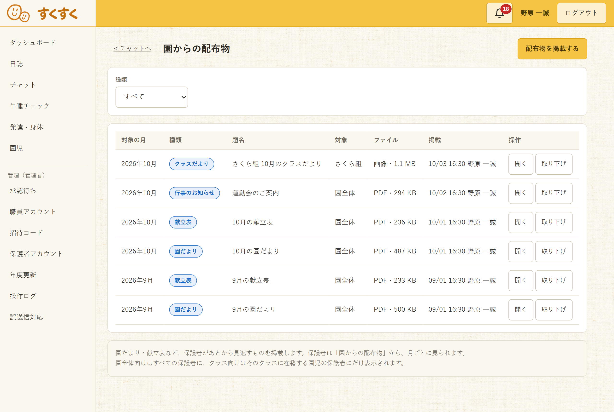
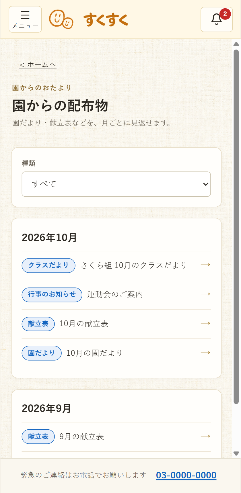

# 保育支援システム 画面詳細図

| 項目 | 内容 |
| :-- | :-- |
| 対象システム | 保育支援システム（すくすくシステム） |
| 版数 | 第 2.4 版 |
| 作成日 | 2026 年 9 月 1 日 |
| 改訂日 | 2026 年 10 月 19 日 |
| 典拠 | `基本設計書.md` 第3.4版「保護者へ届けるときの関所」(2-4)・「画面の一覧」(3-2)・「画面基本構成」(3-5)・「画面詳細」(3-6)・4章（機能概要）・5章（データベース設計）・「権限と利用可能機能」(6-1)、`要件定義書.md` 第3.2版、`設計方針.md` 第1.0版 |
| 作成区分 | チーム開発演習 基本設計 |

## 改訂履歴

| 版 | 日付 | 変更内容 |
| :-: | :-: | :-- |
| 2.4 | 2026/10/19 | **持ち主の答え（2026/10/19）と、持ち主が任せて推しのとおりに決めたものに合わせた**（`基本設計書.md` 第3.4版）。①**午睡の記録の修正**：「異常時記録画面」(5-2) の項目17と「午睡記録検索画面」(5-3) の項目12に、直せる行にだけ「修正」を出すこと（一般は実施の日のうちのその園児のクラスの担任、翌日以降と、異常時の記録がある子の午睡チェックの記録は管理者）、理由は必須（500文字以内）、修正前・修正後の値と理由を操作ログに残すこと、行に「修正あり」を出すことを書いた（行を書き換えてよいことは**持ち主が決めた**）。異常時の記録の修正で直すのは発見時刻・状況・とった対応とし、保護者への連絡は項目13で足す・直すとした。②**午睡の帳票は CSV だけ**とし、5-3 の項目9（PDF の出力）を置かないことにした。項目10に、帳票の中身と末尾の「修正の履歴」の表を移した（演習上の想定）。「モックアップでは実装しないもの」(12-1) から 5-3 項目9 の行を外した。③「全画面に共通する規定」(0-2) の端末と向きに、最小の幅 744px（744px 未満は支えない）を足した。④「連絡帳（クラス）画面」(8-1) の項目15・16：ひとこと・写真が無いとき（いまは「—」）と園からを送っていないとき（いまは「未送信」）に、文字のボタン「書く」を出し、セルいっぱいを押せる形（高さ 44px 以上）にした。読み上げの名前は「（園児名）のひとことを書く」「（園児名）の園からを書く」、送った子は「送った（時刻）」のまま（GitHub Issue #215。同じ日の続きで、未送信の文字と色の残りを消した）。「家庭から」が増えたときだけ読み上げの欄で知らせることを足した（GitHub Issue #209。`詳細設計書.md`「全画面に共通する部品と決まり」(2-0) の (6)）。⑤（同じ日の続き）「午睡チェック画面」(5-1) に、時刻を過ぎた子はタイマーの欄でまとめて1回だけ読み、行ごとには読ませないことを足した（同 (6) の③）。⑥「成長の記録画面（保護者・スマートフォン）」(6-6) の項目7の【要決定】（発達チェックの項目名の出し方）を推しのとおりに決めた。【要決定】は残し、「決まった。本文への反映は次の改訂」と添えた（`要決定事項.md`「決めたが本文へ反映していないもの」(1-4)）。理由は `ナレッジ/決定事項.md` 2026-10-19「持ち主の答え（写真は写った子全員の成長の記録に、午睡の記録は行を書き換えてよい）と、任された決めごとを設計書に書いた」 |
| 2.3 | 2026/10/18 | **設計の細部を保育の目で見直した結果を反映した**（`基本設計書.md` 第3.3版）。①「午睡チェック画面」(5-1)：呼吸「確認できず」の促しを、記録より先に子どもへの対応と応援の要請、記録はそのあと、に改めた。うつ伏せの注意喚起に出す文を書いた。その文は、保存の前に「うつ伏せを記録します」と言い切ると記録が済んだと受け取られ、項目15「記録する」を押さずに離れるおそれがあるため、「このまま記録し」と促す形にした（PR #223 の自動レビュー）。②「異常時記録画面」(5-2)：保護者への連絡の連絡帳・個人チャットは電話（段4）のあとに経過を書く手段だと書き、修正で発見時刻を直せるようにした（保存時刻は変えない）。③「午睡記録検索画面」(5-3)：一覧と出力に入眠時の体温を足した。④「成長の記録画面（保護者・スマートフォン）」(6-6)：免責を画面の下端（緊急連絡の案内のすぐ上）に固定とし（基本設計書・詳細設計書に合わせた）、「できたこと」の画面イメージと項目7を、1回の確定を1件にまとめる形に直した。⑤「園児情報入力画面／園児情報確認画面」(7-2) の項目18：午睡の確認の間隔の上限を、その子のクラスの年齢児の値にした。⑥「日誌作成・編集画面」(3-2)：ヒヤリハットの「今後の対策」を項目28として足した（番号を送らないため末尾に置いた）。⑦人が決める事項に【要決定】を添えた（5-1 の項目10・13・14・17・担当交代・4タップ、6-6 の項目7、「連絡帳（クラス）画面」(8-1) の項目11。`要決定事項.md` 第2.11版「決めてもらうこと」(1-3)）。⑧**保護者へ届ける流れ・共通の仕組みの見直し**（同じ日）で、「新規登録画面（保護者）」(2-3) の続柄の初期値を未選択にし、「保護者ホーム」(2-7)・「連絡帳画面（保護者・スマートフォン）」(8-3) の個人チャットの範囲をそろえ、「誤送信対応記録画面（管理者）」(4-4) の注意書きに情報が含まれていた家庭への連絡を足し、「アレルギー一覧画面」(7-4) の印刷を管理者・一般にし、連絡帳の体温の欄に「先にお電話を」の固定の文【仮置き】を足した。「連絡帳画面（保護者・スマートフォン）」(8-3) のお迎えの部品を詳細設計書にそろえ、連絡事項の近くに「お薬・食事の除去のご依頼は書面で」【仮置き】を足した。4-4 の項目5の言い方を直し、誤送信の欄・続柄の直し方に【要決定】を添えた（`ナレッジ/決定事項.md` 2026-10-18「設計の細部の見直し（保護者へ届ける流れ・共通の仕組み）で直したもの」）。理由は `ナレッジ/決定事項.md` 2026-10-18「設計の細部の見直し（午睡と安全・日誌と育ちの記録）で、保育の目で直したもの」 |
| 2.2 | 2026/10/18 | `詳細設計書.md` 第1.2版を書く中で見つけた食い違いを直した。チャット画面（保護者）(4-2) の項目3に、保護者がまだ1人もいなかった間に園が書いたメッセージも出すことを足した（`基本設計書.md` 第3.1版「チャット」(5-6)。この図だけ第3.1版に追いついていなかった）。連絡帳（クラス）画面 (8-1) の項目8に「おやつ（2回目）」を足した（おやつが2回ある園で2回目を見分ける形が無かった。詳細設計書の申し送り） |
| 2.1 | 2026/10/17 | **基本設計書 第3.0版・要件定義書 第3.0版の統合で決めたことに合わせた。** 連絡帳と「ねた」「おきた」の取り消し・訂正ができる人を「その日は記録した職員」から**「その日はその園児のクラスの担任（記録した職員に限らない）、管理者はいつでも」**に改め（要件定義書「取り消し・訂正」(4-2-5)）、直せない人への文言を基本設計書「メッセージ一覧」(4-12) にそろえた（全画面に共通する規定の④、誤送信対応記録画面、午睡チェック画面の項目27、連絡帳（クラス）画面の項目17、連絡帳（園児）画面の項目7）。アレルギー一覧画面の参照「権限マトリクス」を「権限と利用可能機能」(6-1) に直した。**発達チェックの保護者へのひとことには AI のボタンを置かない**と改めた（発達の記録は外部の AI へ送らない。共通のダイアログと部品の (1)・(6)、発達チェック入力画面の項目14） |
| 2.0 | 2026/10/17 | **`基本設計書.md` 第3.0版（保護者と保育士を子どもでつなぐ作り直し）に追随した。** ①**足した画面**：「連絡帳」(8) を新しく置き、連絡帳（クラス）画面 (8-1)・連絡帳（園児）画面 (8-2)・連絡帳画面 (8-3) を足した。成長の記録画面 (6-6) と設定画面 (7-10) を区分の末尾に足した。第1.x版の節（2〜7）の番号は、ほかの文書が参照しているため動かさず、連絡帳を末尾の 8 に置き、要確認事項・作成状況・残る作業・モックアップとの差異を 8〜11 から **9〜12** に送った。②**消した画面**：共有日誌閲覧画面（2-8）の節を外し、**2-8 は欠番**とした（連絡帳画面に置き換えた。日誌を保護者へ共有しないため）。③**作り直した画面**：保護者ホーム (2-7) を園児ごとの「きょう」の区画で作り直し（項目の番号を振り直した）、職員ダッシュボード (2-6) を「届ける」ことを中心にした項目に、午睡チェック画面 (5-1) を1人1行にして「ねた」「おきた」「きょうは対象外」を5分ごとの確認と同じ行に置いた。共通レイアウト (1-1)・(1-2) は、つながっているかの表示、管理者のヘッダの「異常時の記録（未確認）」、サイドナビの「連絡帳」「設定」と末尾のパスワードの変更・利用規約、保護者のメニュー（連絡帳・成長の記録を園児ごとに、お子さまの追加・連絡先の変更・通知の設定・AI の下書きの利用）と通知の行き先（保護者ホーム）を直した。「共通のダイアログと部品」(1-3) を新しく置き、宛先の表示・写っている子を選ぶ・他児の名前の注意・取り消しの確認・定型文の候補・AI の下書きと、保護者のメニューの4つのダイアログを定めた。④**変えた画面**：チャット画面（職員）(4-1)（確認しました、保護者の既読の人数とまだ読んでいない家庭、スレッドの見出しと絞り込み、宛先の表示、管理者の削除、連絡帳の引用。共有された日誌のカードを外した）、チャット画面（保護者）(4-2)（〇〇（園児名）の園とのやりとり、この連絡について園にたずねる、確認しましたの表示、掲載の知らせのカード）、誤送信対応記録画面 (4-4)（連絡帳を含め、読んでいた家庭の数をシステムが入れる）、日誌一覧画面 (3-1)・日誌作成・編集画面 (3-2)・日誌確認画面 (3-3)・承認待ち一覧画面 (3-4)・日誌承認画面 (3-5)（保護者への共有の欄を外し、きょうのようすから入れる・クラスのようすへ引き写す・AI の下書き・ヒヤリハットの欄・申請の取り下げ・承認の取り消し・編集ロックを持ち続ける）、異常時記録画面 (5-2)（保護者への連絡、管理者の確認した、修正）、午睡記録検索画面 (5-3)（修正の入口、管理者だけがサーバで作る帳票・CSV）、発達チェック一覧画面 (6-1)・発達チェック入力画面 (6-2)（保護者へのひとこと、園児の未実施と項目の漏れ、上書きの印）、身体記録画面 (6-4)、共有範囲設定画面 (6-5)（身体測定の行。引き渡しの失敗と再実行を外した）、新規登録画面 (2-3)（2つの同意と緊急連絡先）、職員用トップ／保護者用トップ (2-1)（保護者は記憶を既定オン、残りの試行回数を示さない）、パスワード変更画面 (2-4)・利用規約同意画面 (2-5)（職員の初回ログインの順番、強制の画面のログアウト）、園児一覧画面 (7-1)・園児情報入力画面 (7-2)（顔写真・呼び名・午睡の間隔・在籍状態と退園の操作・保護者と緊急連絡先、一般は読み取り専用、写真の利用同意の初期値を園内記録に）、CSV一括登録画面 (7-3)、アレルギー一覧画面 (7-4)（既往歴と生年月日を外した）、年度更新画面 (7-5)・保護者アカウント管理画面 (7-8)（保護者の停止はシステムが行う、連絡順、猶予中、紙で申し出があったときの AI を断った記録）、職員アカウント管理画面 (7-6)（フリー）、操作ログ参照画面 (7-9)（連絡帳・設定・AI、CSV は絞り込んだ結果すべて）、配布物の2画面 (4-5)・(4-6)。⑤**全画面に共通する規定 (0-2)**：`設計方針.md`「操作の条件（誰でも使える）」(3-6) の7つの条件を「誰でも使える操作の条件」として置き、本書の項目の並べ方に下ろした。**確認ダイアログの対象から「保護者へ共有する承認」を外し、段1の記録と段2の送信には確認ダイアログを挟まない**（段2は「送る」の直前の宛先の表示を確認とし、他児の名前の注意だけ当たったときに挟む）と定めた。完了の表示に「保護者が見られる状態です」と「取り消す」、免責表示に成長の記録画面、判定の言葉、つながっているかの表示、宛先の顔写真、保護者の画面の園児名、時刻を足した。⑥画面イメージは撮り直していない。足した・作り直した画面は等幅テキストのワイヤーフレームで描き、変えた画面は第2.7版の画像の下に「第2.0版で変えたところ」を書いた（「画面イメージの扱い（第2.0版）」(0-1)）。⑦「モックアップでは実装しないもの」(12-1) を第2.0版の仕様に合わせた（引き渡しの失敗の行を外し、アレルギー一覧の既往歴の列を外した）。⑧画面の数を本書から外した（`基本設計書.md`「画面の一覧」(3-2) と `図/画面ID対応表.md` だけが持つ）。基本設計書の節の番号の送り（4-9→4-12、5-8→5-9 など）に参照を合わせた。典拠は `基本設計書.md` 第3.0版の1〜6章（`design-v3-ui` の `4d5c939`、`design-v3-func` の `88d9a51`、`design-v3-db` の `d87dfbf`。各係の作業中のもの）と `修正箇所/07_設計の食い違い_2026-10-17/`。理由は `ナレッジ/決定事項.md` 2026-10-17「基本設計 第3.0版：画面遷移図・画面詳細図」 |
| 1.14 | 2026/10/09 | **「モックアップ実装との差異」(11) の100件の扱いを決め、反映した。** (1) 形・動きが違うが実画面で成り立っているものは、**実画面を正**として項目表を直した。置かないと決めた部品は、番号を詰めずに取り消し線で残した。(2) モックアップに実装していない機能は、**仕様として残し**、(11) に「モックアップでは実装しないもの」として挙げた。(3) 検査の抜けと不具合は、モックアップを直した（GitHub Issue #136、PR #137）。「全画面に共通する規定」(0-2) に、入力・編集の領域はダイアログで開く旨を足した |
| 1.13 | 2026/10/09 | **全画面の項目表を、モックアップの実画面（`mockup-go-react` の `14c3d24`）と1行ずつ突き合わせた。** 文言・部品の形だけが違っていた行は、実画面に合わせて項目表を直した（表示名・部品種別・列名）。実画面にあって項目表に無かった操作できる部品は、行を足した。**項目表にあって実画面に無い機能と、値・動きの違いは、項目表を変えずに「モックアップ実装との差異」(11) へ挙げた。** 本文の例の氏名を、いまのデモデータのもの（野原 太郎）に改めた |
| 1.12 | 2026/10/09 | **管理側のペルソナのデモと PR #92 の評価で見つけた指摘の直し（GitHub Issue #95〜#129）と、そこで決めた扱いを反映した**（`基本設計書.md` 第2.5版・第2.6版）。共通の規定に「完了の表示」「確認ダイアログ」を足した。新しく置いた部品は項目表に行を足した（日誌作成・編集画面のロックの強制解除、チャット画面（職員）の「操作」、午睡記録検索画面の出力と異常時の記録、招待コード管理画面の「発行済みの園児にも発行する」、保護者アカウント管理画面の「紐づけを戻す」）。決めた扱いは各画面の補足へ書いた。**画面画像は、デモデータの人名を置き換えたあとのモックアップで全43枚を撮り直した** |
| 1.11 | 2026/10/06 | **配布物管理画面 (4-5) と配布物一覧画面（保護者）(4-6) を追加し、全38画面になった。** 保護者ホームに「園からの配布物」の区画を、保護者のメニューに導線を足した。保護者ホームと保護者のメニューの画面画像を撮り直した（`基本設計書.md` 第2.4版、GitHub Issue #94） |
| 1.10 | 2026/10/06 | **保護者の表し方を「〇〇ちゃんの保護者」から「〇〇 〇〇 保護者」（園児の氏名＋保護者）へ改めた。** 「ちゃんの」は要らないとの判断による。園児の氏名で家庭を識別する考え方は変えない |
| 1.9 | 2026/10/06 | **保護者用の共通レイアウトの「メニュー」に、閉じるボタンを加えた。** メニューを開いたあと、閉じる手段が外側を押すことしか無く、見て分からなかったため |
| 1.8 | 2026/10/06 | **`基本設計書.md` 第2.3版に合わせて4画面の項目を改めた。** ①保護者ホーム画面の「緊急連絡の案内」に園の電話番号を添える（GitHub Issue #88）。②日誌承認画面の「保護者への共有」は、個人日誌とヒヤリハットにだけ出す（#61）。③チャット画面（職員）の「メンバー」は職員と保護者を分け、保護者には続柄を添える（#91）。④発達チェック入力画面の「所見」は園内限定である旨を添える（#58） |
| 1.7 | 2026/10/05 | **「全画面に共通する規定」(0-2) に「端末と向き」を加えた。** `基本設計書.md` 第2.2版「想定する端末と向き」(3-5) の新設による。職員向けの画面イメージが横向きのものであることを明記した。画面イメージと項目表は変えていない |
| 1.6 | 2026/09/08 | **チャット2画面に「メッセージの編集」の項目を追記した。** `基本設計書.md` 第2.0版「メッセージの編集」(4-6) の追記による。職員(4-1)へ編集・編集の入力欄・保存/やめる・編集済みの印・取消の5項目、保護者(4-2)へ編集・編集の入力欄・保存/やめる・編集済みの印の4項目を足し、**編集中の画面を撮って貼った**（40・41）。保護者側は既読を表示しないが**編集済みの印は表示する**（編集の有無は読み手が知るべき情報であるため） |
| 1.5 | 2026/09/07 | **画面イメージを等幅テキストのワイヤーフレームから、実装のスクリーンショットへ差し替えた（全36画面）。** 作成当初は実装が無かったため描いていたが、全画面の実装がそろい、**描いた図より実物のほうが正確**になったため。撮影に足りなかった2画面（ログイン中に入口を開いたとき、保護者のメニューを開いた状態）を新たに撮った。項目表はそのまま残し、**項目表が仕様の正である**ことを「表記ルール」(0-1) に明記した。「残る作業」(10) は画面ID対応表の1件だけになった |
| 1.4 | 2026/09/07 | **共有日誌閲覧画面 (2-8) を追加し、【要決定】【要確認】を 68件から11件へ減らした。** 設定マスタの既定値と入力項目の制約値が `基本設計書.md`「設定マスタ」(5-8)・「入力項目の制約値」(4-9) で確定したため、各画面の補足欄へ反映した。あわせて、保護者側チャットの画面分割・共有記録を開く画面・通知からの導線・きょうだいの切り替え・招待コードの入力形式・日誌の雛形の適用・パスワード変更時のセッション・保護者の表し方・規約改定時の差分表示が決着したため、該当の記述を確定に置き換えた。**残る11件は園またはチームの判断を要するもの**（園情報の記入、保護者への共有の既定値、保護者を目的別グループへ入れてよいか、年度更新の取り消し、卒園児の保護者の参照範囲） |
| 1.3 | 2026/09/01 | **「本書で明らかになった要確認事項」(8) が持っていた13件の表を `要決定事項.md` へ移し、同項を案内に置き換えた。** 同じ事項を `図/画面遷移図.md` とも重複して持っており（3件）、一覧が3か所に分かれていたため。`CLAUDE.md`「要決定事項の扱い」に従い、未確定事項の一覧は同書1本が持つ。本文の【要確認】表記は残し、**番号での参照（「要確認事項」(8) No.8 など）を項目名での参照へ改めた** |
| 1.2 | 2026/09/01 | **未着手だった19画面を作成し、全36画面がそろった。** 追加したのは、パスワード変更／利用規約同意／保護者ホーム／日誌確認／承認待ち一覧／園児タイムライン／グループ編成／誤送信対応記録／異常時記録／午睡記録検索／発達チェック一覧／スケジュール設定／共有範囲設定／CSV一括登録／アレルギー一覧／年度更新／職員アカウント管理／保護者アカウント管理／操作ログ参照の19画面。あわせて**節の並びを `基本設計書.md`「画面の一覧」(3-2) の順に整えた**（職員ダッシュボードは 2-4→2-6、日誌承認画面は 3-3→3-5、発達チェック入力画面は 6-1→6-2、身体記録画面は 6-2→6-4、招待コード管理画面は 7-3→7-7）。「チャット画面（職員・タブレット／PC）」(4-1) がグループ編成を管理者のみとしていたのを、同項の利用者（管理者・一般）に合わせて訂正した。「未着手の画面」(10) は「残る作業」(10) に改めた |
| 1.1 | 2026/09/01 | **ワイヤーフレームと項目表を対にする様式へ改めた。** 学校提供テンプレート「(PRGDE004)06_基本設計書_画面詳細_2.0.2」は**画面イメージと項目表（番号／表示名／部品種別／補足）の両方**を求めるが、第1.0版は画面イメージしか持っていなかった。共通レイアウト2種と14画面すべてに項目表を追加し、「部品種別の語彙」(0-1) と「画面イメージの扱い」(0-1) を定めた。あわせて、項目の一覧をどちらが持つかで `基本設計書.md`「画面詳細」(3-6) と**相互に相手を正としていた循環参照**を解消し（項目は本書が正）、「日誌一覧画面」(3-1) のページング件数を同書「一覧表示とページング」(3-7) の既定50件に合わせた |
| 1.0 | 2026/09/01 | 新規作成。共通レイアウト2種と、全36画面のうち**14画面**のワイヤーフレームを作成した。残りの画面と着手順は「未着手の画面」(10) に示す |

---

# 0 本書の位置づけ

- 本書は**図**であり、1画面ごとに**画面イメージ**（どこに何が置かれるか）と**項目の一覧**（番号／表示名／部品種別／補足）を**対にして**示す。学校提供テンプレート「(PRGDE004)06_基本設計書_画面詳細_2.0.2」がユーザインターフェイス設計の章で求める**画面詳細（別紙）**にあたる。同テンプレートは画面イメージと項目表の**両方**を求める。
- **1画面の中に何があるか（項目の並びと見せ方）は本書が正**である。**権限・処理・値は `基本設計書.md` が正**であり、本書の項目が同書の権限（「権限と利用可能機能」(6-1)）・処理（4章）・値（「入力項目の制約値とメッセージ一覧」(4-12)、「設定マスタ」(5-9)）とぶつかったときは、同書に寄せて本書を直す（同「画面詳細」(3-6) の境目）。
- **入力項目の制約値**（必須・桁数・形式・範囲）は、確定したものを本書の補足欄に書く。ただし**エラー時の文言**は `基本設計書.md`「メッセージ一覧」(4-12)、**データ型・桁**は同書「データベース設計」(5) が正であり、食い違った場合は同書へ追随させる。
- **画面のつながり**は `図/画面遷移図.md` が持つ。**画面の数**は `基本設計書.md`「画面の一覧」(3-2) と `図/画面ID対応表.md` だけが持ち、本書は数を書かない。
- 記述が食い違った場合は、**要件定義書 → 基本設計書 → 本書**の順で正とし、本書を追随させる。
- **第2.0版（2026/10/17）で `基本設計書.md` 第3.0版に追随した。** 保護者と保育士を子どもでつなぐ作り直し（`設計方針.md`）により、連絡帳の3画面・成長の記録画面・設定画面を足し、共有日誌閲覧画面を外し、届けることにかかわる画面を直した。
- 掲載している氏名・メールアドレス・招待コード・測定値は**すべて架空**である。実在の園児・保護者の情報は含まない。

## 0-1 表記ルール

**画面イメージは、実装した画面のスクリーンショットを貼る**（2026/09/07 に等幅テキストのワイヤーフレームから差し替えた）。

作成当初は実装が無かったため等幅テキストで描いていた。全36画面の実装がそろい、**描いた図より実物のほうが正確**になったため差し替えた。ワイヤーフレームは git の履歴に残る。

| 項目 | 内容 |
| :-- | :-- |
| 出典 | Go + React 版モックアップ（`mockup-go-react` ブランチ、`48ab4c0`）を **2026/10/09** に動かして撮影（PR #137 のマージ後に、全43枚を撮り直した） |
| データ | 起動時に作られるデモデータ。**実在の園児・保護者ではない** |
| 画像の置き場所 | `図/画面画像/` |
| 画面の幅 | 職員（タブレット／PC）1280px、保護者（スマートフォン）420px（`基本設計書.md`「画面基本構成」(3-5) の前提に合わせた） |

- **画面に出ている値は、デモ用の仮置きである。** 制約値の正は `基本設計書.md`「入力項目の制約値」(4-12)、設定値の正は同「設定マスタ」(5-9) が持つ
- **項目表が仕様の正である。** スクリーンショットは実装の現状を写したものであり、実装が仕様と食い違っていれば実装を直す
- 実装が変われば撮り直す。**撮り直しの手順は `図/画面遷移図.md`「画面画像の出典」(0-2) と同じ**
- 画面名は `基本設計書.md`「画面の一覧」(3-2) の名称と一致させる

### 画面イメージの扱い（第2.0版）

**第2.0版では画面画像を撮り直していない。** モックアップは第2.7版の設計のままであり、作り直したあとに撮る（`設計方針.md`「モックアップの作り直しの順番」(8-4) の段4）。それまでは画面ごとに次のとおり扱う。

| 画面 | 画面イメージ | 項目表 |
| :-- | :-- | :-- |
| **足した画面**（連絡帳（クラス）画面・連絡帳（園児）画面・連絡帳画面・成長の記録画面・設定画面）と、共通のダイアログ（1-3） | **等幅テキストのワイヤーフレーム**（ASCII の枠）で描く。第1.4版まで使っていた描き方に合わせた | 番号1から振る |
| **作り直した画面**（保護者ホーム・職員ダッシュボード・午睡チェック画面）と共通レイアウト | ワイヤーフレームで描き直す。第2.7版の画像は貼らない（違う姿を見せると、どちらが正か迷うため） | 保護者ホームは番号を振り直した。ほかは下の「変えた画面」と同じ |
| **変えた画面**（上のほか） | **第2.7版のスクリーンショットを残し**、画像の下に「第2.0版で変えたところ（画像に写っていない）」を書く | **番号を詰めない。** 足した項目は末尾の番号に足し、置かなくなった項目は取り消し線で残す（第1.14版と同じ書き方）。補足を書き換えた項目はそのまま直す |

- ワイヤーフレームは**配置と項目の対応を示すもの**であり、見た目（色・字の大きさ・余白）は決めない。見た目は採用したデザインの部品（`設計方針.md`「変えないもの」(9)）による
- ワイヤーフレームの中の `[ ]` はボタン、`( )` はラジオボタン、`[x]` はチェックボックス、`< >` は入力欄、`(!)` は注意の表示、`(*)` は選んだラジオボタンを表す
- **差し替えても項目表は残す。** テンプレートが求めるのは画面イメージと項目表の両方であり、画像だけでは番号・部品種別・制約が読めない
- 画像は `図/画面画像/` に置き、相対リンクで貼る

### 部品種別の語彙

補足欄に何を書くかは**部品種別で決まる**ため、次の語だけを使う。表記がゆれると、項目表を画面をまたいで読めなくなる。

| 部品種別 | 用途 | 補足欄に書くこと |
| :-- | :-- | :-- |
| ラベル | 表示専用の文字 | 表示：何を出すか |
| テキスト入力／パスワード入力／数値入力／日付入力 | 1行の入力 | 初期値／入力（必須・任意）／制限（形式・桁数・範囲） |
| テキストエリア | 複数行の入力 | 同上 |
| プルダウン／ラジオボタン／チェックボックス | 選択 | 初期値／入力／制限（選択肢） |
| ボタン／リンク | 操作 | 処理：何をするか／処理結果：どうなるか |
| 一覧（テーブル）／カード | 複数件の表示 | 表示：列と並び順／制限：ページング |
| ファイル選択 | 写真・添付 | 初期値／入力／制限（枚数・形式・容量） |
| 領域 | 他の部品をまとめる枠 | 表示：何をまとめるか |
| ナビゲーション | 画面間の導線 | 表示：項目／処理：遷移先 |
| アイコン／画像／タイマー／グラフ | 上記に当てはまらないもの | 表示：何を出すか |

- **未確定の値を空欄にしない。** 空欄は「制約なし」と読めてしまい、決め忘れが埋もれる。第3.0版で未確定のもの（チームか持ち主が決めるもの）は **【要決定】** と書く（一覧は `要決定事項.md`「決めてもらうこと」(1-3)）
- 全画面に効く規定は各画面で繰り返さず、「全画面に共通する規定」(0-2) を参照する。段2を送る画面に共通の部品（宛先の表示、写っている子を選ぶ、他児の名前の注意、定型文の候補、AI の下書き）は「共通のダイアログと部品」(1-3) を参照する

## 0-2 全画面に共通する規定

`基本設計書.md`「画面基本構成」(3-5) より、レイアウトに影響するものを再掲する。**本書の全画面がこれに従う。**

| 規定 | 内容 |
| :-- | :-- |
| テーマカラー | 優しい黄色。警告色は黄色と対比の付く色を用いる。警告色は午睡チェックの異常、範囲外の入力値、サーバに届かないときの表示に使う |
| グリッド | 職員（タブレット／PC）＝12カラム、保護者（スマートフォン）＝シングルカラム |
| タップ領域 | **44×44px 以上**。タブレットとスマートフォンの片手操作を前提とする。縦向きでも小さくしない |
| 端末と向き | 職員のタブレットは**横向きが基本**。**縦向きでも構成を変えず**、各領域の幅だけを詰める。**最小の幅は 744px**（iPad mini の縦向き。744px 未満は支えない）。PC はタブレット横向きの縦横比のまま中央に表示する。列の多い一覧（連絡帳（クラス）画面など）は、**一覧の領域の中だけを横に送る**。**本書の職員向けの画面イメージは横向きのもの**である（`基本設計書.md`「想定する端末と向き」(3-5)）。保護者のスマートフォンは縦向きで、**よく押すボタン（「送る」「家庭からを書く」など）を画面の下半分に置く** |
| ヘッダ | ログイン中の利用者名を**常時表示**する（職員は所属クラスも）。職員は**つながっているかの表示**を置く（下の行）。管理者は**異常時の記録（未確認）の件数**を置く（「職員（タブレット／PC）」(1-1)） |
| ログアウト | 職員はヘッダに常時表示。保護者はメニュー内。**保存していない入力があれば、破棄される旨を確認する。午睡チェックの実施中は、先に午睡チェックを終了するよう示す**（`基本設計書.md`「ログアウト」(4-3)） |
| 免責表示 | 成長グラフ・発達チェックの比較（職員）と、保護者の**成長の記録画面**には「判定・診断を行うものではありません」を**固定表示**する。文言は `基本設計書.md`「メッセージ一覧」(4-12) の免責表示 |
| 判定の言葉 | 連絡帳の体温・午睡の長さ・食事の量に、良し悪しや「平熱」「発熱」のような**判定の言葉を付けない**。時刻と値と職員の言葉だけを出す（設計原則1。`基本設計書.md`「画面基本構成」(3-5)） |
| サイドナビ | **保護者向け画面は持たない** |
| 入力・編集の領域 | 項目表で「同じ画面の中に入力領域／編集領域を開く」と書いたものは、**画面に重ねるダイアログ**で開く。画面は移らない。ただし**一覧の行の上で終える記録**（連絡帳（クラス）画面の「確認しました」・食事・排せつ、午睡チェック画面の「ねた」「おきた」と5分ごとの確認）はダイアログを開かない |
| 完了の表示 | 操作が通ったことを、**画面の下端に数秒表示する**。画面を移っても消さない。押したあとに、できたのかどうかが分かるようにする。**保護者へ届く操作では「送りました。保護者が見られる状態です」まで示し、「取り消す」を添える**（保護者が未登録の園児は「送りました。保護者が登録すると読めます」）。保護者の「家庭から」は「送りました。園が確認するとここに出ます」（`基本設計書.md`「入力項目の制約値とメッセージ一覧」(4-12)） |
| 確認ダイアログ | **アカウントの操作・設定の変更・保護者へ出たものを取り消す操作・園内の確認を変える操作は、確定の前に確認する。** 対象は、職員アカウントの停止・再開、一時パスワードの再発行、招待コードの失効、紐づけの解除・復元、退園の操作と在籍へ戻す操作、園児情報の取消、共有範囲の切り替え、設定の変更（AI の有効化を含む）、**連絡帳・チャットの取り消しと削除（いま読んでいる家庭の数を示す）**、日誌の申請の取り下げ・承認の取り消し、編集ロックの強制解除。何が起きるかを文章で示す（同上） |
| 確認を挟まないもの | **段1の記録（選ぶだけ・数値だけ。「ねた」「おきた」、食事・排せつ・体温、「確認しました」）には確認を挟まない。** 押した結果を見せ、その日のうちに取り消せるようにする（1件3タップ以内のため）。**段2の送信（文と写真）も別の確認ダイアログを挟まず、「送る」の直前に示す宛先の表示を確認とする**（「共通のダイアログと部品」(1-3) の宛先の表示）。毎回ダイアログを挟むと、読まずに押す癖がつく。**他児の名前の注意だけは、当たったときに挟む**。配布物の掲載は、掲載の入力の中の「届く範囲の案内」を確認とする（`基本設計書.md`「保護者へ届けるときの関所」(2-4)・「入力項目の制約値とメッセージ一覧」(4-12)） |
| ダイアログの中の誤り | ダイアログの中で起きた入力の誤りは、**ダイアログの中に表示する**。背後の画面に出すと隠れて読めない |
| つながっているかの表示 | 3つの状態を、**色だけに頼らず文字でも**示す（`基本設計書.md`「画面基本構成」(3-5) の「つながっているかの表示」）。**つながっている**：職員はヘッダに小さく「すぐに反映」、保護者は出さない。**知らせが切れている**：職員はヘッダに「自動で読み直しています」、保護者は画面の上端に細く同じ文。**サーバに届かない**：職員・保護者とも画面の上端に警告色で「サーバにつながりません。記録は保存されていません」と「もう一度送る」。入力中の内容は画面に残す（オフライン入力はしない） |
| 宛先の顔写真 | 園児の顔写真は、**職員の画面で宛先を確かめるためだけ**に出す。保護者の画面には出さない（自児のものも出さない） |
| 保護者の画面の園児名 | 連絡帳画面・成長の記録画面・個人チャットは、**先頭に園児名を常に出す**。画面の中で別の園児へ切り替える操作は置かない（`基本設計書.md`「画面体系図」(3-3)） |
| 時刻 | 画面に出す時刻・「本日」の判定は**サーバの時刻**による。端末の時計を使わない |

### 誰でも使える操作の条件

`設計方針.md`「操作の条件（誰でも使える）」(3-6) と要件定義書「誰でも使える操作」(7-1 No.9) を、**職員・保護者の全画面の条件**とする。画面での作りは `基本設計書.md`「画面基本構成」(3-5) の「誰でも使える操作の条件」による。本書の各画面は、次のとおり項目を並べる。

| 条件 | 本書の項目の並べ方 |
| :-- | :-- |
| ① **文字を打たなくても届けられる** | 連絡帳の各欄は**選ぶ部品（ラジオボタン・ボタン）を先に**置き、文字の欄はその後ろに任意で置く。選んだものだけで「送る」を押せる。定型文は**候補から選んで入れる**（「共通のダイアログと部品」(1-3)）。AI の下書きは文字の欄の横の任意のボタンであり、無くても届けられる。入力の順番は「選ぶ → 定型文 → AI の下書き → 手で直す」 |
| ② **1件の記録は3タップ以内**（写真を除く） | よく使う記録は**一覧の行の上で終える**（連絡帳（クラス）画面の「確認しました」・食事・排せつ、午睡チェック画面の「ねた」「おきた」）。食事は列の「全員ぜんぶ」で全員に一度に記録し、違う子だけ行で直す。段1の記録には確認のダイアログを出さない。**数え方**：記録を始める画面を開いてから保存されるまでに押す回数とし、数字や文字の入力はひとまとまりで1回と数える |
| ③ **押したら結果を見せる** | 保存・送信のたびに、画面の下端に結果を出す（上の「完了の表示」）。送れなかったときは、送れなかったことと次にすることを出す |
| ④ **送ったものは取り消せる** | 結果の表示と記録の行に「直す」「取り消す」を置く。**その日はその園児のクラスの担任（記録した職員に限らない）、管理者はいつでも**（`基本設計書.md`「連絡帳」(4-5) の「取り消し・訂正」）。直せない人には、ボタンを出さないか、押したときに「この記録を直せるのは、その日はクラスの担任、翌日以降は管理者です。管理者へご依頼ください。」を出す |
| ⑤ **間違えたら何が違うかと次にすること** | エラーの文言は、**何が違うか**と**次にすること**の2つを必ず持つ（例「〇〇さんは写真の同意が『園内記録として保持』のため送れません。写真を外すか、写っている子を見直してください。」）。文言は `基本設計書.md`「メッセージ一覧」(4-12) が持つ。エラーのときも入力中の内容は消さない |
| ⑥ **送る前に宛先を園児名と顔写真で大きく示す** | 段2を送る画面は、「送る」の直前に**宛先の表示**を置く（「共通のダイアログと部品」(1-3)）。保護者の画面では、上の「保護者の画面の園児名」による |
| ⑦ **タップ領域 44px 以上、縦向きでも同じ構成** | 上の「タップ領域」「端末と向き」による |

- **段1・段2の見分け**（`基本設計書.md`「保護者へ届けるときの関所」(2-4)）：段1は選ぶだけ・数値だけで他児の情報が入る余地の無い記録（「ねた」「おきた」、食事・排せつ・体温、「確認しました」、身体測定の登録、発達チェックの「確認できた」）。段2は職員が書く文と写真（活動のひとこと・写真・クラスのようす・園からのひとこと・保護者が参加するチャンネルへの投稿・発達チェックの保護者へのひとこと）。段3（園内に留める記録）の画面には、保護者へ届ける部品を置かない

---

# 1 共通レイアウト

## 1-1 職員（タブレット／PC）

```text
+------------------------------------------------------------------------------
| [すくすく]   (!) 異常時の記録（未確認）1件      すぐに反映   [通知 5]
|                                     野原 一誠（ひよこ組）     [ ログアウト ]
+------------------------------------------------------------------------------
| (!) サーバにつながりません。記録は保存されていません   [ もう一度送る ]
+--------------+---------------------------------------------------------------
| ダッシュボード |
| 連絡帳       |   メインコンテンツ（各画面）
| 日誌         |
| チャット      |
| 午睡チェック   |
| 発達・身体    |
| 園児         |
| 管理（管理者）  |
|  承認待ち     |
|  職員アカウント |
|  招待コード    |
|  保護者アカウント|
|  年度更新     |
|  操作ログ     |
|  誤送信対応    |
|  設定        |
| ------------ |
| パスワードの変更 |
| 利用規約      |                         送りました。保護者が見られる状態です
|              |                                        [ 取り消す ] [ 閉じる ]
+--------------+---------------------------------------------------------------
```

*職員（タブレット／PC）の共通レイアウト。ヘッダ・サイドナビ・メインコンテンツ。「異常時の記録（未確認）」は管理者の画面だけ、「サーバにつながりません」は届かないときだけ出る。第2.7版の画像（`06_職員ダッシュボード.png`）にはサイドナビの「連絡帳」「設定」と末尾の2項目、つながっているかの表示、異常時の記録の件数が無い*

**項目**

| 番号 | 表示名 | 部品種別 | 補足 |
| :-: | :-- | :-- | :-- |
| 1 | サービス名（すくすく） | 画像 | 表示：全画面のヘッダ左端に固定する |
| 2 | 通知 | アイコン | 表示：その職員に出る未対応の項目の**総件数**を添える（職員ダッシュボード (2-6) の項目の合計）。0件のときは件数を出さない／処理：職員ダッシュボード (2-6) へ移る。保護者の通知は「保護者（スマートフォン）」(1-2) の項目3 |
| 3 | 利用者名・所属クラス | ラベル | 表示：ログイン中の職員名と所属クラス。**常時表示**（要件定義書「端末の利用形態と本人特定」(4-1-4 (4))）。担当クラスの無い一般には「フリー」と出す |
| 4 | ログアウト | ボタン | 処理：セッションを破棄する／処理結果：職員用トップへ遷移する。**保存していない入力があれば、破棄される旨を確認する。午睡チェックの実施中は、先に午睡チェックを終了するよう示して止める** |
| 5 | サイドナビゲーション | ナビゲーション | 表示：ダッシュボード／**連絡帳**／日誌／チャット／午睡チェック／発達・身体／園児／管理。現在地を強調する。**管理は管理者にのみ表示**する／「管理」は押せる項目ではなく見出し「管理（管理者）」とし、その下に 承認待ち／職員アカウント／招待コード／保護者アカウント／年度更新／操作ログ／誤送信対応／**設定** を並べる／**末尾に区切りを置き、「パスワードの変更」「利用規約」を並べる**（一般・管理者とも。PR #190 の形） |
| 6 | メインコンテンツ | 領域 | 表示：各画面の内容。12カラムグリッド |
| 7 | メッセージ表示領域 | 領域 | 表示：完了・警告・エラーの文言。文言は `基本設計書.md`「メッセージ一覧」(4-12) に従う／完了の表示には「閉じる」を置く。保護者へ届いた操作の完了には「取り消す」を添える（「全画面に共通する規定」(0-2) の完了の表示） |
| 8 | 本文へ移動 | リンク | 表示：キーボードで最初に止まる位置に置く／処理：メインコンテンツへ移る |
| 9 | つながっているかの表示 | ラベル | 表示：ヘッダに「すぐに反映」（つながっている）／「自動で読み直しています」（知らせが切れている）を文字で出す。色だけに頼らない（「全画面に共通する規定」(0-2)） |
| 10 | 異常時の記録（未確認） | ラベル＋ボタン | 表示：**管理者の全画面のヘッダに**、管理者が「確認した」を押していない異常時の記録の件数を警告色で出す。登録されたときに**通知音を鳴らす**。0件のときは出さない／処理：異常時記録画面 (5-2) へ移る／制限：一般の画面には出さない。1人の管理者が確認すれば、全管理者のヘッダから消える（`基本設計書.md`「異常時の記録の受け手」(4-8)） |
| 11 | サーバに届かないときの警告 | 領域 | 表示：サーバに届かないとき、画面の上端に警告色で「サーバにつながりません。記録は保存されていません」と「もう一度送る」を出す。入力中の内容は残す／処理：「もう一度送る」で、送れなかった操作をもう一度送る |
| 12 | パスワードの変更・利用規約 | リンク | 表示：サイドナビの末尾（項目5）／処理：パスワード変更画面 (2-4)（任意の変更）、利用規約の参照（利用規約同意画面 (2-5) の読み返しの表示）へ移る |

- **ログイン中の職員名と所属クラスをヘッダに常時置く。** 共有端末での記録者の取り違えを防ぐため（要件定義書「端末の利用形態と本人特定」(4-1-4 (4))）
- サイドナビは**現在地を強調**する。「管理」は管理者にのみ表示し、一般には項目自体を出さない
- 通知には未対応の**総件数**を添える。**項目ごとに該当画面へ入る導線は、職員ダッシュボードの側が持つ**（`基本設計書.md`「画面基本構成」(3-5)）。ヘッダに項目一覧を出すと、全画面に載る部品が重くなり、午睡チェック中の画面でも視線を奪うため。**例外は管理者の「異常時の記録（未確認）」だけ**で、園児の生命に関わるため件数をヘッダに直接出し、通知音を鳴らす
- **担当クラスの無い一般（保育士）には「フリー」の印を付け、全クラスを閲覧のみで見られることをメインコンテンツの先頭に示す**（要件定義書「参照範囲の全体規定」(4-1-5)）。記録の作成・編集のボタンは出さない。割り当ての誤りなら管理者へ依頼するよう添える
- **管理者に限る画面を、権限の無い職員がアドレスから開いたときは、職員ダッシュボードへ戻したうえで、その旨を表示する。** 黙って戻さない
- 職員には Web Push を送らない（園内の端末で画面を開いて使う）。知らせは開いている画面への即時の反映（SSE）で受ける

## 1-2 保護者（スマートフォン）

```text
メニューを閉じた状態              メニューを開いた状態
+--------------------------      +--------------------------
| [=]  [すくすく]   [通知 3]      | 野原 太郎・野原 花 保護者
+--------------------------      |              [ 閉じる ]
| 自動で読み直しています           | ホーム
+--------------------------      | 野原 太郎の連絡帳
|                                | 野原 花の連絡帳
|   メインコンテンツ              | 野原 太郎の成長の記録
|   （各画面）                    | 野原 花の成長の記録
|                                | チャット・お知らせ
|   よく押すボタンは               | 園からの配布物
|   画面の下半分に置く             | ------------------------
|                                | お子さまの追加
+--------------------------      | 連絡先の変更
| (!) 緊急のご連絡は              | 通知の設定
|     お電話でお願いします         | AI の下書きの利用
|     （園の電話番号）            | パスワードの変更
+--------------------------      | 利用規約
                                 | [ ログアウト ]
                                 +--------------------------
```

*保護者（スマートフォン）の共通レイアウトとメニュー。きょうだい（野原 太郎・野原 花）が在籍する例。「自動で読み直しています」は知らせが切れているときだけ出る。第2.7版の画像（`34_保護者ホーム.png`・`39_保護者メニュー.png`）は、メニューが「ホーム／チャット・お知らせ／園からの配布物／パスワードの変更／利用規約／ログアウト」だけの姿である*

**項目**

| 番号 | 表示名 | 部品種別 | 補足 |
| :-: | :-- | :-- | :-- |
| 1 | メニュー | ボタン（アイコン） | 処理：メニューを開閉する／処理結果：同じ画面の中にメニューを重ねて表示する。**開いたメニューの中に「閉じる」ボタンを置く。** 外側を押しても閉じるが、それは見て分かる操作ではないため、閉じ方を文字で示す |
| 2 | サービス名（すくすく） | 画像（リンク） | 表示：サービス名の画像を置く。園名は保護者用トップ (2-1) に出す／処理：保護者ホームへ移る |
| 3 | 通知 | アイコン | 表示：**未読の合計**（連絡帳の新着・チャットの未読・成長の記録の新しい記録・配布物。保護者ホーム (2-7) の区画に出す数の合計）。0件のときは件数を出さない／処理：**保護者ホーム (2-7) へ移る**（第1.x版はチャット画面。新着が4種類に分かれたため、園児の区画ごとに何が新しいかを示すホームへつなぐ） |
| 4 | 利用者名 | ラベル | 表示：「〇〇 〇〇 保護者」（園児の氏名＋保護者。例：「野原 太郎 保護者」）。メニュー内に表示する。園児が複数のときは氏名を「・」でつなぐ |
| 5 | ホーム | リンク | 処理：保護者ホームへ遷移する |
| 6 | チャット・お知らせ | リンク | 処理：チャット画面（保護者） (4-2) のチャンネル一覧へ遷移する |
| 7 | パスワードの変更 | リンク | 処理：パスワード変更画面へ遷移する |
| 8 | 利用規約 | リンク | 処理：利用規約を表示する（`利用規約・プライバシーポリシー.md`） |
| 9 | ログアウト | ボタン | 処理：セッションを破棄し、**この端末の通知の購読を外す**／処理結果：保護者用トップへ遷移する |
| 10 | メインコンテンツ | 領域 | 表示：各画面の内容。シングルカラム。**サイドナビゲーションは持たない** |
| 11 | 園からの配布物 | リンク | 表示：メニューの中に置く／処理：配布物一覧画面（保護者） (4-6) へ遷移する |
| 12 | 緊急の連絡の案内 | ラベル（電話番号はリンク） | 表示：全画面の下端に「緊急のご連絡はお電話でお願いします」と園の電話番号（`facility.phone_number`）を置く。番号は押すと電話をかけられる。未設定のあいだは文言だけ |
| 13 | 連絡帳 | リンク | 表示：**園児ごとに**「〇〇（園児名）の連絡帳」と並べる（園児が1人なら「連絡帳」）／処理：その園児の連絡帳画面 (8-3) のきょうのページへ遷移する |
| 14 | 成長の記録 | リンク | 表示：園児ごとに「〇〇（園児名）の成長の記録」と並べる／処理：その園児の成長の記録画面 (6-6) へ遷移する |
| 15 | お子さまの追加 | リンク | 処理：「お子さまの追加」ダイアログ（1-3）を開く。画面は移らない |
| 16 | 連絡先の変更 | リンク | 処理：「連絡先の変更」ダイアログ（1-3）を開く |
| 17 | 通知の設定 | リンク | 処理：「通知の設定」ダイアログ（1-3）を開く／制限：**【要決定】Web Push を演習で作らない場合は置かない**（`要決定事項.md`「決めてもらうこと」(1-3)） |
| 18 | AI の下書きの利用 | リンク | 処理：「AI の下書きの利用」ダイアログ（1-3）を開く／制限：園が AI を有効にしているとき（`ai.enabled`）だけ置く |
| 19 | つながっているかの表示 | ラベル | 表示：知らせが切れているときだけ、画面の上端に細く「自動で読み直しています」。サーバに届かないときは警告色で「サーバにつながりません。記録は保存されていません」と「もう一度送る」。つながっているときは出さない（狭い画面を使わないため） |

- **サイドナビを持たず、ホームとメニューからの導線に絞る。** 片手操作を前提とするため
- ログアウトはメニュー内に置く
- **連絡帳と成長の記録は、メニューでも園児ごとに項目を並べる。** 選んだあとで園児を切り替える操作は置かない（`基本設計書.md`「画面体系図」(3-3)）
- メニューの「お子さまの追加」「連絡先の変更」「通知の設定」「AI の下書きの利用」は**ダイアログ**であり、画面として数えない（`基本設計書.md`「画面の一覧」(3-2)）。「AI の下書きの利用」は、保護者が自児ごとに AI を断る口である（`基本設計書.md`「文章の下書き（AI）」(4-11)、「データ保護」(6-3)）
- **保護者の画面に、AI を使ったかどうかの印は出さない**（担任が直して送った文は担任の言葉として扱う。演習上の想定）

## 1-3 共通のダイアログと部品

第2.0版で新しく置いた。**段2を送る画面に共通の部品**と、**保護者のメニューから開くダイアログ**をまとめる。いずれも画面として起こさず、画面数に数えない（`基本設計書.md`「画面の洗い出しの考え方」(3-1) の基準3）。各画面の項目表は「（1-3）の宛先の表示」のようにここを参照し、同じ中身を繰り返さない。

### (1) 宛先の表示（段2を送る画面の「送る」の直前）

```text
園児1人あて（連絡帳・個人チャット・発達チェックの保護者へのひとこと）
+--------------------------------------------------------------------
| 宛先  [顔写真]  野原 太郎（ひよこ組）     母・父に届きます
+--------------------------------------------------------------------
| < 本文 >                                              残り 312 文字
| [ 定型文 ]  [ AI の下書き ]  [ 言い換え ]
|                                                        [ 送る ]
+--------------------------------------------------------------------

クラスあて（クラスのようす・クラスグループ）／園全体（園チャット）
+--------------------------------------------------------------------
| 宛先  ひよこ組の 12 家庭に届きます   ／   園全体の 98 家庭に届きます
+--------------------------------------------------------------------

顔写真が無い園児              保護者がまだ登録していない園児
| 宛先  (野)  野原 太郎（ひよこ組）  | 宛先 [顔写真] 野原 太郎 まだ保護者が登録していません（登録すると読めます）
```

| 番号 | 表示名 | 部品種別 | 補足 |
| :-: | :-- | :-- | :-- |
| 1 | 宛先の園児名・クラス | ラベル | 表示：**大きく**出す。園児1人あてのとき |
| 2 | 顔写真 | 画像 | 表示：園児マスターの顔写真（`m_child.face_photo_path`）。**職員の画面だけ**に出す。登録が無いときは**名前の1文字目を丸で示し**、園児名とクラスを大きく出す（送るのは止めない） |
| 3 | 届く保護者 | ラベル | 表示：届く保護者の続柄（例「母・父に届きます」）。保護者がまだ登録していない園児は「まだ保護者が登録していません（登録すると読めます）」 |
| 4 | 届く家庭の数 | ラベル | 表示：クラスあては「ひよこ組の n 家庭に届きます」、園全体は「園全体の n 家庭に届きます」 |
| 5 | 送る | ボタン | 処理：サーバが権限・入力の制約・写真の同意・他児の名前を確かめ、満たせば保存して届ける（`基本設計書.md`「共通の処理」(4-2) の「送る時点の守り」）／処理結果：「送りました。保護者が見られる状態です」と「取り消す」を出す。**別の確認ダイアログは挟まない**（この表示が確認を兼ねる。「全画面に共通する規定」(0-2)）。他児の名前が当たったときだけ (3) を開く |

- 宛先の表示は**「送る」と同じ領域の、すぐ上**に置く。画面の上のほうに出すだけでは、送るときに目に入らない
- 顔写真は宛先を確かめるための園内の情報であり、保護者の画面と外部の AI には出さない（`基本設計書.md`「園児・クラス」(5-3)）
- 図の [ AI の下書き ]・[ 言い換え ] は、使える欄にだけ出す（(6)）。**発達チェックの保護者へのひとことには出さない**

### (2) 写っている子を選ぶ（ダイアログ）

写真を添えられる画面（連絡帳（クラス）画面 (8-1)・連絡帳（園児）画面 (8-2)・チャット画面（職員） (4-1)）で、写真を選んだあとに開く。

```text
+-------------------------------------------------------------------
| 写っている子を選んでください                         [ 閉じる ]
| +------------+
| | 写真の見本  |   [x] [顔] 野原 太郎   [x] [顔] 上園 花子
| +------------+   [ ] [顔] 山田 さくら [ ] (野) 野原 花  ...
|                  [ ] 子どもは写っていない（作品・景色など）
| -----------------------------------------------------------------
| 届く先：野原 太郎・上園 花子の連絡帳
| < 写真に添える文（任意） >                         残り 200 文字
| (!) 上園 花子さんは、ほかの保護者にも見える場への写真の同意がないため
|     送れません。写真を外すか、写っている子を見直してください。
|                                         [ やめる ]  [ 送る ]
+-------------------------------------------------------------------
```

| 番号 | 表示名 | 部品種別 | 補足 |
| :-: | :-- | :-- | :-- |
| 1 | 写真の見本 | 画像 | 表示：選んだ写真を小さく出す／制限：**1回に1枚**。JPEG・PNG、1ファイル10MBまで（`attachment.allowed_types`・`attachment.max_size_mb`）。動画は認めない |
| 2 | 園児の一覧 | チェックボックス（一覧） | 表示：その日にそのクラスに在籍する園児の**園児名と顔写真**（顔写真が無ければ名前の1文字目を丸で）／初期値：連絡帳（園児）画面から開いたときは**その子を選んだ状態**、ほかは未選択／入力：写っている子を**全員**選ぶ。顔の自動判定はしない |
| 3 | 子どもは写っていない | チェックボックス | 初期値：オフ／処理：作品・景色など、子どもが写っていない写真のときに選ぶ。連絡帳では、届ける子を1人選ぶ（連絡帳（園児）画面ではその子） |
| 4 | 届く先 | ラベル | 表示：選んだ内容から、届く先を (1) と同じ形で示す。連絡帳は**選んだ全員の連絡帳**、クラスのようすはクラスと家庭の数、チャットはそのチャンネル |
| 5 | 写真に添える文 | テキストエリア | 初期値：空／入力：任意／制限：連絡帳は**200文字以内**（`基本設計書.md`「入力項目の制約値」(4-12)）。チャットは本文として1,000文字以内 |
| 6 | 送れない理由 | ラベル | 表示：サーバが写真の同意を確かめて送れなかったとき、**同意の足りない子の名前**と**次にすること**（写真を外す・写っている子を見直す）をダイアログの中に出す。警告で済ませず、送らない |
| 7 | やめる | ボタン | 処理：ダイアログを閉じる／処理結果：送らない |
| 8 | 送る | ボタン | 処理：(1) の「送る」と同じ／制限：**写っている子か「子どもは写っていない」を選ぶまで押せない** |

- **送れる条件**（サーバが確かめる。`基本設計書.md`「共通の処理」(4-2) の「写真の同意で止める規則」）：連絡帳で写っている子が1人なら、その子の同意が「自児の保護者へ共有」以上。2人以上なら、**全員**の同意が「他の保護者にも見える場へ掲載」。クラスのようす・クラスグループ・園チャットは、写っている全員が「他の保護者にも見える場へ掲載」。子どもが写っていない写真は条件なし
- 2人以上が写った写真は、**選んだ全員の連絡帳**に出る
- 写真は1回に1枚とする。写っている子と同意の判定は写真ごとに違うため、まとめて選ばせると取り違えやすい

### (3) 他児の名前の注意（ダイアログ）

```text
+--------------------------------------------------------------
| ほかのお子さんの名前（上園 花子）が入っています。
| このまま送りますか。
|   「……【はなちゃん】と砂場で……」   ← 当たった語を強調する
|                              [ 直す ]  [ このまま送る ]
+--------------------------------------------------------------
```

| 番号 | 表示名 | 部品種別 | 補足 |
| :-: | :-- | :-- | :-- |
| 1 | 注意の文 | ラベル | 表示：「ほかのお子さんの名前（〇〇）が入っています。このまま送りますか。」（`基本設計書.md`「メッセージ一覧」(4-12)） |
| 2 | 当たった箇所 | ラベル | 表示：本文の中で当たった語を強調して示す |
| 3 | 直す | ボタン | 処理：ダイアログを閉じ、入力へ戻る／処理結果：送らない。入力中の内容は残す |
| 4 | このまま送る | ボタン | 処理：送る人の承諾を付けて送り直す |

- **照合はサーバが行う。** 宛先以外の在籍園児の氏名・名・よみ・**呼び名**を本文から探す。園児の名前の一覧は画面へ配らない
- **機械的な文字の照合であり、判断ではない**（設計原則1）。送るかどうかは送る人が決める
- 段2を送るすべての画面（連絡帳・保護者が参加するチャンネル・発達チェックの保護者へのひとこと）で出す。送ったあとの編集（チャット）でも出す

### (4) 取り消し・削除の確認（ダイアログ）

```text
+--------------------------------------------------------------
| この記録を取り消しますか。
|   12:10 給食 ぜんぶ（野原 太郎）
| いま保護者 1 家庭（2 名）が読んでいます。
| 取り消しても、読まれた内容は取り消せません。
|                                 [ やめる ]  [ 取り消す ]
+--------------------------------------------------------------
```

| 番号 | 表示名 | 部品種別 | 補足 |
| :-: | :-- | :-- | :-- |
| 1 | 対象 | ラベル | 表示：取り消す記録・メッセージの要約（時刻・内容・園児名） |
| 2 | 読んでいる家庭の数 | ラベル | 表示：「いま保護者 n 家庭（m 名）が読んでいます。取り消しても、読まれた内容は取り消せません。」。**システムが数える**。連絡帳は保護者がそのページを最後に開いた時刻（`t_contact_read`）、チャットは既読で数える |
| 3 | やめる | ボタン | 処理：閉じる |
| 4 | 取り消す（削除する） | ボタン | 処理：論理削除し、元の値を操作ログへ残す／処理結果：保護者の全画面（連絡帳・保護者ホームの「きょう」・成長の記録・通知の一覧）から消える。他児の情報を含んでいた場合は、管理者が誤送信対応記録画面 (4-4) に記録する |

### (5) 定型文の候補（部品）

| 番号 | 表示名 | 部品種別 | 補足 |
| :-: | :-- | :-- | :-- |
| 1 | 定型文 | ボタン | 処理：その欄で使える定型文の候補を開く |
| 2 | 候補 | 一覧 | 表示：定型文（`m_phrase`）のうち、その欄の使う場所（園から・活動のひとこと・クラスのようす・日誌）のもの。並び順は園が決めた順／処理：選ぶと**入力欄の末尾へ足す**（置き換えない） |

- **候補から選んで入れる。** 打つたびに候補を出す形にはしない（`基本設計書.md`「定型文」(5-9)）。定型文は管理者が設定画面 (7-10) で登録する

### (6) AI の下書き（部品）

職員が保護者へ書く欄（活動のひとこと・写真に添える文・クラスのようす・園から・保護者が参加するチャンネル）と、日誌の本文に置く。発達チェックの保護者へのひとことには置かない（下の箇条）。

```text
| < メモ（任意） 体温や体の具合は書かずに、その日のようすを書いてください >
| [ AI の下書き ]  [ 言い換え ]  [ 続きの候補 ]
| (i) AI の下書きです。事実と違うところがないか確かめてから送ってください。
```

| 番号 | 表示名 | 部品種別 | 補足 |
| :-: | :-- | :-- | :-- |
| 1 | メモ | テキストエリア | 初期値：空／入力：任意／制限：**500文字以内**。欄の近くに「体温や体の具合は書かずに、その日のようすを書いてください」を出す |
| 2 | AI の下書き | ボタン | 処理：園からのひとこと（連絡帳（園児）画面の「園から」）と保育日誌（日誌作成・編集画面）で、下書きを作る |
| 3 | 言い換え | ボタン | 処理：書いた文の言い換え・整えの候補を3つ示す |
| 4 | 続きの候補 | ボタン | 処理：書きかけの文の続きの候補を3つ示す。**押したときだけ**呼ぶ |
| 5 | 下書き・候補 | 一覧 | 表示：入力欄が空なら下書きをそのまま入れる。書いてある文があれば**置き換えずに**候補として示して選ばせる |
| 6 | AI の下書きの注意 | ラベル | 表示：「AI の下書きです。事実と違うところがないか確かめてから送ってください。」。メモのほかの子の名前を置き換えたときは「ほかのお子さんの名前は『おともだち』に置き換えて送りました」 |
| 7 | 作れなかった旨 | ラベル | 表示：「いまは下書きを作れません。そのまま書いて送れます。」／上限に達したときは「きょうの AI の下書きの回数を使い切りました。そのまま書いて送れます。」。入力中の文は残す |

- **使えるときだけボタンを出す**：園が有効にしている（`ai.enabled`）、サーバにキーがある、宛先の園児の保護者が断っていない・同意している（`基本設計書.md`「文章の下書き（AI）」(4-11)）。上限に達したときはボタンを出し、押したときに上の文を出す
- **下書きは入力欄に入るだけで、「送る」は職員が押す。** まとめて送る操作は置かない
- 発達チェックの所見と**保護者へのひとこと**、ヒヤリハット、異常時の記録、誤送信対応記録、**保護者の画面**には置かない（保護者へのひとことは発達チェックの記録の一部であり、外部の AI へ送らないため。`基本設計書.md`「文章の下書き（AI）」(4-11)）

### (7) お子さまの追加（保護者のメニュー）

```text
+-----------------------------------------
| お子さまの追加                 [ 閉じる ]
| 招待コード < ABCD-1234-EFGH >
|                       [ コードを確認する ]
| 野原 花さんを追加します。
| 続柄 < 母 v >
|                 [ やめる ]  [ 追加する ]
+-----------------------------------------
```

| 番号 | 表示名 | 部品種別 | 補足 |
| :-: | :-- | :-- | :-- |
| 1 | 招待コード | テキスト入力 | 初期値：空／入力：必須／制限：新規登録画面 (2-3) と同じ形式（大文字小文字を区別せず、ハイフンは省略してよい） |
| 2 | コードを確認する | ボタン | 処理：コードが未使用かつ期限内かを確かめる／処理結果：紐づく**園児名**を「〇〇さんを追加します」と示す。すでにこのアカウントに紐づいている園児なら「このお子さまはすでに追加されています。」 |
| 3 | 続柄 | プルダウン | 初期値：最初に登録したときの続柄／入力：必須／制限：母・父・祖母・祖父・その他（紐づけごとに持つ。`t_guardian_child.relationship`） |
| 4 | 追加する | ボタン | 処理：紐づけを作り、コードを使用済みにし、その園児の個人チャットとクラスグループへ参加させる／処理結果：保護者ホームに**その園児の区画が増える** |
| 5 | やめる | ボタン | 処理：閉じる |

### (8) 連絡先の変更（保護者のメニュー）

| 番号 | 表示名 | 部品種別 | 補足 |
| :-: | :-- | :-- | :-- |
| 1 | 連絡先1 | テキスト入力 | 初期値：いまの値／入力：**必須**／制限：数字とハイフンで20文字以内。欄の下に「急ぎのときに園からお電話するために使います」 |
| 2 | 連絡先2 | テキスト入力 | 初期値：いまの値／入力：任意／制限：同上 |
| 3 | 保存する | ボタン | 処理：保存し、変更の前後を操作ログへ記録する |
| 4 | やめる | ボタン | 処理：閉じる |

- **連絡順（何番目にかけるか）は保護者には出さず、管理者が保護者アカウント管理画面 (7-8) で紐づけごとに決める**（保護者どうしで書き換え合わないため）

### (9) 通知の設定（保護者のメニュー）

**【要決定】Web Push を演習で作るか、いつ作るか**（`要決定事項.md`「決めてもらうこと」(1-3)）。作らない場合は、このダイアログとメニューの項目を置かない。

| 番号 | 表示名 | 部品種別 | 補足 |
| :-: | :-- | :-- | :-- |
| 1 | この端末で通知を受け取る | ボタン | 処理：端末の許可を求め、購読を保存する（`t_push_subscription`）／処理結果：受け取っている端末には「この端末で受け取っています」と「受け取らない」を出す |
| 2 | 種類ごとのオン・オフ | チェックボックス（一覧） | 初期値：園からのひとこと・「確認しました」・チャットの新着・成長の記録・配布物は**オン**、きょうのようすの1件ずつ（クラスのようすを含む）は**オフ**（`t_push_preference`）／処理：切り替えるたびに保存する（アカウントごと） |
| 3 | ホーム画面への追加の案内 | ラベル | 表示：iPhone でホーム画面に追加していないとき「お知らせを受け取るには、ホーム画面に追加してから開いてください。」と手順 |
| 4 | 知らせの文面と時間帯の説明 | ラベル | 表示：知らせには園児の名前や中身が出ないこと（「すくすく：新しいお知らせがあります」）、園が決めた時間帯（既定 21:00〜7:00）は送らないこと、**緊急の連絡は電話で行うこと** |

### (10) AI の下書きの利用（保護者のメニュー）

| 番号 | 表示名 | 部品種別 | 補足 |
| :-: | :-- | :-- | :-- |
| 1 | 説明 | ラベル | 表示：園が外部の AI で連絡帳の文の下書きを作ること、送るもの（その日の事実・担任のメモ・年齢）と送らないもの（氏名・体温・写真・家庭からの内容など）、断っても連絡帳の届き方は変わらないこと |
| 2 | 〇〇（園児名）の文に AI の下書きを使わない | チェックボックス（園児ごと） | 初期値：オフ／処理：切り替えるたびに保存し、操作ログへ記録する（`t_guardian_child.ai_opt_out`。紐づけごと）／制限：有効な紐づけの園児だけ |

- **紐づく保護者の1人でも断れば、その園児には AI を使わない**（AI のボタンが出ない）。断ったかどうかは職員の画面に出さない（`基本設計書.md`「データ保護」(6-3)）
- 園が AI を有効にしていないときは、このダイアログとメニューの項目を置かない

---

# 2 共通・認証

## 2-1 職員用トップ／保護者用トップ

| 職員用トップ | 保護者用トップ |
| :--: | :--: |
|  |  |

*画像は第2.7版の画面。第2.0版で変えたところ（画像に写っていない）：保護者用トップの項目4の初期値をオンにした。項目7で残りの試行回数を示さない*

**項目**

| 番号 | 表示名 | 部品種別 | 補足 |
| :-: | :-- | :-- | :-- |
| 1 | サービス名・園名 | 画像・ラベル | 表示：サービス名の画像と園名。**演習では「すくすく保育園」を仮に置く。** 導入時に園の名称へ差し替える |
| 2 | ログインID | テキスト入力 | 初期値：空／入力：必須／制限：メールアドレス形式、**254文字以内**（`基本設計書.md`「入力項目の制約値」(4-12)） |
| 3 | パスワード | パスワード入力 | 初期値：空／入力：必須／制限：伏字で表示する。**8文字以上。文字種の組み合わせは求めない**（`基本設計書.md`「パスワードの要件」(6-3)） |
| 4 | ログイン状態を保持する | チェックボックス | 初期値：**職員用トップはオフ、保護者用トップはオン**／入力：任意／制限：有効にすると保存期間（既定30日）まで再認証を求めない。職員は**共有端末では既定をオフにしておく**必要があるため、オフとする。保護者は自分のスマートフォンで使い、開くたびにログインを求めると「いち早く」届くことに反するため、オンとする（`基本設計書.md`「システムの利用方法」(2-2)） |
| 5 | ログイン | ボタン | 処理：認証し、サーバー側でロールを判定する／処理結果：職員は職員ダッシュボード、保護者は保護者ホームへ。一時パスワードならパスワード変更画面 (2-4)、規約の同意が最新でなければ利用規約同意画面 (2-5) を先に通す。**誤った系統の入口では成立させず、正しい入口を案内する** |
| 6 | 招待コードで新規登録 | ボタン | 処理：新規登録画面へ遷移する／制限：**保護者用トップにのみ表示**する |
| 7 | エラーメッセージ | ラベル | 表示：認証の失敗（「IDまたはパスワードが違います。」）。**残りの試行回数は示さない**（残り回数の有無で、そのログインIDが登録済みかを推測できるため）。ロックしたときだけ、その旨を知らせる。文言は `基本設計書.md`「メッセージ一覧」(4-12) に従う |
| 8 | ロック中の案内 | ラベル | 表示：ロック中である旨と解除の方法。**既定は5回の失敗で30分**。管理者は待機を待たずに解除できる（`基本設計書.md`「設定マスタ」(5-9)） |
| 9 | 入口の見出し | ラベル | 表示：「職員用の入口」／「保護者用の入口」 |
| 10 | もう一方の入口へ | リンク | 表示：「保護者の方はこちら」／「職員の方はこちら」／処理：もう一方のトップへ遷移する |
| 11 | 停止中の案内 | ラベル | 表示：停止されたアカウントでログインしたとき、園の管理者へ連絡するよう示す |
| 12 | 演習用：デモアカウント | 折りたたみ（ボタンの一覧） | 表示：**演習用。** デモアカウントを入力欄へ流し込む／制限：導入時には置かない |


- **表示するのは認証の導線のみ。** 園児情報・記録などの実データも、サービス紹介コンテンツも置かない（`基本設計書.md`「画面詳細」(3-6)）
- **新規登録の導線は保護者用トップにのみ置く。** 職員アカウントは管理者が発行するため（要件定義書「アカウントの管理」(4-1-2)）
- 職員用と保護者用は**同じ様式で、入口だけが異なる**。誤った系統でのログインは成立させず、正しい入口を案内する

## 2-2 ログイン中に入口を開いたとき


*保護者でログイン中に職員用の入口を開いたとき*

**項目**

| 番号 | 表示名 | 部品種別 | 補足 |
| :-: | :-- | :-- | :-- |
| 1 | 案内文 | ラベル | 表示：すでにログインしている旨と、先にログアウトを求める旨。**ログイン中の氏名・ロールは表示しない** |
| 2 | ログアウトする | ボタン | 処理：セッションを破棄する／処理結果：開こうとした側の入口のトップへ遷移する |
| 3 | 前の画面へ戻る | ボタン | 処理：直前の画面へ戻る／処理結果：ログイン中の系統の画面へ戻る |

- **ログインフォームを表示しない。** ログイン中は系統・アカウントを問わず新しいログインを成立させないため（要件定義書「同時ログインの扱い」(4-1-1)）
- **案内にログイン中の氏名・ロールを出さない。** 共有端末で、前の利用者が誰であったかを第三者に示さないため

## 2-3 新規登録画面（保護者）


*画像は第2.7版の画面。第2.0版で足したところ（画像に写っていない）：プライバシーポリシーの本文と同意（項目12・13）、緊急連絡先（項目14・15）、ログイン状態を保持する（項目16）*

**項目**

| 番号 | 表示名 | 部品種別 | 補足 |
| :-: | :-- | :-- | :-- |
| 1 | 戻る | ボタン | 処理：保護者用トップへ戻る／処理結果：入力中の内容は保持しない |
| 2 | 招待コード | テキスト入力 | 初期値：空／入力：必須／制限：`ABCD-1234-EFGH` 形式。**大文字小文字を区別せず、ハイフンは省略してもよい**（`基本設計書.md`「招待コード」(5-2)） |
| 3 | コードを確認する | ボタン | 処理：招待コードの有効性を照会する／処理結果：有効なら (2)(3) を操作できるようにする。無効・使用済・期限切れはメッセージを表示する |
| 4 | 利用規約 | 領域（スクロール） | 表示：`利用規約・プライバシーポリシー.md` の第1部（利用規約）の本文 |
| 5 | 利用規約に同意します | チェックボックス | 初期値：未チェック／入力：必須／制限：未チェックのままでは登録できない |
| 6 | メールアドレス | テキスト入力 | 初期値：空／入力：必須／制限：メールアドレス形式。既存アカウントとの重複を認めない（ロールをまたいで一意） |
| 7 | パスワード | パスワード入力 | 初期値：空／入力：必須／制限：**8文字以上。文字種の組み合わせは求めない** |
| 8 | パスワード（確認） | パスワード入力 | 初期値：空／入力：必須／制限：7と一致すること |
| 9 | 登録する | ボタン | 処理：アカウントを作成し、招待コードを使用済にし、同意した版と日時を記録し、その園児の個人チャット・クラスグループ・園チャットへ参加させる／処理結果：保護者ホームへ遷移する。初めてのときは、ホーム画面への追加と通知の受け取りの案内を出す。**1枚のコードで作成できるのは1アカウント**（要件定義書「招待コードの発行」(4-1-2)） |
| 10 | 保護者の氏名 | テキスト入力 | 初期値：空／入力：必須／制限：50文字以内 |
| 11 | 続柄 | プルダウン | 初期値：**未選択**／入力：必須（選ばないと登録できない）／制限：母・父・祖母・祖父・その他。続柄は職員がお迎えの人を確かめる手がかりになるため、初期値で埋めない（`基本設計書.md`「家庭からの記入」(4-5)）。**【要決定】** 管理者が保護者の続柄を直せるか、新規登録で園児の生年月日を入れて確かめるか（`要決定事項.md`「決めてもらうこと」(1-3)） |
| 12 | プライバシーポリシー | 領域（スクロール） | 表示：同第2部（プライバシーポリシー）の本文。利用規約と**種別ごとに分けて**表示する |
| 13 | プライバシーポリシーに同意します | チェックボックス | 初期値：未チェック／入力：必須／制限：**利用規約とプライバシーポリシーの両方**に同意しないと登録できない。2つの文書は1つの版として記録する |
| 14 | 緊急連絡先（連絡先1） | テキスト入力 | 初期値：空／入力：**必須**／制限：数字とハイフンで20文字以内。欄の下に「急ぎのときに園からお電話するために使います」を出す（緊急は電話で伝えるため、番号の無い家庭を作らない） |
| 15 | 緊急連絡先（連絡先2） | テキスト入力 | 初期値：空／入力：任意／制限：同上 |
| 16 | ログイン状態を保持する | チェックボックス | 初期値：**オン**／入力：任意／制限：保護者用トップ (2-1) の項目4と同じ。登録を終えたログインに当てる |

- 段階を1画面の中で上から順に踏ませる。**招待コードが確認できるまで (2)(3) を操作できない**
- **園児名を画面に表示しない。** 招待コードだけでは、誰の保護者かを名乗る前の段階であるため。紐づく園児は登録完了後のホームで確認する
- 招待コードは `ABCD-1234-EFGH` 形式とし、**大文字小文字を区別せず、ハイフンは省略してもよい**。紙に印刷して手渡すため、読み違えやすい文字（`0` `O` `1` `I` `l`）は使わない（`基本設計書.md`「招待コード」(5-2)）
- 「(3) アカウント情報」は、招待コードの確認に加えて、**利用規約とプライバシーポリシーの両方への同意が済むまで**操作できない
- **連絡順（何番目にかけるか）は保護者に入れさせない。** 管理者が保護者アカウント管理画面 (7-8) で紐づけごとに決める。登録のあとの番号の変更はメニューの「連絡先の変更」（1-3）で行う
- 同意しなかった場合は登録を完了せず、保護者用トップへ戻す。保護者は登録の中で同意するため、初回のログインで利用規約同意画面は出ない

## 2-4 パスワード変更画面


*一時パスワードでのログイン後（強制）。画像は第2.7版の画面。第2.0版で変えたところ（画像に写っていない）：項目6の行き先（規約の同意が残っていれば利用規約同意画面へ）、強制の画面のログアウト（項目8）*

**項目**

| 番号 | 表示名 | 部品種別 | 補足 |
| :-: | :-- | :-- | :-- |
| 1 | 案内 | ラベル | 表示：一時パスワードでログインした直後は、変更を促す案内を出す。任意の変更のときは出さない |
| 2 | 現在のパスワード | パスワード入力 | 初期値：空／入力：必須／制限：伏字で表示する |
| 3 | 新しいパスワード | パスワード入力 | 初期値：空／入力：必須／制限：**8文字以上。文字種の組み合わせは求めない。現在のパスワードと同じ値は認めない**（変更した意味が無くなるため） |
| 4 | 新しいパスワード（確認） | パスワード入力 | 初期値：空／入力：必須／制限：3と一致すること |
| 5 | 条件の表示 | ラベル | 表示：使える長さと文字種。**入力する前に示す**（弾かれてから知らせない） |
| 6 | 変更する | ボタン | 処理：現在のパスワードを照合し、新しい値をハッシュ化して保存する／処理結果：一時パスワードからの変更のときは、**同意した規約が最新でなければ利用規約同意画面 (2-5) へ進む**（職員の初回ログインは必ずこちら）。最新なら、ロールに応じて職員ダッシュボードまたは保護者ホームへ移る。メニュー・サイドナビから開いた任意の変更では、同じ画面に留まり、変更した旨を出す。一時パスワードは無効になる |
| 7 | ~~やめる~~ | — | **置かない。** 任意の変更は、メニューやサイドナビからほかの画面へ移れば足りる。一時パスワードからの変更では、変更せずに先へ進ませない |
| 8 | ログアウト | ボタン | 表示：**強制の画面に置く**（任意の変更では、ヘッダ・メニューのログアウトを使う）／処理：セッションを破棄する／処理結果：ログインしていた系統のトップへ戻る |

- 一時パスワードは**二度と表示できない**（`基本設計書.md`「一時パスワードの再発行」(4-3)）。この画面で変更できなかった場合は、管理者に再発行を依頼する
- 一時パスワードの期限切れは、**ログイン試行によるロックとは別**に扱う。待っても解消しない旨を案内する
- **変更したときは、変更した端末以外のセッションをすべて無効化する。** 変更する動機の多くは「他人に知られたかもしれない」であり、そのとき他の端末のログインが生き続けるのは目的に反する（`基本設計書.md`「認証情報の保持方式」(6-3)）
- 入力欄の下の案内は「8文字以上。文字の種類の組み合わせは問わない」とする（`基本設計書.md`「入力項目の制約値」(4-12)）
- **職員の初回ログインは、この画面 → 利用規約同意画面 → 職員ダッシュボードの順に進む**（要件定義書「初回ログインの順番（職員）」(4-1-1)）。一時パスワードのまま規約の同意を記録すると、本人が同意したことを示せないため、パスワードを先にする
- 任意の変更は、職員はサイドナビの末尾、保護者はメニューから開く

## 2-5 利用規約同意画面


*画像は第2.7版の画面（プライバシーポリシーの本文と同意が1つの領域にまとまっている。項目4・6は「モックアップでは実装しないもの」(12-1)）*

**項目**

| 番号 | 表示名 | 部品種別 | 補足 |
| :-: | :-- | :-- | :-- |
| 1 | 表題 | ラベル | 表示：改定にともなう同意である旨。初回ログイン時は初めての同意である旨 |
| 2 | 版と施行日 | ラベル | 表示：版と施行日（`基本設計書.md`「利用規約（m_terms）」(5)）。**メニューから開く読み返しの表示に出す。** 同意を求める画面には出さない |
| 3 | 利用規約の本文 | 領域（スクロール） | 表示：`利用規約・プライバシーポリシー.md` の第1部 |
| 4 | プライバシーポリシーの本文 | 領域（スクロール） | 表示：同第2部。**種別ごとに分けて表示する** |
| 5 | 利用規約に同意します | チェックボックス | 初期値：未チェック／入力：必須 |
| 6 | プライバシーポリシーに同意します | チェックボックス | 初期値：未チェック／入力：必須 |
| 7 | 同意して進む | ボタン | 処理：同意した版と日時を記録する／処理結果：ロールに応じたトップへ。**同意するまで他の画面へ進ませない** |
| 8 | 同意せずログアウトする | ボタン | 処理：同意せずセッションを破棄する／処理結果：ログインしていた系統のトップへ戻る |

- ログイン時に**同意済みの版が最新かを判定**し、旧版・未同意ならこの画面へ進める（`基本設計書.md`「ログイン」(4-3)）。一時パスワードのときは、パスワード変更画面 (2-4) のあとに出す
- **利用規約とプライバシーポリシーは、2つをまとめた1つの版**として同意を記録する（同上）。外部の AI へ送ることを書き足した版を施行したときも、この画面で全員に同意を求める（`基本設計書.md`「データ保護」(6-3)）
- **同意しない場合は利用を続けられない。** 保護者の新規登録では登録自体を完了させない（同「保護者アカウントの自己登録」(4-3)）
- **職員・保護者の双方が対象**である（`利用規約・プライバシーポリシー.md`「本書について」）
- **前の版からの差分は示さず、本文全体を再提示する。** 差分を出すには版ごとの本文を保持して比較する仕組みが要り、規約の改定はまれである。**改定の要点は本文の冒頭に文章で添える**ほうが、保育士・保護者には読みやすい
- **案内の文言は、初めてログインした人にも通じるものにする**（「ご利用の前に、利用規約の内容をご確認のうえ、同意をお願いします。規約を改定したときも、この画面で改めて同意をお願いしています。」）。この画面は、改定時の再同意だけでなく、**発行された職員の初回ログイン**（パスワード変更画面のあと）でも出る。保護者は新規登録画面 (2-3) の中で同意するため、初回には出ない
- **規約は1本であり、職員と保護者の双方に適用する**（`利用規約・プライバシーポリシー.md`「適用範囲」(1)）。本文は双方に当てはまる書き方にする

## 2-6 職員ダッシュボード

```text
+------------------------------------------------------------------------------------
| 10月17日（金）                                                   ひよこ組（担当クラス）
| 届けること
| +----------------------------+ +----------------------------+ +-------------------------+
| | 家庭からの連絡              | | 園からのひとことを            | | 未対応の個人チャット       |
| |  未確認 3件   更新 1件      | |  送っていない園児 12名        | |  2件                     |
| |        [ 連絡帳（クラス）へ ] | |        [ 連絡帳（クラス）へ ]  | |           [ チャットへ ]  |
| +----------------------------+ +----------------------------+ +-------------------------+
| +----------------------------+ +----------------------------+
| | 午睡中の園児 8名            | | (!) 異常時の記録（未確認） 1件 |   ← 管理者だけ
| |          [ 午睡チェックへ ]  | |                    [ 開く ]  |
| +----------------------------+ +----------------------------+
| 園内のこと
|  差し戻された日誌 1件  [ 開く ]          ← 一般だけ
|  承認待ちの日誌 4件（うち自分の申請 1件：ほかの管理者へ） [ 開く ]   ← 管理者だけ
|  発達チェック  予定日が近い 2名・過ぎた 1名  [ 開く ]
|  ヒヤリハット未起票の異常時の記録 0件
| よく使う
|  [ 連絡帳 ] [ 午睡チェックを開始 ] [ 日誌を書く ] [ 身体測定を入力 ] [ 発達チェックを入力 ]
+------------------------------------------------------------------------------------
```

*第2.0版で作り直した（「届ける」ことを中心にした並び）。第2.7版の画像（`06_職員ダッシュボード.png`）は、差し戻し・未読のチャット・発達チェックの未実施を並べた古い姿である*

**項目**

| 番号 | 表示名 | 部品種別 | 補足 |
| :-: | :-- | :-- | :-- |
| 1 | 本日の日付 | ラベル | 表示：サーバー時刻の日付と曜日 |
| 2 | 差し戻された日誌 | ラベル＋ボタン | 表示：自分が作成した日誌で、状態が差し戻しのものの件数。**一般にのみ表示**する／処理：日誌一覧画面へ遷移する（状態＝差し戻し・**自分が作成したもの**で絞り、**期間の条件を外して**開く。古い差し戻しが期間の外で見えなくならないため） |
| 3 | 未対応の個人チャット | ラベル＋ボタン | 表示：状態が「未対応」の個人チャットの件数（旧「未読のチャット」）／処理：チャット画面（職員） (4-1) へ遷移する（未対応の個人チャットを上に並べる） |
| 4 | 発達チェックの予定日が近い・過ぎた園児 | ラベル＋ボタン | 表示：**「予定日が近い」**（予定日まで設定の日数（`dev.notice_days_before`。既定7日）以内）と**「過ぎた」**（予定日を過ぎても確定した記録が無い＝園児の未実施）を**分けて**人数で出す。**「未確認」は含めない**（旧「発達チェックの未実施」）／処理：発達チェック一覧画面 (6-1) へ遷移する |
| 5 | 午睡チェックを開始 | ボタン | 表示：「よく使う」に置く／処理：午睡チェック画面へ遷移する／実施中のクラスがあるときは「午睡チェックが実施中です（開く）」に替える |
| 6 | 日誌を書く | ボタン | 表示：「よく使う」に置く／処理：日誌作成・編集画面を新規で開く |
| 7 | 身体測定を入力 | ボタン | 表示：「よく使う」に置く／処理：身体記録画面へ遷移する |
| 8 | 承認待ちの日誌 | ラベル＋ボタン | 表示：申請中の日誌の件数。**管理者にのみ表示**する。自分が申請したものには「ほかの管理者へ」と添える（自分の申請は承認できないため）／処理：承認待ち一覧画面へ遷移する |
| 9 | ヒヤリハット未起票の異常時の記録 | ラベル＋ボタン | 表示：件数／処理：異常時記録画面 (5-2) へ遷移する（第2.x版から残す） |
| 10 | 発達チェックを入力 | ボタン | 表示：「よく使う」に置く／処理：発達チェック一覧画面 (6-1) へ遷移する |
| 11 | 家庭からの連絡の未確認・更新 | ラベル＋ボタン | 表示：その日のページで「家庭から」が送られていて「確認しました」が無いものの件数を**未確認**と**更新**（確認のあとに保護者が直したもの）に分けて出す／処理：連絡帳（クラス）画面 (8-1) へ遷移する（**未確認・更新の園児を上に**並べる） |
| 12 | 園からのひとことを送っていない園児 | ラベル＋ボタン | 表示：在籍中で、その日の「園から」を送っていない園児の人数。**午睡チェックで「きょうは対象外（欠席）」にした園児は数えない**（出欠の記録を持たないため、園内で欠席を記録している唯一の場所を使う）／処理：連絡帳（クラス）画面 (8-1) へ遷移する（**未送信の園児を上に**並べる） |
| 13 | 午睡中の園児 | ラベル＋ボタン | 表示：実施中の午睡で「ねた」のあと「おきた」が無い園児の人数／処理：午睡チェック画面 (5-1) へ遷移する |
| 14 | 異常時の記録（未確認） | ラベル＋ボタン | 表示：管理者が「確認した」を押していない異常時の記録の件数。警告色。**管理者にのみ表示**する（全画面のヘッダにも出る。「職員（タブレット／PC）」(1-1) の項目10）／処理：異常時記録画面 (5-2) へ遷移する |
| 15 | 連絡帳 | ボタン | 表示：「よく使う」の先頭に置く／処理：連絡帳（クラス）画面 (8-1) へ遷移する |

- **「届ける」ことを上に置く。** 家庭からの連絡の未確認・園からのひとことを送っていない園児・未対応の個人チャットは、**届いていない家庭に園が先に気づく**ための項目である（要件定義書「届いていない家庭に園が先に気づく」(4-2-7)）。園内の事務（日誌の差し戻し・承認待ち・発達チェック）はその下に置く
- **件数はサーバが数え、知らせ（SSE）を受けて読み直す。** ヘッダの通知の件数は、その職員に出る項目の合計とする（`基本設計書.md`「連絡帳」(4-5) の「届いていない家庭の一覧」）
- **数える範囲**：一般は自クラス、管理者は全クラス。各項目に、数えている範囲（「担当クラス」「全クラス」）を添える
- 「よく使う」は**その時間帯に使う機能**を出す。午睡の時間帯は午睡チェックを先頭にする
- 承認待ちの日誌と異常時の記録（未確認）は**管理者にのみ**、差し戻された日誌は**一般にのみ**表示する
- 園が送ったメッセージを**まだ読んでいない家庭**は、ここではなくチャット画面（職員）の既読の人数から見る（`基本設計書.md`「既読確認」(4-7)）。システムは再送・催促を行わない

## 2-7 保護者ホーム

**第2.0版で全面的に作り直した。** 保護者の入口であり、**アプリを開いたときのまとめ**である。先頭に**園児ごとの「きょう」の区画**を置き、Web Push を使わない・届かない場合も、ここを開けばその日に届いたものが分かるようにする（`基本設計書.md`「画面基本構成」(3-5) の「保護者ホームの『きょう』」が中身を持つ）。

```text
+------------------------------------------
| [=]  [すくすく]                [通知 3]
+------------------------------------------
| 野原 太郎（ひよこ組）     10月17日（金）
| +----------------------------------------
| | 家庭から   園が確認しました（8:52）
| | きょうのようす                 新着 2
| |   12:10 給食 ぜんぶ
| |   13:05 おひるね中
| |     おひるねの間は、決められた間隔で
| |     呼吸や体の向きを確かめています。
| |     いつもと違うことがあれば、
| |     園からお電話します
| |   13:40 [写真] 砂場でお山を作りました
| | 園から  きょうは砂場で…   [ 続きを読む ]
| | 成長の記録  新しい記録があります
| |  [ 連絡帳を開く ]   [ 成長の記録 ]
| |  [ 野原 太郎の園とのやりとり  1 ]
| +----------------------------------------
| 野原 花（うさぎ組）       10月17日（金）
| +----------------------------------------
| | 家庭から   まだ書いていません
| | まだきょうの記録はありません
| |  [ 連絡帳を開く ]   [ 成長の記録 ]
| |  [ 野原 花の園とのやりとり ]
| |               [ 家庭からを書く ]
| +----------------------------------------
| チャット・お知らせ  未読 3      [ 開く ]
| 園からの配布物
|   園だより     11月号
|   献立表       11月
|   行事のお知らせ 運動会について
|            [ 園だより・献立表をすべて見る ]
+------------------------------------------
| (!) 緊急のご連絡はお電話でお願いします
|     （園の電話番号）
+------------------------------------------
```

*きょうだい（野原 太郎・野原 花）が在籍する例。第2.7版の画像（`34_保護者ホーム.png`）は「共有された記録」を5件並べた古い姿であり、貼らない。項目の番号は第2.0版で振り直した*

**項目**

| 番号 | 表示名 | 部品種別 | 補足 |
| :-: | :-- | :-- | :-- |
| 1 | 園児の区画 | 領域 | 表示：紐づく園児（有効・猶予中）ごとに、その日の「きょう」をまとめる。**きょうだいは区画を縦に並べて同時に表示する**（上の子から。切り替えは設けない。`基本設計書.md`「画面体系図」(3-3)） |
| 2 | 見出し | ラベル | 表示：**園児名（大きく）**・クラス・きょうの日付（サーバの日付）。**顔写真は出さない**（職員が宛先を確かめるためのもの） |
| 3 | 家庭から | ラベル＋ボタン | 表示：書いていなければ「まだ書いていません」と「**家庭からを書く**」。送ったあとは、確認されるまで「急ぎはお電話でお願いします。」、確認されると「**園が確認しました（8:52）**」。確認のあとに直すと印が外れ、確認されるまでの表示に戻る／処理：「家庭からを書く」と、表示の行を押すと、連絡帳画面 (8-3) のその日の「家庭から」を開く |
| 4 | きょうのようす | 一覧 | 表示：その日の連絡帳の要約。**午睡はいまの状態**（「13:05 おひるね中」「14:40 おきた（1時間35分）」）と**常に添える文**（「おひるねの間は、決められた間隔で呼吸や体の向きを確かめています。いつもと違うことがあれば、園からお電話します」）。そのほか（食事・排せつ・体温・活動のひとこと・写真・クラスのようす）は、**新しい3件を時刻の順**に並べる（時刻つき。写真は小さく）。訂正したものには「訂正しました（時刻）」を添え、取り消したものは出さない／制限：園が出さない設定にした項目は出さない（`contact.show_items`）。**判定の言葉を付けない**。確認の回数や間隔は出さない |
| 5 | 園から | ラベル＋リンク | 表示：届いていれば冒頭の2行と「続きを読む」。届いていなければ出さない／処理：「続きを読む」で連絡帳画面 (8-3) のその日へ遷移する |
| 6 | 新着の数 | ラベル | 表示：その園児のその日のページで、**この保護者が最後に開いた時刻より後に記録・訂正されたもの**の数（「新着 n」）。0のときは出さない |
| 7 | 成長の記録の印 | ラベル | 表示：その日に成長の記録へ届いたもの（身体測定の登録・上書き、発達チェックの確定）があれば「新しい記録があります」 |
| 8 | 連絡帳を開く | ボタン | 処理：連絡帳画面 (8-3)（その園児・きょう）へ遷移する |
| 9 | 成長の記録 | ボタン | 処理：成長の記録画面 (6-6)（その園児）へ遷移する |
| 10 | 〇〇（園児名）の園とのやりとり | ボタン | 表示：その園児の個人チャットの未読の数を添える（参加した時点以降と、保護者がまだ1人もいなかった間のやりとりで数える）／処理：チャット画面（保護者） (4-2) を、その園児の個人チャットを開いた状態で表示する |
| 11 | 記録が無いときの表示 | ラベル | 表示：その日に何も届いていないときは「**まだきょうの記録はありません**」（空のままにしない） |
| 12 | 猶予期間中の表示 | ラベル | 表示：卒園・退園して保護者の猶予期間にある園児の区画に、その旨と**読める期限**（例「11月16日まで読めます」）を出す／制限：「家庭からを書く」を出さない（読めるが書けない） |
| 13 | チャット・お知らせ | ラベル＋ボタン | 表示：参照できる全チャンネルの未読の合計を1つ出す。**参照できないチャンネルは数えない**／処理：チャット画面（保護者） (4-2) のチャンネル一覧へ遷移する |
| 14 | 園からの配布物 | 一覧 | 表示：見られる配布物のうち、**掲載日時の新しいものから3件**。種類と題名を出す。園児ごとではなく1つにまとめて置く（園全体向けが中心であり、きょうだいがいても同じものを二度並べないため）／処理：行を押すと配布物一覧画面（保護者）(4-6) へ遷移する |
| 15 | 園だより・献立表をすべて見る | ボタン | 処理：配布物一覧画面（保護者）(4-6) へ遷移する |
| 16 | 緊急連絡の案内 | ラベル | 表示：「緊急のご連絡はお電話でお願いします」と**園の電話番号**。**常時表示**する。番号は押すと電話をかけられるリンクにする（`facility.phone_number`） |

- **ヘッダの通知と Web Push の知らせを押すと、この画面を開く。** 知らせの文面には名前と中身が無いため、何が届いたかは園児の区画の新着の数・成長の記録の印・個人チャットの未読で示す
- **画面を開いている間は即時に新しくする**（知らせ（SSE）を受けて読み直す）。開き直したとき・つなぎ直したときはすべて読み直す
- **この区画を表示したときに、その保護者がその園児のその日のページを開いた時刻を書き換える**（`t_contact_read`。連絡帳画面でその日を開いたときも同じ）。1件ずつの既読は持たず、保護者には誰が読んだかを出さない
- **連絡帳と成長の記録は、園児との紐づけで見られるかを判定する**（紐づけより前の日の分も読める）。個人チャットの未読は、参加した時点以降と、保護者がまだ1人もいなかった間のやりとりで数える
- **出さないもの**：午睡の確認の回数や間隔などの監査の層、既読の状態、AI を使ったかどうかの印、判定の言葉、園児の顔写真
- **よく押すボタン（「家庭からを書く」など）は区画の下のほうに置く**（片手で縦に持って押しやすい位置）
- 通知は届かないことがある。**緊急の連絡をこの画面に依存させない**
- **園児を切り替える操作は設けない。** きょうだいが在籍する場合、切り替え式では**いま誰の情報を見ているのかを取り違える**恐れがある。在籍するのは多くて数名であり、並べて置いても画面が破綻しない

> **2-8 は欠番とした。** 第1.x版の「共有日誌閲覧画面（保護者）」は、第2.0版で連絡帳画面 (8-3) に置き換えて外した（日誌を保護者へ共有しなくなったため。`基本設計書.md`「保護者へ届けるときの関所」(2-4) の (4)）。ほかの節の番号を動かさないため、番号を詰めていない。

---

# 3 日誌システム

## 3-1 日誌一覧画面


*画像は第2.7版の画面。第2.0版で足したところ（画像に写っていない）：園児名・キーワードの絞り込み（項目10・11）、作成者の絞り込み（項目12）、申請の取り下げ（項目13）、PDF 出力（項目14）*

**項目**

| 番号 | 表示名 | 部品種別 | 補足 |
| :-: | :-- | :-- | :-- |
| 1 | 種別 | プルダウン | 初期値：すべて／入力：任意／制限：個人日誌・クラス日誌・週案／月案・ヒヤリハット／画面の表記は「週案・月案」 |
| 2 | クラス | プルダウン | 初期値：自クラス／入力：任意／制限：**一般（保育士）は自クラスのみ**。管理者は全クラス／クラスを持たない管理者の初期値は「すべて」 |
| 3 | 状態 | プルダウン | 初期値：すべて／入力：任意／制限：下書き・申請中・差し戻し・承認済 |
| 4 | 期間（開始・終了） | 日付入力 | 初期値：**直近1か月**（開始＝当日の30日前、終了＝当日。`基本設計書.md`「入力項目の制約値」(4-12) の検索の期間）／入力：任意／制限：開始日 ≦ 終了日 |
| 5 | 絞り込む | ボタン | 処理：条件を付けて再検索する／処理結果：一覧を1ページ目から表示する |
| 6 | ＋ 新しく書く | ボタン | 処理：日誌作成・編集画面を新規で開く |
| 7 | 一覧 | 一覧（テーブル） | 表示：記録日・種別・対象・作成者・状態。**差し戻しは他の状態と区別できる色**にする |
| 8 | 開く | ボタン | 処理：状態によらず、日誌作成・編集画面へ遷移する。申請中・承認済みの日誌は、同画面が読み取り専用で開く |
| 9 | ページング | ナビゲーション | 表示：現在のページと総件数／制限：既定50件（`基本設計書.md`「一覧表示とページング」(3-7)） |
| 10 | 園児名 | テキスト入力 | 初期値：空／入力：任意／制限：部分一致。よみでも探せる（要件定義書「絞り込み検索」(4-3)） |
| 11 | キーワード | テキスト入力 | 初期値：空／入力：任意／制限：本文の部分一致 |
| 12 | 自分が作成したもの | チェックボックス | 初期値：オフ（職員ダッシュボードの「差し戻された日誌」から開いたときはオン）／入力：任意 |
| 13 | 申請を取り下げる | ボタン | 表示：**自分が申請した、申請中の日誌の行**にだけ出す（承認・差し戻しの前）／処理：確認ダイアログを出し、状態を下書きへ戻す／処理結果：「申請を取り下げました。下書きに戻っています」。承認・差し戻しが先に済んでいたら「すでに承認または差し戻しされたため、取り下げられません。」 |
| 14 | PDF 出力 | ボタン | 表示：**管理者にのみ表示**する／処理：出力の条件（ダイアログ。期間・記録種別・クラス）を開き、**サーバで作る**／処理結果：出力を操作ログへ記録する（`基本設計書.md`「絞り込みと出力」(4-6)） |

- **状態を列として持つ**（下書き／申請中／差し戻し／承認済）。差し戻しは他と区別できる色にする
- 一覧は**既定50件**でページングする（`基本設計書.md`「一覧表示とページング」(3-7)）
- 一般（保育士）の既定の絞り込みは**自クラス**。他クラスは選べない（要件定義書「参照範囲の全体規定」(4-1-5)）
- **日誌は園内の記録であり、保護者へは共有しない**（`基本設計書.md`「日誌システム（園内の記録）」(4-6)）。一覧に保護者への共有の列は置かない
- 職員ダッシュボードの「差し戻された日誌」から開いたときは、状態＝差し戻し・自分が作成したもので絞り、**期間の条件を外して**表示する（古い差し戻しが期間の外で見えなくならないため）

## 3-2 日誌作成・編集画面


*画像は第2.7版の画面。第2.0版で足した・変えたところ（画像に写っていない）：ヒヤリハットの欄（項目18〜21。第2.3版で項目28を足した）、きょうのようすから入れる（項目22）、クラスのようすへ引き写す（項目23）、AI の下書き（項目24）、取り込んだ記録の訂正の表示（項目25）、申請の取り下げ（項目26）、承認の取り消し（項目27）。承認の経緯（項目15）から保護者への共有を外した*

**項目**

| 番号 | 表示名 | 部品種別 | 補足 |
| :-: | :-- | :-- | :-- |
| 1 | 日誌一覧へ | ボタン | 処理：日誌一覧画面へ戻る／処理結果：未保存の内容がある場合は確認する |
| 2 | 状態 | ラベル | 表示：下書き／申請中／差し戻し／承認済 |
| 3 | 編集中の警告 | ラベル | 表示：他の職員が開いている旨（要件定義書「同時編集の扱い」(4-1-4 (3))）。解除は `基本設計書.md`「編集ロックの解除」(4-6) に従う |
| 4 | 記録種別 | ラジオボタン | 初期値：個人日誌／入力：必須／制限：個人日誌・クラス日誌・週案／月案・ヒヤリハット／画面の表記は「週案・月案」 |
| 5 | 対象の園児／対象のクラス | プルダウン | 初期値：空／入力：必須／制限：個人日誌は園児、クラス日誌・週案／月案は**自クラス**を選ぶ／プルダウンは2つ。「対象の園児」は個人日誌・ヒヤリハットのときに出し、必須。「対象のクラス」は常に出し、**必須**。初期値は自分の担当クラス（参照範囲の判定に使う） |
| 6 | 記録日 | 日付入力 | 初期値：本日（サーバー時刻）／入力：必須／制限：**未来日は認めない**（当日まで）。記録は起きたことを書くものであるため。**週案・月案だけは365日先まで認め、記録日を「計画の初日」と読む**（計画は始まる前に書くため。`基本設計書.md`「日付の扱い」(4-6)） |
| 7 | 雛形を呼び出す | プルダウン | 処理：記録種別に応じた雛形を本文へ入れる／処理結果：**本文が空なら入れ、入力済みなら末尾へ足す**。置き換えると書きかけを失うため（`基本設計書.md`「日誌の作成から承認まで」(4-6)）。雛形は設定画面 (7-10) で園が直す |
| 8 | 定型文を入れる | ボタン | 処理：**候補から選んで**本文の末尾へ足す（「共通のダイアログと部品」(1-3) の定型文の候補。使う場所が「日誌」の定型文） |
| 9 | 本文 | テキストエリア | 初期値：空または雛形／入力：必須（ヒヤリハットでは項目20・21に替える）／制限：**2,000文字以内**。残り文字数を示す |
| 10 | 写真 | ファイル選択 | 初期値：なし／入力：任意／制限：**3枚まで（任意）**。上限に達したら追加を無効にする。**形式は JPEG・PNG、1ファイル10MB まで**（`基本設計書.md`「設定マスタ」(5-9)）。日誌は園内の記録であり、写っている子を選ぶ確かめ（1-3）は通らない |
| 11 | この園児の過去の記録 | 一覧 | 表示：同じ園児の直近の記録（8件まで）／処理：開くで、その日誌の日誌作成・編集画面へ遷移する |
| 12 | 下書き保存 | ボタン | 処理：保存する。下書きは下書きのまま、**差し戻された日誌は差し戻しのまま**とする（作成者の一覧とダッシュボードの「差し戻された日誌」から消さないため）／処理結果：同じ画面に留まる |
| 13 | 確認へ進む | ボタン | 処理：入力を検証し、日誌確認画面へ遷移する。**編集ロックを外さない**（申請するか、編集画面へ戻るまで持ち続ける）／処理結果：確認画面で申請すると状態が申請中になる |
| 14 | ロックを強制解除する | ボタン | 表示：ほかの職員が編集中のとき、**管理者にのみ**表示する／処理：確認ダイアログを出し、相手の編集ロックを解除する／処理結果：解除を操作ログへ記録する（`基本設計書.md`「編集ロックの解除」(4-6)） |
| 15 | 承認の経緯 | ラベル | 表示：申請中・承認済みの日誌を開いたとき、**申請者・申請日時**、承認済みなら**承認者・承認日時**を示す（第1.x版の「保護者へ共有したか」は外した。日誌は保護者へ共有しない） |
| 16 | 差し戻しの理由 | ラベル | 表示：差し戻された日誌を開いたとき、理由を示す（承認を取り消されたときの理由もここに出る） |
| 17 | 編集できない旨 | ラベル | 表示：申請中・承認済みの日誌に「申請中のため編集できません。」／「承認済みのため編集できません。」を示す |
| 18 | 発生日時（ヒヤリハット） | 日付入力（時刻を含む） | 表示：記録種別がヒヤリハットのとき／初期値：空（異常時の記録から起票したときは発見時刻）／入力：**必須**／制限：未来の日時は不可 |
| 19 | 場所（ヒヤリハット） | テキスト入力 | 表示：ヒヤリハットのとき／入力：**必須**／制限：**100文字以内** |
| 20 | 状況（ヒヤリハット） | テキストエリア | 表示：ヒヤリハットのとき（本文の代わり）／入力：**必須**／制限：**1,000文字以内**。異常時の記録から起票したときは引き継ぐ |
| 21 | とった対応・保護者へ伝えたこと（ヒヤリハット） | テキストエリア＋ラジオボタン | 表示：ヒヤリハットのとき／入力：とった対応は**必須**（**1,000文字以内**）。保護者へ伝えたことは任意で、した／しない、「した」のときは日時（未来は不可）・手段（電話・お迎えのときに対面・連絡帳や個人チャット・その他）・相手（50文字以内）が必須／制限：**保護者へは共有しない**。職員の言葉で伝え、伝えたことをここに残す（演習上の想定） |
| 22 | きょうのようすから入れる | ボタン | 表示：**個人日誌のとき**／処理：その園児・その日のきょうのようすのうち**午睡（ねた・おきた・何分）と食事（区分と量）**を、時刻つきの行で本文の末尾へ足す（置き換えない）。個人日誌を新しく作るときは、雛形の本文に続けて自動で入れる。取り消した記録は入れない。保護者へ出さない設定の項目も入れる（`基本設計書.md`「きょうのようすから個人日誌の下書きへ」(4-6)） |
| 23 | クラスのようすへ引き写す | ボタン | 表示：**クラス日誌のとき**（日誌の状態は問わない）／処理：選んだ範囲（選ばなければ本文の全体）を、連絡帳（クラス）画面 (8-1) のその日の**クラスのようすの入力欄に下書きとして**入れて移る／処理結果：**写しただけでは保護者に届かない。** 送るかは職員が確かめて決め、段2の守りを通る。上限（500文字）を超える分は入れず、その旨を示す |
| 24 | AI の下書き | ボタン | 表示：使えるときだけ（「共通のダイアログと部品」(1-3) の AI の下書き）／処理：保育日誌の下書き・言い換え・続きの候補 |
| 25 | 取り込んだ記録の訂正の表示 | ラベル | 表示：きょうのようすから取り込んだあとで、連絡帳の元の記録が訂正・取り消しされていれば「取り込んだあとに連絡帳で訂正・取り消しされた記録があります。本文を確かめてください。」と、どの記録かを示す。**本文は自動では書き換えない** |
| 26 | 申請を取り下げる | ボタン | 表示：**申請した本人**が申請中の日誌を開いたとき（承認・差し戻しの前）／処理：確認ダイアログを出し、状態を下書きへ戻す |
| 27 | 承認を取り消して差し戻す | ボタン | 表示：**管理者**が承認済みの日誌を開いたとき／処理：確認ダイアログで**理由（必須、500文字以内）**を求め、状態を差し戻しにし、承認者・承認日時を消す（元の値は操作ログへ）。作成者へ知らせる／制限：自分が承認したものも、ほかの管理者が承認したものも取り消せる |
| 28 | 今後の対策（ヒヤリハット） | テキストエリア | 表示：ヒヤリハットのとき（項目21の下に置く。番号は第2.3版で足したため末尾にした）／初期値：空／入力：任意／制限：**1,000文字以内**。人が書く欄であり、システムは原因の判定・過失の評価をしない（`基本設計書.md`「ヒヤリハットの記録」(4-6)） |

- **他の職員が開いている場合は、その旨をヘッダ直下に出す**（要件定義書「同時編集の扱い」(4-1-4 (3))）。ロックの解除は `基本設計書.md`「編集ロックの解除」(4-6) に従う
- 過去の記録を同じ画面に並べる。**前回の記述を見ながら書けるようにするため**
- 写真は**3枚まで（任意）**。上限に達したら追加を無効にする
- **申請中・承認済みの日誌を開いたときは、編集ロックを取得しない。** 読むだけの人にロックを取らせない。ほかの職員が編集中であることの表示は出す
- 一般（保育士）には、ほかの職員が編集中のとき「ロックの解除は管理者へ依頼してください」と示す
- ログアウトしたとき・タブを閉じたときにも、持っている編集ロックを解除する
- **日誌は園内の記録であり、保護者へ共有しない**（`基本設計書.md`「保護者へ届けるときの関所」(2-4) の段3）。保護者へ伝えたいことは連絡帳で届ける。日誌から連絡帳へ移る道は項目23だけで、写しても届かない
- **承認の取り消しはこの画面に置く。** 承認済みの日誌は承認待ち一覧画面に並ばず、管理者は日誌一覧画面からこの画面（読み取り専用）で開くため（`基本設計書.md`「承認の取り消し」(4-6)）

## 3-3 日誌確認画面


*画像は第2.7版の画面。第2.0版で変えたのは、この画面にいる間も編集ロックを持ち続けること（画面の見た目は変わらない）*

**項目**

| 番号 | 表示名 | 部品種別 | 補足 |
| :-: | :-- | :-- | :-- |
| 1 | 戻る | ボタン | 処理：日誌作成・編集画面へ戻る／処理結果：**入力内容を保持する** |
| 2 | ~~差し戻し理由~~ | — | **置かない。** 差し戻しの理由は、日誌作成・編集画面 (3-2) の上部に出す。直してから、この画面へ進む |
| 3 | 日誌の内容 | 領域（読み取り専用） | 表示：記録種別・対象・記録日・写真の枚数・本文 |
| 4 | 申請する | ボタン | 処理：**保存時のロックの識別子が、いま有効なロックと一致するかを照合し**、一致すれば状態を申請中にし、申請した職員と申請日時を記録し、ロックを解除して管理者へ知らせる。一致しなければ保存せず「編集ロックが解除されました。内容を再読み込みしてください。」を出す（入力中の内容は残す）／処理結果：日誌一覧画面へ戻る |

- **申請の前に一度だけ挟む画面**である。申請すると管理者の承認の列に載り、承認されると監査の記録として残る。取り下げは承認・差し戻しの前に限られ、取り消しの手間が本人の外へ及ぶため（`基本設計書.md`「画面の洗い出しの考え方」(3-1) の基準2）。**日誌は保護者へは渡らない**（第1.x版は「保護者へ渡りうる記録」を理由にしていた）
- **この画面にいる間も、編集ロックを持ち続ける**（日誌作成・編集画面から移るときに外さない）。確認しているあいだにほかの職員が書き換えると、後勝ちの無警告上書きを防げないため（要件定義書「編集ロックの解除」(4-1-4 (3))）。「戻る」か「申請する」までロックを持つ。無操作が続けば、編集画面と同じ時間（`ui.diary_lock_minutes`）で解除される
- 差し戻された日誌の再申請も同じ画面を通す
- **この画面は、日誌作成・編集画面から「確認へ進む」で進んだときだけ表示する。** 申請中・承認済みの日誌の閲覧は、日誌作成・編集画面 (3-2) が読み取り専用で受け持つ

## 3-4 承認待ち一覧画面（管理者）


*画像は第2.7版の画面（列名が「作成者」。項目1〜3・5は「モックアップでは実装しないもの」(12-1)）*

**項目**

| 番号 | 表示名 | 部品種別 | 補足 |
| :-: | :-- | :-- | :-- |
| 1 | クラス | プルダウン | 初期値：すべて／入力：任意／制限：管理者は全クラスを選べる |
| 2 | 種別 | プルダウン | 初期値：すべて／入力：任意／制限：個人日誌・クラス日誌・週案／月案・ヒヤリハット |
| 3 | 絞り込む | ボタン | 処理：条件を付けて再検索する |
| 4 | 一覧 | 一覧（テーブル） | 表示：申請日時（サーバー時刻）・種別・クラス・対象・**申請者**・経過。並び順の既定は**申請の古い順**／画面の列名は 申請日時・記録日・種別・クラス・対象・申請者・操作。**自分が申請したものには「ほかの管理者へ」と添える**（自分の申請は承認できないため） |
| 5 | 経過 | ラベル | 表示：申請からの経過日数。**滞留を見つけるための表示であって、期限の判定ではない**／制限：**3日**を超えると警告色を付ける（マスタ値。`基本設計書.md`「設定マスタ」(5-9)） |
| 6 | 承認へ | ボタン | 処理：日誌承認画面へ遷移する |
| 7 | ページング | ナビゲーション | 表示：現在のページと総件数／制限：既定50件（`基本設計書.md`「一覧表示とページング」(3-7)） |

- **管理者だけが使う画面**である。一般（保育士）にはサイドナビにも出さない
- ヒヤリハットは他の種別と**区別できる色**にする。異常時の記録から起票された下書きは、**作成者が申請するとここへ並ぶ**（下書きのままでは並ばない。`基本設計書.md`「異常時の記録」(4-8)）
- **申請者の列**は、作成者ではなく申請した職員を出す（承認できない人の判定に使う列。`基本設計書.md`「日誌の作成から承認まで」(4-6)）
- 取り下げられた日誌はこの一覧から消える
- 承認の順序をシステムが決めることはしない。**並び順は目安**であり、どれを先に見るかは管理者が決める

## 3-5 日誌承認画面（管理者）


*画像は第2.7版の画面（「保護者への共有」の選択肢が写っている。第2.0版で外した）。第2.0版で足したところ：申請者（項目2）、取り込んだ記録の訂正の表示（項目9）*

**項目**

| 番号 | 表示名 | 部品種別 | 補足 |
| :-: | :-- | :-- | :-- |
| 1 | 承認待ち一覧へ | ボタン | 処理：承認待ち一覧画面へ戻る |
| 2 | 申請日時・申請者 | ラベル | 表示：申請の日時（サーバー時刻）と**申請者名**（作成者と違えば作成者も） |
| 3 | 日誌の内容 | 領域（読み取り専用） | 表示：種別・対象・記録日・本文・写真（ヒヤリハットは発生日時・場所・状況・とった対応・保護者へ伝えたこと）。**承認者は本文を書き換えない**（直すのは作成者） |
| 4 | ~~保護者への共有~~ | — | **置かない（第2.0版）。** 日誌は保護者へ共有しない（`基本設計書.md`「保護者へ届けるときの関所」(2-4) の (4)）。保護者へ伝えたいことは連絡帳で届ける |
| 5 | ~~共有先~~ | — | **置かない（第2.0版）。** 同上 |
| 6 | 差し戻す理由 | テキストエリア | 初期値：空／入力：**差し戻すときは必須**／制限：**500文字以内** |
| 7 | 差し戻す | ボタン | 処理：状態が申請中かを確かめ、差し戻しにし、理由を保存して作成者へ通知する／処理結果：承認待ち一覧画面へ戻る |
| 8 | 承認する | ボタン | 処理：状態が申請中かを確かめ、**承認する管理者が申請者と違うかを確かめて**、状態を承認済にし、承認者・承認日時を記録して作成者へ知らせる。**保護者へは何も届かない**／処理結果：承認待ち一覧画面へ戻る。取り下げられていたら「この日誌は取り下げられました。」 |
| 9 | 取り込んだ記録の訂正の表示 | ラベル | 表示：個人日誌に取り込んだきょうのようすが、取り込んだあとで連絡帳で訂正・取り消しされていれば、その旨とどの記録かを示す（日誌作成・編集画面 (3-2) の項目25と同じ） |

- **承認は園内の確認である**（監査と上司の確認）。保護者へ届けるための関所ではない。第1.x版の「承認と共有指定」は「承認する」になった
- 差し戻しは理由の入力を必須とする。**何を直せばよいかが作成者に伝わらないため**
- **自分が申請した日誌は承認できない。** その旨（「自分が申請した日誌は承認できません。ほかの管理者に依頼してください。」）を表示し、承認のボタンを押せなくする。差し戻しはできる。判定は作成者ではなく**申請者**で行う（`基本設計書.md`「日誌の作成から承認まで」(4-6)。演習上の想定）
- **承認の取り消しは、この画面ではなく日誌作成・編集画面 (3-2) の項目27で行う。** 承認済みの日誌はこの画面の入口（承認待ち一覧画面）に並ばないため
- クラス日誌・週案月案・ヒヤリハットも、承認の操作は個人日誌と同じである（共有の有無の違いが無くなった）

## 3-6 園児タイムライン画面


**項目**

| 番号 | 表示名 | 部品種別 | 補足 |
| :-: | :-- | :-- | :-- |
| 1 | 園児一覧へ | ボタン | 処理：園児一覧画面へ戻る |
| 2 | 園児名・月齢 | ラベル | 表示：氏名と、今日の時点の月齢 |
| 3 | 種別 | プルダウン | 初期値：すべて／入力：任意／制限：日誌・午睡チェック・発達チェック・身体測定 |
| 4 | 期間（開始・終了） | 日付入力 | 初期値：**直近1か月**（開始＝当日の30日前、終了＝当日）／入力：任意／制限：開始日 ≦ 終了日 |
| 5 | 絞り込む | ボタン | 処理：条件を付けて再検索する |
| 6 | タイムライン | 一覧 | 表示：日付ごとに時刻・種別・要約。時刻は**記録が対象とする時刻**（後追い入力は保存時刻を別に持つ。`基本設計書.md`「記録の修正と改ざん防止」(4-8)） |
| 7 | 開く | ボタン | 処理：種別に応じた画面へ遷移する |
| 8 | さらに読み込む | ボタン | 処理：古い記録を追加で読み込む／制限：ページングではなく**追加読み込み**とする |

- **一般（保育士）は自クラスの園児のみ**参照できる
- **職員が使う画面**であり、共有範囲の設定にかかわらず全件を並べる。保護者向けの画面ではない
- チャットのメッセージは並べない。**記録ではなくやりとり**であり、チャット画面で追う
- **連絡帳（家庭から・きょうのようす・園から）は並べない。** 連絡帳は1日1ページで読むものであり、連絡帳（園児）画面 (8-2) の前の日・次の日で辿る
- 並べるだけで、**傾向の判定や要注意の指摘は行わない**

---

# 4 チャットツール

## 4-1 チャット画面（職員・タブレット／PC）

| 通常の表示 | 編集中 |
| :--: | :--: |
|  |  |

*画像は第2.7版の画面。第2.0版で足した・変えたところ（画像に写っていない）：「確認しました」（項目21）、保護者の既読の人数とまだ読んでいない家庭（項目4・22）、スレッドの見出しと一覧の並べ方・絞り込み（項目23・24）、宛先の表示（項目25）、写っている子を選ぶ（項目8）、削除（項目26）、連絡帳の引用（項目27）、AI の下書き（項目28）。共有された日誌のカードは外した*

```text
第2.0版で変わる部分（メッセージ領域と投稿欄）
+---------------------------------------------------------------------------
| 野原 太郎の園とのやりとり（個人）   未対応   最後に切り替えた人：宮城 10/16 17:20
|                                              [ 対応済みにする ]
| -------------------------------------------------------------------------
| 野原 太郎の母  8:10   10月17日の連絡帳について
|   きのうのお昼寝が短かったようですが…
|   園が確認しました（9:10 宮城）                 [ 操作 ]
| 宮城 蓮（担任）  9:15
|   はい、きょうは…                保護者の既読 1／2 名   [ 操作 ]
| -------------------------------------------------------------------------
| 宛先  [顔写真] 野原 太郎（ひよこ組）   母・父に届きます
| < メッセージ >                         [ 写真を添える ] [ AI の言い換え ]
|                                                              [ 送信 ]
+---------------------------------------------------------------------------
```

**項目**

| 番号 | 表示名 | 部品種別 | 補足 |
| :-: | :-- | :-- | :-- |
| 1 | チャンネル一覧 | ナビゲーション | 表示：園全体・職員・クラス・目的別・個人。未読は件数を添える。**個人チャットは「〇〇（園児名）」で表し、未対応のものを上に並べる**／処理：**選択してもメッセージ領域が入れ替わるだけで画面遷移しない** |
| 2 | グループ編成 | ボタン | 処理：グループ編成画面へ遷移する／制限：管理者・一般が使える（`基本設計書.md`「画面の一覧」(3-2)）。クラスグループの再編は年度更新が行う |
| 3 | チャンネル名 | ラベル | 表示：選択中のチャンネル名と種別 |
| 4 | メッセージ | 一覧 | 表示：送信者・時刻・本文。**保護者が参加するチャンネルでは、職員が送ったメッセージ（配布物の知らせを含む）に「保護者の既読 n／m 名」を、そのチャンネルの職員全員に出す**（送った本人に限らない）。n は開いた保護者の数で、**職員の既読は数えない**。m はそのメッセージを読める有効な保護者アカウントの数（`基本設計書.md`「既読確認」(4-7)）。職員だけのチャンネルでは、自分が送ったメッセージに職員の既読の人数を添える。時刻はサーバー時刻／制限：直近から遡って追加読み込みする（「一覧表示とページング」(3-7)） |
| 5 | メンバー | 一覧 | 表示：チャンネルの参加者。**職員と保護者を分けて並べ、保護者には続柄を添える**（例：「野原 一誠（父）」）。お迎えに来る人が誰なのかを、職員が確かめられるようにするため（`基本設計書.md`「チャット」(5-6)）／制限：**職員の画面にだけ出す**（保護者には返さない） |
| 6 | ~~追加~~ | — | **置かない。** メンバーの編成は、グループ編成画面 (4-3) で行う |
| 7 | メッセージを入力 | テキストエリア | 初期値：空／入力：任意／制限：**1,000文字以内**。**園全体（園チャット）では一般に表示しない**（閲覧のみ）。引き継ぎ猶予期間中の前の担任には出さない |
| 8 | 添付 | ファイル選択 | 初期値：なし／入力：任意／制限：**画像（JPEG・PNG）だけ。動画は認めない。1ファイル10MB まで**（`基本設計書.md`「設定マスタ」(5-9)）／処理：保護者が参加するチャンネルでは、選んだあとに**写っている子を選ぶ**（「共通のダイアログと部品」(1-3)） |
| 9 | 送信 | ボタン | 処理：メッセージを送信する。**保護者が参加するチャンネル（園チャット・クラスグループ・個人チャット）では、段2の守りを通す**（宛先の表示・写真の同意・他児の名前の注意。1-3）／処理結果：「送りました。保護者が見られる状態です」。送ったあとは、送信者本人の「取消」（項目14）か管理者の「削除」（項目26）で消せる。誤送信は `基本設計書.md`「誤送信への対応」(4-7) に従う |
| 10 | 編集 | ボタン | 処理：本文を編集できる状態にする／制限：**送信者本人のメッセージにのみ表示する**（園全体では管理者同士も可）。取り消し済みのものには出さない。保護者が参加するチャンネルでは、保存するときに他児の名前の注意を通す（`基本設計書.md`「メッセージの編集」(4-7)） |
| 11 | 編集の入力欄 | テキストエリア | 初期値：**編集前の本文**／入力：必須（空にはできない）／制限：**1,000文字以内**。新規送信と同じ |
| 12 | 保存・やめる | ボタン | 処理：保存すると本文を上書きし、編集日時を記録する。やめると編集前の本文に戻す |
| 13 | 編集済みの印 | ラベル | 表示：編集されたメッセージに「（編集済み）」を添える。**送信者・受信者の双方に表示する** |
| 14 | 取消 | ボタン | 処理：確認ダイアログ（いま読んでいる家庭の数を示す。1-3）を出し、メッセージを取り消す／制限：送信者本人のみ。取り消したものは編集できない。もう一度は取り消せない |
| 15 | 操作 | ボタン | 表示：メッセージごとに置く／処理：そのメッセージの操作の一覧（リアクション・編集・取消・**削除**・**確認しました**）を開く。**右クリック（タブレットでは長押し）でも同じ一覧を開ける**／制限：編集は送信者本人（園チャットは管理者同士も可）、取消は送信者本人、削除は管理者（他者のメッセージ）、確認しましたは保護者のメッセージにだけ出す |
| 16 | 園からの配布物 | ボタン | 処理：配布物管理画面 (4-5) へ遷移する |
| 17 | 未対応の件数 | ラベル | 表示：保護者との個人チャットのうち、未対応のものの件数を見出しに添える。チャンネル一覧にも「未対応」の印を出す |
| 18 | 対応済みにする／未対応に戻す | ボタン | 表示：保護者との個人チャットを選んでいるときに出す／処理：そのチャンネルの対応の状態を切り替え、切り替えた職員と日時を記録する。保護者から新しいメッセージが届くと自動で「未対応」に戻る |
| 19 | 届く範囲の表示 | ラベル | 表示：投稿欄の上に、保護者が参加するチャンネルでは**宛先の表示**（項目25）を、職員だけのチャンネルでは「このチャンネルは職員だけが読みます。」を出す |
| 20 | 配布物へのリンク | リンク | 表示：掲載された配布物の知らせに「園からの配布物を開く」を添える（第1.x版の「日誌を開く」は外した。日誌の共有のカードはチャットに流さない） |
| 21 | 確認しました | ボタン | 表示：**保護者が送ったメッセージ**の操作の一覧（項目15）に置く。押したあとは、そのメッセージの下に「園が確認しました（9:10 宮城）」と確認した職員と時刻を出す／処理：確認した職員と時刻を記録し、保護者の画面に「園が確認しました（時刻）」を出す（段1。確認のダイアログを挟まない）／制限：**外す操作は設けない**。開いただけで付く既読とは別の、人が確かめた印である |
| 22 | まだ読んでいない家庭 | 一覧（項目4の既読の人数を押して開く） | 表示：その園児に紐づく保護者の**誰も**読んでいない家庭を、園児名・保護者の氏名・続柄・連絡先（連絡順）で並べる。**職員にだけ示す**／制限：一般は**自クラスの園児の家庭だけ**、管理者は全家庭。システムは再送・催促をしない（追い方は園の運用） |
| 23 | スレッドの見出し | ラベル | 表示：個人チャットを選んでいるとき、対応の状態（未対応・対応済み）と**最後に状態を切り替えた職員と日時**／制限：職員だけが見る。保護者の画面には出さない |
| 24 | 個人チャットの絞り込み | プルダウン＋テキスト入力 | 初期値：すべて／入力：任意／制限：クラスと園児名（よみでも）で、チャンネル一覧の個人チャットを絞り込む |
| 25 | 宛先の表示 | 領域 | 表示：保護者が参加するチャンネルで、「送信」の直前に出す（「共通のダイアログと部品」(1-3) の宛先の表示）。個人チャットは**園児名と顔写真・届く保護者の続柄**、クラスグループは「ひよこ組の n 家庭に届きます」、園チャットは「園全体の n 家庭に届きます」 |
| 26 | 削除 | ボタン | 表示：操作の一覧（項目15）。**管理者にのみ**、他者が送ったメッセージに出す／処理：確認ダイアログに**いま保護者に読まれているか（何家庭・何名か）**をシステムが示し、論理削除する／処理結果：保護者の画面から消える。管理者は誤送信対応記録画面 (4-4) に対応を記録する |
| 27 | 連絡帳の引用 | リンク | 表示：保護者が連絡帳画面から「この日の連絡帳について園にたずねる」で送ったメッセージに「10月17日の連絡帳について」と添える。閲覧のみの場のお知らせからたずねたものは、元のメッセージを引用で示す（取り消されていれば「取り消されたメッセージ」）／処理：連絡帳の引用は、連絡帳（園児）画面 (8-2) のその日へ遷移する |
| 28 | AI の言い換え | ボタン | 表示：保護者が参加するチャンネルの投稿欄で、使えるときだけ（「共通のダイアログと部品」(1-3) の AI の下書き。言い換え・続きの候補） |

- **チャンネルの切替は画面遷移ではない**（`図/画面遷移図.md`「チャットツール」(5)）。メッセージ領域が入れ替わるだけ
- 未読はチャンネル一覧に件数で示す。**既読はメッセージ側に人数で示す**
- 園全体（園チャット）は、一般には**投稿欄を表示しない**（閲覧のみ）
- **編集の回数・期限は設けない。** 編集前の本文は操作ログへ記録する（`基本設計書.md`「メッセージの編集」(4-7)）
- **既読状態・リアクション・「確認しました」は編集の影響を受けない。** そのまま維持する
- 添付ファイルは編集の対象外。差し替えが必要なときは**取消のうえ再送信**する
- **リアクション・編集・取消・削除・確認しましたは、メッセージごとに常には並べない。**「操作」ボタンで開く一覧に置く。やりとりが続いたときに本文が読みにくくなるためである。付いているリアクション・既読・「確認しました」は常に出す
- 右クリックと長押しは見ただけでは気づけないため、メッセージの先頭に1行の案内を出す。キーボードと読み上げからは「操作」ボタンで開く（吹き出しそのものには役割を持たせない）
- **メンバーの一覧を取得できるのは、そのチャンネルに参加している職員と管理者に限る。保護者には返さない**（`基本設計書.md`「メッセージの送受信」(4-7)）
- **チャットは会話の窓口である。** 日誌・発達・身体の記録を共有するカードは流さない（`基本設計書.md`「画面の一覧」(3-2)）。第1.x版の「共有された日誌の知らせ」は新しく作らない
- 保護者のリアクションは、閲覧のみの場（園チャット・クラスグループ）では「読みました」の返事として扱い、どの家庭が反応したかを職員の画面で見られる

## 4-2 チャット画面（保護者・スマートフォン）

| チャンネル一覧 | 会話（同じ画面の中で入れ替える） | 編集中 |
| :--: | :--: | :--: |
|  |  |  |

*画像は第2.7版の画面（個人チャットの表記が「担任の先生とのやりとり」で、共有された日誌のカードがある）。第2.0版で足した・変えたところ（画像に写っていない）：個人チャットの表記（項目1）、「この連絡について園にたずねる」（項目16）、「確認しました」の表示（項目17）、引用（項目18）、掲載の知らせのカード（項目19）、猶予期間中の表示（項目20）。共有された日誌のカード（項目4）は外した*

```text
第2.0版で変わる部分
チャンネル一覧                          閲覧のみの場（クラスグループ）
+-----------------------------------    +-----------------------------------
| 園からのお知らせ            2        | [ もどる ]  ひよこ組
| ひよこ組                   1        | 宮城 蓮  10:00
| うさぎ組                            |  あすは遠足です。水筒を…
| 野原 太郎の園とのやりとり    1        |  [ 読みました ]
| 野原 花の園とのやりとり              |  [ この連絡について園にたずねる ]
+-----------------------------------    | こちらは園からのお知らせです。
                                        | 返信はできません。…
                                        +-----------------------------------
```

**項目**

| 番号 | 表示名 | 部品種別 | 補足 |
| :-: | :-- | :-- | :-- |
| 1 | チャンネル一覧 | 一覧 | 表示：園からのお知らせ・クラス・個人チャット。未読は件数を添える／処理：選択でメッセージを表示する（同じ画面の中で入れ替える）／**個人チャットの表記は「〇〇（園児名）の園とのやりとり」**。きょうだいがいれば園児の数だけ並ぶ（第1.x版の「担任の先生とのやりとり」は、きょうだいを並べたときに取り違えるため改めた） |
| 2 | もどる | ボタン | 処理：チャンネル一覧へ戻る |
| 3 | メッセージ | 一覧 | 表示：送信者・時刻・本文。個人チャットでは、**自分が登録した時点より後**のメッセージと、**保護者がまだ1人もいなかった間**に園が書いたメッセージだけを出す（`基本設計書.md`「チャット」(5-6)。第3.1版）。取り消されたものは痕跡だけを出す |
| 4 | ~~共有された日誌~~ | — | **置かない（第2.0版）。** 日誌の共有のカードはチャットに流さない。保護者は記録を連絡帳画面 (8-3) と成長の記録画面 (6-6) で読む |
| 5 | メッセージを入力 | テキストエリア | 初期値：空（「この日の連絡帳について園にたずねる」から開いたときは引用を添えた状態）／入力：任意／制限：**個人チャットにのみ表示**する。園全体・グループには表示しない。**1,000文字以内**。猶予期間中は出さない |
| 6 | 添付 | ファイル選択 | 初期値：なし／入力：任意／制限：**個人チャットのみ。画像（JPEG・PNG）、1ファイル10MB まで**。動画は認めない。保護者が送る写真は園への連絡であり、関所（写っている子を選ぶ）は通らない |
| 7 | 送信 | ボタン | 処理：メッセージを送信する／処理結果：そのチャットを園の側で「未対応」に戻す。送ったあとは、自分のメッセージの「取消」（項目14）で消せる |
| 8 | 編集 | ボタン | 処理：本文を編集できる状態にする／制限：**自分が送ったメッセージにのみ表示する**（`基本設計書.md`「メッセージの編集」(4-7)） |
| 9 | 編集の入力欄 | テキストエリア | 初期値：編集前の本文／入力：必須（空にはできない）／制限：**1,000文字以内** |
| 10 | 保存・やめる | ボタン | 処理：保存すると本文を上書きする。やめると編集前の本文に戻す |
| 11 | 編集済みの印 | ラベル | 表示：編集されたメッセージに「（編集済み）」を添える。**園から送られたものにも表示する**（編集の有無は隠さない） |
| 12 | 操作 | ボタン | 表示：メッセージごとに置く／処理：操作の一覧（リアクション・編集・取消）を開く。長押しでも開ける／制限：編集と取消は自分のメッセージにだけ出す |
| 13 | リアクション | ボタン | 表示：操作の一覧に4種を置く。付いているものはメッセージの下に常に出す。**閲覧のみの場（園からのお知らせ・クラスグループ）でも付けられ、「読みました」として扱う**。ほかの家庭の誰が反応したかは出さない（数だけ） |
| 14 | 取消 | ボタン | 表示：操作の一覧の中。自分のメッセージにだけ出す／処理：メッセージを取り消す |
| 15 | 投稿できない旨 | ラベル | 表示：閲覧のみの場では、投稿欄の代わりに「こちらは園からのお知らせです。返信はできません。このお知らせについては「この連絡について園にたずねる」からお送りください。」を出す |
| 16 | この連絡について園にたずねる | ボタン | 表示：**閲覧のみの場**（園からのお知らせ・クラスグループ）の各メッセージに置く／処理：**同じ画面の中で**、そのお知らせが届いた子の個人チャットを開き、そのメッセージを指す引用を入力欄に添える。きょうだいの両方に届いたお知らせは、どの子のチャットで聞くかを園児名で選ばせる |
| 17 | 確認しました | ラベル | 表示：職員が「確認しました」を付けた自分のメッセージの下に「**園が確認しました（9:10）**」。**どの職員が押したかは出さない** |
| 18 | 引用 | ラベル | 表示：連絡帳からたずねたメッセージに「10月17日の連絡帳について」、閲覧のみの場からたずねたメッセージに元のお知らせの冒頭を添える（取り消されていれば「取り消されたメッセージ」） |
| 19 | 掲載の知らせ | カード（リンク） | 表示：園からの配布物を掲載した知らせ（種類と題名）／処理：配布物一覧画面（保護者） (4-6) へ遷移する |
| 20 | 猶予期間中の表示 | ラベル | 表示：卒園・退園して保護者の猶予期間にある園児の個人チャットでは、投稿欄の代わりに「卒園・退園したお子さまのやりとりは、読むことだけができます。」 |

- **一覧と各チャンネルは、同じ画面の中で入れ替えて表示する。** 別々の画面には分けない。シングルカラムでも戻る操作で一覧へ帰るだけであり、画面を分けても表示項目は増えないため（`基本設計書.md`「画面の一覧」(3-2)）
- **チャットは会話の窓口である。** 記録（連絡帳・成長の記録）はチャットに流れず、連絡帳画面 (8-3) と成長の記録画面 (6-6) で読む。第1.x版の共有日誌閲覧画面への導線は外した
- 保護者は**個人チャットのみ送受信**。園全体・グループには投稿欄を表示しない。たずねたいときは「この連絡について園にたずねる」から個人チャットへ移る（ほかの家庭どうしのやりとりを園の場に持ち込まないため）
- **編集できるのは自分が送ったものだけ。** 園から送られたメッセージは編集できない
- **既読は保護者側に一切表示しない**が、**編集済みの印と「確認しました」は表示する**。既読は園内の運用の情報であるのに対し、編集の有無と、人が確かめた印は**読み手が知るべき情報**であるため
- **メンバー一覧は出さない**（ほかの家庭の保護者の氏名が読めてしまうため）
- 画面の先頭（会話を開いたとき）には、個人チャットの園児名を常に出す

## 4-3 グループ編成画面


**項目**

| 番号 | 表示名 | 部品種別 | 補足 |
| :-: | :-- | :-- | :-- |
| 1 | ＋ グループを作る | ボタン | 処理：目的別グループを作る／制限：**クラスグループは手で作らない**（年度更新が再編する。`基本設計書.md`「年度更新」(4-4)）／ダイアログで開く |
| 2 | 一覧 | 一覧（テーブル） | 表示：グループ名・メンバー（氏名を並べる）・操作。**目的別グループだけを出す。** クラスのグループは、クラスと年度から自動で作られるため、ここには出さない |
| 3 | メンバーを編成 | ボタン | 処理：同じ画面の中に編成の領域を開く／制限：アーカイブには表示しない／ダイアログで開く |
| 4 | 終了 | ボタン | 処理：目的別グループを終了する／処理結果：**過去ログは残す**。以後の投稿はできない |
| 5 | グループ名 | テキスト入力 | 初期値：現在の名称／入力：必須／制限：**50文字以内** |
| 6 | メンバー | チェックボックス（一覧） | 初期値：現在の参加者／入力：任意／制限：**候補に出すのは職員のみ。保護者は入れない**（`基本設計書.md`「チャット」(5-6)） |
| 7 | 候補 | 一覧 | 表示：追加できる職員（保護者は出さない。項目6と同じ） |
| 8 | 保存する | ボタン | 処理：編成を保存し、操作ログへ記録する／処理結果：**外した参加者は以後の投稿を参照できない。所属していた期間の過去ログは職員のみ参照できる**（同「メッセージの送受信」(4-7)） |
| 9 | やめる | ボタン | 処理：編成の領域を閉じる／処理結果：変更しない |

- クラスグループの再編は**年度更新が行う**。この画面には出さない。過年度のクラスグループは、チャット画面（職員）で閲覧のみのアーカイブとして読む
- 保護者は**現在所属しているグループのみ**参照できる。職員は過去に所属していたグループも参照できる
- 参照できないグループは**チャンネル一覧に出さない**
- この画面は**管理者・一般の双方が使える**（`基本設計書.md`「画面の一覧」(3-2)）

## 4-4 誤送信対応記録画面（管理者）


*画像は第2.7版の画面。第2.0版で変えたところ（画像に写っていない）：対象に連絡帳を含める（項目1・9）、読んでいた家庭の数をシステムが入れる（項目5）、一覧に載せるのは職員が送ったものだけ（項目9）*

**項目**

| 番号 | 表示名 | 部品種別 | 補足 |
| :-: | :-- | :-- | :-- |
| 1 | 対象 | 領域（読み取り専用） | 表示：**チャットのメッセージ**はチャンネルと送信日時、**連絡帳の記録**（きょうのようす・クラスのようす・園から）は園児（クラス）・ページの日付・種類・記録した時刻。送信者・記録した職員は「対応の記録がない取り消し」の一覧に出す。**論理削除のため本文は表示せず、取り消された痕跡のみを示す**（`基本設計書.md`「誤送信への対応」(4-7)） |
| 2 | ~~既読の表示~~ | — | **置かない。** 読んでいた家庭の数は、項目5にシステムが入れる |
| 3 | 発生日時 | 日付入力（時刻を含む） | 初期値：対象の送信日時（記録した時刻）／入力：必須 |
| 4 | ~~対象~~ | — | **置かない。** 対象は、一覧で選んだ取り消しで決まる（項目1に表示する） |
| 5 | 取り消した時点で読んでいた家庭 | ラベル | 表示：**削除・取り消しの時点で保護者に読まれていた家庭の数（と名数）を、システムが入れる**（記録する人が確かめて入れるのではない）。チャットは既読、連絡帳は保護者がそのページを最後に開いた時刻で数える。1家庭以上のときは、受け取った家庭と、**情報が含まれていた園児の家庭**への連絡を含めて記録するよう注意を出す |
| 6 | とった対応 | テキストエリア | 初期値：空／入力：必須／制限：**1,000文字以内**。事故の記録は後から経緯を追うため短く切り詰めない |
| 7 | 記録する | ボタン | 処理：記録を保存し、操作ログへ記録する／処理結果：入力を閉じ、同じ画面の「記録済み」に並べる |
| 8 | 注意書き | ラベル | 表示：**漏えいに該当するかの判断、外部への報告の要否をシステムは行わない**旨。受け取った家庭と、**情報が含まれていた園児の家庭**への連絡を含めて記録すること、漏えいに該当するか・報告の要否を判断したことも、とった対応に書くこと（`要件定義書.md`「チャットツール」(4-4) の誤送信の扱い）。**【要決定】** 「本人の家庭へ知らせた（日時・手段）」「報告の要否（する／しない・理由）」の欄を足すか（`要決定事項.md`「決めてもらうこと」(1-3)） |
| 9 | 対応の記録がない取り消し | 一覧（テーブル） | 表示：送信（記録）・取消・種類（チャット／連絡帳）・チャンネルまたは園児・送信者・読んでいた家庭の数・操作／制限：**職員が送ったものの取消・削除**（チャットと連絡帳）だけを載せる。**保護者が自分のメッセージを取り消したものは載せない** |
| 10 | 対応を記録する | ボタン | 処理：その取り消しについて、対応の入力（ダイアログ）を開く |
| 11 | 記録済み | 一覧（テーブル） | 表示：発生日時・種類・チャンネルまたは園児・読んでいた家庭の数・とった対応・記録者 |

- **画面から消すことを回復手段とは位置づけない。** すでに読まれていれば、情報が伝わったこと自体は取り消せない（同 (4-7)）
- メッセージの削除・連絡帳の取り消しは**論理削除**であり、実データと操作履歴は保持する
- チャットの削除は管理者が行う（送信者本人の取消でもよい）。連絡帳の取り消しは、その日はその園児のクラスの担任、翌日以降は管理者が行う。**この記録は管理者が行う**
- **配布物の取り下げで取り消された掲載の知らせは、「対応の記録がない取り消し」に出さない**（`基本設計書.md`「誤送信への対応」(4-7)。演習上の想定）
- 取り消したメッセージを、もう一度取り消すことはできない

---

## 4-5 配布物管理画面



**項目**

| 番号 | 表示名 | 部品種別 | 補足 |
| :-: | :-- | :-- | :-- |
| 1 | チャットへ | ボタン | 処理：チャット画面（職員）へ戻る |
| 2 | 配布物を掲載する | ボタン | 処理：掲載の入力（ダイアログ）を開く／制限：**管理者にのみ表示する** |
| 3 | 種類 | プルダウン | 初期値：すべて／入力：任意。園だより・献立表・行事のお知らせ・クラスだより・その他 |
| 4 | 一覧 | 一覧（テーブル） | 表示：対象の月・種類・題名・対象（園全体／クラス名）・ファイルの形式と大きさ・掲載日時と掲載者。並び順は**対象の月の新しい順**。一般には**園全体向けと自クラス向け**だけを出す |
| 5 | 開く | ボタン | 処理：配布物を表示する |
| 6 | 取り下げ | ボタン | 処理：確認のうえ取り下げる／制限：**管理者にのみ表示する**。論理削除とし、チャットに流れた掲載の知らせも取り消す |
| 7 | 掲載の入力：種類 | プルダウン | 初期値：園だより／入力：必須 |
| 8 | 掲載の入力：題名 | テキスト入力 | 初期値：空／入力：必須／制限：**50文字以内**。残り文字数を示す |
| 9 | 掲載の入力：対象の月 | 日付入力（年と月） | 初期値：当月／入力：必須 |
| 10 | 掲載の入力：対象 | プルダウン | 初期値：**園全体**／入力：必須。園全体か、クラスを1つ選ぶ |
| 11 | 掲載の入力：ファイル | ファイル選択 | 初期値：なし／入力：必須／制限：**PDF・JPEG・PNG、10MBまで**（`基本設計書.md`「設定マスタ」(5-9)） |
| 12 | 掲載の入力：届く範囲の案内 | ラベル | 表示：選んだ対象に応じて、**誰に表示され、どのチャンネルへ知らせが流れるか**を示す |
| 13 | 掲載する | ボタン | 処理：配布物を保存し、掲載の知らせをチャットへ流す／処理結果：一覧へ戻る |

- **掲載と取り下げは管理者のみ。** 園全体への発信は園としての意思表示であり、園チャットへ投稿できるのが管理者だけであるのと同じ扱いにする。**演習上の想定であり、導入時に園へ確認する**
- 掲載の入力は**ダイアログで行い、画面として起こさない**（`基本設計書.md`「画面の洗い出しの考え方」(3-1) 基準3）
- **届く範囲を掲載する前に示す。** 園全体向けのつもりでクラス向けに、またはその逆に掲載する取り違えを防ぐ。**この案内を掲載の確認とし、別の確認ダイアログは挟まない**（「全画面に共通する規定」(0-2)。掲載の知らせは関所の段1）
- 配布物に園児の写真を載せるときは、**写真の利用同意の段階を超えないことを、掲載する管理者が確かめる**（ファイルの中の写真を選ばせる手段が無いため、システムは判定しない）
- サイドナビには置かず、**チャット画面（職員）から入る**。配布物はチャットツールの機能の1つである

---

## 4-6 配布物一覧画面（保護者・スマートフォン）



**項目**

| 番号 | 表示名 | 部品種別 | 補足 |
| :-: | :-- | :-- | :-- |
| 1 | ホームへ | ボタン | 処理：保護者ホームへ戻る |
| 2 | 種類 | プルダウン | 初期値：すべて／入力：任意。選ぶと一覧を絞り込む |
| 3 | 月の見出し | ラベル | 表示：対象の月（例：「2026年10月」）。**月ごとにまとめ、新しい月を上に置く** |
| 4 | 配布物 | 一覧 | 表示：種類と題名。**見られるのは園全体向けと、自児がいま在籍するクラス向けのもの**だけである |
| 5 | 配布物の行 | ボタン | 処理：配布物を表示する／「開く」のボタンは置かず、行の全体を押せるようにする |

- **月ごとにまとめる。** 保護者が探すのは「今月の献立表」「先月の園だより」であり、月が手がかりになる
- 過年度のクラス向けの配布物は出さない。**過年度のクラスグループを保護者が参照できない規定と合わせる**（要件定義書「過去ログの参照範囲」(4-4 (c))）
- 掲載の知らせはチャットに届き、そこからこの画面へ入れる。保護者ホームと、メニューからも入れる
- **既読は持たない。** 配布物を開いたかどうかは記録しない

---

# 5 午睡チェック

## 5-1 午睡チェック画面

**第2.0版で、園児の記録をカードとダイアログから「1人1行」に作り直した。** 「ねた」「おきた」「きょうは対象外」を、5分ごとの確認と**同じ行**に置く（`基本設計書.md`「午睡チェック」(4-8)）。

```text
+------------------------------------------------------------------------------------------
| (!) サーバにつながりません。記録は保存されていません            [ もう一度送る ]   ← 届かないとき
+------------------------------------------------------------------------------------------
| 午睡チェック  ひよこ組                                         記録者：宮城 蓮
| 次の確認  13:35  野原 太郎・上園 花子（あと 2:10）     開始 13:00  経過 0:33
| ねた 8名  おきた 1名  対象外 2名（欠席 1・午睡なし 1）  記録済み 9／10名
|                                    [ 記録を検索 ] [ 異常を記録する ] [ 午睡チェックを終了 ]
+------------------------------------------------------------------------------------------
| 園児        平熱  ねた・おきた               最後の確認 次の確認  体位         呼吸        顔色           時刻     
| 野原 太郎    36.6 13:05 ねた [ おきた ]       13:25 仰  13:35    (*)仰 ( )う ( )左 ( )右  (*)あり ( )確認できず  (*)通常 ( )蒼白 ( )紅潮 ( )他  <13:30> [ 記録する ]
|                  体温を入れてください <36.7>                                   [ 直す ] [ 取り消す ]
| 上園 花子    36.8 [ ねた ]                   ―        13:35    ...                                              [ きょうは対象外 ]
| 山田 さくら   36.5 13:00 ねた 13:20 おきた（20分） 13:15  ―    （おきた）                                       [ ねた ]
| 山田 ゆい    36.7 きょうは対象外（欠席）                                                                          [ 戻す ]
+------------------------------------------------------------------------------------------
```

*列の多い行は、一覧の領域の中だけを横に送る（`基本設計書.md`「想定する端末と向き」(3-5)）。第2.7版の画像（`16_午睡チェック画面.png`）は、園児カードと「記録」のダイアログの古い姿であり、貼らない*

**項目**

| 番号 | 表示名 | 部品種別 | 補足 |
| :-: | :-- | :-- | :-- |
| 1 | クラス | プルダウン | 表示：対象のクラス。一般（保育士）は自クラス／実施中は切り替えられない |
| 2 | 記録者 | ラベル | 表示：ログイン中の職員名（要件定義書「端末の利用形態と本人特定」(4-1-4 (4))） |
| 3 | 次の確認 | タイマー | 表示：**次に確認が要る園児の時刻と園児名**、その時刻までの残り。**画面上部に固定**する／制限：**間隔は園児ごと**に決める（園児マスターの午睡の間隔、空ならクラスの年齢児の値）。対象の園児（対象外を除く）それぞれの「最後に確認した時刻（まだなら開始した時刻）＋その子の間隔」のうち、**いちばん早い時刻**で知らせる。時刻になったら**通知音を伴って**知らせる（`基本設計書.md`「午睡チェックの実施」(4-8) のタイマーの決め方） |
| 4 | 開始時刻・経過時間 | ラベル | 表示：実施の開始時刻と経過時間。いずれもサーバー時刻 |
| 5 | クラス全体の状況 | ラベル | 表示：**ねた・おきた・対象外**（理由ごと）の人数と、記録済み人数／対象人数。異常時の記録があれば強調表示する |
| 6 | 午睡チェックを終了 | ボタン | 処理：実施を終了する／処理結果：**「ねた」のまま「おきた」が無い園児**と未記録の園児がいれば、名前を示して確かめる（「『おきた』が記録されていない園児がいます（〇〇）。このまま終了しますか。」） |
| 7 | 園児の行 | 一覧（テーブル） | 表示：**1人1行**。名前・平熱・ねた・おきた・最後に確認した時刻・次の確認の時刻・体位・呼吸・顔色・チェックした時刻・きょうは対象外。**確認が要る時刻を過ぎた園児は行を警告色**にする（第1.x版の「園児カード」を改めた）／制限：ページングしない |
| 8 | ~~記録~~ | — | **置かない（第2.0版）。** 体位・呼吸・顔色は**行の上で**選んで記録する。入力領域（ダイアログ）を開かない |
| 9 | 体位 | ラジオボタン | 表示：行の上／初期値：未選択／入力：必須／制限：仰向け・うつ伏せ・左向き・右向き |
| 10 | 呼吸 | ラジオボタン | 表示：行の上／初期値：未選択／入力：必須／制限：あり・確認できず。「確認できず」を選ぶと、**記録より先に子どもへの対応と応援の要請を行うよう促す。異常時の記録はそのあとでよい**（`利用手引き.md`「午睡チェック（最も重要な運用）」(2-5)）。救命の手順そのものは書かない（`要件定義書.md`「午睡チェック」(4-5) の異常時の記録「救急要請や保護者への連絡の要否はシステムが判断せず、園の手順に従う」）。**【要決定】** 保存したとき、異常時の記録と同じく管理者へ通知音つきで知らせるか（`要決定事項.md`「決めてもらうこと」(1-3)） |
| 11 | 顔色 | ラジオボタン | 表示：行の上／初期値：未選択／入力：必須／制限：通常・蒼白・紅潮・その他 |
| 12 | 体温 | 数値入力 | 初期値：空／入力：**設定のタイミングで必須**（既定は**入眠時＝「ねた」を押したとき**。`nap.temperature_required`）／制限：**30.0〜43.0℃、小数第1位まで**。**範囲外でも入力は妨げず、確認を促すだけ**とする。園児の平熱を並べて示す（差の判定はしない）。入眠時の体温は監査の層の記録であり、保護者へは出さない |
| 13 | 平熱 | ラベル | 表示：園児マスターの平熱。**比較の材料として並べるだけで、発熱の判定は行わない**。**【要決定】** その日の「家庭から」の体温・夜の睡眠・きげんも行に並べるか（`要決定事項.md`「決めてもらうこと」(1-3)） |
| 14 | 注意喚起 | ラベル | 表示：うつ伏せを選んだときに表示する。文は「うつ伏せです。このまま記録し、仰向けに直したら、直したあとの向きをもう一度記録してください。」（判定の言葉を入れない。`詳細設計書.md`「共通」(4-1) の「(6) 本書で足す文言」）。**注意喚起であって判定ではなく、記録自体は妨げない**。**【要決定】** 直したことを1タップで残す操作を置くか（`要決定事項.md`「決めてもらうこと」(1-3)） |
| 15 | 記録する | ボタン | 表示：行の上／処理：その園児の確認を保存する（チェックした時刻と保存時刻の両方を持つ）／処理結果：行の「最後の確認」「次の確認」を更新し、タイマーを決め直す。保護者へは送らない（監査の層） |
| 16 | ~~やめる~~ | — | **置かない（第2.0版）。** 入力領域を開かないため。選んだものは選び直せる |
| 17 | 異常を記録する | ボタン | 処理：異常時記録画面へ遷移する。**【要決定】** タイマーと通知音のあるこの画面から離れずに記録できるようにするか（異常時記録画面へ移るとタイマーの画面を離れる。`図/画面遷移図.md` はこの画面を開いたまま運用し、他画面への遷移を前提としない。`要決定事項.md`「決めてもらうこと」(1-3)） |
| 18 | 午睡チェックを開始する | ボタン | 表示：実施が無いときに出す／処理：当日の午睡チェックを開始する |
| 19 | 記録を検索 | ボタン | 処理：午睡記録検索画面 (5-3) へ遷移する |
| 20 | 時刻を過ぎた旨 | ラベル | 表示：チェックの時刻を過ぎたとき「チェックの時刻を過ぎています（未確認 n 名）」を出す |
| 21 | 自動で終了した旨 | ラベル | 表示：午睡の時間帯を過ぎて自動で終了したとき、その旨を出す。このとき「おきた」は**推測で入れない**（保護者には「13:05 ねた」と出る。その日のうちに連絡帳（園児）画面で「おきた」を直せる） |
| 22 | ねた | ボタン | 表示：行の上。対象外でなく、「おひるね中」でない園児に出す／処理：**1タップで**、サーバの時刻で「ねた」を記録する（入眠と定める）。確認のダイアログを挟まない／処理結果：行に「13:05 ねた」。**保護者の連絡帳に「13:05 おひるね中」と出る**（段1）。完了の表示「記録しました。保護者が見られる状態です」と「取り消す」 |
| 23 | おきた | ボタン | 表示：「ねた」のあとにだけ出す／処理：1タップで「おきた」を記録し、何分寝たか（おきた−ねた。分の単位で切り捨て）を求める／処理結果：行に「14:40 おきた（1時間35分）」。保護者の連絡帳に同じ形で出る。起きたあとにまた寝たときは、もう一度「ねた」を押せる |
| 24 | 体温を入れてください | ラベル | 表示：体温が入眠時に必須の設定で、「ねた」のあと体温が入るまで、その行に出す（「ねた」の記録は先に保存する。押した時刻を遅らせないため） |
| 25 | きょうは対象外 | ボタン＋ラジオボタン | 表示：行の上。「ねた」を記録していない園児に出す／処理：理由（**欠席／午睡なし**）を選んで、その実施の対象から外す（タイマー・未記録の数・終了時の確かめから外す）。外した職員・時刻・理由を記録する／処理結果：行を「きょうは対象外（欠席）」と表示し、「戻す」を出す（実施中なら戻せる）。「ねた」を記録した園児は対象外にできない（「『ねた』を記録した園児は対象外にできません。」） |
| 26 | チェックした時刻 | 日付入力（時刻） | 表示：行の上／初期値：いまの時刻／入力：必須／制限：**実施を開始した時刻からいままで**（巡回のあとにまとめて入れるとき。後追い入力は実施中に限る） |
| 27 | 直す・取り消す（ねた・おきた） | ボタン | 表示：「ねた」「おきた」を記録した行に出す／処理：押し間違いを直す・取り消す（取り消しは確認ダイアログ。1-3）。**その日はその園児のクラスの担任（押した職員に限らない）、管理者はいつでも**／処理結果：保護者の連絡帳に「訂正しました（時刻）」が出る。取り消したものは消える。元の値は操作ログに残る |
| 28 | サーバに届かない旨 | 領域 | 表示：**画面の上端に大きく、警告色で**「サーバにつながりません。記録は保存されていません」と「もう一度送る」を出す。**タイマーと通知音は画面の中で動かし、つながらない間も止めない**（目視の巡回で担保する運用は変えない） |

- **タイマーを画面の上部に固定する。** スクロールしても視界から外さない（`基本設計書.md`「画面基本構成」(3-5)）
- **読み上げ**：確認の時刻を過ぎた子は、タイマーの欄（項目3。`role="status"`）で「未確認 n 名」とまとめて1回だけ読む（項目20の文）。園児の行（項目7）ごとには読ませない（行ごとの `role="status"` は置かない。時刻を過ぎると全員の行が同時に変わり、続けて何度も読むため。`詳細設計書.md`「全画面に共通する部品と決まり」(2-0) の (6)）
- **平熱は比較の材料として並べて表示するのみ**であり、発熱の判定は行わない
- うつ伏せを選んだときの警告は**注意喚起であって判定ではない**。記録自体は妨げない
- **記録は園児の行の上で行い、確認画面もダイアログも挟まない。** 連続入力を前提とするため（`基本設計書.md`「画面の洗い出しの考え方」(3-1) の基準2）。「ねた」「おきた」は**1人1タップずつ**（設計方針の手間の目標「1人2タップ」）。**5分ごとの確認は監査の層の記録であり、体位・呼吸・顔色を必ず選んで「記録する」を押す**（4タップ。選ぶ項目を減らさない。監査の層は弱めない）。**【要決定】** この4タップを、要件定義書「品質要求一覧」(7-1) の No.9「1件の記録は3タップ以内」の例外にするか（要件に例外が書かれていない。`要決定事項.md`「決めてもらうこと」(1-3)）
- **「ねた」「おきた」は伝える層、5分ごとの確認は監査の層である。** 同じ行に置いても、保護者に届くのは「ねた」「おきた」の時刻と何分寝たかだけで、**確認の回数・間隔・体位などは届けない**（`基本設計書.md`「保護者へ届けるときの関所」(2-4) の段1・段3）
- この画面は**開いたまま運用**し、実施中は自動ログアウトの対象外とする
- **選べるクラスが無い職員（担当クラスの無い一般）には、記録の操作を出さない**（フリーの職員は閲覧のみ）
- **開始できるのは当日のぶんだけ。終了した実施（自動で解除されたものを含む）へは記録できず、画面を読み込み直すよう案内する**（「午睡チェックは終了しています。画面を読み込み直してください。」。`基本設計書.md`「午睡チェックの実施」(4-8)。演習上の想定）
- 担当を交代するときは、**終了 → ログアウト → 次の職員がログイン → 開始**の順で引き継ぐ。**【要決定】** 実施を終えずに記録者だけを替える操作にするか（`要決定事項.md`「決めてもらうこと」(1-3)）

## 5-2 異常時記録画面


*画像は第2.7版の画面。第2.0版で足したところ（画像に写っていない）：保護者への連絡（項目13）、管理者の「確認した」（項目14）、この園児の連絡帳・個人チャットへの導線（項目15・16）、記録の修正（項目17）*

**項目**

| 番号 | 表示名 | 部品種別 | 補足 |
| :-: | :-- | :-- | :-- |
| 1 | ~~クラス・記録者~~ | — | **置かない。** 記録者は、ヘッダの利用者名と、記録の一覧の「記録者」に出る |
| 2 | 園児 | プルダウン | 初期値：午睡チェック画面で選んでいた園児／入力：必須 |
| 3 | 発見時刻 | 日付入力（時刻を含む） | 初期値：現在時刻（サーバー時刻）／入力：必須／制限：**保存時刻とは別に保持する**（`基本設計書.md`「記録の修正と改ざん防止」(4-8)） |
| 4 | 保存時刻 | ラベル | 表示：保存操作を行ったサーバー時刻。**発見時刻と離れている記録は識別できる**ようにする |
| 5 | 発見時の状況 | テキストエリア | 初期値：空／入力：必須／制限：**1,000文字以内** |
| 6 | とった対応 | テキストエリア | 初期値：空／入力：必須／制限：**1,000文字以内** |
| 7 | 記録する | ボタン | 処理：記録を保存し、午睡チェック画面で強調表示し、**通知音を伴って管理者へ通知する**（管理者の全画面のヘッダに「異常時の記録（未確認）」の件数を出す。「職員（タブレット／PC）」(1-1) の項目10）／処理結果：入力を空に戻し、下の「記録の一覧」に並べる。起票は一覧の行から行う |
| 8 | 注意書き | ラベル | 表示：**通知の到達は保証されない**旨と、園内で口頭の応援要請を並行する旨 |
| 9 | 起票する | ボタン | 表示：記録の一覧の、まだ起票していない行に出す／処理：発生日時・対象園児・状況・とった対応を引き継いだ**ヒヤリハットの下書きを日誌側に作る**／処理結果：日誌作成・編集画面へ遷移する |
| 10 | ~~起票しない~~ | — | **置かない。** 起票するかどうかは、記録の一覧からあとで選べる |
| 11 | 記録の一覧 | 一覧（テーブル） | 表示：発見時刻・園児・状況・対応・記録者・ヒヤリハット |
| 12 | 起票済み（開く） | ボタン | 表示：ヒヤリハットを起票した記録に出す／処理：その日誌を開く |
| 13 | 保護者への連絡 | ラジオボタン＋日付入力＋プルダウン＋テキスト入力 | 初期値：未記入／入力：任意（あとから足してよい）／制限：した／しない。「した」のときは**日時**（未来は不可）・**手段**（電話・お迎えのときに対面・連絡帳や個人チャット・その他）・**相手**（50文字以内。例「母（勤務先）」）が必須。**連絡の要否はシステムが判断しない**。ヒヤリハットを起票すると引き継ぐ。**午睡中の異常は電話で伝える（段4）。連絡帳・個人チャットは、電話のあとに経過を書く手段**である（`基本設計書.md`「異常時の記録」(4-8)） |
| 14 | 確認した | ボタン | 表示：**管理者にのみ**、まだ確認していない記録の行に出す／処理：確認した管理者と時刻を記録する／処理結果：**全管理者のヘッダから件数が消え**、行に「確認した（〇〇 14:05）」を出す。対応の要否の判断ではなく、管理者が把握したことの記録である |
| 15 | この園児の連絡帳 | ボタン | 処理：連絡帳（園児）画面 (8-2) のその園児・その日へ遷移する（**電話で伝えたあと**、経過を職員の言葉で書くため。段2の守りを通る） |
| 16 | この園児の個人チャット | ボタン | 処理：チャット画面（職員） (4-1) を、その園児の個人チャットを開いた状態で表示する（同上） |
| 17 | 修正 | ボタン | 表示：記録の一覧の、**直せる行にだけ**置く（管理者はいつでも全クラス。一般はその園児のクラスの担任が、実施の日のうちだけ。翌日以降は管理者だけ。担保はサーバ）／処理：同じ画面の中に編集領域を開き、**発見時刻**・状況・とった対応を書き換える。**理由（必須・500文字以内）**を入れる。**保存時刻は変えない**。発見時刻は、未来と保存時刻より後を受け付けない。保護者への連絡は項目13で足す・直す／処理結果：行を書き換え、修正者・修正日時・修正前の値・修正後の値と理由を操作ログへ記録する（修正の履歴。`基本設計書.md`「記録の修正と改ざん防止」(4-8)、`要件定義書.md`「午睡チェック」(4-5) の「記録時刻の扱いと改ざん防止」の「記録の修正」）。一覧の行に「**修正あり**」を出す。削除はできない |

- **システムはヒヤリハットに該当するかを判定せず、自動では起票しない**（同「異常時の記録」(4-8)）。起票するかは保育士・管理者が判断する
- 起票しなかった記録も、午睡チェック画面の強調表示と管理者への通知で**把握できる状態を保つ**
- **救急要請や保護者への連絡の要否をシステムは判断しない。保護者へは電話で伝える**（段4）。伝えたことを項目13に残す。**異常時の記録そのものは保護者へ返さない**（段3）
- 保存済みの記録は**削除できない**。誤記録は修正で対応し、修正履歴を残す（同「記録の修正と改ざん防止」(4-8)）。修正した行には「**修正あり**」を出す
- 通知が届くことに依存せず、**園内での口頭による応援要請を並行して行う**（注意書き。項目8）

## 5-3 午睡記録検索画面


*画像は第2.7版の画面。第2.0版で変えたところ（画像に写っていない）：期間の初期値（項目1）、「修正あり」・ねた・おきた・対象外の表示（項目6）、出力を管理者に限りサーバで作る（項目9・10）、記録の修正（項目12）*

**項目**

| 番号 | 表示名 | 部品種別 | 補足 |
| :-: | :-- | :-- | :-- |
| 1 | 期間（開始・終了） | 日付入力 | 初期値：**直近1か月**（開始＝当日の30日前、終了＝本日。`基本設計書.md`「入力項目の制約値」(4-12) の検索の期間。第1.x版は直近1週間）／入力：任意／制限：開始日 ≦ 終了日 |
| 2 | クラス | プルダウン | 初期値：自クラス／入力：任意／制限：一般（保育士）は自クラスのみ／管理者の初期値は「すべて」。一般は自クラスで切り替えられない |
| 3 | 園児名 | テキスト入力 | 初期値：空／入力：任意／制限：部分一致で絞り込む |
| 4 | ~~異常時の記録のみ~~ | — | **置かない。** 同じ期間の異常時の記録は、検索結果の下に別の一覧で出す（項目11） |
| 5 | 絞り込む | ボタン | 処理：条件で検索する／処理結果：一覧を1ページ目から表示する |
| 6 | 一覧 | 一覧（テーブル） | 表示：日付・チェック時刻・園児・クラス・体位・呼吸・顔色・体温・記録者・保存時刻・**修正あり**の印。園児ごとの**入眠（ねた）と起床（おきた）**、**入眠時の体温**（ねたの行）、**きょうは対象外とその理由**も、その日の行に出す |
| 7 | 保存時刻 | 一覧の列 | 表示：**チェックした時刻と保存した時刻が離れている記録**を識別できるよう、保存時刻を列で並べる。離れている行は後からまとめて入力された記録である旨を、一覧の下に注記する（`基本設計書.md`「記録の修正と改ざん防止」(4-8)） |
| 8 | ページング | ナビゲーション | 表示：現在のページと総件数／制限：既定50件（同「一覧表示とページング」(3-7)） |
| 9 | ~~出力する（PDF）~~ | — | **置かない。** 帳票は CSV だけとし（項目10）、PDF は演習では作らない（**演習上の想定**。`基本設計書.md`「帳票の出力」(4-8)。第2.4版で改めた） |
| 10 | CSV出力 | ボタン | 処理：検索の条件（期間・クラス）で帳票の CSV を**サーバで作る**／制限：**チェック時刻と保存時刻の両方**、「修正あり」の印、きょうは対象外と理由、ねた・おきた、**入眠時の体温**（ねたの行）、異常時の記録を含める。ファイルの末尾に「**修正の履歴**」の表（記録・修正日時・修正者・修正前・修正後・理由。1回の修正で1行）を続ける。**出力できるのは管理者のみ**（第1.x版は一般も出力できた）／処理結果：**出力したことを操作ログへ記録する**（期間と件数はサーバが記録する。`基本設計書.md`「帳票の出力」(4-8)） |
| 11 | 同じ期間の異常時の記録 | 一覧（テーブル） | 表示：検索した期間・園児名に当たる異常時の記録を、検索結果の下に並べる（発見時刻・園児・状況・対応・記録者・ヒヤリハットの起票の有無）／処理：異常時記録画面へ移る導線を置く |
| 12 | 修正 | ボタン | 表示：一覧の、**直せる行にだけ**置く（管理者はいつでも全クラス。一般はその園児のクラスの担任が、実施の日のうちだけ。翌日以降と、その実施でその園児に異常時の記録がある行は管理者だけ。担保はサーバ）／処理：同じ画面の中に編集領域を開き、体位・呼吸・顔色・体温を書き換える。**理由（必須・500文字以内）**を入れる。チェックした時刻・保存時刻・記録した職員は変えない／処理結果：行を書き換え、修正者・修正日時・修正前の値・修正後の値と理由を操作ログへ記録し（修正の履歴）、行と帳票に「**修正あり**」の印を出す。**削除はできない** |

- **記録の修正の入口は、この画面の行（項目12）と異常時記録画面の一覧**である（`基本設計書.md`「記録の修正と改ざん防止」(4-8)）。修正の履歴を残し、帳票に「修正あり」の印と修正の履歴の表を出す。行を書き換えてよいことは 2026/10/19 に持ち主が決めた
- 体温は記録された値を並べるだけで、**発熱の判定は行わない**
- **保存済みの記録は削除できない**。誤記録は修正で対応する
- 一般は閲覧と、実施の日のうちの修正ができるが、**帳票（CSV）の出力はできない**（ボタンを出さない）
- 「ねた」「おきた」の押し間違いは、この画面ではなく、伝える層の規則（午睡チェック画面の行、連絡帳（園児）画面）で直す

---

# 6 発達チェック・身体測定・成長の記録

## 6-1 発達チェック一覧画面


*画像は第2.7版の画面。第2.0版で変えたところ（画像に写っていない）：園児の未実施と項目の漏れを分けた（項目5）、上書きの印（項目6）、予定日が近い園児の知らせ（項目13）*

**項目**

| 番号 | 表示名 | 部品種別 | 補足 |
| :-: | :-- | :-- | :-- |
| 1 | クラス | プルダウン | 初期値：自クラス／入力：任意／制限：一般（保育士）は自クラスのみ |
| 2 | 未実施のみ | チェックボックス | 初期値：未チェック／入力：任意 |
| 3 | ~~絞り込む~~ | — | **置かない。** クラスを変えると、すぐに絞り込む |
| 4 | 一覧 | 一覧（テーブル） | 表示：園児・月齢・前回実施日・次回予定日・状態・項目の漏れ。**予定日を過ぎても確定した記録が無い園児（園児の未実施）は強調表示**する（`基本設計書.md`「発達チェックの実施」(4-9)）／画面の列名は 園児・（クラス）・月齢（予定日の時点。目安）・前回の実施日・次回の予定日・状態・項目の漏れ・操作 |
| 5 | 状態・項目の漏れ | ラベル | 表示：状態は「予定どおり」「予定日が近い」「**園児の未実施**」（予定日を過ぎても確定した記録が無い。下書きだけの園児も含む）「実施済」。**項目の漏れ**は別の列に、確定した記録で未入力のまま残った項目の数（「項目の漏れ n 件」）を出す。**どちらを数えているかを表示名で示す**。記録の中の「未確認」は含めない（`基本設計書.md`「発達チェックの実施」(4-9)） |
| 6 | 上書きの印 | ラベル | 表示：予定日を手で上書きした園児の次回の予定日に「**手動上書き**」と添える（第1.14版では置かないとしていたが、第2.0版で戻した。担任が、自クラスのどの子が推奨から外れているかを見られるように。`基本設計書.md`「推奨スケジュールの作り方」(4-9)） |
| 7 | 入力 | ボタン | 処理：発達チェック入力画面へ遷移する |
| 8 | ~~開く~~ | — | **置かない。** 実施済みの記録も「入力」から開く |
| 9 | 身体記録へ | ボタン | 処理：身体記録画面 (6-4) へ遷移する |
| 10 | スケジュール設定 | ボタン | 処理：スケジュール設定画面 (6-3) へ遷移する／制限：管理者のみ |
| 11 | 共有範囲の設定 | ボタン | 処理：共有範囲設定画面 (6-5) へ遷移する／制限：管理者のみ |
| 12 | 予定日を過ぎた園児の知らせ | ラベル | 表示：予定日を過ぎて未実施の園児の人数と氏名を、一覧の上に出す |
| 13 | 予定日が近い園児の知らせ | ラベル | 表示：予定日まで設定の日数（`dev.notice_days_before`。既定7日）以内の園児の人数と氏名を、項目12の下に出す |

- **チェック漏れの対象は未入力のみ。**「未確認」は、できないという評価ではなく**その回に観察できなかったという事実の記録**であり、漏れとして扱わない（同 (4-9)）
- **「園児の未実施」と「項目の漏れ」を分けて数える**（要件定義書「チェック漏れの強調」(4-6-2)）。職員ダッシュボードの「発達チェックの予定日が近い・過ぎた園児」は、園児の未実施を数える
- 予定日が近づくと担任へ通知する。**通知は画面内の表示が基本**であり、届かないことがある
- 一覧に**判定は出さない**。並ぶのは予定と実施の有無だけである
- **管理者は、クラスに「すべて」を選べる**（初期値）。園全体の抜けを1画面で見る。「すべて」のときは、一覧にクラスの列を足す。一般は自クラスのみ
- **月齢の列には、何の時点の月齢かを添える**（「予定日の時点。目安」）。**チェック項目は、実施日の時点の月齢で決まる**（要件定義書「年齢・月齢別テンプレート表示」(4-6-2)）。予定日の月齢は目安である。園児一覧の月齢は今日の時点であり、同じ園児でも値が違って見えることを、画面の注記に書く
- 発達チェックの記録は、**保護者の成長の記録画面 (6-6) に、確定した時点で届く**（共有する項目の「確認できた」だけ）。この画面からは移らない

## 6-2 発達チェック入力画面


*画像は第2.7版の画面。第2.0版で足したところ（画像に写っていない）：保護者へのひとこと（項目14）、宛先の表示（項目15）、成長の記録に届くものの案内（項目16）*

**項目**

| 番号 | 表示名 | 部品種別 | 補足 |
| :-: | :-- | :-- | :-- |
| 1 | 発達チェック一覧へ | ボタン | 処理：発達チェック一覧画面へ戻る |
| 2 | 園児名・月齢 | ラベル | 表示：氏名と月齢。月齢は**応当日基準**で算出する（要件定義書「記録の一貫性」(7-1 No.6)） |
| 3 | 実施日 | 日付入力 | 初期値：本日／入力：任意（空なら本日として保存する）／制限：未来日は選べない。**実施日の時点の月齢で区分とチェック項目が決まる** |
| 4 | 発達過程区分 | ラベル | 表示：実施日の時点の月齢から該当する区分を表示する。**区分の表示であって発達の判定ではない** |
| 5 | チェック項目 | ラジオボタン | 初期値：**未入力**／入力：任意／制限：確認できた・一部・未確認。**「未入力」と「未確認」は別の状態**として保持する |
| 6 | 所見 | テキストエリア | 初期値：空／入力：任意／制限：**1,000文字以内**。**園内限定であり、保護者へは共有しない**（`基本設計書.md`「発達チェック・身体測定」(5-8)）。保護者へ伝えたいことは項目14に書く。AI の下書きのボタンは置かない |
| 7 | 前回の記録と並べて表示する | チェックボックス | 初期値：**オン**／入力：任意。前回との違いに気づくための機能であり、既定で見えている方が目的に合う |
| 8 | 前回の記録 | 領域 | 表示：前回の実施日・月齢と、項目ごとの変化 |
| 9 | 免責表示 | ラベル | 表示：「本表示は記録の比較であり、発達の判定・診断を行うものではありません。」（`基本設計書.md`「メッセージ一覧」(4-12)）。**保存操作の直上に固定**する |
| 10 | 下書き保存 | ボタン | 処理：入力途中の内容を保存する／処理結果：発達チェック一覧画面へ戻る |
| 11 | 確定する | ボタン | 処理：記録を確定し、**確定した日時**を記録し、次の予定日を作る。保護者へのひとことがあれば**段2の守り**（他児の名前の注意。1-3）を通す／処理結果：一覧へ戻る。**未入力の項目が残る場合は警告する**。確定した時点で、共有する項目の「確認できた」と保護者へのひとことが**保護者の成長の記録画面 (6-6) に届く**（確認画面は挟まない。確定する操作が「送る」にあたる） |
| 12 | 未入力に戻す | ボタン | 表示：結果を選んだ項目に出す／処理：その項目を未入力に戻す |
| 13 | 未入力の確認 | ダイアログ | 表示：未入力の項目を残して確定するとき「未入力の項目があります」を出す／処理：「戻って入力する」「このまま確定する」を選ぶ |
| 14 | 保護者へのひとこと | テキストエリア | 初期値：空／入力：任意／制限：**500文字以内**。**所見とは別の欄**で、保護者に向けて書く。確定した時点で成長の記録に届く（段2。Should）。定型文の候補を使える（1-3）。**AI のボタンは置かない**（発達チェックの記録の一部であり、外部の AI へ送らない。`基本設計書.md`「文章の下書き（AI）」(4-11)）。下書き保存の段階では届かない |
| 15 | 宛先の表示 | 領域 | 表示：保護者へのひとことを書いたとき、「確定する」の直前に宛先（園児名と顔写真・届く保護者の続柄）を出す（「共通のダイアログと部品」(1-3)） |
| 16 | 成長の記録に届くものの案内 | ラベル | 表示：「確定すると、共有する項目のうち『確認できた』ものと、保護者へのひとことが、保護者の成長の記録に届きます。所見・『一部』『未確認』は届きません」 |

- **免責表示を保存操作の直上に固定する。** 比較を見ながら入力する画面であり、判断と取り違えられやすいため
- **「未入力」と「未確認」は別の状態。** 未確認は結果として保持し、未入力はチェック漏れの対象となる（`基本設計書.md`「画面詳細」(3-6)）
- 区分は**月齢から自動で表示**するが、項目はマスタから読む。園が調整できるため
- **所見と保護者へのひとことを別の欄にする。** 所見を保護者に見せると、項目ごとの共有の設定を素通りできてしまうため（`基本設計書.md`「保護者へのひとこと」(4-9)）。保護者へのひとことは職員が書く文であり、**段2**として扱う
- 確定した記録を直したときは、元の値を操作ログへ残す。成長の記録には、保護者が開いた時点の記録が出る

## 6-3 スケジュール設定画面（管理者）


*画像は第2.7版の画面。第2.0版で変えたのは、項目3の編集先（推奨頻度のマスタを設定画面で直す）と、担任にも許すかの【要決定】*

**項目**

| 番号 | 表示名 | 部品種別 | 補足 |
| :-: | :-- | :-- | :-- |
| 1 | クラス | プルダウン | 初期値：選べるクラスの先頭／入力：任意 |
| 2 | 園の推奨（マスタ） | 領域 | 表示：月齢区分ごとのチェック間隔。**ハードコードせずマスタで持つ**（要件定義書「推奨スケジュールと頻度管理」(4-6-3)） |
| 3 | マスタを編集 | ボタン | 処理：**推奨頻度のマスタ**（`m_development_frequency`）と健診の節目・予定日が近いとする日数（`dev.milestone_months`・`dev.notice_days_before`）を、設定画面 (7-10) で開く／制限：管理者のみ |
| 4 | 一覧 | 一覧（テーブル） | 表示：園児・月齢・推奨・設定・次回予定日。**上書きしている園児は推奨からの逸脱が分かるようにする**／画面の列名は 園児・月齢（提案日の時点）・推奨間隔・システムの提案・設定中の予定日・次回の予定日・操作。上書きした園児には「手動上書き」を添える |
| 5 | 上書きする | ボタン | 処理：その行の「次回の予定日」に入れた日で、園児単位の上書きを保存し、操作ログへ記録する／制限：日付を変えるまで押せない。過ぎた日は入れられない |
| 6 | 提案に戻す | ボタン | 処理：上書きを解除する／処理結果：推奨値で次回予定日を計算し直す |
| 7 | 推奨間隔 | ラベル | 表示：園児の月齢に応じた推奨の間隔（日）。設定マスタから読む。**間隔そのものは入力させず、次回の予定日を直接決める** |
| 8 | 次回予定日 | 日付入力 | 初期値：間隔から算出した日／入力：必須／制限：**過去日は認めない**（当日以降）。予定日であるため |
| 9 | 理由 | テキストエリア | 初期値：空／入力：**推奨値から変えたときは必須**／制限：500文字以内。**なぜ推奨と変えたかを残す欄**であり、後任の職員が経緯をたどれるようにする |
| 10 | ~~保存する~~ | — | **置かない。** 「上書きする」が保存を兼ねる |
| 11 | ~~やめる~~ | — | **置かない。** 入力領域を開かないため |

- **チェック頻度はハードコードせず、園が変更できるマスタとして持つ**。そのうえで**園児単位の手動の上書き**を認める（要件定義書「推奨スケジュールと頻度管理」(4-6-3)）
- **【要決定】上書きを担任にも許すか**（`要決定事項.md`「決めてもらうこと」(1-3)）。決まるまでは管理者に限る。担任にも許すことになれば、一般には自クラスの園児だけを出し、理由を必須にする。どちらに決まっても、発達チェック一覧画面 (6-1) に上書きの印は出す
- 上書きの理由を残すのは、**推奨と違う運用にした経緯を後から追えるようにする**ためである
- 間隔を変えることは**発達の判定ではない**。園の運営上の都合や園医の助言といった、園側の判断を記録する
- 月齢の列には「提案日の時点」と添える（発達チェック一覧画面 (6-1) と同じ理由）

## 6-4 身体記録画面


*画像は第2.7版の画面。第2.0版で足したところ（画像に写っていない）：記録の削除（項目14）、成長の記録に届く旨（項目15）*

**項目**

| 番号 | 表示名 | 部品種別 | 補足 |
| :-: | :-- | :-- | :-- |
| 1 | クラス | プルダウン | 初期値：自クラス／入力：任意／制限：一般（保育士）は自クラスのみ |
| 2 | 測定日 | 日付入力 | 初期値：本日／入力：任意／制限：未来日は選べない |
| 3 | クラスの実施状況 | 領域 | 表示：対象人数・記録済み人数・未実施人数と、**未実施の園児名** |
| 4 | 園児一覧 | 一覧 | 表示：記録済みを [x] で示す／処理：選択すると右側の入力領域だけが入れ替わる |
| 5 | 園児名・月齢 | ラベル | 表示：氏名と月齢（応当日基準） |
| 6 | 身長 | 数値入力 | 初期値：空／入力：必須／制限：単位 cm、**小数第1位まで**。しきい値（既定 40〜140）を外れても**入力は妨げず確認を促すだけ**とする |
| 7 | 体重 | 数値入力 | 初期値：空／入力：必須／制限：単位 kg、**小数第2位まで**。しきい値（既定 2〜40）を外れても**入力は妨げず確認を促すだけ**とする |
| 8 | 前回値 | ラベル | 表示：前回の測定値。**比較の材料であり、発育の判定は行わない** |
| 9 | 登録する | ボタン | 処理：測定値を保存する／処理結果：**確認画面を挟まず**、園児一覧の記録済み表示を更新する／範囲の外の値を確かめたあとは、文言を「このまま登録する」に替える。保存後は、未実施の次の園児へ移る |
| 10 | 成長グラフ | 領域（見出し） | 処理：推移を表示する／表示：基準値の帯を背景に置く／常に表示する。身長と体重はボタンで切り替える |
| 11 | 過去の記録 | 領域（見出し） | 表示：直近12件を既定とし、以降は追加読み込み（「一覧表示とページング」(3-7)）／常に表示する。列は 測定日・月齢・身長・体重・記録者 |
| 12 | 免責表示 | ラベル | 表示：「本グラフは発育把握の目安であり、発育の判定・診断を行うものではありません。」（`基本設計書.md`「メッセージ一覧」(4-12)）。**グラフの直下に固定**する |
| 13 | PDF出力 | ボタン | 処理：出力種別（園内利用／保護者引き渡し）を選ばせて出力する／制限：**管理者のみ**。既定値を置かず毎回選ばせる。出力は操作ログに記録する／出力の種別は「出力の目的」（園内利用／保護者引き渡し）として選ばせる。保護者引き渡しは**成長の記録**（身体測定と成長グラフ、届けた「できたこと」）を出す。**【要決定】連絡帳を含めるか**（`要決定事項.md`「決めてもらうこと」(1-3)） |
| 14 | 削除 | ボタン | 表示：過去の記録の行に置く／処理：確認ダイアログを出し、論理削除する／処理結果：**保護者の成長の記録からも消える**。操作ログへ記録する。権限は `基本設計書.md`「権限と利用可能機能」(6-1) の身体測定の記録による |
| 15 | 成長の記録に届く旨 | ラベル | 表示：登録する操作の近くに「登録すると、保護者の成長の記録に届きます」。共有範囲設定画面 (6-5) の身体測定の行が「共有しない」のときは「保護者には届きません（共有範囲の設定）」 |

- **クラスの実施状況を上部に置き、未実施の園児名を出す。** 誰が残っているかを数えさせないため
- 園児を選ぶと右側だけが入れ替わる。**確認画面を挟まず連続して入力できる**
- 免責はグラフの直下に固定する
- PDF出力は管理者のみ。**出力種別（園内利用／保護者引き渡し）に既定値を置かず、毎回選ばせる**（`基本設計書.md`「画面詳細」(3-6)）
- 成長グラフの下に、**基準値の出典**（厚生労働省「平成22年乳幼児身体発育調査」）と、**2歳以上は6か月ごとの公表値を月ごとに補間している**ことを書く（`基本設計書.md`「成長曲線基準値」(5-8)）。免責の表示は変えない
- **身体測定は、登録・上書きした時点で保護者の成長の記録に届く**（段1。承認は通さない）。届くかは、保護者が開いた時点の共有範囲の設定（身体測定の行）で決まる

## 6-5 共有範囲設定画面（管理者）


*画像は第2.7版の画面（引き渡しに失敗した記録の欄がある想定の姿）。第2.0版で足した・変えたところ（画像に写っていない）：身体測定の行（項目8）、届くのは「確認できた」だけである旨（項目9）。引き渡しに失敗した記録と再実行（項目5・6）は外した*

**項目**

| 番号 | 表示名 | 部品種別 | 補足 |
| :-: | :-- | :-- | :-- |
| 1 | ~~クラス~~ | — | **置かない。** 共有するかどうかは発達の項目ごとに決め、クラスでは分けない |
| 2 | 項目一覧 | 一覧（テーブル） | 表示：先頭に**身体測定の行**（項目8）、続いて発達チェックの項目（またはグループ）。**項目単位の粒度**で持つ（要件定義書「共有範囲のチェックリスト設定」(4-6-3)） |
| 3 | 共有可否 | チェックボックス | 初期値：**共有する**（項目を足したときの既定）／入力：必須。発達の記録は保護者と共有することが本機能の目的であり、**共有しない項目を園が個別に外す**形にする |
| 4 | ~~保存する~~ | — | **置かない。** チェックを切り替えるたびに確認ダイアログを出し、1項目ずつ保存して操作ログへ記録する。以後の参照はこの設定で判定される |
| 5 | ~~引き渡しに失敗した記録~~ | — | **置かない（第2.0版）。** 記録を個人チャットへ引き渡す処理が無くなった。保護者が成長の記録画面を開いたときに元の記録を読むため、引き渡しの失敗は起きない（`基本設計書.md`「成長の記録の閲覧（保護者）」(4-9)） |
| 6 | ~~再実行~~ | — | **置かない（第2.0版）。** 同上 |
| 7 | 注意書き | ラベル | 表示：**保護者が成長の記録を開いた時点の設定で判定する**旨。「共有しない」に戻すと、すでに届いた分も次に開いたときから出なくなる旨（`基本設計書.md`「共有範囲の設定」(4-9)） |
| 8 | 身体測定 | チェックボックス（一覧の行） | 初期値：**共有する**（`growth.share_physical`）／入力：必須／処理：切り替えると確認ダイアログを出し、保存して操作ログへ記録する。身長・体重の値とグラフを、保護者の成長の記録画面 (6-6) に出すかを決める |
| 9 | 届くものの説明 | ラベル | 表示：「**共有する項目でも、保護者に届くのは『確認できた』だけです。**『一部』『未確認』と所見は園内に留まります」 |

- **表示するかは、保護者が成長の記録を開いた時点の設定で判定する。** 記録の側に共有可否を書き写さない。渡したあとに取り消して回る方式は採らない（要件定義書「機能間のデータの引き渡し」(4-7-3)）
- 設定の変更は保護者へ知らせない（新しい記録が届いたわけではないため）
- **発達記録のPDF出力は共有範囲にかかわらず全項目**を含む。共有可の項目に限るのは保護者向けの引き渡し出力だけである（`基本設計書.md`「記録の出力」(4-9)）
- **チェックを切り替えたときは、保存の前に確認ダイアログを出す。** 保護者へ見せる範囲を変える操作であり、触れただけで変わらないようにする
- 身体測定の行を、発達チェックの項目と同じ一覧に置くのは、**保護者へ届けるものの範囲を1つの画面で見渡せる**ようにするためである（値は項目の表ではなく設定に持つ。`基本設計書.md`「発達チェック・身体測定」(5-8)）

## 6-6 成長の記録画面（保護者・スマートフォン）

**第2.0版で新しく置いた。** 保護者が自児の**身長・体重**と「**できたこと**」を、成長の流れとして見る（要件定義書「保護者への共有と成長の記録」(4-6-5)）。

```text
+------------------------------------------
| [=]  [すくすく]                [通知 3]
+------------------------------------------
| [ ホームへ ]
| 野原 太郎の成長の記録
| 身長・体重          [ 身長 | 体重 ]
| +----------------------------------------
| |  （基準の帯）
| |       ・---・---・   ← 測った値
| |  0か月                     24か月
| +----------------------------------------
| 測った日    身長      体重
| 10/01     82.3cm   11.20kg
| 06/03     79.0cm   10.55kg
| できたこと
|  10月15日 発達チェック
|    ひとりで歩く ／ 指さしで伝える
|    先生から：最近は…
|  10月2日 [写真] 砂場でお山を作りました
|                      [ さらに読み込む ]
+------------------------------------------
| 本グラフは発育把握の目安であり、
| 発育の判定・診断を行うものではありません。
+------------------------------------------
| (!) 緊急のご連絡はお電話でお願いします
+------------------------------------------
```

**項目**

| 番号 | 表示名 | 部品種別 | 補足 |
| :-: | :-- | :-- | :-- |
| 1 | ホームへ | ボタン | 処理：保護者ホーム (2-7) へ戻る |
| 2 | 園児名 | ラベル | 表示：「〇〇（園児名）の成長の記録」。**画面の先頭に常に出す**。顔写真は出さない／制限：画面の中で別の園児へ切り替える操作は置かない（別の子は保護者ホームの区画かメニューの園児ごとの項目から開き直す） |
| 3 | 身長・体重の切り替え | ボタン | 処理：グラフを身長と体重で切り替える |
| 4 | 成長グラフ | グラフ | 表示：測った値の折れ線と、**基準の帯**（厚生労働省のパーセンタイル基準値。性別ごと）。全期間を1つのグラフに描く／制限：**性別が未回答なら帯を描かず**、折れ線だけに「性別が未回答のため成長曲線を表示できません」を添える。生年月日が未登録ならグラフを描かず、その旨を出す（`基本設計書.md`「成長グラフの表示」(4-9)） |
| 5 | 免責表示 | ラベル | 表示：「本グラフは発育把握の目安であり、発育の判定・診断を行うものではありません。」。**画面の下端（緊急連絡の案内のすぐ上）に固定し**、スクロールしても視界から外れない（`基本設計書.md`「画面基本構成」(3-5) の免責表示、`詳細設計書.md`「成長の記録画面（保護者）」(2-11)） |
| 6 | 測った値 | 一覧 | 表示：測定日・身長・体重。新しい順。**判定の言葉（「やせ」「標準」など）を付けない**／制限：共有範囲の身体測定の行が「共有する」のときだけ出す |
| 7 | できたこと | 一覧 | 表示：①発達チェックで**確定した記録**のうち、**共有する項目で「確認できた」もの**（1回の確定を1件にまとめ、「10月15日 発達チェック」の見出しの下に項目名を並べる。日付は最初に確定した日）②**保護者へのひとこと**（同じ件に「先生から」として続ける。`詳細設計書.md`「成長の記録画面（保護者）」(2-11) の (3)。**【要決定】** 発達チェックの項目名をどう出すか（年齢ごとの定型の項目名の一覧になると、出ていない項目から「できない」が推し量れる。日付は確定した日なのに「その日にできた」と読める。`要決定事項.md`「決めたが本文へ反映していないもの」(1-4)）。**決まった（2026/10/19）。本文への反映は次の改訂**）③連絡帳で「**成長の記録に残す**」を付けた写真・ひとこと（Should）を、**新しい順**に並べる／制限：直近12件を既定とし、以降は追加読み込み（`基本設計書.md`「一覧表示とページング」(3-7)）。「一部」「未確認」「未入力」、所見、過去記録との比較は**出さない** |
| 8 | さらに読み込む | ボタン | 処理：古い「できたこと」を追加で読み込む |
| 9 | きょう届いた印 | ラベル | 表示：その日（サーバの日付）に届いたもの（身体測定の登録・上書き、発達チェックの確定）に「きょう」と添える（保護者ホームの「新しい記録があります」と同じ数え方。保護者が開いた時刻は持たない） |
| 10 | 記録が無いときの表示 | ラベル | 表示：まだ何も届いていないときは「まだ成長の記録はありません。身体測定や発達チェックのあとに届きます」 |
| 11 | 猶予期間中の表示 | ラベル | 表示：卒園・退園して保護者の猶予期間にある園児では、その旨と読める期限 |
| 12 | 緊急連絡の案内 | ラベル | 表示：全画面の下端（「保護者（スマートフォン）」(1-2) の項目12） |

- **開いた時点の共有範囲の設定で、出すものをサーバが決める**（`基本設計書.md`「成長の記録の閲覧（保護者）」(4-9)）。記録の側に共有可否を書き写さない
- **園児との紐づけで見られるかを判定する。** 紐づけより前の記録も見られる（チャットの参加時点によらない）
- **判定・診断を行わない。** 届けるのは事実（測定値と「確認できた」項目）であり、評価ではない。基準の帯は気づきを促す目安である
- 「未確認」を出さないのは、観察できなかった事実でも、保護者の画面では「できない」と読まれやすいためである（演習上の想定）
- 画面を開いている間に届いたものは、即時に出す（知らせ（SSE）を受けて読み直す）
- 入口は保護者ホームの園児の区画の「成長の記録」と、メニューの「〇〇（園児名）の成長の記録」である。**職員の画面からは入らない**（職員は身体記録画面 (6-4)・発達チェック入力画面 (6-2) で同じ記録を見る）
- 画像なし（モックアップの作り直しのあと撮る）

---

# 7 園児マスター・アカウント・設定の管理

## 7-1 園児一覧画面


*画像は第2.7版の画面。第2.0版で変えたところ（画像に写っていない）：一般も園児を選ぶと詳細を読み取り専用で開く（項目7）、誤登録の取消（項目10）、在籍状態の表示（項目11）*

**項目**

| 番号 | 表示名 | 部品種別 | 補足 |
| :-: | :-- | :-- | :-- |
| 1 | クラス | プルダウン | 初期値：自クラス／入力：任意／制限：一般（保育士）は自クラスのみ／クラスを持たない管理者の初期値は「すべて」。一般は自クラスで切り替えられない |
| 2 | 氏名 | テキスト入力 | 初期値：空／入力：任意／制限：部分一致で絞り込む／よみでも探せる |
| 3 | 絞り込む | ボタン | 処理：条件を付けて再検索する |
| 4 | 新規登録 | ボタン | 処理：園児情報入力画面へ遷移する／制限：**管理者にのみ表示**する |
| 5 | CSV一括登録 | ボタン | 処理：CSV一括登録画面へ遷移する／制限：**管理者にのみ表示**する |
| 6 | 一覧 | 一覧（テーブル） | 表示：氏名・よみ・生年月日・クラス・アレルギー／制限：**ページングしない**（1クラス最大30名程度。「一覧表示とページング」(3-7)）／画面の列は 氏名・よみ・生年月日・月齢・クラス・アレルギー・操作 |
| 7 | 編集／詳細 | ボタン | 処理：管理者は「編集」で園児情報入力画面 (7-2) を編集できる状態で開く。**一般は「詳細」で、園児情報入力画面を読み取り専用の「園児の詳細」として開く**（既往歴は自クラスの園児だけ、保護者の緊急連絡先は自クラスの園児の保護者だけを出す） |
| 8 | アレルギー一覧 | ボタン | 処理：アレルギー一覧画面 (7-4) へ遷移する |
| 9 | 記録 | ボタン | 処理：その園児の園児タイムライン画面 (3-6) へ遷移する |
| 10 | 取消 | ボタン | 表示：**管理者にのみ**、記録も保護者も紐づいていない園児の行に出す／処理：確認ダイアログを出し、誤って登録した園児を論理削除する（登録の時点で作った個人チャットもあわせて論理削除し、未使用の招待コードを失効させる）／処理結果：記録か保護者が紐づいていれば「記録または保護者が紐づいている園児は取り消せません。在籍状態を変更してください。」 |
| 11 | 在籍状態 | ラベル＋チェックボックス | 表示：既定では在籍の園児だけを出す。**管理者にのみ**「退園した園児も出す」を置き、オンにすると退園した園児を「退園（退園日）」を添えて一覧の下にまとめる（在籍へ戻すため）。一般には出さない（退園した園児は職員の参照から外れ、管理者だけが読むため。`基本設計書.md`「退園の操作」(4-4)） |

- 一般（保育士）は**閲覧のみ**。登録・編集・一括登録・取消のボタンを表示しない。詳細は読み取り専用で開ける
- **在籍の終了（退園・卒園）は取消ではなく在籍状態の変更**で行う（園児情報入力画面 (7-2) の「退園にする」）
- アレルギーは一覧に出す。**全園児が対象のアレルギー一覧画面とは別**（同画面は印刷用）

## 7-2 園児情報入力画面／園児情報確認画面（管理者。一般は読み取り専用）

| 入力 | 確認 |
| :--: | :--: |
|  |  |

*画像は第2.7版の画面。第2.0版で足した・変えたところ（画像に写っていない）：写真の利用同意の初期値（項目14）、呼び名（項目16）、顔写真（項目17）、午睡の確認の間隔（項目18）、在籍状態と退園の操作（項目19〜21）、保護者と緊急連絡先（項目22）、一般が読み取り専用で開いたときの表示（項目23）*

```text
第2.0版で足す欄（入力画面）
| 呼び名      < たっくん >            （他児の名前の注意と AI の置き換えに使う）
| 顔写真      [顔写真]  [ 写真を選ぶ ] （職員の画面で宛先を確かめるためだけに使う）
| 午睡の間隔  < 　 > 分（空ならクラスの年齢児の値：1歳児 10分）
| 写真の利用同意  < 園内記録として保持 v >
| 在籍状態    在籍     [ 退園にする ]
| 保護者      野原 一誠（父） 連絡順1  090-xxxx-xxxx
```

**項目**

| 番号 | 表示名 | 部品種別 | 補足 |
| :-: | :-- | :-- | :-- |
| 1 | 氏名 | テキスト入力 | 初期値：空／入力：必須／制限：**50文字以内** |
| 2 | よみ | テキスト入力 | 初期値：空／入力：必須／制限：ひらがな、**50文字以内** |
| 3 | 生年月日 | 日付入力 | 初期値：空／入力：必須／制限：**月齢の算出の根拠**。後から直すと過去の記録の月齢表示が変わるため、確認画面で強調する |
| 4 | 性別 | ラジオボタン | 初期値：男／入力：**必須**（「未回答」を選べる）／制限：男・女・未回答。**未回答を選ぶと成長グラフの基準値の帯を表示しない**（`基本設計書.md`「成長曲線基準値」(5-8)） |
| 5 | クラス | プルダウン | 初期値：選べるクラスの先頭／入力：必須／制限：クラスマスタから選ぶ |
| 6 | 平熱 | 数値入力 | 初期値：空／入力：任意／制限：単位 ℃、**30.0〜43.0、小数第1位まで**。午睡チェックの比較表示に用いる |
| 7 | アレルギー | テキスト入力（複数行） | 初期値：空／入力：任意／制限：**要配慮個人情報として扱う**（要件定義書「機微情報の保護」）／1件につき 対象・症状・対応 の3欄。「＋ アレルギーを追加」で行を足し、「削除」で消す |
| 8 | 既往歴 | テキスト入力（複数行） | 初期値：空／入力：任意／制限：要配慮個人情報として扱う／「＋ 既往歴を追加」で行を足し、「削除」で消す |
| 9 | 確認へ進む | ボタン | 処理：入力を検証し、園児情報確認画面へ遷移する |
| 10 | 確認内容 | 領域（読み取り専用） | 表示：入力した全項目。**登録・編集は入力→確認→確定の3段階**とする |
| 11 | 戻る | ボタン | 処理：園児情報入力画面へ戻る／処理結果：**入力内容を保持する** |
| 12 | 登録する | ボタン | 処理：園児マスターへ登録・更新する／処理結果：園児一覧画面へ戻る。操作ログに記録する／編集のときの文言は「更新する」 |
| 13 | 園児ID | テキスト入力 | 初期値：使われている番号の次（新規登録のとき）／入力：必須／制限：編集のときは変えられない |
| 14 | 写真の利用同意 | プルダウン | 初期値：**園内記録として保持**（最も狭い段階。第1.x版の「自児保護者へ共有まで」を改めた）／入力：必須／制限：園内記録として保持・自児の保護者へ共有・他の保護者にも見える場へ掲載。**同意が狭いままだと、その子の写真は連絡帳へ送れない**（送る時点でサーバが止める）。変更は前後を操作ログへ記録する。狭めても送り済みの写真は取り返せない |
| 15 | やめる | ボタン | 処理：園児一覧画面へ戻る／処理結果：登録しない |
| 16 | 呼び名 | テキスト入力 | 初期値：空／入力：任意／制限：**20文字以内**（`m_child.nickname`）。ふだん呼んでいる名前（例「たっくん」）。**他児の名前の注意と、AI へ送る前の置き換えに使う** |
| 17 | 顔写真 | ファイル選択 | 初期値：なし／入力：任意／制限：JPEG・PNG、1ファイル10MBまで（`m_child.face_photo_path`）。**職員の画面で宛先を確かめるためだけに使う**。保護者の画面と外部の AI には出さない。写真の利用同意の段階によらず持てる |
| 18 | 午睡の確認の間隔 | 数値入力 | 初期値：空（クラスの年齢児の値を使う。その値を欄の横に示す）／入力：任意／制限：**1分から、その子のクラスの年齢児の値までの整数**。特に注意が要る子に短い間隔を当てるためのもので、クラスより長くすると目的と逆になるため（`基本設計書.md`「入力項目の制約値とメッセージ一覧」(4-12) の「入力項目の制約値」） |
| 19 | 在籍状態 | ラベル | 表示：在籍／退園（退園日）／卒園 |
| 20 | 退園にする | ボタン＋日付入力 | 表示：**管理者にのみ**、在籍の園児の編集で出す／入力：**退園日**（必須。未来日は不可。登録日より前は不可）／処理：確認ダイアログに、園児名・退園日・**保護者がいつまで読めるか**（保護者の猶予期間の終わり。起点は操作した日）・**停止の対象になる保護者アカウント**を示して確定する（`基本設計書.md`「退園の操作」(4-4)） |
| 21 | 在籍へ戻す | ボタン | 表示：管理者にのみ、退園の園児に出す／処理：確認ダイアログを出し、退園日を消し、その退園の操作で猶予期間に入れた紐づけと停止したアカウントを戻す |
| 22 | 保護者と緊急連絡先 | 一覧 | 表示：紐づく保護者の氏名・続柄・連絡順・連絡先1・2・紐づけの状態（有効・猶予中・終了）／制限：一般には**自クラスの園児の保護者だけ**を出す。連絡順の変更は保護者アカウント管理画面 (7-8) で行う |
| 23 | 読み取り専用の表示 | ラベル | 表示：一般が開いたとき、画面の先頭に「園児の詳細（閲覧のみ）」と示す／制限：入力欄を読み取り専用にし、確認へ進む・退園にする・在籍へ戻す・やめるの代わりに「園児一覧へ」だけを置く。**既往歴は自クラスの園児だけ**を出す |

- **登録・編集は入力→確認→確定の3段階**とする。園児マスターの誤りは全機能へ波及するため（`基本設計書.md`「画面の洗い出しの考え方」(3-1) の基準2）
- 生年月日は**月齢の算出の根拠**であり、後から直すと過去の記録の月齢表示が変わる。確認画面で強調する
- アレルギー・既往歴は要配慮個人情報として扱う（要件定義書「機微情報の保護」）
- **園児IDには、使われている番号の次を入れておく**（新規登録のとき）。園が決めた番号へ書き換えられる
- **よみ（氏名かな）は必須。アレルギーは、対象を入れたら症状と対応も必須**とする
- **平熱が 30.0〜43.0℃ の外のときは、確認を促したうえで進める**（同じ値でもう一度「確認へ進む」を押すと進む）。登録は妨げない
- **入力の誤りはまとめて示す。園児IDの重複は、確認画面へ進む前に知らせる**
- 確認画面の「戻る」では、**入力した内容を保ったまま**入力画面へ戻る
- **一般（保育士）は、この画面を読み取り専用の「園児の詳細」として開く**（要件定義書「園児情報の登録・編集」(4-1-3)）。園児の詳細のために別の画面を起こさないのは、同じ項目を持つ画面を2つにすると片方だけ直す食い違いが起きるため（`基本設計書.md`「画面の一覧」(3-2)）
- **新しく登録した園児には、同じ処理の中で個人チャットを作る**（保護者がまだ登録していなくても作る。`基本設計書.md`「園児情報の登録・編集」(4-4)）
- 呼び名・顔写真・午睡の確認の間隔は CSV では取り込まず、この画面で入れる

## 7-3 CSV一括登録画面（管理者）


*画像は第2.7版の画面。第2.0版で変えたのは補足（必須の列、写真の同意を取り込まないこと、個人チャットを作ること）*

**項目**

| 番号 | 表示名 | 部品種別 | 補足 |
| :-: | :-- | :-- | :-- |
| 1 | ~~様式をダウンロード~~ | — | **置かない。** 列の並びを画面に示し、「サンプルを入れる」で見本を貼り付けの欄へ入れる |
| 2 | ファイルを選ぶ | ファイル選択 | 初期値：なし／入力：必須／制限：CSV、**文字コードは UTF-8**（BOM の有無を問わない）、**10MB まで**。園の既存名簿は表計算ソフトから書き出されるため、Shift_JIS で保存されたものも受け取れるようにし、判別できないときは取り込まずに知らせる |
| 3 | 取込内容を確認する | ボタン | 処理：内容を検証して結果を表示する／処理結果：**この時点では登録しない** |
| 4 | 取込内容 | 領域 | 表示：行ごとの内容と判定。誤りのある行数を見出しに出す。登録する件数は、登録のボタンの文言に出す |
| 5 | 一覧 | 一覧（テーブル） | 表示：行番号・氏名・生年月日・クラス・結果。**エラー行は理由とともに示す**／画面の列は 行・園児ID・氏名・氏名かな・生年月日・性別・クラス名・平熱・判定 |
| 6 | ~~やめる~~ | — | **置かない。** 「園児一覧へ」で離れれば、1件も登録しない |
| 7 | n 件を登録する | ボタン | 処理：全件を登録し、操作ログへ記録する／制限：**誤りのある行が1行でもあれば押せない。** 中途半端に登録された状態を作らないため／処理結果：園児一覧画面へ戻る |
| 8 | 注意書き | ラベル | 表示：**アレルギー・既往歴は取込の対象外**である旨（`基本設計書.md`「CSV一括登録」(4-4)） |
| 9 | または内容を貼り付ける | テキストエリア | 初期値：空／入力：任意（ファイルの代わりに使える） |
| 10 | サンプルを入れる | ボタン | 処理：貼り付けの欄へ見本を入れる |

- 必須は**氏名・氏名（かな）・生年月日・性別・所属クラス**。性別は「男」「女」「未回答」、または 1（男）・2（女）・9（未回答）のいずれかを必ず入れる。空欄は誤りとする（`基本設計書.md`「CSV一括登録」(4-4)）
- **クラス名が取込先の年度に存在するか**を確認し、一致しない行はエラーとする
- **アレルギー・既往歴を取込の対象に含めない。** 要配慮個人情報であり、取込用ファイルが園内に残ることを避けるため
- 検証と登録を**2段階に分ける**。誤ったファイルをそのまま取り込ませないため
- **1行に誤りが複数あれば、まとめて示す。** よみが空の行、同じ取込の中で園児IDが重複する行、平熱が数値でない行は誤りとする
- **範囲の外の平熱は誤りとせず、判定の欄に確認を促す表示を添える**（取り込みは妨げない）
- **写真の利用同意は取り込まず、最も狭い段階（園内記録として保持）で登録する。** 呼び名・顔写真・午睡の確認の間隔も取り込まず、園児情報入力画面 (7-2) で入れる
- **登録と同じ処理の中で、各園児の個人チャットを作る。** 途中で失敗したら、すべてを戻す

## 7-4 アレルギー一覧画面


*画像は第2.7版の画面。第2.0版で変えたところ：既往歴と生年月日を出さない（項目3）*

**項目**

| 番号 | 表示名 | 部品種別 | 補足 |
| :-: | :-- | :-- | :-- |
| 1 | クラス | プルダウン | 初期値：すべて／入力：任意／制限：**全園児が対象**であり、自クラスの制限をかけない |
| 2 | 印刷する | ボタン | 処理：印刷用の様式で出力する／処理結果：出力を操作ログに記録する／制限：**管理者・一般が出力できる**（`要件定義書.md`「園児マスターの管理」(4-1-3)、`基本設計書.md`「権限と利用可能機能」(6-1)）。出力は操作ログに残す（`POST /api/exports`） |
| 3 | 一覧 | 一覧（テーブル） | 表示：クラス・園児・アレルギー（対象・症状・対応）。**アレルギーが登録された園児のみ**を並べる／画面の列は クラス・氏名・対象・症状・対応。**既往歴と生年月日は出さない**（第1.x版から外した。一般も全園児を見る画面であり、要件の表示項目（氏名・クラス・アレルギー）に限る。要件定義書「参照範囲の全体規定」(4-1-5) の例外） |
| 4 | 件数 | ラベル | 表示：対象の人数 |
| 5 | 出力日時 | ラベル | 表示：出力した日時。**紙は古くなるため、いつ時点のものかを必ず刷り込む** |

- **この画面だけは全園児が対象**である。給食・行事で他クラスの園児に接するため（`基本設計書.md`「画面の一覧」(3-2)）
- アレルギーは**要配慮個人情報**である。印刷物の扱いは園の運用に委ねるため、**利用手引きに管理方法を書く**必要がある。既往歴は自クラスの園児に限り、園児情報入力画面 (7-2) で見る
- 園児情報の編集はこの画面では行わない。園児情報入力画面で行う

## 7-5 年度更新画面（管理者）


*画像は第2.7版の画面（実行は「モックアップでは実装しないもの」(12-1)）。第2.0版で変えたところ：保護者の猶予期間と、システムが停止する旨（項目5・6）、職員の引き継ぎ猶予期間の名前（項目8）*

**項目**

| 番号 | 表示名 | 部品種別 | 補足 |
| :-: | :-- | :-- | :-- |
| 1 | 対象年度 | ラベル | 表示：更新元と更新先の年度 |
| 2 | 更新内容を確認する | ボタン | 処理：更新内容の一覧を作って表示する／処理結果：**この時点では更新しない** |
| 3 | 繰り上がる園児 | 領域 | 表示：クラスごとの繰り上がり先と人数 |
| 4 | 個別に修正 | ボタン | 処理：園児単位で繰り上がり先を変える／制限：**進級しない園児がいるため、必ず修正できるようにする** |
| 5 | 卒園する園児 | 領域 | 表示：最年長クラスの園児と、**卒園児と保護者の紐づけを保護者の猶予期間に入れる**旨（期間のあいだ保護者は連絡帳・成長の記録・個人チャットの過去ログを読めるが書けない。過ぎたら紐づけを終える） |
| 6 | 停止の対象になる保護者アカウント | 領域 | 表示：在籍園児がいなくなる保護者の一覧と、**保護者の猶予期間が過ぎるとシステムが停止する**旨（`scope.guardian_grace_days`。既定30日。起点は実行日） |
| 7 | クラスグループ | 領域 | 表示：新年度の構成へ再編する旨と、**過年度分は閲覧のみのアーカイブとして残る**旨 |
| 8 | 引き継ぎ猶予期間（職員） | 数値入力 | 初期値：**30日**（`scope.handover_grace_days`）／入力：必須／制限：単位は日。**起点は実行日**。前の担任が前のクラスの記録と個人チャットを閲覧のみで読める期間。**保護者の猶予期間とは別の設定**である |
| 9 | やめる | ボタン | 処理：中止する／処理結果：**何も変更しない** |
| 10 | 実行する | ボタン | 処理：新年度クラスの作成・繰り上げ・卒園・紐づけの終了・グループの再編・猶予期間の開始を行い、操作ログへ記録する／処理結果：完了と停止対象アカウントの一覧を表示する |

- **確認と実行を分ける。** 影響が全園児・全保護者に及び、取り消しが容易でないため（`基本設計書.md`「年度更新」(4-4)）
- **在籍の終了は削除ではなく在籍状態の変更**で行う（同「園児情報の取消」(4-4)）
- 保護者アカウントの停止は**実行と同時には行わない**。卒園児と保護者の紐づけを保護者の猶予期間に入れ、期間が過ぎて有効な紐づけが無くなったアカウントを**システムが停止する**（管理者の手作業に頼ると、停止の漏れたアカウントで卒園後も記録が読めてしまうため。`基本設計書.md`「アカウントの停止と再開」(4-3)）
- 実行すると、個人チャットの職員の参加を新しい担任へ入れ替える
- **一括で取り消す手段は設けない。** 誤りは個別の画面から直す。実行後に日誌やチャットが積み重なり、どこまで戻すかを機械的に決められないため（`基本設計書.md`「年度更新」(4-4)）。そのぶん**実行前の確認を厚くする**

## 7-6 職員アカウント管理画面（管理者）


*画像は第2.7版の画面。第2.0版で変えたところ：「フリー」の印（項目4・8）、停止のときの管理者の警告（項目9）*

**項目**

| 番号 | 表示名 | 部品種別 | 補足 |
| :-: | :-- | :-- | :-- |
| 1 | 状態 | プルダウン | 初期値：すべて／入力：任意／制限：有効・停止・ロック |
| 2 | 絞り込む | ボタン | 処理：条件を付けて再検索する |
| 3 | ＋ アカウントを発行 | ボタン | 処理：職員アカウントを発行する／制限：**職員は自己登録しない。管理者が発行する**（要件定義書「アカウントの管理」(4-1-2)）／ダイアログで 職員ID・氏名・ログインID（メールアドレス）・ロール・担当クラス を入れる |
| 4 | 一覧 | 一覧（テーブル） | 表示：氏名・ロール・所属クラス・状態・最終ログイン。**ロックは強調表示**する。**担当クラスの無い一般には「フリー」の印**を付ける／画面の列は 職員ID・氏名・ログインID・ロール・担当クラス・状態・操作 |
| 5 | ロック解除 | ボタン | 処理：ロックを解除する／制限：**待機時間の経過を待たずに即時解除できる**（`基本設計書.md`「ログイン」(4-3)） |
| 6 | 変更 | ボタン | 処理：同じ画面の中に編集領域を開く／ダイアログ「職員の情報の変更」で開く。氏名も変えられる |
| 7 | ロール | プルダウン | 初期値：現在の値／入力：必須／制限：**管理者が1名になる操作には警告を表示する** |
| 8 | 担当クラス | プルダウン | 初期値：現在の値／入力：任意／制限：一般（保育士）の自クラス制限の根拠になる／先頭の選択肢は「割り当てない（フリー）」。**【要決定】1人の職員が複数クラスの担任を兼ねる扱い**（`要決定事項.md`「決めてもらうこと」(1-3)）。複数を選べるようにすると決まれば、複数選択にする。付け替えると、そのクラスの園児の個人チャットの職員の参加を入れ替える |
| 9 | 停止／再開 | ボタン | 処理：アカウントを停止する／再開する／表示：編集の中ではなく、一覧の行に置く。確認ダイアログを挟む。自分の行には出さない。**管理者を停止するときは管理者である旨を、管理者が1名になるときは警告を、確認ダイアログに示す** |
| 10 | 一時パスワード再発行 | ボタン | 処理：一時パスワードを生成してハッシュ化して保存し、**その時点で旧パスワードを無効化**し、有効期限を設定して操作ログへ記録する／一覧の行に置く |
| 11 | 一時パスワードの表示 | ラベル | 表示：本人へ口頭または手渡しで伝えるよう添えて、**1度だけ表示する。再表示・再閲覧の手段は設けない**（同「一時パスワードの再発行」(4-3)） |
| 12 | 変更する | ボタン | 処理：変更を保存し、操作ログへ記録する |
| 13 | やめる | ボタン | 処理：編集領域を閉じる／処理結果：変更しない |

- **管理者自身がパスワードを忘れた場合は、他の管理者が再発行する。** そのため管理者は常に2名以上とする運用要件があり、1名になる操作には警告を出す
- 一時パスワードは**口頭または手渡し**で本人へ伝える。画面の外へ送る導線は設けない
- 一時パスワードの期限切れは、**ログイン試行によるロックとは別**に扱う。待機時間の経過では解消しない
- **停止・再開・一時パスワードの再発行は、確認ダイアログを挟む。** 管理者を停止するときは、管理者である旨を示す。**管理者はほかの管理者も停止できるが、自分自身は停止できない**（`基本設計書.md`「アカウントの停止と再開」(4-3)）
- **自分のロールは変えられない。** 職員IDとログインIDは変えられない（同「職員の情報の変更」(4-3)）
- 職員IDには、使われている番号の次を入れておく。**一般（保育士）で担当クラスを割り当てないときは「フリー」となり、全クラスを閲覧のみで見られ、記録の作成・編集はできないことを、入力領域に示す**（要件定義書「参照範囲の全体規定」(4-1-5)。第1.x版の「園児・日誌・チャットが表示されない」を改めた）
- 一時パスワードの表示は、**続けて発行・再発行しても前の人の分を消さない**。閉じるまで並べて出す

## 7-7 招待コード管理画面（管理者）


**項目**

| 番号 | 表示名 | 部品種別 | 補足 |
| :-: | :-- | :-- | :-- |
| 1 | クラス | プルダウン | 初期値：すべて／入力：任意 |
| 2 | 状態 | プルダウン | 初期値：すべて／入力：任意／制限：未使用・使用済・失効 |
| 3 | 絞り込む | ボタン | 処理：条件を付けて再検索する |
| 4 | 1枚発行 | ボタン | 処理：園児を選んで1枚発行する／ダイアログで クラス・園児・有効期限 を入れる |
| 5 | 一括発行 | ボタン | 処理：同じ画面の中に条件の入力領域を開く |
| 6 | 配布用に出力 | ボタン | 処理：コードと園児名の対応表を出力する／処理結果：**取り違えないことを優先した様式**とし、出力を操作ログに記録する／ダイアログ「配布用の出力」を開き、「印刷する」で印刷する |
| 7 | 一覧 | 一覧（テーブル） | 表示：コード・園児・発行日・有効期限・状態。**同じ園児の複数枚をまとめて見られる**ようにする |
| 8 | 失効 | ボタン | 処理：未使用のコードを失効させる／制限：使用済のコードには表示しない |
| 9 | クラス（一括発行） | プルダウン | 初期値：選べるクラスの先頭／入力：必須 |
| 10 | 園児1名あたりの枚数 | 数値入力 | 初期値：**2枚**／入力：必須／制限：**1枚＝1アカウント**。両親それぞれに配ることを想定した初期値であり、必要に応じて増減する（要件定義書「招待コードの発行」(4-1-2)）／上限は5枚 |
| 11 | 有効期限 | 数値入力 | 初期値：**30日**／入力：必須／制限：単位は日。入園前に配って登録してもらう猶予を見た値 |
| 12 | 発行予定の枚数 | ラベル | 表示：対象人数×枚数を**発行前に**示す |
| 13 | 発行する（一括発行） | ボタン | 処理：条件に従って一括発行する／処理結果：一覧を更新する |
| 14 | やめる | ボタン | 処理：入力領域を閉じる／処理結果：発行しない |
| 15 | 使えるコードをすでに持つ n 名にも発行する | チェックボックス | 初期値：オフ／表示：使えるコード（未使用・期限内）をすでに持つ園児が居るときに出す／処理：オンにすると、その園児にも重ねて発行する（配り直すとき） |

- **1枚＝1アカウント**であり、園児ごとに必要枚数を発行する（要件定義書「招待コードの発行」(4-1-2)）。両親それぞれに配るなら2枚
- 同じ園児に複数枚が並ぶため、**園児名でまとめて見られる**ようにする
- 配布用の出力は、**コードと園児名の対応を取り違えないこと**を優先した様式にする
- **一括発行は、使えるコードをすでに持つ園児を、指定しないかぎり飛ばす。** 発行予定の枚数には、除いた人数を示す。発行後は、飛ばした人数を完了の表示に含める
- 有効期限は **1〜365 日**。範囲の外では発行できない
- 失効は確認ダイアログを挟む（失効したコードは元に戻せない）
- 配布用の出力は、**園児ごとにまとめて**並べる

## 7-8 保護者アカウント管理画面（管理者）


*画像は第2.7版の画面。第2.0版で変えたところ：停止・再開のボタンを外した（項目5。停止はシステムが行う）、紐づけの状態に猶予中（項目3）、連絡順（項目11）*

**項目**

| 番号 | 表示名 | 部品種別 | 補足 |
| :-: | :-- | :-- | :-- |
| 1 | 状態 | プルダウン | 初期値：すべて／入力：任意／制限：有効・停止（停止はシステムが行ったもの） |
| 2 | 規約に未同意の保護者 | ボタン | 処理：未同意の保護者だけに絞り込む／表示：件数 |
| 3 | 一覧 | 一覧（テーブル） | 表示：保護者・ログインID・連絡先1・2・紐づく園児（続柄を添える）・規約（同意済／未同意）・状態・操作。**紐づけごとに状態（有効・猶予中・終了）**と、猶予中は猶予の終わりの日、終了は終了日を出す。**在籍園児がいない保護者を強調**する |
| 4 | ~~編集~~ | — | **置かない。** 操作は、一覧の行のボタンと確認ダイアログで行う |
| 5 | ~~停止／再開~~ | — | **置かない（第2.0版）。** 保護者アカウントは、**有効な紐づけ（有効・猶予中）が1つも無くなった時点でシステムが停止する**。止めたいときは紐づけを解除し（項目6）、端末をなくしたなどのときは一時パスワードを再発行する（すべてのセッションが無効になる）。再開は紐づけを戻すことで行う（項目10。`基本設計書.md`「アカウントの停止と再開」(4-3)） |
| 6 | 解除 | ボタン | 処理：園児との紐づけを終了する／処理結果：**その園児の記録を参照できなくなる**／制限：解除の前に確認する／最後の有効な紐づけを解除するときは、アカウントが停止される旨を確認に示す |
| 7 | 一時パスワードを再発行 | ボタン | 処理：職員と同じ（1度だけ表示し、旧パスワードを無効化する。`基本設計書.md`「一時パスワードの再発行」(4-3)） |
| 8 | ~~保存する~~ | — | **置かない。** 編集領域を持たないため |
| 9 | ~~やめる~~ | — | **置かない。** 編集領域を持たないため |
| 10 | 紐づけを戻す | ボタン | 表示：終了した紐づけに出す／処理：確認ダイアログを出し、紐づけを有効へ戻す／処理結果：**停止していたアカウントは、あわせて再開する**。操作ログへ記録する |
| 11 | 連絡順 | 数値入力 | 表示：紐づけごと（園児ごと）に置く／初期値：登録した順／入力：任意／制限：1以上。**緊急時に何番目にかけるか**を管理者が決める（保護者どうしで書き換え合わないように、保護者の画面では変えない）。変更は操作ログへ記録する |
| 12 | AI の下書きを使わない | チェックボックス（紐づけごと） | 表示：園が AI を有効にしているとき、紐づけ（園児）ごとに置く／初期値：保護者がメニューで選んだ値／処理：**紙で申し出があったとき**、管理者がその紐づけについて記録する（`t_guardian_child.ai_opt_out`）。変更の前後を操作ログへ記録する。紐づく保護者の1人でも断れば、その園児には AI を使わない（`基本設計書.md`「園の有効化と保護者の拒否」(4-11)） |

- 卒園・退園で在籍園児がいなくなった保護者は、**年度更新・退園の操作が停止の対象として一覧に挙げる**。保護者の猶予期間が過ぎると、**システムが停止する**（`基本設計書.md`「アカウントの停止と再開」(4-3)）
- **1枚の招待コードで1アカウント**であるため、同じ園児に複数の保護者アカウントが並ぶ（要件定義書「招待コードの発行」(4-1-2)）
- **保護者の猶予期間の間、卒園・退園した園児の保護者は「読めるが書けない」。** 連絡帳・成長の記録・個人チャットの過去ログは読めるが、「家庭から」とチャットの送信はできない。期間が過ぎたら紐づけを終え、有効な紐づけが無くなったアカウントはシステムが停止する（`基本設計書.md`「年度更新」(4-4)）。**演習上の想定であり、導入時に園へ確認する**
- **保護者は「〇〇 〇〇 保護者」と表す**（園児の氏名＋保護者。例：「野原 太郎 保護者」）。 招待コード管理画面・チャット画面・保護者アカウント管理画面のすべてで同じ表記を用いる
  - 職員が保護者を識別する手がかりは**園児**である。園児名の分からない保護者名だけを出されても、職員はどの家庭かを判断できない
  - 保護者の氏名は姓が園児と異なる場合があり、**氏名だけでは取り違えが起きる**
  - 保護者アカウントの氏名そのものは、アカウント管理画面で**併記**する（本人確認のため）
- **停止したアカウントを再開するには、紐づけを戻す**（項目10。`基本設計書.md`「保護者と園児の紐づけを戻す」(4-3)）
- 紐づけの解除・復元、一時パスワードの再発行は、確認ダイアログを挟む。最後の有効な紐づけを解除するときは、アカウントが停止される旨を確認に示す
- **この画面の「保護者」の列には、保護者アカウントの氏名を出す。** どの園児の保護者かは「紐づく園児」の列で示す。「〇〇 〇〇 保護者」の表記は、氏名の分からない場面（チャット・招待コード）で使う

## 7-9 操作ログ参照画面（管理者）


*画像は第2.7版の画面。第2.0版で変えたところ：対象機能に連絡帳・設定、操作に AI の下書き（項目3・4）、CSV は絞り込んだ結果をすべて出す（項目8）*

**項目**

| 番号 | 表示名 | 部品種別 | 補足 |
| :-: | :-- | :-- | :-- |
| 1 | 期間（開始・終了） | 日付入力 | 初期値：**直近30日**（開始＝30日前、終了＝本日）／入力：任意／制限：開始 ≦ 終了 |
| 2 | 操作者 | プルダウン | 初期値：すべて／入力：任意 |
| 3 | 対象機能 | プルダウン | 初期値：すべて／入力：任意／制限：日誌・チャット・午睡・発達・身体測定・園児・アカウント・**連絡帳**・**設定**（`基本設計書.md`「操作ログ（t_operation_log）」(5-9) の機能種別） |
| 4 | 操作 | プルダウン | 初期値：すべて／入力：任意／制限：作成・変更・承認・削除・**出力**・**AI の下書き** |
| 5 | 対象園児 | プルダウン | 初期値：すべて／入力：任意／制限：対象園児での絞り込み |
| 6 | 絞り込む | ボタン | 処理：条件を付けて再検索する |
| 7 | 一覧 | 一覧（テーブル） | 表示：操作日時（サーバー時刻）・操作者・機能・操作・対象・対象園児。**変更系は変更前後の値を保持する**／画面の列は 操作日時・操作者・機能・操作・対象テーブル・対象・対象園児・変更前・変更後 |
| 8 | CSV出力 | ボタン | 処理：**絞り込んだ結果をすべて**出力する（表示しているページだけにしない）／処理結果：**この出力そのものも操作ログに記録される** |
| 9 | ページング | ナビゲーション | 表示：現在のページと総件数／制限：既定100件（同「一覧表示とページング」(3-7)） |

- 操作ログは**追記のみ**であり、この画面から更新・削除はできない（`基本設計書.md`「操作ログ（t_operation_log）」(5-9)）
- **ログアウトは操作ログの対象としない**（同「ログアウト」(4-3)）
- 参照できるのは管理者のみ。一般（保育士）にはサイドナビにも出さない
- **一覧の「対象」には、操作の相手を人が読める名前で出す**（アカウントは氏名、日誌は種別・クラスまたは園児・記録日）。園児に紐づかない操作でも、誰・何に対する操作かが分かるようにする。**参照した時点の名前**であり、記録した時点の名前ではない
- **ログインの失敗と、失敗が続いたことによるロックは記録する。ログインの成功は記録しない**（同「ログイン」(4-3)）。失敗の行の操作者には、試されたアカウントが入る
- 出力は、**絞り込んだ結果をすべて**出す（要件定義書「操作ログの参照」(4-1-4 (2))。第1.x版の「いま表示しているページの行」を改めた）。出力したことの記録を先に行い、記録できなければ出力しない
- 連絡帳の訂正・取り消しは**元の値**を、AI の下書きは**誰が・どの園児・いつ・どの使いどころ**だけを出す（送った文・返った文は残していない）。システムが行った変更（猶予期間の経過による紐づけの終了、保護者アカウントの停止）は、操作者を「システム」と出す

## 7-10 設定画面（管理者）

**第2.0版で新しく置いた。** 園が変える設定を1つの画面にまとめる（要件定義書「園が変える設定」(4-1-4 (5))）。データベースを直接書き換える運用にはしない。

```text
+------------------------------------------------------------------------------------
| 設定（管理者）
| [ 連絡帳 ] [ 定型文・雛形 ] [ 通知 ] [ AI ] [ クラス ] [ そのほかの設定値 ]
+------------------------------------------------------------------------------------
| 連絡帳
|  保護者へ出すきょうのようすの項目
|   [x] 午睡 [x] 食事 [x] 排せつ [x] 体温 [x] 活動のひとこと [x] 写真 [x] クラスのようす
|  「家庭から」の項目
|   [x] 体温 [x] 夜の睡眠 [x] 朝ごはん [x] きげん [x] お迎え [x] 連絡事項
|  排せつの選択肢  < おしっこ > < うんち > < おむつ交換 > < トイレでできた >  [ ＋ ]
|  きげんの選択肢  < ごきげん > < ふつう > < ごきげんななめ >                 [ ＋ ]
|  (i) 出さない項目も職員は記録でき、日誌の下書きに入ります。
|      「家庭から」と「園から」は外せません。
|                                                               [ 保存する ]
+------------------------------------------------------------------------------------
```

**項目**

| 番号 | 表示名 | 部品種別 | 補足 |
| :-: | :-- | :-- | :-- |
| 1 | 区分の切り替え | ナビゲーション | 表示：連絡帳／定型文・雛形／通知／AI／クラス／そのほかの設定値／処理：同じ画面の中で表示を入れ替える（遷移ではない）。保存していない変更があれば、切り替える前に確かめる |
| 2 | 保護者へ出すきょうのようすの項目 | チェックボックス（一覧） | 初期値：**すべて出す**（`contact.show_items`。設計原則2・5。演習上の想定）／入力：任意／制限：午睡・食事・排せつ・体温・活動のひとこと・写真・クラスのようす。**出すかは保護者が開いた時点の設定で決まる**（戻せば過去の分も出る）。出さない項目も職員は記録でき、職員の画面と日誌の下書きには出る |
| 3 | 「家庭から」の項目 | チェックボックス（一覧） | 初期値：すべて（`contact.home_items`。演習上の想定）／入力：任意／制限：体温・夜の睡眠・朝ごはん・きげん・お迎え・連絡事項。出さない項目は入力欄に出さないだけで、過去のページの値は残る |
| 4 | 排せつの選択肢 | テキスト入力（一覧） | 初期値：「設定マスタ」(5-9) の既定（`contact.toilet_choices`）／入力：1つ以上／制限：1つ20文字以内。**健康の判定を含む言葉は入れない**旨を添える（設計原則1）。選んだ時点の文字が記録に残るため、変えても過去の記録の意味は変わらない |
| 5 | きげんの選択肢 | テキスト入力（一覧） | 初期値：同上（`contact.mood_choices`）／入力：1つ以上／制限：同上 |
| 6 | 定型文 | 一覧＋ボタン | 表示：使う場所（園から・活動のひとこと・クラスのようす・日誌）ごとの定型文（`m_phrase`）。「＋ 定型文を足す」「直す」「消す」と並べ替え／制限：1つ**100文字以内**（`基本設計書.md`「入力項目の制約値」(4-12)）。消したものは候補に出なくなる（論理削除） |
| 7 | 日誌の雛形 | 一覧＋ボタン | 表示：記録種別ごとの雛形（`m_diary_template`）。足す・直す・消す／制限：雛形名**50文字以内**。保護者への共有の既定の列は持たない（日誌は共有しないため） |
| 8 | Web Push を送らない時間帯 | 時刻入力（開始・終了） | 初期値：**21:00〜7:00**（`push.quiet_hours`）／入力：必須／制限：時：分。この間に生じた知らせは送らない。**【要決定】Web Push を演習で作らない場合は、この欄を置かない** |
| 9 | 文章の下書き（AI）を使う | チェックボックス | 初期値：**使わない**（`ai.enabled`）／処理：有効にするときは確認ダイアログで「プライバシーポリシーに外部の AI へ送ることを書いた版を施行してから有効にしてください」と示す／制限：サーバに API キーが無いときは、有効にしても使えない旨を出す（キーの値は画面に出さない） |
| 10 | AI の1日の上限回数 | 数値入力 | 初期値：「設定マスタ」(5-9) の既定（`ai.daily_limit`）／入力：必須／制限：園全体の回数。1以上の整数 |
| 11 | クラス | 一覧＋ボタン | 表示：年度ごとのクラス（クラス名・年齢児）と担任。「＋ クラスを作る」「担任を割り当てる」／制限：**異年齢のクラスは扱わない**（年齢児は1つ。演習上の想定）。担任の付け替えは、そのクラスの園児の個人チャットの職員の参加を入れ替える。過年度のクラスは閲覧のみ |
| 12 | そのほかの設定値 | 一覧（テーブル） | 表示：第2.x版から園が設定できるとしていた値（午睡のチェック間隔（年齢別）・体温の必須のタイミング・午睡の時間帯、推奨頻度・健診の節目・予定日が近いとする日数、測定を行う月・身長と体重のしきい値、自動ログアウト・編集ロックの時間、引き継ぎ猶予期間（職員）・保護者の猶予期間、保持年数、園の名称と電話番号 など。「設定マスタ」(5-9)）。設定キー・いまの値・既定値・説明／処理：行を直す／制限：数値の欄に数値でない値は入れられない |
| 13 | 保存する | ボタン | 処理：確認ダイアログに**変更の前後**を示して保存し、操作ログへ記録する（機能種別「設定」）／処理結果：「保存しました」。保護者へは知らせない |

- **管理者だけが使う画面**である。一般にはサイドナビにも出さない。サイドナビ「管理（管理者）」の「設定」から入る
- **「家庭から」と「園から」は外せない。** 連絡帳の両向きの柱であるため（`基本設計書.md`「出す項目と選択肢の設定」(4-5)）。項目2の一覧にも置かない
- **項目を出さないのは園の判断であり、その理由は園が持つ。** システムは出さない理由を問わない
- 選択肢・定型文・雛形を変えても、**過去の記録の見え方は変えない**（選んだ時点の文字を記録に持つ）
- 共有範囲（発達チェックの項目と身体測定の行）は、共有範囲設定画面 (6-5) で変える。推奨スケジュールの園児ごとの上書きはスケジュール設定画面 (6-3) で行う
- 画像なし（モックアップの作り直しのあと撮る）

---

# 8 連絡帳

**第2.0版で新しく置いた。** 連絡帳は、保護者と保育士を子ども1人ごとにつなぐ、本システムの中心の機能である（要件定義書「連絡帳」(4-2)、`基本設計書.md`「連絡帳」(4-5)）。園児1人・1日につき1ページで、朝の「**家庭から**」、日中の「**きょうのようす**」、夕方の「**園から**」を並べ、**記録した時点で保護者に届ける**。

- 節の番号を、`基本設計書.md`「画面の一覧」(3-2) の並び（共通・認証の次）ではなく末尾の 8 にしたのは、第1.x版の節の番号（2〜7）をほかの文書が参照しているためである。番号を送ると参照が壊れる（`図/画面ID対応表.md` が連絡帳を大分類 7 にしたのと同じ考え方）
- 職員が記録して届ける画面は**連絡帳（クラス）画面**（8-1）と**連絡帳（園児）画面**（8-2）、保護者が読み「家庭から」を書く画面は**連絡帳画面**（8-3）である。職員と保護者でレイアウトが根本的に違うため、別の画面とする（`基本設計書.md`「画面の洗い出しの考え方」(3-1) の基準4）
- 午睡の「ねた」「おきた」は、午睡チェック画面 (5-1) の園児の行で記録し、連絡帳の画面はそれを読んで並べる
- **画像なし**（モックアップの作り直しのあと撮る）

## 8-1 連絡帳（クラス）画面

その日のクラスの連絡帳を、**行＝園児、列＝項目**の一覧で見て、よく使う記録と「確認しました」を**行の上で終える**画面である。

```text
+--------------------------------------------------------------------------------------------------
| 連絡帳  < ひよこ組 v >   [ < 前の日 ]  10月17日（金）  [ 次の日 > ]   並べ方 < 未確認・更新を上に v >
+--------------------------------------------------------------------------------------------------
| クラスのようす  < 砂場で大きなお山を作りました。… >          残り 352 文字
|   [ 定型文 ] [ AI の下書き ] [ 写真を添える ]
|   宛先  ひよこ組の 12 家庭に届きます                                          [ 送る ]
+--------------------------------------------------------------------------------------------------
| 園児        | 家庭から                     | 給食 [ 全員ぜんぶ ][ 記録する ] | 排せつ          | 体温       | 午睡        | ひとこと・写真 | 園から
| 野原 太郎    | 未確認  母 7:40              | (*)ぜんぶ ( )半分 ( )少し ( )× | [おしっこ][うんち] | 36.8 [ ＋ ] | 13:05 ねた   | 2          | [ 書く ]
|             | 36.5℃ 21:00-6:30 ぜんぶ ふつう |                              |  きょう 2回      | 平熱 36.6  |             |            |
|             | (!) お迎え 祖母 17:30         |                              |                 |            |             |            |
|             | [ 確認しました ]              |                              |                 |            |             |            |
| 上園 花子    | 更新  父 8:10                | ぜんぶ（仮）                   |                 |            |             | [ 書く ]   | [ 書く ]
| 山田 さくら   | 園が確認しました 8:52 宮城     |                              |                 |            | 13:00-13:20 | [ 書く ]   | 送った 16:40
+--------------------------------------------------------------------------------------------------
|  送りました。保護者が見られる状態です                                   [ 取り消す ] [ 閉じる ]
```

*列が多いときは、一覧の領域の中だけを横に送る。園児名の列は動かさない*

**項目**

| 番号 | 表示名 | 部品種別 | 補足 |
| :-: | :-- | :-- | :-- |
| 1 | クラス | プルダウン | 初期値：自クラス（管理者は担任しているクラス、無ければ先頭のクラス）／入力：任意／制限：**一般（保育士）は自クラスのみ**で切り替えられない。**管理者は全クラスを選べる**（あとから読む。事前の承認はしない）。担当クラスの無い職員（フリー）は全クラスを閲覧のみ |
| 2 | 日付 | ナビゲーション | 表示：ページの日付（サーバの日付）と曜日。「前の日」「次の日」／初期値：きょう／処理：同じ画面の中で切り替える（遷移ではない）／制限：きょうより先へは進めない。前の日以前は閲覧と、管理者の訂正だけ |
| 3 | 並べ方 | プルダウン | 初期値：名前の順（職員ダッシュボードの「家庭からの連絡の未確認・更新」から開いたときは**未確認・更新を上に**、「園からのひとことを送っていない園児」から開いたときは**未送信を上に**）／制限：名前の順・未確認・更新を上に・園からを送っていない園児を上に |
| 4 | 一覧 | 一覧（テーブル） | 表示：**行＝その日にそのクラスに在籍する園児**、列＝家庭から・食事（区分ごと）・排せつ・体温・午睡・ひとこと・写真・園から／制限：**ページングしない**（1クラス最大30名程度。`基本設計書.md`「一覧表示とページング」(3-7)）。**園児名の列を固定し、列の多い部分は一覧の領域の中だけを横に送る**。退園した園児は出さない |
| 5 | 園児名 | リンク | 処理：その園児の連絡帳（園児）画面 (8-2) の同じ日へ遷移する |
| 6 | 家庭から | ラベル | 表示：状態（**未確認**／**更新**／確認済み「園が確認しました 8:52 宮城」／まだ届いていない）、書いた保護者の続柄と時刻（例「母 7:40」）、**内容をセルの中に全部**出す（体温・夜の睡眠・朝ごはん・きげん・お迎え・連絡事項。長いときは折り返す）。お迎えの変更と連絡事項には印を付ける（お迎えの人が誰かは園児の安全にかかわるため）。未確認・更新は他と区別できる色にする |
| 7 | 確認しました | ボタン | 表示：未確認・更新の「家庭から」の行の上に出す／処理：**1タップで**、読んだ版を添えて確認を記録する（段1。確認のダイアログを挟まない）／処理結果：保護者の画面に「園が確認しました（8:52）」が出る。保護者が直していたら記録せず「家庭からの連絡が更新されました。読み直してから確認してください。」を出し、セルを読み直す／制限：**外す操作は設けない**。一般は自クラス、管理者は全クラス。フリーの職員・前の担任には出さない |
| 8 | 食事の区分 | ボタン（切り替え） | 表示：食事の列の見出しで区分（**給食・おやつ**）を切り替える。その区分のその日の記録があれば行に出す。**その日におやつの記録が1人でもあれば「おやつ（2回目）」を足す**（おやつが1日に2回ある園で、1回目の記録を見ながら2回目を入れるため。回の見分け方は `詳細設計書.md`「連絡帳（クラス）画面」(2-2) の食事の列） |
| 9 | 全員ぜんぶ | ボタン | 表示：食事の列の見出し／処理：この回の記録をまだ入れていない園児の行に「ぜんぶ」を**仮に**入れ、列の上に「n人に『ぜんぶ』が入っています。違う子・お休みの子を行で直してから『記録する』を押してください。」を出す。**仮の値は保存しておらず、保護者に届かない**。確認のダイアログは出さない／制限：違う子は行で量を選び直し、お休みの子は行の「ぜんぶ」を外す（出欠の記録を持たないため、システムはお休みの子を知らない） |
| 10 | 記録する（食事の列） | ボタン | 表示：項目9で仮に入れたとき、食事の列の見出しに出す／処理：仮に入れた園児に、園児ごとに1件ずつ、1つの処理で記録する（時刻は押した時刻）。前に記録したものは上書きしない／処理結果：「n人の給食を記録しました。保護者が見られる状態です」（「全員ぜんぶ」と「記録する」の2タップと、違う子の数だけのタップ） |
| 11 | 食べた量 | ラジオボタン | 表示：行の上（選んでいる区分）／入力：ぜんぶ・半分・少し・食べていない／処理：**選んだ時点で1人ぶんを記録する**（1タップ）。記録済みの子で選び直すと訂正になり、保護者に「訂正しました」が出る。**【要決定】** 食事の列に、アレルギーのある子の印（食品名だけ）を出すか（`要決定事項.md`「決めてもらうこと」(1-3)） |
| 12 | 排せつ | ボタン | 表示：行の上に、設定の選択肢（`contact.toilet_choices`）のボタンと、その日の回数／処理：**1タップで**、押した時刻で記録する。時刻を直すときは連絡帳（園児）画面 (8-2) で直す |
| 13 | 体温 | 数値入力＋ボタン | 表示：行の上の「＋」で入力欄を開く。職員の画面には比べる材料として平熱を並べる／入力：**測ったときだけ**／制限：**30.0〜43.0℃、小数第1位まで**。範囲外でも入力は妨げず、確認を促すだけ／処理：「記録する」で押した時刻で記録する。保護者には「36.8℃」とだけ出す（**判定の言葉を付けない**）。入力欄の近くに固定の文「記録すると保護者に数字が出ます。お電話するときは、先にお電話を」【仮置き】を出す（判定の言葉ではない。`基本設計書.md`「排せつ・体温の記録」(4-5)） |
| 14 | 午睡 | ラベル | 表示：午睡チェック画面で記録した「ねた」「おきた」（例「13:05 ねた」「13:00-13:20」）、きょうは対象外（理由）。**この画面では押せない**（記録は午睡チェック画面の園児の行。午睡チェックを終えたあとの直しは連絡帳（園児）画面） |
| 15 | ひとこと・写真 | ラベル／ボタン | 表示：その日の活動のひとことと写真の件数（「2 件」）。**まだ1件も無いときは文字のボタン「書く」**を出す（「—」は出さない）。読み上げの名前は「（園児名）のひとことを書く」（同じ「書く」が表に並ぶため）。どちらも**セルいっぱいを押せる形**にし、高さは 44px 以上／処理：押すと連絡帳（園児）画面 (8-2) へ遷移する |
| 16 | 園から | ラベル／ボタン | 表示：送ったときは「**送った（時刻）**」（例「送った 16:40」）。**送っていないときは文字のボタン「書く」**を出す（「未送信」とは出さない。ボタンの形で、送った子と見分けられる）。読み上げの名前は「（園児名）の園からを書く」。どちらも**セルいっぱいを押せる形**にし、高さは 44px 以上。文言「書く」は実装では【仮置き】／処理：押すと連絡帳（園児）画面 (8-2) の「園から」へ遷移する。**午睡チェックで「きょうは対象外（欠席）」にした園児は「欠席」と出し、未送信に数えない** |
| 17 | 記録した値の直し | ボタン | 表示：行の上の記録した値（食事・排せつ・体温）を押すと「直す」「取り消す」を出す／処理：直すと値を書き換え（訂正）、取り消すと確認ダイアログ（1-3）を出して論理削除する／制限：**その日はそのクラスの担任（記録した職員に限らない）、管理者はいつでも** |
| 18 | クラスのようす | テキストエリア | 初期値：空。日誌作成・編集画面（クラス日誌）の「クラスのようすへ引き写す」で来たときは、写した文が**下書きとして**入る／入力：送るときは必須／制限：**500文字以内**。残り文字数を示す。その日に送ったものがあれば、その文と「直す」「取り消す」を出す。**1日1回を目安**とし、行事の日などに2回書くことは止めない（`基本設計書.md`「クラスのようす」(4-5)） |
| 19 | 定型文・AI の下書き | ボタン | 表示：クラスのようすの欄の下（「共通のダイアログと部品」(1-3) の定型文の候補・AI の下書き）／制限：AI は、クラスの園児の誰かの保護者が断っていれば使わない |
| 20 | 写真を添える（クラスのようす） | ファイル選択 | 初期値：なし／入力：任意／制限：**1枚まで**。選ぶと写っている子を選ぶ（1-3）を開く。**写っている全員の同意が「他の保護者にも見える場へ掲載」のときだけ**送れる |
| 21 | 宛先の表示（クラスのようす） | 領域 | 表示：「送る」の直前に「ひよこ組の n 家庭に届きます」（1-3 の宛先の表示） |
| 22 | 送る（クラスのようす） | ボタン | 処理：段2の守り（写真の同意・他児の名前の注意。照合はクラスの全園児が対象）を通して保存し、**その日にそのクラスに在籍する園児全員の連絡帳**に出す／処理結果：「ひよこ組の12家庭に送りました」と「取り消す」 |
| 23 | 写真を添える（園児ごと） | ボタン | 表示：一覧の上か下に置く／処理：写真を選び、写っている子を選ぶ（1-3）を開く（初期値は未選択）／処理結果：選んだ子それぞれの連絡帳に出る |

- **よく使う記録と「確認しました」は、この画面の行の上で終える**（1件3タップ以内。「全画面に共通する規定」(0-2) の誰でも使える操作の条件②）。食事は「全員ぜんぶ」で全員に一度に記録し、違う子だけ行で直す（12名で約20秒が目標。演習上の想定）
- **段1（食事・排せつ・体温・確認しました）には確認のダイアログを出さない。** 押した結果を画面の下端に出し、「取り消す」を添える。**段2（クラスのようす・写真）は「送る」の直前に宛先を示す**（`基本設計書.md`「保護者へ届けるときの関所」(2-4)）
- **管理者は全クラスを、送られたあとに読む。** 事前の承認の列は作らない
- **保護者へ出さない設定にした項目**（`contact.show_items`）も、職員は記録でき、この画面に出る。その列の見出しに「保護者には出していません」と添える
- 画面を開いている間は、ほかの職員の記録・保護者の「家庭から」を**即時に**出す（知らせ（SSE）を受けて読み直す）。**「家庭から」が増えたときだけ**、画面に1つの読み上げの欄（`role="status"`）で「家庭からが1件届きました（〇〇さん）」と読む。読み直すたびには読まない（`詳細設計書.md`「全画面に共通する部品と決まり」(2-0) の (6)。連絡帳（園児）画面 (8-2) も同じ）
- 同じ子の同じ区分の食事を2人の職員が同時に記録したときは、あとのほうを上書きせず訂正として扱う（同時編集の検出。`基本設計書.md`「共通の処理」(4-2)）
- 出欠の記録は持たない（登降園管理は対象範囲外）。欠席・遅刻は保護者が「家庭から」の連絡事項か個人チャットで伝える

## 8-2 連絡帳（園児）画面

**1人・1日の1ページ**を、保護者と同じ並び（家庭から・きょうのようす・園から）で見て、活動のひとこと・写真・「園から」を書いて送る画面である。

```text
+------------------------------------------------------------------------------------------
| [ クラスへ戻る ]  [顔写真] 野原 太郎（ひよこ組）   [ < 前の日 ] 10月17日（金） [ 次の日 > ]
+------------------------------------------------------------------------------------------
| 家庭から                                           未確認   母が 7:40 に送りました
|   体温 36.5℃  夜の睡眠 21:00〜6:30  朝ごはん ぜんぶ  きげん ふつう
|   (!) お迎え 変更あり：祖母 17:30    連絡事項 鼻水が少し出ています
|                                                                [ 確認しました ]
+------------------------------------------------------------------------------------------
| きょうのようす（朝から）
|   10:30 [写真] 砂場でお山を作りました（宮城）  [x] 成長の記録に残す   [ 直す ] [ 取り消す ]
|   11:00 排せつ おしっこ（宮城）                                       [ 直す ] [ 取り消す ]
|   12:10 給食 ぜんぶ（宮城）                                           [ 直す ] [ 取り消す ]
|   13:05 おひるね中（午睡チェック 宮城）                                [ 直す ] [ 取り消す ]
|   15:00 クラスのようす：きょうは…（ひよこ組。直すのは連絡帳（クラス）画面）
|  ---------------------------------------------------------------------------------------
|  記録する  排せつ [おしっこ][うんち][おむつ交換][トイレでできた]  体温 < >  時刻 <11:00>
|  ひとこと < 　　　　　　　　　 >  残り 200 文字   [ 定型文 ] [ AI の言い換え ] [ 写真を添える ]
|  宛先  [顔写真] 野原 太郎（ひよこ組）   母・父に届きます                       [ 送る ]
+------------------------------------------------------------------------------------------
| 園から                                                                         未送信
|  < メモ（任意） 体温や体の具合は書かずに、その日のようすを書いてください >  [ AI の下書き ]
|  < 本文 >                                                     残り 500 文字   [ 定型文 ]
|  宛先  [顔写真] 野原 太郎（ひよこ組）   母・父に届きます
|                                                                        [ 送る ]
+------------------------------------------------------------------------------------------
```

**項目**

| 番号 | 表示名 | 部品種別 | 補足 |
| :-: | :-- | :-- | :-- |
| 1 | クラスへ戻る | ボタン | 処理：連絡帳（クラス）画面 (8-1) の同じ日へ戻る |
| 2 | 園児の見出し | ラベル | 表示：**園児名・クラス・顔写真**（職員の画面だけ。無ければ名前の1文字目を丸で） |
| 3 | 日付 | ナビゲーション | 表示：ページの日付と曜日。「前の日」「次の日」／処理：同じ画面の中で切り替える（遷移ではない）／制限：きょうより先へは進めない |
| 4 | 家庭から | 領域 | 表示：状態（未確認／更新／確認済み）、書いた保護者の続柄と時刻、内容の全部（体温・夜の睡眠・朝ごはん・きげん・お迎え・連絡事項）。お迎えの変更に印を付ける。確認済みなら確認した職員と時刻 |
| 5 | 確認しました | ボタン | 処理：連絡帳（クラス）画面 (8-1) の項目7と同じ |
| 6 | きょうのようす | 一覧 | 表示：その日の記録を**時刻の順（朝から）**に並べる。種類・値・文・写真・**記録した職員**・訂正の有無（「訂正しました 15:20」）。午睡は午睡チェックの「ねた」「おきた」（何分寝たか）、クラスのようすはクラス名を添える。取り消したものは出さない。保護者へ出さない設定の項目には「保護者には出していません」と添える |
| 7 | 直す・取り消す | ボタン | 表示：記録の行に置く（クラスのようすは連絡帳（クラス）画面で直す）／処理：直すと同じ画面の中で値・文を書き換え（訂正）、取り消すと確認ダイアログ（1-3）を出して論理削除する／処理結果：保護者の画面に「訂正しました（時刻）」、取り消したものは保護者の全画面から消える／制限：**その日はその園児のクラスの担任（記録した職員に限らない）、管理者はいつでも**。翌日以降の一般には出さず、「翌日以降は管理者へご依頼ください」と添える。**午睡チェックを終えたあとの「ねた」「おきた」の直しもここで行う** |
| 8 | 成長の記録に残す | チェックボックス | 表示：活動のひとこと・写真の行に置く（Should）／初期値：オフ／処理：オンにすると、その子の成長の記録の「できたこと」に並ぶ。付け外しは訂正と同じ規則 |
| 9 | 排せつ | ボタン | 表示：設定の選択肢／処理：**1タップで**記録する（時刻は項目11） |
| 10 | 体温 | 数値入力＋ボタン | 入力：測ったときだけ／制限：**30.0〜43.0℃、小数第1位まで**。範囲外でも入力は妨げず確認を促すだけ。職員の画面には平熱を並べる。**判定の言葉を付けない**。入力欄の近くに固定の文「記録すると保護者に数字が出ます。お電話するときは、先にお電話を」【仮置き】を出す |
| 11 | 時刻 | 日付入力（時刻） | 初期値：いま／制限：その日の0時から**いままで**（後から付けることがあるため）。排せつ・体温に使う |
| 12 | 食事 | ラジオボタン | 表示：区分（給食・おやつ）を選んで、ぜんぶ・半分・少し・食べていない／処理：選んだ時点で記録する（1人ぶん。ふだんは連絡帳（クラス）画面で記録する） |
| 13 | 活動のひとこと | テキストエリア | 初期値：空／入力：送るときは必須／制限：**200文字以内**。残り文字数を示す。定型文の候補・AI の言い換え（1-3）を使える |
| 14 | 写真を添える | ボタン | 処理：写真を選び、写っている子を選ぶ（1-3）を**その子を選んだ状態で**開く。写真には短い文（200文字以内）を添えられる／制限：1回に1枚 |
| 15 | 宛先の表示 | 領域 | 表示：「送る」の直前に、**園児名と顔写真・届く保護者の続柄**（1-3 の宛先の表示） |
| 16 | 送る（ひとこと） | ボタン | 処理：段2の守り（他児の名前の注意。1-3）を通して保存する／処理結果：「送りました。保護者が見られる状態です」と「取り消す」 |
| 17 | 園から：状態 | ラベル | 表示：未送信／送った（送った職員と時刻）。欠席（午睡チェックの対象外）なら「欠席」 |
| 18 | 園から：メモ | テキストエリア | 初期値：空／入力：任意／制限：**500文字以内**。AI の下書きの材料（1-3 の AI の下書き）。保護者には届かない |
| 19 | 園から：AI の下書き | ボタン | 表示：使えるときだけ／処理：その日のきょうのようす（時刻・量・活動の言葉）と、メモ・年齢から、2〜3文の下書きを作る（氏名・体温・排せつの中身・写真・家庭からの内容は送らない。`基本設計書.md`「文章の下書き（AI）」(4-11)）／処理結果：本文が空なら入れ、書いてあれば候補として示す。「AI の下書きです。事実と違うところがないか確かめてから送ってください。」を添える |
| 20 | 園から：本文 | テキストエリア | 初期値：空／入力：送るときは必須（空では送れない）／制限：**500文字以内**。残り文字数を示す |
| 21 | 園から：定型文 | ボタン | 処理：使う場所が「園から」の定型文の候補を開き、選ぶと末尾へ足す（1-3） |
| 22 | ~~園から：保存（書きかけ）~~ | — | **置かない。** **送るまでは保存しない**（書きかけは保護者にもほかの職員にも見えない）。書きかけのまま画面を離れるときは、消えることを確かめる（`基本設計書.md`「園からのひとこと」(4-5)） |
| 23 | 園から：送る | ボタン | 処理：段2の守りを通して保存し、保護者へ届ける（アプリを開いていない保護者にも既定で知らせる）／処理結果：「送りました。保護者が見られる状態です」と「取り消す」。職員ダッシュボードの「園からのひとことを送っていない園児」から外れる／制限：**園児・日に1件**。送ったあとに直すのは訂正 |
| 24 | 読み取り専用の表示 | ラベル | 表示：フリーの職員・前の担任（引き継ぎ猶予期間）が開いたとき、前の日以前を一般が開いたときは、記録・送信の部品を出さず、その旨を示す |

- **保護者と同じ並び**（家庭から・きょうのようす・園から）に、**職員だけの表示**（家庭からを書いた続柄、確認した職員、記録した職員、訂正の有無、出さない設定の印）を足す（`基本設計書.md`「連絡帳の閲覧（職員）」(4-5)）
- **入力の順番は「選ぶ → 定型文 → AI の下書き → 手で直す」**。AI が無くても、選ぶだけの記録と定型文で届けられる
- 管理者は全クラスの園児を**あとから読む**（事前の承認はしない）。翌日以降の訂正・取り消しは管理者が行う
- **発熱・けがなど緊急のものは電話で伝える**（段4）。電話のあと、経過を職員の言葉で活動のひとことか「園から」に書ける（異常時記録画面 (5-2) から、この画面へ移れる）
- チャット画面（職員）の連絡帳の引用（「10月17日の連絡帳について」）から、この画面のその日へ移れる
- 退園した園児のページは、管理者だけが読む

## 8-3 連絡帳画面（保護者・スマートフォン）

**保護者が読む連絡帳。** 自児の1日1ページを読み、「家庭から」を**選ぶだけで**書いて直す画面である。第1.x版の共有日誌閲覧画面を置き換えた。

```text
+------------------------------------------
| [=]  [すくすく]                [通知 3]
+------------------------------------------
| [ ホームへ ]
| 野原 太郎の連絡帳
| [ < 前の日 ]  10月17日（金）  [ 次の日 > ]
|                          [ 月の一覧 ]
+------------------------------------------
| 家庭から
|  体温     < 36.5 > ℃
|  夜の睡眠 ねた < 21:00 v >  おきた < 6:30 v >
|  朝ごはん (*)ぜんぶ ( )半分 ( )少し
|           ( )食べていない
|  きげん   ( )ごきげん (*)ふつう
|           ( )ごきげんななめ
|  お迎え   ( )いつもどおり (*)変更あり
|           迎えの人 < 祖母 >  時刻 < 17:30 v >
|  連絡事項 < 鼻水が少し出ています >
|                          残り 489 文字
|  急ぎはお電話でお願いします。
|                               [ 送る ]
+------------------------------------------
| きょうのようす
|  10:30 [写真] 砂場でお山を作りました  新
|  12:10 給食 ぜんぶ
|  13:05 おひるね中
|    おひるねの間は、決められた間隔で
|    呼吸や体の向きを確かめています。
|    いつもと違うことがあれば、
|    園からお電話します
|  15:00 クラスのようす：きょうは…
|         訂正しました（15:20）
+------------------------------------------
| 園から
|  きょうは砂場で…（2〜3文）
+------------------------------------------
|  [ この日の連絡帳について園にたずねる ]
+------------------------------------------
| (!) 緊急のご連絡はお電話でお願いします
|     （園の電話番号）
+------------------------------------------
```

**項目**

| 番号 | 表示名 | 部品種別 | 補足 |
| :-: | :-- | :-- | :-- |
| 1 | ホームへ | ボタン | 処理：保護者ホーム (2-7) へ戻る |
| 2 | 園児名 | ラベル | 表示：「〇〇（園児名）の連絡帳」。**画面の先頭に常に出す**。顔写真は出さない／制限：**画面の中で別の園児へ切り替える操作は置かない**（別の子は保護者ホームの区画かメニューの園児ごとの項目から開き直す） |
| 3 | 日付・前の日・次の日 | ナビゲーション | 表示：ページの日付と曜日／初期値：きょう（保護者ホームの区画から開いたとき）／処理：同じ画面の中で切り替える（遷移ではない）／制限：きょうより先と、参照できる範囲（在籍した期間、保護者の猶予期間）の外へは移れない。**紐づけより前の日の分も読める** |
| 4 | 月の一覧 | ボタン | 処理：同じ画面の中に1か月の一覧を出す。日ごとに「家庭から」「園から」の有無と、きょうのようすの件数を出し、日を押すとその日のページを出す。前の月・次の月へ移れる（参照できる範囲の外の月へは移れない） |
| 5 | 家庭から：体温 | 数値入力 | 初期値：空／入力：任意／制限：**30.0〜43.0℃、小数第1位まで**。範囲外でも入力は妨げず、確認を促すだけ。**平熱との比較や判定はしない** |
| 6 | 家庭から：夜の睡眠 | プルダウン（時刻） | 初期値：空／入力：任意／制限：寝た時刻・起きた時刻（10分刻み）。寝た時刻が起きた時刻より遅いときは前の日の夜とみなす |
| 7 | 家庭から：朝ごはん | ラジオボタン | 初期値：未選択／入力：任意／制限：ぜんぶ・半分・少し・食べていない |
| 8 | 家庭から：きげん | ラジオボタン | 初期値：未選択／入力：任意／制限：設定の選択肢（`contact.mood_choices`） |
| 9 | 家庭から：お迎え | ラジオボタン（いつもどおり・変更あり）＋ボタン（母・父・祖母・祖父・その他）＋テキスト入力（その他のときだけ、50文字以内）＋プルダウン（時刻、10分刻み） | 初期値：**いつもどおり**／入力：任意／制限：**変更ありのときは迎えの人と時刻が必須**（`詳細設計書.md`「連絡帳画面（保護者）」(2-6)） |
| 10 | 家庭から：連絡事項 | テキストエリア | 表示：欄の近くに「お薬・食事の除去のご依頼は、書面で担任へお渡しください」【仮置き】を常に出す（`要件定義書.md`「家庭から」(4-2-2)）／初期値：空／入力：任意／制限：**500文字以内**。残り文字数を示す。欠席・遅刻・お迎えの時間の変更もここか個人チャットで伝える。長い相談は個人チャットへ |
| 11 | 家庭から：送る | ボタン | 表示：「家庭から」の欄の下（画面の下半分）／処理：**1つ以上の項目が入っていれば**送る（すべて任意で、選ぶだけで送れる）／処理結果：「送りました。園が確認するとここに出ます。」。すでにきょう送っていれば上書きし（父母どちらが書いても1件）、確認の印が付いていれば外れる／制限：**その日（サーバの日付）のページだけ**書ける。前の日は「前の日の連絡は直せません。急ぎはお電話でお願いします。」 |
| 12 | 確認の表示 | ラベル | 表示：送ったあと、確認されるまで「**急ぎはお電話でお願いします。**」、確認されると「**園が確認しました（8:52）**」（どの職員が押したかは出さない） |
| 13 | 送った内容と直す | ラベル＋ボタン | 表示：送ったあとは、送った内容と「直す」（その日だけ）を出す。「直す」で項目5〜10の入力に戻る |
| 14 | きょうのようす | 一覧 | 表示：**時刻の順（朝から）**に、時刻・種類・値・職員の文・写真・クラスのようす。訂正したものには「訂正しました（時刻）」を添える。**判定の言葉を付けない**。取り消したものと、園が出さない設定にした項目は出さない。前に開いたあとに記録・訂正されたものに「新」と添える（保護者がそのページを最後に開いた時刻（`t_contact_read`）と比べる） |
| 15 | 午睡に添える文 | ラベル | 表示：午睡の行に**常に**「おひるねの間は、決められた間隔で呼吸や体の向きを確かめています。いつもと違うことがあれば、園からお電話します」。**確認の回数や間隔は出さない** |
| 16 | 写真 | 画像 | 表示：小さく並べ、押すと大きく出す |
| 17 | 園から | ラベル | 表示：その日の「園から」の全文と、訂正があれば「訂正しました（時刻）」。届いていないときは「まだ届いていません」（前の日以前は「この日の園からはありません」） |
| 18 | この日の連絡帳について園にたずねる | ボタン | 処理：その園児の個人チャット（チャット画面（保護者） (4-2)）を開き、**その日の連絡帳を指す引用**（「10月17日の連絡帳について」）を入力欄に添える／制限：紐づけが有効なときだけ出す（猶予期間中は出さない） |
| 19 | 記録が無いときの表示 | ラベル | 表示：その日に何も記録されていないときは「まだこの日の記録はありません」 |
| 20 | 猶予期間中の表示 | ラベル | 表示：卒園・退園して保護者の猶予期間にある園児では、「卒園・退園したお子さまの連絡帳は、読むことだけができます。」と読める期限／制限：「家庭から」の入力と項目18を出さない |
| 21 | 緊急連絡の案内 | ラベル | 表示：全画面の下端（「保護者（スマートフォン）」(1-2) の項目12） |

- **返事の欄は置かない。** 会話はチャットに一本化し、たずねたいときは「この日の連絡帳について園にたずねる」から個人チャットへ移る（要件定義書「1ページの構成」(4-2-1)）
- **保護者が書けるのは「家庭から」だけ**である。きょうのようす・園からは読むだけ
- **連絡帳は園児との紐づけで見られるかを判定する。** 紐づけより前の日の分も読める（後から登録した祖父母なども、登録前の連絡帳を読める）。個人チャット（参加した時点以降と、保護者がまだ1人もいなかった間）とは扱いが違う
- **その日を開いたとき、その保護者がそのページを最後に開いた時刻を書き換える**（`t_contact_read`）。1件ずつの既読は持たず、**園の側に誰が読んだかを出さない**（誤送信への対応で家庭の数を示すときだけ使う）
- 画面を開いている間に記録・訂正されたものは、**即時に**出す（知らせ（SSE）を受けて読み直す）。知らせが切れているときは、画面の上端に細く「自動で読み直しています」を出す
- **出さないもの**：監査の層（午睡の確認の回数・間隔・体位など、入眠時の体温）、既読の状態、AI を使ったかどうかの印、判定の言葉、記録した職員の名前（職員の言葉は園の言葉として届ける）
- **「家庭から」を選ぶだけで送れるようにする**のは、文字の入力が苦手な保護者（祖父母を含む）でも送れることを優先するためである。項目と選択肢は演習上の想定で、園が設定で変えられる
- 写真の保持期間（既定3年）が過ぎると、本文は残って写真だけが消えることがある。**【要決定】連絡帳の保持年数**（`要決定事項.md`「決めてもらうこと」(1-3)）

---

# 9 本書で明らかになった要確認事項

**一覧は `要決定事項.md` が持ち、本書は表を持たない**（`CLAUDE.md`「要決定事項の扱い」）。本書の項目にかかわるものの所在だけを示す。

**第2.0版（2026/10/17）で本文に【要決定】を書いたもの**（`要決定事項.md`「決めてもらうこと」(1-3) の項目名）

| 項目名 | 本書の箇所 |
| :-- | :-- |
| Web Push を演習で作るか、いつ作るか | 保護者のメニューの「通知の設定」（1-2 項目17、1-3 の (9)）、設定画面の「Web Push を送らない時間帯」（7-10 項目8）。作らなくても画面の数は変わらない（ダイアログと欄が無くなるだけ） |
| 発達チェックの推奨スケジュールの上書きを、担任にも許すか | スケジュール設定画面（6-3） |
| 1人の職員が複数クラスの担任を兼ねる扱い | 職員アカウント管理画面の担当クラス（7-6 項目8） |
| 卒園・退園時の引き渡しの記録一式に、連絡帳を含めるか | 身体記録画面の PDF 出力（6-4 項目13） |
| 連絡帳の保持年数 | 連絡帳画面（8-3） |

**演習上の想定として置いたもの**は、`要決定事項.md`「演習上の想定として置いたもの」(1-1) が一覧として持つ。本書で第2.0版に足した画面の項目のうち、想定にかかわるもの：連絡帳の「家庭から」の項目と選択肢、保護者へ出すきょうのようすの項目の既定（すべて出す）、午睡の確認の回数を保護者に見せないこと、発達チェックは「確認できた」だけを届けること、事前の承認なしに段2を届けること、ヒヤリハットを保護者へ共有しないこと、保護者の画面に AI の印を出さないこと。

**2026/09/07 に決着したもの**（第1.x版で本書から挙げた14件）は、すべて本文に反映してある。うち「共有された日誌・記録を保護者が開く画面を設けるか」「日誌承認画面の『保護者への共有』の既定値」は、第2.0版で論点が無くなった（日誌を保護者へ共有しなくなったため）。

- **入力項目の制約値**は `基本設計書.md`「入力項目の制約値」(4-12) が一括して定め、本書の各補足欄はそれを参照する

---

# 10 一覧に対する作成状況

**画面の数は書かない**（`基本設計書.md`「画面の一覧」(3-2) と `図/画面ID対応表.md` だけが持つ）。本書は、区分ごとにどの節が受け持つかを示す。

| 区分（`基本設計書.md`「画面の一覧」(3-2)） | 本書の節 | 画面イメージ（第2.0版） |
| :-- | :-- | :-- |
| 共通レイアウトと共通のダイアログ・部品 | 1-1〜1-3 | ワイヤーフレーム |
| 共通・認証 | 2-1〜2-7（2-8 は欠番） | 2-6・2-7 はワイヤーフレーム。ほかは第2.7版の画像 |
| 連絡帳 | 8-1〜8-3 | ワイヤーフレーム（新しい画面） |
| 日誌システム | 3-1〜3-6 | 第2.7版の画像 |
| チャットツール | 4-1〜4-6 | 第2.7版の画像。4-1・4-2 は変わる部分をワイヤーフレームで添えた |
| 午睡チェック | 5-1〜5-3 | 5-1 はワイヤーフレーム。ほかは第2.7版の画像 |
| 発達チェック・身体測定・成長の記録 | 6-1〜6-6 | 6-6 はワイヤーフレーム（新しい画面）。ほかは第2.7版の画像 |
| 園児マスター・アカウント・設定の管理 | 7-1〜7-10 | 7-10 はワイヤーフレーム（新しい画面）。7-2 は足す欄をワイヤーフレームで添えた。ほかは第2.7版の画像 |

- `基本設計書.md`「画面の一覧」(3-2) の**全画面を作成済み**である
- 節の並びは、第1.x版の節（2〜7）の番号を動かさず、第2.0版で足した連絡帳を末尾の節（8）に置いた。ほかの文書が節の番号で参照しているため（「連絡帳」(8)）。成長の記録画面は区分の末尾（6-6）、設定画面も区分の末尾（7-10）に足した
- 節の数は画面数と一致しない。「職員用トップ／保護者用トップ」(2-1) と「園児情報入力画面／園児情報確認画面」(7-2) が**2画面を1節**で扱い、「ログイン中に入口を開いたとき」(2-2) が**画面ではなくトップの一状態**であり、2-8 が欠番であるため
- 全画面が**画面イメージと項目表を対**にして記述されている

# 11 残る作業

| 作業 | 何を待っているか | 反映先 |
| :-- | :-- | :-- |
| 画面画像の撮り直し | モックアップの作り直し（`設計方針.md`「モックアップの作り直しの順番」(8-4) の段4）。足した画面（8-1〜8-3・6-6・7-10）の画像を撮り、作り直した画面（1-1・1-2・2-6・2-7・5-1）のワイヤーフレームを画像に差し替え、変えた画面の「第2.0版で変えたところ」の注記を外す | 本書、`図/画面遷移図.md`、`図/画面画像/`（`36_共有日誌閲覧画面.png` は片付ける） |
| 画面ID対応表の「画面詳細図」の列 | 本書 第2.0版で足した節（8-1・8-2・8-3・6-6・7-10）と欠番（2-8）を、同表に書く | `図/画面ID対応表.md`（UI の係） |
| 【要決定】の5件 | `要決定事項.md`「決めてもらうこと」(1-3)（「本書で明らかになった要確認事項」(9)） | 本書の該当の項目 |
| 画面ごとの動き（空・読み込み中・つながっていないとき・エラーの文言の出る場所） | 詳細設計書（`設計方針.md`「詳細設計書（新規）の章立て」(8-3) の2） | 詳細設計書 |
| 第1.x版の作業（制約値の反映・要確認事項の解消・画面ID対応表の作成・スクリーンショットへの差し替え） | **完了**（2026/09/07） | — |

---

# 12 モックアップ実装との差異

**項目表と、モックアップの実画面との食い違いの扱い。** 第1.13版で100件を挙げ、第1.14版（2026/10/09）で次の3つに分けて決着させた。

| 分け方 | 扱い | 件数のめやす |
| :-- | :-- | :-: |
| 形・動きが違うが、機能は実画面で成り立っているもの | **実画面を正とした。** 項目表を直したため、ここには無い | 約45 |
| モックアップに実装していない機能 | **仕様として残す。** モックアップでは実装しない（12-1） | 29（第2.0版で1件、第2.4版で1件を外した） |
| 検査の抜けと、不具合に近いもの | **モックアップを直した**（12-2） | 約25 |

- 突き合わせは画面のソース（`web/src/`）と、画面が使うモックのデータ層で行った。Go サーバ側の検査は、直したものを除いて読んでいない
- 遷移の食い違いは `図/画面遷移図.md`「モックアップ実装との差異」(10) が持つ
- **第2.0版で足した・変えた項目**（連絡帳・成長の記録・設定の画面、届けることにかかわる項目）は、モックアップの作り直しで実装する予定であり、ここには挙げない。第2.0版の項目表とモックアップの突き合わせは、作り直したあとで改めて行う

## 12-1 モックアップでは実装しないもの

**項目表は仕様の正であり、変えない。** 次のものは、演習のモックアップでは実装しない範囲とする。画面画像に写っていなくても、仕様から落としたわけではない。

| 節・項目 | 項目表（仕様） | モックアップ |
| :-- | :-- | :-- |
| 共通 | 日付・時刻の初期値と経過時間は、サーバー時刻を使う | 端末の時計から日本時間を求めている（午睡チェックの経過・残り時間を含む） |
| 共通 | 写真・添付はファイル選択（JPEG・PNG、10MB まで） | ファイルを選ぶ部品が無い。日誌の写真は仮の値を足すボタン、職員のチャットの添付は未実装の知らせを出すボタン。写真の表示は「写真 1」の札 |
| 2-1 項目4 | ログイン状態を保持する | チェックボックスはあるが、値を送っていない |
| 2-5 項目4・6 | プライバシーポリシーの本文と、その同意 | 本文の領域もチェックボックスも1つ（利用規約）だけ |
| 3-4 項目1〜3・7 | クラス・種別の絞り込み、ページング（既定50件） | 無い。全件を1つの表に出す |
| 3-4 項目4・5、補足 | 経過（3日を超えたら警告色）、ヒヤリハットの色分け | 無い |
| 3-6 項目3〜5・8 | 種別・期間の絞り込み、さらに読み込む | 無い。全件を1度に出す |
| 3-6 項目6・7 | 発達チェックも並べ、種別に応じた画面を開く | 並ぶのは日誌・身体測定・午睡チェック。「開く」は日誌の行だけ |
| 4-1 項目4 | メッセージを遡って追加読み込みする | 全件を出す |
| 4-3 項目4・5 | グループの終了、グループ名の変更 | 無い。名称を入れるのは作るときだけ |
| 5-1 項目3 | チェック間隔の園児単位の上書き（第2.0版で、次に確認が要る園児の時刻で知らせる形にした） | クラスの年齢児だけで決める |
| 5-1 項目12 | 体温は入眠時のみ必須（設定マスタ `nap.temperature_required`） | 常に任意。入眠時かどうかを見ていない |
| 5-2 項目2 | 対象園児の初期値は、午睡チェック画面で選んでいた園児 | 未選択から選ぶ |
| 5-2 項目4 | 保存時刻の表示 | 無い |
| 5-2 項目7 | 午睡チェック画面での強調表示、通知音を伴う管理者への通知 | 無い。職員ダッシュボードの「ヒヤリハット未起票の異常時の記録」に数えるだけ |
| 6-1 項目2 | 未実施のみ（チェックボックス） | 無い。予定日を過ぎた園児は、一覧の上の知らせに出す |
| 6-3 項目2・3 | 園の推奨（マスタ）の表示と編集 | 無い。園児ごとの推奨間隔を列で出すだけ |
| 6-3 項目9 | 上書きの理由（推奨から変えたときは必須） | 入力欄が無い |
| 6-4 項目11 | 過去の記録の追加読み込み | 直近12件だけを出す |
| 7-1 項目7 | 一般（保育士）による園児情報の閲覧（第2.0版で、園児情報入力画面を読み取り専用で開くと決めた。7-2 項目23） | 一般には、園児情報を開く操作が無い（一覧とアレルギー一覧で見る） |
| 7-3 項目2 | ファイルの容量（10MB）の検査、文字コードの判別（Shift_JIS も受け取る） | 無い。貼り付けでも取り込める |
| 7-4 項目1・5 | クラスでの絞り込み、出力日時（既往歴の列は第2.0版で仕様から外した） | 無い |
| 7-5 全体 | 年度更新（内容の確認、個別の修正、卒園・停止対象・クラスグループの表示、引き継ぎ猶予期間、実行） | **実行を実装していない。** 現在の年度の内訳と、押せない「年度更新を実行する」だけがある。引き継ぎ猶予期間のモックの値は14日（項目表は30日） |
| 7-6 項目1・2・4 | 状態での絞り込み、最終ログインの列 | 無い |
| 7-8 項目1・2 | 状態での絞り込み、規約に未同意の保護者だけに絞るボタン | 無い。未同意の保護者は、人数と氏名を知らせる表示だけ |
| 7-8 項目3 | 在籍園児がいない保護者の強調 | 無い |
| 7-8 項目7 | 保護者の一時パスワードの再発行 | 無い |
| 7-9 項目4 | 操作での絞り込み | 無い（一覧の列にはある） |

## 12-2 モックアップを直したもの

GitHub Issue #136、PR #137（`fix/spec-gap-checks` → `mockup-go-react`）。**2026/10/09 にマージした**（`48ab4c0`）。次の食い違いは解消しており、画面画像もマージ後のものに撮り直してある。

- 文字数の上限：日誌の本文（残り文字数の表示を含む）、チャットの新規送信、差し戻す理由、発達チェックの所見、誤送信の対応、異常時の状況・対応、グループ名、園児の氏名・よみ、ログインID
- よみはひらがな（園児情報の登録、CSV の取込）
- 期間の開始 ≦ 終了（日誌一覧、午睡記録検索、操作ログ参照）
- 午睡チェック：体温が範囲の外のときの確認、未記録が残っているときの終了の前の確認
- スケジュール設定：手で決める予定日に、過ぎた日を入れさせない
- 身体記録：体重を小数第2位まで受け取る
- 職員アカウント管理：管理者が1名になるロールの変更に警告する
- 日誌作成・編集：一覧へ戻る前に、保存していない内容を確かめる。雛形は、本文が入力済みなら末尾へ足す
- 日誌確認：「戻る」で、入力した内容を保つ
- アレルギー一覧：印刷を管理者に限り、操作ログへ記録する
- 招待コード管理：配布用の出力を操作ログへ記録する
- 利用規約同意：同意せずログアウトしたとき、ログインしていた系統のトップへ戻す
- 注意書き：誤送信対応（漏えいの判断をしない旨）、異常時記録（通知の到達は保証されない旨）、共有範囲設定（参照した時点の設定で決める旨）、CSV一括登録（アレルギー・既往歴は対象外の旨）、ロック中の案内（時間をおけばログインできる旨）
- 職員アカウント管理：一時パスワードの伝え方の文言を「口頭または手渡しで」に改める（要件定義書に合わせる）
- グループ編成：メンバーの候補を職員に限り、一般（保育士）にも出す（`9c4b181`。PR #137 より前に直っていた）
