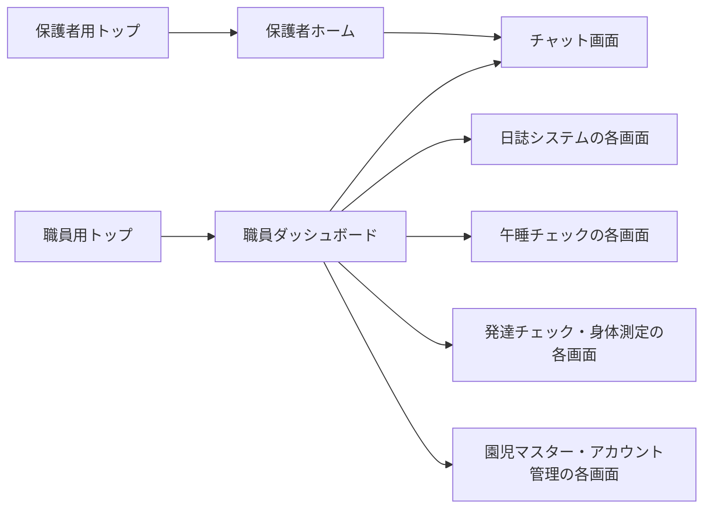
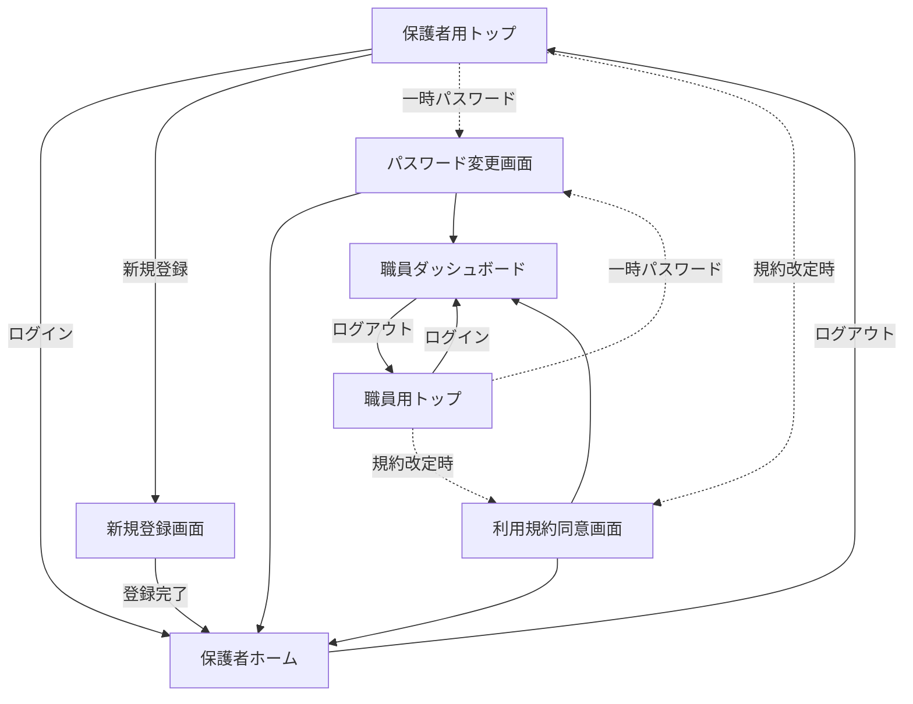
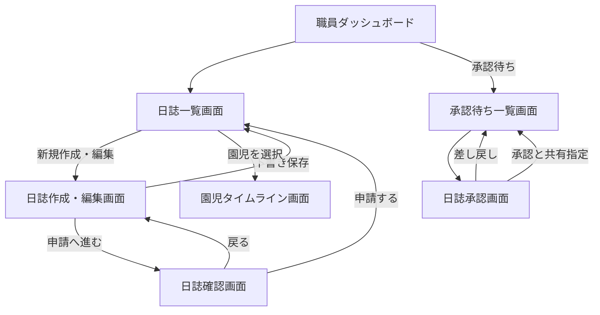
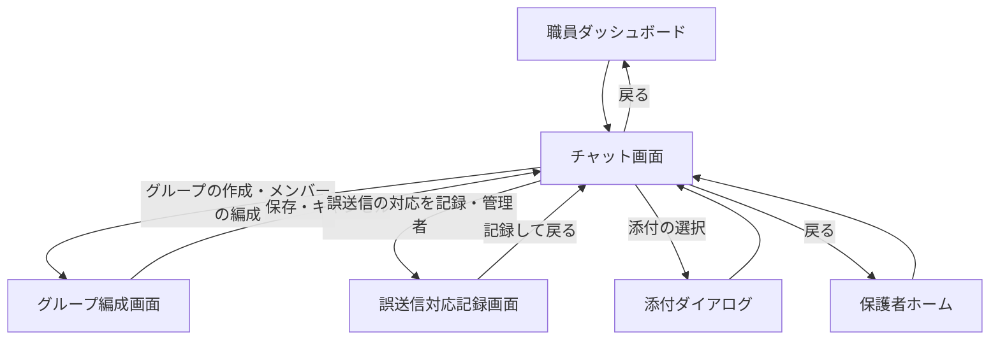
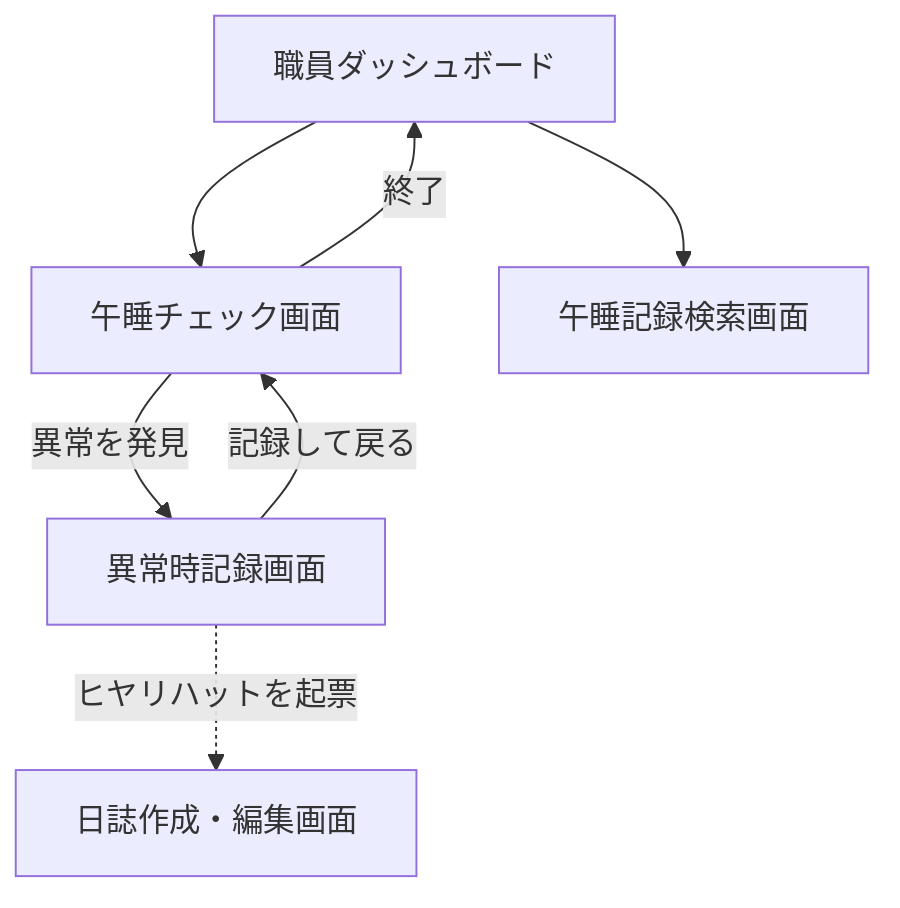
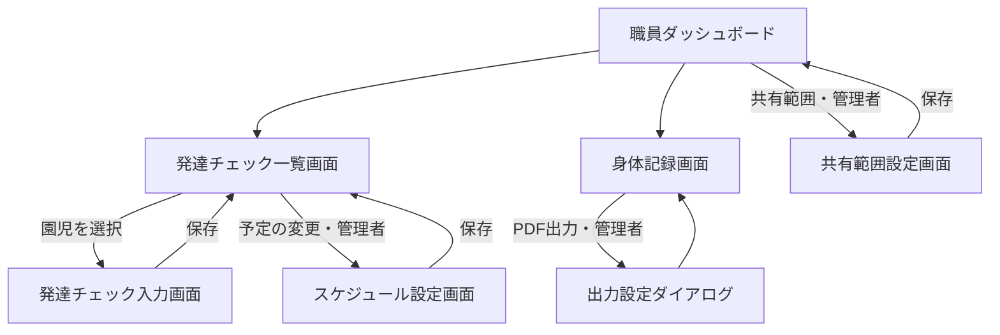
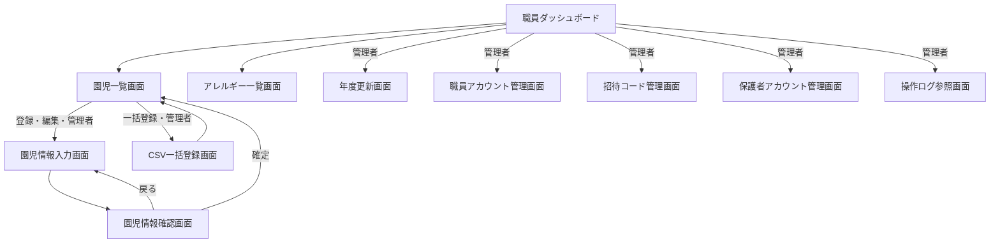

# 保育支援システム 画面遷移図

| 項目 | 内容 |
| :-- | :-- |
| 対象システム | 保育支援システム（すくすくシステム） |
| 版数 | 第 1.2 版 |
| 作成日 | 2026 年 9 月 1 日 |
| 典拠 | `基本設計書.md` 第1.0版「画面の一覧」(3-2)、`要件定義書.md` 第2.2版 |
| 作成区分 | チーム開発演習 基本設計 |

## 改訂履歴

| 版 | 日付 | 変更内容 |
| :-: | :-: | :-- |
| 1.2 | 2026/09/01 | **「本書で明らかになった要確認事項」(8) が持っていた9件の表を `要決定事項.md` へ移し、同項を案内に置き換えた。** うち3件（保護者側チャットの画面分割、共有された記録を開く画面、通知からの導線）は `図/画面詳細図.md` とも重複しており、一覧が3か所に分かれていた。1件（保護者ホームからチャット以外への導線）は同図 第1.2版で「保護者ホーム」(2-7) を作成して定義したため**解決済み**とした。`CLAUDE.md`「要決定事項の扱い」に従い、未確定事項の一覧は `要決定事項.md` 1本が持つ |
| 1.1 | 2026/09/01 | `画面遷移図_チャットツール.md` 第0.2版（ドラフト）を退役させ、**本書を画面遷移図の唯一の正**とした。同書が持っていた前提（デバイス別のレイアウト）と未解決の論点を、チャットツールの節および「本書で明らかになった要確認事項」(8) へ引き継いだ |
| 1.0 | 2026/09/01 | 新規作成。`基本設計書.md`「画面遷移」(3-4) の遷移図を本書へ移し、遷移一覧表を追加した。基本設計書に無かった**チャットツールの遷移**を「画面の一覧」(3-2) の画面名から起こして補った |

---

# 0 本書の位置づけ

- 本書は**図**であり、画面と画面の**つながり（遷移）**を示す。学校テンプレート「【テンプレート】3_基本設計書.docx」がユーザインターフェイス設計の章で求める**画面遷移図（別紙）**にあたる。
- **画面そのものの定義**（画面名・概要・利用者・表示項目・入力項目）は `基本設計書.md`「画面の一覧」(3-2)「画面詳細」(3-6) が持つ。本書は画面名を参照するだけで、定義を重複して持たない。
- **利用者種別ごとの画面の所属**は `基本設計書.md`「画面体系図」(3-3) が持つ。本書が示すのは所属ではなく遷移である。
- 記述が食い違った場合は、**要件定義書 → 基本設計書 → 本書**の順で正とし、本書を追随させる。

> **退役させた文書**：`画面遷移図_チャットツール.md` 第0.2版（ドラフト、2026/07/27）。チャットツールの遷移は本書「チャットツール」(4) が持つ。**画面遷移図の正を1本に絞る**方針による（要件定義書・基本設計書と同じ扱い）。内容は git 履歴に残る。

## 0-1 表記ルール

| 表記 | 意味 |
| :-- | :-- |
| 実線の矢印 `-->` | 利用者の操作による遷移 |
| 点線の矢印 `-.->` | 条件が成立したときにシステムが起こす遷移（一時パスワード、規約の改定など） |
| ラベルの「管理者」 | **管理者（園長・主任）のみ**が通れる遷移。一般（保育士）には導線を表示しない |
| ダイアログ | 画面として起こさず、元の画面の上に重ねる（`基本設計書.md`「画面の洗い出しの考え方」(3-1) の基準3） |

- 画面名は `基本設計書.md`「画面の一覧」(3-2) の名称と一致させる。本書で言い換えない
- 画面IDは採番しない（`CLAUDE.md`「機能は番号ではなく機能名で呼ぶ」の方針）

---

# 1 全体像

入口は**保護者用と職員用の2系統**に分かれる。ロールの判定はアカウントで行い、誤った系統では認証を成立させない（要件定義書「アプリのログイン」(4-1-1)）。

- 職員側の**起点は職員ダッシュボード**であり、各機能へはここから入る
- 保護者側の**起点は保護者ホーム**。記録の閲覧は専用画面を持たず、**チャット画面の中**で行う

---

# 2 共通・認証

| 遷移元 | 操作・条件 | 遷移先 |
| :-- | :-- | :-- |
| 保護者用トップ | ログイン | 保護者ホーム |
| 保護者用トップ | 新規登録（招待コードの入力） | 新規登録画面 |
| 新規登録画面 | 登録完了 | 保護者ホーム |
| 職員用トップ | ログイン | 職員ダッシュボード |
| 保護者用トップ／職員用トップ | 一時パスワードでの認証成功 | パスワード変更画面 |
| 保護者用トップ／職員用トップ | 規約の改定後の初回ログイン | 利用規約同意画面 |
| パスワード変更画面／利用規約同意画面 | 完了 | ログインしたロールのホーム |
| 保護者ホーム／職員ダッシュボード | ログアウト | ログインしていた系統のトップ |

- **ログアウトの遷移先は、ログインしていた系統のトップ**（要件定義書「アプリのログイン」(4-1-1)）
- 一時パスワードでのログイン時は、**変更を完了するまで他の画面へ進めない**
- 利用規約の同意も同様に、**同意するまで他の画面へ進めない**

---

# 3 日誌システム

| 遷移元 | 操作・条件 | 遷移先 |
| :-- | :-- | :-- |
| 職員ダッシュボード | 日誌 | 日誌一覧画面 |
| 日誌一覧画面 | 新規作成／編集 | 日誌作成・編集画面 |
| 日誌作成・編集画面 | 下書き保存 | 日誌一覧画面 |
| 日誌作成・編集画面 | 申請へ進む | 日誌確認画面 |
| 日誌確認画面 | 戻る／申請する | 日誌作成・編集画面／日誌一覧画面 |
| 日誌一覧画面 | 園児を選択 | 園児タイムライン画面 |
| 職員ダッシュボード | 承認待ち（管理者） | 承認待ち一覧画面 |
| 承認待ち一覧画面 | 対象を選択（管理者） | 日誌承認画面 |
| 日誌承認画面 | 承認と共有指定／差し戻し（管理者） | 承認待ち一覧画面 |

- 承認済みの日誌の保護者への共有は、**日誌承認画面での指定**によって行われ、共有先は個人チャットになる。画面としての遷移は伴わない

---

# 4 チャットツール

チャンネルの切り替え・メッセージの送受信・リアクション・既読確認は、**チャット画面の中で完結する**（`基本設計書.md`「画面の一覧」(3-2)）。画面として遷移するのは、グループの編成と誤送信への対応のみ。

| 遷移元 | 操作・条件 | 遷移先 |
| :-- | :-- | :-- |
| 職員ダッシュボード／保護者ホーム | チャット | チャット画面 |
| チャット画面 | グループの作成・メンバーの編成 | グループ編成画面 |
| チャット画面 | 誤送信への対応を記録（管理者） | 誤送信対応記録画面 |
| チャット画面 | 写真・動画の添付 | 添付ダイアログ（画面として起こさない） |
| グループ編成画面／誤送信対応記録画面 | 保存・キャンセル | チャット画面 |

- **チャンネルの切り替えは画面遷移ではない。** 園チャット・グループチャット・個人チャット・職員チャットは、いずれもチャット画面の中の表示の切り替えとして扱う
- 保護者はチャット画面のみを利用し、グループ編成画面・誤送信対応記録画面への導線を持たない

## 4-1 デバイスによるレイアウトの前提

退役させた `画面遷移図_チャットツール.md` が置いていた前提を、次のとおり引き継ぐ。

| 利用者 | デバイス | 構成 | 遷移の性質 |
| :-- | :-- | :-- | :-- |
| 管理者・一般（職員） | タブレット／PC | チャンネル一覧・メッセージ領域・メンバー一覧を**同一画面に並べる** | チャンネルの切替は**画面内の状態変化**。独立画面として遷移するのはグループ編成と誤送信対応記録のみ |
| 保護者 | スマートフォン | シングルカラム（`基本設計書.md`「画面基本構成」(3-5)） | 3ペインを並べられない |

> **【要確認】保護者側のチャットの遷移**：スマートフォンでは一覧とメッセージ領域を並べられないため、**「チャンネル一覧 ⇄ 各チャンネル」の実際の画面遷移になる可能性がある。** `基本設計書.md`「画面の一覧」(3-2) は保護者・職員を通じて**チャット画面の1画面**として定義しているため、画面を分けるなら同書の改訂が必要になる。本書は現時点の定義に従い1画面として描いた。

> **【要確認】共有された日誌を開く導線**：承認済みの日誌は個人チャットへ共有されるが、チャット画面からその日誌を開いた先の画面が「画面の一覧」(3-2) に無い（園児タイムライン画面は職員向け）。保護者が日誌を読む画面をチャット画面の中で完結させるのか、別画面を設けるのかが未定。

---

# 5 午睡チェック

| 遷移元 | 操作・条件 | 遷移先 |
| :-- | :-- | :-- |
| 職員ダッシュボード | 午睡チェック | 午睡チェック画面 |
| 午睡チェック画面 | 異常を発見 | 異常時記録画面 |
| 異常時記録画面 | 記録して戻る | 午睡チェック画面 |
| 異常時記録画面 | ヒヤリハットを起票 | 日誌作成・編集画面 |
| 職員ダッシュボード | 午睡記録の検索 | 午睡記録検索画面 |
| 午睡チェック画面 | 実施の終了 | 職員ダッシュボード |

- **午睡チェック画面は開いたまま運用する。** 実施中は自動ログアウトの対象外とし、他画面への遷移を前提としない（`基本設計書.md`「システムの利用方法」(2-2)）
- タイマーとアラームは画面内の表示であり、遷移を起こさない

---

# 6 発達チェック・身体測定

| 遷移元 | 操作・条件 | 遷移先 |
| :-- | :-- | :-- |
| 職員ダッシュボード | 発達チェック | 発達チェック一覧画面 |
| 発達チェック一覧画面 | 園児を選択 | 発達チェック入力画面 |
| 発達チェック入力画面 | 保存 | 発達チェック一覧画面 |
| 発達チェック一覧画面 | 予定の変更（管理者） | スケジュール設定画面 |
| 職員ダッシュボード | 身体記録 | 身体記録画面 |
| 身体記録画面 | PDF出力（管理者） | 出力設定ダイアログ（画面として起こさない） |
| 職員ダッシュボード | 共有範囲の設定（管理者） | 共有範囲設定画面 |

- 発達チェック入力画面と身体記録画面は**連続入力を前提とし、確認画面を挟まない**（`基本設計書.md`「画面の洗い出しの考え方」(3-1) の基準2）
- 成長グラフと過去記録の比較は身体記録画面・発達チェック入力画面の中の表示であり、遷移を起こさない。**判定・診断を行うものではない旨の免責を常時表示する**

---

# 7 園児マスター・アカウント管理

| 遷移元 | 操作・条件 | 遷移先 |
| :-- | :-- | :-- |
| 職員ダッシュボード | 園児 | 園児一覧画面（一般は閲覧のみ） |
| 園児一覧画面 | 登録・編集（管理者） | 園児情報入力画面 |
| 園児情報入力画面 | 確認へ進む | 園児情報確認画面 |
| 園児情報確認画面 | 戻る／確定 | 園児情報入力画面／園児一覧画面 |
| 園児一覧画面 | CSVでの一括登録（管理者） | CSV一括登録画面 |
| 職員ダッシュボード | アレルギー一覧 | アレルギー一覧画面 |
| 職員ダッシュボード | 年度更新（管理者） | 年度更新画面 |
| 職員ダッシュボード | 職員アカウントの管理（管理者） | 職員アカウント管理画面 |
| 職員ダッシュボード | 招待コードの管理（管理者） | 招待コード管理画面 |
| 職員ダッシュボード | 保護者アカウントの管理（管理者） | 保護者アカウント管理画面 |
| 職員ダッシュボード | 操作ログの参照（管理者） | 操作ログ参照画面 |

- 園児情報の登録・編集だけが**入力→確認→確定**の3段階を持つ。誤登録が全機能へ波及するため（`基本設計書.md`「画面の洗い出しの考え方」(3-1) の基準2）
- アレルギー一覧画面は**全園児が対象**であり、自クラス制限の例外となる（要件定義書「対象権限列の読み方」(4-2 冒頭)）

---

# 8 本書で明らかになった要確認事項

本書と、退役させた `画面遷移図_チャットツール.md` 第0.2版から引き継いだ論点のうち、**未解決のものが8件**ある。**一覧は `要決定事項.md` が持ち、本書は表を持たない**（`CLAUDE.md`「要決定事項の扱い」）。

| 決める人 | 本書から挙げたもの（`要決定事項.md` の項目名） |
| :-- | :-- |
| 園に確認 | グループチャットと園チャットの使い分け／職員がスマートフォンを使う運用を想定するか |
| チームで決定 | 保護者側のチャットを、一覧と各チャンネルの2画面に分けるか／共有された日誌・記録を保護者が開く画面を設けるか／動画の添付を認めるか／チャットのメッセージ検索を設けるか／チャットツールの画面名の追認 |
| 設計判断 | 通知（未対応件数）から該当画面への導線を設けるか |

- 旧チャット図の論点のうち、**既読確認・職員チャット・リアクションは解決済み**である（`基本設計書.md`「チャットツール」(4-6)・「画面の一覧」(3-2)）
- **保護者ホームからチャット以外への導線**も解決済みである。`図/画面詳細図.md` 第1.2版で「保護者ホーム」(2-7) を作成し、チャットと共有された記録への導線を定義した。残るのは**開いた先の画面**（`要決定事項.md`「共有された日誌・記録を保護者が開く画面を設けるか」）である
- **画面が増減しうるのは3件**（保護者側チャットの2画面化、共有された記録を開く画面、職員のスマートフォン運用）。決まった時点で `基本設計書.md`「画面の一覧」(3-2) と本書・`図/画面詳細図.md` を直す
