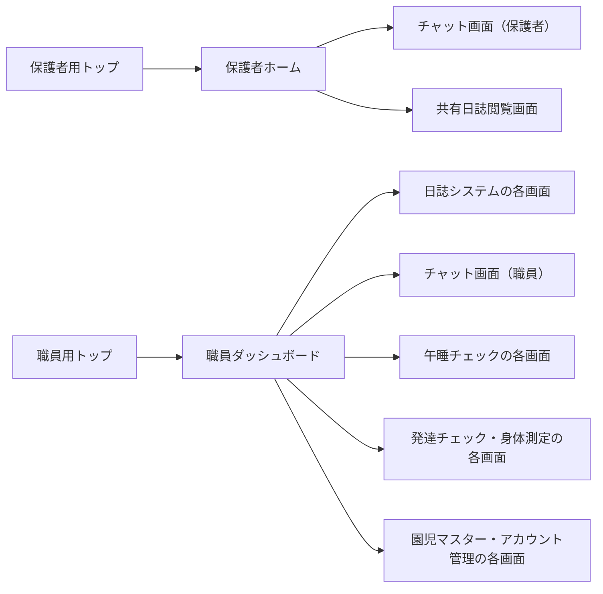
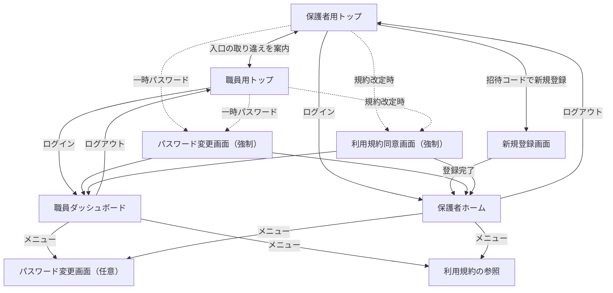
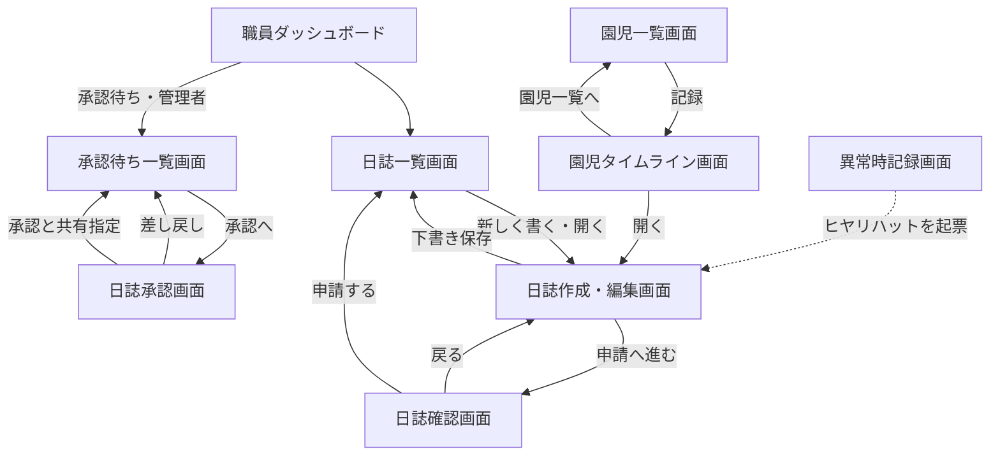
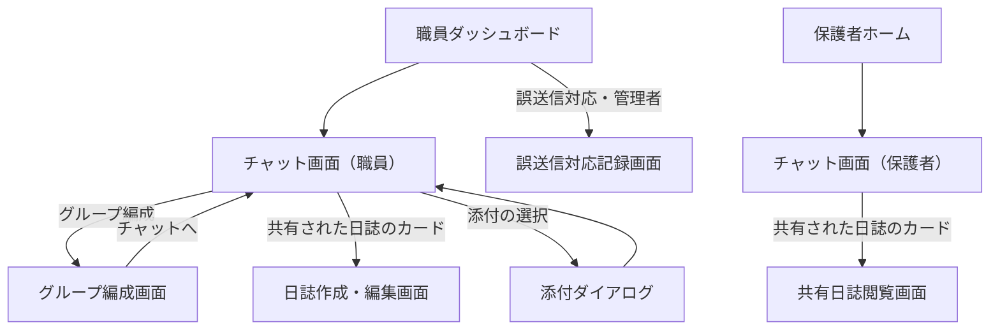
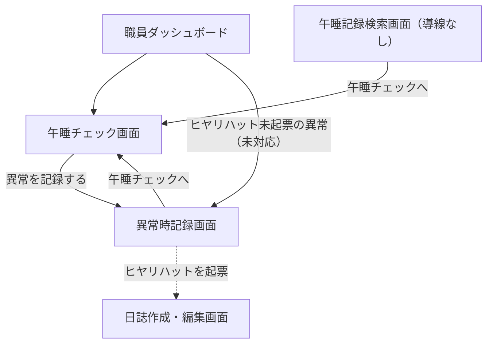
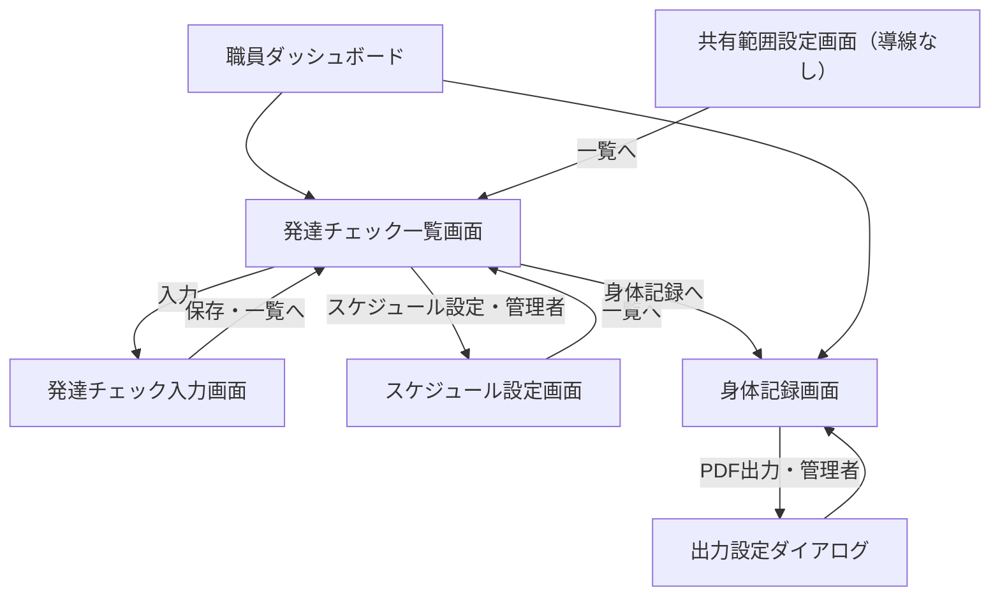
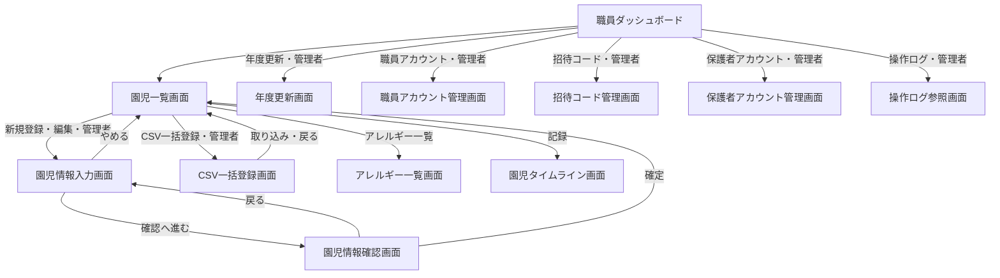
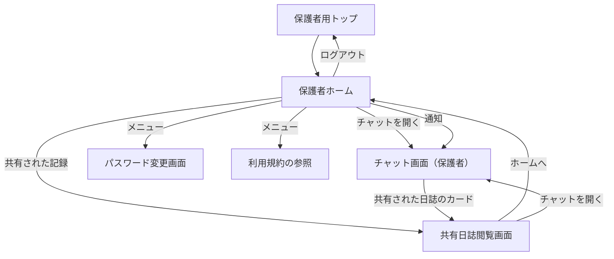

# 保育支援システム 画面遷移図

| 項目 | 内容 |
| :-- | :-- |
| 対象システム | 保育支援システム（すくすくシステム） |
| 版数 | 第 1.3 版 |
| 作成日 | 2026 年 9 月 7 日 |
| 典拠 | `基本設計書.md` 第1.7版「画面の一覧」(3-2)、`要件定義書.md` 第2.4版、Go + React 版モックアップ（`mockup-go-react` ブランチ） |
| 作成区分 | チーム開発演習 基本設計 |

## 改訂履歴

| 版 | 日付 | 変更内容 |
| :-: | :-: | :-- |
| 1.3 | 2026/09/07 | **Go + React 版モックアップの実画面を貼り、遷移を実装に合わせて改めた。** 画像は同モックアップを動かして撮ったもの（「画面画像の出典」(0-2)）。実装と本書 第1.2版の食い違い9件を「モックアップ実装との差異」(9) に整理した。うち**保護者が共有された記録を開く画面**と**保護者側チャットの画面分割**は実装が答えを持っており、チームの追認で `要決定事項.md` から落とせる見込み |
| 1.2 | 2026/09/01 | **「本書で明らかになった要確認事項」が持っていた9件の表を `要決定事項.md` へ移し、同項を案内に置き換えた。** うち3件（保護者側チャットの画面分割、共有された記録を開く画面、通知からの導線）は `図/画面詳細図.md` とも重複しており、一覧が3か所に分かれていた。1件（保護者ホームからチャット以外への導線）は同図 第1.2版で「保護者ホーム」(2-7) を作成して定義したため**解決済み**とした。`CLAUDE.md`「要決定事項の扱い」に従い、未確定事項の一覧は `要決定事項.md` 1本が持つ |
| 1.1 | 2026/09/01 | `画面遷移図_チャットツール.md` 第0.2版（ドラフト）を退役させ、**本書を画面遷移図の唯一の正**とした。同書が持っていた前提（デバイス別のレイアウト）と未解決の論点を、チャットツールの節および要確認事項の項へ引き継いだ |
| 1.0 | 2026/09/01 | 新規作成。`基本設計書.md`「画面遷移」(3-4) の遷移図を本書へ移し、遷移一覧表を追加した。基本設計書に無かった**チャットツールの遷移**を「画面の一覧」(3-2) の画面名から起こして補った |

---

# 0 本書の位置づけ

- 本書は**図**であり、画面と画面の**つながり（遷移）**を示す。学校テンプレート「【テンプレート】3_基本設計書.docx」がユーザインターフェイス設計の章で求める**画面遷移図（別紙）**にあたる。
- **画面そのものの定義**（画面名・概要・利用者・表示項目・入力項目）は `基本設計書.md`「画面の一覧」(3-2)「画面詳細」(3-6) と `図/画面詳細図.md` が持つ。本書は画面名を参照するだけで、定義を重複して持たない。
- **利用者種別ごとの画面の所属**は `基本設計書.md`「画面体系図」(3-3) が持つ。本書が示すのは所属ではなく遷移である。
- 記述が食い違った場合は、**要件定義書 → 基本設計書 → 本書**の順で正とし、本書を追随させる。
- **モックアップは正ではない。** 本書に貼った画面画像は実装の現状を写したものであり、実装が設計と食い違っていれば設計に合わせて実装を直す。食い違いは「モックアップ実装との差異」(9) に挙げた。

> **退役させた文書**：`画面遷移図_チャットツール.md` 第0.2版（ドラフト、2026/07/27）。チャットツールの遷移は本書「チャットツール」(4) が持つ。**画面遷移図の正を1本に絞る**方針による（要件定義書・基本設計書と同じ扱い）。内容は git 履歴に残る。

## 0-1 表記ルール

| 表記 | 意味 |
| :-- | :-- |
| 実線の矢印 `-->` | 利用者の操作による遷移 |
| 点線の矢印 `-.->` | 条件が成立したときにシステムが起こす遷移（一時パスワード、規約の改定など） |
| ラベルの「管理者」 | **管理者（園長・主任）のみ**が通れる遷移。一般（保育士）には導線を表示しない |
| ダイアログ | 画面として起こさず、元の画面の上に重ねる（`基本設計書.md`「画面の洗い出しの考え方」(3-1) の基準3） |
| 「導線なし」 | 画面はあるが、そこへ入る導線が実装に無いもの。「モックアップ実装との差異」(9) を参照 |

- 画面名は `基本設計書.md`「画面の一覧」(3-2) の名称と一致させる。本書で言い換えない
- 画面IDは採番しない（`CLAUDE.md`「機能は番号ではなく機能名で呼ぶ」の方針）

## 0-2 画面画像の出典

各節に貼った画面画像は、**Go + React 版モックアップ**（`mockup-go-react` ブランチ、`C:/Users/calif/sukusuku-mockup-go-react`）を 2026/09/07 に動かして撮ったものである。

| 項目 | 内容 |
| :-- | :-- |
| 動かし方 | `web` を `npm run build` し、`server` を `go run . -addr 127.0.0.1:8099` で起動（`MOCKUP.md`「動かし方」） |
| データ | 初回起動時に作られるデモデータ。**実在の園児・保護者ではない** |
| 撮影したアカウント | 管理者（園長）＝高橋、保護者＝山田太郎の保護者、一時パスワード中＝佐藤、規約の再同意が必要＝鈴木 |
| 画像の置き場所 | `図/画面画像/` |
| 画面の幅 | 職員（タブレット／PC）1280px、保護者（スマートフォン）420px。`基本設計書.md`「画面基本構成」(3-5) の前提に合わせた |

> 画面に出ている値（クラス名・日付・件数・しきい値など）は**デモ用の仮置きであり、設計の決定ではない**。仮置き値の一覧は `web/仮置き値.md` が持つ。

---

# 1 全体像

入口は**保護者用と職員用の2系統**に分かれる。ロールの判定はアカウントで行い、誤った系統では認証を成立させない（要件定義書「アプリのログイン」(4-1-1)）。

- 職員側の**起点は職員ダッシュボード**であり、各機能へはここから入る。加えて、画面の左側に常時置く**サイドナビ**から各機能へ直接入れる
- 保護者側の**起点は保護者ホーム**。記録の閲覧はチャット画面と共有日誌閲覧画面で行う

| 職員ダッシュボード | 保護者ホーム |
| :--: | :--: |
|  |  |

---

# 2 共通・認証

| 遷移元 | 操作・条件 | 遷移先 |
| :-- | :-- | :-- |
| 保護者用トップ | ログイン | 保護者ホーム |
| 保護者用トップ | 招待コードで新規登録 | 新規登録画面 |
| 新規登録画面 | 登録完了 | 保護者ホーム |
| 新規登録画面 | 戻る | 保護者用トップ |
| 職員用トップ | ログイン | 職員ダッシュボード |
| 保護者用トップ／職員用トップ | 誤った系統でのログイン | 正しい入口へ案内するリンクを出す（遷移は利用者の操作） |
| 保護者用トップ／職員用トップ | 一時パスワードでの認証成功 | パスワード変更画面（強制） |
| 保護者用トップ／職員用トップ | 規約の改定後の初回ログイン | 利用規約同意画面（強制） |
| パスワード変更画面／利用規約同意画面 | 完了 | ログインしたロールのホーム |
| 利用規約同意画面（強制） | 同意せずログアウトする | 保護者用トップ |
| 職員ダッシュボード／保護者ホーム | メニューからパスワードの変更・利用規約 | パスワード変更画面（任意）／利用規約の参照 |
| 保護者ホーム／職員ダッシュボード | ログアウト | ログインしていた系統のトップ |

- **ログアウトの遷移先は、ログインしていた系統のトップ**（要件定義書「アプリのログイン」(4-1-1)）
- 一時パスワードでのログイン時は、**変更を完了するまで他の画面へ進めない**
- 利用規約の同意も同様に、**同意するまで他の画面へ進めない**
- パスワード変更画面と利用規約同意画面には、**強制で通る経路と、メニューから任意に開く経路の2つ**がある。画面は同じで、強制のときだけ他の画面への導線を出さない

| 保護者用トップ | 職員用トップ | 新規登録画面 |
| :--: | :--: | :--: |
|  |  |  |

| パスワード変更画面（強制） | 利用規約同意画面（強制） |
| :--: | :--: |
|  |  |

---

# 3 日誌システム

| 遷移元 | 操作・条件 | 遷移先 |
| :-- | :-- | :-- |
| 職員ダッシュボード／サイドナビ | 日誌 | 日誌一覧画面 |
| 職員ダッシュボード | 差し戻された日誌（未対応） | 日誌一覧画面（差し戻しで絞った状態） |
| 日誌一覧画面 | 新しく書く／開く | 日誌作成・編集画面 |
| 日誌作成・編集画面 | 下書き保存 | 日誌一覧画面 |
| 日誌作成・編集画面 | 申請へ進む | 日誌確認画面 |
| 日誌確認画面 | 戻る／申請する | 日誌作成・編集画面／日誌一覧画面 |
| 園児一覧画面 | 記録 | 園児タイムライン画面 |
| 園児タイムライン画面 | 日誌を開く | 日誌作成・編集画面 |
| 職員ダッシュボード／サイドナビ | 承認待ち（管理者） | 承認待ち一覧画面 |
| 承認待ち一覧画面 | 承認へ（管理者） | 日誌承認画面 |
| 日誌承認画面 | 承認と共有指定／差し戻し（管理者） | 承認待ち一覧画面 |
| 異常時記録画面 | ヒヤリハットを起票 | 起票された日誌の日誌作成・編集画面 |

- 承認済みの日誌の保護者への共有は、**日誌承認画面での指定**によって行われ、共有先は個人チャットになる。職員側に画面としての遷移は伴わない。保護者側では共有日誌閲覧画面（「保護者の画面」(8)）で開く
- **園児タイムライン画面への導線は園児一覧画面が持つ。** 本書 第1.2版は日誌一覧画面からとしていた（「モックアップ実装との差異」(9) No.4）

| 日誌一覧画面 | 日誌作成・編集画面 | 日誌確認画面 |
| :--: | :--: | :--: |
|  |  |  |

| 園児タイムライン画面 | 承認待ち一覧画面 | 日誌承認画面 |
| :--: | :--: | :--: |
|  |  |  |

---

# 4 チャットツール

職員側では、チャンネルの切り替え・メッセージの送受信・リアクション・既読確認が**チャット画面の中で完結する**。保護者側も画面としては1つで、**チャンネル一覧と会話の切り替えを画面の中の状態変化として持つ**（実装でも URL は変わらない）。

| 遷移元 | 操作・条件 | 遷移先 |
| :-- | :-- | :-- |
| 職員ダッシュボード／サイドナビ | チャット | チャット画面（職員） |
| 職員ダッシュボード | 未読のチャット（未対応） | チャット画面（職員） |
| チャット画面（職員） | グループ編成 | グループ編成画面 |
| グループ編成画面 | チャットへ | チャット画面（職員） |
| チャット画面（職員） | 共有された日誌のカード | 日誌作成・編集画面 |
| チャット画面（職員） | 写真・動画の添付 | 添付ダイアログ（画面として起こさない） |
| サイドナビ「管理（管理者）」 | 誤送信対応 | 誤送信対応記録画面 |
| 保護者ホーム | チャットを開く | チャット画面（保護者） |
| チャット画面（保護者） | チャンネルを開く／一覧へ戻る | 同じ画面の中の切り替え（遷移ではない） |
| チャット画面（保護者） | 共有された日誌のカード | 共有日誌閲覧画面 |

- **チャンネルの切り替えは画面遷移ではない。** 園チャット・グループチャット・個人チャット・職員チャットは、いずれもチャット画面の中の表示の切り替えとして扱う
- 保護者はチャット画面のみを利用し、グループ編成画面・誤送信対応記録画面への導線を持たない
- **誤送信対応記録画面へはチャット画面からではなく、サイドナビの「管理（管理者）」から入る**（「モックアップ実装との差異」(9) No.3）

## 4-1 デバイスによるレイアウトの前提

| 利用者 | デバイス | 構成 | 遷移の性質 |
| :-- | :-- | :-- | :-- |
| 管理者・一般（職員） | タブレット／PC | チャンネル一覧・メッセージ領域・メンバー一覧を**同一画面に並べる** | チャンネルの切替は**画面内の状態変化**。独立画面として遷移するのはグループ編成のみ |
| 保護者 | スマートフォン | シングルカラム（`基本設計書.md`「画面基本構成」(3-5)） | チャンネル一覧と会話を**入れ替えて表示する**。画面としては1つで、URL も変わらない |

> **保護者側のチャットの扱い（`要決定事項.md`「保護者側のチャットを、一覧と各チャンネルの2画面に分けるか」）**：モックアップは**分けない**（同じ画面の中で入れ替える）を採っている。この方式なら `基本設計書.md`「画面の一覧」(3-2) の改訂は要らない。**チームで追認すれば本件は落とせる。**

| チャット画面（職員） | グループ編成画面 | 誤送信対応記録画面 |
| :--: | :--: | :--: |
|  |  |  |

| チャット画面（保護者・チャンネル一覧） | チャット画面（保護者・会話） |
| :--: | :--: |
|  |  |

---

# 5 午睡チェック

| 遷移元 | 操作・条件 | 遷移先 |
| :-- | :-- | :-- |
| 職員ダッシュボード／サイドナビ | 午睡チェック | 午睡チェック画面 |
| 職員ダッシュボード | 午睡チェックを開始／実施中の午睡チェック | 午睡チェック画面 |
| 午睡チェック画面 | 異常を記録する | 異常時記録画面 |
| 異常時記録画面 | 午睡チェックへ | 午睡チェック画面 |
| 異常時記録画面 | ヒヤリハットを起票／起票済み（開く） | 日誌作成・編集画面 |
| 職員ダッシュボード | ヒヤリハット未起票の異常時の記録（未対応） | 異常時記録画面 |
| 午睡記録検索画面 | 午睡チェックへ | 午睡チェック画面 |

- **午睡チェック画面は開いたまま運用する。** 実施中は自動ログアウトの対象外とし、他画面への遷移を前提としない（`基本設計書.md`「システムの利用方法」(2-2)）
- タイマーとアラームは画面内の表示であり、遷移を起こさない
- **午睡記録検索画面へ入る導線が実装に無い**（「モックアップ実装との差異」(9) No.6）

| 午睡チェック画面 | 異常時記録画面 | 午睡記録検索画面 |
| :--: | :--: | :--: |
|  |  |  |

---

# 6 発達チェック・身体測定

| 遷移元 | 操作・条件 | 遷移先 |
| :-- | :-- | :-- |
| 職員ダッシュボード／サイドナビ | 発達・身体 | 発達チェック一覧画面 |
| 職員ダッシュボード | 発達チェックの未実施（未対応） | 発達チェック一覧画面 |
| 発達チェック一覧画面 | 入力 | 発達チェック入力画面 |
| 発達チェック入力画面 | 保存／一覧へ | 発達チェック一覧画面 |
| 発達チェック一覧画面 | スケジュール設定（管理者） | スケジュール設定画面 |
| 発達チェック一覧画面 | 身体記録へ | 身体記録画面 |
| 職員ダッシュボード | 身体測定を入力 | 身体記録画面 |
| 身体記録画面 | PDF出力（管理者） | 出力設定ダイアログ（画面として起こさない） |
| 共有範囲設定画面 | 一覧へ | 発達チェック一覧画面 |

- 発達チェック入力画面と身体記録画面は**連続入力を前提とし、確認画面を挟まない**（`基本設計書.md`「画面の洗い出しの考え方」(3-1) の基準2）
- 成長グラフと過去記録の比較は身体記録画面・発達チェック入力画面の中の表示であり、遷移を起こさない。**判定・診断を行うものではない旨の免責を常時表示する**
- **共有範囲設定画面へ入る導線が実装に無い**（「モックアップ実装との差異」(9) No.5）

| 発達チェック一覧画面 | 発達チェック入力画面 | スケジュール設定画面 |
| :--: | :--: | :--: |
|  |  |  |

| 身体記録画面 | 共有範囲設定画面 |
| :--: | :--: |
|  |  |

---

# 7 園児マスター・アカウント管理

| 遷移元 | 操作・条件 | 遷移先 |
| :-- | :-- | :-- |
| 職員ダッシュボード／サイドナビ | 園児 | 園児一覧画面（一般は閲覧のみ） |
| 園児一覧画面 | 新規登録／編集（管理者） | 園児情報入力画面 |
| 園児情報入力画面 | 確認へ進む | 園児情報確認画面 |
| 園児情報入力画面 | やめる | 園児一覧画面 |
| 園児情報確認画面 | 戻る／確定 | 園児情報入力画面／園児一覧画面 |
| 園児一覧画面 | CSV一括登録（管理者） | CSV一括登録画面 |
| 園児一覧画面 | アレルギー一覧 | アレルギー一覧画面 |
| 園児一覧画面 | 記録 | 園児タイムライン画面 |
| サイドナビ「管理（管理者）」 | 年度更新 | 年度更新画面 |
| サイドナビ「管理（管理者）」 | 職員アカウント | 職員アカウント管理画面 |
| サイドナビ「管理（管理者）」 | 招待コード | 招待コード管理画面 |
| サイドナビ「管理（管理者）」 | 保護者アカウント | 保護者アカウント管理画面 |
| サイドナビ「管理（管理者）」 | 操作ログ | 操作ログ参照画面 |

- 園児情報の登録・編集だけが**入力→確認→確定**の3段階を持つ。誤登録が全機能へ波及するため（`基本設計書.md`「画面の洗い出しの考え方」(3-1) の基準2）
- アレルギー一覧画面は**全園児が対象**であり、自クラス制限の例外となる（要件定義書「対象権限列の読み方」(4-2 冒頭)）
- **アレルギー一覧画面への導線は園児一覧画面が持つ。** 本書 第1.2版は職員ダッシュボードからとしていた（「モックアップ実装との差異」(9) No.7）

| 園児一覧画面 | 園児情報入力画面 | 園児情報確認画面 |
| :--: | :--: | :--: |
|  |  |  |

| CSV一括登録画面 | アレルギー一覧画面 | 年度更新画面 |
| :--: | :--: | :--: |
|  |  |  |

| 職員アカウント管理画面 | 招待コード管理画面 | 保護者アカウント管理画面 |
| :--: | :--: | :--: |
|  |  |  |

| 操作ログ参照画面 |
| :--: |
|  |

---

# 8 保護者の画面

保護者が持つ画面は**保護者用トップ・新規登録画面・保護者ホーム・チャット画面・共有日誌閲覧画面・パスワード変更画面／利用規約の参照**である。

| 遷移元 | 操作・条件 | 遷移先 |
| :-- | :-- | :-- |
| 保護者ホーム | チャットを開く | チャット画面（保護者） |
| 保護者ホーム | 共有された記録を開く | 共有日誌閲覧画面 |
| チャット画面（保護者） | 共有された日誌のカード | 共有日誌閲覧画面 |
| 共有日誌閲覧画面 | ホームへ／チャットを開く | 保護者ホーム／チャット画面（保護者） |
| 保護者ホーム | 通知 | チャット画面（保護者） |
| 保護者ホーム | メニューからパスワードの変更・利用規約 | パスワード変更画面／利用規約の参照 |

- **共有日誌閲覧画面は、保護者が共有された日誌を読むための専用画面である。** 本書 第1.2版が【要確認】として挙げていた「共有された記録を開く画面」に対し、モックアップは**専用画面を設ける**を採っている（「モックアップ実装との差異」(9) No.2）
- 保護者側の通知は**チャット画面へ寄せている**。職員側の通知は職員ダッシュボードへ戻す（同 No.8）
- 急ぎの連絡は電話で行う旨を、チャット画面に常時表示する（要件定義書「通知の到達性」）

| 保護者ホーム | チャット画面（保護者） | 共有日誌閲覧画面 |
| :--: | :--: | :--: |
|  |  |  |

---

# 9 モックアップ実装との差異

本書 第1.2版の記述と、Go + React 版モックアップの実装を突き合わせて見つかった食い違い**9件**。**設計と実装のどちらを直すかを決める必要がある**。

| No. | 差異 | 本書 第1.2版 | モックアップの実装 | 扱い |
| :-: | :-- | :-- | :-- | :-- |
| 1 | チャット画面の単位 | 保護者・職員を通じて**1画面** | 職員用と保護者用の**別画面**（レイアウトが根本的に違うため） | 実装が妥当。`基本設計書.md`「画面の一覧」(3-2) を職員用・保護者用に分けるか、1画面のまま「表示の出し分け」と説明するかを**チームで決める** |
| 2 | 保護者が共有された記録を開く画面 | 【要確認】未定 | **共有日誌閲覧画面**を設けている | 実装が答えを持つ。追認すれば `要決定事項.md` から落とせる |
| 3 | 誤送信対応記録画面への導線 | チャット画面から | **サイドナビの「管理（管理者）」から** | 実装が妥当（管理者だけの操作であり、チャットの操作の流れに置くと一般にも見えてしまう）。本書を実装に合わせた |
| 4 | 園児タイムライン画面への導線 | 日誌一覧画面から園児を選択 | **園児一覧画面の「記録」から** | 実装が妥当（園児を軸に見る機能であるため）。本書を実装に合わせた |
| 5 | 共有範囲設定画面への導線 | 職員ダッシュボードから | **どこからも入れない**（URLの直接指定のみ） | **実装の漏れ**。発達チェック一覧画面に管理者向けの導線を足すのが自然 |
| 6 | 午睡記録検索画面への導線 | 職員ダッシュボードから | **どこからも入れない**（URLの直接指定のみ） | **実装の漏れ**。午睡チェック画面かサイドナビに導線を足す |
| 7 | アレルギー一覧画面への導線 | 職員ダッシュボードから | **園児一覧画面から** | 実装が妥当。本書を実装に合わせた |
| 8 | 通知からの導線 | 【要確認】未定 | 職員は**職員ダッシュボード**へ、保護者は**チャット画面**へ | 実装は答えを持つが、**未対応の項目ごとに該当画面へ飛ばす**ほうが要件に近い。`要決定事項.md`「通知（未対応件数）から該当画面への導線を設けるか」は残す |
| 9 | パスワード変更・利用規約の経路 | 強制の経路のみ | **強制の経路と、メニューから任意に開く経路の2つ** | 実装が妥当。本書を実装に合わせた |

> No.5・No.6 は**モックアップ側の修正**であり、GitHub Issue として起票する。No.1・No.2 は**基本設計書と `要決定事項.md` の更新**が要る。

---

# 10 本書で明らかになった要確認事項

本書と、退役させた `画面遷移図_チャットツール.md` 第0.2版から引き継いだ論点のうち、**未解決のものが8件**ある。**一覧は `要決定事項.md` が持ち、本書は表を持たない**（`CLAUDE.md`「要決定事項の扱い」）。

| 決める人 | 本書から挙げたもの（`要決定事項.md` の項目名） |
| :-- | :-- |
| 園に確認 | グループチャットと園チャットの使い分け／職員がスマートフォンを使う運用を想定するか |
| チームで決定 | 保護者側のチャットを、一覧と各チャンネルの2画面に分けるか／共有された日誌・記録を保護者が開く画面を設けるか／動画の添付を認めるか／チャットのメッセージ検索を設けるか／チャットツールの画面名の追認 |
| 設計判断 | 通知（未対応件数）から該当画面への導線を設けるか |

- 旧チャット図の論点のうち、**既読確認・職員チャット・リアクションは解決済み**である（`基本設計書.md`「チャットツール」(4-6)・「画面の一覧」(3-2)）
- **保護者ホームからチャット以外への導線**も解決済みである。`図/画面詳細図.md` 第1.2版で「保護者ホーム」(2-7) を作成し、チャットと共有された記録への導線を定義した
- **モックアップが答えを持つのは2件**である。「共有された日誌・記録を保護者が開く画面を設けるか」（共有日誌閲覧画面を設ける）と「保護者側のチャットを2画面に分けるか」（分けず画面の中で入れ替える）。**チームで追認すれば `要決定事項.md` から落とせる**（「モックアップ実装との差異」(9) No.1・No.2）
- **画面が増減しうるのは2件**（チャット画面を職員用・保護者用に分けるか、職員のスマートフォン運用）。決まった時点で `基本設計書.md`「画面の一覧」(3-2) と本書・`図/画面詳細図.md` を直す
