# 保育支援システム 画面遷移図

| 項目 | 内容 |
| :-- | :-- |
| 対象システム | 保育支援システム（すくすくシステム） |
| 版数 | 第 2.5 版 |
| 作成日 | 2026 年 9 月 7 日 |
| 改訂日 | 2026 年 10 月 29 日 |
| 典拠 | `基本設計書.md` 第3.0版「画面の一覧」(3-2)・「画面体系図」(3-3)・「画面遷移」(3-4)・「画面基本構成」(3-5)、`要件定義書.md` 第3.0版、`設計方針.md` 第1.0版。画面画像は Go + React 版モックアップ（`mockup-go-react` ブランチ）の第2.7版の設計の姿 |
| 作成区分 | チーム開発演習 基本設計 |

## 改訂履歴

| 版 | 日付 | 変更内容 |
| :-: | :-: | :-- |
| 2.5 | 2026/10/29 | **園からの日誌画面（保護者）への遷移を足した**（`基本設計書.md` 第3.6版）。保護者のメニューの「園からの日誌」から開く。保育士が共有を選んで申請し、管理者が承認した個人日誌を読む画面で、ほかの画面へは移らない。「日誌システム」(4) の冒頭と「保護者への共有の道は無い」の注を直した。理由は `ナレッジ/決定事項.md` 2026-10-29 |
| 2.4 | 2026/10/23 | **保護者が「園からの配布物」へ入る口を、職員と同じくチャットにした**（`基本設計書.md` 第3.5版）。「保護者の画面」の図と表で、保護者ホーム・メニューから配布物一覧画面（保護者）への遷移を、チャット画面（保護者）の「園からの配布物」と、保護者ホームの「チャット・お知らせ」の区画の「園からの配布物を見る」に改め、配布物一覧画面（保護者）の戻り先をチャット画面（保護者）にした。全体の図の保護者ホームから配布物一覧画面（保護者）への線を、チャット画面（保護者）からの線にした。園からの配布物はチャットツールの機能の1つであり、職員はチャット画面の「園からの配布物」から開いている。保護者だけメニューとホームに別の入口を持っていたのを、職員と同じくチャットから開く形にそろえた（`ナレッジ/決定事項.md` 2026-10-23） |
| 2.3 | 2026/10/19 | 「午睡チェック」の表の午睡記録検索画面の出力を「帳票（CSV）の出力（管理者）」にした。午睡の帳票は CSV だけで、PDF は演習では作らない（`基本設計書.md` 第3.4版「帳票の出力」(4-8)。演習上の想定）。理由は `ナレッジ/決定事項.md` 2026-10-19「持ち主の答え（写真は写った子全員の成長の記録に、午睡の記録は行を書き換えてよい）と、任された決めごとを設計書に書いた」 |
| 2.2 | 2026/10/18 | **設計の細部の見直し（保護者へ届ける流れ・共通の仕組み）に合わせた。** 「保護者の画面」(9) の図と表のメニューに「AI の下書きの利用（園が有効にしたときだけ）」を足した（`基本設計書.md`「画面の一覧」(3-2) の保護者のメニュー、`詳細設計書.md`「保護者のメニュー」(2-15)）。理由は `ナレッジ/決定事項.md` 2026-10-18「設計の細部の見直し（保護者へ届ける流れ・共通の仕組み）で直したもの」 |
| 2.1 | 2026/10/17 | 「モックアップ実装との差異」(10) の No.2 が指す画面詳細図の節を、第2.0版で欠番にした「共有日誌閲覧画面」（第1.x版の 2-8）と書き直した。基本設計書 第3.0版の統合で名前と番号の対を照合した結果である |
| 2.0 | 2026/10/17 | **`基本設計書.md` 第3.0版（保護者と保育士を子どもでつなぐ作り直し）に合わせた。** ①**「連絡帳」(3) を新しく置いた**：連絡帳（クラス）画面・連絡帳（園児）画面と、職員ダッシュボード・サイドナビ・日誌作成・編集画面（クラスのようすへ引き写す）・異常時記録画面・チャット画面（職員）（連絡帳の引用）からの出入り、写っている子を選ぶ・他児の名前の注意のダイアログ。基本設計書「画面の一覧」(3-2) の並びに合わせて連絡帳の節を共通・認証の次に入れ、日誌システム以降の節の番号を1つずつ送った（日誌 3→4、チャット 4→5、午睡 5→6、発達 6→7、マスター 7→8、保護者の画面 8→9、差異 9→10、要確認 10→11）。②**「保護者の画面」(9) を9画面で作り直した**：連絡帳画面・成長の記録画面を足し、**共有日誌閲覧画面を連絡帳画面に置き換えて外した**。保護者ホームの園児の区画からの導線、メニューの連絡帳・成長の記録（きょうだいは園児ごと）、**ヘッダの通知と Web Push の知らせは保護者ホームを開く**（第1.x版はチャット画面）、連絡帳画面の「この日の連絡帳について園にたずねる」、お子さまの追加・連絡先の変更・通知の設定のダイアログ。③「全体像」(1) を同じ形に直した。④「共通・認証」(2)：**職員の初回ログインをパスワード変更画面 → 利用規約同意画面 → 職員ダッシュボードの順**にし、強制の画面からのログアウト、サイドナビの末尾からのパスワードの変更・利用規約を足した。利用規約同意画面の「同意せずログアウトする」の行き先を「保護者用トップ」から「ログインしていた系統のトップ」に直した。⑤「日誌システム」(4)：承認と共有指定を「承認」にし、保護者への共有の注記を外した。承認の取り消し、申請の取り下げ、日誌の PDF 出力（管理者）のダイアログ、クラスのようすへの引き写しを足した。下書き保存のあとは同じ画面に留まると直した（画面詳細図に合わせた）。⑥「チャットツール」(5)：**共有された日誌のカードの行を外し**、未読のチャットを「未対応の個人チャット」に、添付ダイアログを写っている子を選ぶダイアログにした。「この連絡について園にたずねる」、連絡帳の引用から連絡帳（園児）画面へ、管理者の削除を足した。⑦「午睡チェック」(6)：職員ダッシュボードの「午睡中の園児」、管理者のヘッダの「異常時の記録（未確認）」、異常時記録画面から連絡帳（園児）画面・個人チャットへの導線を足した。「ねた」「おきた」「きょうは対象外」は画面の中の操作であり遷移ではないと書いた。⑧「発達チェック・身体測定・成長の記録」(7)：成長の記録画面は保護者の節で扱い、職員の画面からは入らないと書いた。⑨「園児マスター・アカウント・設定の管理」(8)：設定画面と、一般が園児の詳細を読み取り専用で開く遷移、退園の操作・誤登録の取消のダイアログを足した。要件定義書の古い参照（「対象権限列の読み方」）を「参照範囲の全体規定」(4-1-5) に直した。⑩「モックアップ実装との差異」(10) の No.2・No.8 に第3.0版で改めた旨を添え、「本書で明らかになった要確認事項」(11) の決着済みの2件（動画の添付は認めない、チャットのメッセージ検索は演習では設けない）を外した。⑪**新しい5画面は画像が無い**（モックアップは第2.7版の設計のまま）。画像は撮り直していない（「画面画像の出典」(0-2)）。典拠は `修正箇所/07_設計の食い違い_2026-10-17/` と、基本設計書の UI の係の申し送り。理由は `ナレッジ/決定事項.md` 2026-10-17「基本設計 第3.0版：画面遷移図・画面詳細図」 |
| 1.8 | 2026/10/09 | **画面画像の全43枚を撮り直した。** デモデータの人名の置き換えと、GitHub Issue #95〜#129 の直し（PR #131〜#135）のあとのモックアップ（`mockup-go-react` の `14c3d24`）を写した。「画面画像の出典」(0-2) の撮影日・撮影したアカウントを改めた。遷移そのものは変えていない |
| 1.7 | 2026/10/06 | **配布物管理画面と配布物一覧画面（保護者）への遷移を加えた。** 「チャットツール」(4) と「保護者の画面」(8) の図と表を直した（`基本設計書.md` 第2.4版、GitHub Issue #94） |
| 1.6 | 2026/09/08 | **メッセージの編集が画面遷移ではないことを「チャットツール」(4) に明記した。** `基本設計書.md` 第2.0版「メッセージの編集」(4-6) の追記による。該当のメッセージが入力欄に変わるだけで別画面へは移らない。遷移一覧にも1行加えた |
| 1.5 | 2026/09/07 | **「モックアップ実装との差異」(9) の No.1・No.2・No.8 が決着したため、対応済みとして書き改めた。** チャット画面を職員用・保護者用の2画面に分け、共有日誌閲覧画面を設け、通知からの導線を職員ダッシュボード側に持たせると定めた（`基本設計書.md`「画面の一覧」(3-2)・「画面基本構成」(3-5)）。あわせて「本書で明らかになった要確認事項」(10) を、残る4件と決着した4件に整理した |
| 1.4 | 2026/09/07 | **モックアップ側で GitHub Issue #63・#64 を直したため、共有範囲設定画面と午睡記録検索画面の遷移を「導線なし」から実際の導線へ改めた。** あわせて #65（保護者チャットの送信者名）の修正後の画面へ差し替えた。撮り直した5枚のうち、見た目が変わったのは発達チェック一覧画面・午睡チェック画面・チャット画面（保護者・会話）の3枚（共有範囲設定画面と午睡記録検索画面は、入る導線が増えただけで画面自体は変わらない） |
| 1.3 | 2026/09/07 | **Go + React 版モックアップの実画面を貼り、遷移を実装に合わせて改めた。** 画像は同モックアップを動かして撮ったもの（「画面画像の出典」(0-2)）。実装と本書 第1.2版の食い違い9件を「モックアップ実装との差異」(9) に整理した。うち**保護者が共有された記録を開く画面**と**保護者側チャットの画面分割**は実装が答えを持っており、チームの追認で `要決定事項.md` から落とせる見込み |
| 1.2 | 2026/09/01 | **「本書で明らかになった要確認事項」が持っていた9件の表を `要決定事項.md` へ移し、同項を案内に置き換えた。** うち3件（保護者側チャットの画面分割、共有された記録を開く画面、通知からの導線）は `図/画面詳細図.md` とも重複しており、一覧が3か所に分かれていた。1件（保護者ホームからチャット以外への導線）は同図 第1.2版で「保護者ホーム」(2-7) を作成して定義したため**解決済み**とした。`CLAUDE.md`「要決定事項の扱い」に従い、未確定事項の一覧は `要決定事項.md` 1本が持つ |
| 1.1 | 2026/09/01 | `画面遷移図_チャットツール.md` 第0.2版（ドラフト）を退役させ、**本書を画面遷移図の唯一の正**とした。同書が持っていた前提（デバイス別のレイアウト）と未解決の論点を、チャットツールの節および要確認事項の項へ引き継いだ |
| 1.0 | 2026/09/01 | 新規作成。`基本設計書.md`「画面遷移」(3-4) の遷移図を本書へ移し、遷移一覧表を追加した。基本設計書に無かった**チャットツールの遷移**を「画面の一覧」(3-2) の画面名から起こして補った |

---

# 0 本書の位置づけ

- 本書は**図**であり、画面と画面の**つながり（遷移）**を示す。学校テンプレート「【テンプレート】3_基本設計書.docx」がユーザインターフェイス設計の章で求める**画面遷移図（別紙）**にあたる。
- **画面そのものの定義**（画面名・概要・利用者・表示項目・入力項目）は `基本設計書.md`「画面の一覧」(3-2)「画面詳細」(3-6) と `図/画面詳細図.md` が持つ。本書は画面名を参照するだけで、定義を重複して持たない。
- **利用者種別ごとの画面の所属**は `基本設計書.md`「画面体系図」(3-3) が持つ。本書が示すのは所属ではなく遷移である。
- **遷移の前提**（初回ログインの順番、通知を押したときの行き先、確認画面を挟む範囲、外した遷移）は `基本設計書.md`「画面遷移」(3-4) が持つ。本書はそれを図と一覧表に描く。
- **画面の数は書かない。** 数を持つのは `基本設計書.md`「画面の一覧」(3-2) と `図/画面ID対応表.md`「権限別の画面数」(3) だけである。
- 記述が食い違った場合は、**要件定義書 → 基本設計書 → 本書**の順で正とし、本書を追随させる。
- **モックアップは正ではない。** 本書に貼った画面画像は、第2.7版の設計で作ったモックアップを写したものである。第3.0版で足した画面には画像が無く、変えた画面の画像は古い姿のままである（「画面画像の出典」(0-2)）。実装が設計と食い違っていれば、設計に合わせて実装を直す。

> **退役させた文書**：`画面遷移図_チャットツール.md` 第0.2版（ドラフト、2026/07/27）。チャットツールの遷移は本書「チャットツール」(5) が持つ。**画面遷移図の正を1本に絞る**方針による（要件定義書・基本設計書と同じ扱い）。内容は git 履歴に残る。

## 0-1 表記ルール

| 表記 | 意味 |
| :-- | :-- |
| 実線の矢印 `-->` | 利用者の操作による遷移 |
| 点線の矢印 `-.->` | 条件が成立したときにシステムが起こす遷移（一時パスワード、規約の改定など）と、画面の外からの入口（Web Push の知らせ） |
| ラベルの「管理者」 | **管理者（園長・主任）のみ**が通れる遷移。一般（保育士）には導線を表示しない |
| ダイアログ | 画面として起こさず、元の画面の上に重ねる（`基本設計書.md`「画面の洗い出しの考え方」(3-1) の基準3）。図では名前に「（ダイアログ）」を添える |
| 丸い枠 `([ ])` | 画面ではない入口（Web Push の知らせ、全画面のヘッダの通知など） |
| 同じ画面の中の切り替え | 前の日・次の日、チャンネルの切り替え、保護者のチャットの一覧と会話の入れ替えなど。**遷移として描かず**、一覧表に「同じ画面の中の切り替え（遷移ではない）」と書く |

- 画面名は `基本設計書.md`「画面の一覧」(3-2) の名称と一致させる。本書で言い換えない
- 画面IDは採番しない（`CLAUDE.md`「機能は番号ではなく機能名で呼ぶ」の方針）。画面IDは `図/画面ID対応表.md` だけが持つ
- 節の並びは `基本設計書.md`「画面の一覧」(3-2) の区分の順（共通・認証／連絡帳／日誌／チャット／午睡／発達・身体・成長の記録／マスター・アカウント・設定）とし、最後に保護者が使う画面をまとめた節を置く

## 0-2 画面画像の出典

各節に貼った画面画像は、**Go + React 版モックアップ**（`mockup-go-react` ブランチ）を **2026/10/09** に動かして撮ったものである（`48ab4c0`。PR #137 のマージ後。初回は 2026/09/07）。

> **第2.0版（2026/10/17）では撮り直していない。** モックアップは第2.7版の設計のままであり、次の扱いとする。
>
> - **第3.0版で足した画面（連絡帳（クラス）画面・連絡帳（園児）画面・連絡帳画面・成長の記録画面・設定画面）は画像が無い。** 各節に「画像なし（モックアップの作り直しのあと撮る）」と書いた
> - **変えた画面（保護者ホーム・職員ダッシュボード・午睡チェック画面・チャット画面など）の画像は、第2.7版の姿のまま**である。保護者ホームは全面的に作り直すため、画像は参考にならない。変わったところは `図/画面詳細図.md` の項目表と画面イメージが正である
> - 共有日誌閲覧画面の画像（`36_共有日誌閲覧画面.png`）は使わなくなった。ファイルは撮り直しのときに片付ける
> - 撮り直しは、モックアップを作り直したあと（`設計方針.md`「モックアップの作り直しの順番」(8-4) の段4）に、下の手順で行う

| 項目 | 内容 |
| :-- | :-- |
| 動かし方 | `web` を `npm run build` し、`server` を `go run . -addr 127.0.0.1:8099` で起動（`MOCKUP.md`「動かし方」） |
| データ | 作りたてのデータベースに、初回起動時に作られるデモデータ。職員・保護者の氏名はチームの5人の名前である。**実在の園児・保護者ではない** |
| 撮るときに行う操作 | 日誌の作成（園児と本文を入れて確認画面まで）、チャットの送信（職員は園全体、保護者は担任とのやりとり）と編集の開始、午睡チェックの開始、園児情報の編集から確認画面まで。**いずれも画像のための操作で、撮ったあとのデータベースは捨てる** |
| 撮影したアカウント | 管理者（園長）＝野原 一誠（`nohara@hoiku.example.jp`）、保護者＝野原 太郎の保護者（`nohara.i@example.jp`）、一時パスワード中＝宮城 蓮（`miyagi@hoiku.example.jp`）、規約の再同意が必要＝上園 花子の保護者（`uezono.k@example.jp`） |
| 画像の置き場所 | `図/画面画像/` |
| 画面の幅 | 職員（タブレット／PC）1280px、保護者（スマートフォン）420px。`基本設計書.md`「画面基本構成」(3-5) の前提に合わせた |

> 画面に出ている値（クラス名・日付・件数・しきい値など）は**デモ用の仮置きであり、設計の決定ではない**。仮置き値の一覧は `web/仮置き値.md` が持つ。

---

# 1 全体像

入口は**保護者用と職員用の2系統**に分かれる。ロールの判定はアカウントで行い、誤った系統では認証を成立させない（要件定義書「アプリのログイン」(4-1-1)）。

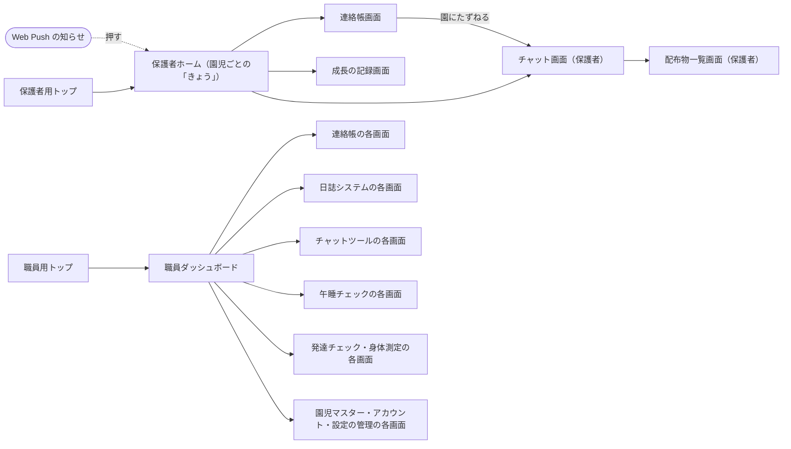

- 職員側の**起点は職員ダッシュボード**であり、「届ける」ことを中心にした未対応の項目から、各画面へ絞り込んだ状態で入る（`基本設計書.md`「画面基本構成」(3-5) の「通知からの導線」）。加えて、画面の左側に常時置く**サイドナビ**から各機能へ直接入れる
- 保護者側の**起点は保護者ホーム**である。**記録は連絡帳画面と成長の記録画面で読み、会話はチャット画面（保護者）で行う。** 入口は保護者ホームの1つで、園児ごとの「きょう」の区画から、その園児の連絡帳・成長の記録・個人チャットへ入る（`基本設計書.md`「画面体系図」(3-3)）
- **保護者が通知（ヘッダの通知、Web Push の知らせ）を押すと、保護者ホームを開く。** 何が新しいかは園児の区画で示す（`基本設計書.md`「画面遷移」(3-4)）
- 連絡帳の各画面は「連絡帳」(3)、保護者の画面は「保護者の画面」(9) に描く

| 職員ダッシュボード（第2.7版の画面） | 保護者ホーム（第2.7版の画面。第3.0版で作り直す） |
| :--: | :--: |
| 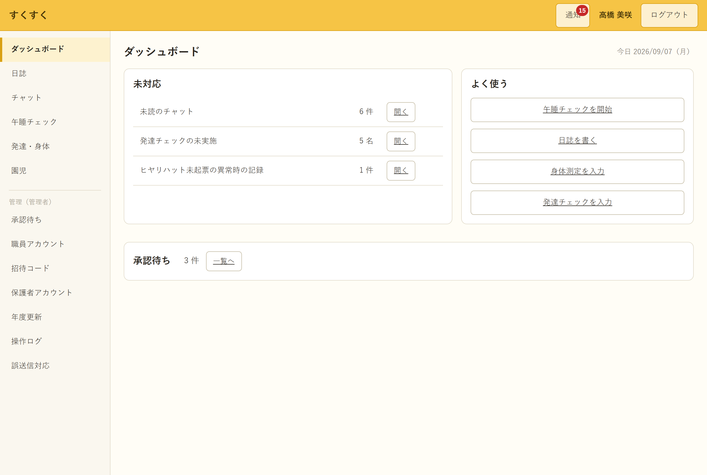 | 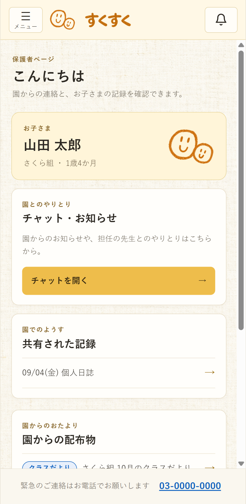 |

---

# 2 共通・認証

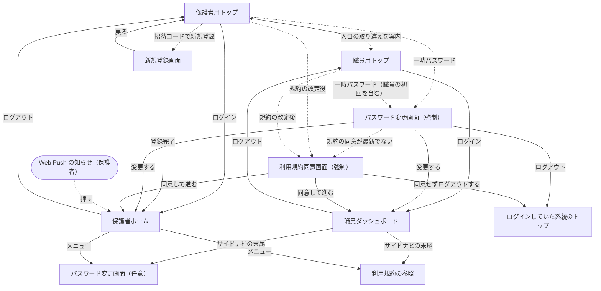

| 遷移元 | 操作・条件 | 遷移先 |
| :-- | :-- | :-- |
| 保護者用トップ | ログイン | 保護者ホーム |
| 保護者用トップ | 招待コードで新規登録 | 新規登録画面 |
| 新規登録画面 | 登録完了 | 保護者ホーム |
| 新規登録画面 | 戻る | 保護者用トップ |
| 職員用トップ | ログイン | 職員ダッシュボード |
| 保護者用トップ／職員用トップ | 誤った系統でのログイン | 正しい入口へ案内するリンクを出す（遷移は利用者の操作） |
| 保護者用トップ／職員用トップ | 一時パスワードでの認証成功（職員の初回ログインを含む） | パスワード変更画面（強制） |
| パスワード変更画面（強制） | 変更する（同意した規約が最新でないとき。**職員の初回ログインは必ずこちら**） | 利用規約同意画面（強制） |
| パスワード変更画面（強制） | 変更する（規約の同意が最新のとき） | ログインしたロールのホーム |
| 保護者用トップ／職員用トップ | 規約の改定後の初回ログイン | 利用規約同意画面（強制） |
| 利用規約同意画面（強制） | 同意して進む | ログインしたロールのホーム |
| パスワード変更画面（強制）／利用規約同意画面（強制） | ログアウト／同意せずログアウトする | **ログインしていた系統のトップ** |
| 職員の全画面のサイドナビの末尾 | パスワードの変更／利用規約 | パスワード変更画面（任意）／利用規約の参照 |
| 保護者のメニュー | パスワードの変更／利用規約 | パスワード変更画面（任意）／利用規約の参照 |
| 保護者ホーム／職員ダッシュボード | ログアウト | ログインしていた系統のトップ |
| Web Push の知らせ（保護者） | 押す | 保護者ホーム（ログインの記憶が切れていれば、保護者用トップを経て保護者ホーム） |

- **ログアウトの遷移先は、ログインしていた系統のトップ**（要件定義書「アプリのログイン」(4-1-1)）。強制の画面からログアウトしたときも同じ
- **職員の初回ログインは、パスワード変更画面 → 利用規約同意画面 → 職員ダッシュボードの順に進める**（要件定義書「初回ログインの順番（職員）」(4-1-1)、`基本設計書.md`「画面遷移」(3-4)）。一時パスワードのまま規約の同意を記録すると、本人が同意したことを示せないため、パスワードを先にする
- 保護者は新規登録画面の中で利用規約とプライバシーポリシーの両方に同意するため、初回に利用規約同意画面は出ない。規約を改定したあとの次のログインで出る
- 一時パスワードでのログイン時は、**変更を完了するまで他の画面へ進めない**。利用規約の同意も同様に、**同意するまで他の画面へ進めない**。どちらの強制の画面にもログアウトを置く
- パスワード変更画面と利用規約同意画面には、**強制で通る経路と、任意に開く経路の2つ**がある。画面は同じで、強制のときだけ他の画面への導線を出さない。**職員は任意の経路をサイドナビの末尾に持つ**（第1.x版は職員ダッシュボードのメニューとしていたが、職員の画面にメニューは無い）
- 保護者が Web Push の知らせを押したときは保護者ホームを開く。知らせの文面には名前と中身が無いため、何が届いたかはホームの「きょう」の区画と未読で示す（`基本設計書.md`「画面遷移」(3-4)）

| 保護者用トップ | 職員用トップ | 新規登録画面 |
| :--: | :--: | :--: |
| 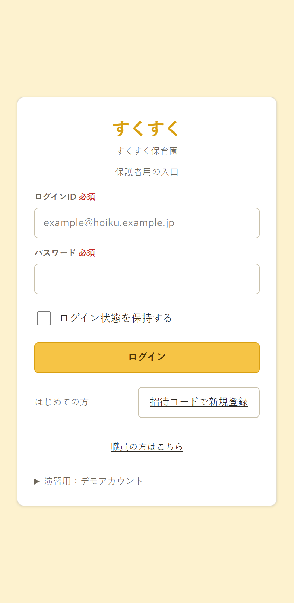 | 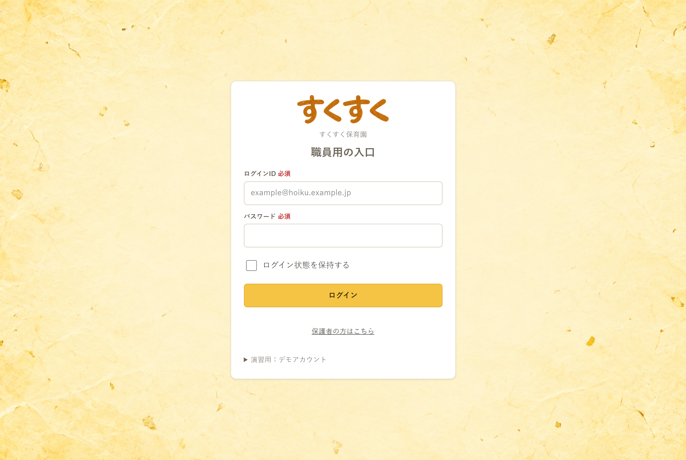 | 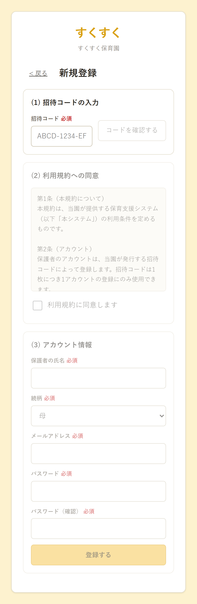 |

| パスワード変更画面（強制） | 利用規約同意画面（強制） |
| :--: | :--: |
| 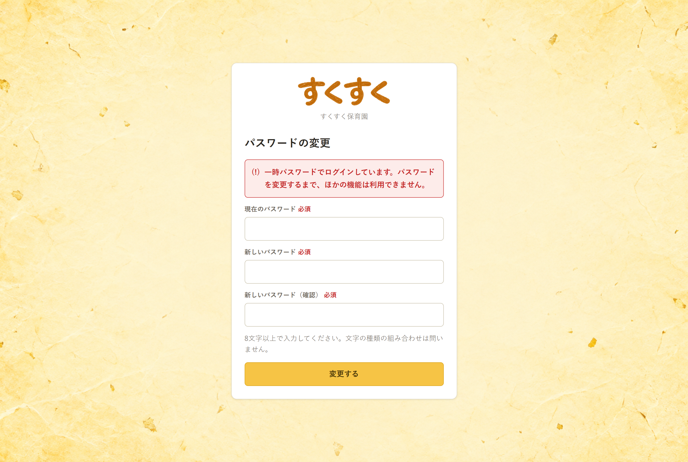 | 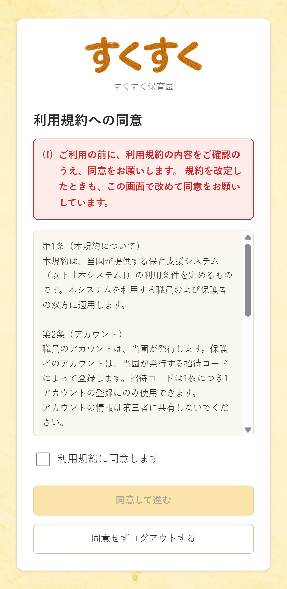 |

---

# 3 連絡帳

第3.0版で新しく置いた。職員が記録して保護者へ届ける**連絡帳（クラス）画面**と**連絡帳（園児）画面**の出入りを描く。保護者が読む連絡帳画面は「保護者の画面」(9) に描く。

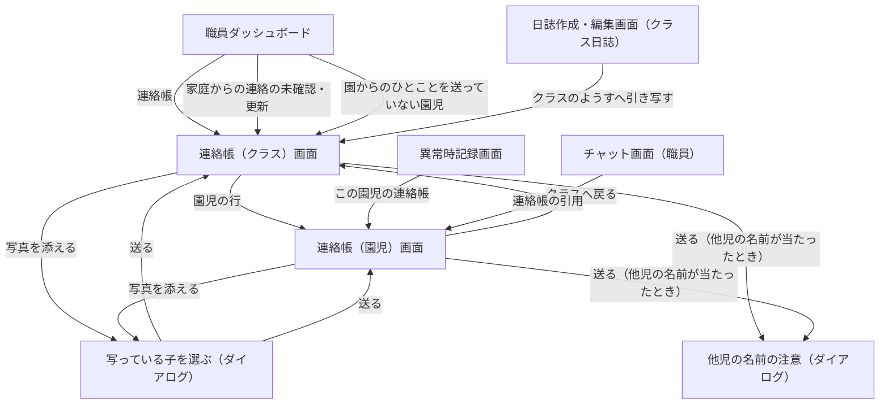

| 遷移元 | 操作・条件 | 遷移先 |
| :-- | :-- | :-- |
| 職員ダッシュボード／サイドナビ | 連絡帳 | 連絡帳（クラス）画面（その日。一般は自クラス、管理者はクラスを選ぶ） |
| 職員ダッシュボード | 家庭からの連絡の未確認・更新 | 連絡帳（クラス）画面（未確認・更新の園児を上に） |
| 職員ダッシュボード | 園からのひとことを送っていない園児 | 連絡帳（クラス）画面（未送信の園児を上に） |
| 連絡帳（クラス）画面 | 園児の行（名前） | 連絡帳（園児）画面（その園児・その日） |
| 連絡帳（クラス）画面 | 「家庭から」の「確認しました」、食事の「全員ぜんぶ」、排せつ・体温の記録 | 同じ画面の中の操作（遷移ではない。行の上で終える） |
| 連絡帳（クラス）画面 | クラスのようすを書く・送る | 同じ画面の中の入力領域（遷移ではない） |
| 連絡帳（クラス）画面 | 日付を選ぶ（前の日・次の日） | 同じ画面の中の切り替え（遷移ではない） |
| 連絡帳（園児）画面 | 前の日・次の日 | 同じ画面の中の切り替え（遷移ではない） |
| 連絡帳（園児）画面 | クラスへ戻る | 連絡帳（クラス）画面（同じ日） |
| 連絡帳（園児）画面 | 各記録の「直す」「取り消す」 | 同じ画面の中の入力領域（取り消しは確認ダイアログ。遷移ではない） |
| 連絡帳（クラス）画面／連絡帳（園児）画面 | 写真を添える | 写っている子を選ぶ（ダイアログ）。連絡帳（園児）画面では、その子を選んだ状態で開く |
| 写っている子を選ぶ（ダイアログ） | 送る | 開いた画面へ戻る（同意を満たさない子がいれば、送らずにダイアログの中に理由と次にすることを出す） |
| 段2を送る画面（連絡帳（クラス）画面・連絡帳（園児）画面） | 送る（本文に宛先以外の園児の名前が当たったとき） | 他児の名前の注意（ダイアログ）。「直す」で入力へ戻り、「このまま送る」で送る |
| 日誌作成・編集画面（クラス日誌） | クラスのようすへ引き写す | 連絡帳（クラス）画面（その日のクラスのようすの入力欄に**下書きとして**入る。送るかは職員が決める） |
| 異常時記録画面 | この園児の連絡帳 | 連絡帳（園児）画面（その園児・その日。電話のあとの経過を書く） |
| チャット画面（職員） | 保護者のメッセージに付いた連絡帳の引用（「10月17日の連絡帳について」） | 連絡帳（園児）画面（その園児・その日） |

- **連絡帳の記録と送信は、確認画面を挟まない**（`基本設計書.md`「画面の洗い出しの考え方」(3-1) の基準2）。選ぶだけの記録（段1）は押した結果を見せて取り消せるようにし、文と写真（段2）は「送る」の直前に宛先を大きく示す（`基本設計書.md`「保護者へ届けるときの関所」(2-4)）。写っている子を選ぶ・他児の名前の注意はダイアログであり、画面は移らない
- **よく使う記録と「確認しました」は、連絡帳（クラス）画面の行の上で終える**（1件3タップ以内。`基本設計書.md`「画面基本構成」(3-5) の「誰でも使える操作の条件」）。連絡帳（園児）画面へ移るのは、活動のひとこと・写真・「園から」を書くとき、1人のページを読むときである
- **午睡の「ねた」「おきた」は、午睡チェック画面の園児の行で記録する**（「午睡チェック」(6)）。連絡帳の画面へは移らない。記録はそのまま連絡帳のきょうのようすに並ぶ。午睡チェックを終えたあとの押し間違いは、連絡帳（園児）画面で直す
- 管理者は連絡帳（クラス）画面でクラスを選び、全クラスの連絡帳を**あとから読む**。事前の承認の画面は無い
- 日誌から連絡帳への道は「クラスのようすへ引き写す」の1つだけである。**写しただけでは保護者に届かない**（段2の守りを通って職員が送る）。個人日誌の午睡・食事の欄は、逆に、きょうのようすから日誌の下書きに入る（日誌作成・編集画面の中の操作。遷移ではない）

> 画像なし（モックアップの作り直しのあと撮る）。画面の中身は `図/画面詳細図.md`「連絡帳」(8) にある。

---

# 4 日誌システム

日誌は**園内の記録**である（`基本設計書.md`「保護者へ届けるときの関所」(2-4) の段3）。承認は園内の確認として残る。例外として、保育士が共有を選んで申請し、管理者が承認した個人日誌は、保護者が園からの日誌画面で読む（第2.5版）。

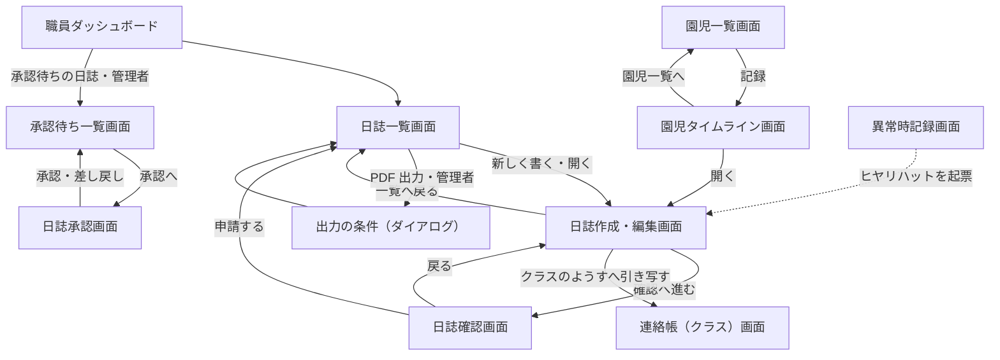

| 遷移元 | 操作・条件 | 遷移先 |
| :-- | :-- | :-- |
| 職員ダッシュボード／サイドナビ | 日誌 | 日誌一覧画面 |
| 職員ダッシュボード | 差し戻された日誌（一般） | 日誌一覧画面（差し戻しで絞った状態） |
| 日誌一覧画面 | 新しく書く／開く | 日誌作成・編集画面（申請中・承認済みは読み取り専用） |
| 日誌一覧画面 | 申請を取り下げる（自分の申請。承認・差し戻しの前） | 同じ画面の中の確認ダイアログ（遷移ではない。取り下げると下書きに戻る） |
| 日誌一覧画面 | PDF 出力（管理者） | 出力の条件（ダイアログ。期間・記録種別・クラスを選ぶ。画面として起こさない） |
| 日誌作成・編集画面 | 下書き保存 | 同じ画面に留まる（第1.x版は日誌一覧画面としていたが、`図/画面詳細図.md`「日誌作成・編集画面」(3-2) の項目12に合わせた） |
| 日誌作成・編集画面 | 日誌一覧へ | 日誌一覧画面（保存していない内容があれば確かめる） |
| 日誌作成・編集画面 | 確認へ進む | 日誌確認画面（**編集ロックを外さない**） |
| 日誌作成・編集画面 | きょうのようすから入れる（個人日誌） | 同じ画面の中の操作（遷移ではない。本文の末尾へ足す） |
| 日誌作成・編集画面 | クラスのようすへ引き写す（クラス日誌） | 連絡帳（クラス）画面（クラスのようすの入力欄に下書きとして入る） |
| 日誌作成・編集画面 | 承認を取り消して差し戻す（管理者。承認済みの日誌を開いたとき） | 同じ画面の中の確認ダイアログ（理由必須。遷移ではない） |
| 日誌確認画面 | 戻る／申請する | 日誌作成・編集画面／日誌一覧画面 |
| 園児一覧画面 | 記録 | 園児タイムライン画面 |
| 園児タイムライン画面 | 日誌を開く | 日誌作成・編集画面 |
| 職員ダッシュボード／サイドナビ | 承認待ちの日誌（管理者） | 承認待ち一覧画面 |
| 承認待ち一覧画面 | 承認へ（管理者） | 日誌承認画面 |
| 日誌承認画面 | 承認する／差し戻す（管理者） | 承認待ち一覧画面 |
| 保護者のメニュー | 園からの日誌（保護者） | 園からの日誌画面（読むだけ。ほかの画面へは移らない） |
| 異常時記録画面 | ヒヤリハットを起票 | 起票された日誌の日誌作成・編集画面 |

- **保護者への共有の道は、第2.5版で個人日誌に限って戻した。** 第1.x版は日誌承認画面で管理者が「承認と共有指定」を行い、保護者は共有日誌閲覧画面で開いていた。第3.0版で日誌を保護者へ共有しなくなり（`基本設計書.md`「画面遷移」(3-4) の外した遷移）、日誌承認画面の操作は「承認する」と「差し戻す」になった。第2.5版で、保育士が日誌作成・編集画面で共有を選んで申請し、管理者が承認すると、保護者が園からの日誌画面で読む形にした。管理者は共有を選ばず、日誌承認画面の遷移先は変わらない
- **承認の取り消しは、承認済みの日誌を管理者が日誌作成・編集画面（読み取り専用）で開いて行う。** 承認済みの日誌は承認待ち一覧画面に並ばないため、日誌承認画面には置かない（`図/画面詳細図.md`「日誌作成・編集画面」(3-2)）
- 日誌から連絡帳へ移るのは「クラスのようすへ引き写す」だけである。写しても保護者には届かず、連絡帳（クラス）画面で職員が確かめて送る（「連絡帳」(3)）
- **園児タイムライン画面への導線は園児一覧画面が持つ。** 本書 第1.2版は日誌一覧画面からとしていた（「モックアップ実装との差異」(10) No.4）

| 日誌一覧画面 | 日誌作成・編集画面 | 日誌確認画面 |
| :--: | :--: | :--: |
| 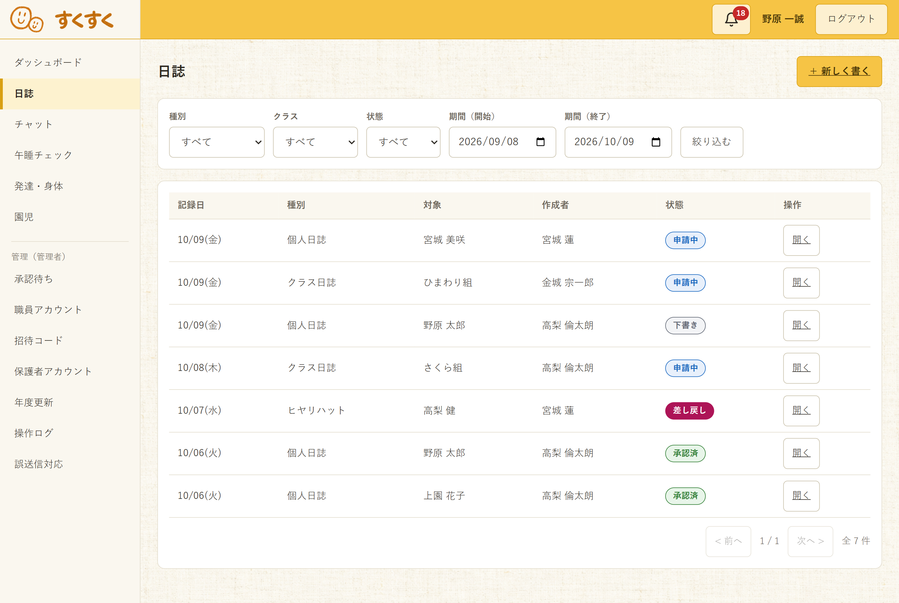 | 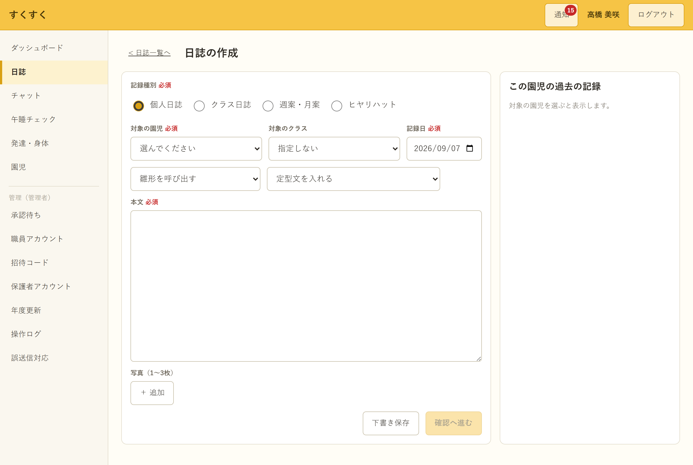 | 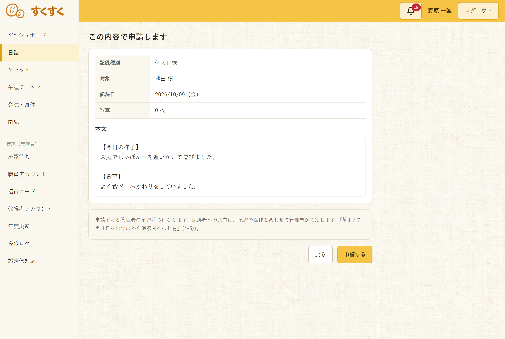 |

| 園児タイムライン画面 | 承認待ち一覧画面 | 日誌承認画面 |
| :--: | :--: | :--: |
| 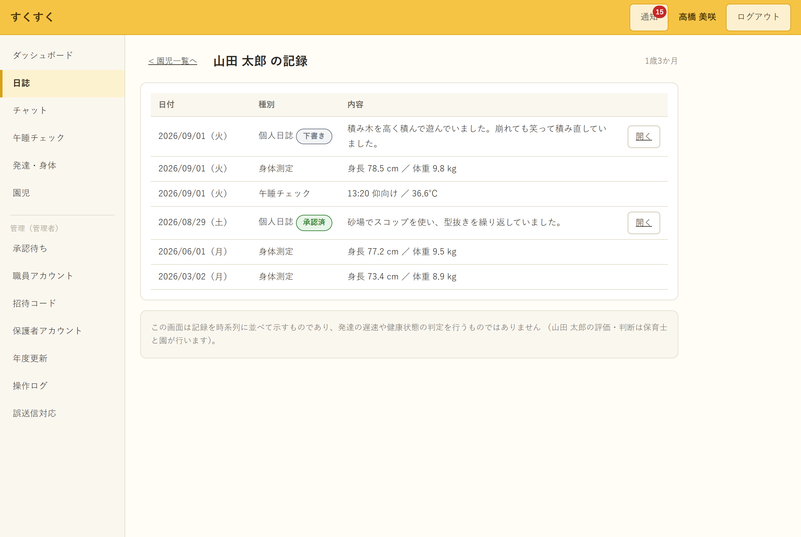 | 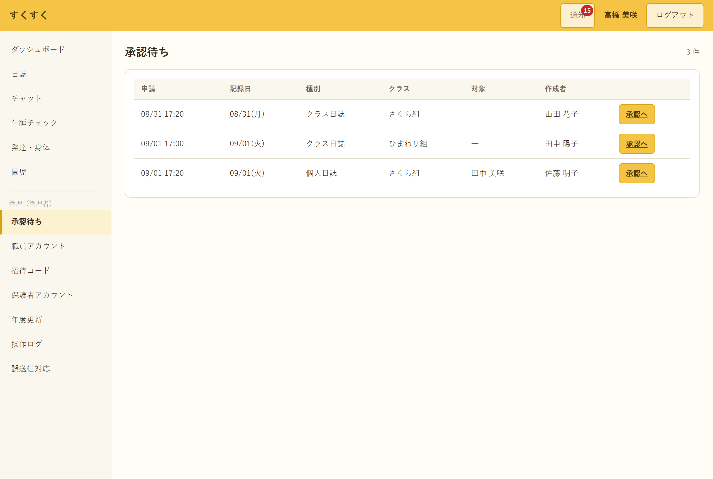 | 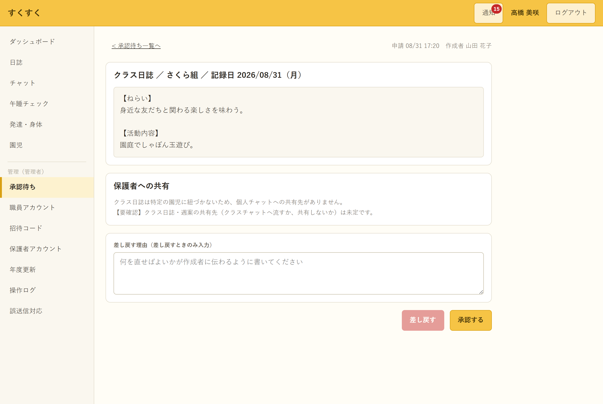 |

---

# 5 チャットツール

チャットは**会話の窓口**である。保護者が記録を読むのは連絡帳画面と成長の記録画面であり、**日誌・発達・身体の記録を共有するカードはチャットに流さない**（`基本設計書.md`「画面の一覧」(3-2)）。職員側では、チャンネルの切り替え・メッセージの送受信・リアクション・「確認しました」・既読確認が**チャット画面の中で完結する**。保護者側も画面としては1つで、**チャンネル一覧と会話の切り替えを画面の中の状態変化として持つ**（実装でも URL は変わらない）。

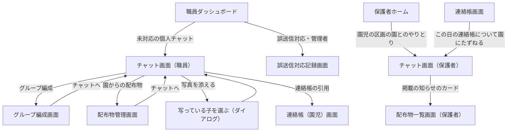

| 遷移元 | 操作・条件 | 遷移先 |
| :-- | :-- | :-- |
| 職員ダッシュボード／サイドナビ | チャット | チャット画面（職員） |
| 職員ダッシュボード | 未対応の個人チャット | チャット画面（職員）（未対応の個人チャットを上に） |
| チャット画面（職員） | グループ編成 | グループ編成画面 |
| グループ編成画面 | チャットへ | チャット画面（職員） |
| チャット画面（職員） | 園からの配布物／掲載の知らせのカード | 配布物管理画面 |
| 配布物管理画面 | チャットへ | チャット画面（職員） |
| 配布物管理画面 | 配布物を掲載する／開く／取り下げ | 同じ画面の中のダイアログ（遷移ではない） |
| チャット画面（職員） | 写真を添える（動画は認めない） | 写っている子を選ぶ（ダイアログ。画面として起こさない） |
| チャット画面（職員） | 送る（保護者が参加するチャンネルで、宛先以外の園児の名前が当たったとき） | 他児の名前の注意（ダイアログ） |
| チャット画面（職員） | 保護者のメッセージの「確認しました」、既読の人数を押してまだ読んでいない家庭を見る、未対応・対応済みの切り替え | 同じ画面の中の操作（遷移ではない） |
| チャット画面（職員） | 削除（管理者。他者のメッセージ）／取消（送信者本人） | 同じ画面の中の確認ダイアログ（いま読んでいる家庭の数を示す。遷移ではない） |
| チャット画面（職員） | 保護者のメッセージに付いた連絡帳の引用 | 連絡帳（園児）画面（その園児・その日） |
| サイドナビ「管理（管理者）」 | 誤送信対応 | 誤送信対応記録画面 |
| 保護者ホーム | 園児の区画の「〇〇（園児名）の園とのやりとり」 | チャット画面（保護者）（その園児の個人チャットを開いた状態） |
| 保護者ホーム／メニュー | チャット・お知らせ | チャット画面（保護者）（チャンネル一覧） |
| 連絡帳画面 | この日の連絡帳について園にたずねる | チャット画面（保護者）（その園児の個人チャット。その日の連絡帳を引用した状態） |
| チャット画面（保護者） | チャンネルを開く／一覧へ戻る | 同じ画面の中の切り替え（遷移ではない） |
| チャット画面（保護者） | 園チャット・クラスグループのメッセージの「この連絡について園にたずねる」 | 同じ画面の中で、その園児の個人チャットを引用つきで開く（きょうだいの両方に届いたお知らせは、どの子のチャットで聞くかを園児名で選ぶ） |
| チャット画面（保護者） | 掲載の知らせのカード | 配布物一覧画面（保護者） |
| チャット画面（職員）／チャット画面（保護者） | 自分のメッセージを編集 | 同じ画面の中の切り替え（遷移ではない） |

- **チャンネルの切り替えは画面遷移ではない。** 園チャット・グループチャット・個人チャット・職員チャットは、いずれもチャット画面の中の表示の切り替えとして扱う
- **メッセージの編集も画面遷移ではない。** 該当のメッセージが入力欄に変わるだけで、別画面へは移らない（`基本設計書.md`「メッセージの編集」(4-7)）。職員側・保護者側の双方で同じ扱いとする
- **「園にたずねる」は、連絡帳画面からは画面を移り、チャット画面（保護者）の中では同じ画面の中で個人チャットへ切り替える。** どちらも元の記録・メッセージを引用した状態で開く（`基本設計書.md`「画面遷移」(3-4)）
- **共有された日誌のカードは無くなった。** 第1.x版の「共有された日誌のカード」から日誌作成・編集画面（職員）・共有日誌閲覧画面（保護者）への遷移は外した（日誌を保護者へ共有しないため）
- 保護者はチャット画面のみを利用し、グループ編成画面・誤送信対応記録画面への導線を持たない
- **誤送信対応記録画面へはチャット画面からではなく、サイドナビの「管理（管理者）」から入る**（「モックアップ実装との差異」(10) No.3）。連絡帳で送ったものの誤送信も同じ画面に記録する

## 5-1 デバイスによるレイアウトの前提

| 利用者 | デバイス | 構成 | 遷移の性質 |
| :-- | :-- | :-- | :-- |
| 管理者・一般（職員） | タブレット／PC | チャンネル一覧・メッセージ領域・メンバー一覧を**同一画面に並べる** | チャンネルの切替は**画面内の状態変化**。独立画面として遷移するのはグループ編成のみ |
| 保護者 | スマートフォン | シングルカラム（`基本設計書.md`「画面基本構成」(3-5)） | チャンネル一覧と会話を**入れ替えて表示する**。画面としては1つで、URL も変わらない |

> **保護者側のチャットは画面を分けない**（同じ画面の中で一覧と会話を入れ替える）。2026/09/07 に決着した。分けても表示項目は増えず、画面数と図の分量だけが増えるため（`基本設計書.md`「画面の一覧」(3-2)）。

| チャット画面（職員） | グループ編成画面 | 誤送信対応記録画面 |
| :--: | :--: | :--: |
| 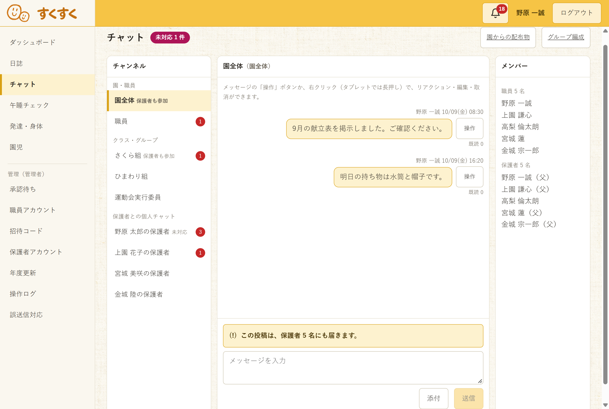 | 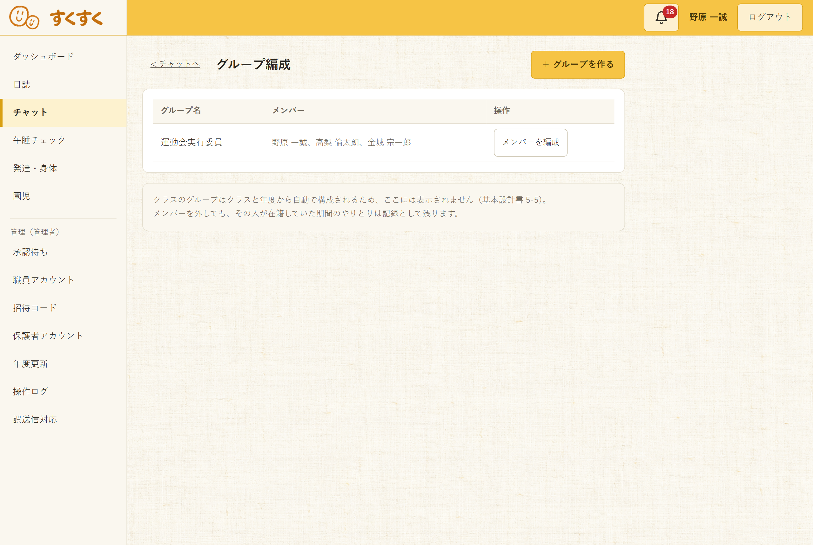 | 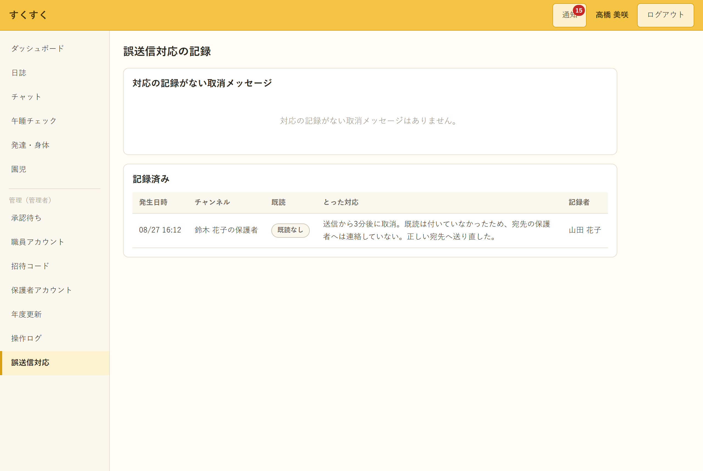 |

| チャット画面（保護者・チャンネル一覧） | チャット画面（保護者・会話） |
| :--: | :--: |
| 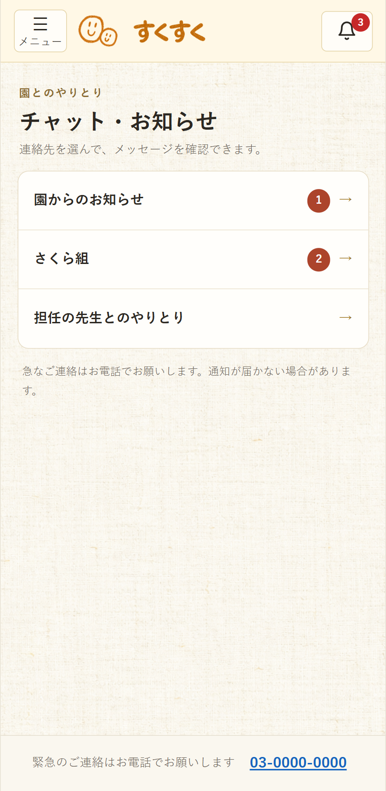 | 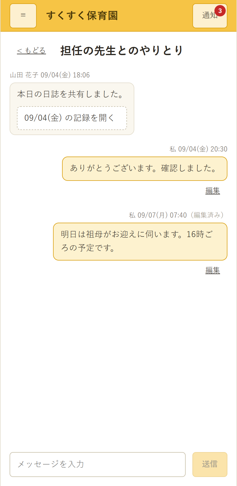 |

*画像は第2.7版の画面。「確認しました」・既読の人数とまだ読んでいない家庭・「この連絡について園にたずねる」は写っておらず、共有された日誌のカードが写っている*

---

# 6 午睡チェック

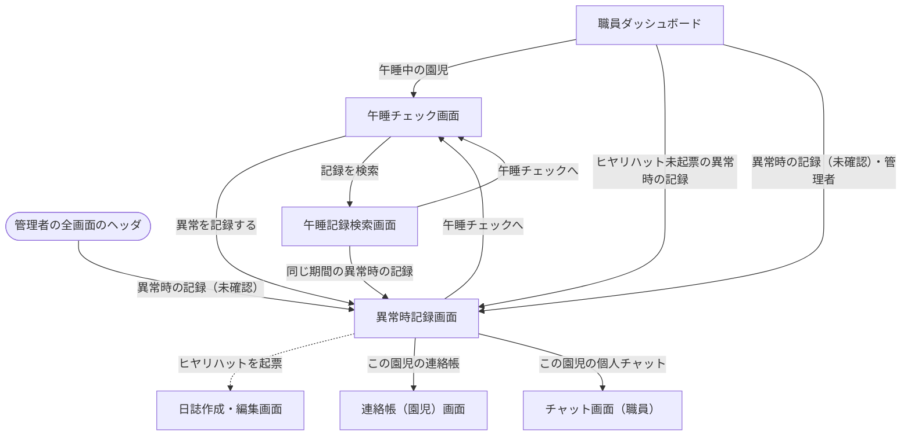

| 遷移元 | 操作・条件 | 遷移先 |
| :-- | :-- | :-- |
| 職員ダッシュボード／サイドナビ | 午睡チェック | 午睡チェック画面 |
| 職員ダッシュボード | 午睡中の園児／午睡チェックを開始／実施中の午睡チェック | 午睡チェック画面 |
| 午睡チェック画面 | 園児の行の「ねた」「おきた」「きょうは対象外」、体位・呼吸・顔色・体温の記録、押し間違いの「直す」「取り消す」 | 同じ画面の中の操作（**遷移ではない**。5分ごとの確認と同じ行で終える） |
| 午睡チェック画面 | 異常を記録する | 異常時記録画面 |
| 異常時記録画面 | 午睡チェックへ | 午睡チェック画面 |
| 異常時記録画面 | ヒヤリハットを起票／起票済み（開く） | 日誌作成・編集画面 |
| 異常時記録画面 | この園児の連絡帳／この園児の個人チャット | 連絡帳（園児）画面／チャット画面（職員）（その園児の個人チャット）。電話で伝えたあとの経過を書く |
| 異常時記録画面 | 確認した（管理者） | 同じ画面の中の操作（遷移ではない。全管理者のヘッダから件数が消える） |
| 職員ダッシュボード | ヒヤリハット未起票の異常時の記録 | 異常時記録画面 |
| 職員ダッシュボード（管理者）／管理者の全画面のヘッダ | 異常時の記録（未確認） | 異常時記録画面 |
| 午睡チェック画面 | 記録を検索 | 午睡記録検索画面 |
| 午睡記録検索画面 | 午睡チェックへ | 午睡チェック画面 |
| 午睡記録検索画面 | 行の「修正」 | 同じ画面の中の入力領域（遷移ではない。修正の履歴を残す） |
| 午睡記録検索画面 | 帳票（CSV）の出力（管理者） | ファイルを受け取る（遷移ではない。サーバで作り、操作ログに残す。PDF は演習では作らない） |
| 午睡記録検索画面 | 同じ期間の異常時の記録の行 | 異常時記録画面 |

- **午睡チェック画面は開いたまま運用する。** 実施中は自動ログアウトの対象外とし、他画面への遷移を前提としない（`基本設計書.md`「システムの利用方法」(2-2)）
- **「ねた」「おきた」「きょうは対象外」は、午睡チェック画面の園児の行（5分ごとの確認と同じ行）で記録する。** 別の画面へ移らせない（`基本設計書.md`「画面遷移」(3-4)）。「ねた」「おきた」は記録した時点で保護者の連絡帳に届くが、職員の画面は移らない
- タイマーとアラームは画面内の表示であり、遷移を起こさない。サーバに届かない状態も画面の上端に出すだけで、遷移は起こさない
- **管理者の全画面のヘッダに「異常時の記録（未確認）」の件数を出し、押すと異常時記録画面へ移る**（ヘッダに項目を出さない原則の例外。`基本設計書.md`「画面基本構成」(3-5) の「通知からの導線」）。管理者が「確認した」を押すまで残る。一般の画面には出さない
- **午睡記録検索画面への導線は午睡チェック画面が持つ。** サイドナビには置かない。実施中の画面から離れる操作を誘わないため（GitHub Issue #64 で実装済み）

| 午睡チェック画面 | 異常時記録画面 | 午睡記録検索画面 |
| :--: | :--: | :--: |
| 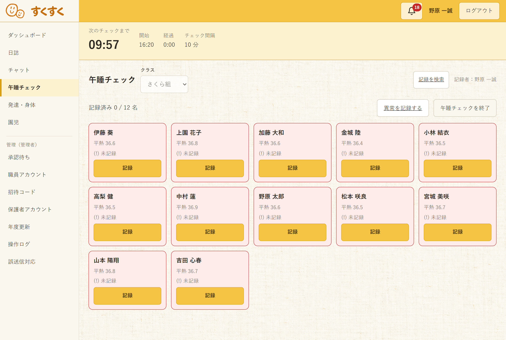 | 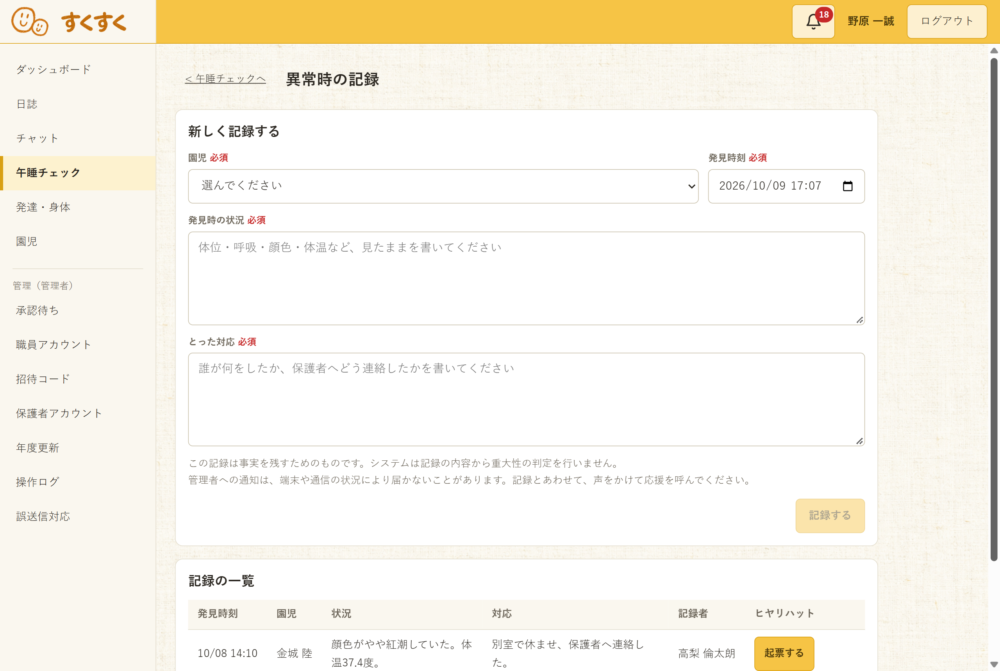 | 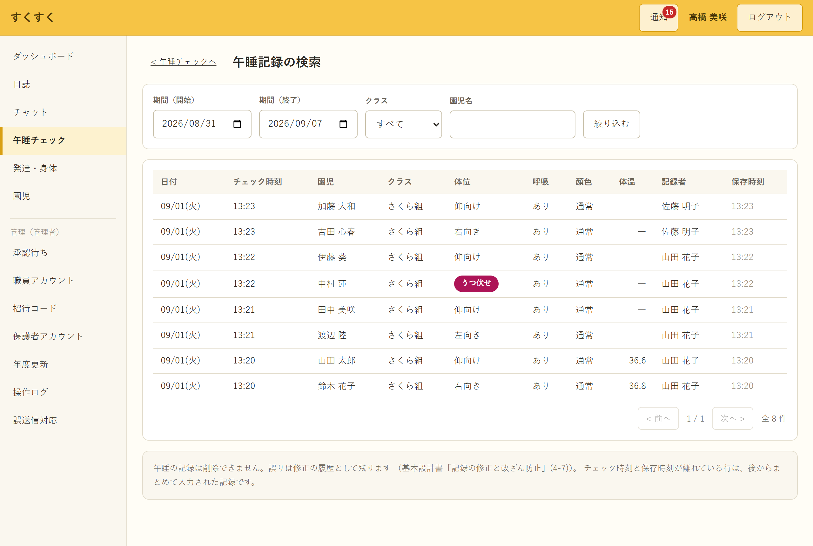 |

*画像は第2.7版の画面。園児の行の「ねた」「おきた」「きょうは対象外」、管理者の「確認した」、保護者への連絡の欄は写っていない*

---

# 7 発達チェック・身体測定・成長の記録

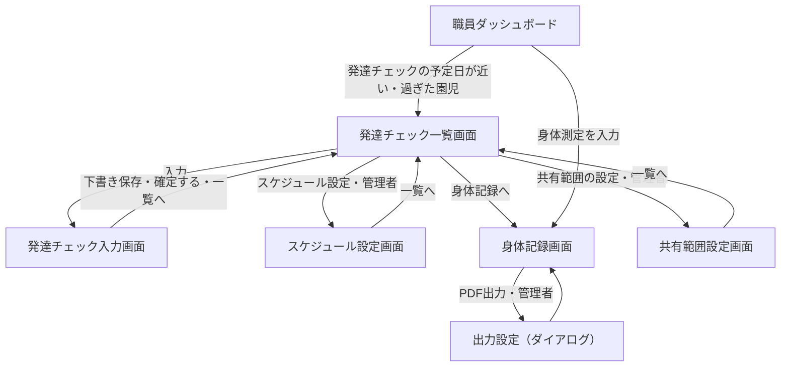

| 遷移元 | 操作・条件 | 遷移先 |
| :-- | :-- | :-- |
| 職員ダッシュボード／サイドナビ | 発達・身体 | 発達チェック一覧画面 |
| 職員ダッシュボード | 発達チェックの予定日が近い・過ぎた園児 | 発達チェック一覧画面 |
| 発達チェック一覧画面 | 入力 | 発達チェック入力画面 |
| 発達チェック入力画面 | 下書き保存／確定する／一覧へ | 発達チェック一覧画面 |
| 発達チェック入力画面 | 確定する（保護者へのひとことに宛先以外の園児の名前が当たったとき） | 他児の名前の注意（ダイアログ） |
| 発達チェック一覧画面 | スケジュール設定（管理者） | スケジュール設定画面 |
| 発達チェック一覧画面 | 身体記録へ | 身体記録画面 |
| 職員ダッシュボード | 身体測定を入力 | 身体記録画面 |
| 身体記録画面 | PDF出力（管理者） | 出力設定（ダイアログ。画面として起こさない） |
| 発達チェック一覧画面 | 共有範囲の設定（管理者） | 共有範囲設定画面 |
| 共有範囲設定画面 | 一覧へ | 発達チェック一覧画面 |

- 発達チェック入力画面と身体記録画面は**連続入力を前提とし、確認画面を挟まない**（`基本設計書.md`「画面の洗い出しの考え方」(3-1) の基準2）
- 成長グラフと過去記録の比較は身体記録画面・発達チェック入力画面の中の表示であり、遷移を起こさない。**判定・診断を行うものではない旨の免責を常時表示する**
- **共有範囲設定画面への導線は発達チェック一覧画面が持つ。** 管理者だけの操作であり、スケジュール設定と並べて置く（GitHub Issue #63 で実装済み）
- **成長の記録画面は保護者の画面であり、職員の画面からは入らない**（「保護者の画面」(9)）。身体測定の登録・上書きと発達チェックの確定は、その時点で保護者の成長の記録に届くが、職員の画面は移らない（`基本設計書.md`「保護者へ届けるときの関所」(2-4) の段1・段2）。第1.x版にあった「個人チャットへの引き渡し」の導線は無い

| 発達チェック一覧画面 | 発達チェック入力画面 | スケジュール設定画面 |
| :--: | :--: | :--: |
| 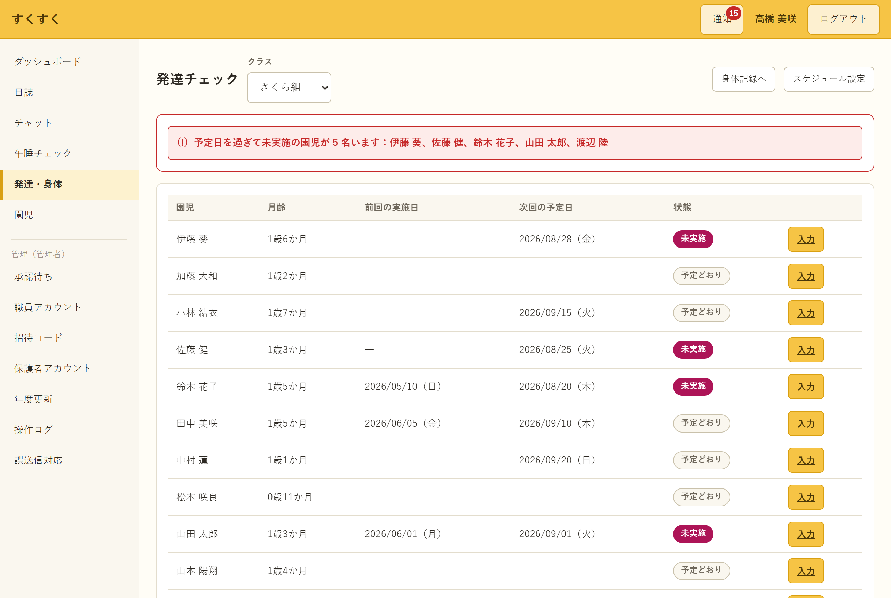 | 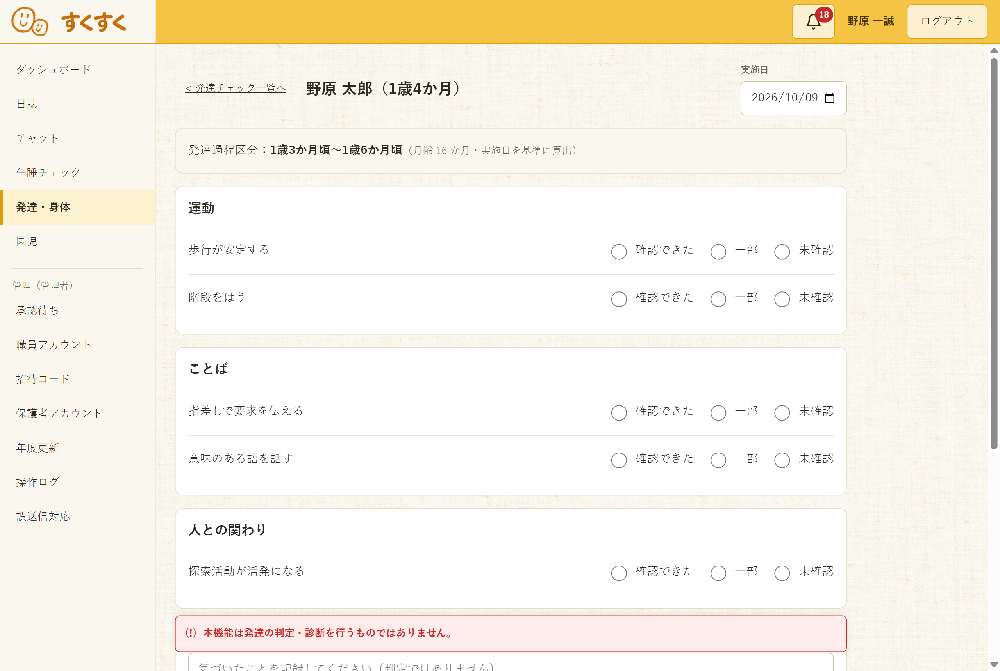 | 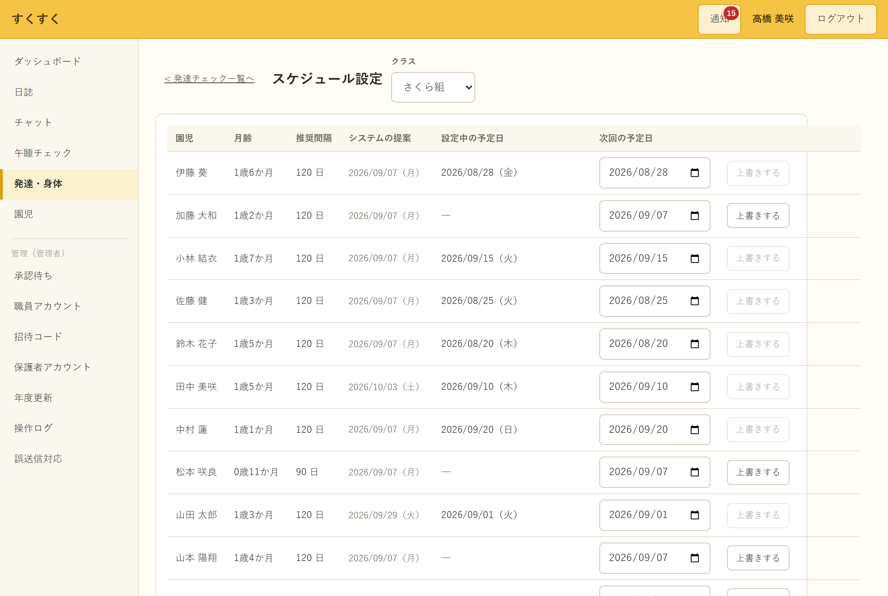 |

| 身体記録画面 | 共有範囲設定画面 |
| :--: | :--: |
| 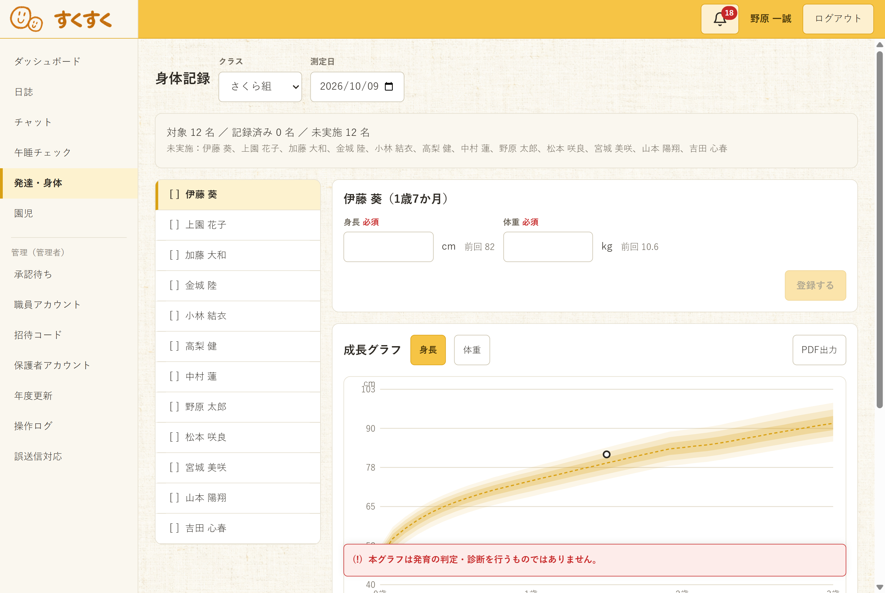 | 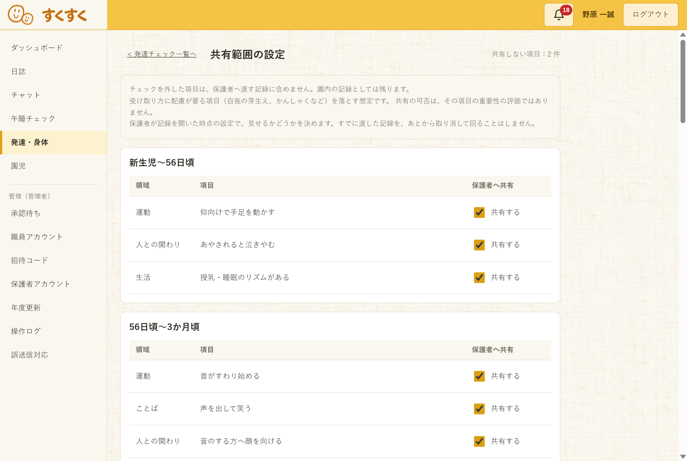 |

---

# 8 園児マスター・アカウント・設定の管理

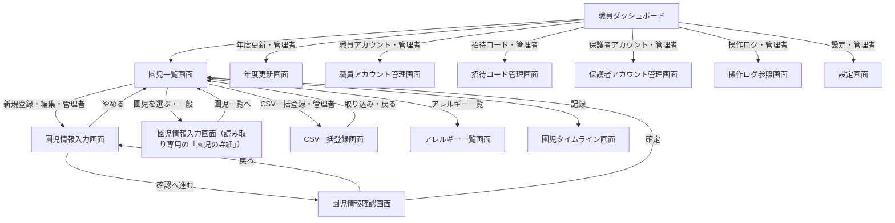

| 遷移元 | 操作・条件 | 遷移先 |
| :-- | :-- | :-- |
| 職員ダッシュボード／サイドナビ | 園児 | 園児一覧画面（一般は閲覧のみ） |
| 園児一覧画面 | 新規登録／編集（管理者） | 園児情報入力画面 |
| 園児一覧画面 | 園児を選ぶ（一般） | 園児情報入力画面（**読み取り専用の「園児の詳細」**。既往歴は自クラスの園児だけ、緊急連絡先は自クラスの園児の保護者だけを出す） |
| 園児一覧画面 | 取消（管理者。誤って登録した園児） | 同じ画面の中の確認ダイアログ（遷移ではない。記録か保護者が紐づいていれば取り消せない） |
| 園児情報入力画面 | 確認へ進む（管理者） | 園児情報確認画面 |
| 園児情報入力画面 | やめる／園児一覧へ | 園児一覧画面 |
| 園児情報入力画面 | 退園にする／在籍へ戻す（管理者） | 同じ画面の中の確認ダイアログ（遷移ではない。保護者がいつまで読めるかと、停止の対象になる保護者アカウントを示す） |
| 園児情報確認画面 | 戻る／確定 | 園児情報入力画面／園児一覧画面 |
| 園児一覧画面 | CSV一括登録（管理者） | CSV一括登録画面 |
| 園児一覧画面 | アレルギー一覧 | アレルギー一覧画面 |
| 園児一覧画面 | 記録 | 園児タイムライン画面 |
| サイドナビ「管理（管理者）」 | 年度更新 | 年度更新画面 |
| サイドナビ「管理（管理者）」 | 職員アカウント | 職員アカウント管理画面 |
| サイドナビ「管理（管理者）」 | 招待コード | 招待コード管理画面 |
| サイドナビ「管理（管理者）」 | 保護者アカウント | 保護者アカウント管理画面 |
| サイドナビ「管理（管理者）」 | 操作ログ | 操作ログ参照画面 |
| サイドナビ「管理（管理者）」 | 設定 | 設定画面 |
| 設定画面 | 各設定の保存 | 同じ画面の中の確認ダイアログ（遷移ではない。変更は操作ログに残る） |

- 園児情報の登録・編集だけが**入力→確認→確定**の3段階を持つ。誤登録が全機能へ波及するため（`基本設計書.md`「画面の洗い出しの考え方」(3-1) の基準2）。**一般が読み取り専用で開いたときは確認へ進む導線を出さない**
- **一般は、園児の詳細のために別の画面を持たず、園児情報入力画面を読み取り専用で開く**（`基本設計書.md`「画面の一覧」(3-2)）。同じ項目を持つ画面を2つにすると、片方だけ直す食い違いが起きるため
- **設定画面は園が変える設定を1つにまとめた画面である**（連絡帳の出す項目と選択肢、定型文・日誌の雛形、通知を送らない時間帯、AI、クラス、そのほかの設定値。要件定義書「園が変える設定」(4-1-4 (5))）。管理者だけが使い、サイドナビ「管理（管理者）」から入る
- アレルギー一覧画面は**全園児が対象**であり、自クラス制限の例外となる（要件定義書「参照範囲の全体規定」(4-1-5)）
- **アレルギー一覧画面への導線は園児一覧画面が持つ。** 本書 第1.2版は職員ダッシュボードからとしていた（「モックアップ実装との差異」(10) No.7）

| 園児一覧画面 | 園児情報入力画面 | 園児情報確認画面 |
| :--: | :--: | :--: |
| 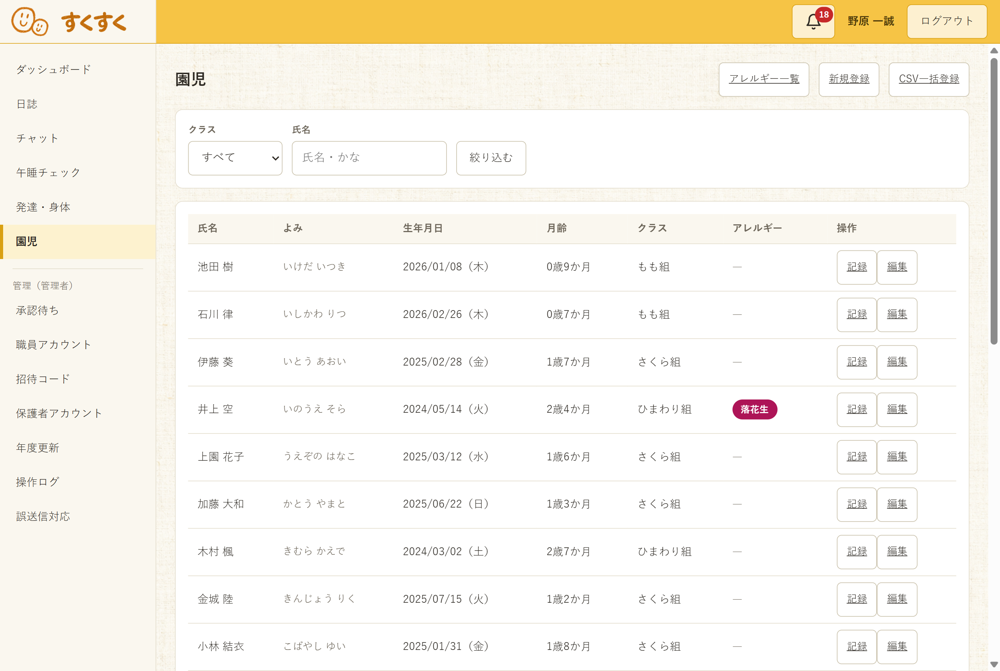 | 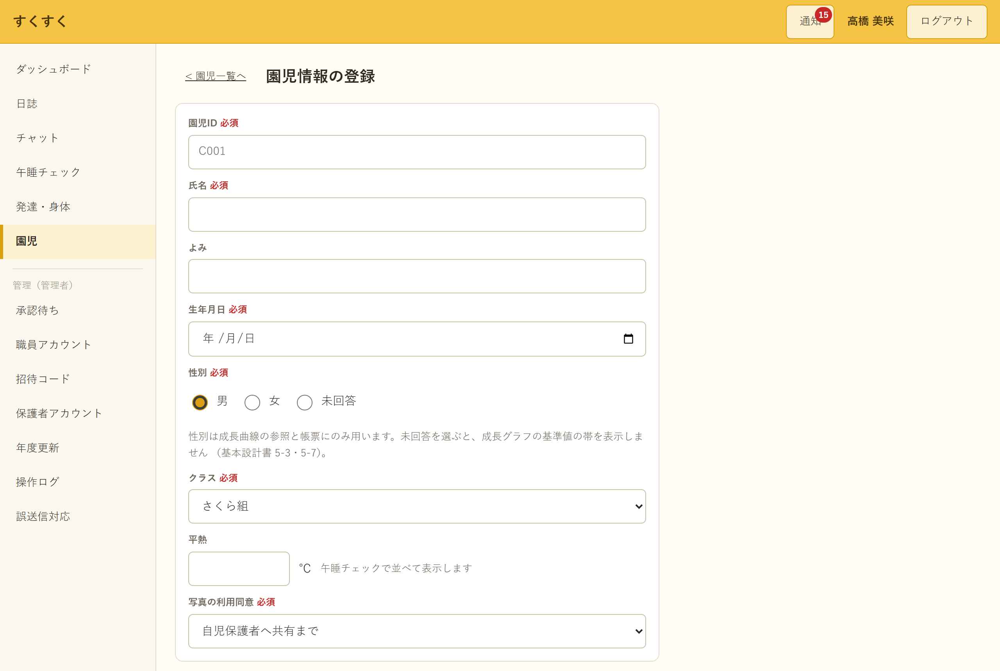 | 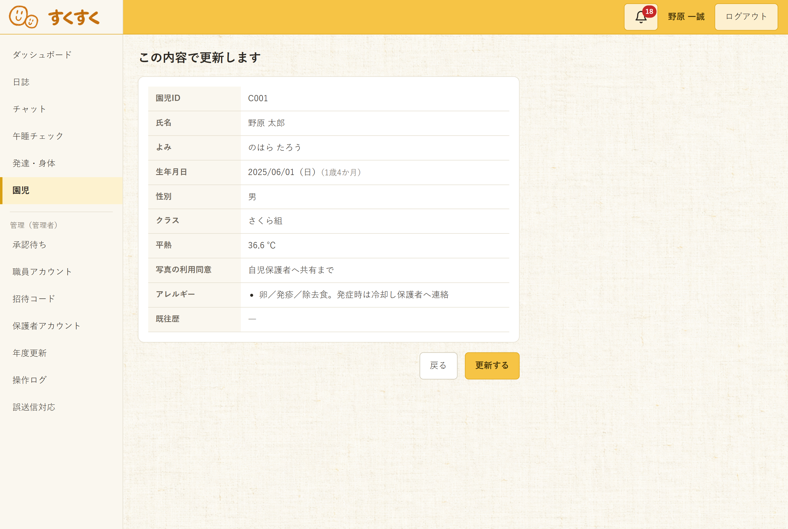 |

| CSV一括登録画面 | アレルギー一覧画面 | 年度更新画面 |
| :--: | :--: | :--: |
| 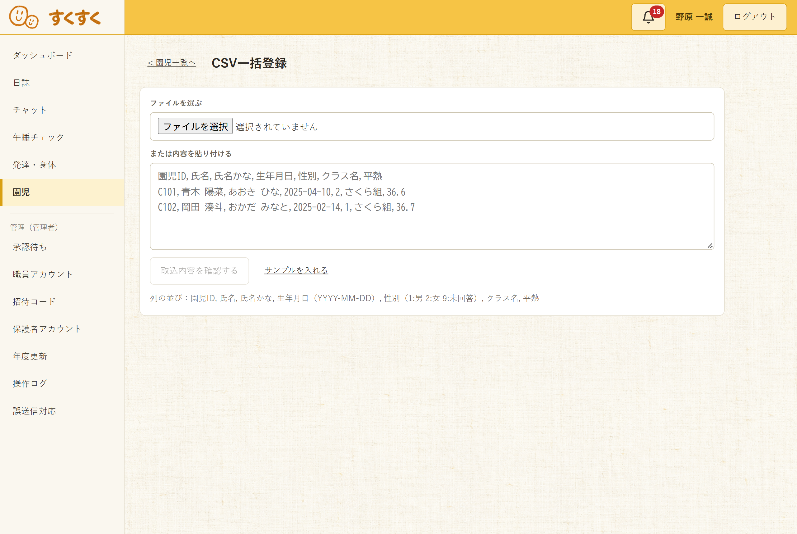 | 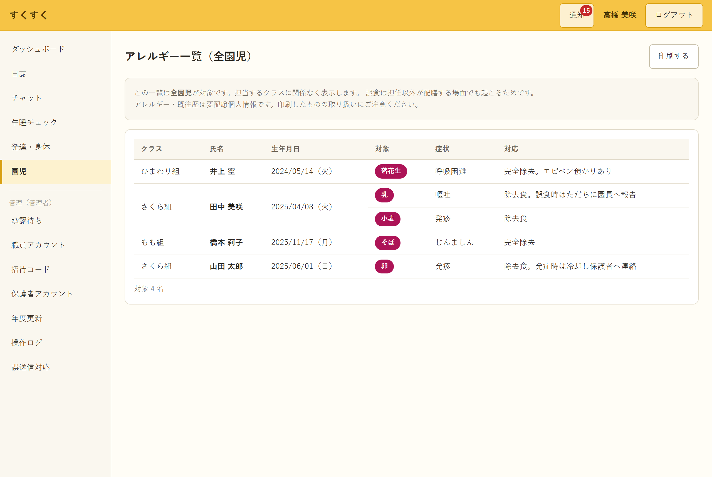 | 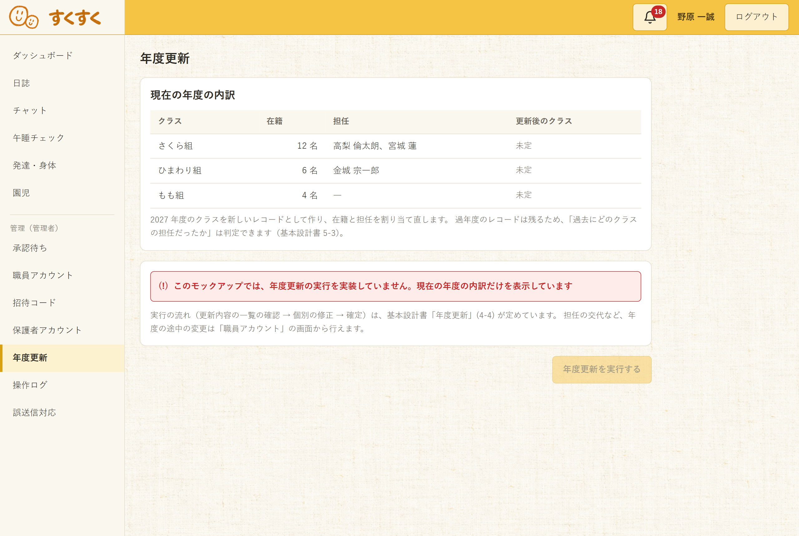 |

| 職員アカウント管理画面 | 招待コード管理画面 | 保護者アカウント管理画面 |
| :--: | :--: | :--: |
| 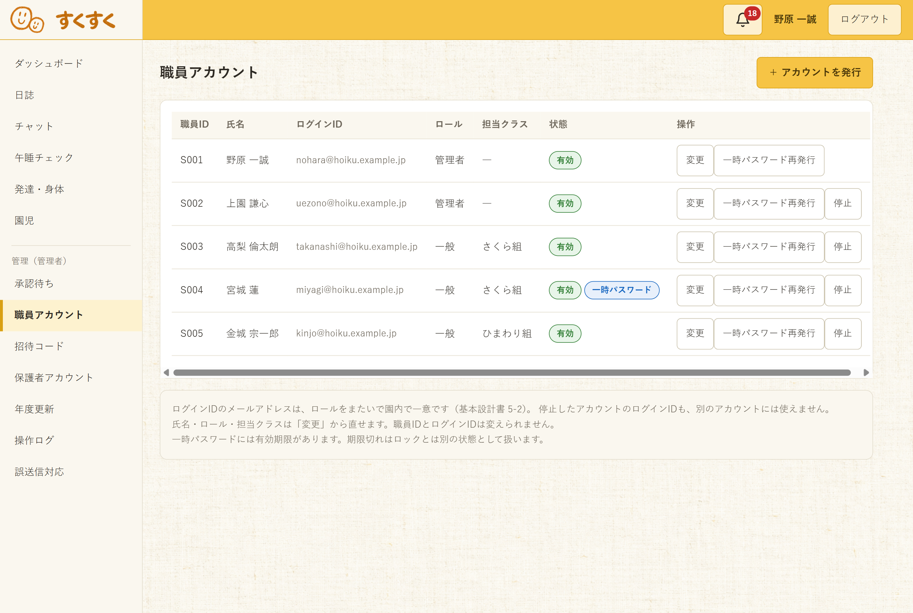 | 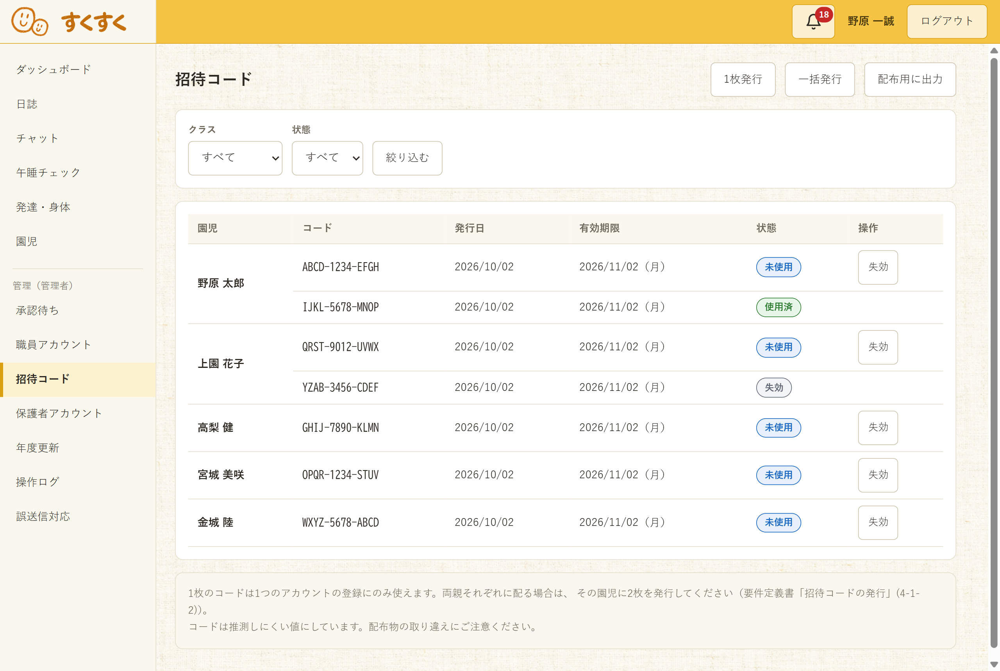 | 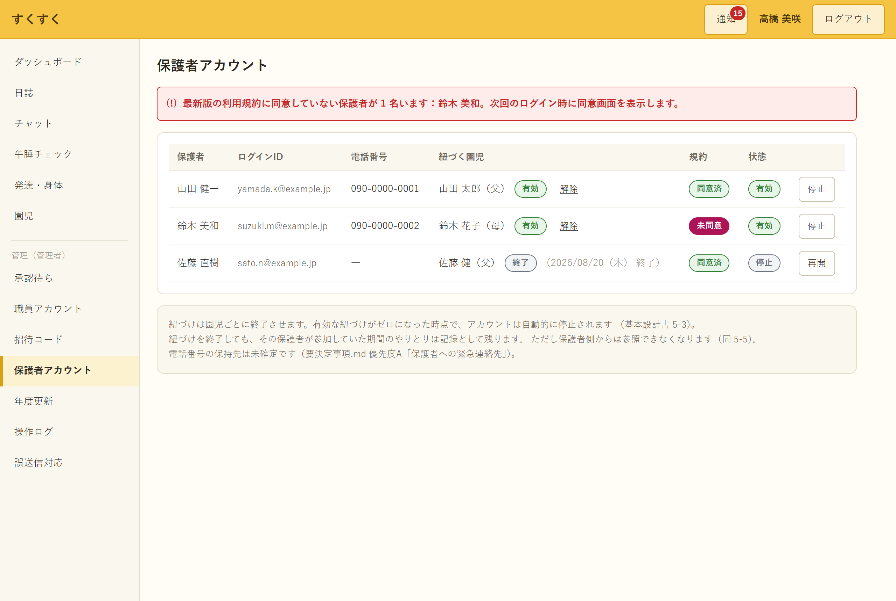 |

| 操作ログ参照画面 | 設定画面 |
| :--: | :--: |
| 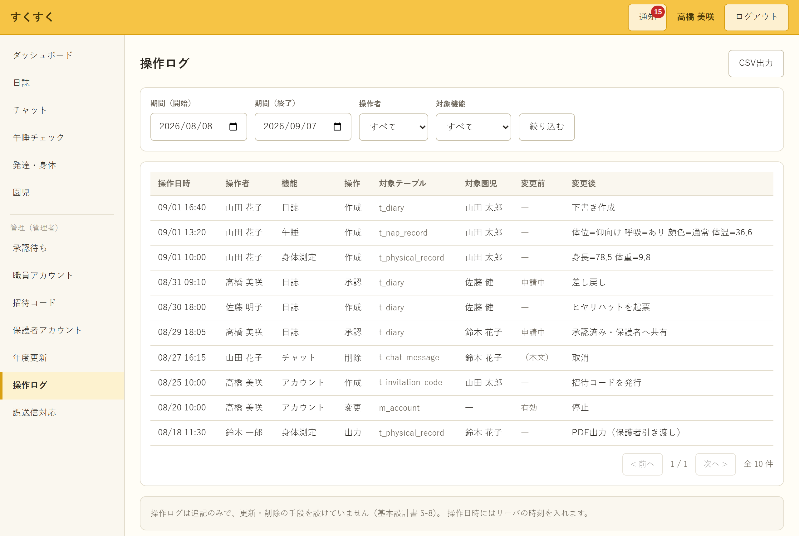 | 画像なし（モックアップの作り直しのあと撮る） |

*園児情報入力画面の画像は第2.7版の画面。顔写真・呼び名・在籍状態と退園日・園児ごとの午睡の間隔と、一般の読み取り専用の表示は写っていない*

---

# 9 保護者の画面

保護者が持つ画面は、**保護者用トップ・新規登録画面・保護者ホーム・連絡帳画面・成長の記録画面・チャット画面（保護者）・配布物一覧画面（保護者）・パスワード変更画面・利用規約同意画面**の9つである（`基本設計書.md`「画面の一覧」(3-2)）。**記録は連絡帳画面と成長の記録画面で読み、会話はチャット画面（保護者）で行う。入口は保護者ホームの1つ**である（同「画面体系図」(3-3)）。

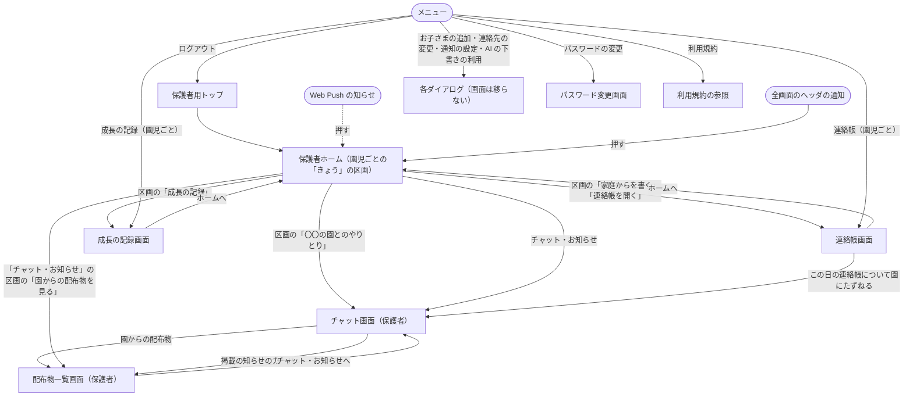

| 遷移元 | 操作・条件 | 遷移先 |
| :-- | :-- | :-- |
| 保護者ホーム | 園児の区画の「家庭からを書く」 | 連絡帳画面（その園児・きょう。「家庭から」の入力を開いた状態） |
| 保護者ホーム | 園児の区画の「連絡帳を開く」、きょうのようす・園からの「続きを読む」 | 連絡帳画面（その園児・きょう） |
| 保護者ホーム | 園児の区画の「成長の記録」 | 成長の記録画面（その園児） |
| 保護者ホーム | 園児の区画の「〇〇（園児名）の園とのやりとり」 | チャット画面（保護者）（その園児の個人チャットを開いた状態） |
| 保護者ホーム／メニュー | チャット・お知らせ | チャット画面（保護者）（チャンネル一覧） |
| 保護者ホーム | 「チャット・お知らせ」の区画の「園からの配布物を見る」 | 配布物一覧画面（保護者） |
| メニュー | 連絡帳／成長の記録（きょうだいがいれば「〇〇（園児名）の連絡帳」のように園児ごとの項目） | 連絡帳画面（その園児・きょう）／成長の記録画面（その園児） |
| メニュー | お子さまの追加／連絡先の変更／通知の設定／AI の下書きの利用（園が有効にしたときだけ） | 各ダイアログ（遷移ではない）。お子さまを追加すると、保護者ホームに区画が増える |
| メニュー | パスワードの変更／利用規約 | パスワード変更画面（任意）／利用規約の参照 |
| メニュー | ログアウト | 保護者用トップ |
| 全画面のヘッダの通知／Web Push の知らせ | 押す | **保護者ホーム**（Web Push は、ログインの記憶が切れていれば保護者用トップを経て保護者ホーム） |
| 連絡帳画面 | 前の日・次の日・月の一覧 | 同じ画面の中の切り替え（遷移ではない。参照できる範囲の外の日・月へは移れない） |
| 連絡帳画面 | 「家庭から」を書く・直す（その日だけ） | 同じ画面の中の入力（遷移ではない） |
| 連絡帳画面 | この日の連絡帳について園にたずねる | チャット画面（保護者）（その園児の個人チャット。その日の連絡帳を引用した状態） |
| 連絡帳画面／成長の記録画面 | ホームへ | 保護者ホーム |
| チャット画面（保護者） | 園からの配布物（チャンネル一覧の上。職員のチャット画面と同じ置き方）／掲載の知らせのカード | 配布物一覧画面（保護者） |
| 配布物一覧画面（保護者） | チャット・お知らせへ | チャット画面（保護者）（チャンネル一覧） |

- **保護者の起点は保護者ホームである。** 園児ごとの「きょう」の区画から、その園児の連絡帳画面・成長の記録画面・個人チャットへ入る（`基本設計書.md`「画面遷移」(3-4)）。どの画面からも、ヘッダのサービス名とメニューの「ホーム」で保護者ホームへ戻れる
- **通知を押すと保護者ホームを開く。** 第1.x版は保護者の通知をチャット画面へ寄せていたが、新着が連絡帳・成長の記録・チャット・配布物に分かれたため、園児の区画ごとに何が新しいかを示すホームへつなぐ（「モックアップ実装との差異」(10) No.8）
- **連絡帳画面と成長の記録画面には、画面の中で別の園児へ切り替える操作を置かない。** 先頭に園児名を常に出し、別の子はホームの区画かメニューの園児ごとの項目から開き直す。切り替え式にすると、いま誰の記録を見ているかを取り違える（`基本設計書.md`「画面体系図」(3-3)）
- **共有日誌閲覧画面は無くなった。** 第1.x版の「共有された記録を開く」（保護者ホーム）と「共有された日誌のカード」（チャット画面（保護者））から共有日誌閲覧画面への遷移は外した。保護者は記録を連絡帳画面と成長の記録画面で読む（同「画面遷移」(3-4) の外した遷移）
- 卒園・退園して保護者の猶予期間にある園児では、連絡帳画面の「家庭から」と「この日の連絡帳について園にたずねる」を出さない（読めるが書けない）。遷移は読むものだけになる
- **緊急の連絡は電話で行う旨と園の電話番号を、保護者の全画面の下端に常時表示する**（要件定義書「全機能に共通する扱い」(4-1-4 (1)) の到達性の限界）

| 保護者ホーム（第2.7版の画面。第3.0版で作り直す） | チャット画面（保護者）（第2.7版の画面） |
| :--: | :--: |
|  |  |

| 連絡帳画面 | 成長の記録画面 |
| :--: | :--: |
| 画像なし（モックアップの作り直しのあと撮る） | 画像なし（モックアップの作り直しのあと撮る） |

---

# 10 モックアップ実装との差異

本書 第1.2版の記述と、Go + React 版モックアップの実装を突き合わせて見つかった食い違い**9件**。第1.5版までにすべて扱いを決めた。

> **第3.0版の遷移とモックアップの差は、ここでは数えていない。** モックアップは第2.7版の設計のままであり、連絡帳の各画面・成長の記録画面・設定画面が無く、共有日誌閲覧画面と共有された日誌のカードが残っている。モックアップを作り直したあとで、改めて突き合わせる（`設計方針.md`「モックアップの作り直しの順番」(8-4)）。下の表の No.2・No.8 は、第3.0版で設計の側を改めた。

| No. | 差異 | 本書 第1.2版 | モックアップの実装 | 扱い |
| :-: | :-- | :-- | :-- | :-- |
| 1 | チャット画面の単位 | 保護者・職員を通じて**1画面** | 職員用と保護者用の**別画面**（レイアウトが根本的に違うため） | **決着済み**（2026/09/07）。実装が妥当と判断し、`基本設計書.md`「画面の一覧」(3-2) を**チャット画面（職員）・チャット画面（保護者）の2画面**に分けた |
| 2 | 保護者が共有された記録を開く画面 | 【要確認】未定 | **共有日誌閲覧画面**を設けている | **決着済み**（2026/09/07）。設けると決め、`基本設計書.md`「画面の一覧」(3-2) と `図/画面詳細図.md`「共有日誌閲覧画面」（第1.x版の 2-8。第2.0版で欠番）に定義した。**第3.0版（2026/10/17）で改めた**：日誌を保護者へ共有しなくなり、共有日誌閲覧画面を連絡帳画面に置き換えた。保護者は記録を連絡帳画面と成長の記録画面で読む（「保護者の画面」(9)）。モックアップは作り直しで追随させる |
| 3 | 誤送信対応記録画面への導線 | チャット画面から | **サイドナビの「管理（管理者）」から** | 実装が妥当（管理者だけの操作であり、チャットの操作の流れに置くと一般にも見えてしまう）。本書を実装に合わせた |
| 4 | 園児タイムライン画面への導線 | 日誌一覧画面から園児を選択 | **園児一覧画面の「記録」から** | 実装が妥当（園児を軸に見る機能であるため）。本書を実装に合わせた |
| 5 | 共有範囲設定画面への導線 | 職員ダッシュボードから | 当初は**どこからも入れなかった**（URLの直接指定のみ） | **対応済み**（Issue #63）。発達チェック一覧画面に管理者向けの導線を足した |
| 6 | 午睡記録検索画面への導線 | 職員ダッシュボードから | 当初は**どこからも入れなかった**（URLの直接指定のみ） | **対応済み**（Issue #64）。午睡チェック画面に導線を足した |
| 7 | アレルギー一覧画面への導線 | 職員ダッシュボードから | **園児一覧画面から** | 実装が妥当。本書を実装に合わせた |
| 8 | 通知からの導線 | 【要確認】未定 | 職員は**職員ダッシュボード**へ、保護者は**チャット画面**へ | **決着済み**（2026/09/07）。ヘッダは総件数のみとし、**項目ごとの導線は職員ダッシュボードが持つ**と定めた（`基本設計書.md`「画面基本構成」(3-5)）。実装と一致する。**第3.0版（2026/10/17）で保護者の側を改めた**：保護者の通知（ヘッダの通知、Web Push の知らせ）は**保護者ホーム**を開く。新着が連絡帳・成長の記録・チャット・配布物に分かれたため。職員の側は変えないが、管理者の全画面のヘッダにだけ「異常時の記録（未確認）」の件数を出し、押すと異常時記録画面へ移る（例外）。モックアップは作り直しで追随させる |
| 9 | パスワード変更・利用規約の経路 | 強制の経路のみ | **強制の経路と、メニューから任意に開く経路の2つ** | 実装が妥当。本書を実装に合わせた |

> No.5・No.6 は**モックアップ側の修正**として GitHub Issue #63・#64 で対応済み（2026/09/07）。あわせて、保護者チャットで送信者名が「アカウント3」と表示されていた不具合を #65 で直した。**No.1・No.2・No.8 も同日に決着し、基本設計書と `要決定事項.md` へ反映済みである。**

---

# 11 本書で明らかになった要確認事項

**一覧は `要決定事項.md` が持ち、本書は表を持たない**（`CLAUDE.md`「要決定事項の扱い」）。本書の遷移にかかわるものの所在だけを示す。

| 区分（`要決定事項.md` の項） | 本書の遷移にかかわるもの（同書の項目名） | 本書への影響 |
| :-- | :-- | :-- |
| 決めてもらうこと (1-3) | Web Push を演習で作るか、いつ作るか | 作らない場合は、「Web Push の知らせ」から保護者ホームへの入口と、メニューの「通知の設定」が無くなる。ヘッダの通知から保護者ホームへの遷移は残る |
| 決めてもらうこと (1-3) | 発達チェックの推奨スケジュールの上書きを、担任にも許すか | 許す場合は、発達チェック一覧画面からスケジュール設定画面への導線を一般にも出す。決まるまでは管理者のみ |
| 演習上の想定として置いたもの (1-1) | グループチャットと園チャットの使い分け／職員が使う端末と向き | 想定を置いて進めている。職員がスマートフォンを使う運用になれば画面が増えうる（`基本設計書.md`「画面の一覧」(3-2) と本書・`図/画面詳細図.md` を直す） |

**決着したもの**

| 項目 | 決定 |
| :-- | :-- |
| 保護者側のチャットを2画面に分けるか | **分けない。** 同じ画面の中で一覧と会話を入れ替える（2026/09/07） |
| 共有された記録を保護者が開く画面 | 2026/09/07 に共有日誌閲覧画面を設けたが、**第3.0版（2026/10/17）で連絡帳画面と成長の記録画面に置き換えた** |
| チャットツールの画面名の追認 | **チャット画面（職員）・チャット画面（保護者）**の2画面として数える（2026/09/07） |
| 通知から該当画面への導線 | ヘッダは総件数のみ。**職員は項目ごとの導線を職員ダッシュボードが持ち、保護者は保護者ホームを開く**（2026/09/07。保護者の行き先は第3.0版で改めた） |
| 動画の添付を認めるか | **認めない**（2026/09/07。要件定義書「添付ファイルの制限」(4-4)）。第1.x版の本書に未決として残っていたのを外した |
| チャットのメッセージ検索を設けるか | **演習では設けない**（`要決定事項.md`「演習の範囲として決めたもの」(1-2)）。同上 |

- 旧チャット図の論点のうち、**既読確認・職員チャット・リアクションは解決済み**である（`基本設計書.md`「チャットツール」(4-7)・「画面の一覧」(3-2)）
- **保護者ホームからチャット以外への導線**も解決済みである。第3.0版で、園児の区画から連絡帳画面・成長の記録画面・個人チャットへ入る（「保護者の画面」(9)、`図/画面詳細図.md`「保護者ホーム」(2-7)）
