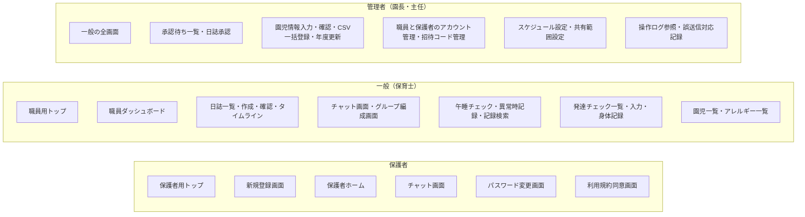

# すくすくシステム 基本設計書

関係者外秘

| 項目 | 内容 |
| :-- | :-- |
| 対象システム | 保育支援システム「すくすくシステム」 |
| 版数 | 第 1.1 版 |
| 作成日 | 2026 年 8 月 29 日 |
| 作成 | Hive-Five Developers |
| 作成区分 | チーム開発演習 基本設計 |

## 改訂履歴

| 版 | 年月日 | 変更内容 |
| :-: | :-: | :-- |
| 1.1 | 2026/09/01 | 「画面遷移」(3-4) の遷移図を `図/画面遷移図.md` 第1.0版へ移し、本書は前提の記述と参照に改めた。同図でチャットツールの遷移を補った |
| 1.0 | 2026/08/29 | 新規作成。`要件定義書.md` 第2.1版の全73機能を対象に、学校テンプレートの章構成へ沿って作成した。`基本設計書（身体記録のみ）.md` 第5.1版の内容を該当章へ取り込み、同書を退役させた |

## 目次

| 章 | 内容 |
| :-- | :-- |
| [1 はじめに](#1-はじめに) | 本書の目的・対象読者・参照元・表記ルール |
| [2 システムの概要](#2-システムの概要) | システムと業務の関係、システムの利用方法 |
| [3 ユーザインターフェイス設計](#3-ユーザインターフェイス設計) | 画面の洗い出し、画面体系、画面遷移、画面基本構成、画面詳細 |
| [4 機能概要](#4-機能概要) | 機能一覧と処理詳細、メッセージ一覧 |
| [5 データベース設計](#5-データベース設計) | テーブル定義、データ関係図 |
| [6 セキュリティ設計](#6-セキュリティ設計) | 権限と利用可能機能、データ保護と監査 |
| [7 要決定事項](#7-要決定事項) | 本書の作成で明らかになった未確定事項 |

---

# 1 はじめに

## 1-1 本書の目的

本書は `要件定義書.md` 第2.1版に基づき、すくすくシステムの**画面・処理・データ構造・権限**を規定する。要件定義書が「何を満たすか」を定めるのに対し、本書は「**どう作るか**」を定める。

## 1-2 対象読者

| 読者 | 本書の使い方 |
| :-- | :-- |
| チームメンバー（実装担当） | 担当機能の画面・処理・テーブルの仕様として参照する |
| 先生（発注者役） | 要件が設計に落ちているかの確認に用いる |

## 1-3 参照元ドキュメント

| 文書 | 版 | 本書との関係 |
| :-- | :-- | :-- |
| `要件定義書.md` | 第2.1版 | **本書の唯一の上位文書。** 要件について食い違う場合は要件定義書を正とし、本書を追随させる |
| `図/ER図.md` | 第1.0版 | 5章のテーブル定義の根拠。エンティティと関連はこちらが持つ |
| `図/ユースケース図.md` | 第1.1版 | 6章の権限マトリクスの根拠 |
| `図/アクティビティ図.md` | 第1.1版 | 4章の処理詳細の根拠 |
| `図/画面遷移図.md` | 第1.0版 | 「画面遷移」(3-4) の別紙。画面のつながりはこちらが持つ |
| `基本設計書_作成必要要素まとめ.md` | ― | 学校テンプレートとの対応マップ |

> **退役させた文書**：`基本設計書（身体記録のみ）.md` 第5.1版。身体記録パートの内容は本書の該当章へ取り込んだ。**要件定義書と同じく、正を1本に絞る**方針による。内容は git 履歴に残る。

## 1-4 表記ルール

- **機能・画面は番号ではなく名前で呼ぶ。** `SCR-nnn` `FUN-nnn` のような番号体系は廃止済みであり、本書で新たに採番しない（`claude.md` の方針）
- 要件定義書の項目を参照するときは**名前を主・番号をカッコで併記**する。例：「招待コードの発行」(4-1-2)
- 機能名は**要件定義書の機能表の名称と一致させる**。設計側で言い換えない
- **【要決定】** は値や方式が未確定の事項を示す。7章に一覧する
- 変更箇所は改訂履歴に記す。本文中で色分けはしない（Markdown のため）

> **【要確認】学校テンプレートの画面ID**：テンプレートは `n-n-n-n`（機能大分類-機能小分類-画面番号-権限）形式の画面IDを求めている。本書は上記のとおり名前で呼ぶ方針のため採番しないが、**提出時に対応表を添えて様式を満たす**。対応表は「画面の一覧」(3-2) に列を足す形で作れる。

---

# 2 システムの概要

## 2-1 システムと業務の関係

保育士の1日の業務のうち、本システムが担う範囲を示す。**システムは記録と共有を担い、判断と保育そのものは人が行う。**

| 時間帯 | 業務 | 本システムの関わり |
| :-- | :-- | :-- |
| 登園時 | 受け入れ、視診 | ―（登降園管理は対象範囲外） |
| 午前 | 保育、活動 | 日誌の下書きを随時入力する |
| 午睡 | 午睡の見守り | **午睡チェック**を開始し、規定の間隔で体位・体調を記録する。異常があれば記録し管理者へ通知する |
| 午後 | 保育、活動 | 発達チェック・身体測定を予定に応じて入力する |
| 降園時 | 引き渡し、連絡 | 保護者との連絡は**チャットツール**の個人チャットで行う。緊急連絡は電話 |
| 退勤前 | 日誌の仕上げ | 日誌を**承認申請**する。管理者が承認し、保護者への共有を指定する |
| 随時 | 園全体の連絡 | 園チャット・グループチャットで共有する |

**業務フローの詳細**は `図/アクティビティ図.md` が11業務分を保持する。本書はそれを前提とし、再掲しない。

## 2-2 システムの利用方法

| 利用者 | デバイス | 入口 | 主な操作 |
| :-- | :-- | :-- | :-- |
| 管理者（園長・主任） | タブレット／PC | 職員用トップ | 日誌の承認・差し戻し、アカウントの発行、園児マスターの管理、全クラスの記録の閲覧、操作ログの参照 |
| 一般（保育士） | タブレット／PC | 職員用トップ | 日誌の作成・申請、午睡チェック、発達チェック・身体測定の入力、自クラスの記録の閲覧 |
| 保護者 | スマートフォン | 保護者用トップ | 個人チャットでの連絡、共有された自児の記録の閲覧 |

- **入口は保護者用と職員用の2系統**に分かれる（要件定義書「アプリのログイン」(4-1-1)）。ロールの判定は入口ではなくアカウントで行い、誤った系統では認証を成立させない
- 職員が利用する全画面のヘッダに、**ログイン中の職員名を常時表示する**。共有端末での記録者の取り違えを防ぐため（同「端末の利用形態と本人特定」(4-1-4 (4))）
- 職員向け画面は無操作が続くと自動ログアウトする。ただし**午睡チェックの実施中は対象外**とする

---

# 3 ユーザインターフェイス設計

## 3-1 画面の洗い出しの考え方

要件定義書の73機能から画面を導く。**1機能＝1画面ではない。**

| 関係 | 例 |
| :-- | :-- |
| 複数の機能が1つの画面に載る | チャットツールの10機能は、ほぼ**チャット画面**の中で完結する（チャンネル切り替え・送受信・リアクション・既読確認） |
| 1つの機能が複数の画面に分かれる | 「園児情報の登録・編集」は、**一覧→入力→確認**の流れになる |
| 機能に画面が対応しない | 「ログイン情報の記憶」はログイン画面のチェックボックスであり、独立した画面を持たない |

**画面として起こす基準**を次のとおり定める。

1. **利用者が明示的に遷移して操作を始める単位**を1画面とする
2. 入力を伴う登録・編集は、テンプレートの流儀に従い**入力→確認**の段階を設ける。ただし**連続入力を前提とする操作は確認画面を挟まない**（午睡チェックの体位記録、身体測定の連続入力）。1件ごとに確認を挟むと現場の運用に耐えないため
3. ダイアログで足りるものは画面として起こさない（PDF出力の条件指定など）

## 3-2 画面の一覧

**共通・認証**

| 画面名 | 概要 | 利用者 |
| :-- | :-- | :-- |
| 保護者用トップ | 保護者用の入口。ログインと新規登録の導線を置く | 未ログイン（保護者） |
| 職員用トップ | 職員用の入口。ログインの導線のみを置く。**新規登録は置かない** | 未ログイン（職員） |
| 新規登録画面 | 招待コードの入力、利用規約への同意、アカウント情報の入力 | 未ログイン（保護者） |
| パスワード変更画面 | 一時パスワードでのログイン後、および任意の変更時 | 全ロール |
| 利用規約同意画面 | 規約の改定時に次回ログインで表示する | 全ロール |
| 職員ダッシュボード | 通知・未対応件数・各機能への導線 | 管理者・一般 |
| 保護者ホーム | 自児の情報とチャットへの導線 | 保護者 |

**日誌システム**

| 画面名 | 概要 | 利用者 |
| :-- | :-- | :-- |
| 日誌一覧画面 | 日誌の検索・絞り込み、ステータス別の表示 | 管理者・一般 |
| 日誌作成・編集画面 | 雛形選択、本文・定型文・写真の入力、下書き保存、承認申請 | 管理者・一般 |
| 日誌確認画面 | 申請前の内容確認 | 管理者・一般 |
| 承認待ち一覧画面 | 申請日・クラス・作成者とともに一覧表示 | 管理者 |
| 日誌承認画面 | 内容の確認、承認／差し戻し、**保護者への共有の指定** | 管理者 |
| 園児タイムライン画面 | 特定の園児の過去の記録を時系列で表示 | 管理者・一般 |

**チャットツール**

| 画面名 | 概要 | 利用者 |
| :-- | :-- | :-- |
| チャット画面 | チャンネル一覧とメッセージの送受信。リアクション・編集・取消・既読確認・未対応スレッドの切り替えを内包する | 全ロール |
| グループ編成画面 | 目的別グループの作成とメンバーの編成 | 管理者・一般 |
| 誤送信対応記録画面 | 誤送信の発生日時・対象・既読の有無・とった対応を記録する | 管理者 |

**午睡チェック**

| 画面名 | 概要 | 利用者 |
| :-- | :-- | :-- |
| 午睡チェック画面 | 実施の開始・終了、タイマー、クラス全体の状況、園児ごとの体位・体調の記録を1画面で行う | 管理者・一般 |
| 異常時記録画面 | 発見時刻・状況・とった対応の記録。ヒヤリハットの起票の導線を置く | 管理者・一般 |
| 午睡記録検索画面 | 日付・園児名・クラスでの検索と履歴の閲覧 | 管理者・一般 |

**発達チェック・身体測定**

| 画面名 | 概要 | 利用者 |
| :-- | :-- | :-- |
| 発達チェック一覧画面 | クラス単位で園児と次回予定日・未実施を表示。チェック漏れを強調する | 管理者・一般 |
| 発達チェック入力画面 | 月齢に応じたチェックリストの入力、所見の記述、過去記録との比較 | 管理者・一般 |
| スケジュール設定画面 | 園児単位の推奨スケジュールの上書き | 管理者 |
| 身体記録画面 | 測定値の登録・修正、成長グラフ、実施状況の確認 | 管理者・一般 |
| 共有範囲設定画面 | 項目ごとの保護者への共有可否の設定 | 管理者 |

**園児マスター・アカウント管理**

| 画面名 | 概要 | 利用者 |
| :-- | :-- | :-- |
| 園児一覧画面 | 園児の検索・絞り込み | 管理者・一般（閲覧のみ） |
| 園児情報入力画面 | 園児情報の登録・編集 | 管理者 |
| 園児情報確認画面 | 登録・編集内容の確認 | 管理者 |
| CSV一括登録画面 | ファイルの選択、取込内容とエラー行の確認 | 管理者 |
| アレルギー一覧画面 | アレルギーが登録された園児の一覧。**全園児が対象**。印刷に対応する | 管理者・一般 |
| 年度更新画面 | 更新内容の一覧確認と実行 | 管理者 |
| 職員アカウント管理画面 | 職員アカウントの発行・停止、一時パスワードの再発行、ロックの解除 | 管理者 |
| 招待コード管理画面 | 招待コードの発行・一括発行・失効、使用状況の確認、配布用の出力 | 管理者 |
| 保護者アカウント管理画面 | 紐づけの解除、アカウントの停止、未同意者の確認 | 管理者 |
| 操作ログ参照画面 | 日付・操作者・対象機能・対象園児での絞り込みと出力 | 管理者 |

**画面数：33**（共通・認証7／日誌6／チャット3／午睡3／発達・身体5／マスター・管理9）

## 3-3 画面体系図

利用者種別ごとに、利用できる画面を示す（遷移ではなく所属）。

- 管理者は**一般の全画面**を利用でき、加えて承認・マスター管理・アカウント管理・監査の画面を持つ
- 保護者が利用する画面は**6画面のみ**。記録の閲覧はチャット画面の中で行い、専用の閲覧画面を持たない

## 3-4 画面遷移

画面と画面のつながりは **`図/画面遷移図.md`** が保持する。同図は共通・認証／日誌システム／チャットツール／午睡チェック／発達チェック・身体測定／園児マスター・アカウント管理の6区分に分けて図示し、あわせて遷移元・操作・遷移先の一覧表を持つ。**学校テンプレートが別紙として求める画面遷移図にあたる。**

本書の他の章と結びつく遷移の前提を、次のとおり定める。

- **ログアウトの遷移先は、ログインしていた系統のトップ**（要件定義書「アプリのログイン」(4-1-1)）
- 一時パスワードでのログイン時と規約の改定後の初回ログイン時は、**変更・同意を完了するまで他の画面へ進めない**
- **午睡チェック画面は開いたまま運用する。** 実施中は他画面への遷移を前提とせず、自動ログアウトの対象外とする
- 入力→確認の段階を設けるのは**園児情報の登録・編集のみ**。連続入力を前提とする午睡チェック・身体測定・発達チェックは確認を挟まない（「画面の洗い出しの考え方」(3-1) の基準2）
- チャンネルの切り替え・PDF出力の条件指定など、ダイアログで足りるものは画面として起こさない（同基準3）

## 3-5 画面基本構成

全画面に共通するレイアウトを定める。

| 領域 | 内容 |
| :-- | :-- |
| ヘッダ | システムロゴ、**ログイン中の利用者名**（職員は所属クラスも表示）、通知アイコンと未対応件数、ログアウト |
| サイドナビゲーション（職員のみ） | 各機能への導線。現在地を視覚的に強調する |
| メインコンテンツ | 各画面の表示・入力領域 |

| 項目 | 規定 |
| :-- | :-- |
| テーマカラー | 優しい黄色（要件定義書「コンセプトとターゲット層」(1-1)） |
| 警告色 | 黄色と対比の付く色を用いる。午睡チェックの異常、範囲外の入力値に使う |
| グリッド | 職員（タブレット／PC）＝12カラム。保護者（スマートフォン）＝シングルカラム |
| タップ領域 | **44×44px 以上**を確保する。タブレットでの操作を前提とするため |
| 免責表示 | 成長グラフ・発達チェックの比較表示には「判定・診断を行うものではありません」を**常時表示**する。スクロールしても視界から外れない位置に固定する |

- **ログアウトの導線**：職員はヘッダに常時表示する（共有端末での担当交代に用いるため）。保護者はメニュー内に置く
- **保護者向け画面はサイドナビゲーションを持たない。** 片手操作を前提とし、ホームからの導線に絞る

## 3-6 画面詳細

主要な画面の表示項目・入力項目・操作を示す。**入力項目の制約値（桁数・必須・形式）は「メッセージ一覧」(4-3) およびテーブル定義(5) と対応する。**

**保護者用トップ／職員用トップ**

| 分類 | 項目 |
| :-- | :-- |
| 入力 | ログインID（メールアドレス）、パスワード、ログイン状態を保持するかの選択 |
| 操作 | ログイン、新規登録へ（**保護者用のみ**） |
| 表示 | エラーメッセージ、ロック中の案内 |

> **未ログインのトップに表示するのは認証の導線のみ。** 園児情報・記録などの実データも、サービス紹介コンテンツも表示しない。

**日誌作成・編集画面**

| 分類 | 項目 |
| :-- | :-- |
| 入力 | 記録種別（個人日誌／クラス日誌／週案・月案／ヒヤリハット）、対象園児またはクラス、記録日、本文、写真（1〜3枚） |
| 操作 | 雛形の呼び出し、定型文の入力、写真の添付、下書き保存、確認へ進む |
| 表示 | 編集中である旨（他の職員が開いている場合）、ステータス、選択中の園児の過去記録 |

**午睡チェック画面**

| 分類 | 項目 |
| :-- | :-- |
| 入力 | 体位（仰向け／うつ伏せ／左向き／右向き）、呼吸の有無、顔色、体温（所定のタイミングのみ） |
| 操作 | 午睡チェックを開始する／終了する、園児の選択、記録、異常時記録画面へ |
| 表示 | タイマー（次回チェックまでの残り）、クラス全員の状況と最終チェック時刻、**園児マスターの平熱**、ログイン中の職員名 |

> **平熱は比較の材料として並べて表示するのみ**であり、発熱の判定は行わない。

**身体記録画面**

| 分類 | 項目 |
| :-- | :-- |
| 入力 | クラス、測定日（初期値＝サーバ日付）、園児、身長、体重 |
| 入力（出力ダイアログ・管理者） | 出力種別（園内利用／保護者引き渡し）、対象期間 |
| 操作 | 登録、修正、削除（管理者）、タブ切替、PDF出力（管理者）、共有範囲設定へ（管理者） |
| 表示 | クラス別の園児一覧（氏名・月齢・入力済みマーク）、**クラスの実施状況**（対象人数・記録済み人数・未実施の園児名）、前回測定値、成長グラフ、過去測定値一覧、免責表示 |

> **出力種別に既定値を設けず、管理者に毎回選択させる。** 取り違えると園内限定の情報が保護者へ渡るため。

**発達チェック入力画面**

| 分類 | 項目 |
| :-- | :-- |
| 入力 | 各項目の結果（確認できた／一部／未確認）、所見 |
| 操作 | 下書き保存、確定、過去記録との比較表示 |
| 表示 | 月齢から判定した発達過程区分、チェックリスト、過去記録、免責表示 |

> **「未入力」と「未確認」は別の状態。** 未入力は結果を保持せず、チェック漏れの対象となる。

## 3-7 一覧表示とページング

| 一覧 | 方針 |
| :-- | :-- |
| クラス別の園児一覧 | **ページングなし**（1クラス最大30名程度）。連続入力の作業性を優先する |
| 日誌一覧・午睡記録検索 | ページングあり。既定は50件 |
| 過去測定値一覧 | 直近12件を既定表示し、以降は追加読み込み。年2〜4回の測定で3〜6年分に相当する |
| 操作ログ | ページングあり。既定は100件 |
| チャットのメッセージ | 直近から遡って追加読み込みする |

---

# 4 機能概要

## 4-1 記載ルール

機能ごとに **＜利用タイミング＞＜処理内容＞** を記す。処理内容は「**画面表示 → 利用者の操作 → システム内処理 → 画面表示**」の順で書く。

- 機能名は `要件定義書.md` の機能表の名称と**一致させる**。設計側で言い換えない
- 全機能に共通する扱い（権限・操作ログ・同時編集・時刻）は「共通の処理」(4-2) に一度だけ書き、各機能では参照する
- 入力値の検証で表示する文言は「メッセージ一覧」(4-9) に集約する

## 4-2 共通の処理

**権限と参照範囲の判定**

すべての機能の入口で、**バックエンドが**次を判定する。フロントエンドの画面の出し分けには依存しない（要件定義書「権限チェック」(8 No.2)）。

1. ログイン済みか。未ログインなら拒否する
2. 操作しようとしている機能が、そのロールに許可されているか
3. 対象の園児が参照範囲に入っているか

**参照範囲の判定は園児単位で行う。** 記録が作られた年度では判定しない。

| ロール | 参照できる園児 |
| :-- | :-- |
| 管理者 | 全園児・全年度 |
| 一般 | 現在の担任クラスに在籍する園児。**その園児の過年度の記録も参照できる** |
| 一般（引き継ぎ猶予期間中） | 上記に加え、前年度に担任していたクラスの在籍園児。**閲覧のみ** |
| 保護者 | 紐づけが有効な自児のみ |

**例外**は2つ。アレルギー情報は一般も全園児を閲覧でき、グループチャットの過去ログは「そのグループに所属していたか」で判定する。

**操作ログの記録**

作成・変更・承認・削除・**出力**の各操作で、共通操作ログへ記録する。

| 項目 | 内容 |
| :-- | :-- |
| 操作者 | ログイン中のアカウント |
| 操作日時 | **サーバの時刻**。端末の時計設定に依存しない |
| 対象 | 機能種別、対象レコード、対象園児 |
| 変更前後の値 | 変更系の操作で保持する。訂正内容を追えるようにするため |
| 出力の情報 | 出力系の操作で、出力種別と対象期間を保持する |

**同時編集の検出**

複数の職員が同じ記録を開く場面があるため、保存時に競合を検出する。

- 開いてから他者による更新があった場合、**上書きせず**「他の職員が更新しています」を表示して再読み込みを促す
- 日誌は編集ロックを用いる。**ロックの取得ごとに一意の識別子を発行し、保存時に照合する**。識別子が一致しない場合は、他者の更新の有無にかかわらず保存を拒否する（管理者による強制解除を検出するため）

**時刻の扱い**

「本日」「現在時刻」の判定は、すべて**サーバの時刻**で行う。利用者の端末の時計設定に依存させない。

---

## 4-3 共通基盤：ログインとアカウント

### ログイン

**＜利用タイミング＞** 利用者がシステムを使い始めるとき。

**＜処理内容＞**

1. 【画面表示】保護者用トップまたは職員用トップを表示する。ログインID・パスワードの入力欄と、ログイン状態を保持するかの選択肢を置く
2. 【操作】利用者がログインIDとパスワードを入力し、ログインを押す
3. 【システム内処理】
   - アカウントがロック中かを判定する。ロック中なら待機時間または管理者への連絡を案内して終了する
   - ログインIDとパスワードを照合する。失敗した場合は**失敗回数を加算**し、上限に達したら一定時間ログインを受け付けない
   - **アカウントのロールが、使われた入口の系統と一致するかを判定する。** 一致しない場合は認証を成立させず、正しい系統の入口を案内する
   - 一時パスワードでのログインなら、有効期限内かを判定する。期限切れなら管理者への連絡を案内する
   - 同意済みの利用規約が最新版かを判定する。旧版・未同意なら利用規約同意画面へ進める
4. 【画面表示】ロールに応じて職員ダッシュボードまたは保護者ホームを表示する

- 失敗回数・待機時間はマスタ値。**管理者は待機時間の経過を待たずに即時解除できる**
- 一時パスワードの期限切れは、**ログイン試行の制限によるロックとは区別する**。待機時間の経過では解消しない

### ログアウト

**＜利用タイミング＞** 利用者が操作を終えるとき。共有端末で担当を交代するとき。

**＜処理内容＞**

1. 【操作】利用者がヘッダ（職員）またはメニュー（保護者）からログアウトを選ぶ
2. 【システム内処理】
   - 保存していない入力があれば、破棄される旨を表示して確認する
   - セッションを無効化する
   - 「ログイン情報の記憶」の保存を破棄する
3. 【画面表示】**ログインしていた系統のトップ**へ戻す

- **ログアウトは操作ログの対象としない。** 誰が記録したかの追跡は各操作の記録で満たされるため
- **午睡チェックの実施中は、先に午睡チェックを終了してからログアウトする**

### 保護者アカウントの自己登録

**＜利用タイミング＞** 保護者が園から招待コードを受け取り、初めて利用を始めるとき。

**＜処理内容＞**

1. 【画面表示】保護者用トップの新規登録から新規登録画面を表示する
2. 【操作】保護者が招待コードを入力する
3. 【システム内処理】コードが未使用かつ有効期限内かを判定する。無効・期限切れ・使用済みならエラーを表示する
4. 【画面表示】利用規約とプライバシーポリシーを表示する
5. 【操作】保護者が同意し、メールアドレス・パスワード・氏名・園児との続柄を入力する
6. 【システム内処理】
   - **メールアドレスが園内で未使用かを判定する。** ロールをまたいで一意である必要がある
   - アカウントを作成し、**コードに紐づく園児と自動的に紐づける**
   - 招待コードを使用済みにする
   - 同意した規約の版と日時を記録する
   - 当該園児のクラスグループへ参加させる
7. 【画面表示】保護者ホームを表示する

- **1枚のコードは1アカウントの登録にのみ使える。** 父母それぞれが登録する場合は、同一園児に対して必要な枚数を発行する
- 同意しなかった場合は**登録を完了せず**、保護者用トップへ戻す

### 一時パスワードの再発行

**＜利用タイミング＞** 利用者がパスワードを忘れたとき。

**＜処理内容＞**

1. 【操作】管理者が職員アカウント管理画面または保護者アカウント管理画面で対象を選び、再発行する
2. 【システム内処理】
   - 一時パスワードを自動生成し、**ハッシュ化して保存する**
   - **その時点で旧パスワードを無効化する**
   - 有効期限を設定する
   - 操作ログへ記録する
3. 【画面表示】生成した値を**1度だけ表示する**。再表示・再閲覧の手段は設けない
4. 【操作】管理者が口頭または手渡しで本人へ伝える

- **管理者自身がパスワードを忘れた場合は、他の管理者が再発行する。** そのため管理者は常に2名以上とする運用要件がある。1名になる操作にはシステムが警告を表示する

---

## 4-4 共通基盤：園児マスターの管理

### 園児情報の登録・編集

**＜利用タイミング＞** 入園時、および登録内容に変更があったとき。

**＜処理内容＞**

1. 【画面表示】園児一覧画面から園児情報入力画面を表示する
2. 【操作】管理者が氏名・生年月日・性別・所属クラス・平熱・写真の利用同意などを入力する
3. 【システム内処理】入力値を検証する（必須・形式・未来日でないこと）
4. 【画面表示】園児情報確認画面に入力内容を表示する
5. 【操作】管理者が確定する
6. 【システム内処理】園児マスターへ保存し、操作ログへ記録する
7. 【画面表示】園児一覧画面へ戻る

- **性別は「男」「女」「未回答」の3値。** 成長曲線の基準値の参照と帳票の出力にのみ用い、機能の出し分けには使わない
- アレルギー・既往歴は要配慮個人情報として別の入力欄で扱う

### 園児情報の取消（誤登録の削除）

**＜利用タイミング＞** 誤って登録した園児のレコードを取り消すとき。

**＜処理内容＞**

1. 【操作】管理者が園児一覧画面から対象を選び、取消を実行する
2. 【システム内処理】
   - **日誌・午睡チェック・発達チェック・身体測定・チャットのいずれの記録も紐づいていないことを確認する。** 1件でもあれば取り消せない旨を表示して中止する
   - 論理削除とし、操作ログへ実行者と日時を記録する
3. 【画面表示】園児一覧画面へ戻る

- **在籍の終了（退園・卒園）は削除ではなく在籍状態の変更で行う**

### 年度更新

**＜利用タイミング＞** 新年度の開始にあたり、クラスと担任を切り替えるとき。

**＜処理内容＞**

1. 【操作】管理者が年度更新画面で実行を選ぶ
2. 【システム内処理】更新内容の一覧を生成する（繰り上がるクラス、卒園する園児、停止対象になる保護者アカウント）
3. 【画面表示】一覧を表示する
4. 【操作】管理者が内容を確認し、必要なら個別に修正して確定する
5. 【システム内処理】
   - 新年度のクラスを作成する
   - 在籍中の園児の所属クラスと担任の割り当てを新年度分へ繰り上げる
   - 最年長クラスの園児を卒園にする
   - **卒園児と保護者の紐づけを終了する**
   - **クラスグループを新年度の構成へ再編する。** 過年度のクラスグループは閲覧のみのアーカイブとして残す
   - **引き継ぎ猶予期間を開始する**（起点は実行日）
   - 紐づく在籍園児がいなくなる保護者アカウントを一覧で提示する
6. 【画面表示】完了と、停止対象アカウントの一覧を表示する

### CSV一括登録

**＜利用タイミング＞** 導入時・入園時に、複数の園児をまとめて登録するとき。

**＜処理内容＞**

1. 【操作】管理者がCSV一括登録画面でファイルを選ぶ
2. 【システム内処理】
   - 取込項目を検証する（氏名・生年月日・所属クラスは必須、性別は空欄を「未回答」として扱う）
   - **クラス名が取込先の年度に存在するかを確認する。** 一致しない行はエラーとする
3. 【画面表示】取り込む内容・件数と、**エラー行の一覧**を表示する
4. 【操作】管理者が確定する
5. 【システム内処理】エラー行を除いて登録し、操作ログへ記録する

- **アレルギー・既往歴は取込対象に含めない。** 要配慮個人情報であり、取込用ファイルが園内に残ることを避けるため

---

## 4-5 日誌システム

### 日誌の作成から保護者への共有

**＜利用タイミング＞** 保育士がその日の記録を残し、管理者が承認して保護者へ共有するまで。

**＜処理内容＞**

1. 【画面表示】日誌一覧画面から日誌作成・編集画面を表示する
2. 【システム内処理】**編集ロックを取得し、一意の識別子を発行する。** 他の職員が編集中なら、その旨を表示して開かせない
3. 【操作】保育士が雛形を選び、本文・定型文・写真を入力する
4. 【操作】下書き保存、または確認へ進む
5. 【システム内処理】
   - **保存時のロック識別子が、現在有効なロックと一致するかを照合する。** 一致しない場合は保存を拒否し、「編集ロックが解除されました。内容を再読み込みしてください」を表示する。入力中の内容は画面に残す
   - 一致すれば保存し、状態を申請中にする
   - 管理者へ通知する
6. 【画面表示】管理者の承認待ち一覧画面に申請日・クラス・作成者とともに表示する
7. 【操作】管理者が日誌承認画面で内容を確認し、承認または差し戻しを選ぶ
8. 【システム内処理】差し戻しなら状態を差し戻しにし、作成者へ通知する
9. 【操作】承認する場合、管理者が**保護者へ共有するかを選ぶ**
10. 【システム内処理】
    - 承認済みとしてアーカイブする
    - 共有する場合、対象園児に紐づく保護者との個人チャットへ送る
11. 【画面表示】承認待ち一覧画面へ戻る

- 共有の既定値は**記録種別ごとのマスタ値**（個人日誌＝共有する、クラス日誌・週案月案・ヒヤリハット＝共有しない）。管理者が個別に変更できる
- **承認済みであっても参照範囲は広がらない。** 一般が閲覧できるのは自クラスの園児に紐づく日誌のみ
- 共有済みの日誌が修正された場合は、**再度の承認と共有指定を経て**改めて送られ、チャット上に「内容が更新されました」と表示する

### 編集ロックの解除

**＜利用タイミング＞** 編集者がブラウザを閉じた、端末の電源が切れたなどで、ロックが残ったとき。

| 解除の契機 | 処理 |
| :-- | :-- |
| 正常終了 | 保存・キャンセル・画面遷移でロックを解除する |
| 無操作の経過 | 編集画面で一定時間（マスタ値）操作がない場合、自動で解除する |
| 管理者による強制解除 | 管理者がロックを解除する。操作ログへ記録する。**解除された編集者の保存は、他者の更新の有無にかかわらず拒否する** |

---

## 4-6 チャットツール

### メッセージの送受信

**＜利用タイミング＞** 職員間の連絡、園から保護者への連絡、保護者から園への連絡。

**＜処理内容＞**

1. 【画面表示】チャット画面にチャンネル一覧を表示する。**参照できないチャンネルは一覧に出さない**
2. 【操作】利用者がチャンネルを選ぶ
3. 【システム内処理】
   - **そのチャンネルを参照できるかを判定する。** 過去ログの参照は「そのグループに所属していたか」で判定する
   - メッセージを時系列で取得する。論理削除されたものは本文を返さず、取り消された痕跡のみを示す
4. 【画面表示】メッセージ一覧を表示する
5. 【操作】利用者が本文を入力して送信する
6. 【システム内処理】
   - **そのチャンネルへ投稿できるかを判定する。** 閲覧のみの権限では拒否する
   - 本文が空でないことを確認する
   - 保存し、送信日時（サーバ時刻）を記録する
7. 【画面表示】一覧に追加する

- 保護者は**現在所属しているグループのみ**参照できる。過年度のクラスグループは参照できない
- 職員は**過去に自分が所属していたグループ**も参照できる

### 既読確認

**＜利用タイミング＞** 職員が、送ったお知らせや記録が保護者に届いているかを確認するとき。

**＜処理内容＞**

1. 【システム内処理】保護者がメッセージを開いた時点で既読を記録する
2. 【画面表示】**職員側にのみ**既読状態を表示する

- **保護者側には既読状態を一切表示しない。** 保護者が送ったメッセージを職員が開いたかも、他の保護者の既読状態も表示しない
- 既読が付かないことをもって、システムが再送・エスカレーションを行うことはない
- **緊急連絡はチャットで行わない。** 緊急時は園から電話で連絡する

### 誤送信への対応

**＜利用タイミング＞** 他児の記録を誤って別の保護者へ送ってしまったとき。

**＜処理内容＞**

1. 【操作】管理者がチャット画面で対象のメッセージを削除する
2. 【システム内処理】
   - **論理削除とする。** 実データと操作履歴は保持する
   - 削除した者・日時を操作ログへ記録する
   - **当該メッセージが既読になっていたかを表示する**（園が影響範囲を判断する材料とする）
3. 【操作】管理者が誤送信対応記録画面で、発生日時・対象・既読の有無・とった対応を記録する

- **画面から消す機能を回復手段とは位置づけない。** 既に相手が閲覧していれば情報の伝達は取り消せない
- 個人情報の漏えいに該当するかの判断、外部への報告要否の判断は**システムが行わず、園が行う**

---

## 4-7 午睡チェック

### 午睡チェックの実施

**＜利用タイミング＞** 午睡の時間帯に、担当保育士がクラスの園児を見守るとき。

**＜処理内容＞**

1. 【操作】保育士が午睡チェック画面で「午睡チェックを開始する」を押す
2. 【システム内処理】
   - 実施中の状態にし、**自動ログアウトの対象外**とする
   - 画面を常時点灯させる
   - 年齢別の間隔（マスタ値）でタイマーを開始する
3. 【画面表示】クラス全員の状況、最終チェック時刻、ログイン中の職員名、タイマーを表示する
4. 【システム内処理】チェック時刻に**通知音を伴って**知らせる
5. 【操作】保育士が園児を目視で確認し、体位・呼吸・顔色を記録する（体温は所定のタイミングのみ）
6. 【システム内処理】
   - **保育士が入力した「チェックを行った時刻」と、サーバ時刻での「保存時刻」の両方を保持する**
   - 園児単位・チェック時刻単位で独立して保存する（複数の職員が別々の園児を同時に記録できる）
7. 【操作】午睡の終了時、保育士が「午睡チェックを終了する」を押す
8. 【システム内処理】実施中を解除し、自動ログアウトを再び適用する

- 終了操作を忘れた場合は、**午睡の時間帯（マスタ値）の終了時刻で自動的に解除する**
- 担当を交代する場合は、**終了 → ログアウト → 次の職員がログイン → 開始**の順で引き継ぐ
- **平熱は画面に並べて表示するのみ。発熱の判定は行わない**
- 本機能は**保育士による目視確認の代替ではない**。通知が届かなかった場合も巡回で担保する

### 異常時の記録

**＜利用タイミング＞** 午睡中に通常と異なる状態を発見したとき。

**＜処理内容＞**

1. 【操作】保育士が異常時記録画面で、発見時刻・状況・とった対応を入力する
2. 【システム内処理】
   - 記録を保存する
   - クラス全体の午睡状況の確認で**強調表示**する
   - **通知音を伴って管理者へ通知する**
3. 【操作】保育士・管理者が、ヒヤリハットとして起票するかを判断する
4. 【システム内処理】起票する場合、発生日時・対象園児・状況・とった対応を引き継いだ**ヒヤリハットの下書きを日誌側に生成する**
5. 【操作】保育士が不足分を追記して申請する

- **システムはヒヤリハットに該当するかを判定せず、自動では起票しない**
- 起票していない異常時の記録は、クラス全体の午睡状況の確認と管理者への通知で把握できる状態を保つ
- **救急要請や保護者への連絡の要否はシステムが判断しない。** 通知が届くことに依存せず、園内での口頭による応援要請を並行して行う

### 記録の修正と改ざん防止

| 項目 | 処理 |
| :-- | :-- |
| 記録時刻 | 保存操作を行った**サーバの時刻**を記録時刻とする |
| 後追い入力 | 巡回後にまとめて入力する運用を許容する。**チェックを行った時刻と保存時刻の両方を保持し、帳票にも両方を出力する**。両者が離れている記録は識別できる |
| 記録の修正 | 保存済みの記録は修正できるが、**上書きせず修正履歴を残す**。修正者・修正日時・修正前の値を操作ログへ記録する |
| 削除 | **保存済み記録の削除は行わない。** 誤記録は修正で対応する |

---

## 4-8 発達チェック・身体測定

### 発達チェックの実施

**＜利用タイミング＞** 推奨スケジュールに基づき、担任が園児の発達を記録するとき。

**＜処理内容＞**

1. 【システム内処理】月齢マスタに基づく推奨スケジュールを各園児へ自動適用する。管理者が園児単位で上書きした場合は、推奨値からの逸脱が分かるよう表示する
2. 【システム内処理】チェック予定日が近づくと担任へ通知する
3. 【画面表示】発達チェック一覧画面に、クラスの園児と次回予定日・未実施の有無を表示する
4. 【操作】担任が園児を選ぶ
5. 【システム内処理】**生年月日から月齢を算出**し、該当する発達過程区分のチェックリストを表示する
6. 【操作】担任が各項目を「確認できた／一部／未確認」で入力し、所見を記述する。途中保存ができる
7. 【システム内処理】記録を確定し、同園児の過去記録と並べて表示する
8. 【システム内処理】**実施予定日を過ぎて未入力の項目・園児**をチェック漏れとして強調表示し、担任へ通知する

- **「未入力」と「未確認」は別の状態。** 未入力は結果を保持せず、チェック漏れの対象となる。**「未確認」は、できないという評価ではなく、その回に観察できなかったという事実の記録**であり、チェック漏れの対象としない
- **伸びの停滞・後退の可視化は行うが、判定・診断は行わない。** 判定・診断ではない旨を画面上に明示する

### 月齢の算出

すべての機能が**同じ共通の関数**を呼ぶ。機能ごとに実装しない。

| 項目 | 規則 |
| :-- | :-- |
| 算出方法 | **応当日基準。** 基準日の時点で、生年月日の応当日を何回迎えたかを月齢とする。経過日数を 30 や 30.4375 で割る方式は採らない |
| 月末生まれ | 応当日が存在しない月（1月31日生まれの2月など）は、**その月の末日を応当日とみなす** |
| 基準日 | その記録が対象とする日付。発達チェックは実施日、身体測定は測定日を用いる。**現在日ではない** |

### 身体測定の記録

**＜利用タイミング＞** 園が定めた測定月に、担当クラスの園児の身長・体重を記録するとき。

**＜処理内容＞**

1. 【画面表示】身体記録画面の入力タブを表示する。参照できる園児の一覧を表示し、**選択中の測定日と同一の年月**に登録済みの園児には入力済みマークを付す。判定の対象は**未削除の記録のみ**
2. 【画面表示】クラスの実施状況（対象人数・記録済み人数・未実施の園児名）を表示する
3. 【操作】保育士が園児を選び、測定日・身長・体重を入力して登録する
4. 【システム内処理】
   - 入力値を検証する（必須・数値形式・未来日でないこと）
   - **範囲外の値は警告を表示し、保育士が確認・承諾した場合のみ登録する**（誤入力の防止であり、発育の判定ではない）
   - 同一園児・同一測定日に未削除の記録があれば、**上書き確認**を表示する
   - **確認の種類ごとに、対応する承諾だけを受け付ける。** 範囲外の警告と上書き確認を一括で承諾扱いにしてはならない
   - 保存し、操作ログへ記録する
5. 【画面表示】登録完了を表示し、入力済みマークと実施状況を更新する

- **測定回の単位は年月とする。** 測定日が数日ずれても同一の回として扱う。測定を行う月は設定マスタに保持する
- **未実施の通知は行わない。** 園全体で日を決めて一斉に行うため、個別の督促を要しない

### 成長グラフの表示

**＜処理内容＞**

1. 【操作】利用者が園児・表示切替（身長／体重）・表示期間を選ぶ
2. 【システム内処理】
   - 生年月日と各測定日から**測定時点の月齢**を算出する
   - 測定記録を時系列で取得する（論理削除されたものは除外する）
   - **園児マスターの現在の性別**で、成長曲線基準値マスタからパーセンタイル基準値を取得する
   - 測定値の折れ線と基準値の帯を重ねる
3. 【画面表示】グラフ・過去測定値一覧・免責表示を表示する

| 条件 | 縮退動作 |
| :-- | :-- |
| 生年月日が未登録 | 月齢を算出できないため、**グラフを描画せず**「生年月日が未登録のためグラフを表示できません」を表示する。過去測定値の一覧は表示する |
| 性別が「未回答」または未登録 | 基準値を引けないため、**基準値の帯を描画せず測定値の折れ線のみ**を表示し、「性別が未回答のため成長曲線を表示できません」を併記する。**誤った性別で基準値を引くことは行わない** |

- **基準値との比較による判定・警告は行わない**
- 性別を「未回答」から変更すると、**過去の全測定値に対して基準値の帯が遡って表示される**。出力済みのPDFは出力時点のスナップショットとして扱い、遡って書き換えない

### 記録の共有

**＜利用タイミング＞** 発達・身体測定の記録を保護者へ共有するとき。

**＜処理内容＞**

1. 【操作】管理者が共有範囲設定画面で、項目ごとの共有可否を設定する
2. 【システム内処理】記録に**項目単位の共有フラグ**を付与し、対象園児に紐づく保護者との個人チャットへ引き渡す
3. 【システム内処理】**表示するかどうかの最終判定はチャットツール側が行う**

- 引き渡しに失敗しても、**元の記録の保存は取り消さない。** 測定値そのものが失われることを避けるため。失敗した記録は一覧で把握でき、管理者が再実行できる
- 引き渡した後に共有範囲の設定が変わった場合、**参照時点の設定で表示可否を判定する**。渡した後に取り消して回る方式は採らない

### 記録の出力

2種類の出力があり、**含める範囲が異なる**。

| 出力 | 目的 | 含める範囲 | 実行者 |
| :-- | :-- | :-- | :-- |
| 発達記録のPDF出力 | 会議資料・監査対応・保育要録の下書き | **共有範囲設定にかかわらず全項目** | 管理者 |
| 保護者向け記録の引き渡し出力 | 卒園・退園時に保護者へ渡す | **共有可の項目のみ** | 管理者 |

- **出力種別に既定値を設けず、管理者に毎回選択させる。** 取り違えると園内限定の情報が保護者へ渡るため
- 出力は**目的を問わず操作ログへ記録する**（出力種別と対象期間を含む）

---

## 4-9 メッセージ一覧

入力値の検証と確認で表示する文言を集約する。**文言はマスタとして持ち、コードに直接書かない。**

**共通・認証**

| 場面 | メッセージ |
| :-- | :-- |
| ログイン失敗 | IDまたはパスワードが違います。 |
| ロック中 | ログインを一定時間受け付けません。しばらく待つか、管理者へご連絡ください。 |
| 系統の不一致 | このアカウントではこちらからログインできません。ご案内する入口からログインしてください。 |
| 一時パスワードの期限切れ | 一時パスワードの有効期限が切れています。管理者へご連絡ください。 |
| パスワード変更の未完了 | パスワードの変更が完了するまで、他の機能はご利用いただけません。 |
| 招待コードが無効 | 招待コードが正しくありません。 |
| 招待コードが使用済み | この招待コードは既に使用されています。 |
| メールアドレスの重複 | このメールアドレスは既に登録されています。 |
| 規約に同意しない | 利用規約に同意いただけない場合、ご利用いただけません。 |

**園児マスター**

| 場面 | メッセージ |
| :-- | :-- |
| 必須項目の欠落 | 入力が必要な項目が未入力です。 |
| 生年月日の形式不正 | 生年月日の形式が正しくありません。 |
| 生年月日が未来日 | 生年月日に未来の日付は指定できません。 |
| 取消の不可 | 記録が登録されている園児は取り消せません。在籍状態を変更してください。 |
| CSVのクラス名不一致 | クラス名が登録されていません。該当する行を確認してください。 |

**日誌**

| 場面 | メッセージ |
| :-- | :-- |
| 他者が編集中 | 他の職員が編集しています。 |
| ロックの解除 | 編集ロックが解除されました。内容を再読み込みしてください。 |
| 競合の検出 | 他の職員が更新しています。内容を再読み込みしてください。 |

**身体測定**

| 場面 | メッセージ |
| :-- | :-- |
| 測定日の欠落 | 測定日は必須項目です。 |
| 測定日の形式不正 | 測定日の形式が正しくありません。 |
| 測定日が未来日 | 測定日に未来の日付は指定できません。 |
| 身長・体重の欠落 | 身長・体重は必須項目です。 |
| 数値以外 | 身長・体重は数値で入力してください。 |
| 範囲外 | 入力値が通常の範囲外です。測定値に誤りがないか確認してください。 |
| 上書き確認 | この測定日の記録は登録済みです。上書きしますか。 |

> **範囲外の文言は「誤りがないか確認してください」であり、「異常値です」ではない。** 発育の判定を行わない設計原則による。

**免責表示（常時表示）**

| 画面 | 文言 |
| :-- | :-- |
| 成長グラフ | 本グラフは発育把握の目安であり、発育の判定・診断を行うものではありません。 |
| 発達チェックの比較表示 | 本表示は記録の比較であり、発達の判定・診断を行うものではありません。 |

---

# 5 データベース設計

## 5-1 設計の方針

| 項目 | 規則 |
| :-- | :-- |
| 命名 | マスタは `m_`、トランザクションは `t_` を接頭辞とする |
| 代理キー | `BIGINT` の自動採番。列名は `<主語>_id` |
| 業務ID | 園児ID・職員ID・保護者IDは `VARCHAR(20)`。園が付番する値を想定する |
| 削除 | **論理削除**（`is_deleted BOOLEAN`）。削除者・削除日時は共通操作ログが保持する |
| 時刻列 | `created_at` / `updated_at`（`DATETIME`）。**サーバの時刻**を入れる |
| 区分値 | `CHAR(1)` の数字コード。意味は各表の備考に記す |

**エンティティと関連の全体像は `図/ER図.md` が保持する。** 本章は列の定義を担う。

## 5-2 アカウント・権限

### アカウント（m_account）

| 物理名 | 論理名 | 型 | 制約 | 備考 |
| :-- | :-- | :-- | :-- | :-- |
| account_id | アカウントID | BIGINT | PRIMARY KEY | 自動採番 |
| email | ログインID | VARCHAR(255) | NOT NULL、UNIQUE | メールアドレス。**ロールをまたいで園内で一意** |
| password_hash | パスワード | VARCHAR(255) | NOT NULL | ハッシュ化して保存する。平文は保持しない |
| role | ロール | CHAR(1) | NOT NULL | 1:管理者 2:一般 3:保護者 |
| status | 状態 | CHAR(1) | NOT NULL | 1:有効 2:停止 |
| is_temp_password | 一時パスワード中 | BOOLEAN | NOT NULL、初期値 false | 真の間は他機能を使わせない |
| temp_password_expires_at | 一時パスワード期限 | DATETIME | | 期限切れはロックと区別する |
| failed_login_count | 連続失敗回数 | INT | NOT NULL、初期値 0 | 上限はマスタ値 |
| locked_until | ロック解除予定 | DATETIME | | 管理者は経過を待たず解除できる |
| terms_version | 同意した規約の版 | VARCHAR(20) | | 最新版でなければ再同意を求める |
| terms_agreed_at | 同意日時 | DATETIME | | |
| created_at | 登録日時 | DATETIME | NOT NULL | |
| updated_at | 更新日時 | DATETIME | NOT NULL | |

> **認証情報を1つのテーブルに集約する理由**：ログインIDのメールアドレスは**ロールをまたいで園内で一意**でなければならない。職員表・保護者表に分けて持つと、この一意性をデータベースの制約で担保できない。

### 職員（m_staff）／保護者（m_guardian）

| 物理名 | 論理名 | 型 | 制約 | 備考 |
| :-- | :-- | :-- | :-- | :-- |
| staff_id | 職員ID | VARCHAR(20) | PRIMARY KEY | 園が付番する |
| account_id | アカウントID | BIGINT | NOT NULL、UNIQUE | m_account を参照 |
| staff_name | 氏名 | VARCHAR(50) | NOT NULL | |
| created_at / updated_at | 登録・更新日時 | DATETIME | NOT NULL | |

| 物理名 | 論理名 | 型 | 制約 | 備考 |
| :-- | :-- | :-- | :-- | :-- |
| guardian_id | 保護者ID | VARCHAR(20) | PRIMARY KEY | |
| account_id | アカウントID | BIGINT | NOT NULL、UNIQUE | m_account を参照 |
| guardian_name | 氏名 | VARCHAR(50) | NOT NULL | |
| phone_number | 電話番号 | VARCHAR(20) | | **緊急連絡先。要件定義書側で保持先が未確定**（7章 No.1） |
| created_at / updated_at | 登録・更新日時 | DATETIME | NOT NULL | |

### 招待コード（t_invitation_code）

| 物理名 | 論理名 | 型 | 制約 | 備考 |
| :-- | :-- | :-- | :-- | :-- |
| invitation_code_id | 招待コードID | BIGINT | PRIMARY KEY | 自動採番 |
| code | コード | VARCHAR(64) | NOT NULL、UNIQUE | **推測困難な値**とする |
| child_id | 園児ID | VARCHAR(20) | NOT NULL | 紐づく園児 |
| expires_on | 有効期限 | DATE | NOT NULL | |
| status | 状態 | CHAR(1) | NOT NULL | 1:未使用 2:使用済 3:失効 |
| used_account_id | 使用アカウント | BIGINT | | 登録に使われたアカウント |
| used_at | 使用日時 | DATETIME | | |
| issued_staff_id | 発行者 | VARCHAR(20) | NOT NULL | |
| created_at | 発行日時 | DATETIME | NOT NULL | |

> **1枚のコードは1アカウントの登録にのみ使える。** 使用と同時に `status` を使用済みにする。

### 利用規約（m_terms）

| 物理名 | 論理名 | 型 | 制約 | 備考 |
| :-- | :-- | :-- | :-- | :-- |
| terms_id | 規約ID | BIGINT | PRIMARY KEY | 自動採番 |
| terms_version | 版 | VARCHAR(20) | NOT NULL、UNIQUE | |
| document_type | 種別 | CHAR(1) | NOT NULL | 1:利用規約 2:プライバシーポリシー |
| body | 本文 | TEXT | NOT NULL | |
| published_on | 施行日 | DATE | NOT NULL | |

## 5-3 園児・クラス

### 園児（m_child）

| 物理名 | 論理名 | 型 | 制約 | 備考 |
| :-- | :-- | :-- | :-- | :-- |
| child_id | 園児ID | VARCHAR(20) | PRIMARY KEY | |
| child_name | 氏名 | VARCHAR(50) | NOT NULL | |
| child_name_kana | 氏名かな | VARCHAR(50) | | 並び替えに用いる |
| birth_date | 生年月日 | DATE | NOT NULL | **月齢算出の唯一の根拠。** 未来日不可 |
| sex | 性別 | CHAR(1) | NOT NULL | 1:男 2:女 9:未回答。**成長曲線の参照と帳票にのみ用いる** |
| normal_temperature | 平熱 | DECIMAL(3,1) | | 午睡チェックで並べて表示する |
| enrollment_status | 在籍状態 | CHAR(1) | NOT NULL | 1:在籍 2:退園 3:卒園 |
| photo_consent_level | 写真の利用同意 | CHAR(1) | NOT NULL | 1:園内記録 2:自児保護者へ共有 3:他保護者にも見える場 |
| is_deleted | 削除フラグ | BOOLEAN | NOT NULL、初期値 false | 誤登録の取消のみ |
| created_at / updated_at | 登録・更新日時 | DATETIME | NOT NULL | |

### クラスと紐づけ

| テーブル | 主な列 | 備考 |
| :-- | :-- | :-- |
| m_class | class_id / fiscal_year / class_name | **年度ごとに別レコード**とする。過年度の割り当てが残り「過去にどのクラスの担任だったか」を判定できる |
| t_class_child | class_id / child_id | 園児のクラス在籍 |
| t_class_staff | class_id / staff_id | 担任の割り当て |
| t_guardian_child | guardian_id / child_id / relationship / link_status / linked_at / ended_at | **紐づけ単位で終了させる**（1:有効 2:終了）。アカウントの停止は有効な紐づけがゼロになった時点 |
| m_allergy | allergy_id / child_id / target_food / symptom / response | 1園児に複数登録できる |
| m_medical_history | medical_history_id / child_id / content | 要配慮個人情報 |

## 5-4 日誌

### 日誌（t_diary）

| 物理名 | 論理名 | 型 | 制約 | 備考 |
| :-- | :-- | :-- | :-- | :-- |
| diary_id | 日誌ID | BIGINT | PRIMARY KEY | 自動採番 |
| record_type | 記録種別 | CHAR(1) | NOT NULL | 1:個人日誌 2:クラス日誌 3:週案月案 4:ヒヤリハット |
| child_id | 園児ID | VARCHAR(20) | | 個人日誌・ヒヤリハットで設定 |
| class_id | クラスID | BIGINT | | 対象クラス |
| diary_date | 記録日 | DATE | NOT NULL | |
| body | 本文 | TEXT | NOT NULL | |
| status | 状態 | CHAR(1) | NOT NULL | 1:下書き 2:申請中 3:承認済み 4:差し戻し |
| created_staff_id | 作成者 | VARCHAR(20) | NOT NULL | |
| approved_staff_id | 承認者 | VARCHAR(20) | | |
| approved_at | 承認日時 | DATETIME | | |
| is_shared_to_guardian | 保護者へ共有 | BOOLEAN | NOT NULL、初期値 false | **承認とは別の指定** |
| shared_at | 共有日時 | DATETIME | | |
| nap_abnormal_id | 起票元 | BIGINT | | ヒヤリハットのみ。異常時の記録と相互に参照する |
| is_deleted | 削除フラグ | BOOLEAN | NOT NULL、初期値 false | |
| created_at / updated_at | 登録・更新日時 | DATETIME | NOT NULL | |

> **記録種別でテーブルを分けない。** 保持する項目がほぼ共通で、保護者共有の既定値だけが種別で変わるため。

### 編集ロック（t_diary_lock）

| 物理名 | 論理名 | 型 | 制約 | 備考 |
| :-- | :-- | :-- | :-- | :-- |
| diary_id | 日誌ID | BIGINT | PRIMARY KEY | 1件の日誌に1つ |
| lock_token | ロック識別子 | VARCHAR(64) | NOT NULL、UNIQUE | **取得のたびに発行し、保存時に照合する** |
| locked_staff_id | 編集者 | VARCHAR(20) | NOT NULL | |
| locked_at | 取得日時 | DATETIME | NOT NULL | |
| last_active_at | 最終操作時刻 | DATETIME | NOT NULL | 無操作の判定に用いる |

> **管理者が強制解除するとレコードを削除する。** 保存時にトークンが一致せず、他者の更新が無くても保存が拒否される。

### 雛形・添付

| テーブル | 主な列 | 備考 |
| :-- | :-- | :-- |
| m_diary_template | diary_template_id / record_type / template_name / body / default_share_to_guardian | **保護者共有の既定値を雛形側に持つ。** コードに書かない |
| t_diary_attachment | diary_attachment_id / diary_id / file_path / file_type | 1〜3枚 |

## 5-5 チャット

| テーブル | 主な列 | 備考 |
| :-- | :-- | :-- |
| m_chat_room | chat_room_id / room_type / class_id / room_name / is_archived / thread_status | room_type＝1:園 2:クラスグループ 3:目的別グループ 4:個人 5:職員。**クラスグループはクラスと年度で自動構成** |
| t_chat_member | chat_room_id / account_id / joined_at / **left_at** | **`left_at` で過去の所属期間を保持する。** 過去ログの参照範囲の判定に用いる |
| t_chat_message | chat_message_id / chat_room_id / sender_account_id / body / source_type / source_id / sent_at / edited_at / is_deleted / deleted_at / deleted_account_id | source_type＝1:手入力 2:日誌の共有 3:発達身体測定の共有 |
| t_chat_attachment | chat_attachment_id / chat_message_id / file_path / file_type / file_size | 上限はマスタ値 |
| t_chat_read | chat_read_id / chat_message_id / account_id / read_at | **保護者側には表示しない** |
| t_chat_reaction | chat_reaction_id / chat_message_id / account_id / reaction_type | |
| t_misdelivery_record | misdelivery_record_id / chat_message_id / occurred_at / was_read / response / staff_id | 誤送信への対応の記録 |

> **職員は `left_at` が入っていても参照できる。保護者は `left_at` が入った時点で参照できなくなる。**

## 5-6 午睡チェック

| テーブル | 主な列 | 備考 |
| :-- | :-- | :-- |
| t_nap_session | nap_session_id / class_id / session_date / started_staff_id / **started_at** / ended_staff_id / **ended_at** / is_auto_closed | **開始・終了の操作を保持する。** 自動ログアウトの例外範囲と担当者の追跡に用いる |
| t_nap_record | nap_record_id / nap_session_id / child_id / **checked_at** / **saved_at** / body_position / breathing / complexion / temperature / staff_id | **チェック時刻と保存時刻の両方を保持する。** 削除フラグは持たない（削除しないため） |
| t_nap_abnormal | nap_abnormal_id / nap_session_id / child_id / found_at / situation / response / staff_id / **diary_id** | `diary_id` が空なら「記録したがヒヤリハットを起票していない」状態 |

- `body_position`＝1:仰向け 2:うつ伏せ 3:左向き 4:右向き
- `breathing`＝1:あり 2:確認できず、`complexion`＝1:通常 2:蒼白 3:紅潮 4:その他

## 5-7 発達チェック・身体測定

| テーブル | 主な列 | 備考 |
| :-- | :-- | :-- |
| m_development_category | development_category_id / age_month_from / age_month_to / category_name / display_order | 発達過程区分。**マスタ化して指針改定に追従する** |
| m_development_item | development_item_id / development_category_id / item_name / domain / display_order | domain＝3歳以上の5領域 |
| m_development_frequency | development_frequency_id / age_month_from / age_month_to / interval_days | 推奨頻度 |
| m_share_setting | share_setting_id / development_item_id / is_shareable / updated_staff_id / updated_at | 項目単位の共有可否 |
| t_development_schedule | development_schedule_id / child_id / scheduled_on / is_manual_override / created_staff_id | 園児単位の予定 |
| t_development_check | development_check_id / child_id / development_schedule_id / checked_on / status / staff_id / share_status | status＝1:下書き 2:確定 |
| t_development_result | development_result_id / development_check_id / development_item_id / result / note | result＝1:確認できた 2:一部 3:未確認 |

> **「未入力」はレコードが存在しない状態で表す。** 「未確認」は `result = 3` として明示的に保持する。両者は別の状態であり、チェック漏れの対象になるのは未入力のみ。

### 身体測定記録（t_physical_record）

| 物理名 | 論理名 | 型 | 制約 | 備考 |
| :-- | :-- | :-- | :-- | :-- |
| physical_record_id | 身体測定記録ID | BIGINT | PRIMARY KEY | 自動採番 |
| child_id | 園児ID | VARCHAR(20) | NOT NULL | |
| measured_on | 測定日 | DATE | NOT NULL | 未来日不可。一意制約は下記 |
| height_cm | 身長 | DECIMAL(4,1) | NOT NULL | 範囲チェックは設定マスタ参照 |
| weight_kg | 体重 | DECIMAL(4,1) | NOT NULL | 範囲チェックは設定マスタ参照 |
| staff_id | 記録職員ID | VARCHAR(20) | NOT NULL | **初回登録者。更新時に書き換えない** |
| share_status | 連携状態 | CHAR(1) | NOT NULL、初期値 1 | 0:対象外 1:未連携 2:連携済 |
| is_deleted | 削除フラグ | BOOLEAN | NOT NULL、初期値 false | |
| created_at / updated_at | 登録・更新日時 | DATETIME | NOT NULL | |

**一意制約**：`child_id + measured_on` を、**`is_deleted = false` の行のみを対象とする部分一意インデックス**とする。削除した測定日に登録し直せるようにするため。

> **部分一意インデックスは SQLite・PostgreSQL が対応し、MySQL は非対応。** DBMS の選定時に本制約を満たせることを条件とする。

### 成長曲線基準値（m_growth_standard）

| 物理名 | 論理名 | 型 | 制約 | 備考 |
| :-- | :-- | :-- | :-- | :-- |
| growth_standard_id | 基準値ID | BIGINT | PRIMARY KEY | 自動採番 |
| sex | 性別 | CHAR(1) | NOT NULL | 1:男 2:女。**未回答に対応する基準値は持たない** |
| age_in_months | 月齢 | INT | NOT NULL | 0〜72 |
| measure_type | 測定種別 | CHAR(1) | NOT NULL | 1:身長 2:体重 |
| percentile | パーセンタイル | INT | NOT NULL | 3/10/25/50/75/90/97 |
| standard_value | 基準値 | DECIMAL(5,2) | NOT NULL | |
| source_version | 出典版 | VARCHAR(20) | NOT NULL | 例：厚労省2010年調査 |

**一意制約**：`sex + age_in_months + measure_type + percentile`。手作業の転記で投入するため重複が起こりやすく、重複すると帯が二重に描画されるか取得順で値が変わる。

## 5-8 共通

### 操作ログ（t_operation_log）

| 物理名 | 論理名 | 型 | 制約 | 備考 |
| :-- | :-- | :-- | :-- | :-- |
| operation_log_id | 操作ログID | BIGINT | PRIMARY KEY | 自動採番 |
| account_id | 操作者 | BIGINT | NOT NULL | |
| operated_at | 操作日時 | DATETIME | NOT NULL | **サーバの時刻** |
| function_type | 機能種別 | CHAR(1) | NOT NULL | 1:日誌 2:チャット 3:午睡 4:発達 5:身体測定 6:園児 7:アカウント |
| operation_type | 操作区分 | CHAR(1) | NOT NULL | 1:作成 2:変更 3:承認 4:削除 **5:出力** |
| target_table | 対象テーブル | VARCHAR(50) | NOT NULL | |
| target_id | 対象レコード | BIGINT | | |
| target_child_id | 対象園児 | VARCHAR(20) | | 絞り込みに用いる |
| before_value | 変更前の値 | TEXT | | 変更系で保持する |
| after_value | 変更後の値 | TEXT | | 変更系で保持する |

> **追記のみとし、更新・削除の手段を設けない。** `updated_at` を持たないのはこのため。

### 設定マスタ（m_setting）

| 物理名 | 論理名 | 型 | 制約 | 備考 |
| :-- | :-- | :-- | :-- | :-- |
| setting_key | 設定キー | VARCHAR(50) | PRIMARY KEY | |
| setting_value | 設定値 | VARCHAR(100) | NOT NULL | 文字列で保持し、利用側で型変換する |
| description | 説明 | VARCHAR(200) | | 設定画面での表示用 |
| updated_staff_id | 更新者 | VARCHAR(20) | NOT NULL | |
| updated_at | 更新日時 | DATETIME | NOT NULL | |

**保持する主な値**

| 分類 | 内容 |
| :-- | :-- |
| 午睡チェック | チェック間隔（年齢別）、体温の必須タイミング、午睡の時間帯 |
| 認証 | ログイン失敗回数、待機時間、ログイン情報の記憶の保存期間、一時パスワードの有効期限 |
| 画面 | 自動ログアウトまでの無操作時間、編集ロックの無操作時間 |
| 参照範囲 | 引き継ぎ猶予期間、年度更新の実行日時 |
| 身体測定 | 測定を行う月、範囲チェックのしきい値（身長・体重の上下限） |
| 添付 | 対応形式、1ファイルあたりの上限サイズ |
| データ保持 | 記録の保持年数、添付ファイルの保持期間 |

- 設定値が数値として解釈できない場合は、**既定値へフォールバックしたうえで警告ログを出力する**。異常を黙殺しない

## 5-9 データ関係図

エンティティと関連の全体像は **`図/ER図.md`** が保持する。同図は6つのサブジェクトエリア（アカウント・権限／園児・クラス／日誌／チャット／午睡チェック／発達チェック・身体測定）と共通に分けて図示している。

---

# 6 セキュリティ設計

## 6-1 権限と利用可能機能

○＝利用できる、△＝制限付きで利用できる、×＝利用できない。

**共通・アカウント**

| 機能 | 未ログイン | 保護者 | 一般 | 管理者 |
| :-- | :-: | :-: | :-: | :-: |
| ログイン・ログアウト | ○ | ○ | ○ | ○ |
| 保護者アカウントの自己登録 | ○ | × | × | × |
| 職員アカウントの発行 | × | × | × | ○ |
| 招待コードの発行・失効 | × | × | × | ○ |
| 園児の追加紐づけ | × | ○ | × | × |
| 紐づけの解除 | × | × | × | ○ |
| アカウントの停止 | × | × | × | ○ |
| 一時パスワードの再発行 | × | × | × | ○ |
| アカウントロックの解除 | × | × | × | ○ |
| 未同意者の確認 | × | × | × | ○ |

**園児マスター**

| 機能 | 未ログイン | 保護者 | 一般 | 管理者 |
| :-- | :-: | :-: | :-: | :-: |
| 園児情報の参照 | × | × | ※1 | ○ |
| 園児情報の登録・編集・取消 | × | × | × | ○ |
| CSV一括登録 | × | × | × | ○ |
| 年度更新 | × | × | × | ○ |
| **アレルギー一覧の参照** | × | × | **○※2** | ○ |
| 既往歴の参照 | × | × | ※1 | ○ |
| 保護者向け記録の引き渡し出力 | × | × | × | ○ |

**日誌システム**

| 機能 | 未ログイン | 保護者 | 一般 | 管理者 |
| :-- | :-: | :-: | :-: | :-: |
| 日誌の作成・編集・申請 | × | × | ※1 | ○ |
| 承認・差し戻し | × | × | × | ○ |
| 保護者への共有の指定 | × | × | × | ○ |
| 日誌の検索・閲覧 | × | ※3 | ※1 | ○ |
| PDF出力 | × | × | × | ○ |
| 編集ロックの強制解除 | × | × | × | ○ |

**チャットツール**

| 機能 | 未ログイン | 保護者 | 一般 | 管理者 |
| :-- | :-: | :-: | :-: | :-: |
| メッセージの送受信 | × | ※4 | ○ | ○ |
| 画像・動画の添付 | × | ※5 | ○ | ○ |
| メッセージの編集・送信取消 | × | ※6 | ※6 | ※6 |
| メッセージの削除（他者分） | × | × | × | ○ |
| 既読確認 | × | × | ○ | ○ |
| 未対応スレッドの管理 | × | × | ○ | ○ |
| グループの作成・メンバー編成 | × | × | ※7 | ※7 |
| 誤送信への対応の記録 | × | × | × | ○ |

**午睡チェック・発達チェック・身体測定**

| 機能 | 未ログイン | 保護者 | 一般 | 管理者 |
| :-- | :-: | :-: | :-: | :-: |
| 午睡チェックの実施・記録 | × | × | ※1 | ○ |
| 異常時の記録 | × | × | ※1 | ○ |
| 発達チェックの入力 | × | × | ※1 | ○ |
| スケジュールの手動上書き | × | × | × | ○ |
| 身体測定の記録 | × | × | ※1 | ○ |
| 成長グラフの閲覧 | × | ※3 | ※1 | ○ |
| 共有範囲の設定 | × | × | × | ○ |
| 発達記録のPDF出力 | × | × | × | ○ |

**監査**

| 機能 | 未ログイン | 保護者 | 一般 | 管理者 |
| :-- | :-: | :-: | :-: | :-: |
| 操作ログの参照 | × | × | × | ○ |
| 帳票の出力 | × | × | × | ○ |

**制限の内容**

| 記号 | 内容 |
| :-: | :-- |
| ※1 | 自クラスの園児のみ。判定は園児単位で行い、**現在の担任クラスに在籍する園児であれば過年度の記録も参照できる**。引き継ぎ猶予期間中は前年度の在籍園児も閲覧のみ可 |
| ○※2 | **全園児が対象。** 誤配食の防止を目的とした例外。表示項目は氏名・クラス・アレルギー情報に限る |
| ※3 | **自児のみ、かつ共有されたものに限る。** チャットの個人チャット画面上で閲覧する。専用の閲覧画面は持たない |
| ※4 | 個人チャットは送受信、グループチャット・園チャットは閲覧のみ。**過年度のクラスグループは参照できない** |
| ※5 | 個人チャットのみ |
| ※6 | 自分の投稿のみ |
| ※7 | **目的別グループのみ。** クラスグループは自動構成のため手動編集しない |

## 6-2 権限チェックの実装方針

- **判定はすべてバックエンドで行う。** フロントエンドの画面の出し分けは利用者の利便のためであり、権限の担保ではない
- 一覧・詳細の取得時は、**参照できる範囲をサーバ側で絞り込む**。園児IDを直接指定した不正な取得を許さない
- 画面を経由せず直接リクエストを送っても拒否されること

## 6-3 データ保護

| 項目 | 方針 |
| :-- | :-- |
| パスワード | ハッシュ化して保存する。**恒久パスワードは平文で保持しない**。一時パスワードも同様にハッシュ化し、発行画面で1度だけ表示する |
| 通信 | 想定運用環境では **HTTPS（TLS）必須**。要配慮個人情報を園外のネットワーク経由でやり取りするため |
| 要配慮個人情報 | 発達・健康・身体測定・アレルギー・既往歴が該当する。**保存時の暗号化の要否はサーバの設置形態が決まった段階で確定する**（7章） |
| 招待コード | 推測困難な値とし、有効期限を設ける。使用済みは再利用できない |
| セッション | ログアウト時に無効化する。「ログイン情報の記憶」を有効にした場合も、保存期間の経過後は再認証を求める |
| CSRF対策 | **【要決定】** 方式を確定する（7章） |

## 6-4 監査への対応

| 項目 | 方針 |
| :-- | :-- |
| 操作ログ | 作成・変更・承認・削除・**出力**を記録する。**追記のみ**とし、画面からの編集・削除の手段を設けない |
| 午睡チェック記録 | **サーバ時刻を記録時刻とする。** 修正は上書きせず履歴を残す。削除は行わない |
| 帳票 | 監査（実地指導）で提示を求められた範囲を出力できる。午睡チェック表は**チェック時刻と保存時刻の両方**を出力する |
| データの保持 | 卒園後も一定期間保持する。保持年数はマスタ値。**保持期間の経過後の削除は管理者の操作を要し、自動削除は行わない** |

---

# 7 要決定事項

本書の作成で明らかになった未確定事項を示す。**実装の着手前に確定を要する。**

> **要件定義書側の未確定事項と合わせた一覧は `要決定事項.md` にある。** 優先度と決める人で整理してあるため、着手順の判断はそちらを参照する。

| No | 事項 | 関連 | 影響 |
| :-: | :-- | :-- | :-- |
| 1 | **保護者の緊急連絡先（電話番号）の保持先と連絡順。** 要件定義書は緊急連絡を電話としているが、電話番号を持つ場所が保護者か園児かで定義が食い違っている | 5-2 | 高。緊急連絡が運用で成立しない |
| 2 | **認証情報の保持方式。** バックエンドとフロントエンドを分離したため、サーバ側セッションを維持するか別方式へ変えるか | 5-2、6-3 | 高。セッションの保護の実現方法が変わる |
| 3 | **CSRF対策の方式** | 6-3 | 高 |
| 4 | **インタフェースの具体的な設計。** 経路の一覧・データの項目名・エラーの返し方の粒度 | 4-2 | 高。フロントとバックの分担が確定しない |
| 5 | 職員チャットの構成（参加者・作成単位・年度更新の対象か） | 5-5 | 中。チャンネル種別の設計が確定しない |
| 6 | 成長曲線基準値の初期データ（7パーセンタイル×73月齢×2性別×2測定種別＝2,044行）の作成担当と手順 | 5-7 | 中。データが無いとグラフが成立しない |
| 7 | 添付ファイルの実体の保存先（データベース内かファイルシステム上か） | 5-4、5-5 | 中。`file_path` の解釈が変わる |
| 8 | 個人チャットのルームを保護者アカウント単位で作るか園児単位で作るか | 5-5 | 中。兄弟姉妹がいる場合にスレッドを分けるかで変わる |
| 9 | 操作ログの変更前後の値の保持形式（JSON か、項目名と値の組を別テーブルへ正規化するか） | 5-8 | 中 |
| 10 | 利用規約の同意履歴を最新版のみ保持するか、履歴テーブルを設けるか | 5-2 | 低 |
| 11 | 各入力項目の桁数・必須・形式の制約値（メッセージ一覧と対応する） | 4-9、5章 | 中。画面詳細の完成に必要 |
| 12 | 確認画面をどこまで独立画面として設けるか | 3-1 | 低。本書は入力から確認への2段階を基本とした |
| 13 | DBMS の選定。**部分一意インデックスを利用できることを条件とする** | 5-7 | 中 |
| 14 | PDF生成の実現方式 | 4-8 | 中 |

> No.1〜4 は要件定義書側の要決定事項と対応する。**No.1・No.2 は要件定義書で決めるべき事項**であり、本書はその決定に従う。
