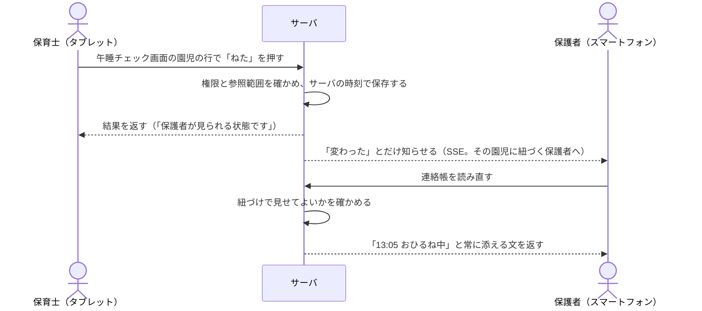
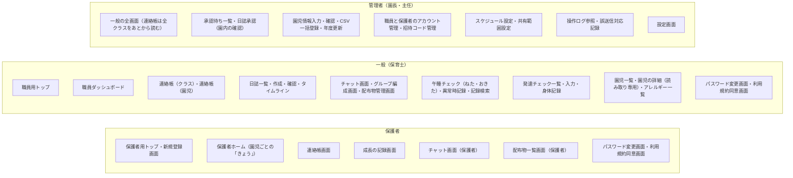

# すくすくシステム 基本設計書

関係者外秘

| 項目 | 内容 |
| :-- | :-- |
| 対象システム | 保育支援システム「すくすくシステム」 |
| 版数 | 第 3.0 版 |
| 作成日 | 2026 年 8 月 29 日 |
| 改訂日 | 2026 年 10 月 17 日 |
| 作成 | Hive-Five Developers |
| 作成区分 | チーム開発演習 基本設計 |

## 改訂履歴

| 版 | 年月日 | 変更内容 |
| :-: | :-: | :-- |
| 3.0 | 2026/10/17 | **作り直しの芯「保護者と保育士を子どもでつなぐ。事務の効率化はおまけ」（`設計方針.md` 第1.0版「基本設計書の作り直し」(8-2)）に沿い、`要件定義書.md` 第3.0版に合わせて作り直した。** 安全と監査、権限と参照範囲、入力の制約値、理由の書き方は第2.x版から引き継ぎ、設計方針「変えないもの」(9) は変えていない。①**はじめに**：「本書の目的」(1-1) に芯（まず保護者に届くかで測る、事務の効率化はおまけ、届けるのは事実で緊急は電話）を書いた。「参照元ドキュメント」(1-3) に設計方針・要件定義書 第3.0版・決定事項・要決定事項を足し、図の版と、第3.0版に追随していない図を明記した。「表記ルール」(1-4) に【要決定】が再び生じたことと本書で使う言葉を足した。目次に節の内訳を置いた（連絡帳を足したため 4章・5章の節の番号が送られた）。②**システムの概要**：「システムと業務の関係」(2-1) を機能ごとの「誰に向けた記録か・保護者へ届くか」の表に、「システムの利用方法」(2-2) を保護者にも届く形に直した。「**保護者の一日と保育士の一日**」(2-3) を新設し、いま→作り直したあと、届く時刻（開いている画面へ3秒以内、Web Push は緊急でない新着に限る）、記録が届くまでの処理の流れ、保育士の手間の目標（演習上の想定）を置いた。「**保護者へ届けるときの関所**」(2-4) を新設し、4つの段がどの画面のどの操作かと、承認の代わりに置く守りをどの画面に置くかを定めた。段3を保護者へ返す経路を作らないこと、第2.x版の日誌の共有の道を外したことを書いた。③**ユーザインターフェイス設計**：「画面の一覧」(3-2) に連絡帳（クラス）画面・連絡帳（園児）画面・連絡帳画面・成長の記録画面・設定画面を足し、共有日誌閲覧画面を連絡帳画面に置き換えた（**画面は38から42**）。お子さまの追加・連絡先の変更・通知の設定などはダイアログとして画面数に数えない。**画面数の数え方を定め、数を持つのは同項と `図/画面ID対応表.md` だけにした**（第2.x版の本文に36と38が混ざっていた）。一般が園児の詳細を読み取り専用で開く画面を園児情報入力画面とした。「画面の洗い出しの考え方」(3-1) に、職員と保護者でレイアウトが根本的に違う画面を分ける基準と、連絡帳の送信は確認画面を挟まず宛先の表示と取り消しで受けることを足した。「画面体系図」(3-3)・「画面遷移」(3-4) を新しい画面に合わせ、職員の初回ログインの順番、園にたずねる、通知を押したときの行き先、外した遷移を書いた。「画面基本構成」(3-5) に**保護者ホームの「きょう」**（その日の連絡帳の要約・未読・入口）、**誰でも使える操作の条件**（7つの条件を画面の作りに下ろした）、**つながっているかの表示**を足し、職員ダッシュボードの項目を「届ける」中心に改め、管理者のヘッダに異常時の記録（未確認）を出すことにした。「画面詳細」(3-6) に、画面詳細図との境目（並びと見せ方は同図、権限・処理・値は本書）と同図が追随していないことを書いた。あわせて `図/画面ID対応表.md` を第2.0版にした。（4 章・5〜6 章の要点は統合のときに足す） |
| 2.7 | 2026/10/09 | **画面詳細図の項目表とモックアップの実画面の突き合わせで決めた扱いのうち、本書の記述と食い違うものを改めた**（`図/画面詳細図.md` 第1.14版）。CSV一括登録は、エラー行が1行でもあれば1件も登録しない（4-4）。性別の空欄はエラーとする（4-4）。定型文は本文の末尾へ足す（4-5）。保護者への共有を選べるのは個人日誌だけとし、ヒヤリハットは共有の対象外とする（4-5） |
| 2.6 | 2026/10/09 | **モックアップで仮に置いていた扱いを、設計として確定した。** 管理側のペルソナのデモと PR #92 の評価で見つけた指摘（GitHub Issue #95〜#129）を直すときに、設計に定めが無く `web/仮置き値.md` に置いていた20項目である。いまのモックアップの動きを正とした。該当する節へ書き足した：「職員の情報の変更」(4-3) を新設、「園児情報の登録・編集」(4-4)、「CSV一括登録」(4-4)、「日誌の作成から保護者への共有」(4-5)、「編集ロックの解除」(4-5)、「メッセージの送受信」(4-6)、「誤送信への対応」(4-6)、「午睡チェックの実施」(4-7)、「入力項目の制約値」(4-9)、「招待コード」(5-2)、「操作ログ」(5-8)。**園の運用で変わりうる3件は演習上の想定**とし、`要決定事項.md`「演習上の想定として置いたもの」(1-1) に足した |
| 2.5 | 2026/10/09 | **管理側のペルソナのデモで残っていた設計の穴を決めた（GitHub Issue #69・#111・#115）。** ①「ログイン」(4-3) に、**ログインの失敗と、失敗が続いたことによるロックを操作ログへ記録する**ことを足した。成功は記録しない。②「アカウントの停止と再開」(4-3) を新設し、**管理者はほかの管理者も停止できる**（自分自身は停止できない）ことを書いた。③「成長曲線基準値」(5-7) を、**仮の値ではなく厚生労働省の公表値を投入する**扱いへ改めた。月齢への当て方（2歳以上は6か月ごとの公表値を補間する）を定めた |
| 2.4 | 2026/10/06 | **「園からの配布物」を加えた（GitHub Issue #94）。** 要件定義書 第2.13版の2機能に対応する。①「画面の一覧」(3-2) に配布物管理画面と配布物一覧画面（保護者）を足し、**画面は36から38**になった。②「チャットツール」(4-6) に「配布物の掲載と閲覧」を新設した。③「チャット」(5-5) に配布物（`t_handout`）を足し、**テーブルは38から39**になった。メッセージの種別に「4:配布物の掲載」を加えた。④「設定マスタ」(5-8) に `handout.allowed_types` を、「入力項目の制約値」(4-9)・「メッセージ一覧」(4-9)・権限一覧 (6-1) に配布物の行を足した |
| 2.3 | 2026/10/06 | **ペルソナのデモとモックアップの実装で見つかった設計の穴8件を決着させた。** ①日誌（`t_diary`）に差し戻す理由の列 `returned_reason` を足した（GitHub Issue #57）。②発達チェック（`t_development_check`）に所見の列 `note` を足し、**所見は園内限定とし保護者へ共有しない**と定めた（#58）。③クラス（`m_class`）に年齢児の列 `age_class` を足し、午睡チェックの間隔をそこから引くと定めた（#59）。④**クラス日誌・週案月案は保護者への共有の対象外**とし、承認画面に共有の選択肢を出さないと定めた（#61）。⑤「設定マスタ」(5-8) に園の名称と電話番号を足し、保護者向けの緊急連絡の案内に番号を出すと定めた（#88）。⑥「パスワードの要件」(6-3) に、**現在と同じパスワードへの変更を認めない**規定を足した（#89）。⑦「チャット」(5-5) に、**後から登録した保護者には登録より前の個人チャットのやりとりを見せない**規定を足した（#90）。⑧同じく、**続柄を職員側のメンバー一覧に出す**ことと、保護者の参加を通知しないことを定めた（#91）。理由は `ナレッジ/決定事項.md` に置いた |
| 2.2 | 2026/10/05 | **「画面基本構成」(3-5) に「想定する端末と向き」を新設した。** 端末の種類（タブレット／PC／スマートフォン）は定めていたが、**タブレットの向きと PC での見せ方はどの文書にも無かった。** 職員のタブレットは横向きを基本とし、縦向きでも横向きと同じ構成で使えること（縦1列へ積み直さない）、PC ではタブレット横向きの縦横比のまま中央に表示し専用のレイアウトを持たないこと、列の多い一覧はその領域の中だけを横に送ることを規定した。演習上の想定である |
| 2.1 | 2026/09/09 | **「メッセージの編集」(4-6) に「編集できる人」の表を設け、チャンネルによらず編集できることを明記した。** 園チャットに限り管理者同士でも編集できる例外を新設（園全体への発信は園としての意思表示であり、発信者個人のものではないため）。あわせて、既読が付いたあとも編集できること、日誌・発達記録を共有したメッセージは添え書きの本文だけを編集できること、誰が編集したかは画面に出さず操作ログで辿ることを規定した。権限一覧「メッセージの編集・送信取消」(6-1) の※6も同じ内容に直した |
| 2.0 | 2026/09/08 | **「チャットツール」(4-6) に「メッセージの編集」を追記した。** `t_chat_message` の `edited_at` 列、権限一覧「メッセージの編集・送信取消」(6-1)、`インタフェース一覧.md` の編集API は既にあったが、対応する処理内容が本文に無かった。送信者本人のみ・回数と期限の制限なし・編集前の本文は操作ログへ記録・「編集済み」の印を双方に表示、を規定した |
| 1.9 | 2026/09/07 | **未確定事項をすべて決着させ、【要決定】表記を本文から消した。** 「データ保護」(6-3) に認証情報の保持方式・CSRF対策の方式・パスワードの要件・日付と時刻の扱いを追加。「入力項目の制約値」(4-9) と「設定マスタ」(5-8) の既定値を新設し、桁数・範囲・必須を1か所へ集約した。**チャット画面を職員用・保護者用に分け、共有日誌閲覧画面を加えたため画面は34画面から36画面に、同意履歴（t_terms_agreement）を加えたためテーブルは38になった。** 添付の保存先・操作ログの形式・PDF生成・確認画面の範囲・個人チャットのルーム単位・職員チャットの構成・チャンネルの使い分け・年度更新の取り消し・卒園児の保護者の参照範囲・緊急連絡先の項目を確定。「共通の処理」(4-2) から新設の `図/インタフェース一覧.md` を参照する |
| 1.8 | 2026/09/01 | 「要決定事項」(7) から**件数の記載（全50件）を外した**。件数は `要決定事項.md` の側で増減するため、参照側が数を持つと必ずずれる。要件定義書 第2.10版と同じ扱いとする |
| 1.7 | 2026/09/01 | 「画面詳細」(3-6) を `図/画面詳細図.md` 第1.2版に合わせた。同図が**全36画面をそろえた**ため、対象が14画面である旨の記述と、残りの着手順への案内を差し替えた。あわせて、同図の節の並びが本書「画面の一覧」(3-2) の順に整ったことを明記した |
| 1.6 | 2026/09/01 | **「画面詳細」(3-6) の担当範囲を書き直した。** 同項は `図/画面詳細図.md` を「項目を持つ側」と書き、同図は本書を「項目を持つ側」と書いており、**相互に相手を正とする循環参照**になっていた。項目の一覧は同図が正と定め、本書はエラー文言（「メッセージ一覧」(4-9)）とデータ型・桁（「テーブル定義」(5)）を担うことを明記した。あわせて、同図が画面イメージと項目表を対にする様式へ改まったこと（同図 第1.1版）を反映した |
| 1.5 | 2026/09/01 | 第1.4版で「画面詳細」(3-6) に「全36画面」と書いたが、`図/画面詳細図.md` 第1.0版の対象は**14画面**である。記述を訂正した |
| 1.4 | 2026/09/01 | **「画面詳細」(3-6) を `図/画面詳細図.md` 第1.0版へ独立させた。** 本書にあったのは主要5画面のみで、学校提供テンプレート「(PRGDE004)06_基本設計書_画面詳細_2.0.2」の様式（番号／表示名／部品種別／補足）とも合っていなかった。同図で**全36画面と共通部品**をテンプレートの様式へ拡張し、本書は担当範囲の切り分けと参照に改めた。「画面遷移」(3-4) を独立させたのと同じ扱いとする |
| 1.3 | 2026/09/01 | **入口を分ける実装方式と、同時ログインの扱いを反映した。** ①「システムの利用方法」(2-2) に、入口の分岐を **URL のパス**（職員用 `/staff/...`／保護者用 `/parent/...`）で行うこと、ログイン後の遷移先をサーバー側でロール判定して決めること、フロントエンドはロール確定後に該当系統だけを読み込むこと（コード分割）を追記した。サブドメインでは分けない。②「ログイン」(4-3) に、**ログイン中は系統・アカウントを問わず新しいログインを成立させない**規定を反映した（要件定義書 第2.4版「同時ログインの扱い」(4-1-1)）。上書きログインは設けない |
| 1.2 | 2026/09/01 | **未確定事項の一覧を `要決定事項.md` に一本化した。**「要決定事項」(7) が持っていた14件の表を削除し、同書への案内に置き換えた。要件定義書と同じ扱いとする |
| 1.1 | 2026/09/01 | 「画面遷移」(3-4) の遷移図を `図/画面遷移図.md` 第1.0版へ移し、本書は前提の記述と参照に改めた。同図でチャットツールの遷移を補った |
| 1.0 | 2026/08/29 | 新規作成。`要件定義書.md` 第2.1版の全73機能を対象に、学校テンプレートの章構成へ沿って作成した。`基本設計書（身体記録のみ）.md` 第5.1版の内容を該当章へ取り込み、同書を退役させた |

## 目次

| 章 | 内容 |
| :-- | :-- |
| [1 はじめに](#1-はじめに) | 本書の目的（保護者と保育士を子どもでつなぐ）・対象読者・参照元・表記ルール |
| [2 システムの概要](#2-システムの概要) | システムと業務の関係、システムの利用方法、**保護者の一日と保育士の一日**、**保護者へ届けるときの関所** |
| [3 ユーザインターフェイス設計](#3-ユーザインターフェイス設計) | 画面の洗い出し、画面の一覧、画面体系、画面遷移、画面基本構成（保護者ホームの「きょう」、誰でも使える操作の条件、つながっているかの表示）、画面詳細 |
| [4 機能概要](#4-機能概要) | 共通の処理、共通基盤、**連絡帳**、日誌・チャット・午睡・発達と成長の記録、**リアルタイムの反映と通知**、**文章の下書き（AI）**、制約値とメッセージ一覧 |
| [5 データベース設計](#5-データベース設計) | テーブル定義（**連絡帳**を含む）、データ関係図 |
| [6 セキュリティ設計](#6-セキュリティ設計) | 権限と利用可能機能、データ保護（外部の AI へ送る情報を含む）と監査 |
| [7 要決定事項](#7-要決定事項) | 未確定事項の一覧（`要決定事項.md`）への案内 |

**節の内訳**（第3.0版で、太字の節を新しく設けた）

| 章 | 節 |
| :-- | :-- |
| 1 はじめに | 1-1 本書の目的／1-2 対象読者／1-3 参照元ドキュメント／1-4 表記ルール |
| 2 システムの概要 | 2-1 システムと業務の関係／2-2 システムの利用方法／**2-3 保護者の一日と保育士の一日**／**2-4 保護者へ届けるときの関所** |
| 3 ユーザインターフェイス設計 | 3-1 画面の洗い出しの考え方／3-2 画面の一覧／3-3 画面体系図／3-4 画面遷移／3-5 画面基本構成／3-6 画面詳細／3-7 一覧表示とページング |
| 4 機能概要 | 4-1 記載ルール／4-2 共通の処理／4-3 共通基盤：ログインとアカウント／4-4 共通基盤：園児マスターの管理／**4-5 連絡帳**／4-6 日誌システム（園内の記録）／4-7 チャットツール／4-8 午睡チェック／4-9 発達チェック・身体測定・成長の記録／**4-10 リアルタイムの反映と通知**／**4-11 文章の下書き（AI）**／4-12 入力項目の制約値とメッセージ一覧 |
| 5 データベース設計 | 5-1 設計の方針／5-2 アカウント・権限／5-3 園児・クラス／**5-4 連絡帳**／5-5 日誌／5-6 チャット／5-7 午睡チェック／5-8 発達チェック・身体測定／5-9 共通（設定マスタ・操作ログ・通知の購読など）／5-10 データ関係図 |
| 6 セキュリティ設計 | 6-1 権限と利用可能機能／6-2 権限チェックの実装方針／6-3 データ保護（外部の AI へ送る情報を含む）／6-4 監査への対応 |
| 7 要決定事項 | `要決定事項.md` への案内 |

> 第2.x版から節の番号が変わった。連絡帳を「連絡帳」(4-5) に置いたため、日誌システム 4-5→4-6、チャットツール 4-6→4-7、午睡チェック 4-7→4-8、発達チェック・身体測定 4-8→4-9、入力項目の制約値とメッセージ一覧 4-9→4-12 になった。5章も連絡帳を 5-4 に置いたため、日誌 5-4→5-5、チャット 5-5→5-6、午睡チェック 5-6→5-7、発達チェック・身体測定 5-7→5-8、共通 5-8→5-9、データ関係図 5-9→5-10 になった。他の文書に残る旧番号は名前で読み替える。

---

# 1 はじめに

## 1-1 本書の目的

本書は `要件定義書.md` 第3.0版に基づき、すくすくシステムの**画面・処理・データ構造・権限**を規定する。要件定義書が「何を満たすか」を定めるのに対し、本書は「**どう作るか**」を定める。

**本書の芯は、保護者と保育士を子どもでつなぐことである。** 預けている間の子どものようすを、保育士から保護者へ**その場で届け**、保護者からの連絡が園に**届いたことを保護者に返す**。線は子ども1人ごとに引く（要件定義書「コンセプトとターゲット層」(1-1)、設計原則5「保護者に届くことを既定にする」(0-3)）。

- 画面・処理・テーブル・権限のどれを決めるときも、**まず保護者に届くかで測る。** 届けない・遅らせる側に倒すときは、その理由（安全・他児の情報・判断を含む記録であること）を書く
- **事務の効率化は「おまけ」である。** 一度の記録が、連絡帳・園内の日誌の下書き・監査の帳票に使われる**結果として**軽くなるように作る。記録のデジタル化と監査の帳票はなくさないが、設計の目的には置かない
- 届けるのは**事実と職員の言葉**であり、評価ではない（設計原則1）。**緊急の連絡は今までどおり電話**で行う（設計原則4）。安全と監査の記録、誤共有と個人情報の守りは、届けることを理由に弱めない

第3.0版は、`設計方針.md`「基本設計書の作り直し」(8-2) に沿って作り直した版である。第2.x版の設計の良いところ（安全と監査の記録、権限と参照範囲の判定、入力の制約値の細かさ、決めたことに理由を添える書き方）は引き継ぎ、同書「変えないもの」(9) に挙げたものは変えていない。初めて読む人は、「保護者の一日と保育士の一日」(2-3) と「保護者へ届けるときの関所」(2-4) から読むと、何をどう届けるかが先に分かる。

## 1-2 対象読者

| 読者 | 本書の使い方 |
| :-- | :-- |
| チームメンバー（実装担当） | 担当機能の画面・処理・テーブルの仕様として参照する。モックアップの作り直し（`設計方針.md`「モックアップの作り直しの順番」(8-4)）も本書に沿って行う |
| 詳細設計書を書く人 | 本書が決めた「何をどう作るか」を、画面ごとの動き・状態・API・SSE のイベント・テストの観点へ下ろす（`設計方針.md`「詳細設計書（新規）の章立て」(8-3)）。本書と詳細設計書が食い違えば本書を正とする |
| 先生（発注者役） | 要件が設計に落ちているかの確認に用いる |

## 1-3 参照元ドキュメント

**上下関係**：要件は `要件定義書.md` が正であり、本書はその下に置く。`設計方針.md` は作り直しの芯（何を本筋に置き、何を変えないか）と理由を持つ文書で、要件定義書の上には立たない。本書は、設計方針を要件定義書 第3.0版の範囲で設計に下ろす。図は本書の別紙であり、本書と食い違えば本書を正として図を追随させる。

| 文書 | 版 | 本書との関係 |
| :-- | :-- | :-- |
| `要件定義書.md` | 第3.0版 | **本書の唯一の上位文書。** 要件について食い違う場合は要件定義書を正とし、本書を追随させる。第3.0版で機能要件の節の番号が送られた（連絡帳 4-2、日誌システム 4-3、チャットツール 4-4、午睡チェック 4-5、発達チェック 4-6、機能間・画面間のインタフェース 4-7）。本書の参照は第3.0版の番号で書く |
| `設計方針.md` | 第1.0版 | **作り直しの芯。** 本書 第3.0版の典拠。保護者の一日と保育士の一日（2章）、届けるときの関所（4章）、リアルタイムと通知（5章）、AI（6章）、変えないもの（9章）を本書へ下ろした。方針の言葉と理由は書き写さず、名前で参照する |
| `ナレッジ/決定事項.md` | ― | 本書が決めたことの**理由**を持つ。第3.0版の理由は 2026-10-17 の項にある |
| `要決定事項.md` | 第2.7版 | 未確定の事項（「決めてもらうこと」(1-3)）と、演習上の想定（「演習上の想定として置いたもの」(1-1)）の**一覧だけ**を持つ。本書は一覧を持たない |
| `図/ER図.md` | 第1.3版 | 5章のテーブル定義の根拠。エンティティと関連はこちらが持つ。**第3.0版に追随していない** |
| `図/ユースケース図.md` | 第1.2版 | 6章の権限マトリクスの根拠。**第3.0版に追随していない** |
| `図/アクティビティ図.md` | 第1.2版 | 4章の処理詳細の根拠。**第3.0版に追随していない**（日誌の承認を経た保護者への共有を前提にしている） |
| `図/インタフェース一覧.md` | 第1.3版 | 4章の処理が使う API の経路と項目。**第3.0版に追随していない** |
| `図/画面遷移図.md` | 第1.8版 | 「画面遷移」(3-4) の別紙。画面のつながりはこちらが持つ。**第3.0版に追随していない**（追随するまでは「画面遷移」(3-4) の前提と「画面の一覧」(3-2) を正とする） |
| `図/画面詳細図.md` | 第1.14版 | 「画面詳細」(3-6) の別紙。**1画面の中身はこちらが持つ。** **第3.0版に追随していない**（追随するまでは「画面詳細」(3-6) の扱いによる） |
| `図/画面ID対応表.md` | 第2.0版 | 学校テンプレートが求める `n-n-n-n` 形式の画面IDと画面名の対応。**提出時に添える**。第3.0版の画面に合わせてある |
| 詳細設計書 | 未着手 | 本書の下位。本書が決めたことを、実装する人が迷わないところまで下ろす（`設計方針.md`「詳細設計書（新規）の章立て」(8-3)） |

> **退役させた文書**：`基本設計書（身体記録のみ）.md` 第5.1版。身体記録パートの内容は本書の該当章へ取り込んだ。**要件定義書と同じく、正を1本に絞る**方針による。内容は git 履歴に残る。

> 図の追随は、要件定義書「他文書との突き合わせが必要な事項」(11) の No.9〜12 で管理する。

## 1-4 表記ルール

- **機能・画面は番号ではなく名前で呼ぶ。** `SCR-nnn` `FUN-nnn` のような番号体系は廃止済みであり、本書で新たに採番しない（`CLAUDE.md` の方針）
- 要件定義書の項目を参照するときは**名前を主・番号をカッコで併記**する。例：「招待コードの発行」(4-1-2)。本書の中の項目も同じ書き方で参照する
- 機能名は**要件定義書の機能表の名称と一致させる**。設計側で言い換えない
- **第3.0版（2026/10/17）で、チームか持ち主が決める事項が再び生じた。** 本文の該当箇所には **【要決定】** を添える。一覧は `要決定事項.md`「決めてもらうこと」(1-3) だけが持つ。それ以外は本文に決まった内容が書いてある
- **実在の園へのヒアリングを行っていないため「演習上の想定」として置いたもの**は、その旨を該当の記述に添えてある（一覧は `要決定事項.md`「演習上の想定として置いたもの」(1-1)）
- 変更箇所は改訂履歴に記す。本文中で色分けはしない（Markdown のため）

**本書で使う言葉**（`設計方針.md`「本書で使う言葉」(0-3) と同じ意味で使う）

| 言葉 | 意味 |
| :-- | :-- |
| 届く | 保護者が自分のスマートフォンで見られる状態になること。**通知が鳴ることとは別**である |
| 連絡帳 | 園児ごと・日ごとの1ページ。「家庭から」（朝）・「きょうのようす」（日中）・「園から」（夕方）の3つの欄を持つ（要件定義書「連絡帳」(4-2)） |
| きょうのようす | 連絡帳の真ん中の欄。午睡・食事・排せつ・体温・活動・写真・クラスのようすが、**記録した時点で**時刻つきで並ぶ |
| 伝える層／監査の層 | 同じ出来事について、保護者に伝える記録と、園が安全と監査のために残す記録。午睡の「ねた・おきた」は伝える層、5〜15分ごとの確認は監査の層である |
| 関所 | 記録が保護者に届く前に通る確かめ。4つの段に分ける（「保護者へ届けるときの関所」(2-4)） |
| 保育日誌 | 日誌システムの記録（クラス日誌・個人日誌・週案月案・ヒヤリハット）。**園内の記録であり、保護者へは共有しない** |
| 成長の記録 | 保護者が見る、身長・体重と「できたこと」の流れ（要件定義書「保護者への共有と成長の記録」(4-6-5)） |

> **学校テンプレートの画面ID**：テンプレートは `n-n-n-n`（機能大分類-機能小分類-画面番号-権限）形式の画面IDを求めている。本書は上記のとおり名前で呼ぶ方針のため採番しない。**提出時は `図/画面ID対応表.md` を添えて様式を満たす。** **画面IDは同書だけが持つ。** 本書を含む他の文書には書かない。書くと、画面が増減したときに直す場所が増えるため。画面の数も同じ理由で、本書では「画面の一覧」(3-2) だけが持つ。

---

# 2 システムの概要

## 2-1 システムと業務の関係

本システムは、**保護者と保育士の両方の業務**にかかわる。保育士は預けている間の子どものようすを記録し、その記録が**記録した時点で保護者に届く**。保護者は朝の連絡を書き、園が受け取ったことが返る。**システムは記録と届けることを担い、判断と保育そのものは人が行う。**

機能ごとに、誰に向けた記録か、保護者へ届くかを示す（要件定義書「機能要件」(4) 冒頭の表に合わせた）。

| 機能 | 業務 | 誰に向けた記録か | 保護者へ届くか（関所の段。「保護者へ届けるときの関所」(2-4)） |
| :-- | :-- | :-- | :-- |
| 連絡帳（4-5） | 朝の受け入れの連絡、日中のようすの記録、夕方のひとこと | 保護者に向けて書く、園児ごと・日ごとの記録 | **記録した時点で届く。** 選ぶだけの事実は段1、文と写真は段2。管理者の事前の承認を置かない |
| 日誌システム（4-6） | 保育日誌（クラス日誌・個人日誌・週案月案・ヒヤリハット）の作成と承認 | 園内（監査と上司の確認） | **届けない**（段3）。承認は園内の確認として残す。個人日誌の午睡・食事の欄は、きょうのようすから下書きに入る |
| チャットツール（4-7） | 園と家庭の会話、園からのお知らせと配布物、職員間の連絡 | 会話の相手 | 送った時点で届く（段2）。配布物の知らせは段1 |
| 午睡チェック（4-8） | 午睡中の見守りと、監査に出す記録 | 安全と監査（監査の層） | 監査の層は**届けない**（段3）。「ねた・おきた」（伝える層）は連絡帳で届く（段1）。異常は電話（段4） |
| 発達チェック・身体測定（4-9） | 発達の観察、身長・体重の測定 | 発達・身体の記録 | 身体測定と「確認できた」項目が、成長の記録で届く（段1）。所見と「一部」「未確認」は届けない（段3） |
| 共通基盤（4-2〜4-4、4-10、4-11） | ログイン、アカウント、園児マスター、即時の反映と通知、文の下書き | ― | 届け方そのものを支える。緊急の連絡は本システムの通知に載せず電話で行う（段4） |

- 登園・降園の打刻と出欠の記録、請求・決済、シフト管理、写真の販売は**対象範囲外**である（要件定義書「対象範囲」(2-2)）。欠席・遅刻の連絡は、連絡帳の「家庭から」か個人チャットで受ける
- 一日の流れの中で、どの画面で何をして、いつ保護者に届くかは「保護者の一日と保育士の一日」(2-3) が示す
- **業務フローの詳細**は `図/アクティビティ図.md` が保持する。ただし同図は**第3.0版に追随していない**（日誌の承認を経た保護者への共有を前提にしている）。追随するまでは、本書の 2章と4章を正とする

## 2-2 システムの利用方法

| 利用者 | デバイス | 入口 | 主な操作 |
| :-- | :-- | :-- | :-- |
| 管理者（園長・主任） | タブレット／PC | 職員用トップ | 一般の操作のすべてに加え、全クラスの連絡帳を**あとから読む**（事前の承認はしない）、日誌の承認・差し戻し・承認の取り消し（園内の確認）、異常時の記録を受けて「確認した」を押す、アカウントの発行、園児マスターの管理、設定の変更、操作ログの参照 |
| 一般（保育士） | タブレット／PC | 職員用トップ | 連絡帳（「家庭から」への「確認しました」、食事・排せつ・体温・活動のひとこと・写真・クラスのようす、園からのひとこと）の記録と送信、午睡チェック（「ねた・おきた」を含む）、日誌の作成・申請、発達チェック・身体測定の入力、自クラスの記録の閲覧、個人チャットでの保護者との会話 |
| 保護者 | スマートフォン（ホーム画面に追加して使える） | 保護者用トップ | 保護者ホームの「きょう」で自児のその日のようすを見る、連絡帳の「家庭から」を書き自児の連絡帳を読む、成長の記録を見る、個人チャットで園と話す、園からのお知らせ・配布物を読む |

- **入口は保護者用と職員用の2系統**に分かれる（要件定義書「アプリのログイン」(4-1-1)）。ロールの判定は入口ではなくアカウントで行い、誤った系統では認証を成立させない
- **入口の分岐は URL のパスで行う。** 職員用を `/staff/...`、保護者用を `/parent/...` とする。**サブドメインでは分けない**（DNS・TLS 証明書・Cookie ドメインの設計が要り、「本演習での動作検証環境」(要件定義書 6-2) の localhost で動かせなくなるため）。バックエンド・データベース・認証基盤・園児マスターは両系統で共通とし、別アプリケーション・別コードベースにはしない
- **ログイン後の遷移先は、サーバー側でアカウントのロールを判定して決める。** フロントエンドの画面出し分けに依存させない。画面の出し分けは表示の制御であって権限制御ではないため、各処理での権限の判定は「共通の処理」(4-2) に従って毎回行う
- **フロントエンドは、ロールが確定してから該当する系統の画面を読み込む**（コード分割）。保護者の端末へ職員用画面を配信しない。利用者が自分に関係のない導線を目にしないようにするという入口を分ける目的（要件定義書「アプリのログイン」(4-1-1)）を、配信されるコードの範囲でも満たすため
- 職員が利用する全画面のヘッダに、**ログイン中の職員名を常時表示する**。共有端末での記録者の取り違えを防ぐため（同「端末の利用形態と本人特定」(4-1-4 (4))）
- **自動ログアウトは職員の画面に限り**、最後の操作から時間を数える。ただし**午睡チェックの実施中は対象外**とする。保護者は自分のスマートフォンで使うため自動ログアウトを課さず、「ログイン情報の記憶」の期間だけで制限する（保護者用トップでは記憶を既定でオンにする。開くたびにログインを求めると「いち早く」に反するため。要件定義書「アプリのログイン」(4-1-1)）
- **開いている画面へは即時に反映する。** サーバは「変わった」ことだけを知らせ（SSE）、画面が読み直す。アプリを開いていない保護者へは、緊急でない新着に限って Web Push で知らせる（「リアルタイムの反映と通知」(4-10)）。保護者はスマートフォンの**ホーム画面に追加して**使える（PWA。ネイティブアプリは作らない）。iPhone はホーム画面に追加したときだけ Web Push を受け取れる

## 2-3 保護者の一日と保育士の一日

`設計方針.md`「保護者の一日と保育士の一日（作り直したあと）」(2) を、本書の画面と処理の流れに下ろす。「いま」は第2.7版の設計とモックアップ（`mockup-go-react`）の姿である。時刻は目安である。画面の名前は「画面の一覧」(3-2) による。

### (1) 保護者の一日

| 時点 | いま（第2.7版） | 作り直したあと：保護者の画面 | 職員の操作（画面） | 届く時点（関所の段） |
| :-- | :-- | :-- | :-- | :-- |
| 朝・預ける | 個人チャットに書くしかなく、園が受け取ったかが分からない | 保護者ホームの園児の区画から連絡帳画面を開き、「家庭から」（体温・夜の睡眠・朝ごはん・きげん・お迎え・連絡事項。すべて任意）を**選ぶだけで**送る。確認されるまでは「急ぎはお電話で」、確認されると「**園が確認しました 8:52**」と出る | 職員ダッシュボードの「家庭からの連絡の未確認」から連絡帳（クラス）画面へ移り、園児の行の上で「確認しました」を押す | 「家庭から」は送った時点で園に届く。「確認しました」は押した時点で保護者に届く（段1） |
| 午前 | 個人日誌が申請・承認・共有の指定を経るまで届かない。早くて夕方 | 写真とひとことが、連絡帳画面の「きょうのようす」に時刻つきで出る。クラスの活動は「クラスのようす」として出る | 連絡帳（クラス）画面で写真を撮り、写っている子を選んで送る。クラスのようすを送る（クラス日誌の活動の欄から引き写せる） | 「送る」を押した時点（段2） |
| 給食・おやつ | 記録する項目が無い | 「12:10 給食 ぜんぶ」 | 連絡帳（クラス）画面の食事の列で「全員ぜんぶ」を押し、違う子だけ直す | 選んだ時点（段1） |
| 午睡 | **届かない**（5分ごとの確認は監査の記録だけ） | 「13:05 おひるね中」、起きると「14:40 おきた（1時間35分）」。常に添える文「おひるねの間は、決められた間隔で呼吸や体の向きを確かめています。いつもと違うことがあれば、園からお電話します」。**確認の回数や間隔は出さない** | 午睡チェック画面の園児の行（5分ごとの確認と同じ行）で「ねた」「おきた」を押す | 押した時点（段1）。5分ごとの確認は届けない（段3） |
| 午後 | 急ぎは電話 | 排せつ・体温（測ったとき。判定の言葉は付けない）が出る。**発熱・けがは電話で知らされる** | 連絡帳（クラス）画面・連絡帳（園児）画面で記録する。急ぎは電話し、そのあと経過を書く | 記録した時点（段1）。緊急は電話（段4） |
| 夕方・お迎え | 日誌が申請前か承認待ちで、迎えに行く前に届かない | 迎えに行く前に、午睡・食事・写真がそろっている。担任の「園から」のひとことが届く。祖父母が迎える日も、紐づく家族が同じものを読める | 連絡帳（園児）画面で「園から」を、定型文か AI の下書きを直して送る。送っていない子は職員ダッシュボードに出る | 「送る」を押した時点（段2） |
| 夜 | アプリを開かないと気づかない | 通知を許可していれば Web Push が鳴る（文面に名前と中身は出さない。夜間は送らない）。開くと保護者ホームの「きょう」と未読で、何が届いたか分かる。聞きたいことは連絡帳画面の「この日の連絡帳について園にたずねる」から、その日の連絡帳を引用した個人チャットへ | 翌朝、チャット画面（職員）の未対応の個人チャットで受け、保護者のメッセージに「確認しました」を付ける | ― |
| 翌日以降 | 保護者ホームに共有された日誌が5件まで | 連絡帳画面を前の日・次の日・月の一覧で辿る。成長の記録画面で身長・体重のグラフと「できたこと」を見る | 身体記録画面で測定値を登録し、発達チェック入力画面で確定する | 身体測定は登録・上書きした時点、発達チェックは確定した時点（段1） |

### (2) 届く時刻

「記録した時点」は、**サーバが記録を保存した時点**である。保護者の画面に出す時刻もサーバの時刻とし、端末の時計は使わない（要件定義書「日付と時刻の基準」(7-1 No.8)）。「ねた」「おきた」も、押した操作をサーバが受けた時刻で打つ。

| 保護者の状態 | 届き方 | 目標 |
| :-- | :-- | :-- |
| 画面を開いている | サーバが「変わった」ことだけを知らせ（SSE）、画面が読み直す。知らせに記録の中身は入れず、見せてよいかは読み直すときに判定する | 記録してから保護者の画面に出るまで **3秒以内**（要件定義書「性能・可用性」(7-2 No.5)。**演習上の想定**） |
| 知らせが切れている | 画面が自分で読み直す。つながっていないことを画面で隠さない（「画面基本構成」(3-5) の「つながっているかの表示」） | 読み直しの間隔だけ遅れる（間隔は「リアルタイムの反映と通知」(4-10)） |
| 画面を開いていない | 開いたときに、保護者ホームの「きょう」と未読で分かる。通知を許可していれば、**緊急でない新着に限って** Web Push で知らせる。既定でオン：園からのひとこと・「確認しました」・チャットの新着・成長の記録・配布物。既定でオフ：きょうのようすの1件ずつ（数が多いため。保護者がオンにできる） | 時刻の目標を置かない（届かないことがある補助） |
| 夜間（既定 21:00〜7:00。園が設定で変える） | Web Push は送らない。開けば見える | ― |
| 緊急（発熱・けが・午睡中の異常・災害時の引き渡し） | **電話**（段4）。本システムの通知には載せない | ― |

- **【要決定】Web Push を演習で作るか、いつ作るか**はチームが決める（`要決定事項.md`「決めてもらうこと」(1-3)）。作らない場合も、開いたときのまとめ（保護者ホームの「きょう」と未読）は必ず作る。想定運用環境の設計としては本項のとおりとする

### (3) 記録が届くまでの処理の流れ

「ねた」を例に示す。ほかの記録も同じ流れで届く。

- 知らせを送る相手は、職員はその園児の記録を見られる職員、保護者はその園児に紐づく保護者である（紐づけで判定する。「共通の処理」(4-2)）
- 知らせに中身を入れないため、**見せてよいかの判定は読み直す API の1か所で済む。** 知らせが届かなくても、読み直せば同じものが出る
- 職員ダッシュボードの件数（「家庭からの連絡の未確認」など）も、同じ知らせで読み直す

### (4) 保育士の一日と「届ける」手間の目標

手間は**目標値**であり、実測ではない（**演習上の想定**。1歳児12名・担任2名で見積もった）。作り直したモックアップで計り、詳細設計書で直す。

| 時間帯 | すること | 画面と操作 | 手間の目標 | 記録がほかに使われる先 |
| :-- | :-- | :-- | :-- | :-- |
| 朝 | 家庭からの連絡帳を読み「確認しました」を押す | 職員ダッシュボード → 連絡帳（クラス）画面の園児の行 | 1人1タップ（読む時間を除く） | ― |
| 午前 | 写真とひとこと（任意）／クラスのようす（1日1回） | 連絡帳（クラス）画面 | 撮る → 写っている子を選ぶ → 送る：約15秒／定型文か AI の下書きで約1分 | 「成長の記録に残す」を付けると成長の記録の「できたこと」へ（Should） |
| 給食・おやつ | 食べた量 | 連絡帳（クラス）画面の食事の列 | 「全員ぜんぶ」＋違う子だけ：12名で約20秒 | 個人日誌の食事の欄の下書き |
| 午睡 | 「ねた」「おきた」 | 午睡チェック画面の園児の行（5分ごとの確認と同じ行） | 1人2タップ | 個人日誌の午睡の欄の下書き。「ねた」は入眠として、設定が「入眠時」なら体温を求める |
| 夕方 | 「園から」のひとこと | 連絡帳（園児）画面 | 定型文か AI の下書きを直して送る：1人約30秒、12名で約6分 | ― |
| 退勤前 | 保育日誌を書いて申請する（園内） | 日誌作成・編集画面 | 個人日誌の午睡・食事の欄は、きょうのようすから下書きに入る | 管理者の承認（園内の確認） |

- いまは午睡の時間に連絡帳をまとめて書き、日誌に書き写している（`20260609議事録まとめ.md` (2-1)）。作り直したあとは、**その場で1タップずつ記録したものが保護者に届き、そのまま日誌の下書きにもなる**
- 目標を満たすための画面の条件は、「画面基本構成」(3-5) の「誰でも使える操作の条件」が持つ（1件3タップ以内、よく使う操作は一覧の行の上で終える）
- **管理者（園長・主任）の一日も変わる。** 第2.x版では、その日のようすが届くまでに管理者が個人日誌を1件ずつ承認していた（園児120名なら1日最大120件）。作り直したあとは事前の承認をせず、連絡帳（クラス）画面で全クラスの連絡帳を**あとから読む**。承認するのは保育日誌だけ（園内の確認）である。午睡中の異常時の記録は、全画面のヘッダで受けて「確認した」を押す

## 2-4 保護者へ届けるときの関所

要件定義書「保護者へ届けるときの関所」(4-1-6) を設計として、**どの画面のどの操作がどの段か**を定める。段と守りは全機能でそろえる。各操作の処理の細部は4章の各機能が持つ。

### (1) 4つの段と、画面の操作

| 段 | 操作（画面） | 届けるもの | 保護者に出る画面 | 関所の作り |
| :-- | :-- | :-- | :-- | :-- |
| **1 そのまま届く** | 「ねた」「おきた」（午睡チェック画面の園児の行） | 時刻と何分寝たか（計算であって判定ではない） | 連絡帳画面、保護者ホームの「きょう」 | 押す操作そのもの。確認のダイアログを出さず、押し間違いは取り消し・訂正で直す |
| | 食事・排せつ・体温（連絡帳（クラス）画面の列、連絡帳（園児）画面） | 量・言葉・数値。体温に判定の言葉は付けない | 同上 | 選ぶ・入れる操作そのもの。**選ぶだけの項目で、他児の情報が入る余地が無い** |
| | 「確認しました」（連絡帳（クラス）画面・連絡帳（園児）画面の「家庭から」、チャット画面（職員）の保護者のメッセージ） | 確認の印と時刻 | 連絡帳画面、チャット画面（保護者） | 押す操作そのもの |
| | 身体測定の登録・上書き（身体記録画面） | 測定値 | 成長の記録画面 | 共有範囲設定画面の身体測定の行（既定は共有する）を、保護者が**開いた時点**で判定する |
| | 発達チェックの確定（発達チェック入力画面） | 共有する項目のうち「確認できた」もの | 成長の記録画面の「できたこと」 | 同上。「一部」「未確認」は届けない |
| | 配布物の掲載（配布物管理画面。管理者） | 掲載の知らせ | 配布物一覧画面（保護者）、保護者ホーム、チャット画面（保護者） | 掲載する操作そのもの。配布物に写る園児は、掲載する管理者が確かめる |
| **2 送る人が確かめて届く** | 活動のひとこと・写真（連絡帳（園児）画面。写真は連絡帳（クラス）画面からも） | 文・写真 | 連絡帳画面。2人以上が写った写真は、写っている全員の連絡帳 | 下の (2) の守りのすべて。**管理者の事前の承認は置かない** |
| | クラスのようす（連絡帳（クラス）画面。日誌作成・編集画面のクラス日誌から引き写せる） | クラスの活動の短い文 | クラス全員の連絡帳画面 | 同上。宛先は届くクラスと家庭の数で示す |
| | 園からのひとこと（連絡帳（園児）画面。定型文・AI の下書きを使える） | 2〜3文 | 連絡帳画面 | 同上 |
| | チャットの送信（チャット画面（職員）） | 本文・画像 | チャット画面（保護者） | 同上。個人チャットは園児名と顔写真、クラスグループ・園チャットは届く家庭の数で宛先を示す |
| | 保護者へのひとこと（発達チェック入力画面。確定した時点で届く） | 所見とは別の欄に担任が書く文 | 成長の記録画面 | 同上。要件定義書の段の表には挙がっていないが、職員が書く文であるため段2として扱う |
| **3 園内に留める** | 午睡チェック画面の5〜15分ごとの確認、異常時記録画面、日誌の各画面（作成・申請・承認）とヒヤリハット、発達チェック入力画面の所見と「一部」「未確認」、操作ログ参照画面 | ― | **どの保護者の画面にも出ない** | **保護者へ返す経路を作らない**（下の (3)）。保育日誌の承認は園内の確認として残す |
| **4 電話で伝える** | 発熱・けが・午睡中の異常・災害時の引き渡し | ― | 保護者の全画面の下端に、園の電話番号（押すと電話をかけられる） | 通知に載せない。電話のあと、異常時記録画面の「保護者への連絡」（した／しない・日時・手段・相手）か、ヒヤリハットの「保護者へ伝えたこと」に残す。経過は連絡帳（園児）画面の活動のひとことか個人チャットに書ける（そのときは段2） |

### (2) 承認の代わりに置く守り

段2のもの（文と写真）を送る画面には、次の守りを必ず置く。日誌の承認がしていた「誤共有を止める」役を、**送る人の手元**に移したものである。

| 守り | 置く画面 | 作り |
| :-- | :-- | :-- |
| 宛先を大きく示す | 段2を送るすべての画面 | 「送る」の直前に、宛先の**園児名と顔写真**、届く保護者の続柄を大きく出す。クラスのようす・クラスグループ・園チャットは、届くクラスと家庭の数を出す。顔写真が登録されていない園児は、名前の1文字目を丸で示し、園児名を大きく出す（送れなくはしない）。顔写真は職員の画面で宛先を確かめるためだけに使い、保護者の画面には出さない（写真の利用同意の段階にかかわらず使えるようにするため）。顔写真は園児マスターに持つ（「園児・クラス」(5-3)）。処理は「共通の処理」(4-2) の「送る時点の守り」による |
| 他児の名前の注意 | 同上 | 「送る」を押したときに、**サーバが**本文を宛先以外の在籍園児の氏名・よみ・呼び名と照合する。当たれば「ほかのお子さんの名前（〇〇）が入っています。このまま送りますか」を出し、「直す」か「このまま送る」を選ばせる。園児の名前の一覧は画面へ配らない。**機械的な文字の照合であり、判断ではない**（設計原則1） |
| 写真の同意で止める | 写真を添えられる画面（連絡帳（クラス）画面・連絡帳（園児）画面・チャット画面（職員）） | 写真を添えると「写っている子を選ぶ」ダイアログを開く（園児名と顔写真の一覧。連絡帳（園児）画面では、その子を選んだ状態で開く）。写っている子を選ぶか、「子どもは写っていない」（作品・景色など）を選ぶまで「送る」を押せない。顔の自動判定はしない。**サーバが**同意の段階を確かめ、満たさない子がいれば送らずに、その子の名前と次にすること（写真を外す、写っている子を見直す）を示す（要件定義書「写真の利用同意」(4-1-3)）。**警告で済ませない** |
| その日の取り消し・訂正 | 連絡帳（クラス）画面・連絡帳（園児）画面・午睡チェック画面（「ねた」「おきた」） | 記録の行と、送ったあとの完了の表示に「直す」「取り消す」を置く。誰がいつまでできるかは「連絡帳」(4-5) が定める。保護者の画面には「訂正しました（時刻）」と出し、取り消したものは連絡帳・保護者ホーム・通知の一覧の全画面から消える。元の値は操作ログに残す |
| 管理者があとから読める | 連絡帳（クラス）画面・連絡帳（園児）画面 | 管理者はクラスを選んで全クラスを読める。**事前の承認の列は作らない** |
| AI の下書きは人が送る | 文を書く欄（連絡帳（園児）画面の「園から」・活動のひとこと、連絡帳（クラス）画面のクラスのようす、日誌作成・編集画面） | 下書きは入力欄に入るだけで、「AI の下書きです。事実と違うところがないか確かめてから送ってください」を添える。まとめて送る操作は置かない。AI を使えないとき（園が有効にしていない・キーが無い・保護者が断った園児）はボタンを出さない（「文章の下書き（AI）」(4-11)） |

### (3) 段3を保護者へ返さない作り

- **保護者のロールに開く読み口は、連絡帳・成長の記録・チャット（参加するチャンネル）・配布物・保護者ホームのまとめと、自分のアカウント（連絡先・通知の設定・パスワード・規約）に限る。** 段3の記録（午睡チェックの確認の記録、異常時の記録、日誌、発達の所見と「一部」「未確認」、操作ログ）を読む経路を、保護者のロールには作らない
- 連絡帳の午睡は、「ねた」「おきた」の打刻だけを読む。5〜15分ごとの確認の記録は読まない
- 成長の記録は、共有範囲の設定と「確認できた」を、保護者が開いた時点でサーバが判定する。所見の欄は返さない
- 段3のものに、保護者へ流す操作を後から足さない。足すときは設計原則5の「届けない理由」を見直したうえで、要件定義書「保護者へ届けるときの関所」(4-1-6) と本項を改める

### (4) 第2.x版の道を外す

- 第2.x版で、保護者にその日のようすが届く道は「個人日誌 → 申請 → 管理者の承認 → 共有の指定 → 個人チャット」の1本だった。第3.0版で**日誌は保護者へ共有しない**。日誌承認画面の「保護者へ共有する／しない」、保護者の共有日誌閲覧画面、チャットへ流していた日誌・発達・身体の共有のカードを外した。日誌の承認は園内の確認として残る（「日誌システム（園内の記録）」(4-6)）
- 段2に事前の承認を置かない理由（書く場所を分けた、宛先が1家庭に限られる、承認を挟むと夜〜翌日になる、誤りは取り消し・訂正と誤送信への対応で受ける）は、要件定義書「保護者へ届けるときの関所」(4-1-6) と `ナレッジ/決定事項.md` 2026-10-17 にある。**演習上の想定である**（担任の責任で事前の承認なしに届けること、管理者が事後に読む運用で足りることは、実在の園に確かめていない）
- 誤送信（他児の情報を含むものを送った）ときは、連絡帳もチャットと同じく「誤送信への対応」（「チャットツール」(4-7)）に従う

---

# 3 ユーザインターフェイス設計

## 3-1 画面の洗い出しの考え方

要件定義書 第3.0版の機能表から画面を導く。**1機能＝1画面ではない。**

| 関係 | 例 |
| :-- | :-- |
| 複数の機能が1つの画面に載る | チャットツールの機能は、ほぼ**チャット画面**の中で完結する（チャンネル切り替え・送受信・リアクション・「確認しました」・既読確認）。連絡帳の食事・排せつ・体温の記録、「確認しました」、クラスのようすは、**連絡帳（クラス）画面**の中で完結する |
| 1つの機能が複数の画面に分かれる | 「園児情報の登録・編集」は、**一覧→入力→確認**の流れになる。連絡帳は、職員が**クラスで見る画面と園児ごとに見る画面**、保護者が読む画面に分かれる |
| 機能を別の機能の画面に置く | 「ねた・おきた」は連絡帳の記録だが、**午睡チェック画面の園児の行**に置く（5分ごとの確認と同じ行。午睡中の見守りを妨げないため、別の画面へ移らせない） |
| 機能に画面が対応しない | 「ログイン情報の記憶」はログイン画面のチェックボックスであり、独立した画面を持たない。「お子さまの追加」「連絡先の変更」「通知の設定」は保護者のメニューから開くダイアログである |

**画面として起こす基準**を次のとおり定める。

1. **利用者が明示的に遷移して操作を始める単位**を1画面とする
2. 入力を伴う登録・編集は、テンプレートの流儀に従い**入力→確認**の段階を設ける。ただし**連続入力を前提とする操作は確認画面を挟まない**（午睡チェックの体位記録と「ねた・おきた」、身体測定の連続入力、連絡帳の記録と送信）。1件ごとに確認を挟むと現場の運用に耐えず、連絡帳では「1件の記録は3タップ以内」（「画面基本構成」(3-5) の「誰でも使える操作の条件」）を満たせないため
3. ダイアログで足りるものは画面として起こさない（PDF出力の条件指定、保護者のお子さまの追加・連絡先の変更・通知の設定、写っている子を選ぶ、など）
4. **同じ記録を見る画面でも、職員と保護者でレイアウトが根本的に違うものは別の画面とする**（タブレット／PC の複数の領域と、スマートフォンのシングルカラム）。チャット画面（職員）とチャット画面（保護者）、連絡帳（園児）画面と連絡帳画面がこれにあたる。1つの画面定義に収めると、表示項目・操作の記述が「職員のときは／保護者のときは」の羅列になり、保護者に見せないもの（既読の人数、監査の層）を画面ごとに書けなくなる

**確認画面を独立した画面として設けるのは、次の2つだけとする。**

| 画面 | 設ける理由 |
| :-- | :-- |
| 園児情報確認画面 | 園児マスターの誤りは**全機能へ波及する**。クラス・生年月日を間違えると、参照範囲・月齢・発達チェックの区分がすべてずれる。登録した時点で個人チャットも作られる |
| 日誌確認画面 | 申請すると**管理者の承認の列に載り、承認されると監査の記録として残る**。取り下げは承認・差し戻しの前に限られ、取り消しの手間が本人の外へ及ぶ |

**それ以外は確認画面を設けない。** 基準2のとおり、連続入力を前提とする操作（午睡チェック、身体測定、発達チェック、連絡帳）に1件ごとの確認を挟むと現場の運用に耐えない。

- **連絡帳と保護者へ送るチャットは、確認画面の代わりに、送る前の宛先の表示と送ったあとの取り消しで受ける。** 段2の文と写真は「送る」の直前に宛先を大きく示し、他児の名前と写真の同意をサーバが確かめる（「保護者へ届けるときの関所」(2-4)）。段1の選ぶだけの記録には確認を挟まず、押した結果を見せて、その日のうちに取り消せるようにする
- マスタの設定変更やアカウントの操作は、**取り消しが本人の操作だけで完結する**ため、保存前の確認ダイアログで足りる

> 年度更新だけは例外で、**画面の中に確認の段階を持つ**（対象件数を示してから実行する）。影響が全園児・全保護者に及ぶが、独立した確認画面にすると年度更新画面が2画面に割れて流れが分かりにくくなるため。

## 3-2 画面の一覧

画面は、要件定義書 第3.0版の機能の並び（共通基盤／連絡帳／日誌システム／チャットツール／午睡チェック／発達チェック）に合わせて区分する。園児マスター・アカウント・設定の管理は共通基盤の一部だが、画面が多いため区分を分けた。

**共通・認証**

| 画面名 | 概要 | 利用者 |
| :-- | :-- | :-- |
| 保護者用トップ | 保護者用の入口。ログインと新規登録の導線を置く。ログイン情報の記憶は既定でオン | 未ログイン（保護者） |
| 職員用トップ | 職員用の入口。ログインの導線のみを置く。**新規登録は置かない** | 未ログイン（職員） |
| 新規登録画面 | 招待コードの入力、利用規約とプライバシーポリシーの**両方**への同意、アカウント情報（緊急連絡先を含む）の入力 | 未ログイン（保護者） |
| パスワード変更画面 | 一時パスワードでのログイン後（強制）、および任意の変更時 | 全ロール |
| 利用規約同意画面 | 規約の改定後の次回ログインと、**職員の初回ログイン**で表示する（利用規約とプライバシーポリシーの両方） | 全ロール |
| 職員ダッシュボード | 「届ける」ことを中心に、未対応の件数と各画面への導線を置く（家庭からの連絡の未確認・更新、未対応の個人チャット、園からのひとことを送っていない園児、午睡中の園児、異常時の記録（未確認。管理者）、差し戻された日誌（一般）、承認待ちの日誌（管理者）、発達チェックの予定日が近い・過ぎた園児）。よく使う操作への導線 | 管理者・一般 |
| 保護者ホーム | 保護者の入口。先頭に**園児ごとの「きょう」の区画**（その日の連絡帳の要約・未読・連絡帳と成長の記録とチャットへの入口）を置き、園からの配布物を続ける（「画面基本構成」(3-5) の「保護者ホームの『きょう』」） | 保護者 |

**連絡帳**（第3.0版で新設）

| 画面名 | 概要 | 利用者 |
| :-- | :-- | :-- |
| 連絡帳（クラス）画面 | クラスの園児と項目の一覧（その日。行＝園児、列＝家庭から・食事・排せつ・体温・午睡・園から）。「家庭から」に**行の上で「確認しました」**、食事を**クラス全員に一度に**記録して違う子だけ直す、排せつ・体温の記録、写真（写っている子を選ぶ）とクラスのようすの送信。行を押すと連絡帳（園児）画面へ。**管理者はクラスを選んで全クラスをあとから読む** | 管理者・一般 |
| 連絡帳（園児）画面 | 1人・1日の1ページ（家庭から・きょうのようす・園から）。活動のひとこと・写真・排せつ・体温の記録、「園から」のひとことの送信（定型文・AI の下書き）、送った記録の直す・取り消す、前の日・次の日 | 管理者・一般 |
| 連絡帳画面 | **保護者が読む連絡帳。** 自児の1日1ページを読む。「家庭から」を選ぶだけで書き、直せる（確認のあとに直すと確認の印が外れ、職員の画面に「更新」と出る）。前の日・次の日・月の一覧で辿る。「この日の連絡帳について園にたずねる」から個人チャットへ | 保護者 |

**日誌システム**（園内の記録。保護者へは共有しない）

| 画面名 | 概要 | 利用者 |
| :-- | :-- | :-- |
| 日誌一覧画面 | 日誌の検索・絞り込み（日付・クラス・園児名・キーワード）、ステータス別の表示。自分の申請の取り下げ（承認・差し戻しの前に限る） | 管理者・一般 |
| 日誌作成・編集画面 | 雛形選択、本文・定型文（候補から選ぶ）・写真（3枚まで）の入力、下書き保存、承認申請。個人日誌の午睡・食事の欄は**きょうのようすから下書きに入る**。クラス日誌の活動の欄を**クラスのようすへ引き写す**。AI の下書き | 管理者・一般 |
| 日誌確認画面 | 申請前の内容確認。**編集ロックを持ち続ける** | 管理者・一般 |
| 承認待ち一覧画面 | 申請日時・クラス・申請者とともに一覧表示 | 管理者 |
| 日誌承認画面 | 内容の確認、承認／差し戻し（**園内の確認**。自分が申請した日誌は承認できない）、承認の取り消し（理由必須）。**保護者への共有の指定は置かない** | 管理者 |
| 園児タイムライン画面 | 特定の園児の過去の記録を時系列で表示 | 管理者・一般 |

**チャットツール**

| 画面名 | 概要 | 利用者 |
| :-- | :-- | :-- |
| チャット画面（職員） | チャンネル一覧・メッセージ領域・メンバー一覧を**同一画面に並べる**（タブレット／PC）。送受信・リアクション・編集・取消・保護者のメッセージへの「確認しました」・既読確認（保護者の既読の人数と、**まだ読んでいない家庭**）・未対応スレッドの切り替え（最後に切り替えた職員と日時）を内包する | 管理者・一般 |
| チャット画面（保護者） | シングルカラム（スマートフォン）。**チャンネル一覧と会話を同じ画面の中で入れ替えて表示する**。個人チャットは「〇〇（園児名）の園とのやりとり」と表す。閲覧のみの場のメッセージにはリアクション（「読みました」）と「この連絡について園にたずねる」を置く。既読の人数は表示しない | 保護者 |
| グループ編成画面 | 目的別グループの作成とメンバーの編成 | 管理者・一般 |
| 誤送信対応記録画面 | 誤送信の発生日時・対象（連絡帳を含む）・削除の時点で保護者に既読だった家庭の数・とった対応を記録する | 管理者 |
| 配布物管理画面 | 園だより・献立表などの配布物の一覧、掲載、取り下げ。**掲載と取り下げは管理者のみ**。一般は閲覧のみ | 管理者・一般 |
| 配布物一覧画面（保護者） | 配布物を月ごとにまとめて並べ、開いて読む。種類で絞り込める | 保護者 |

**チャット画面を職員用と保護者用の2画面として数える。** 機能は同じだが、**レイアウトが根本的に違う**（3ペインとシングルカラム）ため、1つの画面定義に収めると表示項目・操作の記述が「職員のときは／保護者のときは」の羅列になる。既読の人数を保護者に見せない扱い（「チャット」(5-6)）も画面ごとに書けるほうが明確である（「画面の洗い出しの考え方」(3-1) の基準4）。連絡帳（園児）画面と連絡帳画面も同じ理由で分ける。

**保護者側は、チャンネル一覧と会話を画面の中で入れ替える。** 別々の画面には分けない。シングルカラムでも**戻る操作で一覧へ帰るだけ**であり、画面を分けても表示項目は増えない。分けると画面数と図の分量が増えるだけになる。

**チャットは会話の窓口に絞る。** 日誌・発達・身体の記録を共有するカードはチャットに流さない。保護者は記録を連絡帳画面と成長の記録画面で読む（「画面体系図」(3-3)）。

**午睡チェック**

| 画面名 | 概要 | 利用者 |
| :-- | :-- | :-- |
| 午睡チェック画面 | 実施の開始・終了、タイマー（**次に確認が要る園児**の時刻で知らせる。園児ごとの間隔を使う）、クラス全体の状況（ねた・おきた・対象外を含む）、園児ごとの体位・体調の記録を1画面で行う。**園児の行（5分ごとの確認と同じ行）に「ねた」「おきた」「きょうは対象外」を置く** | 管理者・一般 |
| 異常時記録画面 | 発見時刻・状況・とった対応の記録。**保護者への連絡（した／しない・日時・手段・相手）**を残す。ヒヤリハットの起票の導線を置く。管理者は「確認した」を押す | 管理者・一般 |
| 午睡記録検索画面 | 日付・園児名・クラスでの検索と履歴の閲覧。帳票・CSV の出力（管理者。サーバで作る。「修正あり」の印と対象外を出す） | 管理者・一般 |

**発達チェック・身体測定・成長の記録**

| 画面名 | 概要 | 利用者 |
| :-- | :-- | :-- |
| 発達チェック一覧画面 | クラス単位で園児と次回予定日・未実施を表示。**園児の未実施と項目の漏れを分けて**強調する。上書きしたスケジュールに印を付ける | 管理者・一般 |
| 発達チェック入力画面 | 月齢（実施日の時点）に応じたチェックリストの入力、所見（園内）と**保護者へのひとこと**の記述、過去記録との比較、確定 | 管理者・一般 |
| スケジュール設定画面 | 園児単位の推奨スケジュールの上書き（【要決定】担任にも許すか。「発達チェック・身体測定・成長の記録」(4-9)） | 管理者 |
| 身体記録画面 | 測定値の登録・修正、成長グラフ、実施状況の確認 | 管理者・一般 |
| 共有範囲設定画面 | 項目（グループ）ごと、**身体測定の行**（既定は共有する）ごとの保護者への共有可否の設定 | 管理者 |
| 成長の記録画面 | **保護者が見る成長の記録。** 自児の身長・体重の値とグラフ（基準の帯）、「できたこと」（共有する項目のうち「確認できた」もの）、保護者へのひとこと。「判定・診断を行うものではありません」を常に表示する | 保護者 |

**園児マスター・アカウント・設定の管理**

| 画面名 | 概要 | 利用者 |
| :-- | :-- | :-- |
| 園児一覧画面 | 園児の検索・絞り込み。園児を選ぶと、管理者は編集、一般は**読み取り専用の詳細**として園児情報入力画面を開く。誤登録の取消（管理者） | 管理者・一般（閲覧のみ） |
| 園児情報入力画面 | 園児情報の登録・編集（顔写真、呼び名、写真の利用同意、在籍状態と退園日を含む）。**一般には読み取り専用の「園児の詳細」として開く**（既往歴は自クラスのみ、緊急連絡先は自クラスの保護者のみ） | 管理者（一般は読み取り専用） |
| 園児情報確認画面 | 登録・編集内容の確認 | 管理者 |
| CSV一括登録画面 | ファイルの選択、取込内容とエラー行の確認（エラー行が1行でもあれば1件も登録しない） | 管理者 |
| アレルギー一覧画面 | アレルギーが登録された園児の一覧。**全園児が対象**。印刷に対応する | 管理者・一般 |
| 年度更新画面 | 更新内容の一覧確認と実行 | 管理者 |
| 職員アカウント管理画面 | 職員アカウントの発行・停止、一時パスワードの再発行、ロックの解除。担当クラスの無い職員に「フリー」の印 | 管理者 |
| 招待コード管理画面 | 招待コードの発行・一括発行・失効、使用状況の確認、配布用の出力 | 管理者 |
| 保護者アカウント管理画面 | 紐づけの解除、連絡順の設定、アカウントの状態（有効な紐づけが無くなるとシステムが停止する）、未同意者の確認 | 管理者 |
| 操作ログ参照画面 | 日付・操作者・対象機能・対象園児での絞り込みと出力（CSV は絞り込んだ結果をすべて） | 管理者 |
| 設定画面 | **園が変える設定**（要件定義書「全機能に共通する扱い」(4-1-4 (5))）。連絡帳（保護者へ出すきょうのようすの項目・排せつの選択肢・「家庭から」の項目）、定型文・日誌の雛形、通知（Web Push を送らない時間帯）、AI（使うか・1日の上限回数）、クラス（年度ごとの作成と担任の割り当て）、そのほかの設定値（「設定マスタ」(5-9)）。変更は操作ログに残す | 管理者 |

**画面として起こさないダイアログ**（画面数に数えない）

| ダイアログ | 開く場所 | 概要 | 利用者 |
| :-- | :-- | :-- | :-- |
| お子さまの追加 | 保護者のメニュー | 別の園児（きょうだい）の招待コードを入れ、自分のアカウントに紐づける。保護者ホームに区画が増える | 保護者 |
| 連絡先の変更 | 保護者のメニュー | 自分の緊急連絡先（連絡先1・2）を変える | 保護者 |
| 通知の設定 | 保護者のメニュー | この端末で Web Push を受け取るか、項目ごとのオン・オフ（既定は「保護者の一日と保育士の一日」(2-3) の (2)）。iPhone でホーム画面に追加していないときは、追加の手順を案内する。【要決定】Web Push を演習で作らない場合は置かない | 保護者 |
| 写っている子を選ぶ | 写真を添えられる画面 | 写真に写っている子を園児名と顔写真の一覧から選ぶ。写真の同意をサーバが確かめる（「保護者へ届けるときの関所」(2-4)） | 管理者・一般 |
| 他児の名前の注意 | 段2を送る画面 | 「ほかのお子さんの名前（〇〇）が入っています。このまま送りますか」 | 管理者・一般 |

**画面数：42**（共通・認証7／連絡帳3／日誌6／チャット6／午睡3／発達・身体・成長の記録6／マスター・アカウント・設定11）。利用者別では、保護者が使う画面は9（保護者用トップ・新規登録画面・保護者ホーム・連絡帳画面・成長の記録画面・チャット画面（保護者）・配布物一覧画面（保護者）・パスワード変更画面・利用規約同意画面）、職員が使う画面は35（職員用トップ・パスワード変更画面・利用規約同意画面を含む）である。

**画面数の数え方**

1. **上の表の1行を1画面と数える。** 画面の数を持つのは本項と `図/画面ID対応表.md`「権限別の画面数」(3) だけとし、ほかの箇所には数を書かない（第2.x版では本書の中に「36」と「38」が混ざっていた）
2. **ダイアログ、画面の中の切り替え、画面の一状態は数えない。** 上のダイアログのほか、PDF 出力の条件指定、チャンネルの切り替え、保護者のチャットのチャンネル一覧と会話の入れ替え、ログイン中に入口を開いたときの案内（トップ画面の一状態）がこれにあたる
3. **職員と保護者でレイアウトが根本的に違う画面は別に数える**（「画面の洗い出しの考え方」(3-1) の基準4）。チャット画面（職員）と（保護者）、連絡帳（園児）画面と連絡帳画面
4. **入力画面と確認画面は別に数える**（園児情報入力画面と園児情報確認画面、日誌作成・編集画面と日誌確認画面）。職員用トップと保護者用トップも2画面と数える（`図/画面詳細図.md` では1つの節で扱う）
5. **強制と任意で同じ画面を使うものは1画面と数える**（パスワード変更画面、利用規約同意画面）。一般が読み取り専用で開く園児情報入力画面も1画面である
6. 第2.7版の38画面から、連絡帳（クラス）画面・連絡帳（園児）画面・連絡帳画面・成長の記録画面・設定画面の5画面を足し、共有日誌閲覧画面を連絡帳画面に置き換えて落とした（38＋5−1＝42）

## 3-3 画面体系図

利用者種別ごとに、利用できる画面を示す（遷移ではなく所属）。

- 管理者は**一般の全画面**を利用でき、加えて承認（園内の確認）・マスター管理・アカウント管理・監査・設定の画面を持つ。連絡帳は全クラスを**あとから読む**（事前の承認の画面は持たない）
- 一般（保育士）もパスワード変更画面と利用規約同意画面を使う（初回ログイン、規約の改定、任意の変更）。任意に開く導線はサイドナビの末尾に置く（「画面基本構成」(3-5)）
- 保護者が利用する画面は**9画面のみ**である（「画面の一覧」(3-2) の画面数の項）
- **保護者は、記録を連絡帳画面と成長の記録画面で読み、会話をチャット画面（保護者）で行う。入口は保護者ホームの1つとする。** 記録を会話の流れの中に混ぜると**読みづらく、後から探せない**（第2.x版が共有日誌閲覧画面を設けたのと同じ理由。要件定義書「コンセプトとターゲット層」(1-1)）。独立した「保護者ポータル」は設けない方針を保ち、保護者ホームから記録と会話の両方へ入る
- **連絡帳画面と成長の記録画面は、園児との紐づけで見られるかを判定する。** 紐づけより前の日の分も読める。個人チャット（読めるのは自分が登録した時点以降）とは判定が違う（「共通の処理」(4-2)）
- **きょうだいが在籍する保護者には、園児を切り替える操作を設けない。** 保護者ホームに**園児ごとの区画を縦に並べて同時に見せる**。連絡帳画面・成長の記録画面は区画から開き、**画面の先頭に園児名を常に出す**。画面の中で別の園児へ切り替える操作は置かず、別の子はホームの区画から開き直す。個人チャットも園児単位で作り（「チャット」(5-6)）、「〇〇（園児名）の園とのやりとり」としてチャンネル一覧に園児の数だけ並ぶ。切り替え式にすると、**いま誰の情報を見ているのかを取り違える**恐れがあり、連絡帳を取り違えるのと同じ事故につながる。在籍する園児は多くて数名であり、並べて置いても画面が破綻しない

## 3-4 画面遷移

画面と画面のつながりは **`図/画面遷移図.md`** が保持する。同図は区分ごとに図示し、あわせて遷移元・操作・遷移先の一覧表を持つ。**学校テンプレートが別紙として求める画面遷移図にあたる。**

> **同図は第3.0版に追随していない**（第1.8版。連絡帳の3画面・成長の記録画面・設定画面が無く、共有日誌閲覧画面と日誌の共有のカードの遷移が残っている）。追随するまでは、本項の前提と「画面の一覧」(3-2) を正とする。

本書の他の章と結びつく遷移の前提を、次のとおり定める。

**入口とログイン**

- **ログアウトの遷移先は、ログインしていた系統のトップ**（要件定義書「アプリのログイン」(4-1-1)）
- 一時パスワードでのログイン時と規約の改定後の初回ログイン時は、**変更・同意を完了するまで他の画面へ進めない。** 途中の画面にもログアウトを置く
- **職員の初回ログインは、パスワード変更画面 → 利用規約同意画面 → 職員ダッシュボードの順に進める**（要件定義書「初回ログインの順番（職員）」(4-1-1)）。保護者は新規登録画面の中で利用規約とプライバシーポリシーに同意するため、初回に利用規約同意画面は出ない
- 保護者が Web Push の知らせを押したときは、**保護者ホームを開く**。知らせの文面には名前と中身が無いため、何が届いたかはホームの「きょう」と未読で示す。ログインの記憶が切れていれば保護者用トップを経てホームへ入る

**保護者の画面**

- 保護者の起点は保護者ホームである。園児の区画から、その園児の連絡帳画面・成長の記録画面・個人チャット（チャット画面（保護者））へ入る。メニューからも連絡帳・成長の記録・チャット・園からの配布物へ入れる（きょうだいがいれば、連絡帳と成長の記録は「〇〇（園児名）の連絡帳」のように園児ごとに項目を並べる。選んだあとで切り替える操作は置かない）
- 連絡帳画面の「**この日の連絡帳について園にたずねる**」と、チャット画面（保護者）の閲覧のみの場の「**この連絡について園にたずねる**」は、その園児の個人チャットを、元の記録・メッセージを引用した状態で開く（要件定義書「園にたずねる」(4-4)）
- 保護者のヘッダの通知は、**保護者ホーム**へ移る（第2.x版はチャット画面へ移していた。新着が連絡帳・成長の記録・チャット・配布物に分かれたため、ホームの区画で示す）
- お子さまの追加・連絡先の変更・通知の設定は、保護者のメニューから開くダイアログであり、画面は移らない

**職員の画面**

- 職員の起点は職員ダッシュボードである。各項目から該当画面へ、絞り込んだ状態で移る（「画面基本構成」(3-5) の「通知からの導線」）
- 連絡帳（クラス）画面の園児の行を押すと、その園児の連絡帳（園児）画面へ移る。連絡帳（園児）画面から前の日・次の日へ移れる
- 日誌作成・編集画面（クラス日誌）の「クラスのようすへ引き写す」は、連絡帳（クラス）画面のクラスのようすの入力欄に**下書きとして入れて**移る。送るかどうかは職員が確かめて決める
- **午睡チェック画面は開いたまま運用する。** 実施中は他画面への遷移を前提とせず、自動ログアウトの対象外とする。「ねた」「おきた」「きょうは対象外」も園児の行の上で記録し、**別の画面へ移らせない**
- 管理者の全画面のヘッダに出る「異常時の記録（未確認）」を押すと、異常時記録画面へ移る

**確認とダイアログ**

- 入力→確認の段階を設けるのは**園児情報の登録・編集と、日誌の申請**だけである（「画面の洗い出しの考え方」(3-1)）。連続入力を前提とする午睡チェック・身体測定・発達チェックと、連絡帳の記録・送信は確認を挟まない（同基準2）
- 日誌作成・編集画面から日誌確認画面への遷移では、**編集ロックを外さない**（申請するか編集画面へ戻るまで持ち続ける。要件定義書「編集ロックの解除」(4-1-4 (3))）
- チャンネルの切り替え・PDF出力の条件指定・写っている子を選ぶ・他児の名前の注意など、ダイアログで足りるものは画面として起こさない（同基準3）

**外した遷移**（第2.x版にあり、第3.0版で無くなったもの）

- 保護者ホームとチャット画面（保護者）から共有日誌閲覧画面への遷移（同画面を連絡帳画面に置き換えたため）
- チャット画面（職員・保護者）の「共有された日誌のカード」からの遷移（日誌を保護者へ共有しないため）
- 日誌承認画面の「承認と共有指定」は「承認」になる（遷移先は変わらない）

## 3-5 画面基本構成

全画面に共通するレイアウトを定める。

| 領域 | 内容 |
| :-- | :-- |
| ヘッダ | システムロゴ、**ログイン中の利用者名**（職員は所属クラスも表示）、通知アイコンと未対応件数、ログアウト（職員）。職員は**つながっているかの表示**（下の「つながっているかの表示」）。管理者は**異常時の記録（未確認）の件数**（下の「通知からの導線」） |
| サイドナビゲーション（職員のみ） | 各機能への導線（ダッシュボード／連絡帳／日誌／チャット／午睡チェック／発達・身体／園児）。現在地を視覚的に強調する。**末尾にパスワードの変更と利用規約**を置く。管理者には「管理」の見出しの下に、承認待ち・アカウント・年度更新・操作ログ・誤送信対応・**設定**を置く |
| メニュー（保護者のみ） | ホーム／連絡帳／成長の記録／チャット・お知らせ／園からの配布物／**お子さまの追加**／**連絡先の変更**／**通知の設定**／パスワードの変更／利用規約／ログアウト。きょうだいがいれば、連絡帳と成長の記録は園児ごとに項目を並べる |
| メインコンテンツ | 各画面の表示・入力領域 |
| フッタ（保護者のみ） | **「緊急のご連絡はお電話でお願いします」と、園の電話番号を常時表示する。** 番号は押すと電話をかけられるリンクにする |

**緊急連絡の案内は、保護者向けの全画面に常時置く。**

- 本システムの通知は届くことを保証しない。画面内の表示は**画面を開いたときに見えるもの**であり、Web Push も届かないことがある（要件定義書「全機能に共通する扱い」(4-1-4 (1)) の到達性の限界）。**到達を保証しない経路に緊急の連絡を載せない**という原則（設計原則4）を、画面の仕様として担保する
- 保護者は「園に連絡する手段＝このアプリ」と受け取りやすい。**その場で電話へ切り替えられる案内が要る**。そのため案内には**園の電話番号を添える**。番号は設定マスタの `facility.phone_number` から引く（「設定マスタ」(5-9)）。番号が未設定のあいだは、案内の文言だけを出す
- 連絡帳画面の「家庭から」は、園が確認するまで「急ぎはお電話で」と出す。定型の連絡を、受け取りを確かめないまま通知の上に載せないため（要件定義書「アプリのログイン」(4-1-1) の欠席・遅刻の扱い）
- 職員向け画面には置かない。職員は園内にいて、電話が緊急の手段であることを運用として知っているため

| 項目 | 規定 |
| :-- | :-- |
| テーマカラー | 優しい黄色（要件定義書「コンセプトとターゲット層」(1-1)） |
| 警告色 | 黄色と対比の付く色を用いる。午睡チェックの異常、範囲外の入力値、サーバに届かないときの表示に使う |
| グリッド | 職員（タブレット／PC）＝12カラム。保護者（スマートフォン）＝シングルカラム |
| タップ領域 | **44×44px 以上**を確保する。タブレットとスマートフォンの片手操作を前提とするため |
| 免責表示 | 成長グラフ・発達チェックの比較表示と、保護者の**成長の記録画面**には「判定・診断を行うものではありません」を**常時表示**する。スクロールしても視界から外れない位置に固定する |
| 判定の言葉 | 連絡帳の体温・午睡の長さ・食事の量に、良し悪しや「平熱」「発熱」のような判定の言葉を付けない（設計原則1）。時刻と値と職員の言葉だけを出す |

- **ログアウトの導線**：職員はヘッダに常時表示する（共有端末での担当交代に用いるため）。保護者はメニュー内に置く
- **保護者向け画面はサイドナビゲーションを持たない。** 片手操作を前提とし、ホームからの導線とメニューに絞る

**通知からの導線**

ヘッダの通知は**未対応（保護者は未読）の総件数**を示す。職員は押すと職員ダッシュボードへ移り、**各項目から該当画面へ入る導線はダッシュボードの側が持つ**。ヘッダに項目ごとの一覧を出すと、**全画面に載る部品が重くなり、午睡チェック中の画面でも視線を奪う**ため。職員ダッシュボードは「届ける」ことを中心に、次を出す（要件定義書「届いていない家庭に園が先に気づく」(4-2-7)）。

| 職員ダッシュボードの項目 | 出す相手 | 移る画面 |
| :-- | :-- | :-- |
| 家庭からの連絡の未確認・更新 | 一般・管理者 | 連絡帳（クラス）画面（未確認・更新の園児を上に） |
| 未対応の個人チャット | 一般・管理者 | チャット画面（職員）（未対応のスレッドを上に） |
| 園からのひとことを送っていない園児 | 一般・管理者 | 連絡帳（クラス）画面（未送信の園児を上に） |
| 午睡中の園児 | 一般・管理者 | 午睡チェック画面 |
| 異常時の記録（未確認） | 管理者 | 異常時記録画面 |
| 差し戻された日誌 | 一般 | 日誌一覧画面（差し戻しで絞る） |
| 承認待ちの日誌 | 管理者 | 承認待ち一覧画面 |
| 発達チェックの予定日が近い・過ぎた園児 | 一般・管理者 | 発達チェック一覧画面 |
| ヒヤリハット未起票の異常時の記録 | 一般・管理者 | 異常時記録画面（第2.x版から残す） |

- **異常時の記録（未確認）だけは、管理者の全画面のヘッダに件数を直接出し、通知音を鳴らす。** 管理者が「確認した」を押すまで残す（要件定義書「異常時の記録の受け手」(4-5)）。ヘッダに項目を出さない原則の例外であり、通知音を伴う例外（園児の生命に関わる）と同じ理由による。一般の画面には出さない
- 保護者は、通知を押すと**保護者ホーム**へ移る。新着は連絡帳・成長の記録・チャット・配布物に分かれるため、園児の区画ごとに何が新しいかを示す（下の「保護者ホームの『きょう』」）

### 保護者ホームの「きょう」

保護者ホームは保護者の入口であり、**アプリを開いたときのまとめ**である。Web Push を使わない・届かない場合も、ここを開けばその日に届いたものが分かるようにする（要件定義書「リアルタイムの反映と通知」(4-1-7) の「開いたときのまとめ」、「保護者ホームの『きょう』」(4-2)）。

**並び**（上から）：①園児ごとの「きょう」の区画（きょうだいは縦に並べる。上の子から） ②チャット・お知らせ（参照できる全チャンネルの未読の合計） ③園からの配布物（新しい3件。園児ごとではなく1つにまとめる） ④緊急連絡の案内（フッタ）

**「きょう」の区画に出すもの**

| まとまり | 中身 |
| :-- | :-- |
| 見出し | **園児名**（大きく）・クラス・きょうの日付（サーバの日付）。顔写真は出さない（職員が宛先を確かめるためのもの。「保護者へ届けるときの関所」(2-4)） |
| 家庭から | 書いていなければ「家庭からを書く」（連絡帳画面の「家庭から」を開く）。送ったあとは、確認されるまで「急ぎはお電話で」、確認されると「**園が確認しました（8:52）**」 |
| きょうのようす（その日の連絡帳の要約） | 午睡はいまの状態（「13:05 おひるね中」「14:40 おきた（1時間35分）」）と常に添える文。そのほかは時刻の順に並べ、多いときは新しい数件に絞る（時刻つき。写真は小さく）。全部は連絡帳画面で読む |
| 園から | 届いていれば、冒頭と「続きを読む」 |
| 未読 | 連絡帳の新着の数、その園児の個人チャットの未読の数。成長の記録にその日届いたもの（身体測定の登録・発達チェックの確定）があれば「新しい記録があります」の印 |
| 入口 | 「連絡帳を開く」（連絡帳画面）、「成長の記録」（成長の記録画面）、「〇〇（園児名）の園とのやりとり」（チャット画面（保護者）の個人チャット） |

- **連絡帳と成長の記録は、園児との紐づけで見られるかを判定する**（紐づけより前の日の分も読める）。個人チャットの未読は、自分が登録した時点以降のやりとりで数える（「共通の処理」(4-2)）
- 連絡帳の「新着」は、**その保護者がその日のページを最後に開いた時刻より後に記録・訂正されたもの**と数える。最後に開いた時刻は、連絡帳画面でその日を開いたときと、この区画を表示したときに、園児・日・保護者ごとにサーバが書き換える（「連絡帳」(5-4) の保護者が開いた時刻）。1件ずつの既読は持たず、保護者には誰が読んだかを出さない
- 画面を開いている間は**即時に新しくする**（SSE の知らせで読み直す）。開き直したとき・つなぎ直したときはすべて読み直す（「リアルタイムの反映と通知」(4-10)）
- 取り消された記録は区画からも消え、訂正された記録には「訂正しました（時刻）」を添える
- 何も届いていないときは「まだきょうの記録はありません」と出す（空のままにしない）
- 卒園・退園して保護者の猶予期間にある園児の区画には、その旨と読める期限を出し、「家庭からを書く」と個人チャットの送信を出さない（読めるが書けない。要件定義書「保護者アカウントの停止単位」(4-1-2)）
- **出さないもの**：午睡の確認の回数や間隔などの監査の層、既読の状態、AI を使ったかどうかの印、判定の言葉

### 誰でも使える操作の条件

要件定義書「誰でも使える操作」(7-1 No.9) を、**職員・保護者の全画面の条件**とする（`設計方針.md`「操作の条件（誰でも使える）」(3-6)。インタビューで「誰でも使える直感的な操作性」が必須とされ、現場の ICT の得意不得意にばらつきがあるため）。

| 条件 | 画面での作り |
| :-- | :-- |
| ① 文字を打たなくても届けられる | 連絡帳の各欄は**選ぶ部品を先に**置き、文字の欄はその後ろに任意で置く。選んだものだけで「送る」を押せる。定型文は候補から選んで入れる。AI の下書きは文字の欄の横の任意のボタンであり、無くても届けられる |
| ② 1件の記録は3タップ以内（写真を除く） | よく使う操作は**一覧の行の上で終える**（連絡帳（クラス）画面の「確認しました」・食事・排せつ、午睡チェック画面の「ねた」「おきた」）。食事は列の「全員ぜんぶ」で全員を一度に記録し、違う子だけ行で直す。**段1の記録には確認のダイアログを出さない**（押した結果を見せ、取り消せるようにする）。数え方：記録を始める画面を開いてから保存されるまでに押す回数とし、数字や文字の入力はひとまとまりで1回と数える |
| ③ 押したら結果を見せる | 保存・送信のたびに、**画面の下端に結果を出す**（職員「送りました。保護者が見られる状態です」、保護者の「家庭から」「送りました。園が確認するとここに出ます」）。画面を移っても消さない。送れなかったときは、送れなかったことと次にすることを出す |
| ④ 送ったものは取り消せる | 結果の表示と記録の行に「直す」「取り消す」を置く（誰がいつまでできるかは「連絡帳」(4-5)） |
| ⑤ 間違えたら何が違うかと次にすること | エラーの文言は、**何が違うか**と**次にすること**の2つを必ず持つ（例「〇〇さんは写真の同意が『園内記録として保持』のため送れません。写真を外すか、写っている子を見直してください」）。文言は「メッセージ一覧」(4-12) が持つ。エラーのときも入力中の内容は消さない |
| ⑥ 送る前に宛先を園児名と顔写真で大きく示す | 段2を送る画面で、「送る」の直前に示す（「保護者へ届けるときの関所」(2-4)）。保護者の画面では、連絡帳画面・成長の記録画面・個人チャットの先頭に園児名を常に出す |
| ⑦ タップ領域は 44px 以上、縦向きでも同じ構成 | タップ領域は 44×44px 以上。職員のタブレットは縦向きでも構成を変えない（下の「想定する端末と向き」）。保護者の画面は片手で縦に持って使えるよう、よく押すボタン（「送る」「家庭からを書く」など）を画面の下半分に置く |

- `図/画面詳細図.md`「全画面に共通する規定」(0-2) の確認ダイアログの対象のうち「保護者へ出る操作」は、段2の送信と取り消しに限る。段1の記録には確認を挟まない（同図の改訂で直す）
- 入力の順番は「選ぶ → 定型文 → AI の下書き → 手で直す」とする（要件定義書「文章の下書き（AI）」(4-1-8)）

### つながっているかの表示

要件定義書「リアルタイムの反映と通知」(4-1-7) の「つながっていないことを画面で隠さない」と、「通信断への耐性」(7-2 No.4) を画面で満たす。状態を3つに分けて示す。

| 状態 | 意味 | 職員の画面 | 保護者の画面 |
| :-- | :-- | :-- | :-- |
| つながっている | 知らせ（SSE）が届き、記録はすぐに出る | ヘッダに小さく「すぐに反映」 | 出さない（狭い画面を使わない） |
| 知らせが切れている | 保存・送信はできるが、知らせが届かない。画面が一定の間隔で読み直している | ヘッダに「自動で読み直しています」 | 画面の上端に細く「自動で読み直しています」 |
| サーバに届かない | 保存・送信ができない | 画面の上端に、警告色で「サーバにつながりません。記録は保存されていません」と「もう一度送る」 | 同じ |

- 色だけに頼らず、文字でも示す
- **オフライン入力はしない。** 入力中の内容は画面に残し、つながったらそのまま送れるようにする。貯めて後から送ることはしない（同時に複数の職員が同じ記録を書いたときの突き合わせを避けるため。同 (7-2 No.4)）
- **午睡チェック画面では、サーバに届かない状態を画面の上端に大きく出す。** 記録が残らないまま巡回を続けないようにするため。タイマーと通知音は画面の中で動かし、つながらない間も止めない（目視の巡回で担保する運用は変えない）
- 読み直しの間隔と、つなぎ直したときの扱いは「リアルタイムの反映と通知」(4-10) が定める

### 想定する端末と向き

| 利用者 | 端末 | 向き | レイアウトの扱い |
| :-- | :-- | :-- | :-- |
| 職員（管理者・一般） | タブレット | **横向きを基本とする。縦向きでも使う** | **横向きを基準に組む。** 縦向きでも構成を変えず、各領域の幅だけを詰める |
| 職員（管理者・一般） | PC | ― | **タブレット横向きの縦横比のまま、画面の中央に表示する。** PC 専用のレイアウトは持たない |
| 保護者 | スマートフォン | 縦向き | シングルカラム。片手で縦に持って使う。**ホーム画面に追加して**アプリのように開ける（PWA。iPhone は iOS 16.4 以降でホーム画面に追加したときだけ Web Push を受け取れる。追加の手順は利用手引きに書く） |

- **縦向きでも、横向きと同じ構成で使えるようにする。** ヘッダ・サイドナビゲーション・メインコンテンツの配置と、各画面の中の領域の並びを、向きによって変えない。チャット画面（職員）の3つの領域（チャンネル一覧・メッセージ領域・メンバー一覧）も、身体記録画面の2つの領域（園児の選択・記録）も、**縦1列へ積み直さず横に並べたままとする**
  - 理由：午睡チェックでタブレットを立てて置く、片手で持って縦にする、といった場面がある。**向きを変えるたびに配置が変わると、操作する場所を探し直すことになる**
- **縦向きで詰めてよいのは幅と余白だけである。** サイドナビゲーションの幅・メインコンテンツの余白・各領域の幅を狭める。**タップ領域（44×44px 以上）と文字の大きさは変えない**
- **列の多い一覧は、その一覧の領域の中だけを横に送る。** 画面全体を横にスクロールさせない。ヘッダとサイドナビゲーションが視界から外れるのを防ぐため
- **PC では横幅いっぱいに広げない。** タブレット横向きの縦横比を上限として中央に置き、左右は余白とする。職員が使う画面を1つに保ち、**端末によって見え方が変わる箇所を増やさない**ため。PC 専用のレイアウトを別に持つと、設計・実装・テストの対象が画面数の分だけ増える
- 縦横比の基準は **iPad の横向き（1180×820）** とする
- **職員向けにスマートフォンのレイアウトは用意しない**（「チャット」(5-6)）。連絡帳（クラス）画面の列が多いときも、一覧の領域の中だけを横に送る
- **演習上の想定である。** 園で実際に使う端末の機種と、縦向きで使う場面がどの程度あるかは、導入時に園へ確認して確定する

## 3-6 画面詳細

**各画面の画面イメージと項目の一覧は `図/画面詳細図.md` に定める。** 本書は画面の一覧・体系・基本構成までを担い、**1画面の中身は同図が正**である。

| 文書 | 担当する範囲 |
| :-- | :-- |
| 本書「画面の一覧」(3-2)・「画面体系図」(3-3)・「画面基本構成」(3-5) | どんな画面があるか、誰が使うか、共通のレイアウト（保護者ホームの「きょう」、誰でも使える操作の条件、つながっているかの表示を含む） |
| `図/画面遷移図.md` | 画面と画面のつながり |
| `図/画面詳細図.md` | **1画面の中に何があるか**。画面イメージと項目表（番号／表示名／部品種別／補足）を**対にして**持つ |
| 本書「メッセージ一覧」(4-12)・「テーブル定義」(5) | エラー時に出す文言と、データ型・桁 |

**同図と本書の境目**：**項目の並びと見せ方は同図が正、権限・処理・値は本書が正**とする。画面の項目について、本書の権限（6-1）・処理（4章）・値（「入力項目の制約値」(4-12)、「設定マスタ」(5-9)）と同図がぶつかったときは、本書に寄せて同図を直す。同図の並びや部品の形を、本書が書き直すことはしない。

> **同図は第3.0版に追随していない**（第1.14版）。連絡帳（クラス）画面・連絡帳（園児）画面・連絡帳画面・成長の記録画面・設定画面の節が無く、保護者ホーム・職員ダッシュボード・日誌承認画面・午睡チェック画面・発達チェック入力画面・共有範囲設定画面・保護者のメニューなどの項目表が第2.x版のままで、共有日誌閲覧画面の節が残っている。追随するまでは、これらの画面について本書「画面の一覧」(3-2)・「画面基本構成」(3-5) と4章の処理を正とする。追随の作業は要件定義書「他文書との突き合わせが必要な事項」(11) の No.9 で管理する。

- **入力項目の制約値（桁数・必須・形式）は「入力項目の制約値」(4-12) が一括して定める。** 同図の各画面はそれを参照する。画面ごとに別の値を置かない
- 画面イメージは**実装したモックアップのスクリーンショット**である（2026/09/07 に等幅テキストのワイヤーフレームから差し替えた）。**項目表が仕様の正**であり、スクリーンショットは実装の現状を示す。食い違えば実装を直す。第3.0版で足した画面は、モックアップを作り直してから撮る
- 画面IDは採番せず画面名で呼ぶ。学校提供テンプレート「(PRGDE004)06_基本設計書_画面詳細_2.0.2」が求める `n-n-n-n` 形式は、提出時に `図/画面ID対応表.md` を添えて満たす

## 3-7 一覧表示とページング

| 一覧 | 方針 |
| :-- | :-- |
| クラス別の園児一覧 | **ページングなし**（1クラス最大30名程度）。連続入力の作業性を優先する。連絡帳（クラス）画面・午睡チェック画面もこれに従う |
| 連絡帳のきょうのようす | **ページングなし**（1日1ページ）。連絡帳画面・連絡帳（園児）画面では時刻の順（朝から）に並べ、一日の流れとして読めるようにする。保護者ホームの「きょう」には新しい数件だけを時刻の順に出す |
| 連絡帳の月の一覧 | 1か月を1画面とし、日ごとに「家庭から」「園から」の有無と、きょうのようすの件数を出す。前の月・次の月へ移る。猶予期間を含め、参照できる範囲の外の月へは移れない |
| 成長の記録の「できたこと」 | 新しい順。過去測定値一覧と同じく直近12件を既定表示し、以降は追加読み込み。身長・体重のグラフは全期間を1つのグラフに描く |
| 日誌一覧・午睡記録検索 | ページングあり。既定は50件 |
| 過去測定値一覧 | 直近12件を既定表示し、以降は追加読み込み。年2〜4回の測定で3〜6年分に相当する |
| 操作ログ | ページングあり。既定は100件 |
| チャットのメッセージ | 直近から遡って追加読み込みする |
| 個人チャットのスレッド一覧（職員） | 未対応を上に並べ、クラス・園児名で絞り込む（要件定義書「個人チャットの運用」(4-4)） |

---

# 4 機能概要

## 4-1 記載ルール

機能ごとに **＜利用タイミング＞＜処理内容＞** を記す。処理内容は「**画面表示 → 利用者の操作 → システム内処理 → 画面表示**」の順で書く。

- 機能名は `要件定義書.md`（第3.0版）の機能表の名称と**一致させる**。設計側で言い換えない
- 全機能に共通する扱い（権限と参照範囲、保護者へ届けるときの関所、操作ログ、同時編集、時刻）は「共通の処理」(4-2) に一度だけ書き、各機能では参照する。**保護者へ届けるときの確かめを機能ごとに書き分けない**（要件定義書「保護者へ届けるときの関所」(4-1-6)。機能ごとに書くと、第2.x版の「日誌は承認を経て届き、チャットは承認なしで届く」のように方式が揺れるため）
- 開いている画面への即時の反映と、アプリを開いていない保護者への通知は「リアルタイムの反映と通知」(4-10)、AI の使い方は「文章の下書き（AI）」(4-11) に置き、各機能からは名前で参照する
- 入力値の制約と、検証・確認で表示する文言は「入力項目の制約値とメッセージ一覧」(4-12) に集約する
- テーブル・列の名前は「データベース設計」(5) に合わせる。本章では、列名を書くと読みにくい箇所は論理名（「申請者の列」など）で書く
- 要件定義書の項目は第3.0版の名前と番号で参照する。**第3.0版で連絡帳を「連絡帳」(4-2) に置いたため、日誌システム（4-3）以降の番号が第2.x版から1つずつ送られている**

## 4-2 共通の処理

### 画面とサーバの間のインタフェース

経路の一覧・やり取りするデータの項目・エラーの返し方は **`図/インタフェース一覧.md`** が保持する。

- **項目名・型まで定める。** フロントエンドとバックエンドを並行して作るための取り決めであり、両者はこの一覧だけを見て相手の実装を待たずに作れる
- 項目名は「データベース設計」(5) の物理名と一致させる。**画面のために別の名前を付けない**
- エラーはすべて同じ形で返し、状態コードの使い分けを揃える。**権限または参照範囲の外は、存在しない場合と同じ文言にする**（あるかどうかを推測させないため）
- 同図（第1.3版）には、第3.0版で足した機能（連絡帳、成長の記録、設定の画面、知らせの受け取り口、通知の購読、AI の下書き）の経路がまだ載っていない。本書に合わせて改める（要件定義書「他文書との突き合わせが必要な事項」(11)）

### 権限と参照範囲の判定

すべての機能の入口で、**バックエンドが**次を判定する。フロントエンドの画面の出し分けには依存しない（要件定義書「権限チェック」(8 No.2)）。

1. ログイン済みか。未ログインなら拒否する
2. 操作しようとしている機能が、そのロールに許可されているか
3. 対象の記録が参照範囲に入っているか（下の2つの判定のどちらかで決める）
4. 書く操作なら、**書ける状態か**。読めても書けない状態が3つある：保護者の猶予期間中の保護者、引き継ぎ猶予期間中の前の担任、クラスに属さない職員（下の表）

**判定は2つに分かれる。** 園児の記録は**園児との紐づけ（職員は園児単位）**で、グループは**所属**で判定する（要件定義書「参照範囲の全体規定」(4-1-5)）。取り違えると、見せてはならないものが見え、見せるべきものが見えなくなる。

| 対象 | 判定 | 保護者が読める範囲 | 職員が読める範囲 |
| :-- | :-- | :-- | :-- |
| 連絡帳（家庭から・きょうのようす・園から）、成長の記録 | **園児との紐づけ** | 紐づけが有効か猶予中の自児。**紐づけより前の日の分も読める** | 一般＝自クラスの園児、管理者＝全園児 |
| 個人チャット | **園児単位** | 紐づけが有効か猶予中の自児。ただし**自分が参加した時点以降のやりとりだけ** | その園児のいまの担任と管理者。担任でなくなった職員は、引き継ぎ猶予期間のあいだだけ閲覧のみ |
| 園児を持たない日誌（クラス日誌・週案月案） | **対象のクラス** | 返さない（園内に留める） | 今年度はそのクラスの担任、過年度はそのクラスを担任していた職員。管理者は全部 |
| グループ（園チャット・クラスグループ・目的別グループ・職員チャット） | **所属** | 現在所属しているグループのみ | 現在所属しているグループと、過去に所属していたグループ。管理者は全部 |
| 上記のほかの園児の記録（個人日誌・ヒヤリハット・午睡チェック・発達チェック・身体測定・園児情報） | **園児単位** | 返さない。届けるもの（成長の記録）は上の行による | 一般＝自クラスの園児、管理者＝全園児 |

- **連絡帳と成長の記録を紐づけで判定し、登録前の分も読めるようにするのは**、園がその子の家庭に向けて書いたものであり、特定の保護者が書いた会話ではないためである。後から登録した祖父母も、入園からの連絡帳を読める
- **個人チャットの保護者を参加の時点で切るのは**、先に登録していた保護者が、自分の書いたものが後から加わる人に読まれることを知らないためである（「チャット」(5-6)。2026-10-06 の決定を変えない）
- **個人チャットの職員を所属ではなく園児単位で判定するのは**、個人チャットが園児1人の単位であり、園児単位に分解できるためである。所属で判定すると、担任でなくなった職員が前のクラスの家庭とのやりとりを期限なく読める
- **グループを所属で判定するのは**、複数の園児・保護者が同居する単位であり、園児単位に分解できないためである

**ロールごとの読める範囲と書ける範囲**

| ロール・状態 | 読める | 書ける |
| :-- | :-- | :-- |
| 管理者 | 全園児・全年度 | 全園児 |
| 一般 | 現在の担任クラスに在籍する園児（**その園児の過年度の記録も**） | 同じ範囲 |
| 一般（引き継ぎ猶予期間中） | 上記に加え、前に担任していたクラスの在籍園児 | 前のクラスの園児には**書けない** |
| 一般（担当クラスなし。フリー） | **全クラス** | **書けない**（記録の責任は担任が負うため） |
| 保護者 | 紐づけが有効な自児 | 連絡帳の「家庭から」、個人チャット、自分の連絡先だけ |
| 保護者（保護者の猶予期間中） | 卒園・退園した自児の連絡帳・成長の記録・個人チャットの過去ログ | **書けない**（「家庭から」・チャットの送信はできない） |

**例外は次の3つだけ**である（要件定義書「参照範囲の全体規定」(4-1-5)）。

| 例外 | 内容 |
| :-- | :-- |
| アレルギー情報 | 一般も**全園児**を閲覧できる。表示は氏名・クラス・アレルギー情報に限り、既往歴・生年月日は含めない |
| グループの過去ログ | 園児単位ではなく「そのグループに所属していたか」で判定する |
| クラスに属さない職員 | 担当クラスの無い職員は、全クラスを閲覧のみできる |

- **読む API と、知らせを送る相手を決める処理（「リアルタイムの反映と通知」(4-10)）と、外部の AI へ送るかを決める処理（4-11）は、同じ判定の関数を使う。** 判定を2か所に持つと、片方だけ直したときに食い違う
- 保護者のロールで、園内に留めるもの（下の段3）を読める経路は**作らない**。返す側で項目を落とすのではなく、経路そのものを持たない

### 保護者へ届けるときの関所

記録が保護者に届く前に通る確かめを、**届けるものの性質で4つの段に分け、全機能で同じ処理にする**（要件定義書「保護者へ届けるときの関所」(4-1-6)、`設計方針.md`「届けるときの関所」(4)）。どの記録がどの段かは各機能の節に書き、処理はここに一度だけ書く。

| 段 | 当てはまるもの | 処理 |
| :-- | :-- | :-- |
| **1 記録すると届く** | きょうのようすの事実（午睡の「ねた・おきた」、食事の量、排せつ、体温）、成長の記録（身体測定の値、発達チェックの「確認できた」）、「確認しました」、配布物の知らせ | **記録を保存した時点で、保護者が読める状態になる。** 承認・送信の操作と**確認のダイアログを挟まない**（1件3タップ以内。押し間違いは取り消し・訂正で直す）。保存が終わったら知らせを送る（4-10）。選ぶだけ・数値だけの項目で、他児の情報が入る余地が無いため、送る人の確かめを置かない |
| **2 送る人が確かめて届く** | 文と写真（園からのひとこと、活動のひとこと、写真、クラスのようす、発達チェックの保護者へのひとこと、AI の下書きから作った文）、保護者が参加するチャンネルへの職員の投稿 | 「送る」を押したときに、サーバが**下の「送る時点の守り」**を確かめ、満たせば保存して届ける。**管理者の事前の承認は置かない**。管理者はあとから全クラスの連絡帳を読める |
| **3 園内に留める** | 午睡チェックの確認の記録（監査の層）、異常時の記録、ヒヤリハット、保育日誌、発達チェックの所見・「一部」「未確認」・過去記録との比較、操作ログ | **保護者へ返す経路を作らない。** 保護者のロールで読める API を持たず、保護者へ知らせも送らない。保育日誌の承認は園内の確認として残す |
| **4 電話で伝える** | 緊急（発熱・けが・午睡中の異常・災害時の引き渡し） | システムで送る処理は無い（設計原則4）。電話のあと、**伝えたことを記録する欄**（異常時の記録の「保護者への連絡」、ヒヤリハットの「保護者へ伝えたこと」）と、**経過を書く道**（連絡帳・個人チャット。段2）を置く |

**段2に事前の承認を置かない理由**は、①保護者に向けて書く場所（連絡帳）と園内の記録を分けたため、園内向けに書いたものが保護者へ流れる道が無い、②宛先が1家庭（クラスのようすは1クラス）に限られる、③承認を挟むとその日のようすが夜〜翌日になる、④誤りは取り消し・訂正と誤送信への対応で受ける、の4つである（要件定義書 (4-1-6)）。**演習上の想定である。**

**送る時点の守り（段2）**

＜利用タイミング＞ 職員が、段2のものを保護者へ送るとき（連絡帳・チャット・発達チェックの確定）。

＜処理内容＞

1. 【画面表示】送る画面に、**宛先を大きく示す**
   - 園児1人あて（連絡帳・個人チャット）：**園児名と顔写真**、届く保護者の続柄（例「母・祖母に届きます」）。顔写真が無い園児は名前の1文字目を丸で示す。保護者がまだ登録していない園児は「まだ保護者が登録していません（登録すると読めます）」と添える
   - クラスあて（クラスのようす・クラスグループ）：**クラス名と家庭の数**（例「ひよこ組の12家庭に届きます」）
   - 園全体（園チャット）：「園全体の n 家庭に届きます」
2. 【操作】職員が本文を書き、写真を付けるときは**写っている子を選び**、「送る」を押す
3. 【システム内処理】次の順に確かめる。どれかで止まったら保存しない
   - 権限と参照範囲、書ける状態か（上の「権限と参照範囲の判定」）
   - 入力の制約（文字数・形式。「入力項目の制約値」(4-12)）
   - **写真の同意で止める**（下の表）。満たさない写真は**送れない**。警告で済ませないのは、写真は届いたら取り返せないためである。誰の同意が足りないかを返す
   - **他児の名前の注意**。**サーバが**本文を、宛先以外の在籍園児の氏名・名・よみ・呼び名と照合する。当たれば保存せずに返し、画面は「他児の名前の注意」ダイアログ（「ほかのお子さんの名前（〇〇）が入っています。このまま送りますか」）で「直す」か「このまま送る」を選ばせる。「このまま送る」なら、その承諾を付けて送り直し、保存する。**機械的な文字の照合であり、判断ではない**（設計原則1）。園児の名前の一覧は画面へ配らない。クラスあて・園全体では、在籍園児の全員の名前が照合の対象になる（ほかの家庭にも届くため）。照合の細かい規則（短いよみの扱いなど）は詳細設計書で定める
   - 保存する（時刻はサーバの時刻）。保存が終わったら知らせを送る（4-10）
4. 【画面表示】「送りました。保護者が見られる状態です」を出す。保護者が未登録の園児には「送りました。保護者が登録すると読めます」を出す

**写真の同意で止める規則**（要件定義書「写真の利用同意」(4-1-3)・(4-1-6)）

写真は、**写っている子を職員が全員選んでから**送る。写真を添えると「写っている子を選ぶ」ダイアログ（園児名と顔写真の一覧）を開く。顔の自動判定はしない。子どもが写っていない写真（作品・景色など）は「子どもは写っていない」を選ぶ。どちらも選ばない写真は送れない。

| 送る先 | 写っている子 | 送れる条件 | 出る場所 |
| :-- | :-- | :-- | :-- |
| 連絡帳（園児ごと） | 1人 | その子の同意が「自児の保護者へ共有」以上 | その子の連絡帳 |
| 連絡帳（園児ごと） | 2人以上 | 写っている**全員**の同意が「他の保護者にも見える場へ掲載」 | 選んだ**全員**の連絡帳 |
| 個人チャット | その園児だけ | その子の同意が「自児の保護者へ共有」以上 | そのチャット |
| 個人チャット | その園児以外の子が写る | 写っている**全員**の同意が「他の保護者にも見える場へ掲載」 | そのチャット |
| クラスのようす・クラスグループ・園チャット | 1人以上 | 写っている**全員**の同意が「他の保護者にも見える場へ掲載」 | その場 |
| いずれの場 | 子どもは写っていない | 条件なし | ― |

- 日誌の写真は園内の記録（段3）であり、最も狭い段階（園内記録として保持）で足りるため、この確かめを通らない
- 配布物（PDF など）に写る園児は、掲載する管理者が確かめる（「配布物の掲載と閲覧」(4-7)）。ファイルの中の写真を選ばせる手段が無いためである
- 同意を狭めても、送り済みの写真は取り返せない。必要なら管理者が取り消す（下の「取り消し・訂正」）

**取り消し・訂正（段1・段2に共通）**

| 項目 | 規則 |
| :-- | :-- |
| できる人 | **その日は記録した職員**（一般は自分の記録だけ）、**管理者はいつでも**。「その日」はサーバの日付で決める（要件定義書「取り消し・訂正」(4-2-5)） |
| 訂正 | 値を直す。保護者の画面には「**訂正しました（15:20）**」を添える |
| 取り消し | 論理削除し、保護者が見る**全画面**（連絡帳・保護者ホームの「きょう」・成長の記録・通知の一覧）から消す |
| 記録 | 元の値を操作ログに残す |
| 知らせ | 訂正・取り消しのあと、開いている画面へ知らせを送る（4-10）。アプリを開いていない保護者へは、取り消しを知らせない（見に来ても何も無いため） |
| 誤送信 | 他児の情報を含むものを送っていた場合は、誤送信への対応の記録を残す（「誤送信への対応」(4-7)） |

- 「家庭から」は保護者が直す（「家庭からの記入」(4-5)）。保護者は「家庭から」以外の欄を直せない
- 発達チェックの確定と身体測定は、それぞれの機能の修正の手順で直し、成長の記録には開いた時点の記録が出る（4-9）

### 操作ログの記録

作成・変更・承認・削除・**出力**の各操作で、共通操作ログへ記録する。

| 項目 | 内容 |
| :-- | :-- |
| 操作者 | ログイン中のアカウント。**システムが行った変更**（保護者の猶予期間の経過による紐づけの終了、有効な紐づけが無くなったことによる保護者アカウントの停止）は、操作者を「システム」として記録する（表し方は「操作ログ」(5-9)） |
| 操作日時 | **サーバの時刻**。端末の時計設定に依存しない |
| 対象 | 機能種別、対象レコード、対象園児 |
| 変更前後の値 | 変更系の操作で保持する。**連絡帳の訂正と取り消しは、元の値を必ず残す** |
| 出力の情報 | 出力系の操作で、出力種別と対象期間を保持する |

- 第3.0版で対象に足したもの：連絡帳（家庭から・確認しました・きょうのようす・園から・訂正・取り消し）、設定の変更、**AI の下書きを使ったこと**（誰が・どの園児・いつ・どの使いどころ。**送った文と返った文は残さない**。「文章の下書き（AI）」(4-11)）、日誌の申請の取り下げと承認の取り消し、退園の操作と在籍へ戻す操作、午睡の「きょうは対象外」、異常時の記録の「確認した」
- 保護者が連絡帳を開いた記録（「連絡帳の閲覧（保護者）」(4-5)）と既読は、操作ログではなく、それぞれの表に持つ。数が多く、監査の対象ではないため

### 同時編集の検出

複数の職員が同じ記録を開く場面があるため、保存時に競合を検出する。

- 開いてから他者による更新があった場合、**上書きせず**「他の職員が更新しています」を表示して再読み込みを促す
- 日誌は編集ロックを用いる。**ロックの取得ごとに一意の識別子を発行し、保存時に照合する**。識別子が一致しない場合は、他者の更新の有無にかかわらず保存を拒否する（管理者による強制解除を検出するため）
- **「家庭から」の「確認しました」は、職員が読んだ版を添えて送る。** そのあとに保護者が直していれば確認を拒否し、「家庭からの連絡が更新されました。読み直してから確認してください」を出す。直す前の内容に印が付くと、保護者は直した内容も読まれたと受け取るためである
- 食事の「全員ぜんぶ」は、すでに記録のある園児を上書きしない。記録したあとに値を変えるのは訂正として扱う（「食事の記録」(4-5)）

### 時刻と日付の扱い

- 「本日」「現在時刻」の判定は、すべて**サーバの時刻**（日本標準時）で行う。利用者の端末の時計設定に依存させない
- 連絡帳の「その日」、「家庭から」を書ける日、取り消し・訂正の「その日は担任が」は、いずれも**サーバの日付**で決める
- きょうのようすの時刻は、押した時点のサーバの時刻を初期値とする。排せつ・体温のように後から付けることがあるものは、その日の0時からいまの間で直せる（「入力項目の制約値」(4-12)）

---

## 4-3 共通基盤：ログインとアカウント

### ログイン

**＜利用タイミング＞** 利用者がシステムを使い始めるとき。

**＜処理内容＞**

1. 【画面表示】保護者用トップまたは職員用トップを表示する。ログインID・パスワードの入力欄と、ログイン状態を保持するかの選択肢を置く。**保持の選択肢は、保護者用トップでは既定でオン、職員用トップでは既定でオフ**とする（要件定義書「ログイン情報の記憶」(4-1-1)）。**すでにログイン中のセッションがある場合は入力欄を表示せず、ログイン中である旨とログアウトの導線のみを表示する**（要件定義書「同時ログインの扱い」(4-1-1)）
2. 【操作】利用者がログインIDとパスワードを入力し、ログインを押す
3. 【システム内処理】
   - **ログイン中のセッションがあるかを判定する。** ある場合は認証を成立させず、既存のセッションを維持したまま、ログアウトを促して終了する。新しいセッションは作らない
   - アカウントがロック中かを判定する。ロック中なら待機時間または管理者への連絡を案内して終了する
   - ログインIDとパスワードを照合する。失敗した場合は**失敗回数を加算**し、上限に達したら一定時間ログインを受け付けない。**失敗したときに残りの試行回数は示さない。** ロックしたときだけ、その旨を知らせる（残り回数の有無で、そのログインIDが登録済みかを推測できるため）
   - アカウントが停止中なら、園への連絡を案内して終了する（保護者は、有効な紐づけが無くなるとシステムが停止する。下の「アカウントの停止と再開」）
   - **アカウントのロールが、使われた入口の系統と一致するかを判定する。** 一致しない場合は認証を成立させず、正しい系統の入口を案内する
   - 一時パスワードでのログインなら、有効期限内かを判定する。期限切れなら管理者への連絡を案内する
4. 【画面表示】次の順に進める。**途中の画面にもログアウトを置く**
   1. 一時パスワードでのログインなら、パスワード変更画面。変更を終えるまでほかへ進めない
   2. 同意した規約が最新版でなければ、利用規約同意画面。**利用規約とプライバシーポリシーの2つをまとめた1つの版**に同意する
   3. ロールに応じて職員ダッシュボードまたは保護者ホーム

- 失敗回数・待機時間はマスタ値。**管理者は待機時間の経過を待たずに即時解除できる**
- 一時パスワードの期限切れは、**ログイン試行の制限によるロックとは区別する**。待機時間の経過では解消しない
- 職員の初回ログインの順番（パスワードの変更 → 規約への同意 → ホーム）は要件定義書「初回ログインの順番（職員）」(4-1-1) による。パスワードを先にするのは、一時パスワードのまま規約の同意を記録すると、本人が同意したことを示せないためである
- 同時ログインの制限は**系統・アカウントを問わず適用**し、職員↔保護者の**両方向で対称**とする。**上書きログイン（新しいログインで前のセッションを置き換える動作）は設けない。** 担当交代の起点をログアウトに統一するため（「ログアウト」(4-3)）
- ログイン中である旨の案内に、**ログイン中の氏名・ロールは表示しない。** 共有端末で前の利用者が誰であったかを第三者に示さないため
- **別の端末・別のブラウザからの同時ログイン（多重セッション）は制限しない。** 上記は同一ブラウザのログイン状態を対象とする。園のタブレットで午睡チェックを開いたまま、事務室の PC で日誌を書くといった使い方は**通常の業務であり、妨げる理由がない**
- ただし**パスワードを変更したときは、変更した端末以外のセッションをすべて無効化する**（「認証情報の保持方式」(6-3)）。変更する動機の多くは「他人に知られたかもしれない」であり、そのとき他の端末のログインが生き続けるのは目的に反する
- **自動ログアウトは職員の画面に限る。** 最後の操作から時間を数える（午睡チェックの実施中は対象外）。保護者は自分のスマートフォンで使うため、自動ログアウトを課さず、ログイン情報の記憶の期間だけで制限する（要件定義書「端末の利用形態と本人特定」(4-1-4 (4))）。開いている画面への知らせ（4-10）の受け取りは操作に数えない

- **ログインの失敗と、失敗が続いたことによるロックは、操作ログへ記録する。** 不正な試行に気づくための記録である。**ログインの成功は記録しない。** ログアウトと同じく、誰が記録したかの追跡は各操作の記録で満たされるため（GitHub Issue #115）
  - ログインできていないので、操作者は確かめられない。**操作者の欄には、試されたアカウントを入れる**（本人とは限らない）。記録には、続けて何回目の失敗かを残す
  - **存在しないログインIDへの試行は記録しない。** 操作ログは操作者のアカウントを必須とし、入れる先が無いためである

### ログアウト

**＜利用タイミング＞** 利用者が操作を終えるとき。共有端末で担当を交代するとき。

**＜処理内容＞**

1. 【操作】利用者がヘッダ（職員）またはメニュー（保護者）からログアウトを選ぶ
2. 【システム内処理】
   - 保存していない入力があれば、破棄される旨を表示して確認する
   - セッションを無効化し、その画面の知らせの受け取り口（4-10）を閉じる
   - 「ログイン情報の記憶」の保存を破棄する
   - 保護者なら、**その端末の通知の購読を外す**（「リアルタイムの反映と通知」(4-10)）。ログアウトした端末へ知らせを送り続けないため
3. 【画面表示】**ログインしていた系統のトップ**へ戻す

- **ログアウトは操作ログの対象としない。** 誰が記録したかの追跡は各操作の記録で満たされるため
- **午睡チェックの実施中は、先に午睡チェックを終了してからログアウトする**
- その職員が持つ日誌の編集ロックは、ログアウトで解除する（「編集ロックの解除」(4-6)）

### 保護者アカウントの自己登録

**＜利用タイミング＞** 保護者が園から招待コードを受け取り、初めて利用を始めるとき。

**＜処理内容＞**

1. 【画面表示】保護者用トップの新規登録から新規登録画面を表示する
2. 【操作】保護者が招待コードを入力する
3. 【システム内処理】コードが未使用かつ有効期限内かを判定する。無効・期限切れ・使用済みならエラーを表示する
4. 【画面表示】**利用規約とプライバシーポリシーの両方**を表示する（2つをまとめた1つの版）
5. 【操作】保護者が同意し、メールアドレス・パスワード・氏名・園児との続柄・**緊急連絡先（連絡先1は必須、連絡先2は任意）**を入力する
6. 【システム内処理】
   - **メールアドレスが園内で未使用かを判定する。** ロールをまたいで一意である必要がある
   - アカウントを作成し、**コードに紐づく園児と自動的に紐づける**
   - 招待コードを使用済みにする
   - 同意した規約の版と日時を記録する
   - **その園児の個人チャットへ参加させる。** 個人チャットは園児を登録した時点で作ってある（「園児情報の登録・編集」(4-4)）。参加した時刻を記録し、読めるのはそれ以降のやりとりとする
   - 当該園児のクラスグループと、園チャットへ参加させる
   - 連絡帳・成長の記録は紐づけで判定するため、**登録より前の日の分も読める**（「共通の処理」(4-2)）
7. 【画面表示】保護者ホームを表示する。初めてのときは、ホーム画面への追加と通知の受け取りの案内を出す（「リアルタイムの反映と通知」(4-10)）

- **1枚のコードは1アカウントの登録にのみ使える。** 父母それぞれが登録する場合は、同一園児に対して必要な枚数を発行する
- 同意しなかった場合は**登録を完了せず**、保護者用トップへ戻す
- **連絡先1を必須にする**のは、緊急は園から電話で伝える（設計原則4）ため、番号の無い家庭には緊急の連絡が届かないからである。連絡順は管理者が紐づけごとに決める（下の「連絡先の変更」）

### お子さまの追加（園児の追加紐づけ）

**＜利用タイミング＞** すでに登録している保護者が、きょうだいの招待コードを受け取ったとき。

**＜処理内容＞**

1. 【操作】保護者がメニューの「お子さまの追加」を選び、ダイアログで招待コードを入力する
2. 【システム内処理】コードが未使用かつ有効期限内かを判定する。**すでにこのアカウントに紐づいている園児のコード**は「このお子さまはすでに追加されています」として受け付けない
3. 【画面表示】紐づく**園児名**を示し、「〇〇さんを追加します」と確かめる
4. 【操作】保護者が確定する
5. 【システム内処理】紐づけを作り、コードを使用済みにし、その園児の個人チャット（参加した時刻を記録）・クラスグループへ参加させる。操作ログへ記録する
6. 【画面表示】保護者ホームに、その園児の区画を足して表示する

- 園児を切り替える操作は設けず、園児ごとの区画を縦に並べる（「画面体系図」(3-3)）

### 連絡先の変更

**＜利用タイミング＞** 保護者の電話番号が変わったとき。

- 保護者がメニューの「連絡先の変更」で、自分の**連絡先1（必須）・連絡先2（任意）**を変える。変更の前後を操作ログへ記録する
- **連絡順**（同じ園児に複数の保護者が紐づくとき、何番目にかけるか）は、**管理者が**保護者アカウント管理画面で紐づけごとに決める。保護者どうしで順番を書き換え合わないようにするため
- 一般（保育士）は、自クラスの園児の保護者の連絡先を、園児の詳細（読み取り専用）と、まだ読んでいない家庭の一覧（「既読確認」(4-7)）で見る

### アカウントの停止と再開

**＜利用タイミング＞** 職員の退職・休職のとき。停止を取り消すとき。保護者の紐づけがすべて終わったとき（システム）。

**職員アカウント**

1. 【操作】管理者が、職員アカウント管理画面で停止（または再開）を選ぶ
2. 【画面表示】対象の氏名と、停止すると何が起きるかを確認ダイアログに表示する
3. 【操作】管理者が確定する
4. 【システム内処理】アカウントの状態を変え、**誰のアカウントに対する操作かを含めて**操作ログへ記録する。停止したアカウントのセッションと知らせの受け取り口を閉じる。職員チャットからの離脱と、個人チャットの職員の参加の入れ替えを行う

- **管理者は、ほかの管理者（園長を含む）のアカウントも停止できる。** 退職した管理者を止める手段が要るためである（GitHub Issue #111）
- **自分自身のアカウントは停止できない。** これにより、管理者が1人も居なくなる状態は作れない
- 管理者を停止するときは、確認ダイアログに**管理者である旨**を示す。管理者が1名になる操作には警告を出す

**保護者アカウント**

- **有効な紐づけ（有効または保護者の猶予期間中）が1つも無くなった時点で、システムが停止する**（要件定義書「保護者アカウントの停止単位」(4-1-2)）。停止を管理者の手作業に頼ると、停止の漏れたアカウントで卒園後も記録が読めてしまうため
- **管理者が保護者アカウントを手で停止・再開する操作は設けない。** 保護者を止めたいとき（親権の変更など）は、紐づけを解除する（下の「紐づけの解除」）。止めたい端末があるとき（スマートフォンをなくしたなど）は、一時パスワードを再発行する（すべてのセッションが無効になる）
- 停止は、紐づけが終わった時点（解除の操作、保護者の猶予期間の経過）で行う。猶予期間の経過は1日1回の処理でまとめて判定し、操作者を「システム」として操作ログへ記録する
- 年度更新・退園の操作のときに、停止の対象になるアカウントを管理者に示す（「年度更新」「退園の操作」(4-4)）
- 再開は、紐づけを戻すことで行う（下の「保護者と園児の紐づけを戻す」）

### 職員の情報の変更

**＜利用タイミング＞** 年度の途中で担任が替わったとき。発行したときのロール・担当クラス・氏名の誤りを直すとき。

- 管理者は、発行済みの職員の**氏名・ロール・担当クラス**を変えられる。変更の前後は操作ログへ記録する
- **職員IDとログインIDは変えない。** 記録の作成者として各所から参照されているため。停止したアカウントのログインIDも、別のアカウントには使えない
- **自分のロールは変えられない。** 管理者が自分を一般へ下げると、戻せる人が居なくなることがある
- 担当クラスの付け替えは**当年度の割り当てだけ**を変える。過年度の割り当ては残す（「クラスと紐づけ」(5-3)）
- **担当クラスを付け替えたら、そのクラスの園児の個人チャットの職員の参加を入れ替える**（「個人チャットの作成と参加者」(4-7)）。前の担任は、**付け替えた日から引き継ぎ猶予期間のあいだ**、前のクラスの園児の記録と個人チャットを閲覧のみで読める。年度更新の猶予期間（起点は実行日）と同じ考え方を、年度の途中の付け替えにも当てる
- **担当クラスを割り当てない一般（保育士）は、「フリー」の印を付け、全クラスを閲覧のみとする**（要件定義書「クラスと担任の紐づけ」(4-1-2)）。記録の作成・編集はできない。発行・変更の画面でその旨を示す
- 1人の職員が複数クラスの担任を兼ねる扱いは**【要決定】**である（要件どおり複数のクラスを選べるようにするか、工数で1クラスに限るか。`要決定事項.md`「決めてもらうこと」(1-3)）

### 紐づけの解除

**＜利用タイミング＞** 誤ったコード入力、親権の変更などで、保護者と園児の紐づけを外すとき。

- 管理者が保護者アカウント管理画面で解除する。紐づけを「終了」にし、**保護者の猶予期間には入れない**（すぐに止める必要がある場面のための操作であるため）
- その園児の連絡帳・成長の記録・個人チャットは、その保護者から読めなくなる。個人チャット・クラスグループからは離脱させる
- 有効な紐づけが無くなれば、システムがアカウントを停止する
- どの保護者のどの園児の紐づけかを操作ログへ記録する

### 保護者と園児の紐づけを戻す

**＜利用タイミング＞** 誤って紐づけを解除したとき。

- 管理者は、**終了した紐づけを有効へ戻せる。** 解除によって停止していたアカウントは、あわせて再開する
- 個人チャット・クラスグループへの参加も戻す。**個人チャットの参加の時刻は、はじめに参加した時刻のまま**とする（誤った解除の前に読めていたものを、戻したあとも読めるようにするため）
- 解除・復元とも、どの保護者の紐づけかを操作ログへ記録する

### 一時パスワードの再発行

**＜利用タイミング＞** 利用者がパスワードを忘れたとき。保護者がスマートフォンをなくしたとき。

**＜処理内容＞**

1. 【操作】管理者が職員アカウント管理画面または保護者アカウント管理画面で対象を選び、再発行する
2. 【システム内処理】
   - 一時パスワードを自動生成し、**ハッシュ化して保存する**
   - **その時点で旧パスワードを無効化する**
   - **そのアカウントのすべてのセッションを無効化する。** 保護者はログイン情報の記憶を既定でオンにして使うため、端末をなくしたときにログインが残り続けないようにする
   - 有効期限を設定する
   - 操作ログへ記録する
3. 【画面表示】生成した値を**1度だけ表示する**。再表示・再閲覧の手段は設けない
4. 【操作】管理者が口頭または手渡しで本人へ伝える

- **管理者自身がパスワードを忘れた場合は、他の管理者が再発行する。** そのため管理者は常に2名以上とする運用要件がある。1名になる操作にはシステムが警告を表示する

---

## 4-4 共通基盤：園児マスターの管理

### 園児情報の登録・編集

**＜利用タイミング＞** 入園時、および登録内容に変更があったとき。

**＜処理内容＞**

1. 【画面表示】園児一覧画面から園児情報入力画面を表示する
2. 【操作】管理者が氏名・よみ・呼び名（任意）・生年月日・性別・所属クラス・平熱・写真の利用同意・顔写真（任意）・午睡の確認の間隔（任意）などを入力する
3. 【システム内処理】入力値を検証する（必須・形式・未来日でないこと）
4. 【画面表示】園児情報確認画面に入力内容を表示する
5. 【操作】管理者が確定する
6. 【システム内処理】
   - 園児マスターへ保存し、操作ログへ記録する
   - **新しく登録した園児なら、同じ処理の中でその園児の個人チャットを作る。** 職員の参加者は、その園児のクラスのいまの担任と管理者とする（「個人チャットの作成と参加者」(4-7)）。保護者がまだ登録していなくても作り、保護者は登録した時点で参加する。個人チャットを作れなければ、園児の登録も行わない
7. 【画面表示】園児一覧画面へ戻る

- **個人チャットを登録の時点で作る**のは、保護者が登録したその日から園と個別にやりとりできるようにするためである（要件定義書「個人チャットの作成と参加者」(4-4)、GitHub Issue #140）。最初の保護者の登録で作る方式では、作る処理が保護者の登録とお子さまの追加の2か所に分かれる
- **写真の利用同意の初期値は「園内記録として保持」**（最も狭い段階）とする（要件定義書「写真の利用同意」(4-1-3)）。入園の手続き（招待コードの配布）のときに同意を確かめて入力する運用を、利用手引きに書く。同意が狭いままだと、その子の写真は連絡帳へ送れない（「共通の処理」(4-2)）
- **呼び名**は、他児の名前の注意（4-2）と、AI へ送る前の置き換え（4-11）に使う。氏名・よみだけでは、ふだん呼んでいる名前（「ゆいちゃん」の「ゆい」など）を照合できないため
- **顔写真**は、職員が送る画面で宛先を大きく示すためだけに使う（4-2）。保護者の画面と外部の AI には出さない
- **午睡の確認の間隔**は、空ならクラスの年齢児の値を使う。特に注意が要る子に短い間隔を当てるためのもの（「午睡チェックの実施」(4-8)、設計原則3）
- **性別は「男」「女」「未回答」の3値。** 成長曲線の基準値の参照と帳票の出力にのみ用い、機能の出し分けには使わない
- アレルギー・既往歴は要配慮個人情報として別の入力欄で扱う
- **よみ（氏名かな）は必須とする。** 一覧の検索がよみも対象にしているため。CSV一括登録でも同じ
- **アレルギーは、対象を入れたら症状と対応も必須とする。** アレルギー一覧は印刷して配膳の場で使う。対象だけの行を載せない
- **平熱は 30.0〜43.0℃ の外でも登録を妨げず、確認を促す**（「入力項目の制約値」(4-12) の体温と同じ扱い）
- **園児IDの重複は、確認画面へ進む前に知らせる。** 入力の誤りは1つずつではなく、まとめて示す
- **園児IDは、使われている番号の次を入力欄に入れておく**（`C001` の形を数える）。園が決めた番号へ書き換えられる。職員IDも同じ
- 確認画面から戻ったとき、**入力した内容を保つ**
- **一般（保育士）は、園児一覧から園児情報入力画面を、読み取り専用の「園児の詳細」として開ける**（要件定義書「園児情報の登録・編集」(4-1-3)）。保存・取消・退園の操作は出さず、サーバも一般の書き込みを拒否する。既往歴と保護者の緊急連絡先は自クラスの園児に限って出す。アレルギーは全園児（参照範囲の例外）
- 写真の利用同意の変更は、変更の前後を操作ログへ記録する。同意を狭めても、送り済みの写真は取り返せない。AI の利用を断ったかは、園児ではなく保護者との紐づけに持つ（「文章の下書き（AI）」(4-11)）

### 園児情報の取消（誤登録の削除）

**＜利用タイミング＞** 誤って登録した園児のレコードを取り消すとき。

**＜処理内容＞**

1. 【操作】管理者が園児一覧画面から対象を選び、取消を実行する
2. 【システム内処理】
   - **連絡帳・日誌・午睡チェック・発達チェック・身体測定・チャットのメッセージのいずれの記録も紐づいていないこと、紐づいた保護者がいないことを確認する。** 1件でもあれば取り消せない旨を表示して中止する
   - 論理削除とし、登録の時点で作った（メッセージの無い）個人チャットもあわせて論理削除する。未使用の招待コードは失効させる
   - 操作ログへ実行者と日時を記録する
3. 【画面表示】園児一覧画面へ戻る

- **在籍の終了（退園・卒園）は削除ではなく在籍状態の変更で行う**（下の「退園の操作」「年度更新」）

### 退園の操作

**＜利用タイミング＞** 年度の途中で園児が退園したとき。

**＜処理内容＞**

1. 【操作】管理者が園児情報入力画面で「退園にする」を選び、**退園日**を入れる
2. 【画面表示】確認ダイアログに、園児名・退園日・**保護者がいつまで読めるか**（保護者の猶予期間の終わり）・**停止の対象になる保護者アカウント**（ほかに在籍する子がいない保護者）を示す
3. 【操作】管理者が確定する
4. 【システム内処理】
   - 在籍状態を「退園」にし、退園日を記録する
   - その園児と保護者の紐づけを**保護者の猶予期間**に入れる。**起点は退園の操作を実行した日**とする
   - 保護者をクラスグループから離脱させる。個人チャットは、保護者は読めるが送れない状態にする
   - 職員の参照から外す（担任であっても読めなくなり、管理者だけが読む。要件定義書「参照範囲の判定単位」(4-1-2)）
   - 連絡帳・午睡チェック・発達チェックの一覧と件数から外す
   - 操作ログへ記録する
5. 【画面表示】完了と、停止の対象になる保護者アカウントを表示する

- **退園日は当日までとし、未来の日付は認めない。** 先の日付を受けると、その日まで在籍のまま扱う処理と、その日に切り替える処理が要る。退園した日以降に操作する
- **保護者の猶予期間の起点を退園日ではなく実行日にする**のは、操作が遅れても、保護者が記録を手元へ写す時間を確保するためである（年度更新の引き継ぎ猶予期間の起点を実行日にしたのと同じ考え方）
- 保護者の猶予期間は、職員の引き継ぎ猶予期間とは**別の設定**とする（要件定義書「保護者アカウントの停止単位」(4-1-2)。「設定マスタ」(5-9)）
- 期間が過ぎると紐づけを終了し、有効な紐づけが無くなった保護者アカウントはシステムが停止する（「アカウントの停止と再開」(4-3)）

**在籍へ戻す**

- 誤って退園にした場合、管理者は園児情報入力画面から**在籍へ戻せる**。退園日を消し、退園の操作で猶予期間に入れた紐づけ（期間が過ぎて終了したものを含む）を有効へ戻し、停止したアカウントを再開し、クラスグループ・個人チャットへの参加を戻す
- 戻すのは**その退園の操作で変えたものだけ**とする。退園のあとに管理者が解除した紐づけは戻さない
- 操作ログへ記録する

### 年度更新

**＜利用タイミング＞** 新年度の開始にあたり、クラスと担任を切り替えるとき。

**実行できる時期を制限しない。** 年度の切り替わり（既定4月1日）を過ぎていれば、いつでも実行できる。

- 園の事情で作業が遅れることがあり、**3月中しか実行できない**とすると、遅れたときに手作業でクラスを入れ替えることになる
- 誤って年度の途中で実行することを防ぐのは、**実行前の確認**（対象件数の提示）が担う。時期で縛らない
- **演習上の想定である。** 実際の導入時には、園の年度の切り替えの進め方を確認して確定する

**＜処理内容＞**

1. 【操作】管理者が年度更新画面で実行を選ぶ
2. 【システム内処理】更新内容の一覧を生成する（繰り上がるクラス、卒園する園児、停止の対象になる保護者アカウント）
3. 【画面表示】一覧を表示する
4. 【操作】管理者が内容を確認し、必要なら個別に修正して確定する
5. 【システム内処理】
   - 新年度のクラスを作成する
   - 在籍中の園児の所属クラスと担任の割り当てを新年度分へ繰り上げる
   - **個人チャットの職員の参加を、新しい担任へ入れ替える。** 前の担任は引き継ぎ猶予期間のあいだ閲覧のみで読める
   - 最年長クラスの園児を卒園にする
   - **卒園児と保護者の紐づけを保護者の猶予期間に入れる**（起点は実行日）
   - **クラスグループを新年度の構成へ再編する。** 過年度のクラスグループは閲覧のみのアーカイブとして残す（保護者は現在所属しているグループしか読めない）
   - **職員の引き継ぎ猶予期間を開始する**（起点は実行日）
   - 操作ログへ記録する
6. 【画面表示】完了と、停止の対象になる保護者アカウント（保護者の猶予期間が過ぎるとシステムが停止する）の一覧を表示する

**保護者の猶予期間に、卒園・退園した園児の保護者が見られる範囲**

| 対象 | 猶予期間中 | 期間の経過後 |
| :-- | :-- | :-- |
| 連絡帳・成長の記録の**閲覧** | **できる** | できない |
| 個人チャットの**過去ログの閲覧** | **できる** | できない |
| クラスグループの過去ログの閲覧 | できない（現在所属しているグループだけを読めるため） | できない |
| 「家庭から」の記入、チャットへの**送信** | **できない** | できない |
| 新しい記録 | 届かない（在籍していないため） | 届かない |

**読めるが書けない状態にする。** 卒園後に園とのやりとりを続ける関係にはないが、**在籍中の記録を手元へ写す時間は要る**。送信を止めるのは、園側に応答の義務が生じないようにするためである。期間が過ぎたら紐づけを終了し、有効な紐づけが無くなった保護者アカウントは**システムが停止する**（「アカウントの停止と再開」(4-3)）。

> **演習上の想定である。** 実際の導入時には、園が卒園児・退園児の保護者にどこまで見せたいか（写真の持ち出しを認めるかを含む）を確認して確定する。手元に残す手段（引き渡しの出力）に連絡帳を含めるかは**【要決定】**である（要件定義書「卒園・退園時の記録の引き渡し」(4-1-3)、`要決定事項.md`「決めてもらうこと」(1-3)）。

**実行を一括で取り消す手段は設けない。** 誤りは個別の画面から直す。

| 観点 | 理由 |
| :-- | :-- |
| 取り消しの範囲が決まらない | 実行後に連絡帳・日誌・チャットのやりとりが積み重なる。**どこまで戻すのかを機械的に決められない** |
| 戻す処理そのものが危険 | 全園児・全保護者に及ぶ操作をもう一度全件に対して行うことになり、**失敗したときの状態が実行前より悪くなる** |
| 誤りは個別に直せる | クラスの割り当ては園児情報入力画面、担任は職員アカウント管理画面、紐づけは保護者アカウント管理画面から直せる |

**そのぶん、実行前の確認を厚くする。** 対象件数（繰り上がる園児・卒園する園児・停止の対象になる保護者アカウント）を示し、**個別に修正してから確定できる**ようにする（手順4）。

### CSV一括登録

**＜利用タイミング＞** 導入時・入園時に、複数の園児をまとめて登録するとき。

**＜処理内容＞**

1. 【操作】管理者がCSV一括登録画面でファイルを選ぶ
2. 【システム内処理】取込項目を検証する（下の表）。**クラス名が取込先の年度に存在するか**、同じ取込の中・登録済みの園児と園児IDが重ならないかも確かめる
3. 【画面表示】取り込む内容・件数と、**エラー行の一覧**を表示する。**1行に誤りが複数あればまとめて示す**
4. 【操作】管理者が確定する
5. 【システム内処理】**エラー行が1行でもあれば、1件も登録しない。** エラーが無いときに、全件の登録と**各園児の個人チャットの作成**を1つの処理で行い、操作ログへ記録する。途中で失敗したら、すべてを戻す。中途半端に登録された状態を作らないためである

**取込項目と書式**（要件定義書「一括登録の取込項目」(4-1-3) が書式を本書に委ねている）

| 列 | 必須 | 書式 |
| :-- | :-: | :-- |
| 園児ID | 任意 | 20文字以内。空欄なら、使われている番号の次を振る |
| 氏名 | 必須 | 姓名を1列で。50文字以内 |
| 氏名（かな） | 必須 | 50文字以内 |
| 生年月日 | 必須 | `2024-05-20` または `2024/05/20`。未来日はエラー |
| 性別 | 必須 | 「男」「女」「未回答」、または `1`（男）・`2`（女）・`9`（未回答）。**空欄はエラー**（「未回答」は明示して入れる） |
| 所属クラス | 必須 | 取込先の年度に存在するクラス名と完全に一致すること。一致しない行はエラー |
| 平熱 | 任意 | 数値（℃、小数第1位まで）。数値でない行はエラー。**範囲の外は誤りとせず、確認を促す表示を添える** |

- 1行目は見出しの行とする。文字コードは UTF-8（BOM の有無は問わない）
- 性別に文字と数字の両方を受けるのは、園の名簿の書き方に合わせて直さずに取り込めるようにするためである。取り込んだあとは同じ値として持つ
- **写真の利用同意は取り込まず、最も狭い段階（園内記録として保持）で登録する。** 同意は入園の手続きで確かめ、画面から入力する
- **アレルギー・既往歴は取込対象に含めない。** 要配慮個人情報であり、取込用ファイルが園内に残ることを避けるため。呼び名・顔写真・午睡の確認の間隔も、画面から入れる

---

## 4-5 連絡帳

連絡帳は、**保護者と保育士を子ども1人ごとにつなぐ**、本システムの中心の機能である（要件定義書「連絡帳」(4-2)。第3.0版で新設）。園児1人・1日につき1ページで、朝の「家庭から」、日中の「きょうのようす」、夕方の「園から」を並べ、**記録した時点で保護者に届ける**。保護者へその日のようすを届ける役は、第2.x版の個人日誌（承認を経て個人チャットへ共有）から、この機能へ移した。

**1ページの構成と届き方**

| 欄 | 書く人・時 | 中身 | 関所の段（4-2） | 職員の画面 | 保護者の画面 |
| :-- | :-- | :-- | :-- | :-- | :-- |
| 家庭から | 保護者・朝 | 体温、夜の睡眠、朝ごはん、きげん、お迎え、連絡事項 | 送った時点で園に届く。担任の「確認しました」が段1で返る | 連絡帳（クラス）画面・連絡帳（園児）画面 | 保護者ホームの「きょう」・連絡帳画面 |
| きょうのようす | 職員・日中 | 午睡・食事・排せつ・体温（**事実**）と、活動のひとこと・写真・クラスのようす（**文と写真**） | 事実は段1、文と写真は段2 | 同上。午睡は午睡チェック画面 | 同上 |
| 園から | 担任・夕方 | その日のひとこと（2〜3文） | 段2 | 連絡帳（園児）画面 | 同上 |

- **ページは園児とサーバの日付で決まる。** ページを作る操作は無く、その日に何か記録されれば、そのページに並ぶ
- **返事の欄は置かない。** 保護者がたずねたいときは「この日の連絡帳について園にたずねる」から個人チャットへ移る（下の「園にたずねる」）。会話をチャットに一本化するため
- 届けるのは**事実と職員の言葉**であり、システムが評価・判定の言葉を付けることはない（設計原則1）
- 発熱・けがなど緊急のものは**電話**で伝える（設計原則4）。電話のあと、経過を職員の言葉で活動のひとことか「園から」に書ける
- 出欠の記録は持たない（登降園管理は対象範囲外）。欠席・遅刻は「家庭から」の連絡事項か個人チャットで受ける

**データの持ち方**（列は「連絡帳」(5-4)）

| 欄 | 持ち方 |
| :-- | :-- |
| 家庭から | `t_contact_home`。園児・日に1行。最後に書いた保護者と時刻、「確認しました」を押した職員と時刻、確認のあとに直した時刻を持つ |
| きょうのようす | `t_contact_event`。**出来事を1件1行・園児1人で持つ**。種類（食事・排せつ・体温・活動のひとこと・写真）、時刻、値、記録した職員、訂正・取り消しの状態、「成長の記録に残す」の印を持つ。写真の実体は `t_contact_photo`、写っている子は `t_contact_photo_child` |
| 午睡 | 午睡チェックの実施に結び付けた「ねた・おきた」の表 `t_nap_sleep` を**読む**。連絡帳の側に写さない（「ねた・おきた」(4-8)） |
| クラスのようす | `t_contact_class`。クラスの1件。その日にそのクラスに在籍していた園児のページに出す |
| 園から | `t_contact_facility`。園児・日に1件（取り消したものを除く） |
| 保護者が開いた時刻 | `t_contact_read`。園児・日・保護者ごとに最後に開いた時刻 |

### 家庭からの記入

**＜利用タイミング＞** 朝、登園の前後に、保護者がその日の様子を園へ伝えるとき。

**＜処理内容＞**

1. 【画面表示】保護者ホームの「きょう」の区画、または連絡帳画面のその日のページに「家庭から」を出す。項目は園が設定で選んだもの（下の表）。お迎えは「いつもどおり」を初期値とし、ほかの項目は空で始める
2. 【操作】保護者が選ぶ・入れる。**すべて任意で、選ぶだけで送れる。** 「送る」を押す
3. 【システム内処理】
   - その園児との紐づけが**有効**か（保護者の猶予期間中は書けない）
   - **その日（サーバの日付）のページか。** 前の日以前のページは読めるが直せない
   - 1つ以上の項目が入っているか、値が制約に収まるか（「入力項目の制約値」(4-12)）
   - 保存する。すでに今日の「家庭から」があれば上書きし（父母どちらが書いても1件）、前の値を操作ログへ残す。**「確認しました」が付いていれば外し、「更新」の印を付ける**
   - 職員へ知らせる（4-10）。職員ダッシュボードの「家庭からの連絡の未確認・更新」に数える
4. 【画面表示】「送りました。園が確認するとここに出ます」を出す。確認されるまで、その欄に「**急ぎはお電話で**」を出す

| 項目 | 入れ方 |
| :-- | :-- |
| 体温 | 数値（測ったとき） |
| 夜の睡眠 | 寝た時刻・起きた時刻を選ぶ |
| 朝ごはん | ぜんぶ／半分／少し／食べていない |
| きげん | 選ぶ（選択肢は園が設定。既定は「ごきげん」「ふつう」「ごきげんななめ」） |
| お迎え | 「いつもどおり」か、迎えの人（例「祖母」）と時刻 |
| 連絡事項 | 自由記述。欠席・遅刻・お迎え時間の変更もここか個人チャットで |

- 項目と選択肢は**演習上の想定**である（要件定義書「家庭から」(4-2-2)）。園が設定で項目を選べる（「出す項目と選択肢の設定」）
- 体温は記録するだけで、**平熱との比較や発熱の判定は行わない**（設計原則1）。「家庭から」の内容は外部の AI へ送らない（4-11）
- 職員の画面には、書いた保護者の続柄（例「母が 7:40 に送りました」）を出す。お迎えの人が誰かは園児の安全にかかわるため

### 家庭からの確認（「確認しました」）

**＜利用タイミング＞** 担任が朝、家庭からの連絡を読んだとき。

**＜処理内容＞**

1. 【画面表示】職員ダッシュボードと連絡帳（クラス）画面に、家庭からの連絡の**未確認・更新**を出す
2. 【操作】担任が内容を読んで「確認しました」を押す。連絡帳（クラス）画面の園児の行の上でも押せる（1タップ）
3. 【システム内処理】
   - 押した職員がその園児の記録を書けるか（一般は自クラス、管理者は全クラス。フリーの職員・前の担任は押せない）
   - **読んだ版が、いまの版と同じか。** 保護者が直していれば拒否し、読み直させる（「同時編集の検出」(4-2)）
   - 確認した職員・時刻・版を保存し、保護者へ知らせる（4-10。アプリを開いていない保護者にも既定で知らせる）
4. 【画面表示】保護者の画面に「**園が確認しました（8:52）**」を出す。職員の画面には、確認した職員と時刻を出す

- 段1であり、承認・送信の操作は挟まない
- **「確認しました」を外す操作は設けない。** 保護者に一度出た印が消えると、届いたのかが分からなくなるため。読まずに押してしまったときは、その場で内容を読めばよい（印は「園が読んだ」ことを示すため）
- 保護者には、どの職員が押したかを出さず「園が」とだけ示す
- 確認のあとに保護者が直すと、印が外れて「更新」と出る。担任はもう一度確認する

### 食事の記録

**＜利用タイミング＞** 給食・おやつのあと。

**＜処理内容＞**

1. 【画面表示】連絡帳（クラス）画面の食事の列で区分（給食・おやつ）を選ぶ。その日の在籍園児を並べ、その区分のその日の記録があれば行に出す（おやつが1日に2回ある園では、1回目の記録を見ながら2回目を入れる）
2. 【操作】職員が列の「**全員ぜんぶ**」を押す
3. 【画面表示】この回の記録をまだ入れていない園児の行に「ぜんぶ」を**仮に**入れ、列の上に「n人に『ぜんぶ』が入っています。違う子・お休みの子を行で直してから『記録する』を押してください」を出す。仮の値は保存しておらず、保護者に届かない。確認のダイアログは出さない
4. 【操作】違う子の量を行で選び直し、お休みの子の行の「ぜんぶ」を外して、列の「記録する」を押す。1人ずつ記録するときは、園児の行で量を選ぶ（その場で保存する。1タップ）
5. 【システム内処理】園児ごとに1件の出来事として、1つの処理で保存する（時刻は押した時刻）。前に記録したものは上書きしない。保護者と職員へ知らせる（4-10）
6. 【画面表示】「n人の給食を記録しました。保護者が見られる状態です」

- 量は「ぜんぶ／半分／少し／食べていない」から選ぶ。保護者には「12:10 給食 ぜんぶ」のように出る
- **「全員ぜんぶ」は、仮に入れてから「記録する」で保存する（2タップと、違う子の数だけのタップ）。** 押した瞬間に保存すると、お休みの子の家庭に「ぜんぶ」という事実と違うことが届いてしまい、あとで取り消しても通知や表示が先に出る。出欠の記録を持たないので、システムはお休みの子を知らない。段1の記録に確認のダイアログを出さない規則（「画面基本構成」(3-5) の「誰でも使える操作の条件」）は保つ
- 記録したあとに直すのは訂正（「取り消し・訂正」）。保護者に「訂正しました」が出る
- **その子が食べた量の記録であり、給食管理（献立・発注・栄養計算）やアレルギー食の確認ではない**（要件定義書「対象範囲」(2-2)）

### 排せつ・体温の記録

**＜利用タイミング＞** おむつ替え・トイレのあと。体温を測ったとき。

- 連絡帳（クラス）画面の園児の行、または連絡帳（園児）画面で記録する。**排せつは選択肢を1つ選ぶだけ**（選択肢は園が設定。既定は「おしっこ」「うんち」「おむつ交換」「トイレでできた」。選んだ時点の言葉を記録に残す）。**体温は測ったときだけ数値で**入れる
- 時刻は押した時刻を初期値とし、その日の0時からいまの間で直せる（後から付けることがあるため）
- 1日に何件でも記録できる
- 体温は保護者に「36.8℃」と出す。**判定の言葉（「平熱」「熱がある」など）は付けない**（設計原則1）。職員の画面には、比べる材料として平熱を並べてよい
- 体温と排せつの中身は外部の AI へ送らない（4-11）
- 段1。1件を3タップ以内で終える（要件定義書「誰でも使える操作」(7-1 No.9)）

### 活動のひとこと・写真

**＜利用タイミング＞** 午前・午後の活動のなかで、その子のようすを伝えたいとき。

**＜処理内容＞**

1. 【操作】職員が連絡帳（園児）画面または連絡帳（クラス）画面で、ひとことを書くか写真を選ぶ。写真は**写っている子を選ぶ**（その子たちの連絡帳に出る）。作品など子どもが写っていない写真は、届ける子を1人選び「子どもは写っていない」を付ける
2. 【システム内処理】段2の「送る時点の守り」（4-2）を通す：宛先を大きく示す、写真の同意で止める、他児の名前の注意。保存し、知らせる（4-10）
3. 【画面表示】「送りました。保護者が見られる状態です」

- **写真は1回に1枚送る。** 写っている子は写真ごとに違い、同意の判定も写真ごとに行うため。まとめて選ばせると、どの写真に誰が写っているかの選び方が込み入り、同意の判定を誤りやすい。写真には短い文を添えられる
- 定型文・AI の言い換え（4-11）を使える
- **「成長の記録に残す」**（Should）：ひとこと・写真に印を付けると、その子の成長の記録の「できたこと」に並ぶ（「成長の記録の閲覧（保護者）」(4-9)）。印の付け外しは訂正と同じ規則（その日は記録した職員、翌日以降は管理者）

### クラスのようす

**＜利用タイミング＞** クラスの活動（散歩・製作・行事など）を、クラスの家庭へまとめて伝えるとき。

**＜処理内容＞**

1. 【操作】職員が連絡帳（クラス）画面で、クラスのようすを書く。写真を1枚添えられる。保育日誌のクラス日誌から引き写した文を下書きに使える（「クラスのようすへの引き写し」(4-6)）
2. 【システム内処理】段2の守り（4-2）を通す。**宛先はクラス**であり、家庭の数を示し、他児の名前の照合はクラスの全園児を対象にし、写真は写っている全員の同意が「他の保護者にも見える場へ掲載」のときだけ送れる。保存し、そのクラスの全園児の保護者へ知らせる（4-10）
3. 【画面表示】「ひよこ組の12家庭に送りました」

- **1日1回を目安とする**（要件定義書「きょうのようす」(4-2-3)）。行事の日などに2回書くことは止めない
- その日にそのクラスに在籍していた園児のページに出す。あとから入園した園児の、入園前の日のページには出さない
- 一般は自クラス、管理者は全クラスについて書ける

### 園からのひとこと

**＜利用タイミング＞** 夕方、担任がその日のひとことを書くとき。

**＜処理内容＞**

1. 【画面表示】連絡帳（園児）画面の「園から」に、その日のきょうのようすを並べ、入力欄・定型文の候補・AI の下書きのボタン（使えるときだけ。4-11）を出す
2. 【操作】担任が書く。定型文は候補から選んで末尾へ足す。AI の下書きは入力欄に入るだけで、担任が読んで直す。「送る」を押す
3. 【システム内処理】段2の守り（4-2）を通す。保存して保護者へ知らせる（4-10。アプリを開いていない保護者にも既定で知らせる）
4. 【画面表示】「送りました。保護者が見られる状態です」。職員ダッシュボードの「園からのひとことを送っていない園児」から外れる

- **園児・日に1件。** 送ったあとに直すのは訂正（保護者に「訂正しました」が出る）
- **送るまでは保存しない**（書きかけは保護者にもほかの職員にも見えない）。書きかけのまま画面を離れるときは、消えることを確かめる
- 一般は自クラス、管理者は全クラスについて書ける

### 取り消し・訂正

規則は「共通の処理」(4-2) の「取り消し・訂正」による。連絡帳について補うことを書く。

| 対象 | 直せる人 | 直す場所 |
| :-- | :-- | :-- |
| きょうのようす（食事・排せつ・体温・ひとこと・写真）、園から、クラスのようす | その日は記録した職員、管理者はいつでも | 連絡帳（園児）画面・連絡帳（クラス）画面 |
| 午睡の「ねた・おきた」 | 同上 | 午睡チェック画面の園児の行（実施中）、連絡帳（園児）画面 |
| 家庭から | 保護者（その日だけ） | 連絡帳画面 |

**連絡帳で訂正・取り消しした記録が、日誌の下書きに入ったあとの扱い**（要件定義書「機能間のデータの引き渡し」(4-7-3) が本書に委ねている）

- 個人日誌に入ったきょうのようすは、**取り込んだ時点の写し**であり、日誌の本文として扱う。連絡帳で訂正・取り消ししても、**日誌の本文を自動では書き換えない**
- 代わりに、**日誌を作った時刻より後に**、その園児・その日の午睡・食事の記録が訂正・取り消しされていれば、日誌作成・編集画面と日誌承認画面に「**取り込んだあとに連絡帳で訂正・取り消しされた記録があります**」を出し、どの記録かを示す。日誌と連絡帳の記録を結ぶ列は持たず、時刻で比べる（「連絡帳」(5-4)）。取り込んでいない記録に当たって示すことがあるが、本文を確かめるきっかけとしては足りる
- 理由：日誌は園内の記録であり、書いた職員が確かめたうえで申請し、管理者が承認する。システムが本文を書き換えると、申請・承認した内容と違う本文が残る。示すだけにすれば、直すかどうかを人が決め、直したことは日誌の更新として残る

### 連絡帳の閲覧（保護者）

**＜利用タイミング＞** 保護者が、子どものその日のようすを見るとき。過去の日を見返すとき。

**＜処理内容＞**

1. 【画面表示】保護者ホームの先頭に、**園児ごとの「きょう」の区画**を縦に並べる（きょうだいを切り替えず、並べて見せる。「画面体系図」(3-3)）。区画には、家庭から（確認の印）・きょうのようす（時刻の順）・園から、未読の数を出す
2. 【操作】保護者が区画を押すと連絡帳画面のその日のページを開く。**前の日・次の日**と、**月の一覧**（記録のある日に印）で辿れる
3. 【システム内処理】
   - その園児との紐づけが**有効か猶予中**かを判定する。**紐づけより前の日の分も読める**（「共通の処理」(4-2)）
   - **開いた時点の設定で、出す項目を決める**（下の「出す項目と選択肢の設定」）。取り消した記録は返さない
   - 午睡は「ねた・おきた」の表を読み、「おひるね中」「おきた（1時間35分）」の形にして返す。**確認の回数・間隔、監査の層の記録は返さない**（段3）
   - **その保護者がそのページを開いた時刻を記録する**（保護者・園児・日付ごとに最後に開いた時刻）。未読の数と、誤送信への対応で「保護者が見ていたか」を示すのに使う（「誤送信への対応」(4-7)）
4. 【画面表示】ページを表示する。どの園児のページかを、常に園児名で示す

- 画面を開いている間は、記録されたものを**即時に**出す（4-10）。つながっていないときは、その旨を示す
- 午睡には常に次の文を添える：「おひるねの間は、決められた間隔で呼吸や体の向きを確かめています。いつもと違うことがあれば、園からお電話します」
- 訂正したものには「訂正しました（時刻）」を添える
- 卒園・退園した園児のページは、保護者の猶予期間のあいだ**読めるが書けない**（「家庭から」と「園にたずねる」を出さない）
- 連絡帳の保持年数は**【要決定】**である（要件定義書「参照範囲と閲覧」(4-2-6)）。写真は添付の保持期間に従い、本文は残って写真だけが消えることがある

### 園にたずねる

**＜利用タイミング＞** 保護者が、連絡帳に書かれたことについて園にたずねたいとき。

1. 【操作】保護者が連絡帳画面のページの「**この日の連絡帳について園にたずねる**」を押す
2. 【システム内処理】その園児の個人チャットを開き、**その日の連絡帳を指す引用**を入力欄に添える（本文を写さず、園児と日付で指す）
3. 【操作】保護者が文を書いて送る
4. 【画面表示】メッセージに引用（「10月17日の連絡帳について」）が付く。職員は引用から連絡帳（園児）画面のその日へ移れる

- 紐づけが有効なときだけ出す（猶予期間中は送れないため）
- 送ったメッセージは個人チャットの規則に従う（「チャットツール」(4-7)）

### 連絡帳の閲覧（職員）

| 画面 | 中身 |
| :-- | :-- |
| 連絡帳（クラス）画面 | クラスの園児を行、項目を列にした一覧。家庭から（未確認・更新・確認済み）、食事の各区分、排せつの回数、体温、午睡（ねた・おきた）、ひとこと・写真の数、園からの状態（未送信・送った）。**よく使う記録と「確認しました」は行の上で終える**。クラスのようすもここで書く |
| 連絡帳（園児）画面 | 1日1ページ。保護者と同じ並びに、職員だけの表示（家庭からを書いた続柄、確認した職員、記録した職員、訂正の有無）を足す。園からを書く |

- 一般は自クラス、**管理者は全クラスを、送られたあとに読める**（事前の承認ではなく事後の確認）。フリーの職員は全クラスを閲覧のみ、前の担任は引き継ぎ猶予期間のあいだ前のクラスを閲覧のみ（4-2）
- 出さない設定にした項目も、職員の画面には出し、記録もできる（日誌の下書きにも入る）

### 届いていない家庭の一覧（職員ダッシュボード）

職員ダッシュボードには、**届けることを中心に**次を出す（要件定義書「届いていない家庭に園が先に気づく」(4-2-7)）。件数はサーバが数え、知らせ（4-10）を受けて読み直す。ヘッダの通知の件数は、その職員に出る項目の合計とする。

| 出すもの | 数え方 | 出す相手 | 押すと |
| :-- | :-- | :-- | :-- |
| 家庭からの連絡の未確認・更新 | その日のページで、「家庭から」が送られていて「確認しました」が無いもの。確認のあとに直されたものは「更新」と分けて示す | 一般（自クラス）・管理者（全クラス） | 連絡帳（クラス）画面 |
| 未対応の個人チャット | 状態が「未対応」の個人チャット | 同上 | チャット画面（職員） |
| 園からのひとことを送っていない園児 | 在籍中で、その日の「園から」を送っていない園児。**午睡チェックで「きょうは対象外（欠席）」にした園児は数えない** | 同上 | 連絡帳（クラス）画面 |
| 午睡中の園児 | 実施中の午睡で、「ねた」のあと「おきた」が無い園児 | 同上 | 午睡チェック画面 |
| 異常時の記録（未確認） | 管理者が「確認した」を押していない異常時の記録 | 管理者 | 異常時記録画面 |
| 差し戻された日誌 | 自分が作成した日誌で、状態が差し戻しのもの | 一般 | 日誌一覧画面 |
| 承認待ちの日誌 | 申請中の日誌。自分が申請したものには「ほかの管理者へ」と添える | 管理者 | 承認待ち一覧画面 |
| 発達チェックの予定日が近い・過ぎた園児 | 「近い」と「過ぎた（園児の未実施）」を分けて数える（「発達チェックの実施」(4-9)） | 一般（自クラス）・管理者 | 発達チェック一覧画面 |
| ヒヤリハット未起票の異常時の記録 | 異常時の記録のうち、ヒヤリハットを起票するかをまだ決めていないもの（第2.x版から残す） | 一般（自クラス）・管理者 | 異常時記録画面 |

- 欠席を「園から」の数から外すのに、午睡チェックの「きょうは対象外（欠席）」を使う。出欠の記録を持たない（範囲外）ため、園内で欠席を記録している唯一の場所を使う。午睡の前は、欠席の子も未送信に数えられる
- 園が送ったメッセージを**まだ読んでいない家庭**は、チャットツールの「既読確認」(4-7) で示す。システムは再送・催促を行わない

### 出す項目と選択肢の設定

管理者は**設定画面**で次を変える（要件定義書「園が変える設定」(4-1-4 (5))）。変更は操作ログへ記録する。値と既定は「設定マスタ」(5-9) が持つ。

| 設定 | 既定 |
| :-- | :-- |
| 保護者へ出す「きょうのようす」の項目（午睡・食事・排せつ・体温・活動のひとこと・写真・クラスのようす。`contact.show_items`） | **すべて出す**（設計原則2・5。**演習上の想定**） |
| 「家庭から」の項目（`contact.home_items`） | 体温・夜の睡眠・朝ごはん・きげん・お迎え・連絡事項のすべて |
| 排せつの選択肢（`contact.toilet_choices`） | おしっこ・うんち・おむつ交換・トイレでできた |
| きげんの選択肢（`contact.mood_choices`） | ごきげん・ふつう・ごきげんななめ |
| 定型文（`m_phrase`） | 園が登録する（連絡帳と日誌で共通に使う） |

- **出すかどうかは、保護者が開いた時点の設定で決める。** 記録の側に「出す・出さない」を書き写さない。設定を戻せば、過去の分も同じ規則で出る（成長の記録の共有範囲と同じ考え方。4-9）
- 出さない項目も、職員は記録でき、職員の画面と日誌の下書きには出る。保護者の画面と知らせ（4-10）からだけ外す
- 「家庭から」と「園から」は外せない。連絡帳の両向きの柱であるため
- 項目を出さないのは園の判断であり、その理由は園が持つ

---

## 4-6 日誌システム（園内の記録）

日誌システムは、保育士が書く**園内の保育日誌**（クラス日誌・個人日誌・週案月案・ヒヤリハット）の作成・承認・保管を担う。**保育日誌は保護者へ共有しない**（関所の段3）。承認は、保護者へ届けるための関所ではなく、**園内の確認**（監査と上司の確認）として残す（要件定義書「日誌システム」(4-3)）。保護者へその日のようすを届けるのは「連絡帳」(4-5) である。

| 記録種別 | 保護者への共有 | 保護者へ伝えたいとき | 園児・クラス |
| :-- | :-- | :-- | :-- |
| 個人日誌 | **共有しない** | 連絡帳のきょうのようす・園からのひとことで届ける | 園児が必須 |
| クラス日誌 | 共有しない | 活動の欄を「クラスのようす」へ引き写して届ける | クラスが必須 |
| 週案・月案 | 共有しない（園内の計画文書） | ― | クラスが必須 |
| ヒヤリハット | 共有しない | 職員の言葉で伝え、伝えたこと（日時・手段・相手）を記録に残す。**演習上の想定** | 園児が必須 |

- 日誌を保護者へ返す経路は持たない。承認画面に「保護者へ共有する」の選択肢を置かない
- 第2.x版で保護者へ共有した日誌の扱い（第3.0版へ移すときに保護者の画面から外す）は、詳細設計書で定める

### 日誌の作成から承認まで

**＜利用タイミング＞** 保育士が園内の記録を残し、管理者が園内の確認として承認するまで。

**＜処理内容＞**

1. 【画面表示】日誌一覧画面から日誌作成・編集画面を表示する
2. 【システム内処理】**編集ロックを取得し、一意の識別子を発行する。** 他の職員が編集中なら、その旨を表示して開かせない
3. 【操作】保育士が雛形を選び、本文・定型文・写真を入力する
   - **雛形を選んだとき、本文が空なら雛形の内容を入れる。すでに入力があるときは末尾へ足す。** 置き換えると書きかけの本文を失う
   - 定型文は**候補から選んで**本文の末尾へ足す（要件定義書「定型文」(4-3)。連絡帳と共通の定型文）
   - 写真は**3枚まで**（任意）。園内の記録であり、写真の同意の確かめ（4-2）は通らない
   - 個人日誌は、その日のきょうのようすの午睡・食事が下書きに入る（下の「きょうのようすから個人日誌の下書きへ」）
   - クラス日誌・週案月案は**クラスを必ず選ぶ**。個人日誌・ヒヤリハットは**園児を必ず選ぶ**
   - ヒヤリハットは、発生日時・場所・状況・とった対応を入れる（下の「ヒヤリハットの記録」）
   - AI の下書き・言い換えを使える（4-11）
4. 【操作】下書き保存、または確認へ進む。**日誌確認画面へ移っても編集ロックを外さない。** 申請するか、編集画面へ戻るまで持ち続ける（確認しているあいだに他者が書き換えると、後勝ちの無警告上書きを防げないため。要件定義書「編集ロックの解除」(4-1-4 (3))）
5. 【操作】日誌確認画面で「承認申請」を押す
6. 【システム内処理】
   - **保存時のロック識別子が、現在有効なロックと一致するかを照合する。** 一致しない場合は保存を拒否し、「編集ロックが解除されました。内容を再読み込みしてください」を表示する。入力中の内容は画面に残す
   - 一致すれば保存し、状態を申請中にする。**申請した職員と申請日時を記録する**
   - ロックを解除し、管理者へ知らせる
7. 【画面表示】承認待ち一覧画面に、**申請日時・クラス（園児）・申請者**とともに表示する
8. 【操作】管理者が日誌承認画面で内容を確認し、承認または差し戻しを選ぶ
9. 【システム内処理】
   - **状態が申請中かを確かめる。** 取り下げられた日誌は承認・差し戻しできない
   - 差し戻しなら、状態を差し戻しにし、**差し戻す理由を保存して**、作成者へ知らせる
   - 承認なら、**承認する管理者が申請者と違うかを確かめる。** 同じなら拒否する。承認済みとしてアーカイブし、承認者・承認日時を記録し、作成者へ知らせる
10. 【画面表示】承認待ち一覧画面へ戻る

- **自分が申請した日誌は、承認できない。** ほかの管理者に承認を依頼する。差し戻しはできる。承認を「申請した人とは別の人による確認」として扱うためである。判定に使うのは作成者ではなく**申請者の列**である。**演習上の想定である。** 管理者が1人しか居ない園では承認が止まるため、実際の導入時には園に確認して確定する（GitHub Issue #106）
- **差し戻しの日誌を下書き保存しても、状態は差し戻しのまま**とする。作成者側の一覧と、ダッシュボードの「差し戻された日誌」から消さないため
- **承認済みであっても参照範囲は広がらない。** 一般が閲覧できるのは自クラスの園児に紐づく日誌と、自クラスのクラス日誌・週案月案のみ（「共通の処理」(4-2)）
- 承認済みの日誌を開いたとき、**申請者・申請日時・承認者・承認日時**を表示する
- 承認済みの日誌は編集できない。誤りが見つかったときは、管理者が承認を取り消して差し戻す（下の「承認の取り消し」）

### 申請の取り下げ

**＜利用タイミング＞** 申請したあとで、直したいところに気づいたとき。

1. 【操作】申請した本人が、日誌一覧画面または日誌の閲覧で「申請を取り下げる」を押す
2. 【システム内処理】**状態が申請中で、承認・差し戻しの前か**、押した人が申請者かを確かめる。満たせば状態を下書きへ戻し、操作ログへ記録し、管理者の承認待ちから外す
3. 【画面表示】「申請を取り下げました。下書きに戻っています」

- 取り下げと承認がほぼ同時に行われたときは、状態の照合で後に届いたほうを拒否する。取り下げた日誌は承認できない
- 取り下げられるのは申請した本人だけである（要件定義書「申請の取り下げ」(4-3)）

### 承認の取り消し

**＜利用タイミング＞** 承認済みの日誌に誤りが見つかったとき。

1. 【操作】管理者が承認済みの日誌を開き、「承認を取り消して差し戻す」を押す
2. 【画面表示】確認ダイアログで理由の入力を求める（必須）
3. 【システム内処理】状態を差し戻しにし、理由を差し戻す理由の列に入れ、承認者・承認日時を消す（元の値は操作ログへ残す）。作成者へ知らせる
4. 【画面表示】作成者の一覧に差し戻しとして出る。作成者は直して申請し直す

- 管理者であれば、自分が承認したものも、ほかの管理者が承認したものも取り消せる
- 保護者へは何も届いていないので、保護者の側で行う処理は無い

### 日付の扱い

- 日誌の記録日は**未来の日付を認めない**
- **週案・月案に限り未来の日付を認め、記録日を「計画の初日」と読む。** 計画は始まる前に書くため（要件定義書「日付の扱い」(4-3)）。先の日付は365日先までとする（打ち間違いを受けないため）

### きょうのようすから個人日誌の下書きへ

**＜利用タイミング＞** 保育士が個人日誌を書くとき。

- **個人日誌を新しく作るとき**、雛形の本文に続けて、その園児・その日のきょうのようすのうち**午睡（ねた・おきた・何分）と食事（区分と量）**を、時刻つきの行で入れる（要件定義書「下書き・作成」(4-3)）
- 日誌作成・編集画面に「**きょうのようすから入れる**」を置く。押した時点の記録を本文の末尾へ足す（置き換えない）。午睡のあとに書き始めた日誌に、あとから足すためである
- 取り消した記録は入れない。保護者へ出さない設定の項目も入れる（日誌は園内の記録であるため）
- 入ったあとは日誌の本文である。連絡帳で訂正・取り消しされても**自動では書き換えず**、日誌作成・編集画面と日誌承認画面に、取り込んだあとで訂正・取り消しされた記録があることを示す（「取り消し・訂正」(4-5)）
- 一度の記録が連絡帳と日誌の両方に使われることで、午睡の時間に連絡帳をまとめて書き日誌に書き写していた手間（`設計方針.md`「保育士の一日」(2-2)）をなくす

### クラスのようすへの引き写し

**＜利用タイミング＞** クラス日誌に書いた活動を、クラスの家庭へも伝えたいとき。

- クラス日誌の日誌作成・編集画面と閲覧で「**クラスのようすへ写す**」を押すと、職員が選んだ範囲（選ばなければ本文の全体）を、連絡帳（クラス）画面のその日のクラスのようすの**入力欄に下書きとして**入れる
- **写しただけでは保護者に届かない。** 送るかどうかは職員が確かめて決め、段2の守り（宛先・他児の名前の注意・写真の同意）を通る（「クラスのようす」(4-5)）。日誌は園内向けに書かれており、そのまま流すと誤共有の元になるため
- クラスのようすの上限（「入力項目の制約値」(4-12)）を超える分は入れず、その旨を示す
- 日誌の状態（下書き・申請中・承認済み）は問わない

### ヒヤリハットの記録

| 項目 | 入れ方 |
| :-- | :-- |
| 発生日時 | 必須。未来の日時は不可 |
| 場所 | 必須 |
| 対象園児 | 必須 |
| 状況・とった対応 | 必須 |
| 保護者へ伝えたこと | 任意。伝えたか（伝えた／伝えていない）、日時、手段（電話・お迎えのときに対面・連絡帳や個人チャット・その他）、相手 |

- **保護者へは共有しない。** 職員の言葉で伝え、伝えたことをここに残す（**演習上の想定**）
- **原因の判定・過失の評価はシステムが行わない**
- 午睡チェックの異常時の記録から下書きを起票できる（「異常時の記録」(4-8)）。起票すると、発生日時・対象園児・状況・とった対応・保護者への連絡を引き継ぐ。異常時の記録と相互に紐づけ、集計・監査ではヒヤリハットの側を正とする

### 絞り込みと出力

- 日誌一覧画面は、**日付・クラス・園児名・キーワード**・記録種別・状態で絞り込める（要件定義書「絞り込み検索」(4-3)）。キーワードは本文を対象にする
- **PDF出力は管理者が行う。** 期間・記録種別（・クラス）を指定し、**サーバで作る**。出力は操作ログへ記録する（「記録の出力」(4-9) の理由と同じ）

### 編集ロックの解除

**＜利用タイミング＞** 編集者がブラウザを閉じた、端末の電源が切れたなどで、ロックが残ったとき。

| 解除の契機 | 処理 |
| :-- | :-- |
| 正常終了 | 保存・キャンセル・画面遷移でロックを解除する。**ただし日誌確認画面への遷移では解除しない**（申請するか、編集画面へ戻るまで持ち続ける） |
| 無操作の経過 | 編集画面・確認画面で一定時間（マスタ値）操作がない場合、自動で解除する |
| 管理者による強制解除 | 管理者がロックを解除する。操作ログへ記録する。**解除された編集者の保存は、他者の更新の有無にかかわらず拒否する** |

- **ログアウトしたとき、その職員が持つ編集ロックをすべて解除する。** ロックを持ったままログアウトすると、ほかの職員が無操作の経過まで保存できなくなる
- **申請中・承認済みの日誌を開いたときは、ロックを取得しない。** 編集できない状態であり、読むだけの人にロックを取らせない。ほかの職員が編集中であることの表示は出す
- タブを閉じる・読み込み直すときにも、解除を送る（届かなかった場合は、無操作の経過と管理者による強制解除で受ける）
- **管理者による強制解除は、日誌作成・編集画面から行う。** 相手が編集を終えていることを確かめる旨を、確認ダイアログに示す

---

## 4-7 チャットツール

チャットツールは、職員間の連絡手段であると同時に、**保護者と園の会話の窓口**である（要件定義書「チャットツール」(4-4)）。第3.0版で役割を**会話**に絞った。保護者が記録を読むのは連絡帳（4-5）と成長の記録（4-9）であり、**日誌・発達の記録を共有するカードはチャットに流さない**。記録を会話の流れに混ぜると読み返せないためである。お知らせ（園チャット・クラスグループ）と園からの配布物は引き続き本機能が担う。

| チャンネル | 管理者 | 一般 | 保護者 | 参照の判定 |
| :-- | :-: | :-: | :-: | :-- |
| 園チャット | 投稿・編集 | 閲覧のみ | 閲覧のみ（リアクション可） | 所属 |
| クラスグループ | 送受信 | 送受信 | 閲覧のみ（リアクション可） | 所属 |
| 目的別グループ | 送受信 | 送受信 | ― | 所属 |
| 個人チャット | 送受信 | 送受信 | 送受信 | **園児単位**（保護者は参加した時点以降） |
| 職員チャット | 送受信 | 送受信 | ― | 所属 |

- 保護者を園チャット・クラスグループで閲覧のみとするのは、**ほかの家庭どうしのやりとりを園の場に持ち込まない**ためである。たずねたいときは「この連絡について園にたずねる」から個人チャットへ移る
- 第2.x版で流した日誌・発達の共有のカードは新しく作らない。すでにあるものの扱い（保護者の画面から外す）は詳細設計書で定める

### メッセージの送受信

**＜利用タイミング＞** 職員間の連絡、園から保護者への連絡、保護者から園への連絡。

**＜処理内容＞**

1. 【画面表示】チャット画面にチャンネル一覧を表示する。**参照できないチャンネルは一覧に出さない**。保護者の画面では、個人チャットを「**〇〇（園児名）の園とのやりとり**」と表す（きょうだいを並べたときの取り違えを防ぐ）
2. 【操作】利用者がチャンネルを選ぶ
3. 【システム内処理】
   - **そのチャンネルを参照できるかを判定する**（グループは所属、個人チャットは園児単位。「共通の処理」(4-2)）
   - メッセージを時系列で取得する。保護者には、個人チャットでは**自分が参加した時点より後**のメッセージだけを返す。論理削除されたものは本文を返さず、取り消された痕跡のみを示す
4. 【画面表示】メッセージ一覧を表示する
5. 【操作】利用者が本文を入力して送信する。写真を付けるときは写っている子を選ぶ
6. 【システム内処理】
   - **そのチャンネルへ投稿できるかを判定する。** 閲覧のみの権限、保護者の猶予期間中の保護者、引き継ぎ猶予期間中の前の担任は拒否する
   - 本文が空でないことを確認する
   - **保護者が参加するチャンネル（園チャット・クラスグループ・個人チャット）で職員が送るときは、段2の「送る時点の守り」を通す**（宛先を大きく示す、写真の同意で止める、他児の名前の注意。4-2）
   - 保存し、送信日時（サーバ時刻）を記録する。読める人へ知らせる（4-10）
   - 保護者が個人チャットへ送ったときは、そのチャットを「未対応」に戻す
7. 【画面表示】一覧に追加する

- 保護者は**現在所属しているグループのみ**参照できる。過年度のクラスグループは参照できない。職員は**過去に自分が所属していたグループ**も参照できる
- **チャンネルのメンバー一覧は、職員（そのチャンネルに参加している職員と管理者）にだけ返し、保護者には返さない**（要件定義書「メンバー一覧の表示」(4-4)）。保護者に返すと、園チャット・クラスグループの参加者として、ほかの家庭の保護者の氏名が読める。続柄は職員の一覧にだけ添える（お迎えに来る人が誰かは園児の安全にかかわるため）
- **登録と同じ秒に送られた個人チャットのメッセージは、後から登録した保護者に見せない。** 時刻は秒の単位で持つため、登録の前か後かを区別できない。見せる側へ倒すと、登録の直前に送られたものが読める
- **見えないメッセージには、リアクションも付けられない。** 取り消したメッセージを、もう一度取り消すことはできない
- 職員のチャット画面では、リアクション・編集・取消・削除・「確認しました」を、**メッセージの「操作」ボタン**（または右クリック。タブレットでは長押し）で開く一覧に置く。付いているリアクションと既読は常に出す
- **画像は静止画（JPEG・PNG）だけを添付できる。動画は認めない**（2026-09-07 の決定、要件定義書「添付ファイルの制限」(4-4)）。保護者は個人チャットでのみ添付できる。保護者が送る写真は園への連絡であり、関所は通らない

### 個人チャットの作成と参加者

| 項目 | 規則 |
| :-- | :-- |
| 作る時点 | **園児を登録した時点**（画面・CSV とも。「園児情報の登録・編集」「CSV一括登録」(4-4)）。保護者がまだ登録していなくても作る |
| 単位 | **園児単位。** その園児に紐づく保護者（父母・祖父母）が同じものを読む。きょうだいは園児ごとに別のチャットになる |
| 職員の参加者 | その園児の**いまの担任と管理者**。担任の付け替え・年度更新で入れ替える。前の担任は**引き継ぎ猶予期間のあいだ閲覧のみ** |
| 保護者の参加 | 新規登録・お子さまの追加で参加する。**参加した時刻以降のやりとりを読める** |
| 卒園・退園 | 保護者は、保護者の猶予期間のあいだ過去ログを読めるが、送れない。期間が過ぎると読めない |

- **読める・書けるの判定は園児単位で行う**（4-2）。参加者の表（「チャット」(5-6)）は、チャンネル一覧と未読の数え方に使う。参加者の表だけで判定すると、担任でなくなった職員が期限なく読める
- 作ったときのスレッドの状態は「対応済み」とする（まだメッセージが無いため）

### 確認しました

**＜利用タイミング＞** 職員が、保護者からのメッセージを読んで受け取ったことを返すとき。

1. 【操作】職員が保護者のメッセージの「確認しました」を押す
2. 【システム内処理】そのチャットに書ける職員か、**保護者が送ったメッセージか**（職員のメッセージには付けない）を確かめる。確認した職員と時刻を記録し、読める人へ知らせる（4-10。アプリを開いていない保護者にも既定で知らせる）
3. 【画面表示】保護者の画面のメッセージの下に「**園が確認しました（9:10）**」を出す。職員の画面には、確認した職員と時刻を出す

- **開いただけで付く既読とは別の、人が確かめた印である。** 既読は今までどおり保護者に見せない（要件定義書「確認しました」(4-4)）
- 外す操作は設けない（連絡帳の「確認しました」と同じ理由。4-5）
- スレッドの未対応・対応済みは、別に切り替える。受け取ったことと、返事や対応を終えたことは違うため

### 園にたずねる（閲覧のみの場から）

**＜利用タイミング＞** 保護者が、園チャット・クラスグループのお知らせについて園にたずねたいとき。

1. 【操作】保護者がメッセージの「**この連絡について園にたずねる**」を押す
2. 【システム内処理】そのお知らせが届いた子の個人チャットを開き、**そのメッセージを指す引用**を入力欄に添える。園チャットのように、きょうだいの両方に届いたお知らせのときは、どの子のチャットで聞くかを園児名で選ばせる
3. 【操作】保護者が文を書いて送る

- 引用は本文を写さず、メッセージを指す形で持つ。指した先が取り消されたときは「取り消されたメッセージ」と出す
- 連絡帳からたずねる形（「園にたずねる」(4-5)）と同じ流れにそろえる

### リアクション

- 保護者は、閲覧のみの場（園チャット・クラスグループ）でもリアクションを付けられる。**「読みました」の返事**として扱う（要件定義書「リアクション」(4-4)）
- 職員の画面では、どの家庭が反応したかを見られる。保護者の画面には、ほかの家庭の誰が反応したかを出さない（数だけを出す）

### メッセージの編集

**＜利用タイミング＞** 送信した本文に誤字や記載漏れがあり、送信者本人が内容を直したいとき。園チャットのお知らせを、別の管理者が直したいとき。

**＜処理内容＞**

1. 【操作】利用者がチャット画面で、編集できるメッセージの編集を選ぶ
2. 【システム内処理】
   - **編集できる人かを判定する**（下表）。判定はサーバ側で行う（「権限チェックの実装方針」(6-2)）
   - 論理削除済みのメッセージは編集できない
3. 【画面表示】本文を編集可能な状態で表示する
4. 【操作】利用者が本文を書き換えて保存する
5. 【システム内処理】
   - 本文が空でないことを確認する。**文字数の上限は新規送信と同じ**（「入力項目の制約値」(4-12)）
   - 保護者が参加するチャンネルで職員が直すときは、**他児の名前の注意を通す**（4-2）
   - 本文を上書きし、編集日時を記録する
   - **編集前の本文を操作ログへ記録する**
6. 【画面表示】該当メッセージに**「編集済み」の印**を付けて表示する

**編集できる人**

| チャンネル | 編集できる人 |
| :-- | :-- |
| 園チャット | **投稿した管理者本人と、他の管理者。** 園全体への発信は園としての意思表示であり、発信者個人のものではないため、管理者同士で直せる |
| クラスグループ・目的別グループ・個人チャット・職員チャット | **送信者本人のみ。** 管理者であっても他者のメッセージは編集できない |

- **保護者も、自分が送信したメッセージであれば編集できる**
- **編集の回数・期限は設けない。既読が付いたあとも編集できる。** 編集は誤りを直す手段であって、伝達をなかったことにする手段ではない
- **「編集済み」の印は送信者・受信者の双方に表示する。誰が編集したかは画面に出さず、操作ログで辿る**
- 既読状態・リアクション・「確認しました」は編集の影響を受けず、そのまま維持する
- **添付ファイルは編集の対象外とする。** 差し替えが必要な場合は取消のうえ再送信する
- 他児の情報を誤って送った等の対応は、本人による編集ではなく「誤送信への対応」に従う

### 既読確認

**＜利用タイミング＞** 職員が、園が送ったお知らせが保護者に届いているかを確かめるとき。

**＜処理内容＞**

1. 【システム内処理】利用者がメッセージを開いた時点で既読を記録する。職員の既読も記録するが、職員の未読の数え方にだけ使う
2. 【画面表示】**保護者が参加するチャンネル**では、職員が送ったメッセージ（配布物の知らせを含む）に「**保護者の既読 n／m 名**」を、**そのチャンネルの職員全員**に出す（送った本人に限らない）
   - n は、そのメッセージを開いた保護者の数。**職員の既読は数えない**
   - m は、そのメッセージを読める**有効な保護者アカウント**の数。停止中のアカウントは除き、個人チャットでは送った時点より後に参加した保護者を除く
3. 【操作】職員が既読の人数を押す
4. 【画面表示】**まだ読んでいない家庭**を、職員にだけ示す。園児ごとに、その園児に紐づく保護者の**誰も**読んでいない家庭を、園児名・保護者の氏名・続柄・連絡先（連絡順）で並べる

- **家庭の単位で数えるのは**、電話をかける単位が家庭であり、父母のどちらかが読んでいれば家庭には届いているためである。人数（n／m）は保護者の単位で出す
- 一般に示す家庭は、**自クラスの園児の家庭に限る**（緊急連絡先の参照範囲に合わせる。要件定義書「緊急連絡先の保持」(4-1-1)）。管理者は全家庭
- **保護者側には既読状態を一切表示しない。** 保護者が送ったメッセージを職員が開いたかも、他の保護者の既読状態も表示しない。保護者に返るのは「確認しました」だけである
- 既読が付かないことをもって、システムが再送・催促・エスカレーションを行うことはない。**まだ読んでいない家庭を職員が確認できる状態までを本システムの責務とする**（要件定義書「緊急連絡の扱い」(4-4)）。追い方は園の運用に委ねる
- **緊急連絡はチャットで行わない。** 緊急時は園から電話で連絡する

### 誤送信への対応

**＜利用タイミング＞** 他児の情報を含むものを、誤って別の保護者へ送ってしまったとき（チャット・連絡帳・クラスのようす）。

**＜処理内容＞**

1. 【操作】
   - チャット：**管理者**がチャット画面で対象メッセージの「**削除**」を選ぶ（他者が送ったメッセージを消す操作。要件定義書「メッセージの削除」(4-4)）。送った職員本人の「取消」でもよい
   - 連絡帳：「取り消し・訂正」(4-5) で取り消す（その日は記録した職員、翌日以降は管理者）
2. 【画面表示】確認ダイアログに、**いま保護者に読まれているか（何家庭・何名か）**をシステムが示す。チャットは既読、連絡帳は保護者がそのページを開いた記録（「連絡帳の閲覧（保護者）」(4-5)）で、送った時刻より後に開いた保護者を数える
3. 【操作】確定する
4. 【システム内処理】
   - **論理削除とする。** 本文・添付と操作履歴は保持し、画面からだけ消す
   - 消した者・日時と、**消した時点で読んでいた家庭**を記録する
   - 読める人へ知らせ（4-10）、保護者の画面から消す
5. 【操作】管理者が誤送信対応記録画面で、対象（下の一覧から選ぶ）・発生日時・とった対応を記録する。**既読の有無は、消した時点の値をシステムが入れる**（記録する人が確かめて入れるのではない）

- 誤送信対応記録画面の一覧に載せるのは、**職員が送ったものの取消・削除**（チャットと連絡帳）である。**保護者が自分のメッセージを取り消したものは載せない**（要件定義書「誤送信が発生した場合の扱い」(4-4)）
- **配布物の取り下げは、誤送信への対応の記録に載せない。** 取り下げとして操作ログに残るためである。**演習上の想定である。** 誤って別のクラスへ掲載した場合を誤送信として記録するかは、実際の導入時に園に確認して確定する（GitHub Issue #98）
- **画面から消す機能を回復手段とは位置づけない。** 既に相手が閲覧していれば情報の伝達は取り消せない
- 個人情報の漏えいに該当するかの判断、外部への報告要否の判断は**システムが行わず、園が行う**

### 配布物の掲載と閲覧

**＜利用タイミング＞** 園だより・献立表・行事のお知らせなど、保護者があとから見返すものを園が出すとき。保護者がそれを読み返すとき。

**＜処理内容＞**

1. 【操作】管理者が配布物管理画面で「配布物を掲載する」を押し、種類・題名・対象の月・対象（園全体／クラス）・ファイルを指定する
2. 【システム内処理】
   - 管理者であることを判定する
   - 題名・対象の月が入っていること、ファイルの形式と大きさが設定マスタの範囲に収まることを確認する
   - 配布物を保存する。掲載者と掲載日時（サーバ時刻）を記録し、操作ログへ記録する
   - **掲載の知らせをチャットへ流す。** 園全体向けは園チャット、クラス向けはそのクラスグループへ送る。保護者へは、アプリを開いていなくても既定で知らせる（4-10）
3. 【画面表示】配布物管理画面の一覧へ戻る
4. 【操作】保護者が保護者ホームの「園からの配布物」または配布物一覧画面で、配布物を選ぶ
5. 【システム内処理】**その配布物を見られるかを判定する。** 園全体向けは全員、クラス向けは自児がいま在籍するクラスのものだけ
6. 【画面表示】配布物を表示する

- **チャットの投稿としてではなく、配布物として持つ。** チャットは流れを追うものであり、毎月読み返すものを探す場所には向かない。配布物は種類と対象の月を持ち、**月ごとにまとめて並べる**
- 掲載の知らせは既読の人数（上の「既読確認」）の対象になる
- 掲載と取り下げは**管理者のみ**。一般は自クラス向けと園全体向けを閲覧できる。**演習上の想定である。** 担任がクラスだよりを自分で掲載する運用があるかを、導入時に確認して確定する
- **取り下げは論理削除**とし、一覧から消す。チャットに流れた掲載の知らせも取り消す。知らせだけが残ると、開いても見つからない配布物へ案内し続けるため。誤って掲載したときも取り下げで直し、誤送信への対応の記録には載せない（上の「誤送信への対応」）
- 配布物に園児の写真を載せるときは、**写真の利用同意の段階を超えないことを掲載する管理者が確かめる**（要件定義書「配布物の掲載と閲覧」(4-4)）。ファイルの中の写真を選ばせる手段が無いため、システムは判定しない
- ファイルの実体は「添付ファイルの実体の保存先」(5-6) に従い、**権限の判定を通してから配信する**

### 個人チャットの運用（未対応の管理）

想定規模（保護者200名）では個人チャットが多くなるため、対応漏れを防ぐ（要件定義書「個人チャットの運用」(4-4)）。

- 個人チャットに「**未対応／対応済み**」の状態を持ち、職員が切り替える。保護者からの新しいメッセージで自動的に「未対応」に戻す
- 職員のチャンネル一覧では、**未対応の個人チャットを上に並べ、クラス・園児名で絞り込める**
- チャンネルの見出しに、**最後に状態を切り替えた職員と日時**を出す
- 状態と切り替えた人は職員だけが見る。**保護者の画面には出さない**
- 誰が返事を担当するかの割り当ては園の運用に委ね、システムでは担当者を決めない

---

## 4-8 午睡チェック

午睡チェックは、午睡中の安全を見守り、監査に耐える記録を残す機能である。**同じ午睡について、記録を2つの層に分けて持つ**（要件定義書「午睡チェック」(4-5)）。

| 層 | 中身 | 保護者へ | 持つ表（「午睡チェック」(5-7)） |
| :-- | :-- | :-- | :-- |
| **監査の層**（園内） | 5〜15分ごとの体位・呼吸・顔色・体温、チェックした時刻と保存時刻、修正の履歴、異常時の記録、「きょうは対象外」とその理由 | **届けない**（関所の段3）。確認の回数や間隔も見せない | 午睡の実施・確認の記録・異常時の記録・対象外 |
| **伝える層** | 「ねた」「おきた」の時刻と、何分寝たか | **記録した時点で連絡帳に届く**（段1）。常に添える文とともに出す | 「ねた・おきた」の表（例：`t_nap_sleep`） |

- 監査の記録は、抜けや遅れも含めて**ありのまま残す**ためのもので、保護者に向けて書かれていない。確認の回数や間隔を見せると、間隔のずれが誤解と不安を生む。そのため監査の層は園内に留め、伝える層を別に持つ
- **層を分けても、監査の層は弱めない。** 年齢別の間隔、チェックした時刻と保存時刻、修正の履歴、削除しないこと、画面を開いたままの運用、目視の代替ではないこと、異常時の記録からヒヤリハットを下書きで起票し自動では起票しないことは、第2.x版のまま保つ（要件定義書 (4-5)）
- **「ねた・おきた」は、5分ごとの確認と同じ行に置く。** 別の画面へ移らせない（午睡中の見守りを妨げないため）
- 午睡中の異常は、今までどおり**電話**で伝える（段4。設計原則4）

### 午睡チェックの実施

**＜利用タイミング＞** 午睡の時間帯に、担当保育士がクラスの園児を見守るとき。

**＜処理内容＞**

1. 【操作】保育士が午睡チェック画面で「午睡チェックを開始する」を押す
2. 【システム内処理】
   - 自クラスか（管理者は全クラス）、**その日（サーバの日付）のぶんか**を確かめる。前の日以前の実施は開始できない
   - 実施中の状態にし、**自動ログアウトの対象外**とする。開始した職員と時刻を記録する
   - 画面を常時点灯させる
   - タイマーを始める（下の「タイマーの決め方」）
3. 【画面表示】クラスの園児を**1人1行**で並べる。行には、名前、平熱、最後に確認した時刻、次の確認の時刻、「**ねた**」「**おきた**」、体位・呼吸・顔色・体温の記録、「**きょうは対象外**」を置く。上部にタイマーとログイン中の職員名を出す
4. 【システム内処理】次の確認の時刻になったら、**通知音を伴って**知らせる
5. 【操作】保育士が園児を目視で確認し、行の上で体位・呼吸・顔色を記録する（体温は設定のタイミングで）。**チェックした時刻**は、いまの時刻を初期値とし、実施中の時間帯の中で直せる（巡回のあとにまとめて入れるとき）
6. 【システム内処理】
   - **保育士が入れた「チェックした時刻」と、サーバの時刻の「保存時刻」の両方を保持する**
   - 園児単位・チェック時刻単位で独立して保存する（複数の職員が別々の園児を同時に記録できる）
   - 職員へ知らせる（4-10）。保護者へは送らない（段3）
7. 【操作】午睡の終了時、保育士が「午睡チェックを終了する」を押す
8. 【画面表示】**「ねた」のまま「おきた」が無い園児**、未記録の園児がいれば、名前を示して確かめる
9. 【システム内処理】実施中を解除し、終了した職員と時刻を記録し、自動ログアウトを再び適用する

- 終了操作を忘れた場合は、**午睡の時間帯（マスタ値）の終了時刻で自動的に解除する**。このとき「おきた」は**推測で入れない**。保護者の表示は「おひるね中」から「13:05 ねた」（おきた時刻なし）に変える。担任はその日のうちに訂正で「おきた」を入れられる
- **終了した実施へは記録できない**（自動で解除された場合を含む。「画面を読み込み直してください」と返す）。**後追い入力は実施中に限る**（要件定義書「記録時刻の扱いと改ざん防止」(4-5)）。**演習上の想定である**（GitHub Issue #97）
- 担当を交代する場合は、**終了 → ログアウト → 次の職員がログイン → 開始**の順で引き継ぐ
- **平熱は画面に並べて表示するのみ。発熱の判定は行わない**
- 本機能は**保育士による目視確認の代替ではない**。通知が届かなかった場合も巡回で担保する
- **午睡チェックの開始・参照・記録は、一般（保育士）は自クラスに限る。** 管理者は全クラスを扱える。フリーの職員は閲覧のみ

**タイマーの決め方**

- **間隔は園児ごとに決める。** 園児マスターに間隔があればそれを、空ならクラスの年齢児（`m_class.age_class`）の値（「設定マスタ」(5-9)）を使う（設計原則3。要件定義書「タイマー・アラーム」(4-5)）
- 対象の園児（「きょうは対象外」を除く）それぞれについて「最後に確認した時刻（まだ一度も確認していなければ実施を開始した時刻）＋その子の間隔」を求め、**いちばん早い時刻**で知らせる。画面には、その時刻と、確認が要る園児を出す
- 確認が要る時刻を過ぎた園児は、行を警告色にする。全員を確認し終えるまで止まる作りにはしない（対象外の子や、確認の済んだ子のぶんまで鳴らし続けないため）

### ねた・おきた

**＜利用タイミング＞** 園児が寝ついたとき、起きたとき。

**＜処理内容＞**

1. 【操作】保育士が園児の行の「**ねた**」を押す（1タップ）
2. 【システム内処理】
   - 実施中か、自クラスか、その園児が対象外でないかを確かめる
   - **サーバの時刻**で「ねた」を記録する。午睡の実施に結び付けて持つ
   - **「ねた」を入眠と定める。** 体温の設定が「入眠時」なら、その行に体温の入力を求める。「ねた」の記録は先に保存し、体温が入るまで行に「体温を入れてください」を出す（押した時刻を遅らせないため）。体温は「ねた」の行に入眠時の体温として持つが、監査の層の値であり、保護者へは返さない（連絡帳の体温は、きょうのようすの体温の記録だけ）
   - 保護者（連絡帳）と職員（午睡）へ知らせる（4-10）
3. 【画面表示】行に「13:05 ねた」。保護者の連絡帳には「**13:05 おひるね中**」
4. 【操作】起きたら「**おきた**」を押す（1タップ）
5. 【システム内処理】同じく記録し、何分寝たか（おきた−ねた。分の単位で切り捨て）を求め、知らせる
6. 【画面表示】行に「14:40 おきた」。保護者の連絡帳には「**14:40 おきた（1時間35分）**」

- 保護者の画面には、常に次の文を添える。「**おひるねの間は、決められた間隔で呼吸や体の向きを確かめています。いつもと違うことがあれば、園からお電話します**」。**確認の回数や間隔は出さない**（**演習上の想定**）
- 「おきた」は「ねた」のあとにだけ押せる。起きたあとにまた寝たときは、もう一度「ねた」を押せる（組ごとに出す）
- **何分寝たかは計算であり、睡眠の良し悪しを判定するものではない**（設計原則1）
- 押し間違いは、連絡帳の取り消し・訂正と同じ規則で直す（その日は記録した職員、管理者はいつでも。「取り消し・訂正」(4-2)）。実施中は行の上で、終わったあとは連絡帳（園児）画面で直す。保護者に「訂正しました」が出る
- 保護者へ出すかは、きょうのようすの項目「午睡」として園が設定で選ぶ（既定は出す。「出す項目と選択肢の設定」(4-5)）。出さない設定でも記録はでき、日誌の下書きに入る
- ねた・おきたは、職員ダッシュボードの「午睡中の園児」にも使う（4-5）

### きょうは対象外

**＜利用タイミング＞** 欠席の子、午睡をしない子がいるとき。

1. 【操作】保育士が園児の行の「きょうは対象外」を押し、理由（**欠席／午睡なし**）を選ぶ
2. 【システム内処理】その実施の対象から外す（タイマー・未記録の数・終了時の確かめから外す）。外した職員・時刻・理由を記録する
3. 【画面表示】行を対象外として表示する。実施中なら戻せる

- **「ねた」を記録した園児は、対象外にできない。** 記録を残したまま対象から外すと、監査の記録と食い違うため。途中で帰った子は、「おきた」を押してから異常時の記録やひとことで経過を残す
- 対象外とその理由は、帳票とクラス全体の午睡状況に出す
- 「欠席」は、職員ダッシュボードで「園からのひとことを送っていない園児」から外すのにも使う（4-5）

### 異常時の記録

**＜利用タイミング＞** 午睡中に通常と異なる状態を発見したとき。

**＜処理内容＞**

1. 【操作】保育士が異常時記録画面で、発見時刻・状況・とった対応を入力する。**保護者への連絡**（した／しない、日時、手段、相手）を入れられる。あとから足してもよい
2. 【システム内処理】
   - 記録を保存する
   - クラス全体の午睡状況の確認で**強調表示**する
   - **管理者へ通知音を伴って知らせる**（下の「異常時の記録の受け手」）
3. 【操作】保育士・管理者が、ヒヤリハットとして起票するかを判断する
4. 【システム内処理】起票する場合、発生日時・対象園児・状況・とった対応・保護者への連絡を引き継いだ**ヒヤリハットの下書きを日誌側に生成する**
5. 【操作】保育士が不足分を追記して申請する

- **システムはヒヤリハットに該当するかを判定せず、自動では起票しない**
- 起票していない異常時の記録は、クラス全体の午睡状況の確認と管理者への知らせで把握できる状態を保つ
- **救急要請や保護者への連絡の要否はシステムが判断しない。** 通知が届くことに依存せず、園内での口頭による応援要請を並行して行う
- **保護者へは電話で伝える**（段4）。伝えたことは「保護者への連絡」に残す。電話のあと、経過を職員の言葉で連絡帳（活動のひとこと・園から）か個人チャットに書ける（段2の守りを通る）。異常時記録画面から、その園児の連絡帳（園児）画面と個人チャットへ移れるようにする
- 異常時の記録そのものは保護者へ返さない（段3）

### 異常時の記録の受け手

**＜利用タイミング＞** 異常時の記録が登録されたとき。

1. 【システム内処理】管理者へ知らせを送る（4-10）
2. 【画面表示】**管理者の全画面のヘッダ**に「異常時の記録（未確認）n件」を出し、開いている管理者の画面で**通知音を鳴らす**
3. 【操作】管理者が異常時記録画面で内容を見て「**確認した**」を押す
4. 【システム内処理】確認した管理者と時刻を記録する。1人が確認すれば、全管理者のヘッダから外す

- 知らせが届かなかったときも、保険の読み直し（4-10）で見つけたときに出し、音を鳴らす
- **Web Push は使わない**（職員には送らない。届かないことがある経路に生命に関わる知らせを載せない）
- 確認は「管理者が把握した」ことの記録であり、対応の要否の判断ではない。口頭の応援要請を並行して行うことは変えない

### 記録の修正と改ざん防止

| 項目 | 処理 |
| :-- | :-- |
| 記録時刻 | 保存操作を行った**サーバの時刻**を保存時刻とする |
| 後追い入力 | **実施中に限り**、巡回のあとにまとめて入力することを認める。チェックした時刻（初期値はいま、変えられるのは実施中の時間帯の中だけ）と保存時刻の**両方を保持し、帳票にも両方を出力する**。両者が離れている記録はクラス全体の午睡状況で識別できる |
| 記録の修正 | 保存済みの記録は修正できる（一般は自クラス、管理者は全クラス）。**入口は午睡記録検索画面の行と、異常時記録画面の一覧**とする。行を書き換え、**修正者・修正日時・修正前の値を操作ログへ記録して修正の履歴とする**。帳票に「**修正あり**」の印を出す |
| 削除 | **保存済み記録の削除は行わない。** 誤記録は修正で対応する |
| ねた・おきたの訂正 | 伝える層の規則（連絡帳の取り消し・訂正）による。元の値は操作ログに残る |

### 帳票の出力

- 監査（実地指導）用の帳票は**管理者だけが出力でき、サーバで作る**（要件定義書「自動帳票出力」(4-5)）。形式は PDF と CSV とし、**CSV も帳票の一種として管理者に限る**
- 期間とクラスを指定する。含めるもの：園児ごとのチェックした時刻と保存時刻、体位・呼吸・顔色・体温、記録した職員、「修正あり」の印、「きょうは対象外」と理由、入眠（ねた）と起床（おきた）、異常時の記録
- **出力は操作ログへ記録する。期間と件数はサーバが記録する**（画面が申告した値を使わない）。画面の表示をそのまま出す方式では、含める範囲と記録が画面の実装に依存するため（「記録の出力」(4-9) と同じ理由）
- 一般は午睡記録検索画面で閲覧できるが、出力はできない

---

## 4-9 発達チェック・身体測定・成長の記録

発達チェック（身体測定を含む）は、園児の発達と身体の記録を残し、比べ、**成長の記録**として保護者に届ける（要件定義書「発達チェック（身体測定を含む）」(4-6)）。**発達の遅速の判定や医療的診断は行わない。** 保護者へ届けるのは**事実**（測定値と「確認できた」項目）であり、評価ではない。

| 記録 | 園内 | 保護者へ（成長の記録） |
| :-- | :-- | :-- |
| 身体測定の値 | すべて | 共有範囲の「身体測定」の行が「共有する」なら、**登録・上書きした時点で**届く（段1） |
| 発達チェックの結果 | 確認できた／一部／未確認／未入力 | 共有する項目のうち「**確認できた**」だけを「できたこと」として、**確定した時点で**届く（段1） |
| 所見 | すべて | **届けない**（段3） |
| 保護者へのひとこと | すべて | 確定した時点で届く（段2） |
| 過去記録との比較・停滞の表示 | すべて | **届けない**（職員の気づきの支援であるため） |

- 承認は通さない（要件定義書「保護者との共有」(4-6-1)）
- 「一部」「未確認」を届けないのは、「未確認」は観察できなかった事実だが、保護者の画面では「できない」と読まれやすいためである（**演習上の想定**）

### 発達チェックの実施

**＜利用タイミング＞** 推奨スケジュールに基づき、担任が園児の発達を記録するとき。

**＜処理内容＞**

1. 【システム内処理】各園児に推奨スケジュールの予定日を当てる（下の「推奨スケジュールの作り方」）
2. 【システム内処理】予定日が近づいた園児・過ぎた園児を、職員ダッシュボードと発達チェック一覧画面に出す（4-5）
3. 【画面表示】発達チェック一覧画面に、クラスの園児と次回の予定日・**園児の未実施**・**項目の漏れ**・上書きの印を表示する。予定日の時点の月齢は**目安**として添える
4. 【操作】担任が園児を選ぶ
5. 【システム内処理】**生年月日から実施日の時点の月齢を算出**し、該当する発達過程区分のチェックリストを表示する（区分を決めるのは実施日の月齢。要件定義書「年齢・月齢別テンプレート表示」(4-6-2)）
6. 【操作】担任が各項目を「確認できた／一部／未確認」で入力し、所見（園内）と、任意で**保護者へのひとこと**を書く。途中保存ができる
7. 【操作】担任が確定する。未入力の項目が残るときは、「戻って入力する」「このまま確定する」を選ばせる
8. 【システム内処理】
   - 記録を確定し、**確定した日時**を記録する
   - 次の予定日を作る（下の「推奨スケジュールの作り方」）
   - 保護者へのひとことがあれば、段2の守り（他児の名前の注意。4-2）を通す
   - **成長の記録へ届ける。** 記録を写すのではなく、保護者が開いたときに確定した記録を読む（下の「成長の記録の閲覧」）。保護者へ知らせる（4-10）
9. 【画面表示】同じ園児の過去の記録と並べて表示する

- **「未入力」と「未確認」は別の状態。** 未入力は結果を保持せず、チェック漏れの対象となる。**「未確認」は、できないという評価ではなく、その回に観察できなかったという事実の記録**であり、チェック漏れの対象としない
- **チェック漏れは2つに分けて数え、表示名で示す**（要件定義書「チェック漏れの強調」(4-6-2)）

| 表示名 | 数え方 |
| :-- | :-- |
| 園児の未実施 | 予定日を過ぎても、**確定した記録が無い**園児。下書きだけの園児もここに入る |
| 項目の漏れ | 確定した記録で、**未入力のまま残った項目**。次の回が確定するまで一覧に出す |

- **伸びの停滞・後退の可視化は行うが、判定・診断は行わない。** 判定・診断ではない旨を画面上に明示する
- 確定した記録を直したときは、元の値を操作ログへ残す。成長の記録には、保護者が開いた時点の記録が出る

### 推奨スケジュールの作り方

要件定義書「推奨スケジュール提示」(4-6-3) が、最初と次の予定日の決め方と「近づいた」とする日数を本書に委ねている。

| 項目 | 決め方 |
| :-- | :-- |
| 最初の予定日 | **園児を登録した日**（画面・CSV）を基準日とし、基準日の月齢の推奨頻度の日数を足した日 |
| 次の予定日 | 確定したとき、**実施日**を基準日として同じ規則で作る |
| 健診の節目を優先 | 基準日と上の日のあいだに**乳幼児健診の節目（1歳6か月・3歳・5歳の応当日）**があれば、節目の日を予定日にする |
| 近づいた | 予定日まで、設定の日数（「設定マスタ」(5-9)。既定 7 日）以内 |
| 過ぎた | 予定日を過ぎても確定した記録が無い（園児の未実施） |

- 節目の月齢（`dev.milestone_months`）、推奨頻度の日数（`m_development_frequency`）、「近づいた」とする日数（`dev.notice_days_before`）は**マスタ・設定として持ち、園が変えられる**（「発達チェック・身体測定」(5-8)）。システムは特定の値を推奨・固定しない
- 基準日を予定日ではなく実施日にするのは、遅れて実施したときに次の回が詰まりすぎないようにするためである
- 予定の無い在籍園児（第3.0版より前に登録した園児）には、管理者が一括で規則を当てる操作を置く。詳細は詳細設計書で定める

**手動でのスケジュール上書き**

- 管理者がスケジュール設定画面で、園児単位で予定日を上書きできる。**推奨値から変えたときは理由を必須とし**、操作ログへ記録する
- 上書きした園児には、スケジュール設定画面と**発達チェック一覧画面の両方**に上書きの印を出す（担任が、自クラスのどの子が推奨から外れているかを見られるように）
- 上書きした予定は、確定するまで規則で作り直さない
- **上書きを担任にも許すかは【要決定】**である（要件定義書「手動でのスケジュール上書き」(4-6-3)、`要決定事項.md`「決めてもらうこと」(1-3)）。決まるまでは管理者に限る

### 月齢の算出

すべての機能が**同じ共通の関数**を呼ぶ。機能ごとに実装しない。

| 項目 | 規則 |
| :-- | :-- |
| 算出方法 | **応当日基準。** 基準日の時点で、生年月日の応当日を何回迎えたかを月齢とする。経過日数を 30 や 30.4375 で割る方式は採らない |
| 月末生まれ | 応当日が存在しない月（1月31日生まれの2月など）は、**その月の末日を応当日とみなす** |
| 基準日 | その記録が対象とする日付。発達チェックは**実施日**、身体測定は測定日を用いる。**現在日ではない**。一覧に出す予定日の時点の月齢は目安である |

### 身体測定の記録

**＜利用タイミング＞** 園が定めた測定月に、担当クラスの園児の身長・体重を記録するとき。

**＜処理内容＞**

1. 【画面表示】身体記録画面の入力タブを表示する。参照できる園児の一覧を表示し、**選択中の測定日と同一の年月**に登録済みの園児には入力済みマークを付す。判定の対象は**未削除の記録のみ**
2. 【画面表示】クラスの実施状況（対象人数・記録済み人数・未実施の園児名）を表示する
3. 【操作】保育士が園児を選び、測定日・身長・体重を入力して登録する
4. 【システム内処理】
   - 入力値を検証する（必須・数値形式・未来日でないこと。体重は小数第2位まで）
   - **範囲外の値は警告を表示し、保育士が確認・承諾した場合のみ登録する**（誤入力の防止であり、発育の判定ではない）
   - 同一園児・同一測定日に未削除の記録があれば、**上書き確認**を表示する
   - **確認の種類ごとに、対応する承諾だけを受け付ける。** 範囲外の警告と上書き確認を一括で承諾扱いにしてはならない
   - 保存し、操作ログへ記録する
   - **成長の記録へ届ける**（共有範囲の「身体測定」の行が「共有する」とき）。保護者へ知らせる（4-10）
5. 【画面表示】登録完了を表示し、入力済みマークと実施状況を更新する

- **測定回の単位は年月とする。** 測定日が数日ずれても同一の回として扱う。測定を行う月は設定マスタに保持する
- **未実施の通知は行わない。** 園全体で日を決めて一斉に行うため、個別の督促を要しない
- 記録を削除（論理削除）すると、成長の記録からも消える

### 成長グラフの表示

**＜処理内容＞**

1. 【操作】利用者が園児・表示切替（身長／体重）・表示期間を選ぶ
2. 【システム内処理】
   - 生年月日と各測定日から**測定時点の月齢**を算出する
   - 測定記録を時系列で取得する（論理削除されたものは除外する）
   - **園児マスターの現在の性別**で、成長曲線基準値マスタからパーセンタイル基準値を取得する
   - 測定値の折れ線と基準値の帯を重ねる
3. 【画面表示】グラフ・過去測定値一覧・免責表示を表示する

| 条件 | 縮退動作 |
| :-- | :-- |
| 生年月日が未登録 | 月齢を算出できないため、**グラフを描画せず**「生年月日が未登録のためグラフを表示できません」を表示する。過去測定値の一覧は表示する |
| 性別が「未回答」または未登録 | 基準値を引けないため、**基準値の帯を描画せず測定値の折れ線のみ**を表示し、「性別が未回答のため成長曲線を表示できません」を併記する。**誤った性別で基準値を引くことは行わない** |

- **基準値との比較による判定・警告は行わない**
- 性別を「未回答」から変更すると、**過去の全測定値に対して基準値の帯が遡って表示される**。出力済みのPDFは出力時点のスナップショットとして扱い、遡って書き換えない
- 保護者の成長の記録のグラフも、同じ処理と縮退動作で描く

### 共有範囲の設定

**＜利用タイミング＞** 園が、保護者へ届ける発達・身体の記録の範囲を決めるとき。

1. 【操作】管理者が共有範囲設定画面で、発達チェックの項目（またはグループ）ごとと、**身体測定の行**の共有可否を切り替える
2. 【システム内処理】切り替えるたびに保存し、操作ログへ記録する

- **身体測定の行の既定は「共有する」**（設定 `growth.share_physical`）、項目の既定も「共有する」（`m_share_setting`）とする（要件定義書「共有範囲のチェックリスト設定」(4-6-3)。届ける側を既定にした先例）
- **共有する項目でも、届くのは「確認できた」結果だけ**とする。「一部」「未確認」と所見は園内に留める
- **表示するかは、保護者が開いた時点の設定で判定する。** 記録の側に共有可否を書き写さない。渡したあとに取り消して回る方式は採らない（要件定義書「機能間のデータの引き渡し」(4-7-3)）。設定を「共有しない」へ戻せば、すでに届いた分も次に開いたときから出なくなる
- 設定の変更は保護者へ知らせない。新しい記録が届いたわけではなく、全園児に一度に及ぶためである。保護者が次に開いたときに反映される

### 成長の記録の閲覧（保護者）

**＜利用タイミング＞** 保護者が、子どもの成長の流れを見るとき。

**＜処理内容＞**

1. 【操作】保護者が保護者ホームの園児の区画から**成長の記録画面**を開く
2. 【システム内処理】
   - その園児との紐づけが**有効か猶予中**かを判定する。**紐づけより前の記録も見られる**（チャットの参加時点によらない。「共通の処理」(4-2)）
   - **開いた時点の共有範囲の設定**で、出すものを決める
   - 身体測定：「身体測定」の行が「共有する」なら、未削除の測定値
   - 発達チェック：**確定した記録**のうち、共有する項目で「**確認できた**」もの（できたこと）と、保護者へのひとこと。下書きは出さない
   - 連絡帳で「成長の記録に残す」を付けた写真・ひとこと（取り消したものを除く）
3. 【画面表示】身長・体重の値とグラフ（基準の帯。縮退動作は「成長グラフの表示」と同じ）、「**できたこと**」（確定した日と項目名）、保護者へのひとこと、「成長の記録に残す」を付けた写真・ひとことを、新しい順に並べる。グラフには「**判定・診断を行うものではありません**」を常に表示する

- 「一部」「未確認」「未入力」、所見、過去記録との比較は**保護者のロールで読める経路を持たない**（段3）
- **引き渡しの処理は持たない。** 保護者が開いたときに元の記録を読むため、第2.x版の「引き渡しに失敗した記録を一覧で把握し、管理者が再実行する」は要らない。測定値の保存と保護者へ届くことが、同じ記録で成り立つ（要件定義書 (4-7-3) の「元の記録の保存は取り消さない」を、写さないことで満たす）
- 届いたことは、開いている保護者の画面へ即時に反映し、アプリを開いていない保護者へは既定で知らせる（4-10）

### 保護者へのひとこと

- 発達チェック入力画面に、**所見とは別の欄**として置く（Should。要件定義書「保護者へのひとこと」(4-6-5)）
- 担任が書き、**確定した時点**で成長の記録に届く。段2として、他児の名前の注意を通す
- **所見を保護者に見せず欄を分ける**のは、所見を見せると、項目ごとの共有の設定を素通りできてしまうためである（2026-10-06 の決定と同じ考え方）
- AI の言い換えを使える（4-11）。発達の記録そのものは AI へ送らない

### 記録の出力

2種類の出力があり、**含める範囲が異なる**。

| 出力 | 目的 | 含める範囲 | 実行者 |
| :-- | :-- | :-- | :-- |
| 発達記録のPDF出力 | 会議資料・監査対応・保育要録の下書き | **共有範囲設定にかかわらず全項目** | 管理者 |
| 保護者向け記録の引き渡し出力 | 卒園・退園時に保護者へ渡す | **成長の記録**（身体測定と成長グラフ、届けた「できたこと」）。連絡帳を含めるかは**【要決定】**（要件定義書「卒園・退園時の記録の引き渡し」(4-1-3)） | 管理者 |

- **出力種別に既定値を設けず、管理者に毎回選択させる。** 取り違えると園内限定の情報が保護者へ渡るため
- 出力は**目的を問わず操作ログへ記録する**（出力種別と対象期間を含む）

**PDF はサーバ側で生成する。** ブラウザの印刷機能に任せる方式は採らない。

| 観点 | 理由 |
| :-- | :-- |
| 体裁の一定さ | 帳票は**監査で提示する**。ブラウザや端末によって改ページや字体が変わってはならない |
| 含める範囲の担保 | 「共有可の項目のみ」の絞り込みを**サーバ側で行える**。画面の表示を印刷する方式では、絞り込みが画面側の実装に依存する |
| 操作ログ | 出力を記録する要件がある。サーバを通さない印刷は記録できない |

> 用いる生成ライブラリは実装時に選ぶ。**日本語の字体を埋め込めること**を条件とする。埋め込まないと、開いた環境によって文字が出ない。

---

## 4-10 リアルタイムの反映と通知

保護者が「いち早く」知るためには、記録が届いたことに保護者が気づける必要がある。**開いている画面には即時に反映し（SSE）、アプリを開いていない保護者には緊急でない新着に限って知らせる（Web Push）**（要件定義書「リアルタイムの反映と通知」(4-1-7)。SSE は 2026-10-15 の決定）。

### 開いている画面への即時の反映（SSE）

**＜利用タイミング＞** 職員・保護者がログインして画面を開いている間。

**＜処理内容＞**

1. 【画面表示】ログインすると、画面は**知らせの受け取り口**（`GET /api/events`）へ、タブごとに1本つなぐ。そのタブで開く画面すべてが、この1本を共有する
2. 【システム内処理】受け取り口はセッションを確かめ、つないでいるアカウントをサーバのメモリに持つ
3. 【システム内処理】記録を書き込む処理（保存・訂正・取り消し・確認しました・承認など）が終わったら、その変化を**見てよい人**を、**読む API と同じ判定の関数**で求め（4-2）、いまつないでいる人にだけ知らせを送る。**知らせには種類と ID だけを入れ、記録の中身を入れない**
4. 【画面表示】画面は知らせを受けて、関係する表示を**既存の API で読み直す**。読み直すときに、その時点の権限と参照範囲で判定される

**知らせの種類と送る相手**

| 種類（`type`） | 入れる ID | 職員へ | 保護者へ | 主なきっかけ |
| :-- | :-- | :-- | :-- | :-- |
| 連絡帳（`contact`。第3.0版で足す） | 園児ID か クラスID | その園児の連絡帳を読める職員 | 紐づけ（有効・猶予中）で読める保護者 | 家庭から、確認しました、きょうのようす（**ねた・おきたを含む**）、園から、訂正・取り消し、「成長の記録に残す」の付け外し。クラスのようすはクラスIDで送る |
| チャット（`chat`） | チャンネルID | 読める職員（個人チャットは園児単位） | 参加している保護者 | 送信・編集・取消・削除・リアクション・既読・確認しました・未対応の切り替え・参加者の変化 |
| 日誌（`diary`） | 日誌ID | その日誌を読める職員 | **送らない**（段3） | 保存・申請・取り下げ・承認・差し戻し・承認の取り消し・ヒヤリハットの起票 |
| 配布物（`handout`） | 配布物ID | 見られる人 | 見られる人 | 掲載・取り下げ |
| 午睡（`nap`） | クラスID・園児ID | そのクラスの午睡を扱える職員。**異常時の記録は管理者にも送り**、管理者の画面は未確認の件数を読み直し、増えたら通知音を鳴らしてヘッダに残す（4-8） | **送らない**（確認の回数・間隔が分かってしまうため。ねた・おきたは `contact` で送る） | 開始・終了・確認の記録・ねた・おきた・対象外・修正・異常時の記録・「確認した」 |
| 発達（`development`） | 園児ID | 読める職員 | **確定したときだけ**、紐づけで読める保護者（成長の記録を読み直す） | 保存・確定・予定日の変更 |
| 身体測定（`physical`） | 園児ID | 読める職員 | 身体測定を共有するとき（`growth.share_physical`）、紐づけで読める保護者（成長の記録を読み直す） | 登録・上書き・削除 |

- 種類の名前は実装（`server/events.go`）と `図/インタフェース一覧.md`「知らせ（SSE）の形」にそろえ、第3.0版で `contact` を足す。実装（`219358b`）は保護者へ `nap` と `diary` を送っているが、第3.0版では止める
- 職員ダッシュボードとヘッダの件数は、上の知らせを受けて読み直す。件数のための別の知らせは持たない

**知らせに中身を入れない理由**：見せてよいかの判定を、読み直すときの判定の1か所に置くためである（要件定義書「バックエンドとフロントエンドの分担」(4-7-1)）。知らせの側で項目を選び直すと、判定が2か所に分かれて食い違う。送る相手を決めるのも同じ関数であり、送り先を誤っても、読み直しの判定で中身は出ない。

**画面から見える心拍**

- サーバは、つないでいる画面へ**30秒ごとに名前付きの知らせ `ping`**（`event: ping`）を送る。間に入る仕組み（Caddy・Vite の中継など）に無通信の接続として切られないためと、**画面がサーバの生きていることを確かめるため**である。あわせて、セッションの期限切れをこのときに見つけて接続を閉じる
- 名前付きにするのは、空の行（コメント）は画面の側から見えないためである。中継が接続を保ったままサーバが止まると、ブラウザは切れたことに気づかない。画面は `ping` が**45秒**届かなければ、接続が開いていても「知らせが切れている」とみなす
- 実装（PR #196、`feat/sse-realtime-v2`）と `図/インタフェース一覧.md`「知らせ（SSE）の形」は、心拍をコメント行（`: ping`）としている。本書に合わせて、心拍だけを名前付きの知らせに改める（記録の知らせは今までどおり名前を付けない `data:` の1行）

**つながっているかの3つの状態**（表示の文言と置き場所は「画面基本構成」(3-5) の「つながっているかの表示」）

| 状態 | 判定 | 読み直し | 表示（職員／保護者） |
| :-- | :-- | :-- | :-- |
| つながっている | 知らせの接続が開いていて、最後の `ping` から45秒以内 | **30秒ごと**（知らせが届かなかったときの保険） | 「すぐに反映」／出さない |
| 知らせが切れている | 接続が切れている、または `ping` が45秒届かない。読み直し（既存の API）は成功している | **5秒ごと** | 「自動で読み直しています」 |
| サーバに届かない | 読み直しや保存・送信が、通信の失敗やサーバの応答なし（502・503・504 など）で失敗した | **5秒ごと**に試み、成功したら上の状態へ戻る | 警告色で「サーバにつながりません。記録は保存されていません」と「もう一度送る」 |

| 場面 | 処理 |
| :-- | :-- |
| 通信が切れた | ブラウザが **3秒**待ってつなぎ直す（EventSource の retry） |
| サーバに断られた（セッション切れなど） | 画面が、待ちを倍々に延ばして（3秒から30秒まで）つなぎ直す |
| つないだ・つなぎ直した | **すべてを読み直す**（切れていた間の知らせを取りこぼしているため） |
| タブを前に出した・開き直した | すべてを読み直す |

- **つながっていないことを隠さない。** 入力中の内容は画面に残し、「サーバに届かない」から戻ったら、そのまま「もう一度送る」で送れるようにする。貯めて後から送ることはしない（オフライン入力をしない。要件定義書「通信断への耐性」(7-2 No.4)）
- 午睡チェック画面では、「サーバに届かない」を画面の上端に大きく出す。タイマーと通知音は画面の中で動かし、つながらない間も止めない
- 送り先ごとに溜めておける知らせの数を超えたら、その接続を閉じる。画面はつなぎ直してすべてを読み直すので、取りこぼしにならない
- ログアウト・パスワードの変更・アカウントの停止で、その人の接続を閉じる。知らせの受け取りは、職員の自動ログアウトの「操作」に数えない
- 知らせとつないでいる画面はサーバのメモリにだけ持つ。**サーバを1台で動かす前提**である（2026-10-15 の決定）。Go の標準の機能だけで作る
- 30秒・45秒・5秒・3秒は**初期値**である。作り直したモックアップで計って、詳細設計書で見直す

**速さの目標**：職員が記録してから、**開いている保護者の画面に出るまで3秒以内**とする（**演習上の想定**。要件定義書「保護者の画面に届くまでの時間」(7-2 No.5)）。対象は連絡帳のきょうのようす・園からのひとこと・「確認しました」・チャット・成長の記録。書き込みの処理が終わった直後に知らせを送り、画面は受けてすぐ読み直す。

### アプリを開いていない保護者への通知（Web Push）

**位置づけ**：**緊急でない新着に限る補助**であり、届かないことがある（設計原則4）。緊急は電話のまま。**職員には送らない**（園内の端末で画面を開いて使うため）。午睡のタイマーと異常時の記録にも使わない。

**前提**：HTTPS（要件定義書「想定運用環境」(6-1)）、Service Worker、通知の鍵。iPhone は**ホーム画面に追加したとき**だけ受け取れる（iOS 16.4 以降）。**Web Push を演習で作るか、いつ作るかは【要決定】**である（`要決定事項.md`「決めてもらうこと」(1-3)）。作らない場合も、想定運用環境の設計として本節のとおりとする。

**購読の登録**

1. 【画面表示】保護者がメニューの「**通知の設定**」ダイアログを開く。初めてホームを開いたときにも案内を出す。iPhone でホーム画面に追加していないときは、追加の手順を示す
2. 【操作】保護者が「通知を受け取る」を押し、端末の許可の問いに答える
3. 【システム内処理】端末の購読（送り先と鍵）をアカウントに結び付けて保存する（「通知の購読」(5-9)）。種類ごとのオン・オフを既定の値で入れる
4. 【操作】保護者が種類ごとにオン・オフを選ぶ

| 種類 | 既定 |
| :-- | :-- |
| 園からのひとこと | **オン** |
| 「確認しました」（家庭から・チャット） | **オン** |
| チャットの新着 | **オン** |
| 成長の記録 | **オン** |
| 配布物 | **オン** |
| きょうのようすの1件ずつ（クラスのようすを含む） | **オフ**（数が多いため。保護者がオンにできる） |

**送る処理**

1. 【システム内処理】書き込みの処理が終わったら、知らせを送る相手の保護者のうち、その種類をオンにしている購読を選ぶ。紐づけが有効でない保護者、停止したアカウントには送らない
2. 【システム内処理】**送らない時間帯**（設定 `push.quiet_hours`。既定 21:00〜7:00）に生じた知らせは**送らない**。開いたときのまとめ（保護者ホームの「きょう」と未読の数）で知らせる
3. 【システム内処理】文面は題「すくすく」、本文「**新しいお知らせがあります**」とする。**園児の名前・記録の中身・職員の名前を入れない**（ロック画面に出るため。要件定義書「通知の文面の保護」(8 No.14)。**演習上の想定**）。押すと保護者ホームを開く。端末の上では同じ印を付けて**1件に重ねる**（何件も並べない）
4. 【システム内処理】送れなかった購読（期限切れ・取り消された）は消す

- 訂正は元の種類に従って送る。取り消しは送らない（開いても何も無いため）
- 保護者がログアウトしたときは、その端末の購読を外す（4-3）
- 通知の鍵はサーバの環境変数に置き、画面・リポジトリ・ログに出さない
- **時間の目標は置かない**（届かないことがある補助であるため）

**開いたときのまとめ**：Web Push を作らない・届かない場合に備え、保護者ホームの先頭に**園児ごとの「きょう」の区画**と未読の数を必ず出す（「連絡帳の閲覧（保護者）」(4-5)）。

---

## 4-11 文章の下書き（AI）

保護者へ届ける文と保育日誌を書く手間を下げるため、外部の AI（Claude Haiku。モデル `claude-haiku-5-5`）で**文の下書き**を作る（要件定義書「文章の下書き（AI）」(4-1-8)）。入力の土台は**選ぶだけの欄と定型文**であり、AI はその上の**任意の層**である。順番は「選ぶ → 定型文 → AI の下書き → 手で直す」で、**AI が無くても連絡帳は届けられる**。**演習上の想定である**（外部の AI で下書きを作ることは、実在の園に確かめていない）。

### 使いどころと使わないところ

| 使いどころ | ボタンを置く欄 | 渡すもの | 返るもの |
| :-- | :-- | :-- | :-- |
| 園からのひとことの下書き | 連絡帳（園児）画面の「園から」 | その日のきょうのようす（時刻・量・活動の言葉）、担任のメモ、年齢（何歳） | 2〜3文の下書き1つ |
| 言い換え・整え | 職員が保護者へ書く欄（活動のひとこと・写真に添える文・クラスのようす・園から・保護者が参加するチャンネル・発達チェックの保護者へのひとこと）、日誌の本文 | 担任が書いた文 | やわらかく／短く／誤字を直した候補3つ |
| 保育日誌の下書き | 日誌作成・編集画面（クラス日誌・個人日誌・週案月案） | クラスのようすの文、メモ、雛形の欄の見出し | 雛形の欄に沿った下書き |
| 続きの候補 | 上の欄 | 書きかけの文 | 続きの候補3つ。**ボタンを押したときに**出す（打つたびには呼ばない。遅く、費用もかさむため） |

**使わないところ**（ボタンを置かない）

- 発達・健康・安全の評価や推測、他児との比較（設計原則1）。発達チェックの所見、ヒヤリハット、異常時の記録、誤送信対応記録には置かない
- 保護者への**自動送信**と自動返信
- 保護者のメッセージや「家庭から」を読ませること（個人情報を減らし、文に紛れた指示で動かされないため）。保護者の画面には置かない
- ヒヤリハット該当や異常の判断

### 処理の流れ

**＜利用タイミング＞** 職員が、文を書く欄で AI のボタンを押したとき。

**＜処理内容＞**

1. 【画面表示】**使える条件**（下の「使えないとき」に当たらない）を満たすときだけ、欄に AI のボタンを出す
2. 【操作】職員がメモを書き（任意。箇条書き・話し言葉でよい）、ボタンを押す
3. 【システム内処理】
   - 使える条件を**サーバでもう一度確かめる**
   - **送る文を作る。** 決まった項目だけを集める（下の「送る項目と置き換え」）。宛先の園児の氏名・名・よみ・呼び名を「〇〇ちゃん」に、メモや本文に入ったほかの園児の名前を「おともだち」に、電話番号・メールアドレスの形を伏せ字に置き換える
   - **指示を付ける。** 評価や推測を書かない、渡した事実以外を足さない、医療・発達の言葉を使わない、保護者に向けたやわらかい文にする、返す形（下書き1つ／候補3つ）
   - 外部の AI を呼ぶ（下の「呼び出し方」）。**呼ぶのはバックエンドだけ**である（要件定義書「バックエンドとフロントエンドの分担」(4-7-1)）
   - 返った文の「〇〇ちゃん」を、宛先の園児の呼び名（無ければ名）に戻す。「おともだち」は戻さない
   - その日の回数に1を足し、**操作ログに「AI の下書きを使った」**（誰が・どの園児（クラスあてはクラス）・いつ・どの使いどころ）を残す。**送った文と返った文は残さない**。サーバのログにも出さない
4. 【画面表示】下書きを示す。入力欄が空ならそのまま入れ、書いてある文があれば**置き換えずに**候補として示して選ばせる。「**AI の下書きです。事実と違うところがないか確かめてから送ってください**」を添える。メモの他児の名前を置き換えたときは「ほかのお子さんの名前は『おともだち』に置き換えて送りました」を出す

- **勝手に送らない。** 下書きは入力欄に入るだけで、「送る」は職員が押し、段2の守り（4-2）を通る。**まとめて送る機能は作らない**
- 保護者の画面に AI の印は出さない（担任が直して送った文は担任の言葉として扱う。**演習上の想定**）

### 送る項目と置き換え

要件定義書「外部の AI へ送る情報の最小化」(8 No.12) による。**送る項目をバックエンドで決め、画面から任意の項目を送らせない。**

| 送る | 送らない |
| :-- | :-- |
| その日の事実（ねた・おきたの時刻、食事の区分と量、活動の言葉）、担任のメモ、担任が書いた文、年齢（「2歳」の形。月齢・生年月日は送らない）、雛形の欄の見出し | 氏名・よみ・呼び名・生年月日・クラス名・園名・保護者名・職員名、アレルギー・既往歴、**体温**、排せつの中身、発達の記録（結果・所見）、写真、「家庭から」の内容、チャットの本文（保護者のもの）、異常時の記録・ヒヤリハット |

- **体温を送らないのは、「熱もなく」のような判断の文を書かせないため**でもある（設計原則1）
- 置き換えの照合は、他児の名前の注意（4-2）と同じ関数を使う
- 職員がメモに書いたことは送る。メモに書いてよいことを、下書きの欄の近くに示す（「体温や体の具合は書かずに、その日のようすを書いてください」）

### 園の有効化と保護者の拒否

| 守り | 処理 |
| :-- | :-- |
| 園が有効にしたときだけ | 設定（例：`ai.enabled`）の既定は**使わない**。管理者が設定画面で有効にする。有効にするときは、確認ダイアログで「プライバシーポリシーに外部の AI へ送ることを書いた版を施行してから有効にしてください」と示す（要件定義書「外部の AI を使うことの同意」(8 No.13)） |
| まだ同意していない保護者 | その園児の保護者に、外部の AI へ送ることを書いた版に**まだ同意していない人がいるあいだ**は、その園児には使わない。保護者がまだ1人も登録していない園児にも使わない（同意を得ていないため） |
| 保護者の拒否 | 保護者はメニューで、自児ごとに「AI の下書きを使わない」を選べる（紐づけごとに持つ。`t_guardian_child.ai_opt_out`）。紙で申し出があったときは管理者が保護者アカウント管理画面で記録する。**紐づく保護者の1人でも断れば、その園児には使わない**。変更は操作ログへ記録する |
| 園児に結び付く欄 | 園から・活動のひとこと・個人日誌・保護者へのひとこと・個人チャットでは、その園児が上の2つに当たればボタンを出さない |
| クラスあての欄 | クラスのようす・クラス日誌・週案月案・グループチャットでは、**クラスの園児の1人でも**上の2つに当たれば使わない（名前を置き換えても、その子についての文を送ることになるため。**演習上の想定**） |

### 上限と失敗のとき

| 場面 | 処理 |
| :-- | :-- |
| 1日の上限 | 園全体の1日の回数の上限を設定に持つ（例：`ai.daily_limit`）。達したら「きょうの AI の下書きの回数を使い切りました。そのまま書いて送れます」 |
| 時間切れ・混雑・接続の失敗・提供者の不具合 | **10秒で諦め、再試行は1回まで。** それでも失敗したら「いまは下書きを作れません。そのまま書いて送れます」を出す。**入力中の文は残す** |
| 応答の拒否（`stop_reason` が `refusal`） | 再試行しない。上と同じ文を出す。Haiku 5.5 には拒否のとき別のモデルへ回すサーバ側の仕組みが無いため、画面の文で受ける |
| 返った形が決めた形に合わない | 使わずに、上と同じ文を出す |

### 使えないとき（AI 無しで動くこと）

次のどれかに当たるとき、**AI のボタンを出さず、ほかの機能はすべて動く**。選ぶ → 定型文 → 手で書く、で届けられる。

- サーバにキー（`ANTHROPIC_API_KEY`）が無い
- 園が有効にしていない
- その園児の保護者が断った、またはまだ同意していない
- その日の上限に達した（ボタンは出し、押すと上限の文を出す）

テストでは AI を差し替え、**送った文に氏名・体温が入っていないこと**、AI 無しで連絡帳が届くことを検査する（要件定義書「届くことの担保」(7-1 No.10)）。

### 呼び出し方（詳細設計への申し送り）

- **Go サーバから公式の Go SDK で呼ぶ。** キーはサーバの環境変数だけに置き、画面・リポジトリ・ログに出さない
- モデルは `claude-haiku-5-5`。考える深さ（effort）は `low` とする。temperature などのサンプリングの値は既定から変えられないため、出力の形は**指示と構造化出力**（`output_config.format`）で決める
- 費用の目安：入力100万トークンあたり0.10ドル・出力0.50ドル（プロンプト10万トークン以下。2026-10-06 時点の参照資料）。1回を入力約1,500・出力約300トークンとして約0.0003ドル、120名に毎日1回で1か月約1ドル（考える分を除く）
- 指示の文、返す形の定義、上限の既定値は詳細設計書で定める

---

## 4-12 入力項目の制約値とメッセージ一覧

### 入力項目の制約値

**桁数・形式をここで一括して定める。** 画面ごとに別々の値を置くと、同じ意味の項目が画面によって違う長さになる。`図/画面詳細図.md` の各画面はこの表を参照する。

**共通・アカウント**

| 項目 | 制約 | 根拠 |
| :-- | :-- | :-- |
| ログインID（メールアドレス） | **254文字以内**、メールアドレス形式 | RFC 5321 が定めるメールアドレスの上限 |
| パスワード | **8〜128文字**。文字種の組み合わせは求めない | 下限は「パスワードの要件」(6-3)。上限はハッシュ化の実装上の余裕を見た値 |
| 氏名・かな（園児・職員・保護者） | **各50文字以内** | 通称・旧姓の併記を含めても収まる長さ |
| 園児の呼び名 | **20文字以内**、任意 | 他児の名前の注意と AI の置き換えに使う。ふだん呼ぶ名前が収まる長さ |
| 園児ID・職員ID | **20文字以内** | 「データベース設計」(5) の列定義に合わせる |
| 保護者の連絡先1・連絡先2 | 数字とハイフンで**20文字以内**。**連絡先1は必須**、連絡先2は任意 | 緊急は電話で伝えるため、番号の無い家庭を作らない（「保護者アカウントの自己登録」(4-3)） |
| 招待コードの有効日数 | **1〜365 日** | 0 や負の値を通すと、発行した時点で期限切れ・当日期限のコードができる |
| 園児のよみ（氏名かな） | **必須** | 一覧の検索がよみも対象にしている |
| アレルギーの症状・対応 | 対象を入力したときは**必須** | アレルギー一覧は印刷して配膳の場で使う |
| 平熱 | 体温と同じ（**30.0〜43.0℃**）。**範囲外でも入力を妨げず、確認を促すだけ**とする | 午睡チェックの画面に並べて表示する値である |
| 園児の顔写真 | JPEG・PNG、1ファイル10MBまで、任意 | 職員の画面で宛先を示すためだけに使う |
| 午睡の確認の間隔（園児ごと） | **1〜15分の整数**、任意（空ならクラスの年齢児の値） | 特に注意が要る子に短い間隔を当てるためのもの。年齢別の間隔のうち最も長い15分（2歳児以上）を超える間隔は置かない（監査の層を弱めないため） |
| 退園日 | **必須**。未来日は不可。登録日より前は不可 | 「退園の操作」(4-4) |

**連絡帳**

| 項目 | 制約 | 根拠 |
| :-- | :-- | :-- |
| 家庭から（全体） | **1つ以上の項目が必要**。どの項目も任意 | 選ぶだけで送れるようにする（要件定義書「家庭から」(4-2-2)） |
| 家庭からの夜の睡眠 | 寝た時刻・起きた時刻（時：分、10分刻み）。寝た時刻が起きた時刻より遅いときは、前の日の夜とみなす | 夜をまたぐのが普通であるため |
| 朝ごはん・食事の量 | 「ぜんぶ」「半分」「少し」「食べていない」から1つ | 要件定義書「きょうのようす」(4-2-3) |
| きげん | 設定の選択肢から1つ（`contact.mood_choices`） | 演習上の想定（家庭からの項目） |
| お迎え | 「いつもどおり」か「変更あり」。変更のときは**迎えの人**（**50文字以内**）と**時刻**が必須 | 迎えの人と時刻がそろわないと、園が受け取れない |
| 家庭からの連絡事項 | **500文字以内** | 朝の連絡として読み切れる長さ。長い相談は個人チャットへ |
| 体温（家庭から・きょうのようす） | **30.0〜43.0℃、小数第1位まで**。**範囲外でも入力を妨げず、確認を促すだけ** | 体温計が示しうる範囲。判定を行わないため |
| 排せつ | 設定の選択肢から1つ | 選ぶだけで記録する |
| きょうのようすの時刻（排せつ・体温） | その日の0時から**いま**まで。初期値はいま | 後から付けることがある。先の時刻の記録は作れない |
| 活動のひとこと・写真に添える文 | **200文字以内** | 1つの出来事を伝える長さ |
| クラスのようす | **500文字以内**。写真は1枚まで | クラスの活動を短く伝える欄。長い記録は保育日誌へ |
| 園からのひとこと | **500文字以内**。空では送れない | 2〜3文を目安とし、余裕を見た上限 |
| 写真（連絡帳・チャット） | **1回に1枚**。JPEG・PNG、**1ファイル10MBまで**。**写っている子の選択（または「子どもは写っていない」）が必須** | 写真ごとに同意を確かめるため（「共通の処理」(4-2)）。大きさは `attachment.max_size_mb` |
| 定型文 | **100文字以内**。設定画面で園が登録する | 候補から選んで足す短い言葉 |

**日誌**

| 項目 | 制約 | 根拠 |
| :-- | :-- | :-- |
| 日誌の本文 | **2,000文字以内** | 1日の記録として書ける分量の上限。これを超える場合は分けて書く |
| 日誌の写真 | **3枚まで**（任意）。JPEG・PNG、1ファイル10MBまで | 要件定義書「写真添付」(4-3) |
| 差し戻す理由・承認を取り消す理由 | **500文字以内**、必須 | 何を直すかを伝えるのに足りる長さ |
| 記録日 | **未来日は認めない**（当日まで）。**週案・月案だけ365日先まで**認める | 記録は起きたことを書く。計画は始まる前に書く（「日付の扱い」(4-6)） |
| クラス・園児 | クラス日誌・週案月案はクラスが必須、個人日誌・ヒヤリハットは園児が必須 | 参照範囲の判定に使う |
| ヒヤリハットの発生日時 | **必須**、未来は不可 | 要件定義書「ヒヤリハットの記録」(4-3) |
| ヒヤリハットの場所 | **100文字以内**、必須 | 同上 |
| ヒヤリハットの状況・とった対応 | **各1,000文字以内**、必須 | 事故の記録は後から経緯を追うため、短く切り詰めない |
| 雛形名 | **50文字以内** | |

**チャット**

| 項目 | 制約 | 根拠 |
| :-- | :-- | :-- |
| チャットのメッセージ | **1,000文字以内** | 会話の単位として扱える長さ |
| グループ名 | **50文字以内** | |
| 誤送信のとった対応 | **1,000文字以内**、必須 | 事故の記録は後から経緯を追うため |
| 配布物の題名 | **50文字以内**、必須 | 一覧で1行に収まり、何の配布物かが分かる長さ |
| 配布物の対象の月 | 必須。年と月で指定する | 月ごとにまとめて並べるための手がかり |
| 配布物のファイル | 必須。**PDF・JPEG・PNG、1ファイル10MBまで** | 「設定マスタ」(5-9) の `handout.allowed_types`・`attachment.max_size_mb` による |

**午睡チェック**

| 項目 | 制約 | 根拠 |
| :-- | :-- | :-- |
| チェックした時刻 | 実施を開始した時刻から**いま**まで。初期値はいま | 後追い入力は実施中に限る（「記録の修正と改ざん防止」(4-8)） |
| 午睡の体温 | 体温と同じ範囲。**設定のタイミングで必須**（既定は入眠＝「ねた」のとき） | 全チェックで必須にすると5分ごとに検温することになる |
| 「きょうは対象外」の理由 | 「欠席」「午睡なし」から1つ | 要件定義書「きょうは対象外」(4-5) |
| 異常時の状況・とった対応 | **各1,000文字以内**、必須 | 事故の記録は後から経緯を追うため、短く切り詰めない |
| 保護者への連絡（異常時の記録・ヒヤリハット） | した／しない。「した」のときは日時（未来は不可）・手段（電話・お迎えのときに対面・連絡帳や個人チャット・その他）・相手（**50文字以内**）が必須 | 伝えたことを後から確かめられるようにする |

**発達チェック・身体測定**

| 項目 | 制約 | 根拠 |
| :-- | :-- | :-- |
| 所見 | **1,000文字以内** | 「発達チェック・身体測定」(5-8) |
| 保護者へのひとこと（発達チェック） | **500文字以内**、任意 | 園からのひとことと同じ長さ |
| スケジュールの上書きの理由 | **500文字以内**。推奨値から変えたときは必須 | 後任の職員が経緯を辿れるようにする |
| 身長・体重 | 「設定マスタ」(5-9) のしきい値による。**範囲外でも入力できる**。身長は小数第1位、**体重は小数第2位**まで | 乳児は10g単位の体重計で量ることが多く、成長曲線の基準値も小数第2位で持つ |
| 記録日・測定日 | **未来日は認めない**（当日まで） | 記録は起きたことを書くものである |

**AI・通知・検索**

| 項目 | 制約 | 根拠 |
| :-- | :-- | :-- |
| AI へ渡すメモ | **500文字以内** | 下書きの材料として足りる長さ。長いほど送る情報が増える |
| AI の1日の上限 | 園全体の回数。設定画面で管理者が決める（既定は「設定マスタ」(5-9)） | 要件定義書「文章の下書き（AI）」(4-1-8) |
| 通知を送らない時間帯 | 開始・終了の時刻（時：分）。既定 21:00〜7:00 | 要件定義書「リアルタイムの反映と通知」(4-1-7) |
| 検索の期間（開始・終了） | 初期値は**直近1か月**（開始＝当日の30日前、終了＝当日）。開始日 ≦ 終了日 | 期間を空にすると全件を走査する。よく使う範囲を初期値にする |

- **文字数は入力欄に残り文字数を示す。** 保存しようとして初めて弾かれる作りにしない
- **範囲のしきい値は判定ではない。** 身体測定・体温の上下限を超えても記録は妨げず、確認を促すに留める（要件定義書「判断を行わないことの担保」(7-1 No.5)）

- **操作のあとに、完了を知らせる表示を出す。** 画面の下端に数秒出し、画面を移っても消さない。押したあとに、できたのかどうかが分かるようにするためである。保護者へ届く操作では「保護者が見られる状態です」まで示す（要件定義書「誰でも使える操作」(7-1 No.9) の③）
- **アカウントの操作・設定の変更・保護者へ出るものを取り消す操作・園内の確認を変える操作は、確定の前に確認ダイアログを出す**（「画面の洗い出しの考え方」(3-1)）。対象は、職員アカウントの停止・再開、一時パスワードの再発行、招待コードの失効、紐づけの解除・復元、退園の操作と在籍へ戻す操作、共有範囲の切り替え、設定の変更（AI の有効化を含む）、連絡帳・チャットの取り消しと削除（いま読まれている家庭の数を示す）、日誌の申請の取り下げ・承認の取り消し、編集ロックの強制解除である。何が起きるかを文章で示す
- **段1の記録（選ぶだけの記録・「確認しました」・「ねた」「おきた」）には確認のダイアログを出さない**（1件3タップ以内。「画面基本構成」(3-5) の「誰でも使える操作の条件」）。押した結果を見せ、その日のうちに取り消せるようにする
- **段2の送信（4-2）も、確認ダイアログを挟まない。** 宛先を大きく示した画面で「送る」を押すことが確かめであり、毎回ダイアログを挟むと、読まずに押す癖を作る。「他児の名前の注意」ダイアログだけは、当たったときに挟む

### メッセージ一覧

入力値の検証と確認で表示する文言を集約する。**文言はマスタとして持ち、コードに直接書かない。**

**共通・認証**

| 場面 | メッセージ |
| :-- | :-- |
| ログイン失敗 | IDまたはパスワードが違います。 |
| ロック中 | ログインを一定時間受け付けません。しばらく待つか、管理者へご連絡ください。 |
| 停止中のアカウント | このアカウントは使えません。園へご連絡ください。 |
| 系統の不一致 | このアカウントではこちらからログインできません。ご案内する入口からログインしてください。 |
| 一時パスワードの期限切れ | 一時パスワードの有効期限が切れています。管理者へご連絡ください。 |
| パスワード変更の未完了 | パスワードの変更が完了するまで、他の機能はご利用いただけません。 |
| 招待コードが無効 | 招待コードが正しくありません。 |
| 招待コードが使用済み | この招待コードは既に使用されています。 |
| すでに追加したお子さま | このお子さまはすでに追加されています。 |
| メールアドレスの重複 | このメールアドレスは既に登録されています。 |
| 連絡先1の欠落 | 連絡先1（電話番号）を入力してください。急ぎのときに園からお電話するために使います。 |
| 現在と同じパスワードへの変更 | 現在と同じパスワードは使えません。別のパスワードを入力してください。 |
| 配布物の形式が対象外 | 掲載できるのは PDF・JPEG・PNG のファイルです。 |
| 配布物の大きさが上限を超える | ファイルは10MB までです。 |
| 規約に同意しない | 利用規約とプライバシーポリシーに同意いただけない場合、ご利用いただけません。 |
| つながっている（職員のヘッダ） | すぐに反映 |
| 知らせが切れている | 自動で読み直しています |
| サーバに届かない | サーバにつながりません。記録は保存されていません（「もう一度送る」） |

**送るとき（連絡帳・チャット共通）**

| 場面 | メッセージ |
| :-- | :-- |
| 送ったあと | 送りました。保護者が見られる状態です。 |
| 保護者が未登録 | 送りました。保護者が登録すると読めます。 |
| 他児の名前の注意 | ほかのお子さんの名前（〇〇）が入っています。このまま送りますか。 |
| 写っている子を選んでいない | 写っている子を選んでください。子どもが写っていないときは「子どもは写っていない」を選んでください。 |
| 写真の同意で送れない（1人） | 〇〇さんは写真の同意が「園内記録として保持」のため送れません。写真を外すか、写っている子を見直してください。 |
| 写真の同意で送れない（ほかの家庭にも見える） | 〇〇さん・△△さんは、ほかの保護者にも見える場への写真の同意がないため送れません。写真を外すか、写っている子を見直してください。 |
| 訂正できる人でない | この記録は、記録した職員か管理者だけが直せます。翌日以降は管理者へご依頼ください。 |
| 取り消し・削除の確認 | いま保護者 n 家庭（m 名）が読んでいます。取り消しても、読まれた内容は取り消せません。 |

**連絡帳**

| 場面 | メッセージ |
| :-- | :-- |
| 家庭からが空 | 1つ以上の項目を入れてください。 |
| 家庭からを送ったあと（保護者） | 送りました。園が確認するとここに出ます。 |
| 確認される前（保護者の画面） | 急ぎはお電話でお願いします。 |
| 確認されたあと（保護者の画面） | 園が確認しました（8:52） |
| 訂正の印（保護者の画面） | 訂正しました（15:20） |
| 前の日の家庭からを直そうとした | 前の日の連絡は直せません。急ぎはお電話でお願いします。 |
| 猶予期間中の書き込み | 卒園・退園したお子さまの連絡帳は、読むことだけができます。 |
| 確認の競合 | 家庭からの連絡が更新されました。読み直してから確認してください。 |
| 全員ぜんぶ（仮に入れたあと） | n人に「ぜんぶ」が入っています。違う子・お休みの子を行で直してから「記録する」を押してください。 |
| 午睡に添える文（保護者の画面） | おひるねの間は、決められた間隔で呼吸や体の向きを確かめています。いつもと違うことがあれば、園からお電話します。 |

**園児マスター**

| 場面 | メッセージ |
| :-- | :-- |
| 必須項目の欠落 | 入力が必要な項目が未入力です。 |
| 生年月日の形式不正 | 生年月日の形式が正しくありません。 |
| 生年月日が未来日 | 生年月日に未来の日付は指定できません。 |
| 取消の不可 | 記録または保護者が紐づいている園児は取り消せません。在籍状態を変更してください。 |
| CSVのクラス名不一致 | クラス名が登録されていません。該当する行を確認してください。 |
| CSVの性別の空欄 | 性別が空欄です。「男」「女」「未回答」のいずれかを入れてください。 |
| 退園日が未来 | 退園日に未来の日付は指定できません。退園した日以降に操作してください。 |

**日誌**

| 場面 | メッセージ |
| :-- | :-- |
| 他者が編集中 | 他の職員が編集しています。 |
| ロックの解除 | 編集ロックが解除されました。内容を再読み込みしてください。 |
| 競合の検出 | 他の職員が更新しています。内容を再読み込みしてください。 |
| 自分の申請の承認 | 自分が申請した日誌は承認できません。ほかの管理者に依頼してください。 |
| 取り下げの不可 | すでに承認または差し戻しされたため、取り下げられません。 |
| 取り下げ後の承認 | この日誌は取り下げられました。 |
| 未来日（週案・月案以外） | 記録日に未来の日付は指定できません。 |
| 取り込んだ記録の訂正 | 取り込んだあとに連絡帳で訂正・取り消しされた記録があります。本文を確かめてください。 |

**チャット**

| 場面 | メッセージ |
| :-- | :-- |
| 閲覧のみの場（保護者） | こちらは園からのお知らせです。返信はできません。このお知らせについては「この連絡について園にたずねる」からお送りください。 |
| 猶予期間中の送信 | 卒園・退園したお子さまのやりとりは、読むことだけができます。 |

**午睡チェック**

| 場面 | メッセージ |
| :-- | :-- |
| 終了した実施への記録 | 午睡チェックは終了しています。画面を読み込み直してください。 |
| 体温の入力待ち | 体温を入れてください。 |
| おきたが無いまま終了 | 「おきた」が記録されていない園児がいます（〇〇）。このまま終了しますか。 |
| ねたのある子を対象外に | 「ねた」を記録した園児は対象外にできません。 |

**身体測定**

| 場面 | メッセージ |
| :-- | :-- |
| 測定日の欠落 | 測定日は必須項目です。 |
| 測定日の形式不正 | 測定日の形式が正しくありません。 |
| 測定日が未来日 | 測定日に未来の日付は指定できません。 |
| 身長・体重の欠落 | 身長・体重は必須項目です。 |
| 数値以外 | 身長・体重は数値で入力してください。 |
| 範囲外 | 入力値が通常の範囲外です。測定値に誤りがないか確認してください。 |
| 上書き確認 | この測定日の記録は登録済みです。上書きしますか。 |

> **範囲外の文言は「誤りがないか確認してください」であり、「異常値です」ではない。** 発育の判定を行わない設計原則による。

**AI の下書き**

| 場面 | メッセージ |
| :-- | :-- |
| 下書きに添える | AI の下書きです。事実と違うところがないか確かめてから送ってください。 |
| 作れなかった | いまは下書きを作れません。そのまま書いて送れます。 |
| 上限に達した | きょうの AI の下書きの回数を使い切りました。そのまま書いて送れます。 |
| 他児の名前を置き換えた | ほかのお子さんの名前は「おともだち」に置き換えて送りました。 |
| 使わない園児の名前 | AI を使わないお子さんの名前が入っています。このまま書いて送ってください。 |
| メモの注意（欄の近く） | 体温や体の具合は書かずに、その日のようすを書いてください。 |

**通知（Web Push）**

| 場面 | メッセージ |
| :-- | :-- |
| 通知の文面 | 題「すくすく」、本文「新しいお知らせがあります」 |
| ホーム画面に追加していない（iPhone） | お知らせを受け取るには、ホーム画面に追加してから開いてください。 |

**免責表示（常時表示）**

| 画面 | 文言 |
| :-- | :-- |
| 成長グラフ（職員の身体記録画面・保護者の成長の記録画面） | 本グラフは発育把握の目安であり、発育の判定・診断を行うものではありません。 |
| 発達チェックの比較表示 | 本表示は記録の比較であり、発達の判定・診断を行うものではありません。 |

---

# 5 データベース設計

## 5-1 設計の方針

| 項目 | 規則 |
| :-- | :-- |
| 命名 | マスタは `m_`、トランザクションは `t_` を接頭辞とする |
| 代理キー | `BIGINT` の自動採番。列名は `<主語>_id` |
| 業務ID | 園児ID・職員ID・保護者IDは `VARCHAR(20)`。園が付番する値を想定する |
| 削除 | **論理削除**（`is_deleted BOOLEAN`）。削除者・削除日時は共通操作ログが保持する |
| 時刻列 | `created_at` / `updated_at`（`DATETIME`）。**サーバの時刻**を入れる |
| 区分値 | `CHAR(1)` の数字コード。意味は各表の備考に記す |

**エンティティと関連の全体像は `図/ER図.md` が保持する。** 本章は列の定義を担う。

## 5-2 アカウント・権限

### アカウント（m_account）

| 物理名 | 論理名 | 型 | 制約 | 備考 |
| :-- | :-- | :-- | :-- | :-- |
| account_id | アカウントID | BIGINT | PRIMARY KEY | 自動採番 |
| email | ログインID | VARCHAR(255) | NOT NULL、UNIQUE | メールアドレス。**ロールをまたいで園内で一意** |
| password_hash | パスワード | VARCHAR(255) | NOT NULL | ハッシュ化して保存する。平文は保持しない |
| role | ロール | CHAR(1) | NOT NULL | 1:管理者 2:一般 3:保護者 |
| status | 状態 | CHAR(1) | NOT NULL | 1:有効 2:停止 |
| is_temp_password | 一時パスワード中 | BOOLEAN | NOT NULL、初期値 false | 真の間は他機能を使わせない |
| temp_password_expires_at | 一時パスワード期限 | DATETIME | | 期限切れはロックと区別する |
| failed_login_count | 連続失敗回数 | INT | NOT NULL、初期値 0 | 上限はマスタ値 |
| locked_until | ロック解除予定 | DATETIME | | 管理者は経過を待たず解除できる |
| terms_version | 同意した規約の版 | VARCHAR(20) | | 最新版でなければ再同意を求める |
| terms_agreed_at | 同意日時 | DATETIME | | |
| created_at | 登録日時 | DATETIME | NOT NULL | |
| updated_at | 更新日時 | DATETIME | NOT NULL | |

> **認証情報を1つのテーブルに集約する理由**：ログインIDのメールアドレスは**ロールをまたいで園内で一意**でなければならない。職員表・保護者表に分けて持つと、この一意性をデータベースの制約で担保できない。

### 職員（m_staff）／保護者（m_guardian）

| 物理名 | 論理名 | 型 | 制約 | 備考 |
| :-- | :-- | :-- | :-- | :-- |
| staff_id | 職員ID | VARCHAR(20) | PRIMARY KEY | 園が付番する |
| account_id | アカウントID | BIGINT | NOT NULL、UNIQUE | m_account を参照 |
| staff_name | 氏名 | VARCHAR(50) | NOT NULL | |
| created_at / updated_at | 登録・更新日時 | DATETIME | NOT NULL | |

| 物理名 | 論理名 | 型 | 制約 | 備考 |
| :-- | :-- | :-- | :-- | :-- |
| guardian_id | 保護者ID | VARCHAR(20) | PRIMARY KEY | |
| account_id | アカウントID | BIGINT | NOT NULL、UNIQUE | m_account を参照 |
| guardian_name | 氏名 | VARCHAR(50) | NOT NULL | |
| phone_number1 | 電話番号（優先） | VARCHAR(20) | | **緊急連絡先。園から電話をかけるときに最初にかける番号** |
| phone_number2 | 電話番号（予備） | VARCHAR(20) | | 勤務先など。1がつながらないときにかける |
| created_at / updated_at | 登録・更新日時 | DATETIME | NOT NULL | |

### 招待コード（t_invitation_code）

| 物理名 | 論理名 | 型 | 制約 | 備考 |
| :-- | :-- | :-- | :-- | :-- |
| invitation_code_id | 招待コードID | BIGINT | PRIMARY KEY | 自動採番 |
| code | コード | VARCHAR(64) | NOT NULL、UNIQUE | **推測困難な値**とする |
| child_id | 園児ID | VARCHAR(20) | NOT NULL | 紐づく園児 |
| expires_on | 有効期限 | DATE | NOT NULL | |
| status | 状態 | CHAR(1) | NOT NULL | 1:未使用 2:使用済 3:失効 |
| used_account_id | 使用アカウント | BIGINT | | 登録に使われたアカウント |
| used_at | 使用日時 | DATETIME | | |
| issued_staff_id | 発行者 | VARCHAR(20) | NOT NULL | |
| created_at | 発行日時 | DATETIME | NOT NULL | |

> **1枚のコードは1アカウントの登録にのみ使える。** 使用と同時に `status` を使用済みにする。

**コードの形式**：`ABCD-1234-EFGH`（英数字4文字を3組、ハイフン区切り）とする。

| 項目 | 規定 | 理由 |
| :-- | :-- | :-- |
| 区切り | 4文字ごとにハイフンを入れる | **紙に印刷して手渡す**ため。区切りがないと読み違え・入力誤りが増える |
| 大文字小文字 | **区別しない。** 入力された値は大文字に揃えて照合する | 保護者はスマートフォンで入力する。自動で小文字になる環境があり、区別すると理由の分からない失敗が起きる |
| 使う文字 | 英数字から、読み違えやすい文字（`0` `O` `1` `I` `l`）を除く | 印刷した紙を見て打ち込むため |
| 入力欄の扱い | ハイフンは**入力しても省略してもよい**。省略された場合はシステムが補う | 打ち方の違いで失敗させない |

- **一括発行は、使えるコード（未使用・期限内）をすでに持つ園児を飛ばす。** 配り直すときは、指定して重ねて発行する。配り直しのつもりが無いのに枚数が増えるのを防ぐ
- 配布用の出力は、**園児ごとにまとめて**並べる

### 利用規約（m_terms）

| 物理名 | 論理名 | 型 | 制約 | 備考 |
| :-- | :-- | :-- | :-- | :-- |
| terms_id | 規約ID | BIGINT | PRIMARY KEY | 自動採番 |
| terms_version | 版 | VARCHAR(20) | NOT NULL、UNIQUE | |
| document_type | 種別 | CHAR(1) | NOT NULL | 1:利用規約 2:プライバシーポリシー |
| body | 本文 | TEXT | NOT NULL | |
| published_on | 施行日 | DATE | NOT NULL | |

### 同意履歴（t_terms_agreement）

| 物理名 | 論理名 | 型 | 制約 | 備考 |
| :-- | :-- | :-- | :-- | :-- |
| terms_agreement_id | 同意ID | BIGINT | PRIMARY KEY | 自動採番 |
| account_id | アカウント | BIGINT | NOT NULL、外部キー | |
| terms_id | 規約 | BIGINT | NOT NULL、外部キー | 同意した版を指す |
| agreed_at | 同意日時 | DATETIME | NOT NULL | **サーバの時刻** |

**同意は履歴として残す。** アカウントに「同意した版」だけを持つ方式は採らない。

- 同意は、**要配慮個人情報を取り扱う根拠**である。「いつ、どの版に同意したか」を後から示せる必要がある
- 最新版だけを持つと、規約を改定して再同意を得た時点で、**前の版に同意した事実が消える**
- `m_account.terms_version` は「再同意が必要か」を判定するための現在値として残す。履歴とは役割が違う

> 同意履歴は**追記のみ**とし、更新・削除の手段を設けない。操作ログと同じ扱いである（「監査への対応」(6-4)）。

## 5-3 園児・クラス

### 園児（m_child）

| 物理名 | 論理名 | 型 | 制約 | 備考 |
| :-- | :-- | :-- | :-- | :-- |
| child_id | 園児ID | VARCHAR(20) | PRIMARY KEY | |
| child_name | 氏名 | VARCHAR(50) | NOT NULL | |
| child_name_kana | 氏名かな | VARCHAR(50) | | 並び替えに用いる |
| birth_date | 生年月日 | DATE | NOT NULL | **月齢算出の唯一の根拠。** 未来日不可 |
| sex | 性別 | CHAR(1) | NOT NULL | 1:男 2:女 9:未回答。**成長曲線の参照と帳票にのみ用いる** |
| normal_temperature | 平熱 | DECIMAL(3,1) | | 午睡チェックで並べて表示する |
| enrollment_status | 在籍状態 | CHAR(1) | NOT NULL | 1:在籍 2:退園 3:卒園 |
| photo_consent_level | 写真の利用同意 | CHAR(1) | NOT NULL | 1:園内記録 2:自児保護者へ共有 3:他保護者にも見える場 |
| is_deleted | 削除フラグ | BOOLEAN | NOT NULL、初期値 false | 誤登録の取消のみ |
| created_at / updated_at | 登録・更新日時 | DATETIME | NOT NULL | |

### クラスと紐づけ

| テーブル | 主な列 | 備考 |
| :-- | :-- | :-- |
| m_class | class_id / fiscal_year / class_name / **age_class** | **年度ごとに別レコード**とする。過年度の割り当てが残り「過去にどのクラスの担任だったか」を判定できる。`age_class` は**年齢児**（0:0歳児 1:1歳児 2:2歳児 … 5:5歳児）。午睡チェックの間隔を引くのに用いる（下記） |
| t_class_child | class_id / child_id | 園児のクラス在籍 |
| t_class_staff | class_id / staff_id | 担任の割り当て |
| t_guardian_child | guardian_id / child_id / relationship / **contact_order** / link_status / linked_at / ended_at | **紐づけ単位で終了させる**（1:有効 2:終了）。アカウントの停止は有効な紐づけがゼロになった時点。`contact_order` は**緊急時にかける順**（1から順に。同じ園児に複数の保護者が紐づく場合に用いる） |
| m_allergy | allergy_id / child_id / target_food / symptom / response | 1園児に複数登録できる |
| m_medical_history | medical_history_id / child_id / content | 要配慮個人情報 |

**クラスは年齢児を持つ。** 午睡チェックの間隔は年齢別のマスタ値であり（「設定マスタ」(5-8)）、タイマーはクラス全体で1つである。実行時に「このクラスは何歳児か」を決める手がかりが要る。

- **園児の月齢からは決めない。** 同じクラスに月齢の違う園児が混在し、タイマーは園児ごとに変えられない
- **クラス名からも決めない。** クラス名は園が自由に付ける
- クラスは年度ごとに別レコードのため、**進級で年齢児が変わっても、過年度のクラスの年齢児は変わらない**
- 設定マスタは、0歳児は `nap.interval_minutes.age0`、1歳児は `age1`、**2歳児以上は `age2`** を引く
- **異年齢のクラス（混合保育）は扱わない。** クラスに置ける年齢児は1つである。**演習上の想定である。** 園に混合保育があるかを、導入時に確認して確定する

## 5-4 日誌

### 日誌（t_diary）

| 物理名 | 論理名 | 型 | 制約 | 備考 |
| :-- | :-- | :-- | :-- | :-- |
| diary_id | 日誌ID | BIGINT | PRIMARY KEY | 自動採番 |
| record_type | 記録種別 | CHAR(1) | NOT NULL | 1:個人日誌 2:クラス日誌 3:週案月案 4:ヒヤリハット |
| child_id | 園児ID | VARCHAR(20) | | 個人日誌・ヒヤリハットで設定 |
| class_id | クラスID | BIGINT | | 対象クラス |
| diary_date | 記録日 | DATE | NOT NULL | |
| body | 本文 | TEXT | NOT NULL | |
| status | 状態 | CHAR(1) | NOT NULL | 1:下書き 2:申請中 3:承認済み 4:差し戻し |
| created_staff_id | 作成者 | VARCHAR(20) | NOT NULL | |
| approved_staff_id | 承認者 | VARCHAR(20) | | |
| approved_at | 承認日時 | DATETIME | | |
| is_shared_to_guardian | 保護者へ共有 | BOOLEAN | NOT NULL、初期値 false | **承認とは別の指定** |
| shared_at | 共有日時 | DATETIME | | |
| nap_abnormal_id | 起票元 | BIGINT | | ヒヤリハットのみ。異常時の記録と相互に参照する |
| returned_reason | 差し戻す理由 | VARCHAR(500) | | **最後に差し戻したときの理由**。差し戻すときは必須（「入力項目の制約値」(4-9)） |
| is_deleted | 削除フラグ | BOOLEAN | NOT NULL、初期値 false | |
| created_at / updated_at | 登録・更新日時 | DATETIME | NOT NULL | |

> **記録種別でテーブルを分けない。** 保持する項目がほぼ共通で、保護者共有の既定値だけが種別で変わるため。

**差し戻す理由は、最後の1件だけを日誌に持つ。**

- 理由は**作成者が何を直すかを知るためのもの**であり、要るのはいま直すべき内容である
- 再申請しても消さない。**承認されるまで残し、次に差し戻されたときに上書きする**。承認者が前回の指摘を見ながら確かめられる
- 差し戻し→再申請→差し戻しと往復した**経緯は操作ログで追う**（「監査への対応」(6-4)）。履歴のための表は設けない
- 作成者への通知には理由の本文を載せず、日誌を開いて読ませる。通知は画面を開いたときに見えるものであり、長い文を載せる場所ではない

### 編集ロック（t_diary_lock）

| 物理名 | 論理名 | 型 | 制約 | 備考 |
| :-- | :-- | :-- | :-- | :-- |
| diary_id | 日誌ID | BIGINT | PRIMARY KEY | 1件の日誌に1つ |
| lock_token | ロック識別子 | VARCHAR(64) | NOT NULL、UNIQUE | **取得のたびに発行し、保存時に照合する** |
| locked_staff_id | 編集者 | VARCHAR(20) | NOT NULL | |
| locked_at | 取得日時 | DATETIME | NOT NULL | |
| last_active_at | 最終操作時刻 | DATETIME | NOT NULL | 無操作の判定に用いる |

> **管理者が強制解除するとレコードを削除する。** 保存時にトークンが一致せず、他者の更新が無くても保存が拒否される。

### 雛形・添付

| テーブル | 主な列 | 備考 |
| :-- | :-- | :-- |
| m_diary_template | diary_template_id / record_type / template_name / body / default_share_to_guardian | **保護者共有の既定値を雛形側に持つ。** コードに書かない |
| t_diary_attachment | diary_attachment_id / diary_id / file_path / file_type | 1〜3枚 |

## 5-5 チャット

| テーブル | 主な列 | 備考 |
| :-- | :-- | :-- |
| m_chat_room | chat_room_id / room_type / class_id / room_name / is_archived / thread_status | room_type＝1:園 2:クラスグループ 3:目的別グループ 4:個人 5:職員。**クラスグループはクラスと年度で自動構成** |
| t_chat_member | chat_room_id / account_id / joined_at / **left_at** | **`left_at` で過去の所属期間を保持する。** 過去ログの参照範囲の判定に用いる |
| t_chat_message | chat_message_id / chat_room_id / sender_account_id / body / source_type / source_id / sent_at / edited_at / is_deleted / deleted_at / deleted_account_id | source_type＝1:手入力 2:日誌の共有 3:発達身体測定の共有 **4:配布物の掲載** |
| t_chat_attachment | chat_attachment_id / chat_message_id / file_path / file_type / file_size | 上限はマスタ値 |
| t_chat_read | chat_read_id / chat_message_id / account_id / read_at | **保護者側には表示しない** |
| t_chat_reaction | chat_reaction_id / chat_message_id / account_id / reaction_type | |
| t_misdelivery_record | misdelivery_record_id / chat_message_id / occurred_at / was_read / response / staff_id | 誤送信への対応の記録 |
| t_handout | handout_id / handout_type / title / target_month / class_id / file_name / file_path / file_type / file_size / posted_staff_id / posted_at / is_deleted / deleted_at / deleted_staff_id | **配布物**。handout_type＝1:園だより 2:献立表 3:行事のお知らせ 4:クラスだより 5:その他。`target_month` は対象の月（年と月）。`class_id` が空なら**園全体向け**。取り下げは論理削除 |

**配布物をメッセージの添付としてではなく、独立した表で持つ。**

- 配布物は**種類・対象の月・対象（園全体／クラス）**で探すものであり、メッセージの時系列とは並べ方が違う
- メッセージの添付にすると、**チャンネルを開いて遡らないと見つからない**。メッセージの検索は設けていない
- チャットとのつながりは、掲載の知らせ（`t_chat_message.source_type = 4`、`source_id` に配布物のID）で持つ。日誌の共有と同じ形である
- 保持期間は添付と同じ扱いとする（「設定マスタ」(5-8) の `retention.attachment_years`）

**チャンネルの使い分け**

| チャンネル | 使う場面 | 送れる人 |
| :-- | :-- | :-- |
| 園チャット | **園全体へのお知らせ**（行事・休園・感染症の発生） | 管理者のみ。一般・保護者は閲覧のみ |
| クラスグループ | **クラス単位の連絡**（持ち物・その日の活動） | そのクラスの職員 |
| 目的別グループ | **用途ごとに作り、終われば閉じる**（行事の準備など） | 参加者 |
| 個人チャット | **園児1名についての、園と保護者のやりとり** | 担任・管理者・その園児の保護者 |
| 職員チャット | 職員だけのやりとり | 全職員 |

**園チャットで一般が送れないのは、園全体への発信が園としての意思表示になる**ためである。クラス単位の連絡はクラスグループで行う。

> **演習上の想定である。** 実際の導入時には、園がどの単位で連絡を出しているかを確認して確定する。

**保護者は目的別グループへ入れない。** 目的別グループは職員だけのものとする。

- 保護者を含めると、**そのグループの過去ログを保護者が読める範囲**を別に管理することになる（在籍・退園・年度替わりで参加者が動くため）
- 保護者への連絡は、園全体なら園チャット、クラス単位ならクラスグループ、個別なら個人チャットで足りる
- **演習上の想定である。** 行事のように保護者を含めたい用途が園にあるかを、導入時に確認して確定する

**チャットのメッセージ検索は設けない。**

- 日誌の絞り込みは**記録を探す**ためのものであり、チャットは**流れを追う**ものである。役割が違う
- 保護者が読み返したいのは記録であり、そちらは**共有日誌閲覧画面**から日付で辿れる
- **将来の検討対象**とする。設けるならチャット画面の中の領域として足す（画面は増やさない）

**職員はタブレット／PC での利用を前提とし、スマートフォン向けのレイアウトは用意しない。**

- 職員が使うのは**園内の共有端末**であり、記録の入力は一覧性のある画面で行う（午睡チェックの園児カード、日誌の一覧）
- 個人のスマートフォンで園児の記録を扱うと、**端末の紛失がそのまま情報の持ち出しになる**
- **演習上の想定である。** 園外での連絡を職員のスマートフォンで受けたい運用があるかを、導入時に確認して確定する

**職員チャットは、全職員が参加する常設のルームを1つ持つ。**

| 項目 | 規定 |
| :-- | :-- |
| 参加者 | **在籍する全職員**（管理者・一般）。保護者は入らない |
| 作成の単位 | 園に1つ。クラスごとには作らない |
| 参加・離脱 | 職員アカウントの作成・停止に**連動する**。手で編成しない |
| 年度更新の対象 | **対象外**。年度をまたいで同じルームを使い続ける |
| 目的別グループとの違い | 職員チャットは**常設で全員が入る**。目的別グループは**用途ごとに作り、終われば閉じる** |

**年度更新の対象外とする理由**：職員は年度で入れ替わらない。クラスグループはクラスと年度で自動構成されるため毎年作り直すが、職員チャットを作り直すと**年度をまたいだ引き継ぎのやりとりが読めなくなる**。

**目的別グループチャットは実装の範囲に含める。** 行事の準備のように、クラスをまたいで一時的に集まる場面が実際にある。クラスグループだけでは、**関係のない職員にも流れる**か、**個人チャットで散らばる**かのどちらかになる。

**動画の添付は認めない。** 対応する形式は静止画（JPEG・PNG）に限る。

- 容量が写真と桁違いで、**保持期間・バックアップの設計に跳ね返る**
- 端末や再生環境によって再生できないことがあり、**保護者に届かない場合の切り分けができない**
- 記録として求められているのは**その日の様子が伝わること**であり、静止画で足りる

**個人チャットのルームは園児単位で作る。** 保護者アカウント単位ではない。

- 個人チャットへ流れ込むのは**園児に紐づく記録**（承認済みの日誌、共有された発達・身体の記録）である。保護者単位にすると、**きょうだいの記録が1つのやりとりに混ざる**
- 保護者が父母の2名いる場合は、**同じ園児のルームに2名とも参加**する。どちらが読んでも同じ内容が見える
- きょうだいが在籍する保護者には、**園児の数だけ個人チャットが並ぶ**。保護者側のチャンネル一覧で園児名を添えて区別する

**後から登録した保護者には、登録より前の個人チャットのやりとりを見せない。** 保護者が読めるのは、自分が参加した時点（`t_chat_member.joined_at`）以降のメッセージである。

- 先に登録していた保護者は、**自分の書いたものが後から加わる人に読まれることを知らない**。祖父母、別居の親など、後から加わる場面は起こりうる
- 未読の件数にも、参加より前のメッセージは数えない
- **職員は、参加した時点によらずすべて読める。** 担任が替わっても経緯を追える必要があるため（`left_at` の扱いと同じ考え方）
- 園児についての経緯（アレルギーの相談など）を新しい保護者へ伝える必要があるときは、**職員が改めて書いて伝える**。何を伝えるかを園が選べる
- **演習上の想定である。** 家族の中で経緯を共有したい運用が園にあるかを、導入時に確認して確定する

**続柄は、職員側のメンバー一覧に保護者の氏名へ添えて出す。**

- 続柄は登録のときに保護者が入力し、`t_guardian_child.relationship` に保持している。**お迎えに来る人が誰なのかは園児の安全にかかわる**ため、職員がやりとりの相手の続柄を画面で確かめられるようにする
- 保護者側には出さない。保護者は互いの続柄を知っている
- **新しい保護者が参加したことの通知は行わない。** 参加は、園が発行した招待コードによるものであり、園はすでに知っている。メンバー一覧で確かめられれば足りる。**演習上の想定である**

### 添付ファイルの実体の保存先

**ファイルシステム上に置き、データベースには `file_path` だけを持つ。** ファイルの中身をデータベースへ入れる方式は採らない。

| 観点 | 理由 |
| :-- | :-- |
| 大きさ | 写真・動画は1件で数 MB になる。データベースへ入れると**バックアップと復旧が重くなり**、日々の運用が回らない |
| 役割の分担 | データベースは検索と整合性、ファイルシステムは配信に向く |
| 削除の扱い | 記録を論理削除しても実体は残る。**保持期間（「データ保持とバックアップ」）に従って別に消す**運用とする |

> **公開ディレクトリへ直接置いてはならない。** 添付には園児の写真が含まれ、参照範囲の制限がかかる。URL を知っていれば誰でも取得できる状態にせず、**権限の判定を通してから配信する**（「権限チェックの実装方針」(6-2)）。

> **職員は `left_at` が入っていても参照できる。保護者は `left_at` が入った時点で参照できなくなる。**

## 5-6 午睡チェック

| テーブル | 主な列 | 備考 |
| :-- | :-- | :-- |
| t_nap_session | nap_session_id / class_id / session_date / started_staff_id / **started_at** / ended_staff_id / **ended_at** / is_auto_closed | **開始・終了の操作を保持する。** 自動ログアウトの例外範囲と担当者の追跡に用いる |
| t_nap_record | nap_record_id / nap_session_id / child_id / **checked_at** / **saved_at** / body_position / breathing / complexion / temperature / staff_id | **チェック時刻と保存時刻の両方を保持する。** 削除フラグは持たない（削除しないため） |
| t_nap_abnormal | nap_abnormal_id / nap_session_id / child_id / found_at / situation / response / staff_id / **diary_id** | `diary_id` が空なら「記録したがヒヤリハットを起票していない」状態 |

- `body_position`＝1:仰向け 2:うつ伏せ 3:左向き 4:右向き
- `breathing`＝1:あり 2:確認できず、`complexion`＝1:通常 2:蒼白 3:紅潮 4:その他

## 5-7 発達チェック・身体測定

| テーブル | 主な列 | 備考 |
| :-- | :-- | :-- |
| m_development_category | development_category_id / age_month_from / age_month_to / category_name / display_order | 発達過程区分。**マスタ化して指針改定に追従する** |
| m_development_item | development_item_id / development_category_id / item_name / domain / display_order | domain＝3歳以上の5領域 |
| m_development_frequency | development_frequency_id / age_month_from / age_month_to / interval_days | 推奨頻度。**既定値は下記** |
| m_share_setting | share_setting_id / development_item_id / is_shareable / updated_staff_id / updated_at | 項目単位の共有可否 |
| t_development_schedule | development_schedule_id / child_id / scheduled_on / is_manual_override / created_staff_id | 園児単位の予定 |
| t_development_check | development_check_id / child_id / development_schedule_id / checked_on / status / staff_id / share_status / **note** | status＝1:下書き 2:確定。`note` は**所見**（チェック1件に対する自由記述。1,000文字以内） |
| t_development_result | development_result_id / development_check_id / development_item_id / result / note | result＝1:確認できた 2:一部 3:未確認 |

> **「未入力」はレコードが存在しない状態で表す。** 「未確認」は `result = 3` として明示的に保持する。両者は別の状態であり、チェック漏れの対象になるのは未入力のみ。

**所見はチェック1件に対して1つ持ち、園内限定とする。保護者へは共有しない。**

- 画面が求めているのは**チェック単位の記述**である。項目単位の `t_development_result.note` とは粒度が違うため、チェックの側に列を持つ
- 所見は項目に紐づかず、**項目単位の共有可否（`m_share_setting`）の対象にならない**。共有できるようにすると、項目単位で共有しないと決めた内容を所見に書くことで、**共有範囲の設定を素通りできてしまう**
- 保護者へ伝えたい内容は、**個人チャットに職員の言葉で書く**。所見は保育士どうしの気づきを残す場所とする（要件定義書「発達チェック」(4-5) の「保育士の所見・懸念は園内限定」の例に合わせる）
- 下書きの段階でも保存する

**推奨頻度の既定値**

| 月齢 | 間隔 | 根拠 |
| :-- | :-- | :-- |
| 0〜11か月 | **90日**（3か月） | 首すわり・寝返り・つかまり立ちと、**変化が最も速い時期**。間隔を空けると通過点を見落とす |
| 12〜35か月 | **120日**（4か月） | 歩行・言葉の広がり。変化はあるが0歳児ほど急ではない |
| 36か月〜 | **180日**（6か月） | 5領域での見取りが中心になり、短い間隔では差が現れにくい |

> **これは提案であって、実施の義務づけではない。** 園は年齢別にこの値を変えられ、園児ごとの手動上書きもできる（「発達チェック」(4-5)）。**法令が定めた頻度ではない。** 値は現場の保育士のレビューを経て園が確定する。

**チェック項目のマスタを改定しても、過去の記録の見え方を変えない。**

- `m_development_item` は**版を持たせず、改定時に新しい行を追加して古い行を無効にする**（`is_active` を偽にする）。既存の行を書き換えない
- `t_development_result` は**改定前の行を指したまま**になるため、過去の記録を開いたときは**記録した時点の項目名で表示される**
- 一覧・比較では、**現在有効な項目**を軸に並べ、廃止された項目は「過去の記録にのみある項目」として区別して示す

**行を書き換える方式を採らない理由**：項目名を後から直すと、**過去の記録が別の意味に読み替わる**。「歩こうとする」を「ひとりで歩く」に書き換えれば、当時「確認できた」と記録した保育士の判断が、後から違う項目への判断にすり替わってしまう。記録は書いた時点の意味のまま残す。

### 身体測定記録（t_physical_record）

| 物理名 | 論理名 | 型 | 制約 | 備考 |
| :-- | :-- | :-- | :-- | :-- |
| physical_record_id | 身体測定記録ID | BIGINT | PRIMARY KEY | 自動採番 |
| child_id | 園児ID | VARCHAR(20) | NOT NULL | |
| measured_on | 測定日 | DATE | NOT NULL | 未来日不可。一意制約は下記 |
| height_cm | 身長 | DECIMAL(4,1) | NOT NULL | 範囲チェックは設定マスタ参照 |
| weight_kg | 体重 | DECIMAL(4,1) | NOT NULL | 範囲チェックは設定マスタ参照 |
| staff_id | 記録職員ID | VARCHAR(20) | NOT NULL | **初回登録者。更新時に書き換えない** |
| share_status | 連携状態 | CHAR(1) | NOT NULL、初期値 1 | 0:対象外 1:未連携 2:連携済 |
| is_deleted | 削除フラグ | BOOLEAN | NOT NULL、初期値 false | |
| created_at / updated_at | 登録・更新日時 | DATETIME | NOT NULL | |

**一意制約**：`child_id + measured_on` を、**`is_deleted = false` の行のみを対象とする部分一意インデックス**とする。削除した測定日に登録し直せるようにするため。

> **部分一意インデックスは SQLite・PostgreSQL が対応し、MySQL は非対応。** これを満たせることを DBMS 選定の条件とする。
>
> **本演習では SQLite を用いる。** 上記の制約を満たし、サーバに別途データベースを立てずに済むため、演習の検証環境（localhost）を各自の端末で再現しやすい。**運用環境で PostgreSQL へ移す余地を残す**ため、SQLite 固有の書き方は避ける。MySQL は上記の制約を満たせないため候補から外す。

### 成長曲線基準値（m_growth_standard）

| 物理名 | 論理名 | 型 | 制約 | 備考 |
| :-- | :-- | :-- | :-- | :-- |
| growth_standard_id | 基準値ID | BIGINT | PRIMARY KEY | 自動採番 |
| sex | 性別 | CHAR(1) | NOT NULL | 1:男 2:女。**未回答に対応する基準値は持たない** |
| age_in_months | 月齢 | INT | NOT NULL | 0〜72 |
| measure_type | 測定種別 | CHAR(1) | NOT NULL | 1:身長 2:体重 |
| percentile | パーセンタイル | INT | NOT NULL | 3/10/25/50/75/90/97 |
| standard_value | 基準値 | DECIMAL(5,2) | NOT NULL | |
| source_version | 出典版 | VARCHAR(20) | NOT NULL | 例：厚労省2010年調査 |

**一意制約**：`sex + age_in_months + measure_type + percentile`。手作業の転記で投入するため重複が起こりやすく、重複すると帯が二重に描画されるか取得順で値が変わる。

**採用する出典**：**厚生労働省「平成22年乳幼児身体発育調査」**（2010年）。`source_version` には `厚労省2010` を入れる。

- 同調査は**全国規模で行われる最新の公表値**であり、母子健康手帳の発育曲線もこれに基づく。園と保護者が普段目にしているものと同じ帯を出せる
- 出典を列に持つのは、**将来の調査で値が更新されたときに、どの版で描いた帯かを記録に残す**ためである。過去に出力した記録を遡って書き換えない（「記録の出力」(4-8)）

> **投入は転記作業になる。** 男女×0〜72か月×身長体重×7パーセンタイルで 2,044 行ある。

**公表値を投入する。** 第2.4版までは、演習では仮の値で動かし、運用開始前に差し替えるとしていた。2026/10/09 に公表値へ差し替えた（GitHub Issue #69）。

| 項目 | 扱い |
| :-- | :-- |
| 出典 | 同調査「調査結果の概要」の表1（体重）・表2（身長）。3・10・25・50・75・90・97 パーセンタイル値 |
| 満月齢0か月 | **出生時の値**を当てる。公表値に0〜1か月の階級は無い（30日と、体重の1〜5日の値は使わない） |
| 満月齢1〜23か月 | 「N～N+1月未満」の値を、満月齢 N か月に**そのまま**当てる。`source_version` は `厚労省2010` |
| 満月齢24〜72か月 | 2歳以上は6か月ごとの階級しか公表されていない。階級の中央を代表点とし、前後の代表点から**直線で補間**する。`source_version` は `厚労省2010（補間）` として、公表値そのものと見分けられるようにする |
| 身長の測り方 | 公表値のとおり、2歳未満は仰臥位、2歳以上は立位の値である |
| 画面での扱い | 成長グラフの下に、出典と、2歳以上は補間していることを書く。免責（「判定・診断を行うものではありません」）は変えない |

- **数値は手で転記しない。** 公表資料から機械的に読み取り、各行のパーセンタイルが昇順であること・月齢とともに値が増えることを確かめて投入する。手で写すと写し誤りが入る
- **補間した値は公表値ではない。** 公表されている曲線は滑らかにつないだものであり、直線の補間とは一致しない。帯は気づきを促すための目安であり、判定には用いない（「判断を行わないことの担保」）

> **人の目による公表資料との突き合わせは済んでいない**（2026/10/09 時点）。機械で読み取った値を、公表資料の数行と照合しただけである。実際に運用へ出す場合は、全行を突き合わせてからにする。

## 5-8 共通

### 操作ログ（t_operation_log）

| 物理名 | 論理名 | 型 | 制約 | 備考 |
| :-- | :-- | :-- | :-- | :-- |
| operation_log_id | 操作ログID | BIGINT | PRIMARY KEY | 自動採番 |
| account_id | 操作者 | BIGINT | NOT NULL | |
| operated_at | 操作日時 | DATETIME | NOT NULL | **サーバの時刻** |
| function_type | 機能種別 | CHAR(1) | NOT NULL | 1:日誌 2:チャット 3:午睡 4:発達 5:身体測定 6:園児 7:アカウント |
| operation_type | 操作区分 | CHAR(1) | NOT NULL | 1:作成 2:変更 3:承認 4:削除 **5:出力** |
| target_table | 対象テーブル | VARCHAR(50) | NOT NULL | |
| target_id | 対象レコード | BIGINT | | |
| target_child_id | 対象園児 | VARCHAR(20) | | 絞り込みに用いる |
| before_value | 変更前の値 | TEXT | | 変更系で保持する。**JSON 文字列**（下記） |
| after_value | 変更後の値 | TEXT | | 変更系で保持する。**JSON 文字列**（下記） |

> **追記のみとし、更新・削除の手段を設けない。** `updated_at` を持たないのはこのため。

**変更前後の値は JSON 文字列で保持する。** 変更のあった項目だけを `{"項目名": 値}` の形で入れる。

- **対象テーブルが多く、列の構成がそれぞれ違う。** 列ごとに正規化した行を持つ方式（1変更につき複数行）にすると、1回の操作を復元するのに毎回結合が要る
- 操作ログは**追記のみで、項目を条件にした検索を要件としていない**（絞り込みは操作者・日時・機能種別・対象園児で行う）。正規化の利点が効かない
- 変更のあった項目だけを入れる。全項目を写すと、変わっていない値まで監査の対象に見えてしまう

- **操作ログの参照では、操作の相手を「対象」として表示する。** 園児に紐づかない操作（アカウントの停止、紐づけの解除、クラス日誌の承認など）は、対象園児だけでは誰・何に対する操作かが分からない。対象テーブルと対象レコードから組み立てる（アカウントは氏名、日誌は種別・クラスまたは園児・記録日）。**記録した時点の名前は持たない**ため、氏名を変えると過去の行の表示も変わる
- 保護者と園児の紐づけ（`t_guardian_child`）は数値の主キーを持たないため、対象レコードには**保護者のアカウント**を入れる
- **操作ログと午睡記録の CSV 出力は、操作ログへ「出力」として記録する。** 出力は画面側で作るため、出力の前に画面から記録を呼び、記録できなければ出力しない。記録する期間と件数は、画面が申告した値である

### 設定マスタ（m_setting）

| 物理名 | 論理名 | 型 | 制約 | 備考 |
| :-- | :-- | :-- | :-- | :-- |
| setting_key | 設定キー | VARCHAR(50) | PRIMARY KEY | |
| setting_value | 設定値 | VARCHAR(100) | NOT NULL | 文字列で保持し、利用側で型変換する |
| description | 説明 | VARCHAR(200) | | 設定画面での表示用 |
| updated_staff_id | 更新者 | VARCHAR(20) | NOT NULL | |
| updated_at | 更新日時 | DATETIME | NOT NULL | |

**保持する主な値**

| 分類 | 内容 |
| :-- | :-- |
| 午睡チェック | チェック間隔（年齢別）、体温の必須タイミング、午睡の時間帯 |
| 認証 | ログイン失敗回数、待機時間、ログイン情報の記憶の保存期間、一時パスワードの有効期限 |
| 画面 | 自動ログアウトまでの無操作時間、編集ロックの無操作時間 |
| 参照範囲 | 引き継ぎ猶予期間、年度更新の実行日時 |
| 身体測定 | 測定を行う月、範囲チェックのしきい値（身長・体重の上下限） |
| 添付 | 対応形式、1ファイルあたりの上限サイズ |
| データ保持 | 記録の保持年数、添付ファイルの保持期間 |

- 設定値が数値として解釈できない場合は、**既定値へフォールバックしたうえで警告ログを出力する**。異常を黙殺しない

**既定値**

**ここに示すのは初期値であり、園が運用に合わせて変更できる。** 値を決めずに実装へ進むと、コードのあちこちに別々の数字が埋め込まれるため、初期値を1か所に定める。

| 設定キー | 既定値 | 根拠 |
| :-- | :-- | :-- |
| `facility.name` | （園が入力する） | 園の名称。画面のヘッダと、利用規約の表示に用いる |
| `facility.phone_number` | （園が入力する） | 園の電話番号。**保護者向けの緊急連絡の案内に出す**（「画面基本構成」(3-5)）。園の基本情報は項目が少ないため、専用の表を設けず設定マスタに持つ |
| `nap.interval_minutes.age0` | 5 分 | 0歳児は睡眠中の事故の危険が最も高い。厚生労働省の指針が0歳児について短い間隔での確認を求めている |
| `nap.interval_minutes.age1` | 10 分 | |
| `nap.interval_minutes.age2` | 15 分 | **2歳児以上**に用いる |
| `nap.time_range` | 13:00-15:00 | 午睡の一般的な時間帯。**自動ログアウトの例外を解除する終了時刻**としても使う |
| `nap.temperature_required` | 入眠時 | 入眠時に1回測る。全チェックで必須にすると、5分ごとに検温することになり運用に耐えない |
| `auth.max_failed_login` | 5 回 | |
| `auth.lock_minutes` | 30 分 | 管理者は待機時間の経過を待たずに即時解除できる（「ログイン」(4-3)） |
| `auth.remember_days` | 30 日 | |
| `auth.temp_password_hours` | 48 時間 | 週末をまたいでも受け取れる長さ。これ以上長くすると、渡した紙が残り続ける |
| `ui.auto_logout_minutes` | 30 分 | 共有端末を離席したまま放置する時間の目安。**午睡チェック実施中は対象外**（「システムの利用方法」(2-2)） |
| `ui.diary_lock_minutes` | 15 分 | 日誌1件を書く間は解除されず、離席すれば他の職員が引き取れる長さ |
| `scope.handover_grace_days` | 30 日 | 卒園後の引き継ぎに要する期間。**何が見えるかは別に定める**（`要決定事項.md`「引き継ぎ猶予期間の間、卒園児の保護者がどこまで参照できるか」） |
| `scope.fiscal_year_update_date` | 04-01 | 年度の切り替わり |
| `physical.measure_months` | 4,8,12 | **年3回**。学期の区切りに合わせる |
| `physical.height_min` / `max` | 40 / 140 cm | 0〜6歳の範囲を包む。**範囲外でも入力は妨げず、確認を促すだけ**（判定を行わないため） |
| `physical.weight_min` / `max` | 2 / 40 kg | 同上 |
| `attachment.allowed_types` | image/jpeg, image/png | |
| `attachment.max_size_mb` | 10 MB | スマートフォンで撮った写真1枚が2〜5MB。1枚が通る余裕を見た値 |
| `attachment.max_count_diary` | 3 枚 | 「日誌」(5-4) の1〜3枚に合わせる |
| `handout.allowed_types` | application/pdf, image/jpeg, image/png | 配布物の形式。園だより・献立表は PDF で作ることが多いため、チャットの添付より広げる。大きさの上限は `attachment.max_size_mb` を共用する |
| `retention.record_years` | 5 年 | 監査（実地指導）で遡って求められる期間の目安 |
| `retention.attachment_years` | 3 年 | 記録本体より短くする。**容量が大きく、本文ほど遡って参照されない**ため |
| `approval.warn_days` | 3 日 | 承認待ちの滞留を示す色を付ける日数。**期限の判定ではなく、見落としに気づくための表示**である |
| `paging.diary_per_page` | 50 件 | 「一覧表示とページング」(3-7) |
| `paging.nap_search_per_page` | 50 件 | 同上 |
| `paging.operation_log_per_page` | 100 件 | 同上 |
| `paging.physical_history_count` | 12 件 | 同上 |

> **数値の多くは園に確認して確定するものである。** ここに置いたのは、確定するまで実装を進めるための初期値であり、**園の運用を調べた結果ではない**。運用開始前に園と突き合わせる。

## 5-9 データ関係図

エンティティと関連の全体像は **`図/ER図.md`** が保持する。同図は6つのサブジェクトエリア（アカウント・権限／園児・クラス／日誌／チャット／午睡チェック／発達チェック・身体測定）と共通に分けて図示している。

---

# 6 セキュリティ設計

## 6-1 権限と利用可能機能

○＝利用できる、△＝制限付きで利用できる、×＝利用できない。

**共通・アカウント**

| 機能 | 未ログイン | 保護者 | 一般 | 管理者 |
| :-- | :-: | :-: | :-: | :-: |
| ログイン・ログアウト | ○ | ○ | ○ | ○ |
| 保護者アカウントの自己登録 | ○ | × | × | × |
| 職員アカウントの発行 | × | × | × | ○ |
| 招待コードの発行・失効 | × | × | × | ○ |
| 園児の追加紐づけ | × | ○ | × | × |
| 紐づけの解除 | × | × | × | ○ |
| アカウントの停止 | × | × | × | ○ |
| 一時パスワードの再発行 | × | × | × | ○ |
| アカウントロックの解除 | × | × | × | ○ |
| 未同意者の確認 | × | × | × | ○ |

**園児マスター**

| 機能 | 未ログイン | 保護者 | 一般 | 管理者 |
| :-- | :-: | :-: | :-: | :-: |
| 園児情報の参照 | × | × | ※1 | ○ |
| 園児情報の登録・編集・取消 | × | × | × | ○ |
| CSV一括登録 | × | × | × | ○ |
| 年度更新 | × | × | × | ○ |
| **アレルギー一覧の参照** | × | × | **○※2** | ○ |
| 既往歴の参照 | × | × | ※1 | ○ |
| 保護者向け記録の引き渡し出力 | × | × | × | ○ |

**日誌システム**

| 機能 | 未ログイン | 保護者 | 一般 | 管理者 |
| :-- | :-: | :-: | :-: | :-: |
| 日誌の作成・編集・申請 | × | × | ※1 | ○ |
| 承認・差し戻し | × | × | × | ○ |
| 保護者への共有の指定 | × | × | × | ○ |
| 日誌の検索・閲覧 | × | ※3 | ※1 | ○ |
| PDF出力 | × | × | × | ○ |
| 編集ロックの強制解除 | × | × | × | ○ |

**チャットツール**

| 機能 | 未ログイン | 保護者 | 一般 | 管理者 |
| :-- | :-: | :-: | :-: | :-: |
| メッセージの送受信 | × | ※4 | ○ | ○ |
| 画像・動画の添付 | × | ※5 | ○ | ○ |
| メッセージの編集・送信取消 | × | ※6 | ※6 | ※6 |
| メッセージの削除（他者分） | × | × | × | ○ |
| 既読確認 | × | × | ○ | ○ |
| 未対応スレッドの管理 | × | × | ○ | ○ |
| グループの作成・メンバー編成 | × | × | ※7 | ※7 |
| 誤送信への対応の記録 | × | × | × | ○ |
| 配布物の掲載・取り下げ | × | × | × | ○ |
| 配布物の閲覧（クラス向けは、一般は自クラス、保護者は自児が在籍するクラスのもの） | × | ○ | ○ | ○ |

**午睡チェック・発達チェック・身体測定**

| 機能 | 未ログイン | 保護者 | 一般 | 管理者 |
| :-- | :-: | :-: | :-: | :-: |
| 午睡チェックの実施・記録 | × | × | ※1 | ○ |
| 異常時の記録 | × | × | ※1 | ○ |
| 発達チェックの入力 | × | × | ※1 | ○ |
| スケジュールの手動上書き | × | × | × | ○ |
| 身体測定の記録 | × | × | ※1 | ○ |
| 成長グラフの閲覧 | × | ※3 | ※1 | ○ |
| 共有範囲の設定 | × | × | × | ○ |
| 発達記録のPDF出力 | × | × | × | ○ |

**監査**

| 機能 | 未ログイン | 保護者 | 一般 | 管理者 |
| :-- | :-: | :-: | :-: | :-: |
| 操作ログの参照 | × | × | × | ○ |
| 帳票の出力 | × | × | × | ○ |

**制限の内容**

| 記号 | 内容 |
| :-: | :-- |
| ※1 | 自クラスの園児のみ。判定は園児単位で行い、**現在の担任クラスに在籍する園児であれば過年度の記録も参照できる**。引き継ぎ猶予期間中は前年度の在籍園児も閲覧のみ可 |
| ○※2 | **全園児が対象。** 誤配食の防止を目的とした例外。表示項目は氏名・クラス・アレルギー情報に限る |
| ※3 | **自児のみ、かつ共有されたものに限る。** チャットの個人チャット画面上で閲覧する。専用の閲覧画面は持たない |
| ※4 | 個人チャットは送受信、グループチャット・園チャットは閲覧のみ。**過年度のクラスグループは参照できない** |
| ※5 | 個人チャットのみ |
| ※6 | **自分の投稿のみ。** ただし**園チャットの編集だけは管理者同士でも行える**（「メッセージの編集」(4-6)）。取消は自分の投稿のみで、他者分は「メッセージの削除（他者分）」による |
| ※7 | **目的別グループのみ。** クラスグループは自動構成のため手動編集しない |

## 6-2 権限チェックの実装方針

- **判定はすべてバックエンドで行う。** フロントエンドの画面の出し分けは利用者の利便のためであり、権限の担保ではない
- 一覧・詳細の取得時は、**参照できる範囲をサーバ側で絞り込む**。園児IDを直接指定した不正な取得を許さない
- 画面を経由せず直接リクエストを送っても拒否されること

## 6-3 データ保護

| 項目 | 方針 |
| :-- | :-- |
| パスワード | ハッシュ化して保存する。**恒久パスワードは平文で保持しない**。一時パスワードも同様にハッシュ化し、発行画面で1度だけ表示する。**長さは8文字以上とし、文字種の組み合わせは強制しない**（下記「パスワードの要件」） |
| 通信 | 想定運用環境では **HTTPS（TLS）必須**。要配慮個人情報を園外のネットワーク経由でやり取りするため |
| 要配慮個人情報 | 発達・健康・身体測定・アレルギー・既往歴が該当する。**保存時の暗号化の要否はサーバの設置形態が決まった段階で確定する**（7章） |
| 招待コード | 推測困難な値とし、有効期限を設ける。使用済みは再利用できない |
| 認証情報の保持 | **サーバ側にセッションを持ち、HttpOnly の Cookie で識別子だけを渡す**（下記「認証情報の保持方式」） |
| セッション | ログアウト時に無効化する。「ログイン情報の記憶」を有効にした場合も、保存期間の経過後は再認証を求める |
| CSRF対策 | **Cookie の SameSite=Strict と、更新系リクエストの Origin 検証の二段構え**（下記「CSRF対策の方式」） |

### 認証情報の保持方式

**サーバ側にセッションを持ち、ブラウザへは HttpOnly の Cookie で識別子だけを渡す。** アクセストークンを画面側（`localStorage` など）に保持する方式は採らない。

| 観点 | 理由 |
| :-- | :-- |
| 情報の種類 | 要配慮個人情報を扱う。JavaScript から読み出せる場所に認証情報を置くと、**画面のどこか1か所に XSS があるだけで持ち出される** |
| 失効のさせ方 | **サーバ側で即座に無効化できる**。パスワードを変更したときに他の端末のセッションを切る扱い（下記）は、サーバ側にセッションがあって初めて成り立つ |
| 共有端末での運用 | 園のタブレットを複数の職員が使う。ログアウトで確実に切れることが要る（「システムの利用方法」(2-2)） |

**パスワードを変更したときは、変更した端末以外のセッションをすべて無効化する。** 変更する動機の多くは「他人に知られたかもしれない」であり、そのとき他の端末のログインが生き続けるのは目的に反する。

### CSRF対策の方式

**二段構えとする。**

1. セッションの Cookie に **`SameSite=Strict`** を付ける。他サイトからの遷移では Cookie が送られない
2. **状態を変えるリクエスト（POST・PUT・PATCH・DELETE）で `Origin` を検証する。** `Origin` が無い要求は `Referer` で代替し、どちらも無ければ拒否する

**トークンを配って毎回照合する方式は採らない。** Cookie でセッションを持つ構成では、トークンの発行・保持・失効を画面側にも作り込むことになり、得られる安全性の差に見合わない。`SameSite` だけに頼らないのは、ブラウザによって扱いに差があり、将来この既定が緩和されうるためである。

**「ヘッダが無ければ通す」は対策にならない。** 送信元を確かめられない要求は拒否する。

### パスワードの要件

| 項目 | 値 | 理由 |
| :-- | :-- | :-- |
| 最小の長さ | **8文字以上** | 総当たりに対して現実的な下限。これより短いと、ハッシュ化していても保護にならない |
| 文字種の組み合わせ | **強制しない** | 記号や大文字を必須にすると、**紙に書いて端末に貼る**運用を招く。長さのほうが強度に効く |
| よく使われるパスワード | `password` などは拒否する | 強制の複雑さより効果が高い |
| 有効期限 | **設けない**（定期変更を求めない） | 定期変更は、末尾の数字を増やすだけの変更を招き、強度を上げない |
| 現在と同じパスワード | **認めない** | 一時パスワードは管理者が口頭または手渡しで伝えた値である。同じ値のまま使い続けられると、**変更を強制する意味がなくなる**。通常の変更でも同じ扱いとする。過去に使った値までは遡って調べない |

> 上記は NIST SP 800-63B の考え方に沿う。**保育士・保護者が日常的に使う**ことを前提に、覚えられる長さのパスワードを1つ持つ形を採る。

### 日付と時刻の扱い

**日本標準時（JST）で扱う。** 記録は日付そのものが意味を持つ（その日の日誌か、その日の午睡か）。サーバの設置場所や端末の時計の設定によって日付が変わると、**同じ記録が別の日のものに見える**。国内の園で使うシステムであり、地域をまたぐ運用は想定しない。

- 記録に入れる日時は**サーバの時刻**とする（「監査への対応」(6-4)）。端末の時計は信用しない
- 画面に表示する日付・時刻も JST に揃える

## 6-4 監査への対応

| 項目 | 方針 |
| :-- | :-- |
| 操作ログ | 作成・変更・承認・削除・**出力**を記録する。**追記のみ**とし、画面からの編集・削除の手段を設けない |
| 午睡チェック記録 | **サーバ時刻を記録時刻とする。** 修正は上書きせず履歴を残す。削除は行わない |
| 帳票 | 監査（実地指導）で提示を求められた範囲を出力できる。午睡チェック表は**チェック時刻と保存時刻の両方**を出力する |
| データの保持 | 卒園後も一定期間保持する。保持年数はマスタ値。**保持期間の経過後の削除は管理者の操作を要し、自動削除は行わない** |

---

# 7 要決定事項

本書の作成で明らかになった未確定事項は、**`要決定事項.md` に一覧する**。同書は要件定義書側の未確定事項も含めて、**優先度（いつまでに決めるか）と決める人**で整理している。着手順の判断はそちらで行う。**件数は同書が持つ**（本書に書くと同書の増減に追随できずずれるため）。

**一覧を本書に二重に持たない。** 要件定義書と同じ扱いとする（同書「残る要決定事項」(10)）。1件を決めたときに更新し忘れる場所を減らすため。

**2026/09/07 をもって未確定の事項は無くなった。** 決まった内容は本文に書いてあり、決定の理由は `ナレッジ/決定事項.md` が持つ。**「演習上の想定」として置いたもの**の一覧は `要決定事項.md`「演習上の想定として置いたもの」(1-1) にある。

> このうち **保護者の緊急連絡先の保持先**と**認証情報の保持方式**は、本書ではなく**要件定義書で決めるべき事項**である。本書はその決定に従う。
