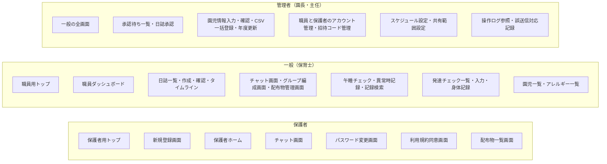

# すくすくシステム 基本設計書

関係者外秘

| 項目 | 内容 |
| :-- | :-- |
| 対象システム | 保育支援システム「すくすくシステム」 |
| 版数 | 第 2.7 版 |
| 作成日 | 2026 年 8 月 29 日 |
| 作成 | Hive-Five Developers |
| 作成区分 | チーム開発演習 基本設計 |

## 改訂履歴

| 版 | 年月日 | 変更内容 |
| :-: | :-: | :-- |
| 2.7 | 2026/10/09 | **画面詳細図の項目表とモックアップの実画面の突き合わせで決めた扱いのうち、本書の記述と食い違うものを改めた**（`図/画面詳細図.md` 第1.14版）。CSV一括登録は、エラー行が1行でもあれば1件も登録しない（4-4）。性別の空欄はエラーとする（4-4）。定型文は本文の末尾へ足す（4-5）。保護者への共有を選べるのは個人日誌だけとし、ヒヤリハットは共有の対象外とする（4-5） |
| 2.6 | 2026/10/09 | **モックアップで仮に置いていた扱いを、設計として確定した。** 管理側のペルソナのデモと PR #92 の評価で見つけた指摘（GitHub Issue #95〜#129）を直すときに、設計に定めが無く `web/仮置き値.md` に置いていた20項目である。いまのモックアップの動きを正とした。該当する節へ書き足した：「職員の情報の変更」(4-3) を新設、「園児情報の登録・編集」(4-4)、「CSV一括登録」(4-4)、「日誌の作成から保護者への共有」(4-5)、「編集ロックの解除」(4-5)、「メッセージの送受信」(4-6)、「誤送信への対応」(4-6)、「午睡チェックの実施」(4-7)、「入力項目の制約値」(4-9)、「招待コード」(5-2)、「操作ログ」(5-8)。**園の運用で変わりうる3件は演習上の想定**とし、`要決定事項.md`「演習上の想定として置いたもの」(1-1) に足した |
| 2.5 | 2026/10/09 | **管理側のペルソナのデモで残っていた設計の穴を決めた（GitHub Issue #69・#111・#115）。** ①「ログイン」(4-3) に、**ログインの失敗と、失敗が続いたことによるロックを操作ログへ記録する**ことを足した。成功は記録しない。②「アカウントの停止と再開」(4-3) を新設し、**管理者はほかの管理者も停止できる**（自分自身は停止できない）ことを書いた。③「成長曲線基準値」(5-7) を、**仮の値ではなく厚生労働省の公表値を投入する**扱いへ改めた。月齢への当て方（2歳以上は6か月ごとの公表値を補間する）を定めた |
| 2.4 | 2026/10/06 | **「園からの配布物」を加えた（GitHub Issue #94）。** 要件定義書 第2.13版の2機能に対応する。①「画面の一覧」(3-2) に配布物管理画面と配布物一覧画面（保護者）を足し、**画面は36から38**になった。②「チャットツール」(4-6) に「配布物の掲載と閲覧」を新設した。③「チャット」(5-5) に配布物（`t_handout`）を足し、**テーブルは38から39**になった。メッセージの種別に「4:配布物の掲載」を加えた。④「設定マスタ」(5-8) に `handout.allowed_types` を、「入力項目の制約値」(4-9)・「メッセージ一覧」(4-9)・権限一覧 (6-1) に配布物の行を足した |
| 2.3 | 2026/10/06 | **ペルソナのデモとモックアップの実装で見つかった設計の穴8件を決着させた。** ①日誌（`t_diary`）に差し戻す理由の列 `returned_reason` を足した（GitHub Issue #57）。②発達チェック（`t_development_check`）に所見の列 `note` を足し、**所見は園内限定とし保護者へ共有しない**と定めた（#58）。③クラス（`m_class`）に年齢児の列 `age_class` を足し、午睡チェックの間隔をそこから引くと定めた（#59）。④**クラス日誌・週案月案は保護者への共有の対象外**とし、承認画面に共有の選択肢を出さないと定めた（#61）。⑤「設定マスタ」(5-8) に園の名称と電話番号を足し、保護者向けの緊急連絡の案内に番号を出すと定めた（#88）。⑥「パスワードの要件」(6-3) に、**現在と同じパスワードへの変更を認めない**規定を足した（#89）。⑦「チャット」(5-5) に、**後から登録した保護者には登録より前の個人チャットのやりとりを見せない**規定を足した（#90）。⑧同じく、**続柄を職員側のメンバー一覧に出す**ことと、保護者の参加を通知しないことを定めた（#91）。理由は `ナレッジ/決定事項.md` に置いた |
| 2.2 | 2026/10/05 | **「画面基本構成」(3-5) に「想定する端末と向き」を新設した。** 端末の種類（タブレット／PC／スマートフォン）は定めていたが、**タブレットの向きと PC での見せ方はどの文書にも無かった。** 職員のタブレットは横向きを基本とし、縦向きでも横向きと同じ構成で使えること（縦1列へ積み直さない）、PC ではタブレット横向きの縦横比のまま中央に表示し専用のレイアウトを持たないこと、列の多い一覧はその領域の中だけを横に送ることを規定した。演習上の想定である |
| 2.1 | 2026/09/09 | **「メッセージの編集」(4-6) に「編集できる人」の表を設け、チャンネルによらず編集できることを明記した。** 園チャットに限り管理者同士でも編集できる例外を新設（園全体への発信は園としての意思表示であり、発信者個人のものではないため）。あわせて、既読が付いたあとも編集できること、日誌・発達記録を共有したメッセージは添え書きの本文だけを編集できること、誰が編集したかは画面に出さず操作ログで辿ることを規定した。権限一覧「メッセージの編集・送信取消」(6-1) の※6も同じ内容に直した |
| 2.0 | 2026/09/08 | **「チャットツール」(4-6) に「メッセージの編集」を追記した。** `t_chat_message` の `edited_at` 列、権限一覧「メッセージの編集・送信取消」(6-1)、`インタフェース一覧.md` の編集API は既にあったが、対応する処理内容が本文に無かった。送信者本人のみ・回数と期限の制限なし・編集前の本文は操作ログへ記録・「編集済み」の印を双方に表示、を規定した |
| 1.9 | 2026/09/07 | **未確定事項をすべて決着させ、【要決定】表記を本文から消した。** 「データ保護」(6-3) に認証情報の保持方式・CSRF対策の方式・パスワードの要件・日付と時刻の扱いを追加。「入力項目の制約値」(4-9) と「設定マスタ」(5-8) の既定値を新設し、桁数・範囲・必須を1か所へ集約した。**チャット画面を職員用・保護者用に分け、共有日誌閲覧画面を加えたため画面は34画面から36画面に、同意履歴（t_terms_agreement）を加えたためテーブルは38になった。** 添付の保存先・操作ログの形式・PDF生成・確認画面の範囲・個人チャットのルーム単位・職員チャットの構成・チャンネルの使い分け・年度更新の取り消し・卒園児の保護者の参照範囲・緊急連絡先の項目を確定。「共通の処理」(4-2) から新設の `図/インタフェース一覧.md` を参照する |
| 1.8 | 2026/09/01 | 「要決定事項」(7) から**件数の記載（全50件）を外した**。件数は `要決定事項.md` の側で増減するため、参照側が数を持つと必ずずれる。要件定義書 第2.10版と同じ扱いとする |
| 1.7 | 2026/09/01 | 「画面詳細」(3-6) を `図/画面詳細図.md` 第1.2版に合わせた。同図が**全36画面をそろえた**ため、対象が14画面である旨の記述と、残りの着手順への案内を差し替えた。あわせて、同図の節の並びが本書「画面の一覧」(3-2) の順に整ったことを明記した |
| 1.6 | 2026/09/01 | **「画面詳細」(3-6) の担当範囲を書き直した。** 同項は `図/画面詳細図.md` を「項目を持つ側」と書き、同図は本書を「項目を持つ側」と書いており、**相互に相手を正とする循環参照**になっていた。項目の一覧は同図が正と定め、本書はエラー文言（「メッセージ一覧」(4-9)）とデータ型・桁（「テーブル定義」(5)）を担うことを明記した。あわせて、同図が画面イメージと項目表を対にする様式へ改まったこと（同図 第1.1版）を反映した |
| 1.5 | 2026/09/01 | 第1.4版で「画面詳細」(3-6) に「全36画面」と書いたが、`図/画面詳細図.md` 第1.0版の対象は**14画面**である。記述を訂正した |
| 1.4 | 2026/09/01 | **「画面詳細」(3-6) を `図/画面詳細図.md` 第1.0版へ独立させた。** 本書にあったのは主要5画面のみで、学校提供テンプレート「(PRGDE004)06_基本設計書_画面詳細_2.0.2」の様式（番号／表示名／部品種別／補足）とも合っていなかった。同図で**全36画面と共通部品**をテンプレートの様式へ拡張し、本書は担当範囲の切り分けと参照に改めた。「画面遷移」(3-4) を独立させたのと同じ扱いとする |
| 1.3 | 2026/09/01 | **入口を分ける実装方式と、同時ログインの扱いを反映した。** ①「システムの利用方法」(2-2) に、入口の分岐を **URL のパス**（職員用 `/staff/...`／保護者用 `/parent/...`）で行うこと、ログイン後の遷移先をサーバー側でロール判定して決めること、フロントエンドはロール確定後に該当系統だけを読み込むこと（コード分割）を追記した。サブドメインでは分けない。②「ログイン」(4-3) に、**ログイン中は系統・アカウントを問わず新しいログインを成立させない**規定を反映した（要件定義書 第2.4版「同時ログインの扱い」(4-1-1)）。上書きログインは設けない |
| 1.2 | 2026/09/01 | **未確定事項の一覧を `要決定事項.md` に一本化した。**「要決定事項」(7) が持っていた14件の表を削除し、同書への案内に置き換えた。要件定義書と同じ扱いとする |
| 1.1 | 2026/09/01 | 「画面遷移」(3-4) の遷移図を `図/画面遷移図.md` 第1.0版へ移し、本書は前提の記述と参照に改めた。同図でチャットツールの遷移を補った |
| 1.0 | 2026/08/29 | 新規作成。`要件定義書.md` 第2.1版の全73機能を対象に、学校テンプレートの章構成へ沿って作成した。`基本設計書（身体記録のみ）.md` 第5.1版の内容を該当章へ取り込み、同書を退役させた |

## 目次

| 章 | 内容 |
| :-- | :-- |
| [1 はじめに](#1-はじめに) | 本書の目的・対象読者・参照元・表記ルール |
| [2 システムの概要](#2-システムの概要) | システムと業務の関係、システムの利用方法 |
| [3 ユーザインターフェイス設計](#3-ユーザインターフェイス設計) | 画面の洗い出し、画面体系、画面遷移、画面基本構成、画面詳細 |
| [4 機能概要](#4-機能概要) | 機能一覧と処理詳細、メッセージ一覧 |
| [5 データベース設計](#5-データベース設計) | テーブル定義、データ関係図 |
| [6 セキュリティ設計](#6-セキュリティ設計) | 権限と利用可能機能、データ保護と監査 |
| [7 要決定事項](#7-要決定事項) | 未確定事項の一覧（`要決定事項.md`）への案内 |

---

# 1 はじめに

## 1-1 本書の目的

本書は `要件定義書.md` 第2.1版に基づき、すくすくシステムの**画面・処理・データ構造・権限**を規定する。要件定義書が「何を満たすか」を定めるのに対し、本書は「**どう作るか**」を定める。

## 1-2 対象読者

| 読者 | 本書の使い方 |
| :-- | :-- |
| チームメンバー（実装担当） | 担当機能の画面・処理・テーブルの仕様として参照する |
| 先生（発注者役） | 要件が設計に落ちているかの確認に用いる |

## 1-3 参照元ドキュメント

| 文書 | 版 | 本書との関係 |
| :-- | :-- | :-- |
| `要件定義書.md` | 第2.1版 | **本書の唯一の上位文書。** 要件について食い違う場合は要件定義書を正とし、本書を追随させる |
| `図/ER図.md` | 第1.0版 | 5章のテーブル定義の根拠。エンティティと関連はこちらが持つ |
| `図/ユースケース図.md` | 第1.1版 | 6章の権限マトリクスの根拠 |
| `図/アクティビティ図.md` | 第1.1版 | 4章の処理詳細の根拠 |
| `図/画面遷移図.md` | 第1.1版 | 「画面遷移」(3-4) の別紙。画面のつながりはこちらが持つ |
| `図/画面詳細図.md` | 第1.4版 | 「画面詳細」(3-6) の別紙。**1画面の中身はこちらが持つ**（全38画面） |
| `図/画面ID対応表.md` | 第1.0版 | 学校テンプレートが求める `n-n-n-n` 形式の画面IDと画面名の対応。**提出時に添える** |

> **退役させた文書**：`基本設計書（身体記録のみ）.md` 第5.1版。身体記録パートの内容は本書の該当章へ取り込んだ。**要件定義書と同じく、正を1本に絞る**方針による。内容は git 履歴に残る。

## 1-4 表記ルール

- **機能・画面は番号ではなく名前で呼ぶ。** `SCR-nnn` `FUN-nnn` のような番号体系は廃止済みであり、本書で新たに採番しない（`CLAUDE.md` の方針）
- 要件定義書の項目を参照するときは**名前を主・番号をカッコで併記**する。例：「招待コードの発行」(4-1-2)
- 機能名は**要件定義書の機能表の名称と一致させる**。設計側で言い換えない
- **2026/09/07 をもって、値や方式が未確定の事項は無い。** 本文には決まった内容が書いてある。**実在の園へのヒアリングを行っていないため「演習上の想定」として置いたもの**は、その旨を該当の記述に添えてある（一覧は `要決定事項.md`「演習上の想定として置いたもの」(1-1)）
- 変更箇所は改訂履歴に記す。本文中で色分けはしない（Markdown のため）

> **学校テンプレートの画面ID**：テンプレートは `n-n-n-n`（機能大分類-機能小分類-画面番号-権限）形式の画面IDを求めている。本書は上記のとおり名前で呼ぶ方針のため採番しない。**提出時は `図/画面ID対応表.md` を添えて様式を満たす**（2026/09/07 作成、全36画面）。**画面IDは同書だけが持つ。** 本書を含む他の文書には書かない。書くと、画面が増減したときに直す場所が増えるため。

---

# 2 システムの概要

## 2-1 システムと業務の関係

保育士の1日の業務のうち、本システムが担う範囲を示す。**システムは記録と共有を担い、判断と保育そのものは人が行う。**

| 時間帯 | 業務 | 本システムの関わり |
| :-- | :-- | :-- |
| 登園時 | 受け入れ、視診 | ―（登降園管理は対象範囲外） |
| 午前 | 保育、活動 | 日誌の下書きを随時入力する |
| 午睡 | 午睡の見守り | **午睡チェック**を開始し、規定の間隔で体位・体調を記録する。異常があれば記録し管理者へ通知する |
| 午後 | 保育、活動 | 発達チェック・身体測定を予定に応じて入力する |
| 降園時 | 引き渡し、連絡 | 保護者との連絡は**チャットツール**の個人チャットで行う。緊急連絡は電話 |
| 退勤前 | 日誌の仕上げ | 日誌を**承認申請**する。管理者が承認し、保護者への共有を指定する |
| 随時 | 園全体の連絡 | 園チャット・グループチャットで共有する |

**業務フローの詳細**は `図/アクティビティ図.md` が11業務分を保持する。本書はそれを前提とし、再掲しない。

## 2-2 システムの利用方法

| 利用者 | デバイス | 入口 | 主な操作 |
| :-- | :-- | :-- | :-- |
| 管理者（園長・主任） | タブレット／PC | 職員用トップ | 日誌の承認・差し戻し、アカウントの発行、園児マスターの管理、全クラスの記録の閲覧、操作ログの参照 |
| 一般（保育士） | タブレット／PC | 職員用トップ | 日誌の作成・申請、午睡チェック、発達チェック・身体測定の入力、自クラスの記録の閲覧 |
| 保護者 | スマートフォン | 保護者用トップ | 個人チャットでの連絡、共有された自児の記録の閲覧 |

- **入口は保護者用と職員用の2系統**に分かれる（要件定義書「アプリのログイン」(4-1-1)）。ロールの判定は入口ではなくアカウントで行い、誤った系統では認証を成立させない
- **入口の分岐は URL のパスで行う。** 職員用を `/staff/...`、保護者用を `/parent/...` とする。**サブドメインでは分けない**（DNS・TLS 証明書・Cookie ドメインの設計が要り、「本演習での動作検証環境」(要件定義書 6-2) の localhost で動かせなくなるため）。バックエンド・データベース・認証基盤・園児マスターは両系統で共通とし、別アプリケーション・別コードベースにはしない
- **ログイン後の遷移先は、サーバー側でアカウントのロールを判定して決める。** フロントエンドの画面出し分けに依存させない。画面の出し分けは表示の制御であって権限制御ではないため、各処理での権限の判定は「共通の処理」(4-2) に従って毎回行う
- **フロントエンドは、ロールが確定してから該当する系統の画面を読み込む**（コード分割）。保護者の端末へ職員用画面を配信しない。利用者が自分に関係のない導線を目にしないようにするという入口を分ける目的（要件定義書「アプリのログイン」(4-1-1)）を、配信されるコードの範囲でも満たすため
- 職員が利用する全画面のヘッダに、**ログイン中の職員名を常時表示する**。共有端末での記録者の取り違えを防ぐため（同「端末の利用形態と本人特定」(4-1-4 (4))）
- 職員向け画面は無操作が続くと自動ログアウトする。ただし**午睡チェックの実施中は対象外**とする

---

# 3 ユーザインターフェイス設計

## 3-1 画面の洗い出しの考え方

要件定義書の75機能から画面を導く。**1機能＝1画面ではない。**

| 関係 | 例 |
| :-- | :-- |
| 複数の機能が1つの画面に載る | チャットツールの10機能は、ほぼ**チャット画面**の中で完結する（チャンネル切り替え・送受信・リアクション・既読確認） |
| 1つの機能が複数の画面に分かれる | 「園児情報の登録・編集」は、**一覧→入力→確認**の流れになる |
| 機能に画面が対応しない | 「ログイン情報の記憶」はログイン画面のチェックボックスであり、独立した画面を持たない |

**画面として起こす基準**を次のとおり定める。

1. **利用者が明示的に遷移して操作を始める単位**を1画面とする
2. 入力を伴う登録・編集は、テンプレートの流儀に従い**入力→確認**の段階を設ける。ただし**連続入力を前提とする操作は確認画面を挟まない**（午睡チェックの体位記録、身体測定の連続入力）。1件ごとに確認を挟むと現場の運用に耐えないため
3. ダイアログで足りるものは画面として起こさない（PDF出力の条件指定など）

**確認画面を独立した画面として設けるのは、次の2つだけとする。**

| 画面 | 設ける理由 |
| :-- | :-- |
| 園児情報確認画面 | 園児マスターの誤りは**全機能へ波及する**。クラス・生年月日を間違えると、参照範囲・月齢・発達チェックの区分がすべてずれる |
| 日誌確認画面 | 申請すると**管理者の承認の列に載り、承認後は保護者へ共有されうる**。取り消しの手間が本人の外へ及ぶ |

**それ以外は確認画面を設けない。** 基準2のとおり、連続入力を前提とする操作（午睡チェック、身体測定、発達チェック）に1件ごとの確認を挟むと現場の運用に耐えない。マスタの設定変更やアカウントの操作は、**取り消しが本人の操作だけで完結する**ため、保存前の確認ダイアログで足りる。

> 年度更新だけは例外で、**画面の中に確認の段階を持つ**（対象件数を示してから実行する）。影響が全園児・全保護者に及ぶが、独立した確認画面にすると年度更新画面が2画面に割れて流れが分かりにくくなるため。

## 3-2 画面の一覧

**共通・認証**

| 画面名 | 概要 | 利用者 |
| :-- | :-- | :-- |
| 保護者用トップ | 保護者用の入口。ログインと新規登録の導線を置く | 未ログイン（保護者） |
| 職員用トップ | 職員用の入口。ログインの導線のみを置く。**新規登録は置かない** | 未ログイン（職員） |
| 新規登録画面 | 招待コードの入力、利用規約への同意、アカウント情報の入力 | 未ログイン（保護者） |
| パスワード変更画面 | 一時パスワードでのログイン後、および任意の変更時 | 全ロール |
| 利用規約同意画面 | 規約の改定時に次回ログインで表示する | 全ロール |
| 職員ダッシュボード | 通知・未対応件数・各機能への導線 | 管理者・一般 |
| 保護者ホーム | 自児の情報、共有された記録とチャットへの導線 | 保護者 |
| 共有日誌閲覧画面 | 共有された日誌を1件ずつ読む。**保護者専用の読み取り画面** | 保護者 |

**日誌システム**

| 画面名 | 概要 | 利用者 |
| :-- | :-- | :-- |
| 日誌一覧画面 | 日誌の検索・絞り込み、ステータス別の表示 | 管理者・一般 |
| 日誌作成・編集画面 | 雛形選択、本文・定型文・写真の入力、下書き保存、承認申請 | 管理者・一般 |
| 日誌確認画面 | 申請前の内容確認 | 管理者・一般 |
| 承認待ち一覧画面 | 申請日・クラス・作成者とともに一覧表示 | 管理者 |
| 日誌承認画面 | 内容の確認、承認／差し戻し、**保護者への共有の指定** | 管理者 |
| 園児タイムライン画面 | 特定の園児の過去の記録を時系列で表示 | 管理者・一般 |

**チャットツール**

| 画面名 | 概要 | 利用者 |
| :-- | :-- | :-- |
| チャット画面（職員） | チャンネル一覧・メッセージ領域・メンバー一覧を**同一画面に並べる**（タブレット／PC）。送受信・リアクション・編集・取消・既読確認・未対応スレッドの切り替えを内包する | 管理者・一般 |
| チャット画面（保護者） | シングルカラム（スマートフォン）。**チャンネル一覧と会話を同じ画面の中で入れ替えて表示する**。既読の人数は表示しない | 保護者 |
| グループ編成画面 | 目的別グループの作成とメンバーの編成 | 管理者・一般 |
| 誤送信対応記録画面 | 誤送信の発生日時・対象・既読の有無・とった対応を記録する | 管理者 |
| 配布物管理画面 | 園だより・献立表などの配布物の一覧、掲載、取り下げ。**掲載と取り下げは管理者のみ**。一般は閲覧のみ | 管理者・一般 |
| 配布物一覧画面（保護者） | 配布物を月ごとにまとめて並べ、開いて読む。種類で絞り込める | 保護者 |

**チャット画面を職員用と保護者用の2画面として数える。** 機能は同じだが、**レイアウトが根本的に違う**（3ペインとシングルカラム）ため、1つの画面定義に収めると表示項目・操作の記述が「職員のときは／保護者のときは」の羅列になる。既読の人数を保護者に見せない扱い（「チャット」(5-5)）も画面ごとに書けるほうが明確である。

**保護者側は、チャンネル一覧と会話を画面の中で入れ替える。** 別々の画面には分けない。シングルカラムでも**戻る操作で一覧へ帰るだけ**であり、画面を分けても表示項目は増えない。分けると画面数と図の分量が増えるだけになる。

**午睡チェック**

| 画面名 | 概要 | 利用者 |
| :-- | :-- | :-- |
| 午睡チェック画面 | 実施の開始・終了、タイマー、クラス全体の状況、園児ごとの体位・体調の記録を1画面で行う | 管理者・一般 |
| 異常時記録画面 | 発見時刻・状況・とった対応の記録。ヒヤリハットの起票の導線を置く | 管理者・一般 |
| 午睡記録検索画面 | 日付・園児名・クラスでの検索と履歴の閲覧 | 管理者・一般 |

**発達チェック・身体測定**

| 画面名 | 概要 | 利用者 |
| :-- | :-- | :-- |
| 発達チェック一覧画面 | クラス単位で園児と次回予定日・未実施を表示。チェック漏れを強調する | 管理者・一般 |
| 発達チェック入力画面 | 月齢に応じたチェックリストの入力、所見の記述、過去記録との比較 | 管理者・一般 |
| スケジュール設定画面 | 園児単位の推奨スケジュールの上書き | 管理者 |
| 身体記録画面 | 測定値の登録・修正、成長グラフ、実施状況の確認 | 管理者・一般 |
| 共有範囲設定画面 | 項目ごとの保護者への共有可否の設定 | 管理者 |

**園児マスター・アカウント管理**

| 画面名 | 概要 | 利用者 |
| :-- | :-- | :-- |
| 園児一覧画面 | 園児の検索・絞り込み | 管理者・一般（閲覧のみ） |
| 園児情報入力画面 | 園児情報の登録・編集 | 管理者 |
| 園児情報確認画面 | 登録・編集内容の確認 | 管理者 |
| CSV一括登録画面 | ファイルの選択、取込内容とエラー行の確認 | 管理者 |
| アレルギー一覧画面 | アレルギーが登録された園児の一覧。**全園児が対象**。印刷に対応する | 管理者・一般 |
| 年度更新画面 | 更新内容の一覧確認と実行 | 管理者 |
| 職員アカウント管理画面 | 職員アカウントの発行・停止、一時パスワードの再発行、ロックの解除 | 管理者 |
| 招待コード管理画面 | 招待コードの発行・一括発行・失効、使用状況の確認、配布用の出力 | 管理者 |
| 保護者アカウント管理画面 | 紐づけの解除、アカウントの停止、未同意者の確認 | 管理者 |
| 操作ログ参照画面 | 日付・操作者・対象機能・対象園児での絞り込みと出力 | 管理者 |

**画面数：38**（共通・認証8／日誌6／チャット6／午睡3／発達・身体5／マスター・管理10）

## 3-3 画面体系図

利用者種別ごとに、利用できる画面を示す（遷移ではなく所属）。

- 管理者は**一般の全画面**を利用でき、加えて承認・マスター管理・アカウント管理・監査の画面を持つ
- 保護者が利用する画面は**8画面のみ**（配布物一覧画面を含む。保護者用トップ・新規登録画面・保護者ホーム・チャット画面（保護者）・共有日誌閲覧画面・パスワード変更画面・利用規約同意画面）
- **共有された日誌は専用の閲覧画面で読む。** チャット画面の中で完結させる案も採りうるが、日誌は本文が長く、写真も伴う。会話の流れの中に混ぜると**読みづらく、後から探せない**。保護者ホームからも同じ画面へ入れるようにし、**チャットを遡らずに記録へ届く**導線を確保する
- **きょうだいが在籍する保護者には、園児を切り替える操作を設けない。** 保護者ホームに**園児ごとの区画を縦に並べて同時に見せる**。個人チャットも園児単位で作るため（「チャット」(5-5)）、チャンネル一覧に園児の数だけ並ぶ。切り替え式にすると、**いま誰の情報を見ているのかを取り違える**恐れがあり、連絡帳を取り違えるのと同じ事故につながる。在籍する園児は多くて数名であり、並べて置いても画面が破綻しない

## 3-4 画面遷移

画面と画面のつながりは **`図/画面遷移図.md`** が保持する。同図は共通・認証／日誌システム／チャットツール／午睡チェック／発達チェック・身体測定／園児マスター・アカウント管理の6区分に分けて図示し、あわせて遷移元・操作・遷移先の一覧表を持つ。**学校テンプレートが別紙として求める画面遷移図にあたる。**

本書の他の章と結びつく遷移の前提を、次のとおり定める。

- **ログアウトの遷移先は、ログインしていた系統のトップ**（要件定義書「アプリのログイン」(4-1-1)）
- 一時パスワードでのログイン時と規約の改定後の初回ログイン時は、**変更・同意を完了するまで他の画面へ進めない**
- **午睡チェック画面は開いたまま運用する。** 実施中は他画面への遷移を前提とせず、自動ログアウトの対象外とする
- 入力→確認の段階を設けるのは**園児情報の登録・編集のみ**。連続入力を前提とする午睡チェック・身体測定・発達チェックは確認を挟まない（「画面の洗い出しの考え方」(3-1) の基準2）
- チャンネルの切り替え・PDF出力の条件指定など、ダイアログで足りるものは画面として起こさない（同基準3）

## 3-5 画面基本構成

全画面に共通するレイアウトを定める。

| 領域 | 内容 |
| :-- | :-- |
| ヘッダ | システムロゴ、**ログイン中の利用者名**（職員は所属クラスも表示）、通知アイコンと未対応件数、ログアウト |
| サイドナビゲーション（職員のみ） | 各機能への導線。現在地を視覚的に強調する |
| メインコンテンツ | 各画面の表示・入力領域 |
| フッタ（保護者のみ） | **「緊急のご連絡はお電話でお願いします」と、園の電話番号を常時表示する。** 番号は押すと電話をかけられるリンクにする |

**緊急連絡の案内は、保護者向けの全画面に常時置く。**

- 本システムの通知は**画面を開いたときに見えるもの**であり、届くことを保証しない（要件定義書「通知の到達性」）。**到達を保証しない経路に緊急の連絡を載せない**という原則を、画面の仕様として担保する
- 保護者は「園に連絡する手段＝このアプリ」と受け取りやすい。**その場で電話へ切り替えられる案内が要る**。そのため案内には**園の電話番号を添える**。番号は設定マスタの `facility.phone_number` から引く（「設定マスタ」(5-8)）。番号が未設定のあいだは、案内の文言だけを出す
- 職員向け画面には置かない。職員は園内にいて、電話が緊急の手段であることを運用として知っているため

| 項目 | 規定 |
| :-- | :-- |
| テーマカラー | 優しい黄色（要件定義書「コンセプトとターゲット層」(1-1)） |
| 警告色 | 黄色と対比の付く色を用いる。午睡チェックの異常、範囲外の入力値に使う |
| グリッド | 職員（タブレット／PC）＝12カラム。保護者（スマートフォン）＝シングルカラム |
| タップ領域 | **44×44px 以上**を確保する。タブレットでの操作を前提とするため |
| 免責表示 | 成長グラフ・発達チェックの比較表示には「判定・診断を行うものではありません」を**常時表示**する。スクロールしても視界から外れない位置に固定する |

- **ログアウトの導線**：職員はヘッダに常時表示する（共有端末での担当交代に用いるため）。保護者はメニュー内に置く
- **通知からの導線**：ヘッダの通知は**未対応の総件数**を示し、押すと職員ダッシュボードの「未対応」へ移る。**各項目から該当画面へ入る導線は、ダッシュボードの側が持つ**（差し戻された日誌 → 日誌一覧、未読のチャット → チャット画面、発達チェックの未実施 → 発達チェック一覧、ヒヤリハット未起票 → 異常時記録画面）。ヘッダに項目ごとの一覧を出すと、**全画面に載る部品が重くなり、午睡チェック中の画面でも視線を奪う**。保護者側は項目が実質チャットだけであるため、通知から直接チャット画面へ移る
- **保護者向け画面はサイドナビゲーションを持たない。** 片手操作を前提とし、ホームからの導線に絞る

### 想定する端末と向き

| 利用者 | 端末 | 向き | レイアウトの扱い |
| :-- | :-- | :-- | :-- |
| 職員（管理者・一般） | タブレット | **横向きを基本とする。縦向きでも使う** | **横向きを基準に組む。** 縦向きでも構成を変えず、各領域の幅だけを詰める |
| 職員（管理者・一般） | PC | ― | **タブレット横向きの縦横比のまま、画面の中央に表示する。** PC 専用のレイアウトは持たない |
| 保護者 | スマートフォン | 縦向き | シングルカラム |

- **縦向きでも、横向きと同じ構成で使えるようにする。** ヘッダ・サイドナビゲーション・メインコンテンツの配置と、各画面の中の領域の並びを、向きによって変えない。チャット画面（職員）の3つの領域（チャンネル一覧・メッセージ領域・メンバー一覧）も、身体記録画面の2つの領域（園児の選択・記録）も、**縦1列へ積み直さず横に並べたままとする**
  - 理由：午睡チェックでタブレットを立てて置く、片手で持って縦にする、といった場面がある。**向きを変えるたびに配置が変わると、操作する場所を探し直すことになる**
- **縦向きで詰めてよいのは幅と余白だけである。** サイドナビゲーションの幅・メインコンテンツの余白・各領域の幅を狭める。**タップ領域（44×44px 以上）と文字の大きさは変えない**
- **列の多い一覧は、その一覧の領域の中だけを横に送る。** 画面全体を横にスクロールさせない。ヘッダとサイドナビゲーションが視界から外れるのを防ぐため
- **PC では横幅いっぱいに広げない。** タブレット横向きの縦横比を上限として中央に置き、左右は余白とする。職員が使う画面を1つに保ち、**端末によって見え方が変わる箇所を増やさない**ため。PC 専用のレイアウトを別に持つと、設計・実装・テストの対象が画面数の分だけ増える
- 縦横比の基準は **iPad の横向き（1180×820）** とする
- **職員向けにスマートフォンのレイアウトは用意しない**（「チャット」(5-5)）
- **演習上の想定である。** 園で実際に使う端末の機種と、縦向きで使う場面がどの程度あるかは、導入時に園へ確認して確定する

## 3-6 画面詳細

**各画面の画面イメージと項目の一覧は `図/画面詳細図.md` に定める。** 本書は画面の一覧・体系・基本構成までを担い、**1画面の中身は同図が正**である。

| 文書 | 担当する範囲 |
| :-- | :-- |
| 本書「画面の一覧」(3-2)・「画面体系図」(3-3)・「画面基本構成」(3-5) | どんな画面があるか、誰が使うか、共通のレイアウト |
| `図/画面遷移図.md` | 画面と画面のつながり |
| `図/画面詳細図.md` | **1画面の中に何があるか**。画面イメージと項目表（番号／表示名／部品種別／補足）を**対にして**持つ |
| 本書「メッセージ一覧」(4-9)・「テーブル定義」(5) | エラー時に出す文言と、データ型・桁 |

同図は共通レイアウト2種と各画面の記述を持つ。**「画面の一覧」(3-2) の全38画面がそろっている**。同図の節の並びも同項の順に合わせてある。**制約値の反映・要確認事項の解消・画面ID対応表の作成・スクリーンショットへの差し替えは、いずれも 2026/09/07 に完了した**（同図「残る作業」(10)）。

- **入力項目の制約値（桁数・必須・形式）は「入力項目の制約値」(4-9) が一括して定める。** 同図の各画面はそれを参照する。画面ごとに別の値を置かない
- 画面イメージは**実装したモックアップのスクリーンショット**である（2026/09/07 に等幅テキストのワイヤーフレームから差し替えた）。**項目表が仕様の正**であり、スクリーンショットは実装の現状を示す。食い違えば実装を直す
- 画面IDは採番せず画面名で呼ぶ。学校提供テンプレート「(PRGDE004)06_基本設計書_画面詳細_2.0.2」が求める `n-n-n-n` 形式は、提出時に `図/画面ID対応表.md` を添えて満たす（2026/09/07 作成、全36画面）

## 3-7 一覧表示とページング

| 一覧 | 方針 |
| :-- | :-- |
| クラス別の園児一覧 | **ページングなし**（1クラス最大30名程度）。連続入力の作業性を優先する |
| 日誌一覧・午睡記録検索 | ページングあり。既定は50件 |
| 過去測定値一覧 | 直近12件を既定表示し、以降は追加読み込み。年2〜4回の測定で3〜6年分に相当する |
| 操作ログ | ページングあり。既定は100件 |
| チャットのメッセージ | 直近から遡って追加読み込みする |

---

# 4 機能概要

## 4-1 記載ルール

機能ごとに **＜利用タイミング＞＜処理内容＞** を記す。処理内容は「**画面表示 → 利用者の操作 → システム内処理 → 画面表示**」の順で書く。

- 機能名は `要件定義書.md`（第3.0版）の機能表の名称と**一致させる**。設計側で言い換えない
- 全機能に共通する扱い（権限と参照範囲、保護者へ届けるときの関所、操作ログ、同時編集、時刻）は「共通の処理」(4-2) に一度だけ書き、各機能では参照する。**保護者へ届けるときの確かめを機能ごとに書き分けない**（要件定義書「保護者へ届けるときの関所」(4-1-6)。機能ごとに書くと、第2.x版の「日誌は承認を経て届き、チャットは承認なしで届く」のように方式が揺れるため）
- 開いている画面への即時の反映と、アプリを開いていない保護者への通知は「リアルタイムの反映と通知」(4-10)、AI の使い方は「文章の下書き（AI）」(4-11) に置き、各機能からは名前で参照する
- 入力値の制約と、検証・確認で表示する文言は「入力項目の制約値とメッセージ一覧」(4-12) に集約する
- テーブル・列の名前は「データベース設計」(5) に合わせる。本章では、列名を書くと読みにくい箇所は論理名（「申請者の列」など）で書く
- 要件定義書の項目は第3.0版の名前と番号で参照する。**第3.0版で連絡帳を「連絡帳」(4-2) に置いたため、日誌システム（4-3）以降の番号が第2.x版から1つずつ送られている**

## 4-2 共通の処理

### 画面とサーバの間のインタフェース

経路の一覧・やり取りするデータの項目・エラーの返し方は **`図/インタフェース一覧.md`** が保持する。

- **項目名・型まで定める。** フロントエンドとバックエンドを並行して作るための取り決めであり、両者はこの一覧だけを見て相手の実装を待たずに作れる
- 項目名は「データベース設計」(5) の物理名と一致させる。**画面のために別の名前を付けない**
- エラーはすべて同じ形で返し、状態コードの使い分けを揃える。**権限または参照範囲の外は、存在しない場合と同じ文言にする**（あるかどうかを推測させないため）
- 同図（第1.3版）には、第3.0版で足した機能（連絡帳、成長の記録、設定の画面、知らせの受け取り口、通知の購読、AI の下書き）の経路がまだ載っていない。本書に合わせて改める（要件定義書「他文書との突き合わせが必要な事項」(11)）

### 権限と参照範囲の判定

すべての機能の入口で、**バックエンドが**次を判定する。フロントエンドの画面の出し分けには依存しない（要件定義書「権限チェック」(8 No.2)）。

1. ログイン済みか。未ログインなら拒否する
2. 操作しようとしている機能が、そのロールに許可されているか
3. 対象の記録が参照範囲に入っているか（下の2つの判定のどちらかで決める）
4. 書く操作なら、**書ける状態か**。読めても書けない状態が3つある：保護者の猶予期間中の保護者、引き継ぎ猶予期間中の前の担任、クラスに属さない職員（下の表）

**判定は2つに分かれる。** 園児の記録は**園児との紐づけ（職員は園児単位）**で、グループは**所属**で判定する（要件定義書「参照範囲の全体規定」(4-1-5)）。取り違えると、見せてはならないものが見え、見せるべきものが見えなくなる。

| 対象 | 判定 | 保護者が読める範囲 | 職員が読める範囲 |
| :-- | :-- | :-- | :-- |
| 連絡帳（家庭から・きょうのようす・園から）、成長の記録 | **園児との紐づけ** | 紐づけが有効か猶予中の自児。**紐づけより前の日の分も読める** | 一般＝自クラスの園児、管理者＝全園児 |
| 個人チャット | **園児単位** | 紐づけが有効か猶予中の自児。ただし**自分が参加した時点以降のやりとりだけ** | その園児のいまの担任と管理者。担任でなくなった職員は、引き継ぎ猶予期間のあいだだけ閲覧のみ |
| 園児を持たない日誌（クラス日誌・週案月案） | **対象のクラス** | 返さない（園内に留める） | 今年度はそのクラスの担任、過年度はそのクラスを担任していた職員。管理者は全部 |
| グループ（園チャット・クラスグループ・目的別グループ・職員チャット） | **所属** | 現在所属しているグループのみ | 現在所属しているグループと、過去に所属していたグループ。管理者は全部 |
| 上記のほかの園児の記録（個人日誌・ヒヤリハット・午睡チェック・発達チェック・身体測定・園児情報） | **園児単位** | 返さない。届けるもの（成長の記録）は上の行による | 一般＝自クラスの園児、管理者＝全園児 |

- **連絡帳と成長の記録を紐づけで判定し、登録前の分も読めるようにするのは**、園がその子の家庭に向けて書いたものであり、特定の保護者が書いた会話ではないためである。後から登録した祖父母も、入園からの連絡帳を読める
- **個人チャットの保護者を参加の時点で切るのは**、先に登録していた保護者が、自分の書いたものが後から加わる人に読まれることを知らないためである（「チャット」(5-6)。2026-10-06 の決定を変えない）
- **個人チャットの職員を所属ではなく園児単位で判定するのは**、個人チャットが園児1人の単位であり、園児単位に分解できるためである。所属で判定すると、担任でなくなった職員が前のクラスの家庭とのやりとりを期限なく読める
- **グループを所属で判定するのは**、複数の園児・保護者が同居する単位であり、園児単位に分解できないためである

**ロールごとの読める範囲と書ける範囲**

| ロール・状態 | 読める | 書ける |
| :-- | :-- | :-- |
| 管理者 | 全園児・全年度 | 全園児 |
| 一般 | 現在の担任クラスに在籍する園児（**その園児の過年度の記録も**） | 同じ範囲 |
| 一般（引き継ぎ猶予期間中） | 上記に加え、前に担任していたクラスの在籍園児 | 前のクラスの園児には**書けない** |
| 一般（担当クラスなし。フリー） | **全クラス** | **書けない**（記録の責任は担任が負うため） |
| 保護者 | 紐づけが有効な自児 | 連絡帳の「家庭から」、個人チャット、自分の連絡先だけ |
| 保護者（保護者の猶予期間中） | 卒園・退園した自児の連絡帳・成長の記録・個人チャットの過去ログ | **書けない**（「家庭から」・チャットの送信はできない） |

**例外は次の3つだけ**である（要件定義書「参照範囲の全体規定」(4-1-5)）。

| 例外 | 内容 |
| :-- | :-- |
| アレルギー情報 | 一般も**全園児**を閲覧できる。表示は氏名・クラス・アレルギー情報に限り、既往歴・生年月日は含めない |
| グループの過去ログ | 園児単位ではなく「そのグループに所属していたか」で判定する |
| クラスに属さない職員 | 担当クラスの無い職員は、全クラスを閲覧のみできる |

- **読む API と、知らせを送る相手を決める処理（「リアルタイムの反映と通知」(4-10)）と、外部の AI へ送るかを決める処理（4-11）は、同じ判定の関数を使う。** 判定を2か所に持つと、片方だけ直したときに食い違う
- 保護者のロールで、園内に留めるもの（下の段3）を読める経路は**作らない**。返す側で項目を落とすのではなく、経路そのものを持たない

### 保護者へ届けるときの関所

記録が保護者に届く前に通る確かめを、**届けるものの性質で4つの段に分け、全機能で同じ処理にする**（要件定義書「保護者へ届けるときの関所」(4-1-6)、`設計方針.md`「届けるときの関所」(4)）。どの記録がどの段かは各機能の節に書き、処理はここに一度だけ書く。

| 段 | 当てはまるもの | 処理 |
| :-- | :-- | :-- |
| **1 記録すると届く** | きょうのようすの事実（午睡の「ねた・おきた」、食事の量、排せつ、体温）、成長の記録（身体測定の値、発達チェックの「確認できた」）、「確認しました」、配布物の知らせ | **記録を保存した時点で、保護者が読める状態になる。** 承認・送信の操作を挟まない。保存が終わったら知らせを送る（4-10）。選ぶだけ・数値だけの項目で、他児の情報が入る余地が無いため、送る人の確かめを置かない |
| **2 送る人が確かめて届く** | 文と写真（園からのひとこと、活動のひとこと、写真、クラスのようす、発達チェックの保護者へのひとこと、AI の下書きから作った文）、保護者が参加するチャンネルへの職員の投稿 | 「送る」を押したときに、サーバが**下の「送る時点の守り」**を確かめ、満たせば保存して届ける。**管理者の事前の承認は置かない**。管理者はあとから全クラスの連絡帳を読める |
| **3 園内に留める** | 午睡チェックの確認の記録（監査の層）、異常時の記録、ヒヤリハット、保育日誌、発達チェックの所見・「一部」「未確認」・過去記録との比較、操作ログ | **保護者へ返す経路を作らない。** 保護者のロールで読める API を持たず、保護者へ知らせも送らない。保育日誌の承認は園内の確認として残す |
| **4 電話で伝える** | 緊急（発熱・けが・午睡中の異常・災害時の引き渡し） | システムで送る処理は無い（設計原則4）。電話のあと、**伝えたことを記録する欄**（異常時の記録の「保護者への連絡」、ヒヤリハットの「保護者へ伝えたこと」）と、**経過を書く道**（連絡帳・個人チャット。段2）を置く |

**段2に事前の承認を置かない理由**は、①保護者に向けて書く場所（連絡帳）と園内の記録を分けたため、園内向けに書いたものが保護者へ流れる道が無い、②宛先が1家庭（クラスのようすは1クラス）に限られる、③承認を挟むとその日のようすが夜〜翌日になる、④誤りは取り消し・訂正と誤送信への対応で受ける、の4つである（要件定義書 (4-1-6)）。**演習上の想定である。**

**送る時点の守り（段2）**

＜利用タイミング＞ 職員が、段2のものを保護者へ送るとき（連絡帳・チャット・発達チェックの確定）。

＜処理内容＞

1. 【画面表示】送る画面に、**宛先を大きく示す**
   - 園児1人あて（連絡帳・個人チャット）：**園児名と顔写真**、届く保護者の続柄（例「母・祖母に届きます」）。顔写真が無い園児は名前の1文字目を丸で示す。保護者がまだ登録していない園児は「まだ保護者が登録していません（登録すると読めます）」と添える
   - クラスあて（クラスのようす・クラスグループ）：**クラス名と家庭の数**（例「ひよこ組の12家庭に届きます」）
   - 園全体（園チャット）：「園全体の n 家庭に届きます」
2. 【操作】職員が本文を書き、写真を付けるときは**写っている子を選び**、「送る」を押す
3. 【システム内処理】次の順に確かめる。どれかで止まったら保存しない
   - 権限と参照範囲、書ける状態か（上の「権限と参照範囲の判定」）
   - 入力の制約（文字数・形式。「入力項目の制約値」(4-12)）
   - **写真の同意で止める**（下の表）。満たさない写真は**送れない**。警告で済ませないのは、写真は届いたら取り返せないためである。誰の同意が足りないかを返す
   - **他児の名前の注意**。本文に、宛先以外の在籍園児の氏名・名・よみ・呼び名があれば、保存せずに「ほかのお子さんの名前（〇〇）が入っています。このまま送りますか」を返す。送る人が「このまま送る」を選べば、その承諾を付けて送り直し、保存する。**機械的な文字の照合であり、判断ではない**（設計原則1）。クラスあて・園全体では、在籍園児の全員の名前が照合の対象になる（ほかの家庭にも届くため）。照合の細かい規則（短いよみの扱いなど）は詳細設計書で定める
   - 保存する（時刻はサーバの時刻）。保存が終わったら知らせを送る（4-10）
4. 【画面表示】「送りました。保護者が見られる状態です」を出す。保護者が未登録の園児には「送りました。保護者が登録すると読めます」を出す

**写真の同意で止める規則**（要件定義書「写真の利用同意」(4-1-3)・(4-1-6)）

写真は、**写っている子を職員が全員選んでから**送る。顔の自動判定はしない。子どもが写っていない写真（作品・景色など）は「子どもは写っていない」を選ぶ。どちらも選ばない写真は送れない。

| 送る先 | 写っている子 | 送れる条件 | 出る場所 |
| :-- | :-- | :-- | :-- |
| 連絡帳（園児ごと） | 1人 | その子の同意が「自児の保護者へ共有」以上 | その子の連絡帳 |
| 連絡帳（園児ごと） | 2人以上 | 写っている**全員**の同意が「他の保護者にも見える場へ掲載」 | 選んだ**全員**の連絡帳 |
| 個人チャット | その園児だけ | その子の同意が「自児の保護者へ共有」以上 | そのチャット |
| 個人チャット | その園児以外の子が写る | 写っている**全員**の同意が「他の保護者にも見える場へ掲載」 | そのチャット |
| クラスのようす・クラスグループ・園チャット | 1人以上 | 写っている**全員**の同意が「他の保護者にも見える場へ掲載」 | その場 |
| いずれの場 | 子どもは写っていない | 条件なし | ― |

- 日誌の写真は園内の記録（段3）であり、最も狭い段階（園内記録として保持）で足りるため、この確かめを通らない
- 配布物（PDF など）に写る園児は、掲載する管理者が確かめる（「配布物の掲載と閲覧」(4-7)）。ファイルの中の写真を選ばせる手段が無いためである
- 同意を狭めても、送り済みの写真は取り返せない。必要なら管理者が取り消す（下の「取り消し・訂正」）

**取り消し・訂正（段1・段2に共通）**

| 項目 | 規則 |
| :-- | :-- |
| できる人 | **その日は記録した職員**（一般は自分の記録だけ）、**管理者はいつでも**。「その日」はサーバの日付で決める（要件定義書「取り消し・訂正」(4-2-5)） |
| 訂正 | 値を直す。保護者の画面には「**訂正しました（15:20）**」を添える |
| 取り消し | 論理削除し、保護者が見る**全画面**（連絡帳・保護者ホームの「きょう」・成長の記録・通知の一覧）から消す |
| 記録 | 元の値を操作ログに残す |
| 知らせ | 訂正・取り消しのあと、開いている画面へ知らせを送る（4-10）。アプリを開いていない保護者へは、取り消しを知らせない（見に来ても何も無いため） |
| 誤送信 | 他児の情報を含むものを送っていた場合は、誤送信への対応の記録を残す（「誤送信への対応」(4-7)） |

- 「家庭から」は保護者が直す（「家庭からの記入」(4-5)）。保護者は「家庭から」以外の欄を直せない
- 発達チェックの確定と身体測定は、それぞれの機能の修正の手順で直し、成長の記録には開いた時点の記録が出る（4-9）

### 操作ログの記録

作成・変更・承認・削除・**出力**の各操作で、共通操作ログへ記録する。

| 項目 | 内容 |
| :-- | :-- |
| 操作者 | ログイン中のアカウント。**システムが行った変更**（保護者の猶予期間の経過による紐づけの終了、有効な紐づけが無くなったことによる保護者アカウントの停止）は、操作者を「システム」として記録する（表し方は「操作ログ」(5-9)） |
| 操作日時 | **サーバの時刻**。端末の時計設定に依存しない |
| 対象 | 機能種別、対象レコード、対象園児 |
| 変更前後の値 | 変更系の操作で保持する。**連絡帳の訂正と取り消しは、元の値を必ず残す** |
| 出力の情報 | 出力系の操作で、出力種別と対象期間を保持する |

- 第3.0版で対象に足したもの：連絡帳（家庭から・確認しました・きょうのようす・園から・訂正・取り消し）、設定の変更、**AI の下書きを使ったこと**（誰が・どの園児・いつ・どの使いどころ。**送った文と返った文は残さない**。「文章の下書き（AI）」(4-11)）、日誌の申請の取り下げと承認の取り消し、退園の操作と在籍へ戻す操作、午睡の「きょうは対象外」、異常時の記録の「確認した」
- 保護者が連絡帳を開いた記録（「連絡帳の閲覧（保護者）」(4-5)）と既読は、操作ログではなく、それぞれの表に持つ。数が多く、監査の対象ではないため

### 同時編集の検出

複数の職員が同じ記録を開く場面があるため、保存時に競合を検出する。

- 開いてから他者による更新があった場合、**上書きせず**「他の職員が更新しています」を表示して再読み込みを促す
- 日誌は編集ロックを用いる。**ロックの取得ごとに一意の識別子を発行し、保存時に照合する**。識別子が一致しない場合は、他者の更新の有無にかかわらず保存を拒否する（管理者による強制解除を検出するため）
- **「家庭から」の「確認しました」は、職員が読んだ版を添えて送る。** そのあとに保護者が直していれば確認を拒否し、「家庭からの連絡が更新されました。読み直してから確認してください」を出す。直す前の内容に印が付くと、保護者は直した内容も読まれたと受け取るためである
- 食事は園児・日・区分（既定は午前のおやつ・給食・午後のおやつ。園が設定で変える）ごとに1件とする。すでにほかの職員が記録していれば上書きせず、訂正として扱う（「食事の記録」(4-5)）

### 時刻と日付の扱い

- 「本日」「現在時刻」の判定は、すべて**サーバの時刻**（日本標準時）で行う。利用者の端末の時計設定に依存させない
- 連絡帳の「その日」、「家庭から」を書ける日、取り消し・訂正の「その日は担任が」は、いずれも**サーバの日付**で決める
- きょうのようすの時刻は、押した時点のサーバの時刻を初期値とする。排せつ・体温のように後から付けることがあるものは、その日の0時からいまの間で直せる（「入力項目の制約値」(4-12)）

---

## 4-3 共通基盤：ログインとアカウント

### ログイン

**＜利用タイミング＞** 利用者がシステムを使い始めるとき。

**＜処理内容＞**

1. 【画面表示】保護者用トップまたは職員用トップを表示する。ログインID・パスワードの入力欄と、ログイン状態を保持するかの選択肢を置く。**保持の選択肢は、保護者用トップでは既定でオン、職員用トップでは既定でオフ**とする（要件定義書「ログイン情報の記憶」(4-1-1)）。**すでにログイン中のセッションがある場合は入力欄を表示せず、ログイン中である旨とログアウトの導線のみを表示する**（要件定義書「同時ログインの扱い」(4-1-1)）
2. 【操作】利用者がログインIDとパスワードを入力し、ログインを押す
3. 【システム内処理】
   - **ログイン中のセッションがあるかを判定する。** ある場合は認証を成立させず、既存のセッションを維持したまま、ログアウトを促して終了する。新しいセッションは作らない
   - アカウントがロック中かを判定する。ロック中なら待機時間または管理者への連絡を案内して終了する
   - ログインIDとパスワードを照合する。失敗した場合は**失敗回数を加算**し、上限に達したら一定時間ログインを受け付けない。**失敗したときに残りの試行回数は示さない。** ロックしたときだけ、その旨を知らせる（残り回数の有無で、そのログインIDが登録済みかを推測できるため）
   - アカウントが停止中なら、園への連絡を案内して終了する（保護者は、有効な紐づけが無くなるとシステムが停止する。下の「アカウントの停止と再開」）
   - **アカウントのロールが、使われた入口の系統と一致するかを判定する。** 一致しない場合は認証を成立させず、正しい系統の入口を案内する
   - 一時パスワードでのログインなら、有効期限内かを判定する。期限切れなら管理者への連絡を案内する
4. 【画面表示】次の順に進める。**途中の画面にもログアウトを置く**
   1. 一時パスワードでのログインなら、パスワード変更画面。変更を終えるまでほかへ進めない
   2. 同意した規約が最新版でなければ、利用規約同意画面。**利用規約とプライバシーポリシーの2つをまとめた1つの版**に同意する
   3. ロールに応じて職員ダッシュボードまたは保護者ホーム

- 失敗回数・待機時間はマスタ値。**管理者は待機時間の経過を待たずに即時解除できる**
- 一時パスワードの期限切れは、**ログイン試行の制限によるロックとは区別する**。待機時間の経過では解消しない
- 職員の初回ログインの順番（パスワードの変更 → 規約への同意 → ホーム）は要件定義書「初回ログインの順番（職員）」(4-1-1) による。パスワードを先にするのは、一時パスワードのまま規約の同意を記録すると、本人が同意したことを示せないためである
- 同時ログインの制限は**系統・アカウントを問わず適用**し、職員↔保護者の**両方向で対称**とする。**上書きログイン（新しいログインで前のセッションを置き換える動作）は設けない。** 担当交代の起点をログアウトに統一するため（「ログアウト」(4-3)）
- ログイン中である旨の案内に、**ログイン中の氏名・ロールは表示しない。** 共有端末で前の利用者が誰であったかを第三者に示さないため
- **別の端末・別のブラウザからの同時ログイン（多重セッション）は制限しない。** 上記は同一ブラウザのログイン状態を対象とする。園のタブレットで午睡チェックを開いたまま、事務室の PC で日誌を書くといった使い方は**通常の業務であり、妨げる理由がない**
- ただし**パスワードを変更したときは、変更した端末以外のセッションをすべて無効化する**（「認証情報の保持方式」(6-3)）。変更する動機の多くは「他人に知られたかもしれない」であり、そのとき他の端末のログインが生き続けるのは目的に反する
- **自動ログアウトは職員の画面に限る。** 最後の操作から時間を数える（午睡チェックの実施中は対象外）。保護者は自分のスマートフォンで使うため、自動ログアウトを課さず、ログイン情報の記憶の期間だけで制限する（要件定義書「端末の利用形態と本人特定」(4-1-4 (4))）。開いている画面への知らせ（4-10）の受け取りは操作に数えない

- **ログインの失敗と、失敗が続いたことによるロックは、操作ログへ記録する。** 不正な試行に気づくための記録である。**ログインの成功は記録しない。** ログアウトと同じく、誰が記録したかの追跡は各操作の記録で満たされるため（GitHub Issue #115）
  - ログインできていないので、操作者は確かめられない。**操作者の欄には、試されたアカウントを入れる**（本人とは限らない）。記録には、続けて何回目の失敗かを残す
  - **存在しないログインIDへの試行は記録しない。** 操作ログは操作者のアカウントを必須とし、入れる先が無いためである

### ログアウト

**＜利用タイミング＞** 利用者が操作を終えるとき。共有端末で担当を交代するとき。

**＜処理内容＞**

1. 【操作】利用者がヘッダ（職員）またはメニュー（保護者）からログアウトを選ぶ
2. 【システム内処理】
   - 保存していない入力があれば、破棄される旨を表示して確認する
   - セッションを無効化し、その画面の知らせの受け取り口（4-10）を閉じる
   - 「ログイン情報の記憶」の保存を破棄する
   - 保護者なら、**その端末の通知の購読を外す**（「リアルタイムの反映と通知」(4-10)）。ログアウトした端末へ知らせを送り続けないため
3. 【画面表示】**ログインしていた系統のトップ**へ戻す

- **ログアウトは操作ログの対象としない。** 誰が記録したかの追跡は各操作の記録で満たされるため
- **午睡チェックの実施中は、先に午睡チェックを終了してからログアウトする**
- その職員が持つ日誌の編集ロックは、ログアウトで解除する（「編集ロックの解除」(4-6)）

### 保護者アカウントの自己登録

**＜利用タイミング＞** 保護者が園から招待コードを受け取り、初めて利用を始めるとき。

**＜処理内容＞**

1. 【画面表示】保護者用トップの新規登録から新規登録画面を表示する
2. 【操作】保護者が招待コードを入力する
3. 【システム内処理】コードが未使用かつ有効期限内かを判定する。無効・期限切れ・使用済みならエラーを表示する
4. 【画面表示】**利用規約とプライバシーポリシーの両方**を表示する（2つをまとめた1つの版）
5. 【操作】保護者が同意し、メールアドレス・パスワード・氏名・園児との続柄・**緊急連絡先（連絡先1は必須、連絡先2は任意）**を入力する
6. 【システム内処理】
   - **メールアドレスが園内で未使用かを判定する。** ロールをまたいで一意である必要がある
   - アカウントを作成し、**コードに紐づく園児と自動的に紐づける**
   - 招待コードを使用済みにする
   - 同意した規約の版と日時を記録する
   - **その園児の個人チャットへ参加させる。** 個人チャットは園児を登録した時点で作ってある（「園児情報の登録・編集」(4-4)）。参加した時刻を記録し、読めるのはそれ以降のやりとりとする
   - 当該園児のクラスグループと、園チャットへ参加させる
   - 連絡帳・成長の記録は紐づけで判定するため、**登録より前の日の分も読める**（「共通の処理」(4-2)）
7. 【画面表示】保護者ホームを表示する。初めてのときは、ホーム画面への追加と通知の受け取りの案内を出す（「リアルタイムの反映と通知」(4-10)）

- **1枚のコードは1アカウントの登録にのみ使える。** 父母それぞれが登録する場合は、同一園児に対して必要な枚数を発行する
- 同意しなかった場合は**登録を完了せず**、保護者用トップへ戻す
- **連絡先1を必須にする**のは、緊急は園から電話で伝える（設計原則4）ため、番号の無い家庭には緊急の連絡が届かないからである。連絡順は管理者が紐づけごとに決める（下の「連絡先の変更」）

### お子さまの追加（園児の追加紐づけ）

**＜利用タイミング＞** すでに登録している保護者が、きょうだいの招待コードを受け取ったとき。

**＜処理内容＞**

1. 【操作】保護者がメニューの「お子さまの追加」を選び、ダイアログで招待コードを入力する
2. 【システム内処理】コードが未使用かつ有効期限内かを判定する。**すでにこのアカウントに紐づいている園児のコード**は「このお子さまはすでに追加されています」として受け付けない
3. 【画面表示】紐づく**園児名**を示し、「〇〇さんを追加します」と確かめる
4. 【操作】保護者が確定する
5. 【システム内処理】紐づけを作り、コードを使用済みにし、その園児の個人チャット（参加した時刻を記録）・クラスグループへ参加させる。操作ログへ記録する
6. 【画面表示】保護者ホームに、その園児の区画を足して表示する

- 園児を切り替える操作は設けず、園児ごとの区画を縦に並べる（「画面体系図」(3-3)）

### 連絡先の変更

**＜利用タイミング＞** 保護者の電話番号が変わったとき。

- 保護者がメニューの「連絡先の変更」で、自分の**連絡先1（必須）・連絡先2（任意）**を変える。変更の前後を操作ログへ記録する
- **連絡順**（同じ園児に複数の保護者が紐づくとき、何番目にかけるか）は、**管理者が**保護者アカウント管理画面で紐づけごとに決める。保護者どうしで順番を書き換え合わないようにするため
- 一般（保育士）は、自クラスの園児の保護者の連絡先を、園児の詳細（読み取り専用）と、まだ読んでいない家庭の一覧（「既読確認」(4-7)）で見る

### アカウントの停止と再開

**＜利用タイミング＞** 職員の退職・休職のとき。停止を取り消すとき。保護者の紐づけがすべて終わったとき（システム）。

**職員アカウント**

1. 【操作】管理者が、職員アカウント管理画面で停止（または再開）を選ぶ
2. 【画面表示】対象の氏名と、停止すると何が起きるかを確認ダイアログに表示する
3. 【操作】管理者が確定する
4. 【システム内処理】アカウントの状態を変え、**誰のアカウントに対する操作かを含めて**操作ログへ記録する。停止したアカウントのセッションと知らせの受け取り口を閉じる。職員チャットからの離脱と、個人チャットの職員の参加の入れ替えを行う

- **管理者は、ほかの管理者（園長を含む）のアカウントも停止できる。** 退職した管理者を止める手段が要るためである（GitHub Issue #111）
- **自分自身のアカウントは停止できない。** これにより、管理者が1人も居なくなる状態は作れない
- 管理者を停止するときは、確認ダイアログに**管理者である旨**を示す。管理者が1名になる操作には警告を出す

**保護者アカウント**

- **有効な紐づけ（有効または保護者の猶予期間中）が1つも無くなった時点で、システムが停止する**（要件定義書「保護者アカウントの停止単位」(4-1-2)）。停止を管理者の手作業に頼ると、停止の漏れたアカウントで卒園後も記録が読めてしまうため
- **管理者が保護者アカウントを手で停止・再開する操作は設けない。** 保護者を止めたいとき（親権の変更など）は、紐づけを解除する（下の「紐づけの解除」）。止めたい端末があるとき（スマートフォンをなくしたなど）は、一時パスワードを再発行する（すべてのセッションが無効になる）
- 停止は、紐づけが終わった時点（解除の操作、保護者の猶予期間の経過）で行う。猶予期間の経過は1日1回の処理でまとめて判定し、操作者を「システム」として操作ログへ記録する
- 年度更新・退園の操作のときに、停止の対象になるアカウントを管理者に示す（「年度更新」「退園の操作」(4-4)）
- 再開は、紐づけを戻すことで行う（下の「保護者と園児の紐づけを戻す」）

### 職員の情報の変更

**＜利用タイミング＞** 年度の途中で担任が替わったとき。発行したときのロール・担当クラス・氏名の誤りを直すとき。

- 管理者は、発行済みの職員の**氏名・ロール・担当クラス**を変えられる。変更の前後は操作ログへ記録する
- **職員IDとログインIDは変えない。** 記録の作成者として各所から参照されているため。停止したアカウントのログインIDも、別のアカウントには使えない
- **自分のロールは変えられない。** 管理者が自分を一般へ下げると、戻せる人が居なくなることがある
- 担当クラスの付け替えは**当年度の割り当てだけ**を変える。過年度の割り当ては残す（「クラスと紐づけ」(5-3)）
- **担当クラスを付け替えたら、そのクラスの園児の個人チャットの職員の参加を入れ替える**（「個人チャットの作成と参加者」(4-7)）。前の担任は、**付け替えた日から引き継ぎ猶予期間のあいだ**、前のクラスの園児の記録と個人チャットを閲覧のみで読める。年度更新の猶予期間（起点は実行日）と同じ考え方を、年度の途中の付け替えにも当てる
- **担当クラスを割り当てない一般（保育士）は、「フリー」の印を付け、全クラスを閲覧のみとする**（要件定義書「クラスと担任の紐づけ」(4-1-2)）。記録の作成・編集はできない。発行・変更の画面でその旨を示す
- 1人の職員が複数クラスの担任を兼ねる扱いは**【要決定】**である（要件どおり複数のクラスを選べるようにするか、工数で1クラスに限るか。`要決定事項.md`「決めてもらうこと」(1-3)）

### 紐づけの解除

**＜利用タイミング＞** 誤ったコード入力、親権の変更などで、保護者と園児の紐づけを外すとき。

- 管理者が保護者アカウント管理画面で解除する。紐づけを「終了」にし、**保護者の猶予期間には入れない**（すぐに止める必要がある場面のための操作であるため）
- その園児の連絡帳・成長の記録・個人チャットは、その保護者から読めなくなる。個人チャット・クラスグループからは離脱させる
- 有効な紐づけが無くなれば、システムがアカウントを停止する
- どの保護者のどの園児の紐づけかを操作ログへ記録する

### 保護者と園児の紐づけを戻す

**＜利用タイミング＞** 誤って紐づけを解除したとき。

- 管理者は、**終了した紐づけを有効へ戻せる。** 解除によって停止していたアカウントは、あわせて再開する
- 個人チャット・クラスグループへの参加も戻す。**個人チャットの参加の時刻は、はじめに参加した時刻のまま**とする（誤った解除の前に読めていたものを、戻したあとも読めるようにするため）
- 解除・復元とも、どの保護者の紐づけかを操作ログへ記録する

### 一時パスワードの再発行

**＜利用タイミング＞** 利用者がパスワードを忘れたとき。保護者がスマートフォンをなくしたとき。

**＜処理内容＞**

1. 【操作】管理者が職員アカウント管理画面または保護者アカウント管理画面で対象を選び、再発行する
2. 【システム内処理】
   - 一時パスワードを自動生成し、**ハッシュ化して保存する**
   - **その時点で旧パスワードを無効化する**
   - **そのアカウントのすべてのセッションを無効化する。** 保護者はログイン情報の記憶を既定でオンにして使うため、端末をなくしたときにログインが残り続けないようにする
   - 有効期限を設定する
   - 操作ログへ記録する
3. 【画面表示】生成した値を**1度だけ表示する**。再表示・再閲覧の手段は設けない
4. 【操作】管理者が口頭または手渡しで本人へ伝える

- **管理者自身がパスワードを忘れた場合は、他の管理者が再発行する。** そのため管理者は常に2名以上とする運用要件がある。1名になる操作にはシステムが警告を表示する

---

## 4-4 共通基盤：園児マスターの管理

### 園児情報の登録・編集

**＜利用タイミング＞** 入園時、および登録内容に変更があったとき。

**＜処理内容＞**

1. 【画面表示】園児一覧画面から園児情報入力画面を表示する
2. 【操作】管理者が氏名・よみ・呼び名（任意）・生年月日・性別・所属クラス・平熱・写真の利用同意・顔写真（任意）・午睡の確認の間隔（任意）などを入力する
3. 【システム内処理】入力値を検証する（必須・形式・未来日でないこと）
4. 【画面表示】園児情報確認画面に入力内容を表示する
5. 【操作】管理者が確定する
6. 【システム内処理】
   - 園児マスターへ保存し、操作ログへ記録する
   - **新しく登録した園児なら、同じ処理の中でその園児の個人チャットを作る。** 職員の参加者は、その園児のクラスのいまの担任と管理者とする（「個人チャットの作成と参加者」(4-7)）。保護者がまだ登録していなくても作り、保護者は登録した時点で参加する。個人チャットを作れなければ、園児の登録も行わない
7. 【画面表示】園児一覧画面へ戻る

- **個人チャットを登録の時点で作る**のは、保護者が登録したその日から園と個別にやりとりできるようにするためである（要件定義書「個人チャットの作成と参加者」(4-4)、GitHub Issue #140）。最初の保護者の登録で作る方式では、作る処理が保護者の登録とお子さまの追加の2か所に分かれる
- **写真の利用同意の初期値は「園内記録として保持」**（最も狭い段階）とする（要件定義書「写真の利用同意」(4-1-3)）。入園の手続き（招待コードの配布）のときに同意を確かめて入力する運用を、利用手引きに書く。同意が狭いままだと、その子の写真は連絡帳へ送れない（「共通の処理」(4-2)）
- **呼び名**は、他児の名前の注意（4-2）と、AI へ送る前の置き換え（4-11）に使う。氏名・よみだけでは、ふだん呼んでいる名前（「ゆいちゃん」の「ゆい」など）を照合できないため
- **顔写真**は、職員が送る画面で宛先を大きく示すためだけに使う（4-2）。保護者の画面と外部の AI には出さない
- **午睡の確認の間隔**は、空ならクラスの年齢児の値を使う。特に注意が要る子に短い間隔を当てるためのもの（「午睡チェックの実施」(4-8)、設計原則3）
- **性別は「男」「女」「未回答」の3値。** 成長曲線の基準値の参照と帳票の出力にのみ用い、機能の出し分けには使わない
- アレルギー・既往歴は要配慮個人情報として別の入力欄で扱う
- **よみ（氏名かな）は必須とする。** 一覧の検索がよみも対象にしているため。CSV一括登録でも同じ
- **アレルギーは、対象を入れたら症状と対応も必須とする。** アレルギー一覧は印刷して配膳の場で使う。対象だけの行を載せない
- **平熱は 30.0〜43.0℃ の外でも登録を妨げず、確認を促す**（「入力項目の制約値」(4-12) の体温と同じ扱い）
- **園児IDの重複は、確認画面へ進む前に知らせる。** 入力の誤りは1つずつではなく、まとめて示す
- **園児IDは、使われている番号の次を入力欄に入れておく**（`C001` の形を数える）。園が決めた番号へ書き換えられる。職員IDも同じ
- 確認画面から戻ったとき、**入力した内容を保つ**
- **一般（保育士）は、園児一覧から園児の詳細を読み取り専用で開ける**（要件定義書「園児情報の登録・編集」(4-1-3)）。既往歴と保護者の緊急連絡先は自クラスの園児に限って出す。アレルギーは全園児（参照範囲の例外）
- 写真の利用同意・AI の利用を断ったか（「文章の下書き（AI）」(4-11)）の変更は、変更の前後を操作ログへ記録する。同意を狭めても、送り済みの写真は取り返せない

### 園児情報の取消（誤登録の削除）

**＜利用タイミング＞** 誤って登録した園児のレコードを取り消すとき。

**＜処理内容＞**

1. 【操作】管理者が園児一覧画面から対象を選び、取消を実行する
2. 【システム内処理】
   - **連絡帳・日誌・午睡チェック・発達チェック・身体測定・チャットのメッセージのいずれの記録も紐づいていないこと、紐づいた保護者がいないことを確認する。** 1件でもあれば取り消せない旨を表示して中止する
   - 論理削除とし、登録の時点で作った（メッセージの無い）個人チャットもあわせて論理削除する。未使用の招待コードは失効させる
   - 操作ログへ実行者と日時を記録する
3. 【画面表示】園児一覧画面へ戻る

- **在籍の終了（退園・卒園）は削除ではなく在籍状態の変更で行う**（下の「退園の操作」「年度更新」）

### 退園の操作

**＜利用タイミング＞** 年度の途中で園児が退園したとき。

**＜処理内容＞**

1. 【操作】管理者が園児情報入力画面で「退園にする」を選び、**退園日**を入れる
2. 【画面表示】確認ダイアログに、園児名・退園日・**保護者がいつまで読めるか**（保護者の猶予期間の終わり）・**停止の対象になる保護者アカウント**（ほかに在籍する子がいない保護者）を示す
3. 【操作】管理者が確定する
4. 【システム内処理】
   - 在籍状態を「退園」にし、退園日を記録する
   - その園児と保護者の紐づけを**保護者の猶予期間**に入れる。**起点は退園の操作を実行した日**とする
   - 保護者をクラスグループから離脱させる。個人チャットは、保護者は読めるが送れない状態にする
   - 職員の参照から外す（担任であっても読めなくなり、管理者だけが読む。要件定義書「参照範囲の判定単位」(4-1-2)）
   - 連絡帳・午睡チェック・発達チェックの一覧と件数から外す
   - 操作ログへ記録する
5. 【画面表示】完了と、停止の対象になる保護者アカウントを表示する

- **退園日は当日までとし、未来の日付は認めない。** 先の日付を受けると、その日まで在籍のまま扱う処理と、その日に切り替える処理が要る。退園した日以降に操作する
- **保護者の猶予期間の起点を退園日ではなく実行日にする**のは、操作が遅れても、保護者が記録を手元へ写す時間を確保するためである（年度更新の引き継ぎ猶予期間の起点を実行日にしたのと同じ考え方）
- 保護者の猶予期間は、職員の引き継ぎ猶予期間とは**別の設定**とする（要件定義書「保護者アカウントの停止単位」(4-1-2)。「設定マスタ」(5-9)）
- 期間が過ぎると紐づけを終了し、有効な紐づけが無くなった保護者アカウントはシステムが停止する（「アカウントの停止と再開」(4-3)）

**在籍へ戻す**

- 誤って退園にした場合、管理者は園児情報入力画面から**在籍へ戻せる**。退園日を消し、退園の操作で猶予期間に入れた紐づけ（期間が過ぎて終了したものを含む）を有効へ戻し、停止したアカウントを再開し、クラスグループ・個人チャットへの参加を戻す
- 戻すのは**その退園の操作で変えたものだけ**とする。退園のあとに管理者が解除した紐づけは戻さない
- 操作ログへ記録する

### 年度更新

**＜利用タイミング＞** 新年度の開始にあたり、クラスと担任を切り替えるとき。

**実行できる時期を制限しない。** 年度の切り替わり（既定4月1日）を過ぎていれば、いつでも実行できる。

- 園の事情で作業が遅れることがあり、**3月中しか実行できない**とすると、遅れたときに手作業でクラスを入れ替えることになる
- 誤って年度の途中で実行することを防ぐのは、**実行前の確認**（対象件数の提示）が担う。時期で縛らない
- **演習上の想定である。** 実際の導入時には、園の年度の切り替えの進め方を確認して確定する

**＜処理内容＞**

1. 【操作】管理者が年度更新画面で実行を選ぶ
2. 【システム内処理】更新内容の一覧を生成する（繰り上がるクラス、卒園する園児、停止の対象になる保護者アカウント）
3. 【画面表示】一覧を表示する
4. 【操作】管理者が内容を確認し、必要なら個別に修正して確定する
5. 【システム内処理】
   - 新年度のクラスを作成する
   - 在籍中の園児の所属クラスと担任の割り当てを新年度分へ繰り上げる
   - **個人チャットの職員の参加を、新しい担任へ入れ替える。** 前の担任は引き継ぎ猶予期間のあいだ閲覧のみで読める
   - 最年長クラスの園児を卒園にする
   - **卒園児と保護者の紐づけを保護者の猶予期間に入れる**（起点は実行日）
   - **クラスグループを新年度の構成へ再編する。** 過年度のクラスグループは閲覧のみのアーカイブとして残す（保護者は現在所属しているグループしか読めない）
   - **職員の引き継ぎ猶予期間を開始する**（起点は実行日）
   - 操作ログへ記録する
6. 【画面表示】完了と、停止の対象になる保護者アカウント（保護者の猶予期間が過ぎるとシステムが停止する）の一覧を表示する

**保護者の猶予期間に、卒園・退園した園児の保護者が見られる範囲**

| 対象 | 猶予期間中 | 期間の経過後 |
| :-- | :-- | :-- |
| 連絡帳・成長の記録の**閲覧** | **できる** | できない |
| 個人チャットの**過去ログの閲覧** | **できる** | できない |
| クラスグループの過去ログの閲覧 | できない（現在所属しているグループだけを読めるため） | できない |
| 「家庭から」の記入、チャットへの**送信** | **できない** | できない |
| 新しい記録 | 届かない（在籍していないため） | 届かない |

**読めるが書けない状態にする。** 卒園後に園とのやりとりを続ける関係にはないが、**在籍中の記録を手元へ写す時間は要る**。送信を止めるのは、園側に応答の義務が生じないようにするためである。期間が過ぎたら紐づけを終了し、有効な紐づけが無くなった保護者アカウントは**システムが停止する**（「アカウントの停止と再開」(4-3)）。

> **演習上の想定である。** 実際の導入時には、園が卒園児・退園児の保護者にどこまで見せたいか（写真の持ち出しを認めるかを含む）を確認して確定する。手元に残す手段（引き渡しの出力）に連絡帳を含めるかは**【要決定】**である（要件定義書「卒園・退園時の記録の引き渡し」(4-1-3)、`要決定事項.md`「決めてもらうこと」(1-3)）。

**実行を一括で取り消す手段は設けない。** 誤りは個別の画面から直す。

| 観点 | 理由 |
| :-- | :-- |
| 取り消しの範囲が決まらない | 実行後に連絡帳・日誌・チャットのやりとりが積み重なる。**どこまで戻すのかを機械的に決められない** |
| 戻す処理そのものが危険 | 全園児・全保護者に及ぶ操作をもう一度全件に対して行うことになり、**失敗したときの状態が実行前より悪くなる** |
| 誤りは個別に直せる | クラスの割り当ては園児情報入力画面、担任は職員アカウント管理画面、紐づけは保護者アカウント管理画面から直せる |

**そのぶん、実行前の確認を厚くする。** 対象件数（繰り上がる園児・卒園する園児・停止の対象になる保護者アカウント）を示し、**個別に修正してから確定できる**ようにする（手順4）。

### CSV一括登録

**＜利用タイミング＞** 導入時・入園時に、複数の園児をまとめて登録するとき。

**＜処理内容＞**

1. 【操作】管理者がCSV一括登録画面でファイルを選ぶ
2. 【システム内処理】取込項目を検証する（下の表）。**クラス名が取込先の年度に存在するか**、同じ取込の中・登録済みの園児と園児IDが重ならないかも確かめる
3. 【画面表示】取り込む内容・件数と、**エラー行の一覧**を表示する。**1行に誤りが複数あればまとめて示す**
4. 【操作】管理者が確定する
5. 【システム内処理】**エラー行が1行でもあれば、1件も登録しない。** エラーが無いときに、全件の登録と**各園児の個人チャットの作成**を1つの処理で行い、操作ログへ記録する。途中で失敗したら、すべてを戻す。中途半端に登録された状態を作らないためである

**取込項目と書式**（要件定義書「一括登録の取込項目」(4-1-3) が書式を本書に委ねている）

| 列 | 必須 | 書式 |
| :-- | :-: | :-- |
| 園児ID | 任意 | 20文字以内。空欄なら、使われている番号の次を振る |
| 氏名 | 必須 | 姓名を1列で。50文字以内 |
| 氏名（かな） | 必須 | 50文字以内 |
| 生年月日 | 必須 | `2024-05-20` または `2024/05/20`。未来日はエラー |
| 性別 | 必須 | 「男」「女」「未回答」、または `1`（男）・`2`（女）・`9`（未回答）。**空欄はエラー**（「未回答」は明示して入れる） |
| 所属クラス | 必須 | 取込先の年度に存在するクラス名と完全に一致すること。一致しない行はエラー |
| 平熱 | 任意 | 数値（℃、小数第1位まで）。数値でない行はエラー。**範囲の外は誤りとせず、確認を促す表示を添える** |

- 1行目は見出しの行とする。文字コードは UTF-8（BOM の有無は問わない）
- 性別に文字と数字の両方を受けるのは、園の名簿の書き方に合わせて直さずに取り込めるようにするためである。取り込んだあとは同じ値として持つ
- **写真の利用同意は取り込まず、最も狭い段階（園内記録として保持）で登録する。** 同意は入園の手続きで確かめ、画面から入力する
- **アレルギー・既往歴は取込対象に含めない。** 要配慮個人情報であり、取込用ファイルが園内に残ることを避けるため。呼び名・顔写真・午睡の確認の間隔も、画面から入れる

---

## 4-5 連絡帳

連絡帳は、**保護者と保育士を子ども1人ごとにつなぐ**、本システムの中心の機能である（要件定義書「連絡帳」(4-2)。第3.0版で新設）。園児1人・1日につき1ページで、朝の「家庭から」、日中の「きょうのようす」、夕方の「園から」を並べ、**記録した時点で保護者に届ける**。保護者へその日のようすを届ける役は、第2.x版の個人日誌（承認を経て個人チャットへ共有）から、この機能へ移した。

**1ページの構成と届き方**

| 欄 | 書く人・時 | 中身 | 関所の段（4-2） | 職員の画面 | 保護者の画面 |
| :-- | :-- | :-- | :-- | :-- | :-- |
| 家庭から | 保護者・朝 | 体温、夜の睡眠、朝ごはん、きげん、お迎え、連絡事項 | 送った時点で園に届く。担任の「確認しました」が段1で返る | 連絡帳（クラス）画面・連絡帳（園児）画面 | 保護者ホームの「きょう」・連絡帳画面 |
| きょうのようす | 職員・日中 | 午睡・食事・排せつ・体温（**事実**）と、活動のひとこと・写真・クラスのようす（**文と写真**） | 事実は段1、文と写真は段2 | 同上。午睡は午睡チェック画面 | 同上 |
| 園から | 担任・夕方 | その日のひとこと（2〜3文） | 段2 | 連絡帳（園児）画面 | 同上 |

- **ページは園児とサーバの日付で決まる。** ページを作る操作は無く、その日に何か記録されれば、そのページに並ぶ
- **返事の欄は置かない。** 保護者がたずねたいときは「この日の連絡帳について園にたずねる」から個人チャットへ移る（下の「園にたずねる」）。会話をチャットに一本化するため
- 届けるのは**事実と職員の言葉**であり、システムが評価・判定の言葉を付けることはない（設計原則1）
- 発熱・けがなど緊急のものは**電話**で伝える（設計原則4）。電話のあと、経過を職員の言葉で活動のひとことか「園から」に書ける
- 出欠の記録は持たない（登降園管理は対象範囲外）。欠席・遅刻は「家庭から」の連絡事項か個人チャットで受ける

**データの持ち方**（列は「連絡帳」(5-4)）

| 欄 | 持ち方 |
| :-- | :-- |
| 家庭から | 園児・日に1件。最後に書いた保護者と時刻、「確認しました」を押した職員と時刻、確認した時点の版を持つ |
| きょうのようす | **出来事を1件1行で持つ表**（例：`t_child_event`）。種類（食事・排せつ・体温・活動のひとこと・写真）、時刻、値、記録した職員、訂正・取り消しの状態、「成長の記録に残す」の印を持つ。写真は写っている子ごとに結び付ける |
| 午睡 | 午睡チェックの実施に結び付けた「ねた・おきた」の表（例：`t_nap_sleep`）を**読む**。連絡帳の側に写さない（「ねた・おきた」(4-8)） |
| クラスのようす | クラス・日に1件。その日にそのクラスに在籍していた園児のページに出す |
| 園から | 園児・日に1件。書きかけ（保護者に見えない）と送った（見える）の状態を持つ |

### 家庭からの記入

**＜利用タイミング＞** 朝、登園の前後に、保護者がその日の様子を園へ伝えるとき。

**＜処理内容＞**

1. 【画面表示】保護者ホームの「きょう」の区画、または連絡帳画面のその日のページに「家庭から」を出す。項目は園が設定で選んだもの（下の表）。お迎えは「いつもどおり」を初期値とし、ほかの項目は空で始める
2. 【操作】保護者が選ぶ・入れる。**すべて任意で、選ぶだけで送れる。** 「送る」を押す
3. 【システム内処理】
   - その園児との紐づけが**有効**か（保護者の猶予期間中は書けない）
   - **その日（サーバの日付）のページか。** 前の日以前のページは読めるが直せない
   - 1つ以上の項目が入っているか、値が制約に収まるか（「入力項目の制約値」(4-12)）
   - 保存する。すでに今日の「家庭から」があれば上書きし（父母どちらが書いても1件）、前の値を操作ログへ残す。**「確認しました」が付いていれば外し、「更新」の印を付ける**
   - 職員へ知らせる（4-10）。職員ダッシュボードの「家庭からの連絡の未確認・更新」に数える
4. 【画面表示】「送りました。担任が確認すると『園が確認しました』と出ます」を出す。確認されるまで、その欄に「**急ぎはお電話で**」を出す

| 項目 | 入れ方 |
| :-- | :-- |
| 体温 | 数値（測ったとき） |
| 夜の睡眠 | 寝た時刻・起きた時刻を選ぶ |
| 朝ごはん | ぜんぶ／半分／少し／食べていない |
| きげん | いい／ふつう／よくない |
| お迎え | 「いつもどおり」か、迎えの人（続柄から選ぶ。その他は文字で）と時刻 |
| 連絡事項 | 自由記述。欠席・遅刻・お迎え時間の変更もここか個人チャットで |

- 項目と選択肢は**演習上の想定**である（要件定義書「家庭から」(4-2-2)）。園が設定で項目を選べる（「出す項目と選択肢の設定」）
- 体温は記録するだけで、**平熱との比較や発熱の判定は行わない**（設計原則1）。「家庭から」の内容は外部の AI へ送らない（4-11）
- 職員の画面には、書いた保護者の続柄（例「母が 7:40 に送りました」）を出す。お迎えの人が誰かは園児の安全にかかわるため

### 家庭からの確認（「確認しました」）

**＜利用タイミング＞** 担任が朝、家庭からの連絡を読んだとき。

**＜処理内容＞**

1. 【画面表示】職員ダッシュボードと連絡帳（クラス）画面に、家庭からの連絡の**未確認・更新**を出す
2. 【操作】担任が内容を読んで「確認しました」を押す。連絡帳（クラス）画面の園児の行の上でも押せる（1タップ）
3. 【システム内処理】
   - 押した職員がその園児の記録を書けるか（一般は自クラス、管理者は全クラス。フリーの職員・前の担任は押せない）
   - **読んだ版が、いまの版と同じか。** 保護者が直していれば拒否し、読み直させる（「同時編集の検出」(4-2)）
   - 確認した職員・時刻・版を保存し、保護者へ知らせる（4-10。アプリを開いていない保護者にも既定で知らせる）
4. 【画面表示】保護者の画面に「**園が確認しました（8:52）**」を出す。職員の画面には、確認した職員と時刻を出す

- 段1であり、承認・送信の操作は挟まない
- **「確認しました」を外す操作は設けない。** 保護者に一度出た印が消えると、届いたのかが分からなくなるため。読まずに押してしまったときは、その場で内容を読めばよい（印は「園が読んだ」ことを示すため）
- 保護者には、どの職員が押したかを出さず「園が」とだけ示す
- 確認のあとに保護者が直すと、印が外れて「更新」と出る。担任はもう一度確認する

### 食事の記録

**＜利用タイミング＞** 給食・おやつのあと。

**＜処理内容＞**

1. 【画面表示】連絡帳（クラス）画面の食事の列で区分（既定は午前のおやつ・給食・午後のおやつ）を選ぶ。その日の在籍園児を並べる
2. 【操作】職員が「**全員ぜんぶ**」を押す
3. 【画面表示】入れる園児の一覧に印を付けて示す（その区分をまだ記録していない園児）。「n人に『ぜんぶ』を入れます。違う子・お休みの子を直してから記録してください」
4. 【操作】違う子の量を選び直し、お休みの子の印を外して「記録する」を押す。1人ずつ記録するときは、園児の行で量を選ぶ（1タップ）
5. 【システム内処理】園児・日・区分ごとに1件として保存する（時刻は押した時刻）。すでに記録のある園児は上書きしない。保護者と職員へ知らせる（4-10）
6. 【画面表示】「n人の給食を記録しました。保護者が見られる状態です」

- 量は「ぜんぶ／半分／少し／食べていない」から選ぶ。保護者には「12:10 給食 ぜんぶ」のように出る
- **「全員ぜんぶ」でも、入れる子を一覧で示してから確定する。** お休みの子に「ぜんぶ」が入ると、その家庭に事実と違うことが届くためである。出欠の記録を持たないので、システムはお休みの子を知らない
- 記録したあとに直すのは訂正（「取り消し・訂正」）。保護者に「訂正しました」が出る
- **その子が食べた量の記録であり、給食管理（献立・発注・栄養計算）やアレルギー食の確認ではない**（要件定義書「対象範囲」(2-2)）

### 排せつ・体温の記録

**＜利用タイミング＞** おむつ替え・トイレのあと。体温を測ったとき。

- 連絡帳（クラス）画面の園児の行、または連絡帳（園児）画面で記録する。**排せつは選択肢を1つ選ぶだけ**（選択肢は園が設定。既定は「おしっこ」「うんち」）。**体温は測ったときだけ数値で**入れる
- 時刻は押した時刻を初期値とし、その日の0時からいまの間で直せる（後から付けることがあるため）
- 1日に何件でも記録できる
- 体温は保護者に「36.8℃」と出す。**判定の言葉（「平熱」「熱がある」など）は付けない**（設計原則1）。職員の画面には、比べる材料として平熱を並べてよい
- 体温と排せつの中身は外部の AI へ送らない（4-11）
- 段1。1件を3タップ以内で終える（要件定義書「誰でも使える操作」(7-1 No.9)）

### 活動のひとこと・写真

**＜利用タイミング＞** 午前・午後の活動のなかで、その子のようすを伝えたいとき。

**＜処理内容＞**

1. 【操作】職員が連絡帳（園児）画面または連絡帳（クラス）画面で、ひとことを書くか写真を選ぶ。写真は**写っている子を選ぶ**（その子たちの連絡帳に出る）。作品など子どもが写っていない写真は、届ける子を1人選び「子どもは写っていない」を付ける
2. 【システム内処理】段2の「送る時点の守り」（4-2）を通す：宛先を大きく示す、写真の同意で止める、他児の名前の注意。保存し、知らせる（4-10）
3. 【画面表示】「送りました。保護者が見られる状態です」

- **写真は1回に1枚送る。** 写っている子は写真ごとに違い、同意の判定も写真ごとに行うため。まとめて選ばせると、どの写真に誰が写っているかの選び方が込み入り、同意の判定を誤りやすい。写真には短い文を添えられる
- 定型文・AI の言い換え（4-11）を使える
- **「成長の記録に残す」**（Should）：ひとこと・写真に印を付けると、その子の成長の記録の「できたこと」に並ぶ（「成長の記録」(4-9)）。印の付け外しは訂正と同じ規則（その日は記録した職員、翌日以降は管理者）

### クラスのようす

**＜利用タイミング＞** クラスの活動（散歩・製作・行事など）を、クラスの家庭へまとめて伝えるとき。

**＜処理内容＞**

1. 【操作】職員が連絡帳（クラス）画面で、クラスのようすを書く。写真を1枚添えられる。保育日誌のクラス日誌から引き写した文を下書きに使える（「クラスのようすへの引き写し」(4-6)）
2. 【システム内処理】段2の守り（4-2）を通す。**宛先はクラス**であり、家庭の数を示し、他児の名前の照合はクラスの全園児を対象にし、写真は写っている全員の同意が「他の保護者にも見える場へ掲載」のときだけ送れる。保存し、そのクラスの全園児の保護者へ知らせる（4-10）
3. 【画面表示】「ひよこ組の12家庭に送りました」

- **クラス・日に1件**とする（1日1回を目安とする要件に合わせる）。2回目は訂正として扱う
- その日にそのクラスに在籍していた園児のページに出す。あとから入園した園児の、入園前の日のページには出さない
- 一般は自クラス、管理者は全クラスについて書ける

### 園からのひとこと

**＜利用タイミング＞** 夕方、担任がその日のひとことを書くとき。

**＜処理内容＞**

1. 【画面表示】連絡帳（園児）画面の「園から」に、その日のきょうのようすを並べ、入力欄・定型文の候補・AI の下書きのボタン（使えるときだけ。4-11）を出す
2. 【操作】担任が書く。定型文は候補から選んで末尾へ足す。AI の下書きは入力欄に入るだけで、担任が読んで直す。「送る」を押す。書きかけのまま「保存」もできる
3. 【システム内処理】段2の守り（4-2）を通す。保存して保護者へ知らせる（4-10。アプリを開いていない保護者にも既定で知らせる）
4. 【画面表示】「送りました。保護者が見られる状態です」。職員ダッシュボードの「園からのひとことを送っていない園児」から外れる

- **園児・日に1件。** 送ったあとに直すのは訂正（保護者に「訂正しました」が出る）
- 書きかけは保護者に見えない。ほかの担任も続きを書ける（同時編集の検出は 4-2）
- 一般は自クラス、管理者は全クラスについて書ける

### 取り消し・訂正

規則は「共通の処理」(4-2) の「取り消し・訂正」による。連絡帳について補うことを書く。

| 対象 | 直せる人 | 直す場所 |
| :-- | :-- | :-- |
| きょうのようす（食事・排せつ・体温・ひとこと・写真）、園から、クラスのようす | その日は記録した職員、管理者はいつでも | 連絡帳（園児）画面・連絡帳（クラス）画面 |
| 午睡の「ねた・おきた」 | 同上 | 午睡チェック画面の園児の行（実施中）、連絡帳（園児）画面 |
| 家庭から | 保護者（その日だけ） | 連絡帳画面 |

**連絡帳で訂正・取り消しした記録が、日誌の下書きに入ったあとの扱い**（要件定義書「機能間のデータの引き渡し」(4-7-3) が本書に委ねている）

- 個人日誌に入ったきょうのようすは、**取り込んだ時点の写し**であり、日誌の本文として扱う。連絡帳で訂正・取り消ししても、**日誌の本文を自動では書き換えない**
- 代わりに、取り込んだあとで元の記録が訂正・取り消しされていれば、日誌作成・編集画面と日誌承認画面に「**取り込んだあとに連絡帳で訂正・取り消しされた記録があります**」を出し、どの記録かを示す
- 理由：日誌は園内の記録であり、書いた職員が確かめたうえで申請し、管理者が承認する。システムが本文を書き換えると、申請・承認した内容と違う本文が残る。示すだけにすれば、直すかどうかを人が決め、直したことは日誌の更新として残る

### 連絡帳の閲覧（保護者）

**＜利用タイミング＞** 保護者が、子どものその日のようすを見るとき。過去の日を見返すとき。

**＜処理内容＞**

1. 【画面表示】保護者ホームの先頭に、**園児ごとの「きょう」の区画**を縦に並べる（きょうだいを切り替えず、並べて見せる。「画面体系図」(3-3)）。区画には、家庭から（確認の印）・きょうのようす（時刻の順）・園から、未読の数を出す
2. 【操作】保護者が区画を押すと連絡帳画面のその日のページを開く。**前の日・次の日**と、**月の一覧**（記録のある日に印）で辿れる
3. 【システム内処理】
   - その園児との紐づけが**有効か猶予中**かを判定する。**紐づけより前の日の分も読める**（「共通の処理」(4-2)）
   - **開いた時点の設定で、出す項目を決める**（下の「出す項目と選択肢の設定」）。取り消した記録は返さない
   - 午睡は「ねた・おきた」の表を読み、「おひるね中」「おきた（1時間35分）」の形にして返す。**確認の回数・間隔、監査の層の記録は返さない**（段3）
   - **その保護者がそのページを開いた時刻を記録する**（保護者・園児・日付ごとに最後に開いた時刻）。未読の数と、誤送信への対応で「保護者が見ていたか」を示すのに使う（「誤送信への対応」(4-7)）
4. 【画面表示】ページを表示する。どの園児のページかを、常に園児名で示す

- 画面を開いている間は、記録されたものを**即時に**出す（4-10）。つながっていないときは、その旨を示す
- 午睡には常に次の文を添える：「おひるねの間は、決められた間隔で呼吸や体の向きを確かめています。いつもと違うことがあれば、園からお電話します」
- 訂正したものには「訂正しました（時刻）」を添える
- 卒園・退園した園児のページは、保護者の猶予期間のあいだ**読めるが書けない**（「家庭から」と「園にたずねる」を出さない）
- 連絡帳の保持年数は**【要決定】**である（要件定義書「参照範囲と閲覧」(4-2-6)）。写真は添付の保持期間に従い、本文は残って写真だけが消えることがある

### 園にたずねる

**＜利用タイミング＞** 保護者が、連絡帳に書かれたことについて園にたずねたいとき。

1. 【操作】保護者が連絡帳画面のページの「**この日の連絡帳について園にたずねる**」を押す
2. 【システム内処理】その園児の個人チャットを開き、**その日の連絡帳を指す引用**を入力欄に添える（本文を写さず、園児と日付で指す）
3. 【操作】保護者が文を書いて送る
4. 【画面表示】メッセージに引用（「10月17日の連絡帳について」）が付く。職員は引用から連絡帳（園児）画面のその日へ移れる

- 紐づけが有効なときだけ出す（猶予期間中は送れないため）
- 送ったメッセージは個人チャットの規則に従う（「チャットツール」(4-7)）

### 連絡帳の閲覧（職員）

| 画面 | 中身 |
| :-- | :-- |
| 連絡帳（クラス）画面 | クラスの園児を行、項目を列にした一覧。家庭から（未確認・更新・確認済み）、食事の各区分、排せつの回数、体温、午睡（ねた・おきた）、ひとこと・写真の数、園からの状態（未送信・書きかけ・送った）。**よく使う記録と「確認しました」は行の上で終える**。クラスのようすもここで書く |
| 連絡帳（園児）画面 | 1日1ページ。保護者と同じ並びに、職員だけの表示（家庭からを書いた続柄、確認した職員、記録した職員、訂正の有無）を足す。園からを書く |

- 一般は自クラス、**管理者は全クラスを、送られたあとに読める**（事前の承認ではなく事後の確認）。フリーの職員は全クラスを閲覧のみ、前の担任は引き継ぎ猶予期間のあいだ前のクラスを閲覧のみ（4-2）
- 出さない設定にした項目も、職員の画面には出し、記録もできる（日誌の下書きにも入る）

### 届いていない家庭の一覧（職員ダッシュボード）

職員ダッシュボードには、**届けることを中心に**次を出す（要件定義書「届いていない家庭に園が先に気づく」(4-2-7)）。件数はサーバが数え、知らせ（4-10）を受けて読み直す。ヘッダの通知の件数は、その職員に出る項目の合計とする。

| 出すもの | 数え方 | 出す相手 | 押すと |
| :-- | :-- | :-- | :-- |
| 家庭からの連絡の未確認・更新 | その日のページで、「家庭から」が送られていて「確認しました」が無いもの。確認のあとに直されたものは「更新」と分けて示す | 一般（自クラス）・管理者（全クラス） | 連絡帳（クラス）画面 |
| 未対応の個人チャット | 状態が「未対応」の個人チャット | 同上 | チャット画面（職員） |
| 園からのひとことを送っていない園児 | 在籍中で、その日の「園から」を送っていない園児（書きかけを含む）。**午睡チェックで「きょうは対象外（欠席）」にした園児は数えない** | 同上 | 連絡帳（クラス）画面 |
| 午睡中の園児 | 実施中の午睡で、「ねた」のあと「おきた」が無い園児 | 同上 | 午睡チェック画面 |
| 異常時の記録（未確認） | 管理者が「確認した」を押していない異常時の記録 | 管理者 | 異常時記録画面 |
| 差し戻された日誌 | 自分が作成した日誌で、状態が差し戻しのもの | 一般 | 日誌一覧画面 |
| 承認待ちの日誌 | 申請中の日誌。自分が申請したものには「ほかの管理者へ」と添える | 管理者 | 承認待ち一覧画面 |
| 発達チェックの予定日が近い・過ぎた園児 | 「近い」と「過ぎた（園児の未実施）」を分けて数える（「発達チェックの実施」(4-9)） | 一般（自クラス）・管理者 | 発達チェック一覧画面 |

- 欠席を「園から」の数から外すのに、午睡チェックの「きょうは対象外（欠席）」を使う。出欠の記録を持たない（範囲外）ため、園内で欠席を記録している唯一の場所を使う。午睡の前は、欠席の子も未送信に数えられる
- 園が送ったメッセージを**まだ読んでいない家庭**は、チャットツールの「既読確認」(4-7) で示す。システムは再送・催促を行わない

### 出す項目と選択肢の設定

管理者は**設定画面**で次を変える（要件定義書「園が変える設定」(4-1-4 (5))）。変更は操作ログへ記録する。値と既定は「設定マスタ」(5-9) が持つ。

| 設定 | 既定 |
| :-- | :-- |
| 保護者へ出す「きょうのようす」の項目（午睡・食事・排せつ・体温・活動のひとこと・写真・クラスのようす） | **すべて出す**（設計原則2・5。**演習上の想定**） |
| 「家庭から」の項目 | 体温・夜の睡眠・朝ごはん・きげん・お迎え・連絡事項のすべて |
| 排せつの選択肢 | おしっこ・うんち |
| 食事の区分 | 午前のおやつ・給食・午後のおやつ |
| 定型文 | 園が登録する（連絡帳と日誌で共通に使う） |

- **出すかどうかは、保護者が開いた時点の設定で決める。** 記録の側に「出す・出さない」を書き写さない。設定を戻せば、過去の分も同じ規則で出る（成長の記録の共有範囲と同じ考え方。4-9）
- 出さない項目も、職員は記録でき、職員の画面と日誌の下書きには出る。保護者の画面と知らせ（4-10）からだけ外す
- 「家庭から」と「園から」は外せない。連絡帳の両向きの柱であるため
- 項目を出さないのは園の判断であり、その理由は園が持つ

---

## 4-6 日誌システム（園内の記録）

### 日誌の作成から保護者への共有

**＜利用タイミング＞** 保育士がその日の記録を残し、管理者が承認して保護者へ共有するまで。

**＜処理内容＞**

1. 【画面表示】日誌一覧画面から日誌作成・編集画面を表示する
2. 【システム内処理】**編集ロックを取得し、一意の識別子を発行する。** 他の職員が編集中なら、その旨を表示して開かせない
3. 【操作】保育士が雛形を選び、本文・定型文・写真を入力する
   - **雛形を選んだとき、本文が空なら雛形の内容を入れる。すでに入力があるときは末尾へ足す。** 置き換えると**書きかけの本文を失う**。取り消せない操作にしない
   - 定型文は、本文の末尾へ足す
4. 【操作】下書き保存、または確認へ進む
5. 【システム内処理】
   - **保存時のロック識別子が、現在有効なロックと一致するかを照合する。** 一致しない場合は保存を拒否し、「編集ロックが解除されました。内容を再読み込みしてください」を表示する。入力中の内容は画面に残す
   - 一致すれば保存し、状態を申請中にする
   - 管理者へ通知する
6. 【画面表示】管理者の承認待ち一覧画面に申請日・クラス・作成者とともに表示する
7. 【操作】管理者が日誌承認画面で内容を確認し、承認または差し戻しを選ぶ
   - **保護者への共有の既定値は「しない」とする。** 共有し忘れは保護者から「見えない」と言われて気づけるが、**誤共有は取り返せない**。園内限定のつもりで書いた記述（気になる様子、家庭の事情）が保護者に届くと、信頼を損なう
   - ただし**雛形ごとに既定値を持てる**（`m_diary_template.default_share_to_guardian`）。「今日のようす」のように必ず共有する雛形は、雛形の側で「する」にしておく
   - **演習上の想定である。** 共有し忘れと誤共有のどちらを重く見るかは園の判断であり、導入時に確認して確定する
8. 【システム内処理】差し戻しなら状態を差し戻しにし、**差し戻す理由を保存して**、作成者へ通知する
9. 【操作】承認する場合、管理者が**保護者へ共有するかを選ぶ**
10. 【システム内処理】
    - 承認済みとしてアーカイブする
    - 共有する場合、対象園児に紐づく保護者との個人チャットへ送る
11. 【画面表示】承認待ち一覧画面へ戻る

- 共有を選べるのは**個人日誌だけ**とする。既定値は雛形のマスタ値に従い（標準の雛形＝共有する）、管理者が承認のときに変えられる
- **クラス日誌・週案月案・ヒヤリハットは、保護者への共有の対象外とする。** 承認画面に共有の選択肢を出さず、対象外である旨を示す
  - 共有先は「対象園児に紐づく保護者との個人チャット」であり、**対象園児を持たない記録には送り先が無い**
  - クラスグループへ送ると、**そのクラスの全保護者に一斉に届く**。クラス日誌にはほかの園児の様子や写真が含まれうるため、写真の利用同意が「自児の保護者まで」の園児について、毎回の確認が要ることになる
  - クラス全体へ伝えたい内容は、**クラスグループへ職員が投稿する**ことで足りる
  - **演習上の想定である。** クラス日誌を保護者へ見せたい運用が園にあるかを、導入時に確認して確定する
- **承認済みであっても参照範囲は広がらない。** 一般が閲覧できるのは自クラスの園児に紐づく日誌のみ
- 共有済みの日誌が修正された場合は、**再度の承認と共有指定を経て**改めて送られ、チャット上に「内容が更新されました」と表示する

- **自分が申請した日誌は、承認できない。** ほかの管理者に承認を依頼する。差し戻しはできる。承認を「作成者とは別の人による確認」として扱うためである。**演習上の想定である。** 管理者が1人しか居ない園では承認が止まるため、実際の導入時には園に確認して確定する（GitHub Issue #106）
- 個人日誌を**保護者へ共有して承認するとき**は、押す前に確認ダイアログを出す。共有したあとは、この画面から取り下げられない
- 承認済みの日誌を開いたとき、**承認者・承認日時・保護者へ共有したか**を表示する

### 編集ロックの解除

**＜利用タイミング＞** 編集者がブラウザを閉じた、端末の電源が切れたなどで、ロックが残ったとき。

| 解除の契機 | 処理 |
| :-- | :-- |
| 正常終了 | 保存・キャンセル・画面遷移でロックを解除する |
| 無操作の経過 | 編集画面で一定時間（マスタ値）操作がない場合、自動で解除する |
| 管理者による強制解除 | 管理者がロックを解除する。操作ログへ記録する。**解除された編集者の保存は、他者の更新の有無にかかわらず拒否する** |

---

- **ログアウトしたとき、その職員が持つ編集ロックをすべて解除する。** ロックを持ったままログアウトすると、ほかの職員が無操作の経過まで保存できなくなる
- **申請中・承認済みの日誌を開いたときは、ロックを取得しない。** 編集できない状態であり、読むだけの人にロックを取らせない。ほかの職員が編集中であることの表示は出す
- タブを閉じる・読み込み直すときにも、解除を送る（届かなかった場合は、無操作の経過と管理者による強制解除で受ける）
- **管理者による強制解除は、日誌作成・編集画面から行う。** 相手が編集を終えていることを確かめる旨を、確認ダイアログに示す

## 4-6 チャットツール

### メッセージの送受信

**＜利用タイミング＞** 職員間の連絡、園から保護者への連絡、保護者から園への連絡。

**＜処理内容＞**

1. 【画面表示】チャット画面にチャンネル一覧を表示する。**参照できないチャンネルは一覧に出さない**
2. 【操作】利用者がチャンネルを選ぶ
3. 【システム内処理】
   - **そのチャンネルを参照できるかを判定する。** 過去ログの参照は「そのグループに所属していたか」で判定する
   - メッセージを時系列で取得する。論理削除されたものは本文を返さず、取り消された痕跡のみを示す
4. 【画面表示】メッセージ一覧を表示する
5. 【操作】利用者が本文を入力して送信する
6. 【システム内処理】
   - **そのチャンネルへ投稿できるかを判定する。** 閲覧のみの権限では拒否する
   - 本文が空でないことを確認する
   - 保存し、送信日時（サーバ時刻）を記録する
7. 【画面表示】一覧に追加する

- 保護者は**現在所属しているグループのみ**参照できる。過年度のクラスグループは参照できない
- 職員は**過去に自分が所属していたグループ**も参照できる

- **チャンネルのメンバー一覧を取得できるのは、そのチャンネルの参加者と管理者に限る。** 参加していない人に返すと、ほかの家庭の保護者の氏名や続柄が読める。管理者は、グループ編成のために全チャンネルを参照できる
- **登録と同じ秒に送られた個人チャットのメッセージは、後から登録した保護者に見せない。** 時刻は秒の単位で持つため、登録の前か後かを区別できない。見せる側へ倒すと、登録の直前に送られたものが読める（「チャット」(5-5) の、登録より前のやりとりを見せない規則の境界）
- **見えないメッセージには、リアクションも付けられない。** 取り消したメッセージを、もう一度取り消すことはできない
- 職員のチャット画面では、リアクション・編集・取消を、**メッセージの「操作」ボタン**（または右クリック。タブレットでは長押し）で開く一覧に置く。付いているリアクションと既読は常に出す

### メッセージの編集

**＜利用タイミング＞** 送信した本文に誤字や記載漏れがあり、送信者本人が内容を直したいとき。園チャットのお知らせを、別の管理者が直したいとき。

**＜処理内容＞**

1. 【操作】利用者がチャット画面で、編集できるメッセージの編集を選ぶ
2. 【システム内処理】
   - **編集できる人かを判定する**（下表）。判定はサーバ側で行う（「権限チェックの実装方針」(6-2)）
   - 論理削除済みのメッセージは編集できない
3. 【画面表示】本文を編集可能な状態で表示する
4. 【操作】利用者が本文を書き換えて保存する
5. 【システム内処理】
   - 本文が空でないことを確認する。**文字数の上限は新規送信と同じ**（「入力項目の制約値」(4-9)）
   - 本文を上書きし、編集日時（`edited_at`）を記録する
   - **編集前の本文を操作ログへ記録する。** 変更系の操作として扱う（「操作ログの記録」(4-2)）
6. 【画面表示】該当メッセージに**「編集済み」の印**を付けて表示する

**編集できる人**

| チャンネル | 編集できる人 |
| :-- | :-- |
| 園チャット | **投稿した管理者本人と、他の管理者。** 園全体への発信は園としての意思表示であり、発信者個人のものではないため、管理者同士で直せる。園チャットへ投稿できるのは管理者だけなので、一般・保護者には編集の対象がない |
| クラスグループ・目的別グループ・個人チャット・職員チャット | **送信者本人のみ。** 管理者であっても他者のメッセージは編集できない |

- **チャンネルの種別によって、編集できるかどうかは変わらない。** 園全体への発信も個別のやりとりも、上表の人であれば編集できる
- **保護者も、自分が送信したメッセージであれば編集できる**
- **編集の回数・期限は設けない。既読が付いたあとも編集できる。** 相手が既に読んでいれば伝わった内容は取り消せないため、編集は誤りを直す手段であって、伝達をなかったことにする手段ではない。誤送信への対応は「誤送信への対応」に従う
- **「編集済み」の印は送信者・受信者の双方に表示する。** 既読確認と異なり、編集の有無を隠す扱いとはしない
- **誰が編集したかは画面に出さず、操作ログで辿る。** 園チャットを他の管理者が直した場合も、画面上は「編集済み」とだけ示す
- 既読状態・リアクションは編集の影響を受けず、そのまま維持する
- **日誌・発達記録を共有したメッセージは、添え書きの本文だけを編集できる。** リンク先の記録は変わらない。別の記録に差し替えたい場合は取消のうえ再送信する
- **添付ファイルは編集の対象外とする。** 差し替えが必要な場合は取消のうえ再送信する
- 他児の情報を誤って送った等の対応は、本人による編集ではなく「誤送信への対応」に従う

### 既読確認

**＜利用タイミング＞** 職員が、送ったお知らせや記録が保護者に届いているかを確認するとき。

**＜処理内容＞**

1. 【システム内処理】保護者がメッセージを開いた時点で既読を記録する
2. 【画面表示】**職員側にのみ**既読状態を表示する

- **保護者側には既読状態を一切表示しない。** 保護者が送ったメッセージを職員が開いたかも、他の保護者の既読状態も表示しない
- 既読が付かないことをもって、システムが再送・エスカレーションを行うことはない
- **緊急連絡はチャットで行わない。** 緊急時は園から電話で連絡する

### 誤送信への対応

**＜利用タイミング＞** 他児の記録を誤って別の保護者へ送ってしまったとき。

**＜処理内容＞**

1. 【操作】管理者がチャット画面で対象のメッセージを削除する
2. 【システム内処理】
   - **論理削除とする。** 実データと操作履歴は保持する
   - 削除した者・日時を操作ログへ記録する
   - **当該メッセージが既読になっていたかを表示する**（園が影響範囲を判断する材料とする）
3. 【操作】管理者が誤送信対応記録画面で、発生日時・対象・既読の有無・とった対応を記録する

- **画面から消す機能を回復手段とは位置づけない。** 既に相手が閲覧していれば情報の伝達は取り消せない
- 個人情報の漏えいに該当するかの判断、外部への報告要否の判断は**システムが行わず、園が行う**

- **配布物の取り下げで取り消される掲載の知らせは、誤送信対応の対象にしない。** 人が打ったメッセージの誤送信ではなく、取り下げとして操作ログに残るためである。**演習上の想定である。** 誤って別のクラスへ掲載した場合を誤送信として記録するかは、実際の導入時に園に確認して確定する（GitHub Issue #98）

### 配布物の掲載と閲覧

**＜利用タイミング＞** 園だより・献立表・行事のお知らせなど、保護者があとから見返すものを園が出すとき。保護者がそれを読み返すとき。

**＜処理内容＞**

1. 【操作】管理者が配布物管理画面で「配布物を掲載する」を押し、種類・題名・対象の月・対象（園全体／クラス）・ファイルを指定する
2. 【システム内処理】
   - 管理者であることを判定する
   - 題名・対象の月が入っていること、ファイルの形式と大きさが設定マスタの範囲に収まることを確認する
   - 配布物を保存する。掲載者と掲載日時（サーバ時刻）を記録し、操作ログへ記録する
   - **掲載の知らせをチャットへ流す。** 園全体向けは園チャット、クラス向けはそのクラスグループへ送る
3. 【画面表示】配布物管理画面の一覧へ戻る
4. 【操作】保護者が保護者ホームの「園からの配布物」または配布物一覧画面で、配布物を選ぶ
5. 【システム内処理】**その配布物を見られるかを判定する。** 園全体向けは全員、クラス向けは自児がいま在籍するクラスのものだけ
6. 【画面表示】配布物を表示する

- **チャットの投稿としてではなく、配布物として持つ。** チャットは流れを追うものであり、毎月読み返すものを探す場所には向かない。配布物は種類と対象の月を持ち、**月ごとにまとめて並べる**
- **通知の経路はチャットのままとする。** 掲載の知らせをチャットへ流すことで、未読の件数にも数えられる。配布物の側に別の通知は持たない
- 掲載と取り下げは**管理者のみ**。一般は自クラス向けと園全体向けを閲覧できる。**演習上の想定である。** 担任がクラスだよりを自分で掲載する運用があるかを、導入時に確認して確定する
- **取り下げは論理削除**とし、一覧から消す。チャットに流れた掲載の知らせも取り消す。知らせだけが残ると、開いても見つからない配布物へ案内し続けるため
- すでに開いて読まれたことは取り消せない。誤って掲載した場合の扱いは「誤送信への対応」に準じる
- 配布物に園児の写真を載せるときは、**写真の利用同意の段階を超えないことを掲載する管理者が確かめる**（要件定義書「配布物の掲載と閲覧」(4-3)）。システムは判定しない
- ファイルの実体は「添付ファイルの実体の保存先」(5-5) に従い、**権限の判定を通してから配信する**

---

## 4-7 午睡チェック

### 午睡チェックの実施

**＜利用タイミング＞** 午睡の時間帯に、担当保育士がクラスの園児を見守るとき。

**＜処理内容＞**

1. 【操作】保育士が午睡チェック画面で「午睡チェックを開始する」を押す
2. 【システム内処理】
   - 実施中の状態にし、**自動ログアウトの対象外**とする
   - 画面を常時点灯させる
   - 年齢別の間隔（マスタ値）でタイマーを開始する。年齢は**クラスの年齢児**（`m_class.age_class`）から引く（「クラスと紐づけ」(5-3)）
3. 【画面表示】クラス全員の状況、最終チェック時刻、ログイン中の職員名、タイマーを表示する
4. 【システム内処理】チェック時刻に**通知音を伴って**知らせる
5. 【操作】保育士が園児を目視で確認し、体位・呼吸・顔色を記録する（体温は所定のタイミングのみ）
6. 【システム内処理】
   - **保育士が入力した「チェックを行った時刻」と、サーバ時刻での「保存時刻」の両方を保持する**
   - 園児単位・チェック時刻単位で独立して保存する（複数の職員が別々の園児を同時に記録できる）
7. 【操作】午睡の終了時、保育士が「午睡チェックを終了する」を押す
8. 【システム内処理】実施中を解除し、自動ログアウトを再び適用する

- 終了操作を忘れた場合は、**午睡の時間帯（マスタ値）の終了時刻で自動的に解除する**
- 担当を交代する場合は、**終了 → ログアウト → 次の職員がログイン → 開始**の順で引き継ぐ
- **平熱は画面に並べて表示するのみ。発熱の判定は行わない**
- 本機能は**保育士による目視確認の代替ではない**。通知が届かなかった場合も巡回で担保する

- **午睡チェックの開始・参照・記録は、一般（保育士）は自クラスに限る。** 管理者は全クラスを扱える
- **開始できるのは当日のぶんだけとする。終了した実施へは記録できない**（自動で解除された場合を含む。「画面を読み込み直してください」と返す）。記録は起きたときに付けるものである。**演習上の想定である。** 後からまとめて入力する運用を認めるかは、実際の導入時に園に確認して確定する（GitHub Issue #97）
- 午睡記録検索画面から、表示している行を CSV で出力できる。同じ期間の異常時の記録を、検索結果の下に並べて出す

### 異常時の記録

**＜利用タイミング＞** 午睡中に通常と異なる状態を発見したとき。

**＜処理内容＞**

1. 【操作】保育士が異常時記録画面で、発見時刻・状況・とった対応を入力する
2. 【システム内処理】
   - 記録を保存する
   - クラス全体の午睡状況の確認で**強調表示**する
   - **通知音を伴って管理者へ通知する**
3. 【操作】保育士・管理者が、ヒヤリハットとして起票するかを判断する
4. 【システム内処理】起票する場合、発生日時・対象園児・状況・とった対応を引き継いだ**ヒヤリハットの下書きを日誌側に生成する**
5. 【操作】保育士が不足分を追記して申請する

- **システムはヒヤリハットに該当するかを判定せず、自動では起票しない**
- 起票していない異常時の記録は、クラス全体の午睡状況の確認と管理者への通知で把握できる状態を保つ
- **救急要請や保護者への連絡の要否はシステムが判断しない。** 通知が届くことに依存せず、園内での口頭による応援要請を並行して行う

### 記録の修正と改ざん防止

| 項目 | 処理 |
| :-- | :-- |
| 記録時刻 | 保存操作を行った**サーバの時刻**を記録時刻とする |
| 後追い入力 | 巡回後にまとめて入力する運用を許容する。**チェックを行った時刻と保存時刻の両方を保持し、帳票にも両方を出力する**。両者が離れている記録は識別できる |
| 記録の修正 | 保存済みの記録は修正できるが、**上書きせず修正履歴を残す**。修正者・修正日時・修正前の値を操作ログへ記録する |
| 削除 | **保存済み記録の削除は行わない。** 誤記録は修正で対応する |

---

## 4-8 発達チェック・身体測定

### 発達チェックの実施

**＜利用タイミング＞** 推奨スケジュールに基づき、担任が園児の発達を記録するとき。

**＜処理内容＞**

1. 【システム内処理】月齢マスタに基づく推奨スケジュールを各園児へ自動適用する。管理者が園児単位で上書きした場合は、推奨値からの逸脱が分かるよう表示する
2. 【システム内処理】チェック予定日が近づくと担任へ通知する
3. 【画面表示】発達チェック一覧画面に、クラスの園児と次回予定日・未実施の有無を表示する
4. 【操作】担任が園児を選ぶ
5. 【システム内処理】**生年月日から月齢を算出**し、該当する発達過程区分のチェックリストを表示する
6. 【操作】担任が各項目を「確認できた／一部／未確認」で入力し、所見を記述する。途中保存ができる
7. 【システム内処理】記録を確定し、同園児の過去記録と並べて表示する
8. 【システム内処理】**実施予定日を過ぎて未入力の項目・園児**をチェック漏れとして強調表示し、担任へ通知する

- **「未入力」と「未確認」は別の状態。** 未入力は結果を保持せず、チェック漏れの対象となる。**「未確認」は、できないという評価ではなく、その回に観察できなかったという事実の記録**であり、チェック漏れの対象としない
- **伸びの停滞・後退の可視化は行うが、判定・診断は行わない。** 判定・診断ではない旨を画面上に明示する

### 月齢の算出

すべての機能が**同じ共通の関数**を呼ぶ。機能ごとに実装しない。

| 項目 | 規則 |
| :-- | :-- |
| 算出方法 | **応当日基準。** 基準日の時点で、生年月日の応当日を何回迎えたかを月齢とする。経過日数を 30 や 30.4375 で割る方式は採らない |
| 月末生まれ | 応当日が存在しない月（1月31日生まれの2月など）は、**その月の末日を応当日とみなす** |
| 基準日 | その記録が対象とする日付。発達チェックは実施日、身体測定は測定日を用いる。**現在日ではない** |

### 身体測定の記録

**＜利用タイミング＞** 園が定めた測定月に、担当クラスの園児の身長・体重を記録するとき。

**＜処理内容＞**

1. 【画面表示】身体記録画面の入力タブを表示する。参照できる園児の一覧を表示し、**選択中の測定日と同一の年月**に登録済みの園児には入力済みマークを付す。判定の対象は**未削除の記録のみ**
2. 【画面表示】クラスの実施状況（対象人数・記録済み人数・未実施の園児名）を表示する
3. 【操作】保育士が園児を選び、測定日・身長・体重を入力して登録する
4. 【システム内処理】
   - 入力値を検証する（必須・数値形式・未来日でないこと）
   - **範囲外の値は警告を表示し、保育士が確認・承諾した場合のみ登録する**（誤入力の防止であり、発育の判定ではない）
   - 同一園児・同一測定日に未削除の記録があれば、**上書き確認**を表示する
   - **確認の種類ごとに、対応する承諾だけを受け付ける。** 範囲外の警告と上書き確認を一括で承諾扱いにしてはならない
   - 保存し、操作ログへ記録する
5. 【画面表示】登録完了を表示し、入力済みマークと実施状況を更新する

- **測定回の単位は年月とする。** 測定日が数日ずれても同一の回として扱う。測定を行う月は設定マスタに保持する
- **未実施の通知は行わない。** 園全体で日を決めて一斉に行うため、個別の督促を要しない

### 成長グラフの表示

**＜処理内容＞**

1. 【操作】利用者が園児・表示切替（身長／体重）・表示期間を選ぶ
2. 【システム内処理】
   - 生年月日と各測定日から**測定時点の月齢**を算出する
   - 測定記録を時系列で取得する（論理削除されたものは除外する）
   - **園児マスターの現在の性別**で、成長曲線基準値マスタからパーセンタイル基準値を取得する
   - 測定値の折れ線と基準値の帯を重ねる
3. 【画面表示】グラフ・過去測定値一覧・免責表示を表示する

| 条件 | 縮退動作 |
| :-- | :-- |
| 生年月日が未登録 | 月齢を算出できないため、**グラフを描画せず**「生年月日が未登録のためグラフを表示できません」を表示する。過去測定値の一覧は表示する |
| 性別が「未回答」または未登録 | 基準値を引けないため、**基準値の帯を描画せず測定値の折れ線のみ**を表示し、「性別が未回答のため成長曲線を表示できません」を併記する。**誤った性別で基準値を引くことは行わない** |

- **基準値との比較による判定・警告は行わない**
- 性別を「未回答」から変更すると、**過去の全測定値に対して基準値の帯が遡って表示される**。出力済みのPDFは出力時点のスナップショットとして扱い、遡って書き換えない

### 記録の共有

**＜利用タイミング＞** 発達・身体測定の記録を保護者へ共有するとき。

**＜処理内容＞**

1. 【操作】管理者が共有範囲設定画面で、項目ごとの共有可否を設定する
2. 【システム内処理】記録に**項目単位の共有フラグ**を付与し、対象園児に紐づく保護者との個人チャットへ引き渡す
3. 【システム内処理】**表示するかどうかの最終判定はチャットツール側が行う**

- 引き渡しに失敗しても、**元の記録の保存は取り消さない。** 測定値そのものが失われることを避けるため。失敗した記録は一覧で把握でき、管理者が再実行できる
- 引き渡した後に共有範囲の設定が変わった場合、**参照時点の設定で表示可否を判定する**。渡した後に取り消して回る方式は採らない

### 記録の出力

2種類の出力があり、**含める範囲が異なる**。

| 出力 | 目的 | 含める範囲 | 実行者 |
| :-- | :-- | :-- | :-- |
| 発達記録のPDF出力 | 会議資料・監査対応・保育要録の下書き | **共有範囲設定にかかわらず全項目** | 管理者 |
| 保護者向け記録の引き渡し出力 | 卒園・退園時に保護者へ渡す | **共有可の項目のみ** | 管理者 |

- **出力種別に既定値を設けず、管理者に毎回選択させる。** 取り違えると園内限定の情報が保護者へ渡るため
- 出力は**目的を問わず操作ログへ記録する**（出力種別と対象期間を含む）

**PDF はサーバ側で生成する。** ブラウザの印刷機能に任せる方式は採らない。

| 観点 | 理由 |
| :-- | :-- |
| 体裁の一定さ | 帳票は**監査で提示する**。ブラウザや端末によって改ページや字体が変わってはならない |
| 含める範囲の担保 | 「共有可の項目のみ」の絞り込みを**サーバ側で行える**。画面の表示を印刷する方式では、絞り込みが画面側の実装に依存する |
| 操作ログ | 出力を記録する要件がある。サーバを通さない印刷は記録できない |

> 用いる生成ライブラリは実装時に選ぶ。**日本語の字体を埋め込めること**を条件とする。埋め込まないと、開いた環境によって文字が出ない。

---

## 4-9 入力項目の制約値とメッセージ一覧

### 入力項目の制約値

**桁数・形式をここで一括して定める。** 画面ごとに別々の値を置くと、同じ意味の項目が画面によって違う長さになる。`図/画面詳細図.md` の各画面はこの表を参照する。

| 項目 | 制約 | 根拠 |
| :-- | :-- | :-- |
| ログインID（メールアドレス） | **254文字以内**、メールアドレス形式 | RFC 5321 が定めるメールアドレスの上限 |
| パスワード | **8〜128文字**。文字種の組み合わせは求めない | 下限は「パスワードの要件」(6-3)。上限はハッシュ化の実装上の余裕を見た値 |
| 氏名・かな（園児・職員・保護者） | **各50文字以内** | 通称・旧姓の併記を含めても収まる長さ |
| 園児ID・職員ID | **20文字以内** | 「データベース設計」(5) の列定義に合わせる |
| 日誌の本文 | **2,000文字以内** | 1日の記録として書ける分量の上限。これを超える場合は分けて書く |
| 差し戻す理由 | **500文字以内**、差し戻すときは必須 | 何を直すかを伝えるのに足りる長さ |
| チャットのメッセージ | **1,000文字以内** | 会話の単位として扱える長さ |
| グループ名・雛形名 | **50文字以内** | |
| 異常時の状況・とった対応 | **各1,000文字以内**、必須 | 事故の記録は後から経緯を追うため、短く切り詰めない |
| 誤送信のとった対応 | **1,000文字以内**、必須 | 同上 |
| 配布物の題名 | **50文字以内**、必須 | 一覧で1行に収まり、何の配布物かが分かる長さ |
| 配布物の対象の月 | 必須。年と月で指定する | 月ごとにまとめて並べるための手がかり |
| 配布物のファイル | 必須。**PDF・JPEG・PNG、1ファイル10MBまで** | 「設定マスタ」(5-8) の `handout.allowed_types`・`attachment.max_size_mb` による |
| 体温 | **30.0〜43.0℃、小数第1位まで**。入眠時のみ必須 | 体温計が示しうる範囲。**範囲外でも入力を妨げず、確認を促すだけ**とする（判定を行わないため） |
| 平熱 | 体温と同じ（**30.0〜43.0℃**）。**範囲外でも入力を妨げず、確認を促すだけ**とする | 午睡チェックの画面に並べて表示する値である |
| 園児のよみ（氏名かな） | **必須** | 一覧の検索がよみも対象にしている |
| アレルギーの症状・対応 | 対象を入力したときは**必須** | アレルギー一覧は印刷して配膳の場で使う |
| 招待コードの有効日数 | **1〜365 日** | 0 や負の値を通すと、発行した時点で期限切れ・当日期限のコードができる |
| 身長・体重 | 「設定マスタ」(5-8) のしきい値による | 同上。**範囲外でも入力できる** |
| 記録日・測定日 | **未来日は認めない**（当日まで） | 記録は起きたことを書くものである。先の日付の記録は作れない |
| 検索の期間（開始・終了） | 初期値は**直近1か月**（開始＝当日の30日前、終了＝当日）。開始日 ≦ 終了日 | 期間を空にすると全件を走査する。よく使う範囲を初期値にする |

- **文字数は入力欄に残り文字数を示す。** 保存しようとして初めて弾かれる作りにしない
- **範囲のしきい値は判定ではない。** 身体測定・体温の上下限を超えても記録は妨げず、確認を促すに留める（「判断を行わないことの担保」）

- **操作のあとに、完了を知らせる表示を出す。** 画面の下端に数秒出し、画面を移っても消さない。押したあとに、できたのかどうかが分かるようにするためである
- **アカウントの操作・設定の変更・保護者へ出る操作は、確定の前に確認ダイアログを出す**（「画面の洗い出しの考え方」(3-1)）。対象は、アカウントの停止・再開、一時パスワードの再発行、招待コードの失効、紐づけの解除・復元、共有範囲の切り替え、保護者へ共有する承認、編集ロックの強制解除である。何が起きるかを文章で示す

### メッセージ一覧

入力値の検証と確認で表示する文言を集約する。**文言はマスタとして持ち、コードに直接書かない。**

**共通・認証**

| 場面 | メッセージ |
| :-- | :-- |
| ログイン失敗 | IDまたはパスワードが違います。 |
| ロック中 | ログインを一定時間受け付けません。しばらく待つか、管理者へご連絡ください。 |
| 系統の不一致 | このアカウントではこちらからログインできません。ご案内する入口からログインしてください。 |
| 一時パスワードの期限切れ | 一時パスワードの有効期限が切れています。管理者へご連絡ください。 |
| パスワード変更の未完了 | パスワードの変更が完了するまで、他の機能はご利用いただけません。 |
| 招待コードが無効 | 招待コードが正しくありません。 |
| 招待コードが使用済み | この招待コードは既に使用されています。 |
| メールアドレスの重複 | このメールアドレスは既に登録されています。 |
| 現在と同じパスワードへの変更 | 現在と同じパスワードは使えません。別のパスワードを入力してください。 |
| 配布物の形式が対象外 | 掲載できるのは PDF・JPEG・PNG のファイルです。 |
| 配布物の大きさが上限を超える | ファイルは10MB までです。 |
| 規約に同意しない | 利用規約に同意いただけない場合、ご利用いただけません。 |

**園児マスター**

| 場面 | メッセージ |
| :-- | :-- |
| 必須項目の欠落 | 入力が必要な項目が未入力です。 |
| 生年月日の形式不正 | 生年月日の形式が正しくありません。 |
| 生年月日が未来日 | 生年月日に未来の日付は指定できません。 |
| 取消の不可 | 記録が登録されている園児は取り消せません。在籍状態を変更してください。 |
| CSVのクラス名不一致 | クラス名が登録されていません。該当する行を確認してください。 |

**日誌**

| 場面 | メッセージ |
| :-- | :-- |
| 他者が編集中 | 他の職員が編集しています。 |
| ロックの解除 | 編集ロックが解除されました。内容を再読み込みしてください。 |
| 競合の検出 | 他の職員が更新しています。内容を再読み込みしてください。 |

**身体測定**

| 場面 | メッセージ |
| :-- | :-- |
| 測定日の欠落 | 測定日は必須項目です。 |
| 測定日の形式不正 | 測定日の形式が正しくありません。 |
| 測定日が未来日 | 測定日に未来の日付は指定できません。 |
| 身長・体重の欠落 | 身長・体重は必須項目です。 |
| 数値以外 | 身長・体重は数値で入力してください。 |
| 範囲外 | 入力値が通常の範囲外です。測定値に誤りがないか確認してください。 |
| 上書き確認 | この測定日の記録は登録済みです。上書きしますか。 |

> **範囲外の文言は「誤りがないか確認してください」であり、「異常値です」ではない。** 発育の判定を行わない設計原則による。

**免責表示（常時表示）**

| 画面 | 文言 |
| :-- | :-- |
| 成長グラフ | 本グラフは発育把握の目安であり、発育の判定・診断を行うものではありません。 |
| 発達チェックの比較表示 | 本表示は記録の比較であり、発達の判定・診断を行うものではありません。 |

---

# 5 データベース設計

## 5-1 設計の方針

| 項目 | 規則 |
| :-- | :-- |
| 命名 | マスタは `m_`、トランザクションは `t_` を接頭辞とする |
| 代理キー | `BIGINT` の自動採番。列名は `<主語>_id` |
| 業務ID | 園児ID・職員ID・保護者IDは `VARCHAR(20)`。園が付番する値を想定する |
| 削除 | **論理削除**（`is_deleted BOOLEAN`）。削除者・削除日時は共通操作ログが保持する |
| 時刻列 | `created_at` / `updated_at`（`DATETIME`）。**サーバの時刻**を入れる |
| 区分値 | `CHAR(1)` の数字コード。意味は各表の備考に記す |

**エンティティと関連の全体像は `図/ER図.md` が保持する。** 本章は列の定義を担う。

## 5-2 アカウント・権限

### アカウント（m_account）

| 物理名 | 論理名 | 型 | 制約 | 備考 |
| :-- | :-- | :-- | :-- | :-- |
| account_id | アカウントID | BIGINT | PRIMARY KEY | 自動採番 |
| email | ログインID | VARCHAR(255) | NOT NULL、UNIQUE | メールアドレス。**ロールをまたいで園内で一意** |
| password_hash | パスワード | VARCHAR(255) | NOT NULL | ハッシュ化して保存する。平文は保持しない |
| role | ロール | CHAR(1) | NOT NULL | 1:管理者 2:一般 3:保護者 |
| status | 状態 | CHAR(1) | NOT NULL | 1:有効 2:停止 |
| is_temp_password | 一時パスワード中 | BOOLEAN | NOT NULL、初期値 false | 真の間は他機能を使わせない |
| temp_password_expires_at | 一時パスワード期限 | DATETIME | | 期限切れはロックと区別する |
| failed_login_count | 連続失敗回数 | INT | NOT NULL、初期値 0 | 上限はマスタ値 |
| locked_until | ロック解除予定 | DATETIME | | 管理者は経過を待たず解除できる |
| terms_version | 同意した規約の版 | VARCHAR(20) | | 最新版でなければ再同意を求める |
| terms_agreed_at | 同意日時 | DATETIME | | |
| created_at | 登録日時 | DATETIME | NOT NULL | |
| updated_at | 更新日時 | DATETIME | NOT NULL | |

> **認証情報を1つのテーブルに集約する理由**：ログインIDのメールアドレスは**ロールをまたいで園内で一意**でなければならない。職員表・保護者表に分けて持つと、この一意性をデータベースの制約で担保できない。

### 職員（m_staff）／保護者（m_guardian）

| 物理名 | 論理名 | 型 | 制約 | 備考 |
| :-- | :-- | :-- | :-- | :-- |
| staff_id | 職員ID | VARCHAR(20) | PRIMARY KEY | 園が付番する |
| account_id | アカウントID | BIGINT | NOT NULL、UNIQUE | m_account を参照 |
| staff_name | 氏名 | VARCHAR(50) | NOT NULL | |
| created_at / updated_at | 登録・更新日時 | DATETIME | NOT NULL | |

| 物理名 | 論理名 | 型 | 制約 | 備考 |
| :-- | :-- | :-- | :-- | :-- |
| guardian_id | 保護者ID | VARCHAR(20) | PRIMARY KEY | |
| account_id | アカウントID | BIGINT | NOT NULL、UNIQUE | m_account を参照 |
| guardian_name | 氏名 | VARCHAR(50) | NOT NULL | |
| phone_number1 | 電話番号（優先） | VARCHAR(20) | | **緊急連絡先。園から電話をかけるときに最初にかける番号** |
| phone_number2 | 電話番号（予備） | VARCHAR(20) | | 勤務先など。1がつながらないときにかける |
| created_at / updated_at | 登録・更新日時 | DATETIME | NOT NULL | |

### 招待コード（t_invitation_code）

| 物理名 | 論理名 | 型 | 制約 | 備考 |
| :-- | :-- | :-- | :-- | :-- |
| invitation_code_id | 招待コードID | BIGINT | PRIMARY KEY | 自動採番 |
| code | コード | VARCHAR(64) | NOT NULL、UNIQUE | **推測困難な値**とする |
| child_id | 園児ID | VARCHAR(20) | NOT NULL | 紐づく園児 |
| expires_on | 有効期限 | DATE | NOT NULL | |
| status | 状態 | CHAR(1) | NOT NULL | 1:未使用 2:使用済 3:失効 |
| used_account_id | 使用アカウント | BIGINT | | 登録に使われたアカウント |
| used_at | 使用日時 | DATETIME | | |
| issued_staff_id | 発行者 | VARCHAR(20) | NOT NULL | |
| created_at | 発行日時 | DATETIME | NOT NULL | |

> **1枚のコードは1アカウントの登録にのみ使える。** 使用と同時に `status` を使用済みにする。

**コードの形式**：`ABCD-1234-EFGH`（英数字4文字を3組、ハイフン区切り）とする。

| 項目 | 規定 | 理由 |
| :-- | :-- | :-- |
| 区切り | 4文字ごとにハイフンを入れる | **紙に印刷して手渡す**ため。区切りがないと読み違え・入力誤りが増える |
| 大文字小文字 | **区別しない。** 入力された値は大文字に揃えて照合する | 保護者はスマートフォンで入力する。自動で小文字になる環境があり、区別すると理由の分からない失敗が起きる |
| 使う文字 | 英数字から、読み違えやすい文字（`0` `O` `1` `I` `l`）を除く | 印刷した紙を見て打ち込むため |
| 入力欄の扱い | ハイフンは**入力しても省略してもよい**。省略された場合はシステムが補う | 打ち方の違いで失敗させない |

- **一括発行は、使えるコード（未使用・期限内）をすでに持つ園児を飛ばす。** 配り直すときは、指定して重ねて発行する。配り直しのつもりが無いのに枚数が増えるのを防ぐ
- 配布用の出力は、**園児ごとにまとめて**並べる

### 利用規約（m_terms）

| 物理名 | 論理名 | 型 | 制約 | 備考 |
| :-- | :-- | :-- | :-- | :-- |
| terms_id | 規約ID | BIGINT | PRIMARY KEY | 自動採番 |
| terms_version | 版 | VARCHAR(20) | NOT NULL、UNIQUE | |
| document_type | 種別 | CHAR(1) | NOT NULL | 1:利用規約 2:プライバシーポリシー |
| body | 本文 | TEXT | NOT NULL | |
| published_on | 施行日 | DATE | NOT NULL | |

### 同意履歴（t_terms_agreement）

| 物理名 | 論理名 | 型 | 制約 | 備考 |
| :-- | :-- | :-- | :-- | :-- |
| terms_agreement_id | 同意ID | BIGINT | PRIMARY KEY | 自動採番 |
| account_id | アカウント | BIGINT | NOT NULL、外部キー | |
| terms_id | 規約 | BIGINT | NOT NULL、外部キー | 同意した版を指す |
| agreed_at | 同意日時 | DATETIME | NOT NULL | **サーバの時刻** |

**同意は履歴として残す。** アカウントに「同意した版」だけを持つ方式は採らない。

- 同意は、**要配慮個人情報を取り扱う根拠**である。「いつ、どの版に同意したか」を後から示せる必要がある
- 最新版だけを持つと、規約を改定して再同意を得た時点で、**前の版に同意した事実が消える**
- `m_account.terms_version` は「再同意が必要か」を判定するための現在値として残す。履歴とは役割が違う

> 同意履歴は**追記のみ**とし、更新・削除の手段を設けない。操作ログと同じ扱いである（「監査への対応」(6-4)）。

## 5-3 園児・クラス

### 園児（m_child）

| 物理名 | 論理名 | 型 | 制約 | 備考 |
| :-- | :-- | :-- | :-- | :-- |
| child_id | 園児ID | VARCHAR(20) | PRIMARY KEY | |
| child_name | 氏名 | VARCHAR(50) | NOT NULL | |
| child_name_kana | 氏名かな | VARCHAR(50) | | 並び替えに用いる |
| birth_date | 生年月日 | DATE | NOT NULL | **月齢算出の唯一の根拠。** 未来日不可 |
| sex | 性別 | CHAR(1) | NOT NULL | 1:男 2:女 9:未回答。**成長曲線の参照と帳票にのみ用いる** |
| normal_temperature | 平熱 | DECIMAL(3,1) | | 午睡チェックで並べて表示する |
| enrollment_status | 在籍状態 | CHAR(1) | NOT NULL | 1:在籍 2:退園 3:卒園 |
| photo_consent_level | 写真の利用同意 | CHAR(1) | NOT NULL | 1:園内記録 2:自児保護者へ共有 3:他保護者にも見える場 |
| is_deleted | 削除フラグ | BOOLEAN | NOT NULL、初期値 false | 誤登録の取消のみ |
| created_at / updated_at | 登録・更新日時 | DATETIME | NOT NULL | |

### クラスと紐づけ

| テーブル | 主な列 | 備考 |
| :-- | :-- | :-- |
| m_class | class_id / fiscal_year / class_name / **age_class** | **年度ごとに別レコード**とする。過年度の割り当てが残り「過去にどのクラスの担任だったか」を判定できる。`age_class` は**年齢児**（0:0歳児 1:1歳児 2:2歳児 … 5:5歳児）。午睡チェックの間隔を引くのに用いる（下記） |
| t_class_child | class_id / child_id | 園児のクラス在籍 |
| t_class_staff | class_id / staff_id | 担任の割り当て |
| t_guardian_child | guardian_id / child_id / relationship / **contact_order** / link_status / linked_at / ended_at | **紐づけ単位で終了させる**（1:有効 2:終了）。アカウントの停止は有効な紐づけがゼロになった時点。`contact_order` は**緊急時にかける順**（1から順に。同じ園児に複数の保護者が紐づく場合に用いる） |
| m_allergy | allergy_id / child_id / target_food / symptom / response | 1園児に複数登録できる |
| m_medical_history | medical_history_id / child_id / content | 要配慮個人情報 |

**クラスは年齢児を持つ。** 午睡チェックの間隔は年齢別のマスタ値であり（「設定マスタ」(5-8)）、タイマーはクラス全体で1つである。実行時に「このクラスは何歳児か」を決める手がかりが要る。

- **園児の月齢からは決めない。** 同じクラスに月齢の違う園児が混在し、タイマーは園児ごとに変えられない
- **クラス名からも決めない。** クラス名は園が自由に付ける
- クラスは年度ごとに別レコードのため、**進級で年齢児が変わっても、過年度のクラスの年齢児は変わらない**
- 設定マスタは、0歳児は `nap.interval_minutes.age0`、1歳児は `age1`、**2歳児以上は `age2`** を引く
- **異年齢のクラス（混合保育）は扱わない。** クラスに置ける年齢児は1つである。**演習上の想定である。** 園に混合保育があるかを、導入時に確認して確定する

## 5-4 日誌

### 日誌（t_diary）

| 物理名 | 論理名 | 型 | 制約 | 備考 |
| :-- | :-- | :-- | :-- | :-- |
| diary_id | 日誌ID | BIGINT | PRIMARY KEY | 自動採番 |
| record_type | 記録種別 | CHAR(1) | NOT NULL | 1:個人日誌 2:クラス日誌 3:週案月案 4:ヒヤリハット |
| child_id | 園児ID | VARCHAR(20) | | 個人日誌・ヒヤリハットで設定 |
| class_id | クラスID | BIGINT | | 対象クラス |
| diary_date | 記録日 | DATE | NOT NULL | |
| body | 本文 | TEXT | NOT NULL | |
| status | 状態 | CHAR(1) | NOT NULL | 1:下書き 2:申請中 3:承認済み 4:差し戻し |
| created_staff_id | 作成者 | VARCHAR(20) | NOT NULL | |
| approved_staff_id | 承認者 | VARCHAR(20) | | |
| approved_at | 承認日時 | DATETIME | | |
| is_shared_to_guardian | 保護者へ共有 | BOOLEAN | NOT NULL、初期値 false | **承認とは別の指定** |
| shared_at | 共有日時 | DATETIME | | |
| nap_abnormal_id | 起票元 | BIGINT | | ヒヤリハットのみ。異常時の記録と相互に参照する |
| returned_reason | 差し戻す理由 | VARCHAR(500) | | **最後に差し戻したときの理由**。差し戻すときは必須（「入力項目の制約値」(4-9)） |
| is_deleted | 削除フラグ | BOOLEAN | NOT NULL、初期値 false | |
| created_at / updated_at | 登録・更新日時 | DATETIME | NOT NULL | |

> **記録種別でテーブルを分けない。** 保持する項目がほぼ共通で、保護者共有の既定値だけが種別で変わるため。

**差し戻す理由は、最後の1件だけを日誌に持つ。**

- 理由は**作成者が何を直すかを知るためのもの**であり、要るのはいま直すべき内容である
- 再申請しても消さない。**承認されるまで残し、次に差し戻されたときに上書きする**。承認者が前回の指摘を見ながら確かめられる
- 差し戻し→再申請→差し戻しと往復した**経緯は操作ログで追う**（「監査への対応」(6-4)）。履歴のための表は設けない
- 作成者への通知には理由の本文を載せず、日誌を開いて読ませる。通知は画面を開いたときに見えるものであり、長い文を載せる場所ではない

### 編集ロック（t_diary_lock）

| 物理名 | 論理名 | 型 | 制約 | 備考 |
| :-- | :-- | :-- | :-- | :-- |
| diary_id | 日誌ID | BIGINT | PRIMARY KEY | 1件の日誌に1つ |
| lock_token | ロック識別子 | VARCHAR(64) | NOT NULL、UNIQUE | **取得のたびに発行し、保存時に照合する** |
| locked_staff_id | 編集者 | VARCHAR(20) | NOT NULL | |
| locked_at | 取得日時 | DATETIME | NOT NULL | |
| last_active_at | 最終操作時刻 | DATETIME | NOT NULL | 無操作の判定に用いる |

> **管理者が強制解除するとレコードを削除する。** 保存時にトークンが一致せず、他者の更新が無くても保存が拒否される。

### 雛形・添付

| テーブル | 主な列 | 備考 |
| :-- | :-- | :-- |
| m_diary_template | diary_template_id / record_type / template_name / body / default_share_to_guardian | **保護者共有の既定値を雛形側に持つ。** コードに書かない |
| t_diary_attachment | diary_attachment_id / diary_id / file_path / file_type | 1〜3枚 |

## 5-5 チャット

| テーブル | 主な列 | 備考 |
| :-- | :-- | :-- |
| m_chat_room | chat_room_id / room_type / class_id / room_name / is_archived / thread_status | room_type＝1:園 2:クラスグループ 3:目的別グループ 4:個人 5:職員。**クラスグループはクラスと年度で自動構成** |
| t_chat_member | chat_room_id / account_id / joined_at / **left_at** | **`left_at` で過去の所属期間を保持する。** 過去ログの参照範囲の判定に用いる |
| t_chat_message | chat_message_id / chat_room_id / sender_account_id / body / source_type / source_id / sent_at / edited_at / is_deleted / deleted_at / deleted_account_id | source_type＝1:手入力 2:日誌の共有 3:発達身体測定の共有 **4:配布物の掲載** |
| t_chat_attachment | chat_attachment_id / chat_message_id / file_path / file_type / file_size | 上限はマスタ値 |
| t_chat_read | chat_read_id / chat_message_id / account_id / read_at | **保護者側には表示しない** |
| t_chat_reaction | chat_reaction_id / chat_message_id / account_id / reaction_type | |
| t_misdelivery_record | misdelivery_record_id / chat_message_id / occurred_at / was_read / response / staff_id | 誤送信への対応の記録 |
| t_handout | handout_id / handout_type / title / target_month / class_id / file_name / file_path / file_type / file_size / posted_staff_id / posted_at / is_deleted / deleted_at / deleted_staff_id | **配布物**。handout_type＝1:園だより 2:献立表 3:行事のお知らせ 4:クラスだより 5:その他。`target_month` は対象の月（年と月）。`class_id` が空なら**園全体向け**。取り下げは論理削除 |

**配布物をメッセージの添付としてではなく、独立した表で持つ。**

- 配布物は**種類・対象の月・対象（園全体／クラス）**で探すものであり、メッセージの時系列とは並べ方が違う
- メッセージの添付にすると、**チャンネルを開いて遡らないと見つからない**。メッセージの検索は設けていない
- チャットとのつながりは、掲載の知らせ（`t_chat_message.source_type = 4`、`source_id` に配布物のID）で持つ。日誌の共有と同じ形である
- 保持期間は添付と同じ扱いとする（「設定マスタ」(5-8) の `retention.attachment_years`）

**チャンネルの使い分け**

| チャンネル | 使う場面 | 送れる人 |
| :-- | :-- | :-- |
| 園チャット | **園全体へのお知らせ**（行事・休園・感染症の発生） | 管理者のみ。一般・保護者は閲覧のみ |
| クラスグループ | **クラス単位の連絡**（持ち物・その日の活動） | そのクラスの職員 |
| 目的別グループ | **用途ごとに作り、終われば閉じる**（行事の準備など） | 参加者 |
| 個人チャット | **園児1名についての、園と保護者のやりとり** | 担任・管理者・その園児の保護者 |
| 職員チャット | 職員だけのやりとり | 全職員 |

**園チャットで一般が送れないのは、園全体への発信が園としての意思表示になる**ためである。クラス単位の連絡はクラスグループで行う。

> **演習上の想定である。** 実際の導入時には、園がどの単位で連絡を出しているかを確認して確定する。

**保護者は目的別グループへ入れない。** 目的別グループは職員だけのものとする。

- 保護者を含めると、**そのグループの過去ログを保護者が読める範囲**を別に管理することになる（在籍・退園・年度替わりで参加者が動くため）
- 保護者への連絡は、園全体なら園チャット、クラス単位ならクラスグループ、個別なら個人チャットで足りる
- **演習上の想定である。** 行事のように保護者を含めたい用途が園にあるかを、導入時に確認して確定する

**チャットのメッセージ検索は設けない。**

- 日誌の絞り込みは**記録を探す**ためのものであり、チャットは**流れを追う**ものである。役割が違う
- 保護者が読み返したいのは記録であり、そちらは**共有日誌閲覧画面**から日付で辿れる
- **将来の検討対象**とする。設けるならチャット画面の中の領域として足す（画面は増やさない）

**職員はタブレット／PC での利用を前提とし、スマートフォン向けのレイアウトは用意しない。**

- 職員が使うのは**園内の共有端末**であり、記録の入力は一覧性のある画面で行う（午睡チェックの園児カード、日誌の一覧）
- 個人のスマートフォンで園児の記録を扱うと、**端末の紛失がそのまま情報の持ち出しになる**
- **演習上の想定である。** 園外での連絡を職員のスマートフォンで受けたい運用があるかを、導入時に確認して確定する

**職員チャットは、全職員が参加する常設のルームを1つ持つ。**

| 項目 | 規定 |
| :-- | :-- |
| 参加者 | **在籍する全職員**（管理者・一般）。保護者は入らない |
| 作成の単位 | 園に1つ。クラスごとには作らない |
| 参加・離脱 | 職員アカウントの作成・停止に**連動する**。手で編成しない |
| 年度更新の対象 | **対象外**。年度をまたいで同じルームを使い続ける |
| 目的別グループとの違い | 職員チャットは**常設で全員が入る**。目的別グループは**用途ごとに作り、終われば閉じる** |

**年度更新の対象外とする理由**：職員は年度で入れ替わらない。クラスグループはクラスと年度で自動構成されるため毎年作り直すが、職員チャットを作り直すと**年度をまたいだ引き継ぎのやりとりが読めなくなる**。

**目的別グループチャットは実装の範囲に含める。** 行事の準備のように、クラスをまたいで一時的に集まる場面が実際にある。クラスグループだけでは、**関係のない職員にも流れる**か、**個人チャットで散らばる**かのどちらかになる。

**動画の添付は認めない。** 対応する形式は静止画（JPEG・PNG）に限る。

- 容量が写真と桁違いで、**保持期間・バックアップの設計に跳ね返る**
- 端末や再生環境によって再生できないことがあり、**保護者に届かない場合の切り分けができない**
- 記録として求められているのは**その日の様子が伝わること**であり、静止画で足りる

**個人チャットのルームは園児単位で作る。** 保護者アカウント単位ではない。

- 個人チャットへ流れ込むのは**園児に紐づく記録**（承認済みの日誌、共有された発達・身体の記録）である。保護者単位にすると、**きょうだいの記録が1つのやりとりに混ざる**
- 保護者が父母の2名いる場合は、**同じ園児のルームに2名とも参加**する。どちらが読んでも同じ内容が見える
- きょうだいが在籍する保護者には、**園児の数だけ個人チャットが並ぶ**。保護者側のチャンネル一覧で園児名を添えて区別する

**後から登録した保護者には、登録より前の個人チャットのやりとりを見せない。** 保護者が読めるのは、自分が参加した時点（`t_chat_member.joined_at`）以降のメッセージである。

- 先に登録していた保護者は、**自分の書いたものが後から加わる人に読まれることを知らない**。祖父母、別居の親など、後から加わる場面は起こりうる
- 未読の件数にも、参加より前のメッセージは数えない
- **職員は、参加した時点によらずすべて読める。** 担任が替わっても経緯を追える必要があるため（`left_at` の扱いと同じ考え方）
- 園児についての経緯（アレルギーの相談など）を新しい保護者へ伝える必要があるときは、**職員が改めて書いて伝える**。何を伝えるかを園が選べる
- **演習上の想定である。** 家族の中で経緯を共有したい運用が園にあるかを、導入時に確認して確定する

**続柄は、職員側のメンバー一覧に保護者の氏名へ添えて出す。**

- 続柄は登録のときに保護者が入力し、`t_guardian_child.relationship` に保持している。**お迎えに来る人が誰なのかは園児の安全にかかわる**ため、職員がやりとりの相手の続柄を画面で確かめられるようにする
- 保護者側には出さない。保護者は互いの続柄を知っている
- **新しい保護者が参加したことの通知は行わない。** 参加は、園が発行した招待コードによるものであり、園はすでに知っている。メンバー一覧で確かめられれば足りる。**演習上の想定である**

### 添付ファイルの実体の保存先

**ファイルシステム上に置き、データベースには `file_path` だけを持つ。** ファイルの中身をデータベースへ入れる方式は採らない。

| 観点 | 理由 |
| :-- | :-- |
| 大きさ | 写真・動画は1件で数 MB になる。データベースへ入れると**バックアップと復旧が重くなり**、日々の運用が回らない |
| 役割の分担 | データベースは検索と整合性、ファイルシステムは配信に向く |
| 削除の扱い | 記録を論理削除しても実体は残る。**保持期間（「データ保持とバックアップ」）に従って別に消す**運用とする |

> **公開ディレクトリへ直接置いてはならない。** 添付には園児の写真が含まれ、参照範囲の制限がかかる。URL を知っていれば誰でも取得できる状態にせず、**権限の判定を通してから配信する**（「権限チェックの実装方針」(6-2)）。

> **職員は `left_at` が入っていても参照できる。保護者は `left_at` が入った時点で参照できなくなる。**

## 5-6 午睡チェック

| テーブル | 主な列 | 備考 |
| :-- | :-- | :-- |
| t_nap_session | nap_session_id / class_id / session_date / started_staff_id / **started_at** / ended_staff_id / **ended_at** / is_auto_closed | **開始・終了の操作を保持する。** 自動ログアウトの例外範囲と担当者の追跡に用いる |
| t_nap_record | nap_record_id / nap_session_id / child_id / **checked_at** / **saved_at** / body_position / breathing / complexion / temperature / staff_id | **チェック時刻と保存時刻の両方を保持する。** 削除フラグは持たない（削除しないため） |
| t_nap_abnormal | nap_abnormal_id / nap_session_id / child_id / found_at / situation / response / staff_id / **diary_id** | `diary_id` が空なら「記録したがヒヤリハットを起票していない」状態 |

- `body_position`＝1:仰向け 2:うつ伏せ 3:左向き 4:右向き
- `breathing`＝1:あり 2:確認できず、`complexion`＝1:通常 2:蒼白 3:紅潮 4:その他

## 5-7 発達チェック・身体測定

| テーブル | 主な列 | 備考 |
| :-- | :-- | :-- |
| m_development_category | development_category_id / age_month_from / age_month_to / category_name / display_order | 発達過程区分。**マスタ化して指針改定に追従する** |
| m_development_item | development_item_id / development_category_id / item_name / domain / display_order | domain＝3歳以上の5領域 |
| m_development_frequency | development_frequency_id / age_month_from / age_month_to / interval_days | 推奨頻度。**既定値は下記** |
| m_share_setting | share_setting_id / development_item_id / is_shareable / updated_staff_id / updated_at | 項目単位の共有可否 |
| t_development_schedule | development_schedule_id / child_id / scheduled_on / is_manual_override / created_staff_id | 園児単位の予定 |
| t_development_check | development_check_id / child_id / development_schedule_id / checked_on / status / staff_id / share_status / **note** | status＝1:下書き 2:確定。`note` は**所見**（チェック1件に対する自由記述。1,000文字以内） |
| t_development_result | development_result_id / development_check_id / development_item_id / result / note | result＝1:確認できた 2:一部 3:未確認 |

> **「未入力」はレコードが存在しない状態で表す。** 「未確認」は `result = 3` として明示的に保持する。両者は別の状態であり、チェック漏れの対象になるのは未入力のみ。

**所見はチェック1件に対して1つ持ち、園内限定とする。保護者へは共有しない。**

- 画面が求めているのは**チェック単位の記述**である。項目単位の `t_development_result.note` とは粒度が違うため、チェックの側に列を持つ
- 所見は項目に紐づかず、**項目単位の共有可否（`m_share_setting`）の対象にならない**。共有できるようにすると、項目単位で共有しないと決めた内容を所見に書くことで、**共有範囲の設定を素通りできてしまう**
- 保護者へ伝えたい内容は、**個人チャットに職員の言葉で書く**。所見は保育士どうしの気づきを残す場所とする（要件定義書「発達チェック」(4-5) の「保育士の所見・懸念は園内限定」の例に合わせる）
- 下書きの段階でも保存する

**推奨頻度の既定値**

| 月齢 | 間隔 | 根拠 |
| :-- | :-- | :-- |
| 0〜11か月 | **90日**（3か月） | 首すわり・寝返り・つかまり立ちと、**変化が最も速い時期**。間隔を空けると通過点を見落とす |
| 12〜35か月 | **120日**（4か月） | 歩行・言葉の広がり。変化はあるが0歳児ほど急ではない |
| 36か月〜 | **180日**（6か月） | 5領域での見取りが中心になり、短い間隔では差が現れにくい |

> **これは提案であって、実施の義務づけではない。** 園は年齢別にこの値を変えられ、園児ごとの手動上書きもできる（「発達チェック」(4-5)）。**法令が定めた頻度ではない。** 値は現場の保育士のレビューを経て園が確定する。

**チェック項目のマスタを改定しても、過去の記録の見え方を変えない。**

- `m_development_item` は**版を持たせず、改定時に新しい行を追加して古い行を無効にする**（`is_active` を偽にする）。既存の行を書き換えない
- `t_development_result` は**改定前の行を指したまま**になるため、過去の記録を開いたときは**記録した時点の項目名で表示される**
- 一覧・比較では、**現在有効な項目**を軸に並べ、廃止された項目は「過去の記録にのみある項目」として区別して示す

**行を書き換える方式を採らない理由**：項目名を後から直すと、**過去の記録が別の意味に読み替わる**。「歩こうとする」を「ひとりで歩く」に書き換えれば、当時「確認できた」と記録した保育士の判断が、後から違う項目への判断にすり替わってしまう。記録は書いた時点の意味のまま残す。

### 身体測定記録（t_physical_record）

| 物理名 | 論理名 | 型 | 制約 | 備考 |
| :-- | :-- | :-- | :-- | :-- |
| physical_record_id | 身体測定記録ID | BIGINT | PRIMARY KEY | 自動採番 |
| child_id | 園児ID | VARCHAR(20) | NOT NULL | |
| measured_on | 測定日 | DATE | NOT NULL | 未来日不可。一意制約は下記 |
| height_cm | 身長 | DECIMAL(4,1) | NOT NULL | 範囲チェックは設定マスタ参照 |
| weight_kg | 体重 | DECIMAL(4,1) | NOT NULL | 範囲チェックは設定マスタ参照 |
| staff_id | 記録職員ID | VARCHAR(20) | NOT NULL | **初回登録者。更新時に書き換えない** |
| share_status | 連携状態 | CHAR(1) | NOT NULL、初期値 1 | 0:対象外 1:未連携 2:連携済 |
| is_deleted | 削除フラグ | BOOLEAN | NOT NULL、初期値 false | |
| created_at / updated_at | 登録・更新日時 | DATETIME | NOT NULL | |

**一意制約**：`child_id + measured_on` を、**`is_deleted = false` の行のみを対象とする部分一意インデックス**とする。削除した測定日に登録し直せるようにするため。

> **部分一意インデックスは SQLite・PostgreSQL が対応し、MySQL は非対応。** これを満たせることを DBMS 選定の条件とする。
>
> **本演習では SQLite を用いる。** 上記の制約を満たし、サーバに別途データベースを立てずに済むため、演習の検証環境（localhost）を各自の端末で再現しやすい。**運用環境で PostgreSQL へ移す余地を残す**ため、SQLite 固有の書き方は避ける。MySQL は上記の制約を満たせないため候補から外す。

### 成長曲線基準値（m_growth_standard）

| 物理名 | 論理名 | 型 | 制約 | 備考 |
| :-- | :-- | :-- | :-- | :-- |
| growth_standard_id | 基準値ID | BIGINT | PRIMARY KEY | 自動採番 |
| sex | 性別 | CHAR(1) | NOT NULL | 1:男 2:女。**未回答に対応する基準値は持たない** |
| age_in_months | 月齢 | INT | NOT NULL | 0〜72 |
| measure_type | 測定種別 | CHAR(1) | NOT NULL | 1:身長 2:体重 |
| percentile | パーセンタイル | INT | NOT NULL | 3/10/25/50/75/90/97 |
| standard_value | 基準値 | DECIMAL(5,2) | NOT NULL | |
| source_version | 出典版 | VARCHAR(20) | NOT NULL | 例：厚労省2010年調査 |

**一意制約**：`sex + age_in_months + measure_type + percentile`。手作業の転記で投入するため重複が起こりやすく、重複すると帯が二重に描画されるか取得順で値が変わる。

**採用する出典**：**厚生労働省「平成22年乳幼児身体発育調査」**（2010年）。`source_version` には `厚労省2010` を入れる。

- 同調査は**全国規模で行われる最新の公表値**であり、母子健康手帳の発育曲線もこれに基づく。園と保護者が普段目にしているものと同じ帯を出せる
- 出典を列に持つのは、**将来の調査で値が更新されたときに、どの版で描いた帯かを記録に残す**ためである。過去に出力した記録を遡って書き換えない（「記録の出力」(4-8)）

> **投入は転記作業になる。** 男女×0〜72か月×身長体重×7パーセンタイルで 2,044 行ある。

**公表値を投入する。** 第2.4版までは、演習では仮の値で動かし、運用開始前に差し替えるとしていた。2026/10/09 に公表値へ差し替えた（GitHub Issue #69）。

| 項目 | 扱い |
| :-- | :-- |
| 出典 | 同調査「調査結果の概要」の表1（体重）・表2（身長）。3・10・25・50・75・90・97 パーセンタイル値 |
| 満月齢0か月 | **出生時の値**を当てる。公表値に0〜1か月の階級は無い（30日と、体重の1〜5日の値は使わない） |
| 満月齢1〜23か月 | 「N～N+1月未満」の値を、満月齢 N か月に**そのまま**当てる。`source_version` は `厚労省2010` |
| 満月齢24〜72か月 | 2歳以上は6か月ごとの階級しか公表されていない。階級の中央を代表点とし、前後の代表点から**直線で補間**する。`source_version` は `厚労省2010（補間）` として、公表値そのものと見分けられるようにする |
| 身長の測り方 | 公表値のとおり、2歳未満は仰臥位、2歳以上は立位の値である |
| 画面での扱い | 成長グラフの下に、出典と、2歳以上は補間していることを書く。免責（「判定・診断を行うものではありません」）は変えない |

- **数値は手で転記しない。** 公表資料から機械的に読み取り、各行のパーセンタイルが昇順であること・月齢とともに値が増えることを確かめて投入する。手で写すと写し誤りが入る
- **補間した値は公表値ではない。** 公表されている曲線は滑らかにつないだものであり、直線の補間とは一致しない。帯は気づきを促すための目安であり、判定には用いない（「判断を行わないことの担保」）

> **人の目による公表資料との突き合わせは済んでいない**（2026/10/09 時点）。機械で読み取った値を、公表資料の数行と照合しただけである。実際に運用へ出す場合は、全行を突き合わせてからにする。

## 5-8 共通

### 操作ログ（t_operation_log）

| 物理名 | 論理名 | 型 | 制約 | 備考 |
| :-- | :-- | :-- | :-- | :-- |
| operation_log_id | 操作ログID | BIGINT | PRIMARY KEY | 自動採番 |
| account_id | 操作者 | BIGINT | NOT NULL | |
| operated_at | 操作日時 | DATETIME | NOT NULL | **サーバの時刻** |
| function_type | 機能種別 | CHAR(1) | NOT NULL | 1:日誌 2:チャット 3:午睡 4:発達 5:身体測定 6:園児 7:アカウント |
| operation_type | 操作区分 | CHAR(1) | NOT NULL | 1:作成 2:変更 3:承認 4:削除 **5:出力** |
| target_table | 対象テーブル | VARCHAR(50) | NOT NULL | |
| target_id | 対象レコード | BIGINT | | |
| target_child_id | 対象園児 | VARCHAR(20) | | 絞り込みに用いる |
| before_value | 変更前の値 | TEXT | | 変更系で保持する。**JSON 文字列**（下記） |
| after_value | 変更後の値 | TEXT | | 変更系で保持する。**JSON 文字列**（下記） |

> **追記のみとし、更新・削除の手段を設けない。** `updated_at` を持たないのはこのため。

**変更前後の値は JSON 文字列で保持する。** 変更のあった項目だけを `{"項目名": 値}` の形で入れる。

- **対象テーブルが多く、列の構成がそれぞれ違う。** 列ごとに正規化した行を持つ方式（1変更につき複数行）にすると、1回の操作を復元するのに毎回結合が要る
- 操作ログは**追記のみで、項目を条件にした検索を要件としていない**（絞り込みは操作者・日時・機能種別・対象園児で行う）。正規化の利点が効かない
- 変更のあった項目だけを入れる。全項目を写すと、変わっていない値まで監査の対象に見えてしまう

- **操作ログの参照では、操作の相手を「対象」として表示する。** 園児に紐づかない操作（アカウントの停止、紐づけの解除、クラス日誌の承認など）は、対象園児だけでは誰・何に対する操作かが分からない。対象テーブルと対象レコードから組み立てる（アカウントは氏名、日誌は種別・クラスまたは園児・記録日）。**記録した時点の名前は持たない**ため、氏名を変えると過去の行の表示も変わる
- 保護者と園児の紐づけ（`t_guardian_child`）は数値の主キーを持たないため、対象レコードには**保護者のアカウント**を入れる
- **操作ログと午睡記録の CSV 出力は、操作ログへ「出力」として記録する。** 出力は画面側で作るため、出力の前に画面から記録を呼び、記録できなければ出力しない。記録する期間と件数は、画面が申告した値である

### 設定マスタ（m_setting）

| 物理名 | 論理名 | 型 | 制約 | 備考 |
| :-- | :-- | :-- | :-- | :-- |
| setting_key | 設定キー | VARCHAR(50) | PRIMARY KEY | |
| setting_value | 設定値 | VARCHAR(100) | NOT NULL | 文字列で保持し、利用側で型変換する |
| description | 説明 | VARCHAR(200) | | 設定画面での表示用 |
| updated_staff_id | 更新者 | VARCHAR(20) | NOT NULL | |
| updated_at | 更新日時 | DATETIME | NOT NULL | |

**保持する主な値**

| 分類 | 内容 |
| :-- | :-- |
| 午睡チェック | チェック間隔（年齢別）、体温の必須タイミング、午睡の時間帯 |
| 認証 | ログイン失敗回数、待機時間、ログイン情報の記憶の保存期間、一時パスワードの有効期限 |
| 画面 | 自動ログアウトまでの無操作時間、編集ロックの無操作時間 |
| 参照範囲 | 引き継ぎ猶予期間、年度更新の実行日時 |
| 身体測定 | 測定を行う月、範囲チェックのしきい値（身長・体重の上下限） |
| 添付 | 対応形式、1ファイルあたりの上限サイズ |
| データ保持 | 記録の保持年数、添付ファイルの保持期間 |

- 設定値が数値として解釈できない場合は、**既定値へフォールバックしたうえで警告ログを出力する**。異常を黙殺しない

**既定値**

**ここに示すのは初期値であり、園が運用に合わせて変更できる。** 値を決めずに実装へ進むと、コードのあちこちに別々の数字が埋め込まれるため、初期値を1か所に定める。

| 設定キー | 既定値 | 根拠 |
| :-- | :-- | :-- |
| `facility.name` | （園が入力する） | 園の名称。画面のヘッダと、利用規約の表示に用いる |
| `facility.phone_number` | （園が入力する） | 園の電話番号。**保護者向けの緊急連絡の案内に出す**（「画面基本構成」(3-5)）。園の基本情報は項目が少ないため、専用の表を設けず設定マスタに持つ |
| `nap.interval_minutes.age0` | 5 分 | 0歳児は睡眠中の事故の危険が最も高い。厚生労働省の指針が0歳児について短い間隔での確認を求めている |
| `nap.interval_minutes.age1` | 10 分 | |
| `nap.interval_minutes.age2` | 15 分 | **2歳児以上**に用いる |
| `nap.time_range` | 13:00-15:00 | 午睡の一般的な時間帯。**自動ログアウトの例外を解除する終了時刻**としても使う |
| `nap.temperature_required` | 入眠時 | 入眠時に1回測る。全チェックで必須にすると、5分ごとに検温することになり運用に耐えない |
| `auth.max_failed_login` | 5 回 | |
| `auth.lock_minutes` | 30 分 | 管理者は待機時間の経過を待たずに即時解除できる（「ログイン」(4-3)） |
| `auth.remember_days` | 30 日 | |
| `auth.temp_password_hours` | 48 時間 | 週末をまたいでも受け取れる長さ。これ以上長くすると、渡した紙が残り続ける |
| `ui.auto_logout_minutes` | 30 分 | 共有端末を離席したまま放置する時間の目安。**午睡チェック実施中は対象外**（「システムの利用方法」(2-2)） |
| `ui.diary_lock_minutes` | 15 分 | 日誌1件を書く間は解除されず、離席すれば他の職員が引き取れる長さ |
| `scope.handover_grace_days` | 30 日 | 卒園後の引き継ぎに要する期間。**何が見えるかは別に定める**（`要決定事項.md`「引き継ぎ猶予期間の間、卒園児の保護者がどこまで参照できるか」） |
| `scope.fiscal_year_update_date` | 04-01 | 年度の切り替わり |
| `physical.measure_months` | 4,8,12 | **年3回**。学期の区切りに合わせる |
| `physical.height_min` / `max` | 40 / 140 cm | 0〜6歳の範囲を包む。**範囲外でも入力は妨げず、確認を促すだけ**（判定を行わないため） |
| `physical.weight_min` / `max` | 2 / 40 kg | 同上 |
| `attachment.allowed_types` | image/jpeg, image/png | |
| `attachment.max_size_mb` | 10 MB | スマートフォンで撮った写真1枚が2〜5MB。1枚が通る余裕を見た値 |
| `attachment.max_count_diary` | 3 枚 | 「日誌」(5-4) の1〜3枚に合わせる |
| `handout.allowed_types` | application/pdf, image/jpeg, image/png | 配布物の形式。園だより・献立表は PDF で作ることが多いため、チャットの添付より広げる。大きさの上限は `attachment.max_size_mb` を共用する |
| `retention.record_years` | 5 年 | 監査（実地指導）で遡って求められる期間の目安 |
| `retention.attachment_years` | 3 年 | 記録本体より短くする。**容量が大きく、本文ほど遡って参照されない**ため |
| `approval.warn_days` | 3 日 | 承認待ちの滞留を示す色を付ける日数。**期限の判定ではなく、見落としに気づくための表示**である |
| `paging.diary_per_page` | 50 件 | 「一覧表示とページング」(3-7) |
| `paging.nap_search_per_page` | 50 件 | 同上 |
| `paging.operation_log_per_page` | 100 件 | 同上 |
| `paging.physical_history_count` | 12 件 | 同上 |

> **数値の多くは園に確認して確定するものである。** ここに置いたのは、確定するまで実装を進めるための初期値であり、**園の運用を調べた結果ではない**。運用開始前に園と突き合わせる。

## 5-9 データ関係図

エンティティと関連の全体像は **`図/ER図.md`** が保持する。同図は6つのサブジェクトエリア（アカウント・権限／園児・クラス／日誌／チャット／午睡チェック／発達チェック・身体測定）と共通に分けて図示している。

---

# 6 セキュリティ設計

## 6-1 権限と利用可能機能

○＝利用できる、△＝制限付きで利用できる、×＝利用できない。

**共通・アカウント**

| 機能 | 未ログイン | 保護者 | 一般 | 管理者 |
| :-- | :-: | :-: | :-: | :-: |
| ログイン・ログアウト | ○ | ○ | ○ | ○ |
| 保護者アカウントの自己登録 | ○ | × | × | × |
| 職員アカウントの発行 | × | × | × | ○ |
| 招待コードの発行・失効 | × | × | × | ○ |
| 園児の追加紐づけ | × | ○ | × | × |
| 紐づけの解除 | × | × | × | ○ |
| アカウントの停止 | × | × | × | ○ |
| 一時パスワードの再発行 | × | × | × | ○ |
| アカウントロックの解除 | × | × | × | ○ |
| 未同意者の確認 | × | × | × | ○ |

**園児マスター**

| 機能 | 未ログイン | 保護者 | 一般 | 管理者 |
| :-- | :-: | :-: | :-: | :-: |
| 園児情報の参照 | × | × | ※1 | ○ |
| 園児情報の登録・編集・取消 | × | × | × | ○ |
| CSV一括登録 | × | × | × | ○ |
| 年度更新 | × | × | × | ○ |
| **アレルギー一覧の参照** | × | × | **○※2** | ○ |
| 既往歴の参照 | × | × | ※1 | ○ |
| 保護者向け記録の引き渡し出力 | × | × | × | ○ |

**日誌システム**

| 機能 | 未ログイン | 保護者 | 一般 | 管理者 |
| :-- | :-: | :-: | :-: | :-: |
| 日誌の作成・編集・申請 | × | × | ※1 | ○ |
| 承認・差し戻し | × | × | × | ○ |
| 保護者への共有の指定 | × | × | × | ○ |
| 日誌の検索・閲覧 | × | ※3 | ※1 | ○ |
| PDF出力 | × | × | × | ○ |
| 編集ロックの強制解除 | × | × | × | ○ |

**チャットツール**

| 機能 | 未ログイン | 保護者 | 一般 | 管理者 |
| :-- | :-: | :-: | :-: | :-: |
| メッセージの送受信 | × | ※4 | ○ | ○ |
| 画像・動画の添付 | × | ※5 | ○ | ○ |
| メッセージの編集・送信取消 | × | ※6 | ※6 | ※6 |
| メッセージの削除（他者分） | × | × | × | ○ |
| 既読確認 | × | × | ○ | ○ |
| 未対応スレッドの管理 | × | × | ○ | ○ |
| グループの作成・メンバー編成 | × | × | ※7 | ※7 |
| 誤送信への対応の記録 | × | × | × | ○ |
| 配布物の掲載・取り下げ | × | × | × | ○ |
| 配布物の閲覧（クラス向けは、一般は自クラス、保護者は自児が在籍するクラスのもの） | × | ○ | ○ | ○ |

**午睡チェック・発達チェック・身体測定**

| 機能 | 未ログイン | 保護者 | 一般 | 管理者 |
| :-- | :-: | :-: | :-: | :-: |
| 午睡チェックの実施・記録 | × | × | ※1 | ○ |
| 異常時の記録 | × | × | ※1 | ○ |
| 発達チェックの入力 | × | × | ※1 | ○ |
| スケジュールの手動上書き | × | × | × | ○ |
| 身体測定の記録 | × | × | ※1 | ○ |
| 成長グラフの閲覧 | × | ※3 | ※1 | ○ |
| 共有範囲の設定 | × | × | × | ○ |
| 発達記録のPDF出力 | × | × | × | ○ |

**監査**

| 機能 | 未ログイン | 保護者 | 一般 | 管理者 |
| :-- | :-: | :-: | :-: | :-: |
| 操作ログの参照 | × | × | × | ○ |
| 帳票の出力 | × | × | × | ○ |

**制限の内容**

| 記号 | 内容 |
| :-: | :-- |
| ※1 | 自クラスの園児のみ。判定は園児単位で行い、**現在の担任クラスに在籍する園児であれば過年度の記録も参照できる**。引き継ぎ猶予期間中は前年度の在籍園児も閲覧のみ可 |
| ○※2 | **全園児が対象。** 誤配食の防止を目的とした例外。表示項目は氏名・クラス・アレルギー情報に限る |
| ※3 | **自児のみ、かつ共有されたものに限る。** チャットの個人チャット画面上で閲覧する。専用の閲覧画面は持たない |
| ※4 | 個人チャットは送受信、グループチャット・園チャットは閲覧のみ。**過年度のクラスグループは参照できない** |
| ※5 | 個人チャットのみ |
| ※6 | **自分の投稿のみ。** ただし**園チャットの編集だけは管理者同士でも行える**（「メッセージの編集」(4-6)）。取消は自分の投稿のみで、他者分は「メッセージの削除（他者分）」による |
| ※7 | **目的別グループのみ。** クラスグループは自動構成のため手動編集しない |

## 6-2 権限チェックの実装方針

- **判定はすべてバックエンドで行う。** フロントエンドの画面の出し分けは利用者の利便のためであり、権限の担保ではない
- 一覧・詳細の取得時は、**参照できる範囲をサーバ側で絞り込む**。園児IDを直接指定した不正な取得を許さない
- 画面を経由せず直接リクエストを送っても拒否されること

## 6-3 データ保護

| 項目 | 方針 |
| :-- | :-- |
| パスワード | ハッシュ化して保存する。**恒久パスワードは平文で保持しない**。一時パスワードも同様にハッシュ化し、発行画面で1度だけ表示する。**長さは8文字以上とし、文字種の組み合わせは強制しない**（下記「パスワードの要件」） |
| 通信 | 想定運用環境では **HTTPS（TLS）必須**。要配慮個人情報を園外のネットワーク経由でやり取りするため |
| 要配慮個人情報 | 発達・健康・身体測定・アレルギー・既往歴が該当する。**保存時の暗号化の要否はサーバの設置形態が決まった段階で確定する**（7章） |
| 招待コード | 推測困難な値とし、有効期限を設ける。使用済みは再利用できない |
| 認証情報の保持 | **サーバ側にセッションを持ち、HttpOnly の Cookie で識別子だけを渡す**（下記「認証情報の保持方式」） |
| セッション | ログアウト時に無効化する。「ログイン情報の記憶」を有効にした場合も、保存期間の経過後は再認証を求める |
| CSRF対策 | **Cookie の SameSite=Strict と、更新系リクエストの Origin 検証の二段構え**（下記「CSRF対策の方式」） |

### 認証情報の保持方式

**サーバ側にセッションを持ち、ブラウザへは HttpOnly の Cookie で識別子だけを渡す。** アクセストークンを画面側（`localStorage` など）に保持する方式は採らない。

| 観点 | 理由 |
| :-- | :-- |
| 情報の種類 | 要配慮個人情報を扱う。JavaScript から読み出せる場所に認証情報を置くと、**画面のどこか1か所に XSS があるだけで持ち出される** |
| 失効のさせ方 | **サーバ側で即座に無効化できる**。パスワードを変更したときに他の端末のセッションを切る扱い（下記）は、サーバ側にセッションがあって初めて成り立つ |
| 共有端末での運用 | 園のタブレットを複数の職員が使う。ログアウトで確実に切れることが要る（「システムの利用方法」(2-2)） |

**パスワードを変更したときは、変更した端末以外のセッションをすべて無効化する。** 変更する動機の多くは「他人に知られたかもしれない」であり、そのとき他の端末のログインが生き続けるのは目的に反する。

### CSRF対策の方式

**二段構えとする。**

1. セッションの Cookie に **`SameSite=Strict`** を付ける。他サイトからの遷移では Cookie が送られない
2. **状態を変えるリクエスト（POST・PUT・PATCH・DELETE）で `Origin` を検証する。** `Origin` が無い要求は `Referer` で代替し、どちらも無ければ拒否する

**トークンを配って毎回照合する方式は採らない。** Cookie でセッションを持つ構成では、トークンの発行・保持・失効を画面側にも作り込むことになり、得られる安全性の差に見合わない。`SameSite` だけに頼らないのは、ブラウザによって扱いに差があり、将来この既定が緩和されうるためである。

**「ヘッダが無ければ通す」は対策にならない。** 送信元を確かめられない要求は拒否する。

### パスワードの要件

| 項目 | 値 | 理由 |
| :-- | :-- | :-- |
| 最小の長さ | **8文字以上** | 総当たりに対して現実的な下限。これより短いと、ハッシュ化していても保護にならない |
| 文字種の組み合わせ | **強制しない** | 記号や大文字を必須にすると、**紙に書いて端末に貼る**運用を招く。長さのほうが強度に効く |
| よく使われるパスワード | `password` などは拒否する | 強制の複雑さより効果が高い |
| 有効期限 | **設けない**（定期変更を求めない） | 定期変更は、末尾の数字を増やすだけの変更を招き、強度を上げない |
| 現在と同じパスワード | **認めない** | 一時パスワードは管理者が口頭または手渡しで伝えた値である。同じ値のまま使い続けられると、**変更を強制する意味がなくなる**。通常の変更でも同じ扱いとする。過去に使った値までは遡って調べない |

> 上記は NIST SP 800-63B の考え方に沿う。**保育士・保護者が日常的に使う**ことを前提に、覚えられる長さのパスワードを1つ持つ形を採る。

### 日付と時刻の扱い

**日本標準時（JST）で扱う。** 記録は日付そのものが意味を持つ（その日の日誌か、その日の午睡か）。サーバの設置場所や端末の時計の設定によって日付が変わると、**同じ記録が別の日のものに見える**。国内の園で使うシステムであり、地域をまたぐ運用は想定しない。

- 記録に入れる日時は**サーバの時刻**とする（「監査への対応」(6-4)）。端末の時計は信用しない
- 画面に表示する日付・時刻も JST に揃える

## 6-4 監査への対応

| 項目 | 方針 |
| :-- | :-- |
| 操作ログ | 作成・変更・承認・削除・**出力**を記録する。**追記のみ**とし、画面からの編集・削除の手段を設けない |
| 午睡チェック記録 | **サーバ時刻を記録時刻とする。** 修正は上書きせず履歴を残す。削除は行わない |
| 帳票 | 監査（実地指導）で提示を求められた範囲を出力できる。午睡チェック表は**チェック時刻と保存時刻の両方**を出力する |
| データの保持 | 卒園後も一定期間保持する。保持年数はマスタ値。**保持期間の経過後の削除は管理者の操作を要し、自動削除は行わない** |

---

# 7 要決定事項

本書の作成で明らかになった未確定事項は、**`要決定事項.md` に一覧する**。同書は要件定義書側の未確定事項も含めて、**優先度（いつまでに決めるか）と決める人**で整理している。着手順の判断はそちらで行う。**件数は同書が持つ**（本書に書くと同書の増減に追随できずずれるため）。

**一覧を本書に二重に持たない。** 要件定義書と同じ扱いとする（同書「残る要決定事項」(10)）。1件を決めたときに更新し忘れる場所を減らすため。

**2026/09/07 をもって未確定の事項は無くなった。** 決まった内容は本文に書いてあり、決定の理由は `ナレッジ/決定事項.md` が持つ。**「演習上の想定」として置いたもの**の一覧は `要決定事項.md`「演習上の想定として置いたもの」(1-1) にある。

> このうち **保護者の緊急連絡先の保持先**と**認証情報の保持方式**は、本書ではなく**要件定義書で決めるべき事項**である。本書はその決定に従う。
