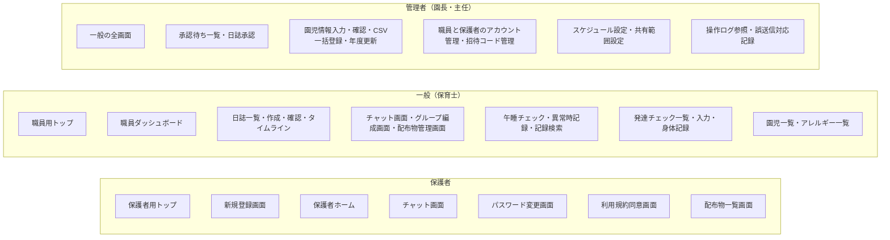

# すくすくシステム 基本設計書

関係者外秘

| 項目 | 内容 |
| :-- | :-- |
| 対象システム | 保育支援システム「すくすくシステム」 |
| 版数 | 第 2.7 版 |
| 作成日 | 2026 年 8 月 29 日 |
| 作成 | Hive-Five Developers |
| 作成区分 | チーム開発演習 基本設計 |

## 改訂履歴

| 版 | 年月日 | 変更内容 |
| :-: | :-: | :-- |
| 2.7 | 2026/10/09 | **画面詳細図の項目表とモックアップの実画面の突き合わせで決めた扱いのうち、本書の記述と食い違うものを改めた**（`図/画面詳細図.md` 第1.14版）。CSV一括登録は、エラー行が1行でもあれば1件も登録しない（4-4）。性別の空欄はエラーとする（4-4）。定型文は本文の末尾へ足す（4-5）。保護者への共有を選べるのは個人日誌だけとし、ヒヤリハットは共有の対象外とする（4-5） |
| 2.6 | 2026/10/09 | **モックアップで仮に置いていた扱いを、設計として確定した。** 管理側のペルソナのデモと PR #92 の評価で見つけた指摘（GitHub Issue #95〜#129）を直すときに、設計に定めが無く `web/仮置き値.md` に置いていた20項目である。いまのモックアップの動きを正とした。該当する節へ書き足した：「職員の情報の変更」(4-3) を新設、「園児情報の登録・編集」(4-4)、「CSV一括登録」(4-4)、「日誌の作成から保護者への共有」(4-5)、「編集ロックの解除」(4-5)、「メッセージの送受信」(4-6)、「誤送信への対応」(4-6)、「午睡チェックの実施」(4-7)、「入力項目の制約値」(4-9)、「招待コード」(5-2)、「操作ログ」(5-8)。**園の運用で変わりうる3件は演習上の想定**とし、`要決定事項.md`「演習上の想定として置いたもの」(1-1) に足した |
| 2.5 | 2026/10/09 | **管理側のペルソナのデモで残っていた設計の穴を決めた（GitHub Issue #69・#111・#115）。** ①「ログイン」(4-3) に、**ログインの失敗と、失敗が続いたことによるロックを操作ログへ記録する**ことを足した。成功は記録しない。②「アカウントの停止と再開」(4-3) を新設し、**管理者はほかの管理者も停止できる**（自分自身は停止できない）ことを書いた。③「成長曲線基準値」(5-7) を、**仮の値ではなく厚生労働省の公表値を投入する**扱いへ改めた。月齢への当て方（2歳以上は6か月ごとの公表値を補間する）を定めた |
| 2.4 | 2026/10/06 | **「園からの配布物」を加えた（GitHub Issue #94）。** 要件定義書 第2.13版の2機能に対応する。①「画面の一覧」(3-2) に配布物管理画面と配布物一覧画面（保護者）を足し、**画面は36から38**になった。②「チャットツール」(4-6) に「配布物の掲載と閲覧」を新設した。③「チャット」(5-5) に配布物（`t_handout`）を足し、**テーブルは38から39**になった。メッセージの種別に「4:配布物の掲載」を加えた。④「設定マスタ」(5-8) に `handout.allowed_types` を、「入力項目の制約値」(4-9)・「メッセージ一覧」(4-9)・権限一覧 (6-1) に配布物の行を足した |
| 2.3 | 2026/10/06 | **ペルソナのデモとモックアップの実装で見つかった設計の穴8件を決着させた。** ①日誌（`t_diary`）に差し戻す理由の列 `returned_reason` を足した（GitHub Issue #57）。②発達チェック（`t_development_check`）に所見の列 `note` を足し、**所見は園内限定とし保護者へ共有しない**と定めた（#58）。③クラス（`m_class`）に年齢児の列 `age_class` を足し、午睡チェックの間隔をそこから引くと定めた（#59）。④**クラス日誌・週案月案は保護者への共有の対象外**とし、承認画面に共有の選択肢を出さないと定めた（#61）。⑤「設定マスタ」(5-8) に園の名称と電話番号を足し、保護者向けの緊急連絡の案内に番号を出すと定めた（#88）。⑥「パスワードの要件」(6-3) に、**現在と同じパスワードへの変更を認めない**規定を足した（#89）。⑦「チャット」(5-5) に、**後から登録した保護者には登録より前の個人チャットのやりとりを見せない**規定を足した（#90）。⑧同じく、**続柄を職員側のメンバー一覧に出す**ことと、保護者の参加を通知しないことを定めた（#91）。理由は `ナレッジ/決定事項.md` に置いた |
| 2.2 | 2026/10/05 | **「画面基本構成」(3-5) に「想定する端末と向き」を新設した。** 端末の種類（タブレット／PC／スマートフォン）は定めていたが、**タブレットの向きと PC での見せ方はどの文書にも無かった。** 職員のタブレットは横向きを基本とし、縦向きでも横向きと同じ構成で使えること（縦1列へ積み直さない）、PC ではタブレット横向きの縦横比のまま中央に表示し専用のレイアウトを持たないこと、列の多い一覧はその領域の中だけを横に送ることを規定した。演習上の想定である |
| 2.1 | 2026/09/09 | **「メッセージの編集」(4-6) に「編集できる人」の表を設け、チャンネルによらず編集できることを明記した。** 園チャットに限り管理者同士でも編集できる例外を新設（園全体への発信は園としての意思表示であり、発信者個人のものではないため）。あわせて、既読が付いたあとも編集できること、日誌・発達記録を共有したメッセージは添え書きの本文だけを編集できること、誰が編集したかは画面に出さず操作ログで辿ることを規定した。権限一覧「メッセージの編集・送信取消」(6-1) の※6も同じ内容に直した |
| 2.0 | 2026/09/08 | **「チャットツール」(4-6) に「メッセージの編集」を追記した。** `t_chat_message` の `edited_at` 列、権限一覧「メッセージの編集・送信取消」(6-1)、`インタフェース一覧.md` の編集API は既にあったが、対応する処理内容が本文に無かった。送信者本人のみ・回数と期限の制限なし・編集前の本文は操作ログへ記録・「編集済み」の印を双方に表示、を規定した |
| 1.9 | 2026/09/07 | **未確定事項をすべて決着させ、【要決定】表記を本文から消した。** 「データ保護」(6-3) に認証情報の保持方式・CSRF対策の方式・パスワードの要件・日付と時刻の扱いを追加。「入力項目の制約値」(4-9) と「設定マスタ」(5-8) の既定値を新設し、桁数・範囲・必須を1か所へ集約した。**チャット画面を職員用・保護者用に分け、共有日誌閲覧画面を加えたため画面は34画面から36画面に、同意履歴（t_terms_agreement）を加えたためテーブルは38になった。** 添付の保存先・操作ログの形式・PDF生成・確認画面の範囲・個人チャットのルーム単位・職員チャットの構成・チャンネルの使い分け・年度更新の取り消し・卒園児の保護者の参照範囲・緊急連絡先の項目を確定。「共通の処理」(4-2) から新設の `図/インタフェース一覧.md` を参照する |
| 1.8 | 2026/09/01 | 「要決定事項」(7) から**件数の記載（全50件）を外した**。件数は `要決定事項.md` の側で増減するため、参照側が数を持つと必ずずれる。要件定義書 第2.10版と同じ扱いとする |
| 1.7 | 2026/09/01 | 「画面詳細」(3-6) を `図/画面詳細図.md` 第1.2版に合わせた。同図が**全36画面をそろえた**ため、対象が14画面である旨の記述と、残りの着手順への案内を差し替えた。あわせて、同図の節の並びが本書「画面の一覧」(3-2) の順に整ったことを明記した |
| 1.6 | 2026/09/01 | **「画面詳細」(3-6) の担当範囲を書き直した。** 同項は `図/画面詳細図.md` を「項目を持つ側」と書き、同図は本書を「項目を持つ側」と書いており、**相互に相手を正とする循環参照**になっていた。項目の一覧は同図が正と定め、本書はエラー文言（「メッセージ一覧」(4-9)）とデータ型・桁（「テーブル定義」(5)）を担うことを明記した。あわせて、同図が画面イメージと項目表を対にする様式へ改まったこと（同図 第1.1版）を反映した |
| 1.5 | 2026/09/01 | 第1.4版で「画面詳細」(3-6) に「全36画面」と書いたが、`図/画面詳細図.md` 第1.0版の対象は**14画面**である。記述を訂正した |
| 1.4 | 2026/09/01 | **「画面詳細」(3-6) を `図/画面詳細図.md` 第1.0版へ独立させた。** 本書にあったのは主要5画面のみで、学校提供テンプレート「(PRGDE004)06_基本設計書_画面詳細_2.0.2」の様式（番号／表示名／部品種別／補足）とも合っていなかった。同図で**全36画面と共通部品**をテンプレートの様式へ拡張し、本書は担当範囲の切り分けと参照に改めた。「画面遷移」(3-4) を独立させたのと同じ扱いとする |
| 1.3 | 2026/09/01 | **入口を分ける実装方式と、同時ログインの扱いを反映した。** ①「システムの利用方法」(2-2) に、入口の分岐を **URL のパス**（職員用 `/staff/...`／保護者用 `/parent/...`）で行うこと、ログイン後の遷移先をサーバー側でロール判定して決めること、フロントエンドはロール確定後に該当系統だけを読み込むこと（コード分割）を追記した。サブドメインでは分けない。②「ログイン」(4-3) に、**ログイン中は系統・アカウントを問わず新しいログインを成立させない**規定を反映した（要件定義書 第2.4版「同時ログインの扱い」(4-1-1)）。上書きログインは設けない |
| 1.2 | 2026/09/01 | **未確定事項の一覧を `要決定事項.md` に一本化した。**「要決定事項」(7) が持っていた14件の表を削除し、同書への案内に置き換えた。要件定義書と同じ扱いとする |
| 1.1 | 2026/09/01 | 「画面遷移」(3-4) の遷移図を `図/画面遷移図.md` 第1.0版へ移し、本書は前提の記述と参照に改めた。同図でチャットツールの遷移を補った |
| 1.0 | 2026/08/29 | 新規作成。`要件定義書.md` 第2.1版の全73機能を対象に、学校テンプレートの章構成へ沿って作成した。`基本設計書（身体記録のみ）.md` 第5.1版の内容を該当章へ取り込み、同書を退役させた |

## 目次

| 章 | 内容 |
| :-- | :-- |
| [1 はじめに](#1-はじめに) | 本書の目的・対象読者・参照元・表記ルール |
| [2 システムの概要](#2-システムの概要) | システムと業務の関係、システムの利用方法 |
| [3 ユーザインターフェイス設計](#3-ユーザインターフェイス設計) | 画面の洗い出し、画面体系、画面遷移、画面基本構成、画面詳細 |
| [4 機能概要](#4-機能概要) | 機能一覧と処理詳細、メッセージ一覧 |
| [5 データベース設計](#5-データベース設計) | テーブル定義、データ関係図 |
| [6 セキュリティ設計](#6-セキュリティ設計) | 権限と利用可能機能、データ保護と監査 |
| [7 要決定事項](#7-要決定事項) | 未確定事項の一覧（`要決定事項.md`）への案内 |

---

# 1 はじめに

## 1-1 本書の目的

本書は `要件定義書.md` 第2.1版に基づき、すくすくシステムの**画面・処理・データ構造・権限**を規定する。要件定義書が「何を満たすか」を定めるのに対し、本書は「**どう作るか**」を定める。

## 1-2 対象読者

| 読者 | 本書の使い方 |
| :-- | :-- |
| チームメンバー（実装担当） | 担当機能の画面・処理・テーブルの仕様として参照する |
| 先生（発注者役） | 要件が設計に落ちているかの確認に用いる |

## 1-3 参照元ドキュメント

| 文書 | 版 | 本書との関係 |
| :-- | :-- | :-- |
| `要件定義書.md` | 第2.1版 | **本書の唯一の上位文書。** 要件について食い違う場合は要件定義書を正とし、本書を追随させる |
| `図/ER図.md` | 第1.0版 | 5章のテーブル定義の根拠。エンティティと関連はこちらが持つ |
| `図/ユースケース図.md` | 第1.1版 | 6章の権限マトリクスの根拠 |
| `図/アクティビティ図.md` | 第1.1版 | 4章の処理詳細の根拠 |
| `図/画面遷移図.md` | 第1.1版 | 「画面遷移」(3-4) の別紙。画面のつながりはこちらが持つ |
| `図/画面詳細図.md` | 第1.4版 | 「画面詳細」(3-6) の別紙。**1画面の中身はこちらが持つ**（全38画面） |
| `図/画面ID対応表.md` | 第1.0版 | 学校テンプレートが求める `n-n-n-n` 形式の画面IDと画面名の対応。**提出時に添える** |

> **退役させた文書**：`基本設計書（身体記録のみ）.md` 第5.1版。身体記録パートの内容は本書の該当章へ取り込んだ。**要件定義書と同じく、正を1本に絞る**方針による。内容は git 履歴に残る。

## 1-4 表記ルール

- **機能・画面は番号ではなく名前で呼ぶ。** `SCR-nnn` `FUN-nnn` のような番号体系は廃止済みであり、本書で新たに採番しない（`CLAUDE.md` の方針）
- 要件定義書の項目を参照するときは**名前を主・番号をカッコで併記**する。例：「招待コードの発行」(4-1-2)
- 機能名は**要件定義書の機能表の名称と一致させる**。設計側で言い換えない
- **2026/09/07 をもって、値や方式が未確定の事項は無い。** 本文には決まった内容が書いてある。**実在の園へのヒアリングを行っていないため「演習上の想定」として置いたもの**は、その旨を該当の記述に添えてある（一覧は `要決定事項.md`「演習上の想定として置いたもの」(1-1)）
- 変更箇所は改訂履歴に記す。本文中で色分けはしない（Markdown のため）

> **学校テンプレートの画面ID**：テンプレートは `n-n-n-n`（機能大分類-機能小分類-画面番号-権限）形式の画面IDを求めている。本書は上記のとおり名前で呼ぶ方針のため採番しない。**提出時は `図/画面ID対応表.md` を添えて様式を満たす**（2026/09/07 作成、全36画面）。**画面IDは同書だけが持つ。** 本書を含む他の文書には書かない。書くと、画面が増減したときに直す場所が増えるため。

---

# 2 システムの概要

## 2-1 システムと業務の関係

保育士の1日の業務のうち、本システムが担う範囲を示す。**システムは記録と共有を担い、判断と保育そのものは人が行う。**

| 時間帯 | 業務 | 本システムの関わり |
| :-- | :-- | :-- |
| 登園時 | 受け入れ、視診 | ―（登降園管理は対象範囲外） |
| 午前 | 保育、活動 | 日誌の下書きを随時入力する |
| 午睡 | 午睡の見守り | **午睡チェック**を開始し、規定の間隔で体位・体調を記録する。異常があれば記録し管理者へ通知する |
| 午後 | 保育、活動 | 発達チェック・身体測定を予定に応じて入力する |
| 降園時 | 引き渡し、連絡 | 保護者との連絡は**チャットツール**の個人チャットで行う。緊急連絡は電話 |
| 退勤前 | 日誌の仕上げ | 日誌を**承認申請**する。管理者が承認し、保護者への共有を指定する |
| 随時 | 園全体の連絡 | 園チャット・グループチャットで共有する |

**業務フローの詳細**は `図/アクティビティ図.md` が11業務分を保持する。本書はそれを前提とし、再掲しない。

## 2-2 システムの利用方法

| 利用者 | デバイス | 入口 | 主な操作 |
| :-- | :-- | :-- | :-- |
| 管理者（園長・主任） | タブレット／PC | 職員用トップ | 日誌の承認・差し戻し、アカウントの発行、園児マスターの管理、全クラスの記録の閲覧、操作ログの参照 |
| 一般（保育士） | タブレット／PC | 職員用トップ | 日誌の作成・申請、午睡チェック、発達チェック・身体測定の入力、自クラスの記録の閲覧 |
| 保護者 | スマートフォン | 保護者用トップ | 個人チャットでの連絡、共有された自児の記録の閲覧 |

- **入口は保護者用と職員用の2系統**に分かれる（要件定義書「アプリのログイン」(4-1-1)）。ロールの判定は入口ではなくアカウントで行い、誤った系統では認証を成立させない
- **入口の分岐は URL のパスで行う。** 職員用を `/staff/...`、保護者用を `/parent/...` とする。**サブドメインでは分けない**（DNS・TLS 証明書・Cookie ドメインの設計が要り、「本演習での動作検証環境」(要件定義書 6-2) の localhost で動かせなくなるため）。バックエンド・データベース・認証基盤・園児マスターは両系統で共通とし、別アプリケーション・別コードベースにはしない
- **ログイン後の遷移先は、サーバー側でアカウントのロールを判定して決める。** フロントエンドの画面出し分けに依存させない。画面の出し分けは表示の制御であって権限制御ではないため、各処理での権限の判定は「共通の処理」(4-2) に従って毎回行う
- **フロントエンドは、ロールが確定してから該当する系統の画面を読み込む**（コード分割）。保護者の端末へ職員用画面を配信しない。利用者が自分に関係のない導線を目にしないようにするという入口を分ける目的（要件定義書「アプリのログイン」(4-1-1)）を、配信されるコードの範囲でも満たすため
- 職員が利用する全画面のヘッダに、**ログイン中の職員名を常時表示する**。共有端末での記録者の取り違えを防ぐため（同「端末の利用形態と本人特定」(4-1-4 (4))）
- 職員向け画面は無操作が続くと自動ログアウトする。ただし**午睡チェックの実施中は対象外**とする

---

# 3 ユーザインターフェイス設計

## 3-1 画面の洗い出しの考え方

要件定義書の75機能から画面を導く。**1機能＝1画面ではない。**

| 関係 | 例 |
| :-- | :-- |
| 複数の機能が1つの画面に載る | チャットツールの10機能は、ほぼ**チャット画面**の中で完結する（チャンネル切り替え・送受信・リアクション・既読確認） |
| 1つの機能が複数の画面に分かれる | 「園児情報の登録・編集」は、**一覧→入力→確認**の流れになる |
| 機能に画面が対応しない | 「ログイン情報の記憶」はログイン画面のチェックボックスであり、独立した画面を持たない |

**画面として起こす基準**を次のとおり定める。

1. **利用者が明示的に遷移して操作を始める単位**を1画面とする
2. 入力を伴う登録・編集は、テンプレートの流儀に従い**入力→確認**の段階を設ける。ただし**連続入力を前提とする操作は確認画面を挟まない**（午睡チェックの体位記録、身体測定の連続入力）。1件ごとに確認を挟むと現場の運用に耐えないため
3. ダイアログで足りるものは画面として起こさない（PDF出力の条件指定など）

**確認画面を独立した画面として設けるのは、次の2つだけとする。**

| 画面 | 設ける理由 |
| :-- | :-- |
| 園児情報確認画面 | 園児マスターの誤りは**全機能へ波及する**。クラス・生年月日を間違えると、参照範囲・月齢・発達チェックの区分がすべてずれる |
| 日誌確認画面 | 申請すると**管理者の承認の列に載り、承認後は保護者へ共有されうる**。取り消しの手間が本人の外へ及ぶ |

**それ以外は確認画面を設けない。** 基準2のとおり、連続入力を前提とする操作（午睡チェック、身体測定、発達チェック）に1件ごとの確認を挟むと現場の運用に耐えない。マスタの設定変更やアカウントの操作は、**取り消しが本人の操作だけで完結する**ため、保存前の確認ダイアログで足りる。

> 年度更新だけは例外で、**画面の中に確認の段階を持つ**（対象件数を示してから実行する）。影響が全園児・全保護者に及ぶが、独立した確認画面にすると年度更新画面が2画面に割れて流れが分かりにくくなるため。

## 3-2 画面の一覧

**共通・認証**

| 画面名 | 概要 | 利用者 |
| :-- | :-- | :-- |
| 保護者用トップ | 保護者用の入口。ログインと新規登録の導線を置く | 未ログイン（保護者） |
| 職員用トップ | 職員用の入口。ログインの導線のみを置く。**新規登録は置かない** | 未ログイン（職員） |
| 新規登録画面 | 招待コードの入力、利用規約への同意、アカウント情報の入力 | 未ログイン（保護者） |
| パスワード変更画面 | 一時パスワードでのログイン後、および任意の変更時 | 全ロール |
| 利用規約同意画面 | 規約の改定時に次回ログインで表示する | 全ロール |
| 職員ダッシュボード | 通知・未対応件数・各機能への導線 | 管理者・一般 |
| 保護者ホーム | 自児の情報、共有された記録とチャットへの導線 | 保護者 |
| 共有日誌閲覧画面 | 共有された日誌を1件ずつ読む。**保護者専用の読み取り画面** | 保護者 |

**日誌システム**

| 画面名 | 概要 | 利用者 |
| :-- | :-- | :-- |
| 日誌一覧画面 | 日誌の検索・絞り込み、ステータス別の表示 | 管理者・一般 |
| 日誌作成・編集画面 | 雛形選択、本文・定型文・写真の入力、下書き保存、承認申請 | 管理者・一般 |
| 日誌確認画面 | 申請前の内容確認 | 管理者・一般 |
| 承認待ち一覧画面 | 申請日・クラス・作成者とともに一覧表示 | 管理者 |
| 日誌承認画面 | 内容の確認、承認／差し戻し、**保護者への共有の指定** | 管理者 |
| 園児タイムライン画面 | 特定の園児の過去の記録を時系列で表示 | 管理者・一般 |

**チャットツール**

| 画面名 | 概要 | 利用者 |
| :-- | :-- | :-- |
| チャット画面（職員） | チャンネル一覧・メッセージ領域・メンバー一覧を**同一画面に並べる**（タブレット／PC）。送受信・リアクション・編集・取消・既読確認・未対応スレッドの切り替えを内包する | 管理者・一般 |
| チャット画面（保護者） | シングルカラム（スマートフォン）。**チャンネル一覧と会話を同じ画面の中で入れ替えて表示する**。既読の人数は表示しない | 保護者 |
| グループ編成画面 | 目的別グループの作成とメンバーの編成 | 管理者・一般 |
| 誤送信対応記録画面 | 誤送信の発生日時・対象・既読の有無・とった対応を記録する | 管理者 |
| 配布物管理画面 | 園だより・献立表などの配布物の一覧、掲載、取り下げ。**掲載と取り下げは管理者のみ**。一般は閲覧のみ | 管理者・一般 |
| 配布物一覧画面（保護者） | 配布物を月ごとにまとめて並べ、開いて読む。種類で絞り込める | 保護者 |

**チャット画面を職員用と保護者用の2画面として数える。** 機能は同じだが、**レイアウトが根本的に違う**（3ペインとシングルカラム）ため、1つの画面定義に収めると表示項目・操作の記述が「職員のときは／保護者のときは」の羅列になる。既読の人数を保護者に見せない扱い（「チャット」(5-5)）も画面ごとに書けるほうが明確である。

**保護者側は、チャンネル一覧と会話を画面の中で入れ替える。** 別々の画面には分けない。シングルカラムでも**戻る操作で一覧へ帰るだけ**であり、画面を分けても表示項目は増えない。分けると画面数と図の分量が増えるだけになる。

**午睡チェック**

| 画面名 | 概要 | 利用者 |
| :-- | :-- | :-- |
| 午睡チェック画面 | 実施の開始・終了、タイマー、クラス全体の状況、園児ごとの体位・体調の記録を1画面で行う | 管理者・一般 |
| 異常時記録画面 | 発見時刻・状況・とった対応の記録。ヒヤリハットの起票の導線を置く | 管理者・一般 |
| 午睡記録検索画面 | 日付・園児名・クラスでの検索と履歴の閲覧 | 管理者・一般 |

**発達チェック・身体測定**

| 画面名 | 概要 | 利用者 |
| :-- | :-- | :-- |
| 発達チェック一覧画面 | クラス単位で園児と次回予定日・未実施を表示。チェック漏れを強調する | 管理者・一般 |
| 発達チェック入力画面 | 月齢に応じたチェックリストの入力、所見の記述、過去記録との比較 | 管理者・一般 |
| スケジュール設定画面 | 園児単位の推奨スケジュールの上書き | 管理者 |
| 身体記録画面 | 測定値の登録・修正、成長グラフ、実施状況の確認 | 管理者・一般 |
| 共有範囲設定画面 | 項目ごとの保護者への共有可否の設定 | 管理者 |

**園児マスター・アカウント管理**

| 画面名 | 概要 | 利用者 |
| :-- | :-- | :-- |
| 園児一覧画面 | 園児の検索・絞り込み | 管理者・一般（閲覧のみ） |
| 園児情報入力画面 | 園児情報の登録・編集 | 管理者 |
| 園児情報確認画面 | 登録・編集内容の確認 | 管理者 |
| CSV一括登録画面 | ファイルの選択、取込内容とエラー行の確認 | 管理者 |
| アレルギー一覧画面 | アレルギーが登録された園児の一覧。**全園児が対象**。印刷に対応する | 管理者・一般 |
| 年度更新画面 | 更新内容の一覧確認と実行 | 管理者 |
| 職員アカウント管理画面 | 職員アカウントの発行・停止、一時パスワードの再発行、ロックの解除 | 管理者 |
| 招待コード管理画面 | 招待コードの発行・一括発行・失効、使用状況の確認、配布用の出力 | 管理者 |
| 保護者アカウント管理画面 | 紐づけの解除、アカウントの停止、未同意者の確認 | 管理者 |
| 操作ログ参照画面 | 日付・操作者・対象機能・対象園児での絞り込みと出力 | 管理者 |

**画面数：38**（共通・認証8／日誌6／チャット6／午睡3／発達・身体5／マスター・管理10）

## 3-3 画面体系図

利用者種別ごとに、利用できる画面を示す（遷移ではなく所属）。

- 管理者は**一般の全画面**を利用でき、加えて承認・マスター管理・アカウント管理・監査の画面を持つ
- 保護者が利用する画面は**8画面のみ**（配布物一覧画面を含む。保護者用トップ・新規登録画面・保護者ホーム・チャット画面（保護者）・共有日誌閲覧画面・パスワード変更画面・利用規約同意画面）
- **共有された日誌は専用の閲覧画面で読む。** チャット画面の中で完結させる案も採りうるが、日誌は本文が長く、写真も伴う。会話の流れの中に混ぜると**読みづらく、後から探せない**。保護者ホームからも同じ画面へ入れるようにし、**チャットを遡らずに記録へ届く**導線を確保する
- **きょうだいが在籍する保護者には、園児を切り替える操作を設けない。** 保護者ホームに**園児ごとの区画を縦に並べて同時に見せる**。個人チャットも園児単位で作るため（「チャット」(5-5)）、チャンネル一覧に園児の数だけ並ぶ。切り替え式にすると、**いま誰の情報を見ているのかを取り違える**恐れがあり、連絡帳を取り違えるのと同じ事故につながる。在籍する園児は多くて数名であり、並べて置いても画面が破綻しない

## 3-4 画面遷移

画面と画面のつながりは **`図/画面遷移図.md`** が保持する。同図は共通・認証／日誌システム／チャットツール／午睡チェック／発達チェック・身体測定／園児マスター・アカウント管理の6区分に分けて図示し、あわせて遷移元・操作・遷移先の一覧表を持つ。**学校テンプレートが別紙として求める画面遷移図にあたる。**

本書の他の章と結びつく遷移の前提を、次のとおり定める。

- **ログアウトの遷移先は、ログインしていた系統のトップ**（要件定義書「アプリのログイン」(4-1-1)）
- 一時パスワードでのログイン時と規約の改定後の初回ログイン時は、**変更・同意を完了するまで他の画面へ進めない**
- **午睡チェック画面は開いたまま運用する。** 実施中は他画面への遷移を前提とせず、自動ログアウトの対象外とする
- 入力→確認の段階を設けるのは**園児情報の登録・編集のみ**。連続入力を前提とする午睡チェック・身体測定・発達チェックは確認を挟まない（「画面の洗い出しの考え方」(3-1) の基準2）
- チャンネルの切り替え・PDF出力の条件指定など、ダイアログで足りるものは画面として起こさない（同基準3）

## 3-5 画面基本構成

全画面に共通するレイアウトを定める。

| 領域 | 内容 |
| :-- | :-- |
| ヘッダ | システムロゴ、**ログイン中の利用者名**（職員は所属クラスも表示）、通知アイコンと未対応件数、ログアウト |
| サイドナビゲーション（職員のみ） | 各機能への導線。現在地を視覚的に強調する |
| メインコンテンツ | 各画面の表示・入力領域 |
| フッタ（保護者のみ） | **「緊急のご連絡はお電話でお願いします」と、園の電話番号を常時表示する。** 番号は押すと電話をかけられるリンクにする |

**緊急連絡の案内は、保護者向けの全画面に常時置く。**

- 本システムの通知は**画面を開いたときに見えるもの**であり、届くことを保証しない（要件定義書「通知の到達性」）。**到達を保証しない経路に緊急の連絡を載せない**という原則を、画面の仕様として担保する
- 保護者は「園に連絡する手段＝このアプリ」と受け取りやすい。**その場で電話へ切り替えられる案内が要る**。そのため案内には**園の電話番号を添える**。番号は設定マスタの `facility.phone_number` から引く（「設定マスタ」(5-8)）。番号が未設定のあいだは、案内の文言だけを出す
- 職員向け画面には置かない。職員は園内にいて、電話が緊急の手段であることを運用として知っているため

| 項目 | 規定 |
| :-- | :-- |
| テーマカラー | 優しい黄色（要件定義書「コンセプトとターゲット層」(1-1)） |
| 警告色 | 黄色と対比の付く色を用いる。午睡チェックの異常、範囲外の入力値に使う |
| グリッド | 職員（タブレット／PC）＝12カラム。保護者（スマートフォン）＝シングルカラム |
| タップ領域 | **44×44px 以上**を確保する。タブレットでの操作を前提とするため |
| 免責表示 | 成長グラフ・発達チェックの比較表示には「判定・診断を行うものではありません」を**常時表示**する。スクロールしても視界から外れない位置に固定する |

- **ログアウトの導線**：職員はヘッダに常時表示する（共有端末での担当交代に用いるため）。保護者はメニュー内に置く
- **通知からの導線**：ヘッダの通知は**未対応の総件数**を示し、押すと職員ダッシュボードの「未対応」へ移る。**各項目から該当画面へ入る導線は、ダッシュボードの側が持つ**（差し戻された日誌 → 日誌一覧、未読のチャット → チャット画面、発達チェックの未実施 → 発達チェック一覧、ヒヤリハット未起票 → 異常時記録画面）。ヘッダに項目ごとの一覧を出すと、**全画面に載る部品が重くなり、午睡チェック中の画面でも視線を奪う**。保護者側は項目が実質チャットだけであるため、通知から直接チャット画面へ移る
- **保護者向け画面はサイドナビゲーションを持たない。** 片手操作を前提とし、ホームからの導線に絞る

### 想定する端末と向き

| 利用者 | 端末 | 向き | レイアウトの扱い |
| :-- | :-- | :-- | :-- |
| 職員（管理者・一般） | タブレット | **横向きを基本とする。縦向きでも使う** | **横向きを基準に組む。** 縦向きでも構成を変えず、各領域の幅だけを詰める |
| 職員（管理者・一般） | PC | ― | **タブレット横向きの縦横比のまま、画面の中央に表示する。** PC 専用のレイアウトは持たない |
| 保護者 | スマートフォン | 縦向き | シングルカラム |

- **縦向きでも、横向きと同じ構成で使えるようにする。** ヘッダ・サイドナビゲーション・メインコンテンツの配置と、各画面の中の領域の並びを、向きによって変えない。チャット画面（職員）の3つの領域（チャンネル一覧・メッセージ領域・メンバー一覧）も、身体記録画面の2つの領域（園児の選択・記録）も、**縦1列へ積み直さず横に並べたままとする**
  - 理由：午睡チェックでタブレットを立てて置く、片手で持って縦にする、といった場面がある。**向きを変えるたびに配置が変わると、操作する場所を探し直すことになる**
- **縦向きで詰めてよいのは幅と余白だけである。** サイドナビゲーションの幅・メインコンテンツの余白・各領域の幅を狭める。**タップ領域（44×44px 以上）と文字の大きさは変えない**
- **列の多い一覧は、その一覧の領域の中だけを横に送る。** 画面全体を横にスクロールさせない。ヘッダとサイドナビゲーションが視界から外れるのを防ぐため
- **PC では横幅いっぱいに広げない。** タブレット横向きの縦横比を上限として中央に置き、左右は余白とする。職員が使う画面を1つに保ち、**端末によって見え方が変わる箇所を増やさない**ため。PC 専用のレイアウトを別に持つと、設計・実装・テストの対象が画面数の分だけ増える
- 縦横比の基準は **iPad の横向き（1180×820）** とする
- **職員向けにスマートフォンのレイアウトは用意しない**（「チャット」(5-5)）
- **演習上の想定である。** 園で実際に使う端末の機種と、縦向きで使う場面がどの程度あるかは、導入時に園へ確認して確定する

## 3-6 画面詳細

**各画面の画面イメージと項目の一覧は `図/画面詳細図.md` に定める。** 本書は画面の一覧・体系・基本構成までを担い、**1画面の中身は同図が正**である。

| 文書 | 担当する範囲 |
| :-- | :-- |
| 本書「画面の一覧」(3-2)・「画面体系図」(3-3)・「画面基本構成」(3-5) | どんな画面があるか、誰が使うか、共通のレイアウト |
| `図/画面遷移図.md` | 画面と画面のつながり |
| `図/画面詳細図.md` | **1画面の中に何があるか**。画面イメージと項目表（番号／表示名／部品種別／補足）を**対にして**持つ |
| 本書「メッセージ一覧」(4-9)・「テーブル定義」(5) | エラー時に出す文言と、データ型・桁 |

同図は共通レイアウト2種と各画面の記述を持つ。**「画面の一覧」(3-2) の全38画面がそろっている**。同図の節の並びも同項の順に合わせてある。**制約値の反映・要確認事項の解消・画面ID対応表の作成・スクリーンショットへの差し替えは、いずれも 2026/09/07 に完了した**（同図「残る作業」(10)）。

- **入力項目の制約値（桁数・必須・形式）は「入力項目の制約値」(4-9) が一括して定める。** 同図の各画面はそれを参照する。画面ごとに別の値を置かない
- 画面イメージは**実装したモックアップのスクリーンショット**である（2026/09/07 に等幅テキストのワイヤーフレームから差し替えた）。**項目表が仕様の正**であり、スクリーンショットは実装の現状を示す。食い違えば実装を直す
- 画面IDは採番せず画面名で呼ぶ。学校提供テンプレート「(PRGDE004)06_基本設計書_画面詳細_2.0.2」が求める `n-n-n-n` 形式は、提出時に `図/画面ID対応表.md` を添えて満たす（2026/09/07 作成、全36画面）

## 3-7 一覧表示とページング

| 一覧 | 方針 |
| :-- | :-- |
| クラス別の園児一覧 | **ページングなし**（1クラス最大30名程度）。連続入力の作業性を優先する |
| 日誌一覧・午睡記録検索 | ページングあり。既定は50件 |
| 過去測定値一覧 | 直近12件を既定表示し、以降は追加読み込み。年2〜4回の測定で3〜6年分に相当する |
| 操作ログ | ページングあり。既定は100件 |
| チャットのメッセージ | 直近から遡って追加読み込みする |

---

# 4 機能概要

## 4-1 記載ルール

機能ごとに **＜利用タイミング＞＜処理内容＞** を記す。処理内容は「**画面表示 → 利用者の操作 → システム内処理 → 画面表示**」の順で書く。

- 機能名は `要件定義書.md` の機能表の名称と**一致させる**。設計側で言い換えない
- 全機能に共通する扱い（権限・操作ログ・同時編集・時刻）は「共通の処理」(4-2) に一度だけ書き、各機能では参照する
- 入力値の検証で表示する文言は「メッセージ一覧」(4-9) に集約する

## 4-2 共通の処理

**画面とサーバの間のインタフェース**

経路の一覧・やり取りするデータの項目・エラーの返し方は **`図/インタフェース一覧.md`** が保持する。同書は**経路89件と、データの項目定義33件**を持つ。

- **項目名・型まで定める。** フロントエンドとバックエンドを並行して作るための取り決めであり、両者はこの一覧だけを見て相手の実装を待たずに作れる
- 項目名は「データベース設計」(5) の物理名と一致させる。**画面のために別の名前を付けない**
- エラーはすべて同じ形で返し、状態コードの使い分けを揃える。**権限または参照範囲の外は、存在しない場合と同じ文言にする**（あるかどうかを推測させないため）

**権限と参照範囲の判定**

すべての機能の入口で、**バックエンドが**次を判定する。フロントエンドの画面の出し分けには依存しない（要件定義書「権限チェック」(8 No.2)）。

1. ログイン済みか。未ログインなら拒否する
2. 操作しようとしている機能が、そのロールに許可されているか
3. 対象の園児が参照範囲に入っているか

**参照範囲の判定は園児単位で行う。** 記録が作られた年度では判定しない。

| ロール | 参照できる園児 |
| :-- | :-- |
| 管理者 | 全園児・全年度 |
| 一般 | 現在の担任クラスに在籍する園児。**その園児の過年度の記録も参照できる** |
| 一般（引き継ぎ猶予期間中） | 上記に加え、前年度に担任していたクラスの在籍園児。**閲覧のみ** |
| 保護者 | 紐づけが有効な自児のみ |

**例外**は2つ。アレルギー情報は一般も全園児を閲覧でき、グループチャットの過去ログは「そのグループに所属していたか」で判定する。

**操作ログの記録**

作成・変更・承認・削除・**出力**の各操作で、共通操作ログへ記録する。

| 項目 | 内容 |
| :-- | :-- |
| 操作者 | ログイン中のアカウント |
| 操作日時 | **サーバの時刻**。端末の時計設定に依存しない |
| 対象 | 機能種別、対象レコード、対象園児 |
| 変更前後の値 | 変更系の操作で保持する。訂正内容を追えるようにするため |
| 出力の情報 | 出力系の操作で、出力種別と対象期間を保持する |

**同時編集の検出**

複数の職員が同じ記録を開く場面があるため、保存時に競合を検出する。

- 開いてから他者による更新があった場合、**上書きせず**「他の職員が更新しています」を表示して再読み込みを促す
- 日誌は編集ロックを用いる。**ロックの取得ごとに一意の識別子を発行し、保存時に照合する**。識別子が一致しない場合は、他者の更新の有無にかかわらず保存を拒否する（管理者による強制解除を検出するため）

**時刻の扱い**

「本日」「現在時刻」の判定は、すべて**サーバの時刻**で行う。利用者の端末の時計設定に依存させない。

---

## 4-3 共通基盤：ログインとアカウント

### ログイン

**＜利用タイミング＞** 利用者がシステムを使い始めるとき。

**＜処理内容＞**

1. 【画面表示】保護者用トップまたは職員用トップを表示する。ログインID・パスワードの入力欄と、ログイン状態を保持するかの選択肢を置く。**ただし、すでにログイン中のセッションがある場合は入力欄を表示せず、ログイン中である旨とログアウトの導線のみを表示する**（要件定義書「同時ログインの扱い」(4-1-1)）
2. 【操作】利用者がログインIDとパスワードを入力し、ログインを押す
3. 【システム内処理】
   - **ログイン中のセッションがあるかを判定する。** ある場合は認証を成立させず、既存のセッションを維持したまま、ログアウトを促して終了する。新しいセッションは作らない
   - アカウントがロック中かを判定する。ロック中なら待機時間または管理者への連絡を案内して終了する
   - ログインIDとパスワードを照合する。失敗した場合は**失敗回数を加算**し、上限に達したら一定時間ログインを受け付けない
   - **アカウントのロールが、使われた入口の系統と一致するかを判定する。** 一致しない場合は認証を成立させず、正しい系統の入口を案内する
   - 一時パスワードでのログインなら、有効期限内かを判定する。期限切れなら管理者への連絡を案内する
   - 同意済みの利用規約が最新版かを判定する。旧版・未同意なら利用規約同意画面へ進める
4. 【画面表示】ロールに応じて職員ダッシュボードまたは保護者ホームを表示する

- 失敗回数・待機時間はマスタ値。**管理者は待機時間の経過を待たずに即時解除できる**
- 一時パスワードの期限切れは、**ログイン試行の制限によるロックとは区別する**。待機時間の経過では解消しない
- 同時ログインの制限は**系統・アカウントを問わず適用**し、職員↔保護者の**両方向で対称**とする。**上書きログイン（新しいログインで前のセッションを置き換える動作）は設けない。** 担当交代の起点をログアウトに統一するため（「ログアウト」(4-3)）
- ログイン中である旨の案内に、**ログイン中の氏名・ロールは表示しない。** 共有端末で前の利用者が誰であったかを第三者に示さないため
- **別の端末・別のブラウザからの同時ログイン（多重セッション）は制限しない。** 上記は同一ブラウザのログイン状態を対象とする。園のタブレットで午睡チェックを開いたまま、事務室の PC で日誌を書くといった使い方は**通常の業務であり、妨げる理由がない**。1アカウント1セッションに絞ると、共有端末で前の利用者のセッションが残っている場合に、正当な利用者が締め出される
- ただし**パスワードを変更したときは、変更した端末以外のセッションをすべて無効化する**（「認証情報の保持方式」(6-3)）。変更する動機の多くは「他人に知られたかもしれない」であり、そのとき他の端末のログインが生き続けるのは目的に反する

- **ログインの失敗と、失敗が続いたことによるロックは、操作ログへ記録する。** 不正な試行に気づくための記録である。**ログインの成功は記録しない。** ログアウトと同じく、誰が記録したかの追跡は各操作の記録で満たされるため（GitHub Issue #115）
  - ログインできていないので、操作者は確かめられない。**操作者の欄には、試されたアカウントを入れる**（本人とは限らない）。記録には、続けて何回目の失敗かを残す
  - **存在しないログインIDへの試行は記録しない。** 操作ログは操作者のアカウントを必須とし、入れる先が無いためである。共用端末で担当が替わるたびに成功の行が増えることも、成功を記録しない理由である

### ログアウト

**＜利用タイミング＞** 利用者が操作を終えるとき。共有端末で担当を交代するとき。

**＜処理内容＞**

1. 【操作】利用者がヘッダ（職員）またはメニュー（保護者）からログアウトを選ぶ
2. 【システム内処理】
   - 保存していない入力があれば、破棄される旨を表示して確認する
   - セッションを無効化する
   - 「ログイン情報の記憶」の保存を破棄する
3. 【画面表示】**ログインしていた系統のトップ**へ戻す

- **ログアウトは操作ログの対象としない。** 誰が記録したかの追跡は各操作の記録で満たされるため
- **午睡チェックの実施中は、先に午睡チェックを終了してからログアウトする**

### 保護者アカウントの自己登録

**＜利用タイミング＞** 保護者が園から招待コードを受け取り、初めて利用を始めるとき。

**＜処理内容＞**

1. 【画面表示】保護者用トップの新規登録から新規登録画面を表示する
2. 【操作】保護者が招待コードを入力する
3. 【システム内処理】コードが未使用かつ有効期限内かを判定する。無効・期限切れ・使用済みならエラーを表示する
4. 【画面表示】利用規約とプライバシーポリシーを表示する
5. 【操作】保護者が同意し、メールアドレス・パスワード・氏名・園児との続柄を入力する
6. 【システム内処理】
   - **メールアドレスが園内で未使用かを判定する。** ロールをまたいで一意である必要がある
   - アカウントを作成し、**コードに紐づく園児と自動的に紐づける**
   - 招待コードを使用済みにする
   - 同意した規約の版と日時を記録する
   - 当該園児のクラスグループへ参加させる
7. 【画面表示】保護者ホームを表示する

- **1枚のコードは1アカウントの登録にのみ使える。** 父母それぞれが登録する場合は、同一園児に対して必要な枚数を発行する
- 同意しなかった場合は**登録を完了せず**、保護者用トップへ戻す

### アカウントの停止と再開

**＜利用タイミング＞** 職員の退職・休職、保護者アカウントの利用を止めるとき。停止を取り消すとき。

**＜処理内容＞**

1. 【操作】管理者が、職員アカウント管理画面または保護者アカウント管理画面で、停止（または再開）を選ぶ
2. 【画面表示】対象の氏名と、停止すると何が起きるかを確認ダイアログに表示する
3. 【操作】管理者が確定する
4. 【システム内処理】アカウントの状態を変え、**誰のアカウントに対する操作かを含めて**操作ログへ記録する

- **管理者は、ほかの管理者（園長を含む）のアカウントも停止できる。** 退職した管理者を止める手段が要るためである。管理者だけを停止の対象から外すと、先に一般へロールを下げてから止める手順が要り、止めるべきときに止められない（GitHub Issue #111）
- **自分自身のアカウントは停止できない。** これにより、管理者が1人も居なくなる状態は作れない
- 管理者を停止するときは、確認ダイアログに**管理者である旨**を示す。押し間違いで承認やアカウント管理を行える人が減ることを防ぐ
- 保護者アカウントは、**有効な紐づけが無いあいだは再開できない**（「クラスと紐づけ」(5-3)。有効な紐づけがゼロになった時点で停止する規則と合わせる）

### 職員の情報の変更

**＜利用タイミング＞** 年度の途中で担任が替わったとき。発行したときのロール・担当クラス・氏名の誤りを直すとき。

- 管理者は、発行済みの職員の**氏名・ロール・担当クラス**を変えられる。変更の前後は操作ログへ記録する
- **職員IDとログインIDは変えない。** 記録の作成者として各所から参照されているため。停止したアカウントのログインIDも、別のアカウントには使えない
- **自分のロールは変えられない。** 管理者が自分を一般へ下げると、戻せる人が居なくなることがある
- 担当クラスの付け替えは**当年度の割り当てだけ**を変える。過年度の割り当ては残す（「クラスと紐づけ」(5-3)）
- 一般（保育士）で担当クラスを割り当てないと、その職員には園児・日誌・チャットが表示されない。発行・変更の画面でその旨を示す

### 保護者と園児の紐づけを戻す

**＜利用タイミング＞** 誤って紐づけを解除したとき。

- 管理者は、**終了した紐づけを有効へ戻せる。** 解除によって停止していたアカウントは、あわせて再開する
- 有効な紐づけが無い保護者アカウントは、**再開の操作では再開できない**（「アカウントの停止と再開」）。紐づけを戻すことで再開する
- 解除・復元とも、どの保護者の紐づけかを操作ログへ記録する

### 一時パスワードの再発行

**＜利用タイミング＞** 利用者がパスワードを忘れたとき。

**＜処理内容＞**

1. 【操作】管理者が職員アカウント管理画面または保護者アカウント管理画面で対象を選び、再発行する
2. 【システム内処理】
   - 一時パスワードを自動生成し、**ハッシュ化して保存する**
   - **その時点で旧パスワードを無効化する**
   - 有効期限を設定する
   - 操作ログへ記録する
3. 【画面表示】生成した値を**1度だけ表示する**。再表示・再閲覧の手段は設けない
4. 【操作】管理者が口頭または手渡しで本人へ伝える

- **管理者自身がパスワードを忘れた場合は、他の管理者が再発行する。** そのため管理者は常に2名以上とする運用要件がある。1名になる操作にはシステムが警告を表示する

---

## 4-4 共通基盤：園児マスターの管理

### 園児情報の登録・編集

**＜利用タイミング＞** 入園時、および登録内容に変更があったとき。

**＜処理内容＞**

1. 【画面表示】園児一覧画面から園児情報入力画面を表示する
2. 【操作】管理者が氏名・生年月日・性別・所属クラス・平熱・写真の利用同意などを入力する
3. 【システム内処理】入力値を検証する（必須・形式・未来日でないこと）
4. 【画面表示】園児情報確認画面に入力内容を表示する
5. 【操作】管理者が確定する
6. 【システム内処理】園児マスターへ保存し、操作ログへ記録する
7. 【画面表示】園児一覧画面へ戻る

- **性別は「男」「女」「未回答」の3値。** 成長曲線の基準値の参照と帳票の出力にのみ用い、機能の出し分けには使わない
- アレルギー・既往歴は要配慮個人情報として別の入力欄で扱う

- **よみ（氏名かな）は必須とする。** 一覧の検索がよみも対象にしているため。CSV一括登録でも同じ
- **アレルギーは、対象を入れたら症状と対応も必須とする。** アレルギー一覧は印刷して配膳の場で使う。対象だけの行を載せない
- **平熱は 30.0〜43.0℃ の外でも登録を妨げず、確認を促す**（「入力項目の制約値」(4-9) の体温と同じ扱い）。入力画面では、いちど確かめてから確認画面へ進める
- **園児IDの重複は、確認画面へ進む前に知らせる。** 入力の誤りは1つずつではなく、まとめて示す
- **園児IDは、使われている番号の次を入力欄に入れておく**（`C001` の形を数える）。園が決めた番号へ書き換えられる。職員IDも同じ
- 確認画面から戻ったとき、**入力した内容を保つ**

### 園児情報の取消（誤登録の削除）

**＜利用タイミング＞** 誤って登録した園児のレコードを取り消すとき。

**＜処理内容＞**

1. 【操作】管理者が園児一覧画面から対象を選び、取消を実行する
2. 【システム内処理】
   - **日誌・午睡チェック・発達チェック・身体測定・チャットのいずれの記録も紐づいていないことを確認する。** 1件でもあれば取り消せない旨を表示して中止する
   - 論理削除とし、操作ログへ実行者と日時を記録する
3. 【画面表示】園児一覧画面へ戻る

- **在籍の終了（退園・卒園）は削除ではなく在籍状態の変更で行う**

### 年度更新

**＜利用タイミング＞** 新年度の開始にあたり、クラスと担任を切り替えるとき。

**実行できる時期を制限しない。** 年度の切り替わり（既定4月1日）を過ぎていれば、いつでも実行できる。

- 園の事情で作業が遅れることがあり、**3月中しか実行できない**とすると、遅れたときに手作業でクラスを入れ替えることになる
- 誤って年度の途中で実行することを防ぐのは、**実行前の確認**（対象件数の提示）が担う。時期で縛らない
- **演習上の想定である。** 実際の導入時には、園の年度の切り替えの進め方を確認して確定する

**＜処理内容＞**

1. 【操作】管理者が年度更新画面で実行を選ぶ
2. 【システム内処理】更新内容の一覧を生成する（繰り上がるクラス、卒園する園児、停止対象になる保護者アカウント）
3. 【画面表示】一覧を表示する
4. 【操作】管理者が内容を確認し、必要なら個別に修正して確定する
5. 【システム内処理】
   - 新年度のクラスを作成する
   - 在籍中の園児の所属クラスと担任の割り当てを新年度分へ繰り上げる
   - 最年長クラスの園児を卒園にする
   - **卒園児と保護者の紐づけを終了する**
   - **クラスグループを新年度の構成へ再編する。** 過年度のクラスグループは閲覧のみのアーカイブとして残す
   - **引き継ぎ猶予期間を開始する**（起点は実行日）
   - 紐づく在籍園児がいなくなる保護者アカウントを一覧で提示する
6. 【画面表示】完了と、停止対象アカウントの一覧を表示する

**引き継ぎ猶予期間の間、卒園児の保護者が見られる範囲**

| 対象 | 猶予期間中 | 期間の経過後 |
| :-- | :-- | :-- |
| 共有された日誌・記録の**閲覧** | **できる** | できない |
| チャットの**過去ログの閲覧** | **できる** | できない |
| チャットへの**送信** | **できない** | できない |
| 新しい記録の共有 | 行われない（在籍していないため） | 行われない |

**読めるが書けない状態にする。** 卒園後に園とのやりとりを続ける関係にはないが、**在籍中の記録を手元へ写す時間は要る**。送信を止めるのは、園側に応答の義務が生じないようにするためである。

期間が過ぎたら**保護者アカウントを停止する**。停止は管理者が保護者アカウント管理画面から行い、一覧で対象を示す。

> **演習上の想定である。** 実際の導入時には、園が卒園児の保護者にどこまで見せたいか（写真の持ち出しを認めるかを含む）を確認して確定する。

**実行を一括で取り消す手段は設けない。** 誤りは個別の画面から直す。

| 観点 | 理由 |
| :-- | :-- |
| 取り消しの範囲が決まらない | 実行後に日誌やチャットのやりとりが積み重なる。**どこまで戻すのかを機械的に決められない** |
| 戻す処理そのものが危険 | 全園児・全保護者に及ぶ操作をもう一度全件に対して行うことになり、**失敗したときの状態が実行前より悪くなる** |
| 誤りは個別に直せる | クラスの割り当ては園児情報入力画面、担任は職員アカウント管理画面、紐づけは保護者アカウント管理画面から直せる |

**そのぶん、実行前の確認を厚くする。** 対象件数（繰り上がる園児・卒園する園児・停止対象になる保護者アカウント）を示し、**個別に修正してから確定できる**ようにする（手順4）。実行は操作ログに記録する。

### CSV一括登録

**＜利用タイミング＞** 導入時・入園時に、複数の園児をまとめて登録するとき。

**＜処理内容＞**

1. 【操作】管理者がCSV一括登録画面でファイルを選ぶ
2. 【システム内処理】
   - 取込項目を検証する（氏名・よみ・生年月日・所属クラスは必須。性別は 1（男）・2（女）・9（未回答）のいずれかを入れ、空欄はエラーとする）
   - **クラス名が取込先の年度に存在するかを確認する。** 一致しない行はエラーとする
3. 【画面表示】取り込む内容・件数と、**エラー行の一覧**を表示する
4. 【操作】管理者が確定する
5. 【システム内処理】**エラー行が1行でもあれば、1件も登録しない。** エラーが無いときに全件を登録し、操作ログへ記録する。中途半端に登録された状態を作らないためである

- **アレルギー・既往歴は取込対象に含めない。** 要配慮個人情報であり、取込用ファイルが園内に残ることを避けるため

---

- CSV一括登録の確認では、**1行に誤りが複数あればまとめて示す**。同じ取込の中での園児IDの重複も誤りとする
- 平熱が数値でない行は誤りとする。**範囲の外の平熱は誤りとせず、確認を促す表示を添える**（取り込みは妨げない）

## 4-5 日誌システム

### 日誌の作成から保護者への共有

**＜利用タイミング＞** 保育士がその日の記録を残し、管理者が承認して保護者へ共有するまで。

**＜処理内容＞**

1. 【画面表示】日誌一覧画面から日誌作成・編集画面を表示する
2. 【システム内処理】**編集ロックを取得し、一意の識別子を発行する。** 他の職員が編集中なら、その旨を表示して開かせない
3. 【操作】保育士が雛形を選び、本文・定型文・写真を入力する
   - **雛形を選んだとき、本文が空なら雛形の内容を入れる。すでに入力があるときは末尾へ足す。** 置き換えると**書きかけの本文を失う**。取り消せない操作にしない
   - 定型文は、本文の末尾へ足す
4. 【操作】下書き保存、または確認へ進む
5. 【システム内処理】
   - **保存時のロック識別子が、現在有効なロックと一致するかを照合する。** 一致しない場合は保存を拒否し、「編集ロックが解除されました。内容を再読み込みしてください」を表示する。入力中の内容は画面に残す
   - 一致すれば保存し、状態を申請中にする
   - 管理者へ通知する
6. 【画面表示】管理者の承認待ち一覧画面に申請日・クラス・作成者とともに表示する
7. 【操作】管理者が日誌承認画面で内容を確認し、承認または差し戻しを選ぶ
   - **保護者への共有の既定値は「しない」とする。** 共有し忘れは保護者から「見えない」と言われて気づけるが、**誤共有は取り返せない**。園内限定のつもりで書いた記述（気になる様子、家庭の事情）が保護者に届くと、信頼を損なう
   - ただし**雛形ごとに既定値を持てる**（`m_diary_template.default_share_to_guardian`）。「今日のようす」のように必ず共有する雛形は、雛形の側で「する」にしておく
   - **演習上の想定である。** 共有し忘れと誤共有のどちらを重く見るかは園の判断であり、導入時に確認して確定する
8. 【システム内処理】差し戻しなら状態を差し戻しにし、**差し戻す理由を保存して**、作成者へ通知する
9. 【操作】承認する場合、管理者が**保護者へ共有するかを選ぶ**
10. 【システム内処理】
    - 承認済みとしてアーカイブする
    - 共有する場合、対象園児に紐づく保護者との個人チャットへ送る
11. 【画面表示】承認待ち一覧画面へ戻る

- 共有を選べるのは**個人日誌だけ**とする。既定値は雛形のマスタ値に従い（標準の雛形＝共有する）、管理者が承認のときに変えられる
- **クラス日誌・週案月案・ヒヤリハットは、保護者への共有の対象外とする。** 承認画面に共有の選択肢を出さず、対象外である旨を示す
  - 共有先は「対象園児に紐づく保護者との個人チャット」であり、**対象園児を持たない記録には送り先が無い**
  - クラスグループへ送ると、**そのクラスの全保護者に一斉に届く**。クラス日誌にはほかの園児の様子や写真が含まれうるため、写真の利用同意が「自児の保護者まで」の園児について、毎回の確認が要ることになる
  - クラス全体へ伝えたい内容は、**クラスグループへ職員が投稿する**ことで足りる
  - **演習上の想定である。** クラス日誌を保護者へ見せたい運用が園にあるかを、導入時に確認して確定する
- **承認済みであっても参照範囲は広がらない。** 一般が閲覧できるのは自クラスの園児に紐づく日誌のみ
- 共有済みの日誌が修正された場合は、**再度の承認と共有指定を経て**改めて送られ、チャット上に「内容が更新されました」と表示する

- **自分が申請した日誌は、承認できない。** ほかの管理者に承認を依頼する。差し戻しはできる。承認を「作成者とは別の人による確認」として扱うためである。**演習上の想定である。** 管理者が1人しか居ない園では承認が止まるため、実際の導入時には園に確認して確定する（GitHub Issue #106）
- 個人日誌を**保護者へ共有して承認するとき**は、押す前に確認ダイアログを出す。共有したあとは、この画面から取り下げられない
- 承認済みの日誌を開いたとき、**承認者・承認日時・保護者へ共有したか**を表示する

### 編集ロックの解除

**＜利用タイミング＞** 編集者がブラウザを閉じた、端末の電源が切れたなどで、ロックが残ったとき。

| 解除の契機 | 処理 |
| :-- | :-- |
| 正常終了 | 保存・キャンセル・画面遷移でロックを解除する |
| 無操作の経過 | 編集画面で一定時間（マスタ値）操作がない場合、自動で解除する |
| 管理者による強制解除 | 管理者がロックを解除する。操作ログへ記録する。**解除された編集者の保存は、他者の更新の有無にかかわらず拒否する** |

---

- **ログアウトしたとき、その職員が持つ編集ロックをすべて解除する。** ロックを持ったままログアウトすると、ほかの職員が無操作の経過まで保存できなくなる
- **申請中・承認済みの日誌を開いたときは、ロックを取得しない。** 編集できない状態であり、読むだけの人にロックを取らせない。ほかの職員が編集中であることの表示は出す
- タブを閉じる・読み込み直すときにも、解除を送る（届かなかった場合は、無操作の経過と管理者による強制解除で受ける）
- **管理者による強制解除は、日誌作成・編集画面から行う。** 相手が編集を終えていることを確かめる旨を、確認ダイアログに示す

## 4-6 チャットツール

### メッセージの送受信

**＜利用タイミング＞** 職員間の連絡、園から保護者への連絡、保護者から園への連絡。

**＜処理内容＞**

1. 【画面表示】チャット画面にチャンネル一覧を表示する。**参照できないチャンネルは一覧に出さない**
2. 【操作】利用者がチャンネルを選ぶ
3. 【システム内処理】
   - **そのチャンネルを参照できるかを判定する。** 過去ログの参照は「そのグループに所属していたか」で判定する
   - メッセージを時系列で取得する。論理削除されたものは本文を返さず、取り消された痕跡のみを示す
4. 【画面表示】メッセージ一覧を表示する
5. 【操作】利用者が本文を入力して送信する
6. 【システム内処理】
   - **そのチャンネルへ投稿できるかを判定する。** 閲覧のみの権限では拒否する
   - 本文が空でないことを確認する
   - 保存し、送信日時（サーバ時刻）を記録する
7. 【画面表示】一覧に追加する

- 保護者は**現在所属しているグループのみ**参照できる。過年度のクラスグループは参照できない
- 職員は**過去に自分が所属していたグループ**も参照できる

- **チャンネルのメンバー一覧を取得できるのは、そのチャンネルの参加者と管理者に限る。** 参加していない人に返すと、ほかの家庭の保護者の氏名や続柄が読める。管理者は、グループ編成のために全チャンネルを参照できる
- **登録と同じ秒に送られた個人チャットのメッセージは、後から登録した保護者に見せない。** 時刻は秒の単位で持つため、登録の前か後かを区別できない。見せる側へ倒すと、登録の直前に送られたものが読める（「チャット」(5-5) の、登録より前のやりとりを見せない規則の境界）
- **見えないメッセージには、リアクションも付けられない。** 取り消したメッセージを、もう一度取り消すことはできない
- 職員のチャット画面では、リアクション・編集・取消を、**メッセージの「操作」ボタン**（または右クリック。タブレットでは長押し）で開く一覧に置く。付いているリアクションと既読は常に出す

### メッセージの編集

**＜利用タイミング＞** 送信した本文に誤字や記載漏れがあり、送信者本人が内容を直したいとき。園チャットのお知らせを、別の管理者が直したいとき。

**＜処理内容＞**

1. 【操作】利用者がチャット画面で、編集できるメッセージの編集を選ぶ
2. 【システム内処理】
   - **編集できる人かを判定する**（下表）。判定はサーバ側で行う（「権限チェックの実装方針」(6-2)）
   - 論理削除済みのメッセージは編集できない
3. 【画面表示】本文を編集可能な状態で表示する
4. 【操作】利用者が本文を書き換えて保存する
5. 【システム内処理】
   - 本文が空でないことを確認する。**文字数の上限は新規送信と同じ**（「入力項目の制約値」(4-9)）
   - 本文を上書きし、編集日時（`edited_at`）を記録する
   - **編集前の本文を操作ログへ記録する。** 変更系の操作として扱う（「操作ログの記録」(4-2)）
6. 【画面表示】該当メッセージに**「編集済み」の印**を付けて表示する

**編集できる人**

| チャンネル | 編集できる人 |
| :-- | :-- |
| 園チャット | **投稿した管理者本人と、他の管理者。** 園全体への発信は園としての意思表示であり、発信者個人のものではないため、管理者同士で直せる。園チャットへ投稿できるのは管理者だけなので、一般・保護者には編集の対象がない |
| クラスグループ・目的別グループ・個人チャット・職員チャット | **送信者本人のみ。** 管理者であっても他者のメッセージは編集できない |

- **チャンネルの種別によって、編集できるかどうかは変わらない。** 園全体への発信も個別のやりとりも、上表の人であれば編集できる
- **保護者も、自分が送信したメッセージであれば編集できる**
- **編集の回数・期限は設けない。既読が付いたあとも編集できる。** 相手が既に読んでいれば伝わった内容は取り消せないため、編集は誤りを直す手段であって、伝達をなかったことにする手段ではない。誤送信への対応は「誤送信への対応」に従う
- **「編集済み」の印は送信者・受信者の双方に表示する。** 既読確認と異なり、編集の有無を隠す扱いとはしない
- **誰が編集したかは画面に出さず、操作ログで辿る。** 園チャットを他の管理者が直した場合も、画面上は「編集済み」とだけ示す
- 既読状態・リアクションは編集の影響を受けず、そのまま維持する
- **日誌・発達記録を共有したメッセージは、添え書きの本文だけを編集できる。** リンク先の記録は変わらない。別の記録に差し替えたい場合は取消のうえ再送信する
- **添付ファイルは編集の対象外とする。** 差し替えが必要な場合は取消のうえ再送信する
- 他児の情報を誤って送った等の対応は、本人による編集ではなく「誤送信への対応」に従う

### 既読確認

**＜利用タイミング＞** 職員が、送ったお知らせや記録が保護者に届いているかを確認するとき。

**＜処理内容＞**

1. 【システム内処理】保護者がメッセージを開いた時点で既読を記録する
2. 【画面表示】**職員側にのみ**既読状態を表示する

- **保護者側には既読状態を一切表示しない。** 保護者が送ったメッセージを職員が開いたかも、他の保護者の既読状態も表示しない
- 既読が付かないことをもって、システムが再送・エスカレーションを行うことはない
- **緊急連絡はチャットで行わない。** 緊急時は園から電話で連絡する

### 誤送信への対応

**＜利用タイミング＞** 他児の記録を誤って別の保護者へ送ってしまったとき。

**＜処理内容＞**

1. 【操作】管理者がチャット画面で対象のメッセージを削除する
2. 【システム内処理】
   - **論理削除とする。** 実データと操作履歴は保持する
   - 削除した者・日時を操作ログへ記録する
   - **当該メッセージが既読になっていたかを表示する**（園が影響範囲を判断する材料とする）
3. 【操作】管理者が誤送信対応記録画面で、発生日時・対象・既読の有無・とった対応を記録する

- **画面から消す機能を回復手段とは位置づけない。** 既に相手が閲覧していれば情報の伝達は取り消せない
- 個人情報の漏えいに該当するかの判断、外部への報告要否の判断は**システムが行わず、園が行う**

- **配布物の取り下げで取り消される掲載の知らせは、誤送信対応の対象にしない。** 人が打ったメッセージの誤送信ではなく、取り下げとして操作ログに残るためである。**演習上の想定である。** 誤って別のクラスへ掲載した場合を誤送信として記録するかは、実際の導入時に園に確認して確定する（GitHub Issue #98）

### 配布物の掲載と閲覧

**＜利用タイミング＞** 園だより・献立表・行事のお知らせなど、保護者があとから見返すものを園が出すとき。保護者がそれを読み返すとき。

**＜処理内容＞**

1. 【操作】管理者が配布物管理画面で「配布物を掲載する」を押し、種類・題名・対象の月・対象（園全体／クラス）・ファイルを指定する
2. 【システム内処理】
   - 管理者であることを判定する
   - 題名・対象の月が入っていること、ファイルの形式と大きさが設定マスタの範囲に収まることを確認する
   - 配布物を保存する。掲載者と掲載日時（サーバ時刻）を記録し、操作ログへ記録する
   - **掲載の知らせをチャットへ流す。** 園全体向けは園チャット、クラス向けはそのクラスグループへ送る
3. 【画面表示】配布物管理画面の一覧へ戻る
4. 【操作】保護者が保護者ホームの「園からの配布物」または配布物一覧画面で、配布物を選ぶ
5. 【システム内処理】**その配布物を見られるかを判定する。** 園全体向けは全員、クラス向けは自児がいま在籍するクラスのものだけ
6. 【画面表示】配布物を表示する

- **チャットの投稿としてではなく、配布物として持つ。** チャットは流れを追うものであり、毎月読み返すものを探す場所には向かない。配布物は種類と対象の月を持ち、**月ごとにまとめて並べる**
- **通知の経路はチャットのままとする。** 掲載の知らせをチャットへ流すことで、未読の件数にも数えられる。配布物の側に別の通知は持たない
- 掲載と取り下げは**管理者のみ**。一般は自クラス向けと園全体向けを閲覧できる。**演習上の想定である。** 担任がクラスだよりを自分で掲載する運用があるかを、導入時に確認して確定する
- **取り下げは論理削除**とし、一覧から消す。チャットに流れた掲載の知らせも取り消す。知らせだけが残ると、開いても見つからない配布物へ案内し続けるため
- すでに開いて読まれたことは取り消せない。誤って掲載した場合の扱いは「誤送信への対応」に準じる
- 配布物に園児の写真を載せるときは、**写真の利用同意の段階を超えないことを掲載する管理者が確かめる**（要件定義書「配布物の掲載と閲覧」(4-3)）。システムは判定しない
- ファイルの実体は「添付ファイルの実体の保存先」(5-5) に従い、**権限の判定を通してから配信する**

---

## 4-7 午睡チェック

### 午睡チェックの実施

**＜利用タイミング＞** 午睡の時間帯に、担当保育士がクラスの園児を見守るとき。

**＜処理内容＞**

1. 【操作】保育士が午睡チェック画面で「午睡チェックを開始する」を押す
2. 【システム内処理】
   - 実施中の状態にし、**自動ログアウトの対象外**とする
   - 画面を常時点灯させる
   - 年齢別の間隔（マスタ値）でタイマーを開始する。年齢は**クラスの年齢児**（`m_class.age_class`）から引く（「クラスと紐づけ」(5-3)）
3. 【画面表示】クラス全員の状況、最終チェック時刻、ログイン中の職員名、タイマーを表示する
4. 【システム内処理】チェック時刻に**通知音を伴って**知らせる
5. 【操作】保育士が園児を目視で確認し、体位・呼吸・顔色を記録する（体温は所定のタイミングのみ）
6. 【システム内処理】
   - **保育士が入力した「チェックを行った時刻」と、サーバ時刻での「保存時刻」の両方を保持する**
   - 園児単位・チェック時刻単位で独立して保存する（複数の職員が別々の園児を同時に記録できる）
7. 【操作】午睡の終了時、保育士が「午睡チェックを終了する」を押す
8. 【システム内処理】実施中を解除し、自動ログアウトを再び適用する

- 終了操作を忘れた場合は、**午睡の時間帯（マスタ値）の終了時刻で自動的に解除する**
- 担当を交代する場合は、**終了 → ログアウト → 次の職員がログイン → 開始**の順で引き継ぐ
- **平熱は画面に並べて表示するのみ。発熱の判定は行わない**
- 本機能は**保育士による目視確認の代替ではない**。通知が届かなかった場合も巡回で担保する

- **午睡チェックの開始・参照・記録は、一般（保育士）は自クラスに限る。** 管理者は全クラスを扱える
- **開始できるのは当日のぶんだけとする。終了した実施へは記録できない**（自動で解除された場合を含む。「画面を読み込み直してください」と返す）。記録は起きたときに付けるものである。**演習上の想定である。** 後からまとめて入力する運用を認めるかは、実際の導入時に園に確認して確定する（GitHub Issue #97）
- 午睡記録検索画面から、表示している行を CSV で出力できる。同じ期間の異常時の記録を、検索結果の下に並べて出す

### 異常時の記録

**＜利用タイミング＞** 午睡中に通常と異なる状態を発見したとき。

**＜処理内容＞**

1. 【操作】保育士が異常時記録画面で、発見時刻・状況・とった対応を入力する
2. 【システム内処理】
   - 記録を保存する
   - クラス全体の午睡状況の確認で**強調表示**する
   - **通知音を伴って管理者へ通知する**
3. 【操作】保育士・管理者が、ヒヤリハットとして起票するかを判断する
4. 【システム内処理】起票する場合、発生日時・対象園児・状況・とった対応を引き継いだ**ヒヤリハットの下書きを日誌側に生成する**
5. 【操作】保育士が不足分を追記して申請する

- **システムはヒヤリハットに該当するかを判定せず、自動では起票しない**
- 起票していない異常時の記録は、クラス全体の午睡状況の確認と管理者への通知で把握できる状態を保つ
- **救急要請や保護者への連絡の要否はシステムが判断しない。** 通知が届くことに依存せず、園内での口頭による応援要請を並行して行う

### 記録の修正と改ざん防止

| 項目 | 処理 |
| :-- | :-- |
| 記録時刻 | 保存操作を行った**サーバの時刻**を記録時刻とする |
| 後追い入力 | 巡回後にまとめて入力する運用を許容する。**チェックを行った時刻と保存時刻の両方を保持し、帳票にも両方を出力する**。両者が離れている記録は識別できる |
| 記録の修正 | 保存済みの記録は修正できるが、**上書きせず修正履歴を残す**。修正者・修正日時・修正前の値を操作ログへ記録する |
| 削除 | **保存済み記録の削除は行わない。** 誤記録は修正で対応する |

---

## 4-8 発達チェック・身体測定

### 発達チェックの実施

**＜利用タイミング＞** 推奨スケジュールに基づき、担任が園児の発達を記録するとき。

**＜処理内容＞**

1. 【システム内処理】月齢マスタに基づく推奨スケジュールを各園児へ自動適用する。管理者が園児単位で上書きした場合は、推奨値からの逸脱が分かるよう表示する
2. 【システム内処理】チェック予定日が近づくと担任へ通知する
3. 【画面表示】発達チェック一覧画面に、クラスの園児と次回予定日・未実施の有無を表示する
4. 【操作】担任が園児を選ぶ
5. 【システム内処理】**生年月日から月齢を算出**し、該当する発達過程区分のチェックリストを表示する
6. 【操作】担任が各項目を「確認できた／一部／未確認」で入力し、所見を記述する。途中保存ができる
7. 【システム内処理】記録を確定し、同園児の過去記録と並べて表示する
8. 【システム内処理】**実施予定日を過ぎて未入力の項目・園児**をチェック漏れとして強調表示し、担任へ通知する

- **「未入力」と「未確認」は別の状態。** 未入力は結果を保持せず、チェック漏れの対象となる。**「未確認」は、できないという評価ではなく、その回に観察できなかったという事実の記録**であり、チェック漏れの対象としない
- **伸びの停滞・後退の可視化は行うが、判定・診断は行わない。** 判定・診断ではない旨を画面上に明示する

### 月齢の算出

すべての機能が**同じ共通の関数**を呼ぶ。機能ごとに実装しない。

| 項目 | 規則 |
| :-- | :-- |
| 算出方法 | **応当日基準。** 基準日の時点で、生年月日の応当日を何回迎えたかを月齢とする。経過日数を 30 や 30.4375 で割る方式は採らない |
| 月末生まれ | 応当日が存在しない月（1月31日生まれの2月など）は、**その月の末日を応当日とみなす** |
| 基準日 | その記録が対象とする日付。発達チェックは実施日、身体測定は測定日を用いる。**現在日ではない** |

### 身体測定の記録

**＜利用タイミング＞** 園が定めた測定月に、担当クラスの園児の身長・体重を記録するとき。

**＜処理内容＞**

1. 【画面表示】身体記録画面の入力タブを表示する。参照できる園児の一覧を表示し、**選択中の測定日と同一の年月**に登録済みの園児には入力済みマークを付す。判定の対象は**未削除の記録のみ**
2. 【画面表示】クラスの実施状況（対象人数・記録済み人数・未実施の園児名）を表示する
3. 【操作】保育士が園児を選び、測定日・身長・体重を入力して登録する
4. 【システム内処理】
   - 入力値を検証する（必須・数値形式・未来日でないこと）
   - **範囲外の値は警告を表示し、保育士が確認・承諾した場合のみ登録する**（誤入力の防止であり、発育の判定ではない）
   - 同一園児・同一測定日に未削除の記録があれば、**上書き確認**を表示する
   - **確認の種類ごとに、対応する承諾だけを受け付ける。** 範囲外の警告と上書き確認を一括で承諾扱いにしてはならない
   - 保存し、操作ログへ記録する
5. 【画面表示】登録完了を表示し、入力済みマークと実施状況を更新する

- **測定回の単位は年月とする。** 測定日が数日ずれても同一の回として扱う。測定を行う月は設定マスタに保持する
- **未実施の通知は行わない。** 園全体で日を決めて一斉に行うため、個別の督促を要しない

### 成長グラフの表示

**＜処理内容＞**

1. 【操作】利用者が園児・表示切替（身長／体重）・表示期間を選ぶ
2. 【システム内処理】
   - 生年月日と各測定日から**測定時点の月齢**を算出する
   - 測定記録を時系列で取得する（論理削除されたものは除外する）
   - **園児マスターの現在の性別**で、成長曲線基準値マスタからパーセンタイル基準値を取得する
   - 測定値の折れ線と基準値の帯を重ねる
3. 【画面表示】グラフ・過去測定値一覧・免責表示を表示する

| 条件 | 縮退動作 |
| :-- | :-- |
| 生年月日が未登録 | 月齢を算出できないため、**グラフを描画せず**「生年月日が未登録のためグラフを表示できません」を表示する。過去測定値の一覧は表示する |
| 性別が「未回答」または未登録 | 基準値を引けないため、**基準値の帯を描画せず測定値の折れ線のみ**を表示し、「性別が未回答のため成長曲線を表示できません」を併記する。**誤った性別で基準値を引くことは行わない** |

- **基準値との比較による判定・警告は行わない**
- 性別を「未回答」から変更すると、**過去の全測定値に対して基準値の帯が遡って表示される**。出力済みのPDFは出力時点のスナップショットとして扱い、遡って書き換えない

### 記録の共有

**＜利用タイミング＞** 発達・身体測定の記録を保護者へ共有するとき。

**＜処理内容＞**

1. 【操作】管理者が共有範囲設定画面で、項目ごとの共有可否を設定する
2. 【システム内処理】記録に**項目単位の共有フラグ**を付与し、対象園児に紐づく保護者との個人チャットへ引き渡す
3. 【システム内処理】**表示するかどうかの最終判定はチャットツール側が行う**

- 引き渡しに失敗しても、**元の記録の保存は取り消さない。** 測定値そのものが失われることを避けるため。失敗した記録は一覧で把握でき、管理者が再実行できる
- 引き渡した後に共有範囲の設定が変わった場合、**参照時点の設定で表示可否を判定する**。渡した後に取り消して回る方式は採らない

### 記録の出力

2種類の出力があり、**含める範囲が異なる**。

| 出力 | 目的 | 含める範囲 | 実行者 |
| :-- | :-- | :-- | :-- |
| 発達記録のPDF出力 | 会議資料・監査対応・保育要録の下書き | **共有範囲設定にかかわらず全項目** | 管理者 |
| 保護者向け記録の引き渡し出力 | 卒園・退園時に保護者へ渡す | **共有可の項目のみ** | 管理者 |

- **出力種別に既定値を設けず、管理者に毎回選択させる。** 取り違えると園内限定の情報が保護者へ渡るため
- 出力は**目的を問わず操作ログへ記録する**（出力種別と対象期間を含む）

**PDF はサーバ側で生成する。** ブラウザの印刷機能に任せる方式は採らない。

| 観点 | 理由 |
| :-- | :-- |
| 体裁の一定さ | 帳票は**監査で提示する**。ブラウザや端末によって改ページや字体が変わってはならない |
| 含める範囲の担保 | 「共有可の項目のみ」の絞り込みを**サーバ側で行える**。画面の表示を印刷する方式では、絞り込みが画面側の実装に依存する |
| 操作ログ | 出力を記録する要件がある。サーバを通さない印刷は記録できない |

> 用いる生成ライブラリは実装時に選ぶ。**日本語の字体を埋め込めること**を条件とする。埋め込まないと、開いた環境によって文字が出ない。

---

## 4-9 入力項目の制約値とメッセージ一覧

### 入力項目の制約値

**桁数・形式をここで一括して定める。** 画面ごとに別々の値を置くと、同じ意味の項目が画面によって違う長さになる。`図/画面詳細図.md` の各画面はこの表を参照する。

| 項目 | 制約 | 根拠 |
| :-- | :-- | :-- |
| ログインID（メールアドレス） | **254文字以内**、メールアドレス形式 | RFC 5321 が定めるメールアドレスの上限 |
| パスワード | **8〜128文字**。文字種の組み合わせは求めない | 下限は「パスワードの要件」(6-3)。上限はハッシュ化の実装上の余裕を見た値 |
| 氏名・かな（園児・職員・保護者） | **各50文字以内** | 通称・旧姓の併記を含めても収まる長さ |
| 園児ID・職員ID | **20文字以内** | 「データベース設計」(5) の列定義に合わせる |
| 日誌の本文 | **2,000文字以内** | 1日の記録として書ける分量の上限。これを超える場合は分けて書く |
| 差し戻す理由 | **500文字以内**、差し戻すときは必須 | 何を直すかを伝えるのに足りる長さ |
| チャットのメッセージ | **1,000文字以内** | 会話の単位として扱える長さ |
| グループ名・雛形名 | **50文字以内** | |
| 異常時の状況・とった対応 | **各1,000文字以内**、必須 | 事故の記録は後から経緯を追うため、短く切り詰めない |
| 誤送信のとった対応 | **1,000文字以内**、必須 | 同上 |
| 配布物の題名 | **50文字以内**、必須 | 一覧で1行に収まり、何の配布物かが分かる長さ |
| 配布物の対象の月 | 必須。年と月で指定する | 月ごとにまとめて並べるための手がかり |
| 配布物のファイル | 必須。**PDF・JPEG・PNG、1ファイル10MBまで** | 「設定マスタ」(5-8) の `handout.allowed_types`・`attachment.max_size_mb` による |
| 体温 | **30.0〜43.0℃、小数第1位まで**。入眠時のみ必須 | 体温計が示しうる範囲。**範囲外でも入力を妨げず、確認を促すだけ**とする（判定を行わないため） |
| 平熱 | 体温と同じ（**30.0〜43.0℃**）。**範囲外でも入力を妨げず、確認を促すだけ**とする | 午睡チェックの画面に並べて表示する値である |
| 園児のよみ（氏名かな） | **必須** | 一覧の検索がよみも対象にしている |
| アレルギーの症状・対応 | 対象を入力したときは**必須** | アレルギー一覧は印刷して配膳の場で使う |
| 招待コードの有効日数 | **1〜365 日** | 0 や負の値を通すと、発行した時点で期限切れ・当日期限のコードができる |
| 身長・体重 | 「設定マスタ」(5-8) のしきい値による | 同上。**範囲外でも入力できる** |
| 記録日・測定日 | **未来日は認めない**（当日まで） | 記録は起きたことを書くものである。先の日付の記録は作れない |
| 検索の期間（開始・終了） | 初期値は**直近1か月**（開始＝当日の30日前、終了＝当日）。開始日 ≦ 終了日 | 期間を空にすると全件を走査する。よく使う範囲を初期値にする |

- **文字数は入力欄に残り文字数を示す。** 保存しようとして初めて弾かれる作りにしない
- **範囲のしきい値は判定ではない。** 身体測定・体温の上下限を超えても記録は妨げず、確認を促すに留める（「判断を行わないことの担保」）

- **操作のあとに、完了を知らせる表示を出す。** 画面の下端に数秒出し、画面を移っても消さない。押したあとに、できたのかどうかが分かるようにするためである
- **アカウントの操作・設定の変更・保護者へ出る操作は、確定の前に確認ダイアログを出す**（「画面の洗い出しの考え方」(3-1)）。対象は、アカウントの停止・再開、一時パスワードの再発行、招待コードの失効、紐づけの解除・復元、共有範囲の切り替え、保護者へ共有する承認、編集ロックの強制解除である。何が起きるかを文章で示す

### メッセージ一覧

入力値の検証と確認で表示する文言を集約する。**文言はマスタとして持ち、コードに直接書かない。**

**共通・認証**

| 場面 | メッセージ |
| :-- | :-- |
| ログイン失敗 | IDまたはパスワードが違います。 |
| ロック中 | ログインを一定時間受け付けません。しばらく待つか、管理者へご連絡ください。 |
| 系統の不一致 | このアカウントではこちらからログインできません。ご案内する入口からログインしてください。 |
| 一時パスワードの期限切れ | 一時パスワードの有効期限が切れています。管理者へご連絡ください。 |
| パスワード変更の未完了 | パスワードの変更が完了するまで、他の機能はご利用いただけません。 |
| 招待コードが無効 | 招待コードが正しくありません。 |
| 招待コードが使用済み | この招待コードは既に使用されています。 |
| メールアドレスの重複 | このメールアドレスは既に登録されています。 |
| 現在と同じパスワードへの変更 | 現在と同じパスワードは使えません。別のパスワードを入力してください。 |
| 配布物の形式が対象外 | 掲載できるのは PDF・JPEG・PNG のファイルです。 |
| 配布物の大きさが上限を超える | ファイルは10MB までです。 |
| 規約に同意しない | 利用規約に同意いただけない場合、ご利用いただけません。 |

**園児マスター**

| 場面 | メッセージ |
| :-- | :-- |
| 必須項目の欠落 | 入力が必要な項目が未入力です。 |
| 生年月日の形式不正 | 生年月日の形式が正しくありません。 |
| 生年月日が未来日 | 生年月日に未来の日付は指定できません。 |
| 取消の不可 | 記録が登録されている園児は取り消せません。在籍状態を変更してください。 |
| CSVのクラス名不一致 | クラス名が登録されていません。該当する行を確認してください。 |

**日誌**

| 場面 | メッセージ |
| :-- | :-- |
| 他者が編集中 | 他の職員が編集しています。 |
| ロックの解除 | 編集ロックが解除されました。内容を再読み込みしてください。 |
| 競合の検出 | 他の職員が更新しています。内容を再読み込みしてください。 |

**身体測定**

| 場面 | メッセージ |
| :-- | :-- |
| 測定日の欠落 | 測定日は必須項目です。 |
| 測定日の形式不正 | 測定日の形式が正しくありません。 |
| 測定日が未来日 | 測定日に未来の日付は指定できません。 |
| 身長・体重の欠落 | 身長・体重は必須項目です。 |
| 数値以外 | 身長・体重は数値で入力してください。 |
| 範囲外 | 入力値が通常の範囲外です。測定値に誤りがないか確認してください。 |
| 上書き確認 | この測定日の記録は登録済みです。上書きしますか。 |

> **範囲外の文言は「誤りがないか確認してください」であり、「異常値です」ではない。** 発育の判定を行わない設計原則による。

**免責表示（常時表示）**

| 画面 | 文言 |
| :-- | :-- |
| 成長グラフ | 本グラフは発育把握の目安であり、発育の判定・診断を行うものではありません。 |
| 発達チェックの比較表示 | 本表示は記録の比較であり、発達の判定・診断を行うものではありません。 |

---

# 5 データベース設計

## 5-1 設計の方針

| 項目 | 規則 |
| :-- | :-- |
| 命名 | マスタは `m_`、トランザクションは `t_` を接頭辞とする。**機能ごとに同じ語で始める**（`t_chat_*`・`t_nap_*`）。連絡帳は **`t_contact_*`**（contact book）とする |
| 代理キー | `BIGINT` の自動採番。列名は `<主語>_id` |
| 業務ID | 園児ID・職員ID・保護者IDは `VARCHAR(20)`。園が付番する値を想定する |
| 削除 | **論理削除**（`is_deleted BOOLEAN`）。削除者・削除日時は共通操作ログが保持する。連絡帳の**取り消し**もこの列で表す |
| 時刻列 | `created_at` / `updated_at`（`DATETIME`）。**サーバの時刻**を入れる |
| 区分値 | `CHAR(1)` の数字コード。意味は各表の備考に記す |
| 人が確かめた印 | 「確認しました」「確認した」は、どの表でも **`confirmed_staff_id` / `confirmed_at`** とする。発達チェックの「確定」は **`finalized_at`** とし、確認と取り違えない |
| 保護者に届く記録の列 | 連絡帳のページの日付は **`contact_date`**、保護者に出す時刻は **`recorded_at`**（サーバの時刻）、訂正した時刻は **`corrected_at`**（保護者に「訂正しました（時刻）」を出す）。元の値は操作ログに残し、表には持たない |

**エンティティと関連の全体像は `図/ER図.md` が保持する。** 本章は列の定義を担う。表は**52**ある（第2.7版の39に、第3.0版で13を足した。外した表は無い）。

**監査の層と伝える層を、表で分ける。** 保護者へ返す経路を作らない記録（「保護者へ届けるときの関所」(2-4) の段3）は、保護者に届く表と同じ表に置かない。

| 層 | 表 | 保護者へ |
| :-- | :-- | :-- |
| 伝える層 | 連絡帳（`t_contact_*`）、午睡の「ねた・おきた」（`t_nap_sleep` の `slept_at`・`woke_at`）、身体測定（`t_physical_record`）、発達チェックの「確認できた」と保護者へのひとこと、チャット、配布物 | 届く。参照は園児との紐づけ（チャットは参加）で判定する |
| 監査の層・園内 | 午睡チェックの確認の記録（`t_nap_record`）、入眠時の体温（`t_nap_sleep.sleep_temperature`）、対象外（`t_nap_exclusion`）、異常時の記録（`t_nap_abnormal`）、日誌（`t_diary` ほか）、発達チェックの「一部」「未確認」と所見、操作ログ | **返さない。** 保護者の要求に応える処理から、これらの表と列を読まない |

- 1つの出来事を2つの層に分けて持つのは、午睡だけである（`t_nap_record` と `t_nap_sleep`）。**監査の記録は抜けや遅れも含めてありのまま残すもので、保護者に向けて書かれていない**（要件定義書「午睡チェック」(4-5)）
- 段3の表に、保護者へ流す列（「共有する」の印など）を後から足さない。第2.x版の日誌の共有の列（`is_shared_to_guardian`）は、この理由で外した（「日誌」(5-5)）

### いまのデータの移し方

第3.0版の表は、モックアップ（`mockup-go-react`）の `server/schema.sql` を作り直して作る。移し方の詳しい手順は詳細設計書が持つ。ここでは表ごとに方針だけを示す。

- **既存の DB**（演習の各自の端末・デモのサーバの SQLite）：いまの `server/db.go` の `ensure*` と同じ形で、起動のときに足りない列・表を足す。列は `ALTER TABLE … ADD COLUMN`、表は `CREATE TABLE IF NOT EXISTS`。**CHECK・NOT NULL・一意を変える表は、`rebuildChatMessage` と同じく作り直して中身を移す**（SQLite は列の制約を後から変えられない）
- **デモデータ**（`server/seed.sql`・`db.go` の `seed*` と、画面側のモック `web/src/api/mockDb.ts`）：2か所を同じ内容で作り直す。**片方だけ直すと食い違う**（`MOCKUP.md`）

| 表 | 既存の DB | デモデータ |
| :-- | :-- | :-- |
| 新しい13の表（`t_contact_*`・`t_chat_attachment_child`・`t_nap_sleep`・`t_nap_exclusion`・`m_phrase`・`t_push_*`） | 空の表を作る | 連絡帳は、デモの道（朝の連絡帳→確認、ねた・おきた、園からのひとこと）が通る分を「きょう」の日付で入れる。`m_phrase` は、いまコードに持っている定型文（`GET /api/diaries/phrases` の中身）を初期の行として入れる。購読は入れない |
| `m_child` | `nickname`・`face_photo_path`・`withdrawn_on`・`nap_interval_minutes` を足す（空のまま）。`child_name_kana` の空の行は氏名を仮に入れてから NOT NULL にする | 呼び名を数人に入れる（他児の名前の注意を見せるため）。顔写真は架空の絵（似顔の図案）を入れ、実在の子の写真を使わない |
| `t_guardian_child` | `grace_ends_on`・`ai_opt_out` を足す。`contact_order` が無ければ足して 1 を入れ、続柄が空の行には「その他」を入れる。CHECK を広げるため作り直す | 猶予中の紐づけを1件入れる |
| `m_guardian` | 電話番号が1列（`phone_number`）なら `phone_number1` へ移し、`phone_number2` を足す | そのまま |
| `m_terms`・`t_terms_agreement` | 一意を改めるため `m_terms` を作り直す。既存の同意の行はそのまま | 2つの文書を同じ版で入れる |
| `t_diary` | 申請者・申請日時・ヒヤリハットの列を足す。申請中・承認済みの行の `applied_*` は操作ログの申請の行から埋め、無ければ作成者と更新日時を入れる。`class_id` が空の個人日誌・ヒヤリハットは、その日の園児のクラスで埋める。**共有の2列は作り直しで落とす** | 共有の列を外し、申請者・申請日時を入れる |
| `m_diary_template` | 作り直して `default_share_to_guardian` を落とし、`is_deleted` を足す | 同じ |
| `m_chat_room` | `child_id` はいまの実装に在る（`ensurePersonalRoomChild`）。最後に切り替えた人と日時の2列を足す。**個人チャットの無い在籍園児に、ルームを作る** | 全園児に個人チャットを作る |
| `t_chat_message` | 確認と引用の4列を足す。`source_type` が 2・3（日誌・発達身体の共有の知らせ）の行は `is_deleted` にする（日誌はもう保護者に見せないため、知らせの先を開けない） | 共有の知らせを入れない |
| `t_misdelivery_record` | 作り直して `chat_message_id` の NOT NULL を外し、`target_type` に 1（チャット）、`target_id` にメッセージIDを入れる | そのまま |
| `t_nap_record`・`t_nap_abnormal` | 列を足す（空のまま。`recorded_at` はいまの実装に在る） | そのまま |
| `t_development_check`・`t_physical_record` | 作り直して `share_status` を落とす。確定済みの行の `finalized_at` は操作ログの確定の行から埋め、無ければ更新日時を入れる。`weight_kg` は値を変えない（SQLite は `REAL` で持っている） | `guardian_message` を数件入れる |
| `t_development_schedule`・`m_development_item` | 列を足す（`is_active` は真） | そのまま |
| `t_operation_log` | CHECK を広げるため作り直す | そのまま |
| `m_setting` | 新しいキーを既定値で足す。**`ai.enabled` は 0（使わない）で入れる** | 同じ |

## 5-2 アカウント・権限

### アカウント（m_account）

| 物理名 | 論理名 | 型 | 制約 | 備考 |
| :-- | :-- | :-- | :-- | :-- |
| account_id | アカウントID | BIGINT | PRIMARY KEY | 自動採番 |
| email | ログインID | VARCHAR(255) | NOT NULL、UNIQUE | メールアドレス。**ロールをまたいで園内で一意** |
| password_hash | パスワード | VARCHAR(255) | NOT NULL | ハッシュ化して保存する。平文は保持しない |
| role | ロール | CHAR(1) | NOT NULL | 1:管理者 2:一般 3:保護者 |
| status | 状態 | CHAR(1) | NOT NULL | 1:有効 2:停止 |
| is_temp_password | 一時パスワード中 | BOOLEAN | NOT NULL、初期値 false | 真の間は他機能を使わせない |
| temp_password_expires_at | 一時パスワード期限 | DATETIME | | 期限切れはロックと区別する |
| failed_login_count | 連続失敗回数 | INT | NOT NULL、初期値 0 | 上限はマスタ値 |
| locked_until | ロック解除予定 | DATETIME | | 管理者は経過を待たず解除できる |
| terms_version | 同意した規約の版 | VARCHAR(20) | | 最新版でなければ再同意を求める |
| terms_agreed_at | 同意日時 | DATETIME | | |
| created_at | 登録日時 | DATETIME | NOT NULL | |
| updated_at | 更新日時 | DATETIME | NOT NULL | |

> **認証情報を1つのテーブルに集約する理由**：ログインIDのメールアドレスは**ロールをまたいで園内で一意**でなければならない。職員表・保護者表に分けて持つと、この一意性をデータベースの制約で担保できない。

### 職員（m_staff）／保護者（m_guardian）

| 物理名 | 論理名 | 型 | 制約 | 備考 |
| :-- | :-- | :-- | :-- | :-- |
| staff_id | 職員ID | VARCHAR(20) | PRIMARY KEY | 園が付番する |
| account_id | アカウントID | BIGINT | NOT NULL、UNIQUE | m_account を参照 |
| staff_name | 氏名 | VARCHAR(50) | NOT NULL | |
| created_at / updated_at | 登録・更新日時 | DATETIME | NOT NULL | |

| 物理名 | 論理名 | 型 | 制約 | 備考 |
| :-- | :-- | :-- | :-- | :-- |
| guardian_id | 保護者ID | VARCHAR(20) | PRIMARY KEY | |
| account_id | アカウントID | BIGINT | NOT NULL、UNIQUE | m_account を参照 |
| guardian_name | 氏名 | VARCHAR(50) | NOT NULL | |
| phone_number1 | 電話番号（優先） | VARCHAR(20) | | **緊急連絡先。園から電話をかけるときに最初にかける番号** |
| phone_number2 | 電話番号（予備） | VARCHAR(20) | | 勤務先など。1がつながらないときにかける |
| created_at / updated_at | 登録・更新日時 | DATETIME | NOT NULL | |

### 招待コード（t_invitation_code）

| 物理名 | 論理名 | 型 | 制約 | 備考 |
| :-- | :-- | :-- | :-- | :-- |
| invitation_code_id | 招待コードID | BIGINT | PRIMARY KEY | 自動採番 |
| code | コード | VARCHAR(64) | NOT NULL、UNIQUE | **推測困難な値**とする |
| child_id | 園児ID | VARCHAR(20) | NOT NULL | 紐づく園児 |
| expires_on | 有効期限 | DATE | NOT NULL | |
| status | 状態 | CHAR(1) | NOT NULL | 1:未使用 2:使用済 3:失効 |
| used_account_id | 使用アカウント | BIGINT | | 登録に使われたアカウント |
| used_at | 使用日時 | DATETIME | | |
| issued_staff_id | 発行者 | VARCHAR(20) | NOT NULL | |
| created_at | 発行日時 | DATETIME | NOT NULL | |

> **1枚のコードは1アカウントの登録にのみ使える。** 使用と同時に `status` を使用済みにする。

**コードの形式**：`ABCD-1234-EFGH`（英数字4文字を3組、ハイフン区切り）とする。

| 項目 | 規定 | 理由 |
| :-- | :-- | :-- |
| 区切り | 4文字ごとにハイフンを入れる | **紙に印刷して手渡す**ため。区切りがないと読み違え・入力誤りが増える |
| 大文字小文字 | **区別しない。** 入力された値は大文字に揃えて照合する | 保護者はスマートフォンで入力する。自動で小文字になる環境があり、区別すると理由の分からない失敗が起きる |
| 使う文字 | 英数字から、読み違えやすい文字（`0` `O` `1` `I` `l`）を除く | 印刷した紙を見て打ち込むため |
| 入力欄の扱い | ハイフンは**入力しても省略してもよい**。省略された場合はシステムが補う | 打ち方の違いで失敗させない |

- **一括発行は、使えるコード（未使用・期限内）をすでに持つ園児を飛ばす。** 配り直すときは、指定して重ねて発行する。配り直しのつもりが無いのに枚数が増えるのを防ぐ
- 配布用の出力は、**園児ごとにまとめて**並べる

### 利用規約（m_terms）

| 物理名 | 論理名 | 型 | 制約 | 備考 |
| :-- | :-- | :-- | :-- | :-- |
| terms_id | 規約ID | BIGINT | PRIMARY KEY | 自動採番 |
| terms_version | 版 | VARCHAR(20) | NOT NULL | 一意は下記 |
| document_type | 種別 | CHAR(1) | NOT NULL | 1:利用規約 2:プライバシーポリシー |
| body | 本文 | TEXT | NOT NULL | |
| published_on | 施行日 | DATE | NOT NULL | |

**一意制約**：`terms_version + document_type`。**2つの文書を1つの版にまとめる**（要件定義書「アプリのログイン」(4-1-1) の利用規約への同意）。1つの版に、利用規約とプライバシーポリシーの2行がそろう。第2.x版は版を単独で一意にしており、2つの文書に同じ版を付けられなかった。

- 外部の AI へ送ることと断れること（「データ保護」(6-3)）をプライバシーポリシーに書き足すときは、**2つの文書をそろえて新しい版を作り**、全員に再同意を求める

### 同意履歴（t_terms_agreement）

| 物理名 | 論理名 | 型 | 制約 | 備考 |
| :-- | :-- | :-- | :-- | :-- |
| terms_agreement_id | 同意ID | BIGINT | PRIMARY KEY | 自動採番 |
| account_id | アカウント | BIGINT | NOT NULL、外部キー | |
| terms_id | 規約 | BIGINT | NOT NULL、外部キー | 同意した版を指す |
| agreed_at | 同意日時 | DATETIME | NOT NULL | **サーバの時刻** |

**同意は履歴として残す。** アカウントに「同意した版」だけを持つ方式は採らない。**1回の同意で、その版の2つの文書それぞれに1行ずつ、同じ時刻で残す。** どちらに同意したかを後から文書ごとに示せるようにするため。

- 同意は、**要配慮個人情報を取り扱う根拠**である。「いつ、どの版に同意したか」を後から示せる必要がある
- 最新版だけを持つと、規約を改定して再同意を得た時点で、**前の版に同意した事実が消える**
- `m_account.terms_version` は「再同意が必要か」を判定するための現在値として残す。履歴とは役割が違う

> 同意履歴は**追記のみ**とし、更新・削除の手段を設けない。操作ログと同じ扱いである（「監査への対応」(6-4)）。

## 5-3 園児・クラス

### 園児（m_child）

| 物理名 | 論理名 | 型 | 制約 | 備考 |
| :-- | :-- | :-- | :-- | :-- |
| child_id | 園児ID | VARCHAR(20) | PRIMARY KEY | |
| child_name | 氏名 | VARCHAR(50) | NOT NULL | |
| child_name_kana | 氏名かな | VARCHAR(50) | **NOT NULL** | 並び替えと検索に用いる。CSV でも必須（要件定義書「園児マスターの管理」(4-1-3)）。他児の名前の注意と AI の置き換えにも使う |
| nickname | 呼び名 | VARCHAR(20) | | 園で呼んでいる名前（例「たっくん」）。**他児の名前の注意と、外部の AI へ送る前の置き換えに使う**（下記） |
| birth_date | 生年月日 | DATE | NOT NULL | **月齢算出の唯一の根拠。** 未来日不可 |
| sex | 性別 | CHAR(1) | NOT NULL | 1:男 2:女 9:未回答。**成長曲線の参照と帳票にのみ用いる** |
| normal_temperature | 平熱 | DECIMAL(3,1) | | 午睡チェックで並べて表示する |
| face_photo_path | 顔写真 | VARCHAR(255) | | 実体はファイルシステム（「添付ファイルの実体の保存先」(5-6)）。**職員の画面で、送る前の宛先を園児名と顔写真で大きく示すためだけに使う**。保護者の画面には出さない。管理者が園児情報の登録・編集で入れる |
| nap_interval_minutes | 午睡の間隔（園児ごと） | INT | 1〜60 | **空ならクラスの年齢児の値**（`nap.interval_minutes.*`）を使う。特に注意が要る子に短い間隔を当てる（設計原則3） |
| enrollment_status | 在籍状態 | CHAR(1) | NOT NULL | 1:在籍 2:退園 3:卒園 |
| withdrawn_on | 退園日 | DATE | | 退園の操作で入れる。在籍へ戻すと空に戻す（操作ログに残る）。卒園は年度更新の日で足り、入れない |
| photo_consent_level | 写真の利用同意 | CHAR(1) | NOT NULL、初期値 1 | 1:園内記録 2:自児保護者へ共有 3:他保護者にも見える場。**CSV では取り込まず 1 で登録する** |
| is_deleted | 削除フラグ | BOOLEAN | NOT NULL、初期値 false | 誤登録の取消のみ |
| created_at / updated_at | 登録・更新日時 | DATETIME | NOT NULL | |

**呼び名を列に持つ。** 他児の名前の注意（「保護者へ届けるときの関所」(2-4)）は、宛先以外の園児の**氏名・よみ・呼び名**を本文から探す。外部の AI へ送る前の置き換え（「データ保護」(6-3)）も同じ3つを探す。保育士がふだん書くのは呼び名であることが多く、氏名とよみだけでは照合から漏れる。

- 照合は**同じ園の在籍園児**を相手にする。呼び名が短く（2文字など）ほかの言葉と重なる場合も、注意を出すだけで送るのは止めない（判断しない。設計原則1）

**顔写真を列に持つ。** 関所の守り「宛先を大きく示す」（「保護者へ届けるときの関所」(2-4)）は、送る前に宛先の**園児名と顔写真**を示す。名前だけでは同じ読みの子や似た名前の子を取り違える。

- 顔写真は**宛先の確かめのための園内の情報**であり、保護者の要求に応える処理からは返さない（自児のものでも返さない。保護者は自分の子の顔を知っている）。配信は職員だけに、権限の判定を通して行う（「権限チェックの実装方針」(6-2)）
- 写真の利用同意（`photo_consent_level`）は、**保護者へ届ける写真**の段階である。顔写真は保護者へ届けないため、同意の段階によらず園内記録として持てる（段階1「園内記録として保持」の範囲）
- 未登録のときは、宛先を園児名とクラスだけで示す（送るのは止めない）

**園児ごとの午睡の間隔を持つ。** 第2.x版は「タイマーはクラス全体で1つ」としていたが、設計原則3（園児単位の手動設定を必ず用意する）と食い違っていた。タイマーは**次に確認が要る園児**の時刻で知らせる（「午睡チェック」(5-7)）。

### クラスと紐づけ

| テーブル | 主な列 | 備考 |
| :-- | :-- | :-- |
| m_class | class_id / fiscal_year / class_name / **age_class** | **年度ごとに別レコード**とする。過年度の割り当てが残り「過去にどのクラスの担任だったか」を判定できる。`age_class` は**年齢児**（0:0歳児 1:1歳児 2:2歳児 … 5:5歳児）。午睡チェックの間隔を引くのに用いる（下記） |
| t_class_child | class_id / child_id | 園児のクラス在籍 |
| t_class_staff | class_id / staff_id | 担任の割り当て |
| t_guardian_child | （下記） | 保護者と園児の紐づけ |
| m_allergy | allergy_id / child_id / target_food / symptom / response | 1園児に複数登録できる |
| m_medical_history | medical_history_id / child_id / content | 要配慮個人情報 |

- **担当クラスの無い職員（「フリー」の印）は列で持たない。** 今年度のクラスについて `t_class_staff` に行が無い職員を、そう判定する（要件定義書「クラスと担任の紐づけ」(4-1-2)）。印を列に持つと、担任の割り当てと食い違う
- **【要決定】1人の職員が複数クラスの担任を兼ねる扱い**は決まっていない（`要決定事項.md`「決めてもらうこと」(1-3)）。表は `t_class_staff` の複数行で兼任を表せる形のままにする。決まるまで、表の側で1クラスに制限しない

**保護者と園児の紐づけ（t_guardian_child）**

| 物理名 | 論理名 | 型 | 制約 | 備考 |
| :-- | :-- | :-- | :-- | :-- |
| guardian_id | 保護者ID | VARCHAR(20) | PRIMARY KEY（複合）、外部キー | |
| child_id | 園児ID | VARCHAR(20) | PRIMARY KEY（複合）、外部キー | |
| relationship | 続柄 | VARCHAR(20) | NOT NULL | 登録のときに保護者が入れる。職員側のメンバー一覧と、まだ読んでいない家庭の一覧に出す |
| contact_order | 連絡順 | INT | 1以上 | **緊急時にかける順**。管理者が紐づけごとに決める（同じ園児に複数の保護者が紐づく場合に用いる） |
| link_status | 状態 | CHAR(1) | NOT NULL | 1:有効 2:終了 **3:猶予中**（保護者の猶予期間） |
| linked_at | 紐づけた日時 | DATETIME | NOT NULL | |
| grace_ends_on | 猶予の終わり | DATE | 猶予中のとき必須 | 卒園・退園の日に `scope.guardian_grace_days` を足した日。**過ぎたら終了（2）にする** |
| ended_at | 終了日時 | DATETIME | | |
| ai_opt_out | 外部の AI を断った | BOOLEAN | NOT NULL、初期値 false | 保護者が自分で切り替える（「データ保護」(6-3)） |

**紐づけ単位で終了させる。** アカウントの停止は、有効（1）または猶予中（3）の紐づけがゼロになった時点で**システムが行う**（要件定義書「保護者アカウントの停止単位」(4-1-2)）。

| 状態 | 連絡帳・成長の記録・個人チャットの過去ログ | 「家庭から」・チャットの送信 | 新しい記録が届く |
| :-- | :-: | :-: | :-: |
| 1:有効 | 読める（**紐づけより前の日の分も**） | できる | 届く |
| 3:猶予中 | 読める | **できない** | 届かない（園児が在籍していないため記録が作られない） |
| 2:終了 | 読めない | できない | 届かない |

- **猶予中を「有効」と「終了」の間の状態として持つ。** 日付だけで判定すると、在籍中の紐づけと卒園後の紐づけを取り違える。卒園・退園の操作で 1→3 にし、`grace_ends_on` を過ぎたら 3→2 にする（毎日の処理か、参照のたびの判定かは詳細設計書）
- 保護者の猶予期間は**職員の引き継ぎ猶予期間（`scope.handover_grace_days`）と別の設定**（`scope.guardian_grace_days`）とする。目的が違う（保護者は在籍中の記録を手元へ写す時間、職員は新旧の担任の並行）
- 退園を在籍へ戻したときは、3→1 に戻し `grace_ends_on` を空にする（操作ログに残す）
- **外部の AI を断ったかは、紐づけごとに持つ。** 1人の園児について、有効な紐づけの**1つでも**断っていれば、その園児に AI を使わない（AI のボタンを出さない）。父母のどちらかが断れば足りる。アカウントの列にすると、きょうだいのうち1人だけ断ることができない

**クラスは年齢児を持つ。** 午睡チェックの間隔は年齢別のマスタ値であり（「設定マスタ」(5-9)）、園児ごとの上書き（`m_child.nap_interval_minutes`）が空のときはクラスの年齢児の値を使う。実行時に「このクラスは何歳児か」を決める手がかりが要る。

- **園児の月齢からは決めない。** 同じクラスに月齢の違う園児が混在する。月齢で分けたいときは、園児ごとの上書きで行う
- **クラス名からも決めない。** クラス名は園が自由に付ける
- クラスは年度ごとに別レコードのため、**進級で年齢児が変わっても、過年度のクラスの年齢児は変わらない**
- 設定マスタは、0歳児は `nap.interval_minutes.age0`、1歳児は `age1`、**2歳児以上は `age2`** を引く
- **異年齢のクラス（混合保育）は扱わない。** クラスに置ける年齢児は1つである。**演習上の想定である。** 園に混合保育があるかを、導入時に確認して確定する

## 5-4 連絡帳

**連絡帳の表は `t_contact_` で始める。** 園児1人・1日1ページ（`contact_date`）の3つの欄を、次の表に分けて持つ。午睡の「ねた・おきた」は午睡チェックの表（`t_nap_sleep`。「午睡チェック」(5-7)）に持ち、きょうのようすはそれを読む。

| 表 | 欄 | 1行の単位 |
| :-- | :-- | :-- |
| `t_contact_home` | 家庭から | 園児×日に1行 |
| `t_contact_event` | きょうのようす（食事・排せつ・体温・活動のひとこと・写真） | 出来事1件・園児1人 |
| `t_contact_class` | きょうのようす（クラスのようす） | クラスの1件 |
| `t_contact_facility` | 園から | 園児×日に1行（取り消した行を除く） |
| `t_contact_photo` | きょうのようす（写真の実体） | 写真1枚 |
| `t_contact_photo_child` | 写っている子 | 写真×園児 |
| `t_contact_read` | 保護者が開いた時刻 | 園児×日×保護者のアカウント |

**参照は園児との紐づけで判定する**（要件定義書「参照範囲と閲覧」(4-2-6)）。

| 利用者 | 読める連絡帳 | 書けるもの |
| :-- | :-- | :-- |
| 保護者 | 紐づけが有効（1）・猶予中（3）の園児のページ。**紐づけた日より前の日の分も読める**（`t_guardian_child.linked_at` で切らない） | 有効（1）の園児の「家庭から」だけ。猶予中は書けない |
| 一般 | 自クラスの園児のページ（園児単位の判定。「権限チェックの実装方針」(6-2)） | きょうのようす・園から・「確認しました」。取り消し・訂正は**その日・自分の記録**だけ |
| 管理者 | 全クラス（**あとから読める**。事前の承認はしない） | 一般と同じ。取り消し・訂正は日を問わない |
| クラスに属さない職員 | 全クラスを閲覧のみ | 書けない |

- **後から登録した保護者も、登録前の連絡帳を読める。** 個人チャット（登録した時点以降だけ）とは扱いが違う。連絡帳は園がその子の家庭に向けて書いたもので、特定の保護者が書いた会話ではないため（要件定義書「参照範囲の全体規定」(4-1-5)）。**判定の関数をチャットと分ける**（取り違えると、片方で漏れるか、片方で読めなくなる）
- クラスのようす（`t_contact_class`）が出るのは、**その日にそのクラスに在籍している園児**のページである（その日の年度の `t_class_child`）。進級や転入で、前のクラスのようすが新しいクラスの家庭に見えることはない
- 保護者の要求に応える処理は、監査の層の表（「設計の方針」(5-1)）を読まない。きょうのようすの午睡は `t_nap_sleep` の `slept_at`・`woke_at` だけを読み、`sleep_temperature` は返さない

### 家庭から（t_contact_home）

| 物理名 | 論理名 | 型 | 制約 | 備考 |
| :-- | :-- | :-- | :-- | :-- |
| contact_home_id | 家庭からID | BIGINT | PRIMARY KEY | 自動採番 |
| child_id | 園児ID | VARCHAR(20) | NOT NULL、外部キー | |
| contact_date | ページの日付 | DATE | NOT NULL | **サーバの日付**。一意は下記 |
| guardian_id | 書いた保護者 | VARCHAR(20) | NOT NULL、外部キー | **最後に送った保護者**。父母のどちらが書いたかを職員の画面に出す |
| temperature | 体温 | DECIMAL(3,1) | 34.0〜42.0 | 測ったときだけ。**判定しない**（平熱と比べない。設計原則1） |
| night_sleep_from | 夜の睡眠（寝た） | VARCHAR(5) | `HH:mm` | 前の晩の寝た時刻 |
| night_sleep_to | 夜の睡眠（起きた） | VARCHAR(5) | `HH:mm` | その朝の起きた時刻 |
| breakfast | 朝ごはん | CHAR(1) | | 1:ぜんぶ 2:半分 3:少し 4:食べていない（食事の量と同じコード） |
| mood_label | きげん | VARCHAR(20) | | **選んだ時点の選択肢の文字**を持つ（`contact.mood_choices`） |
| pickup_type | お迎え | CHAR(1) | | 1:いつもどおり 2:変更あり |
| pickup_person | お迎えの人 | VARCHAR(50) | `pickup_type = 2` のとき | 例「祖母」 |
| pickup_time | お迎えの時刻 | VARCHAR(5) | `HH:mm` | |
| message | 連絡事項 | VARCHAR(500) | | 自由記述。欠席・遅刻・お迎え時間の変更もここか個人チャットで受ける |
| submitted_at | 送った時刻 | DATETIME | NOT NULL | 最後に送った時刻（サーバの時刻） |
| confirmed_staff_id | 確認した職員 | VARCHAR(20) | 外部キー | 「確認しました」を押した職員 |
| confirmed_at | 確認した時刻 | DATETIME | | 保護者の画面に「**園が確認しました（8:52）**」と出す |
| revised_at | 確認のあとに直した時刻 | DATETIME | | 確認のあとに保護者が直したときに入れる。職員に「更新」と出す |
| created_at / updated_at | 登録・更新日時 | DATETIME | NOT NULL | `updated_at` で同時編集を検出する（要件定義書「同時編集の扱い」(4-1-4 (3)) と同じ） |

**一意制約**：`child_id + contact_date`。**1人の園児の1日に1行**とし、父母など複数の保護者が同じ行を書き換える。保護者ごとに行を分けると、職員は同じ日の連絡を何件も読み比べることになり、どれに「確認しました」を付けたかも分かれる。

**状態は列から読む。** 状態の列を別に持たない。

| 状態 | 条件 | 保護者の画面 | 職員の画面 |
| :-- | :-- | :-- | :-- |
| 未確認 | `confirmed_at` が空、`revised_at` が空 | 「急ぎはお電話で」 | 未確認（ダッシュボードに数える） |
| 確認済み | `confirmed_at` がある | 「園が確認しました（時刻）」 | 確認済み |
| 更新 | `confirmed_at` が空、`revised_at` がある | 「急ぎはお電話で」 | **更新**（もう一度確認する） |

- 確認のあとに保護者が送り直すと、`confirmed_staff_id`・`confirmed_at` を空にし、`revised_at` に時刻を入れる。前の確認の記録は操作ログに残る
- **書けるのはサーバの日付のその日のページだけ**とする。前の日のページを後から直すと、担任が読んだものと保護者が見ているものが食い違う。翌日以降の欠席などは個人チャットで伝える（**演習上の想定**。前の晩に書く運用が園にあるかを導入時に確かめる）
- **選んだ選択肢は、選んだ時点の文字で持つ**（`mood_label`）。園が設定で選択肢を変えても、過去のページの意味が変わらない（「チェック項目のマスタを改定しても、過去の記録の見え方を変えない」(5-8) と同じ考え方）。朝ごはんは食事の量と同じ固定の4つで、コードで持つ
- 出す項目は園が `contact.home_items` で選ぶ。**列は消さない。** 出さない項目は入力欄に出さないだけで、過去のページの値は残る
- **「家庭から」は外部の AI へ送らない**（「データ保護」(6-3)）。取り消しの列を持たない（保護者は値を消して送り直せる）

### 出来事（t_contact_event）

きょうのようすの1件を1行で持つ。

| 物理名 | 論理名 | 型 | 制約 | 備考 |
| :-- | :-- | :-- | :-- | :-- |
| contact_event_id | 出来事ID | BIGINT | PRIMARY KEY | 自動採番 |
| child_id | 園児ID | VARCHAR(20) | NOT NULL、外部キー | **届く先の園児**。参照の判定はこの列1つで行う |
| class_id | クラスID | BIGINT | NOT NULL、外部キー | 記録した時点の園児のクラス。職員の一覧と「その日・自クラス」の判定に使う |
| contact_date | ページの日付 | DATE | NOT NULL | サーバの日付 |
| event_type | 種類 | CHAR(1) | NOT NULL | 1:食事 2:排せつ 3:体温 4:活動のひとこと 5:写真 |
| recorded_at | 記録した時刻 | DATETIME | NOT NULL | **サーバの時刻**。保護者に「12:10 給食 ぜんぶ」のように出す |
| meal_kind | 食事の種類 | CHAR(1) | 食事のとき必須 | 1:給食 2:おやつ |
| meal_amount | 食べた量 | CHAR(1) | 食事のとき必須 | 1:ぜんぶ 2:半分 3:少し 4:食べていない |
| toilet_label | 排せつ | VARCHAR(20) | 排せつのとき必須 | **選んだ時点の選択肢の文字**（`contact.toilet_choices`） |
| temperature | 体温 | DECIMAL(3,1) | 体温のとき必須、34.0〜42.0 | **判定の言葉を付けない** |
| body | 文 | VARCHAR(200) | 活動のひとことのとき必須 | 写真には一言を添えられる（任意） |
| contact_photo_id | 写真 | BIGINT | 写真のとき必須、外部キー | `t_contact_photo` |
| keep_in_growth | 成長の記録に残す | BOOLEAN | NOT NULL、初期値 false | 活動のひとこと・写真だけ。真なら成長の記録の「できたこと」に並ぶ（Should） |
| staff_id | 記録した職員 | VARCHAR(20) | NOT NULL、外部キー | **その日の取り消し・訂正ができる人**を決める |
| corrected_at | 訂正した時刻 | DATETIME | | 保護者に「訂正しました（15:20）」と出す |
| is_deleted | 取り消し | BOOLEAN | NOT NULL、初期値 false | 取り消したものは保護者の全画面から消える |
| created_at / updated_at | 登録・更新日時 | DATETIME | NOT NULL | |

**索引**：`child_id + contact_date`（保護者・職員のページ）、`class_id + contact_date`（連絡帳（クラス）画面）、`contact_photo_id`。

**種類ごとに必須の列を CHECK で縛る。** 1:食事は `meal_kind`・`meal_amount`、2:排せつは `toilet_label`、3:体温は `temperature`、4:活動のひとことは `body`、5:写真は `contact_photo_id`。ほかの種類の列は空とする。

**出来事を1件1行・園児1人で持つ。** 種類ごとに表を分けない。

- きょうのようすは**時刻の順に混ぜて並べる**ものであり、表を分けると1ページを作るたびに表の数だけ読み合わせることになる
- 保護者が読めるかの判定を **`child_id` の列1つ**で済ませる。届く先を別の表に持つと、判定が2か所に分かれる
- **食事を「クラス全員を一度に」記録しても、園児ごとに1行**とする（1つの操作で全員分の行を1つのトランザクションで作る）。違う子だけ直すのは、その子の行の訂正である
- **2人以上が写った写真は、写っている子ごとに1行**とし、同じ `contact_photo_id` を指す。写真を取り消すときは、同じ写真を指す行をまとめて取り消す
- **午睡はこの表に持たない。** 「ねた・おきた」は午睡チェックの実施に結び付けて `t_nap_sleep` に持ち（「午睡チェック」(5-7)）、きょうのようすはそれを読んで並べる。同じ打刻を2か所に書くと、片方だけ直したときに食い違う

**取り消し・訂正**（要件定義書「取り消し・訂正」(4-2-5)）

| 項目 | 規定 |
| :-- | :-- |
| できる人 | `contact_date` がサーバの今日なら `staff_id` の職員と管理者。翌日以降は管理者だけ |
| 訂正 | 値を書き換え、`corrected_at` に時刻を入れる。**変更前後の値は操作ログ**（`t_operation_log` の `before_value`・`after_value`） |
| 取り消し | `is_deleted` を立てる。取り消す前の値は操作ログに残す。保護者の連絡帳・通知の一覧・保護者ホームの「きょう」から消える |
| 誤送信 | 他児の情報を含んでいた場合は、誤送信への対応の記録（`t_misdelivery_record`）を残す（「チャット」(5-6)） |

- **保護者へ出す項目は、表示するときに `contact.show_items` で決める。** 記録は止めない（出さない項目も、日誌の下書きと園内の閲覧には使う）。設定を変えると、過去のページの見え方も変わる（成長の記録の共有範囲を開いた時点で判定するのと同じ）

### クラスのようす（t_contact_class）

| 物理名 | 論理名 | 型 | 制約 | 備考 |
| :-- | :-- | :-- | :-- | :-- |
| contact_class_id | クラスのようすID | BIGINT | PRIMARY KEY | 自動採番 |
| class_id | クラスID | BIGINT | NOT NULL、外部キー | **届く先のクラス** |
| contact_date | ページの日付 | DATE | NOT NULL | サーバの日付 |
| body | 文 | VARCHAR(500) | NOT NULL | |
| contact_photo_id | 写真 | BIGINT | 外部キー | 任意。添えるときは写っている子**全員**の同意が「他の保護者にも見える場へ掲載」であること |
| source_diary_id | 引き写し元 | BIGINT | 外部キー | クラス日誌の活動の欄から引き写したとき、その日誌。**引き写すだけで、日誌が保護者に見えるわけではない** |
| staff_id | 記録した職員 | VARCHAR(20) | NOT NULL、外部キー | |
| recorded_at | 記録した時刻 | DATETIME | NOT NULL | |
| corrected_at | 訂正した時刻 | DATETIME | | |
| is_deleted | 取り消し | BOOLEAN | NOT NULL、初期値 false | |
| created_at / updated_at | 登録・更新日時 | DATETIME | NOT NULL | |

**索引**：`class_id + contact_date`。

- **一意にしない**（1日1回は目安）。行事の日に2回書くことを止める理由が無い
- **クラスに1行**で持ち、園児の数だけ行を作らない。直すときに1か所で済み、在籍の判定（上記）で届く先が決まる
- 取り消し・訂正は出来事と同じ規則による

### 園から（t_contact_facility）

| 物理名 | 論理名 | 型 | 制約 | 備考 |
| :-- | :-- | :-- | :-- | :-- |
| contact_facility_id | 園からID | BIGINT | PRIMARY KEY | 自動採番 |
| child_id | 園児ID | VARCHAR(20) | NOT NULL、外部キー | |
| class_id | クラスID | BIGINT | NOT NULL、外部キー | 記録した時点の園児のクラス |
| contact_date | ページの日付 | DATE | NOT NULL | 一意は下記 |
| body | 文 | VARCHAR(500) | NOT NULL | その日のひとこと（2〜3文） |
| staff_id | 送った職員 | VARCHAR(20) | NOT NULL、外部キー | |
| recorded_at | 送った時刻 | DATETIME | NOT NULL | 「送る」を押した時刻 |
| corrected_at | 訂正した時刻 | DATETIME | | |
| is_deleted | 取り消し | BOOLEAN | NOT NULL、初期値 false | |
| created_at / updated_at | 登録・更新日時 | DATETIME | NOT NULL | |

**一意制約**：`child_id + contact_date` を、**`is_deleted = false` の行のみを対象とする部分一意インデックス**とする（身体測定記録と同じ形。「発達チェック・身体測定」(5-8)）。園からのひとことは1日に1つで、直すのは訂正である。取り消したあとは送り直せる。

- **送っていない園児**（その日に取り消していない行が無い園児）を職員ダッシュボードに出す（要件定義書「届いていない家庭に園が先に気づく」(4-2-7)）
- **AI の下書きを使ったかは、この表に持たない。** 保護者の画面に AI の印を出さず（担任が直して送った文は担任の言葉）、使ったことは操作ログに残す（「共通」(5-9)）

### 写真（t_contact_photo）と写っている子（t_contact_photo_child）

| 物理名 | 論理名 | 型 | 制約 | 備考 |
| :-- | :-- | :-- | :-- | :-- |
| contact_photo_id | 写真ID | BIGINT | PRIMARY KEY | 自動採番 |
| class_id | クラスID | BIGINT | NOT NULL、外部キー | 撮ったクラス |
| contact_date | ページの日付 | DATE | NOT NULL | |
| file_path | 保存先 | VARCHAR(255) | NOT NULL | 実体はファイルシステム（「添付ファイルの実体の保存先」(5-6)） |
| file_type | 形式 | VARCHAR(50) | NOT NULL | `attachment.allowed_types`（静止画のみ。**動画は認めない**） |
| file_size | 大きさ | INT | NOT NULL | `attachment.max_size_mb` 以下 |
| staff_id | 送った職員 | VARCHAR(20) | NOT NULL、外部キー | |
| is_deleted | 取り消し | BOOLEAN | NOT NULL、初期値 false | |
| created_at | 登録日時 | DATETIME | NOT NULL | |

| 物理名 | 論理名 | 型 | 制約 | 備考 |
| :-- | :-- | :-- | :-- | :-- |
| contact_photo_id | 写真ID | BIGINT | PRIMARY KEY（複合）、外部キー | |
| child_id | 写っている子 | VARCHAR(20) | PRIMARY KEY（複合）、外部キー | 職員が選んだ子 |
| consent_level | 送った時点の同意 | CHAR(1) | NOT NULL | `m_child.photo_consent_level` を写す。**なぜ送れたかを後から示す**ため |

**写っている子を必ず記録し、送る時点で同意を確かめる**（「保護者へ届けるときの関所」(2-4)、要件定義書「写真の利用同意」(4-1-3)）。

| 写っている子 | 送れる条件 | 届く先 |
| :-- | :-- | :-- |
| 1人 | その子の同意が 2（自児の保護者へ共有）以上 | その子のページ（`t_contact_event` を1行） |
| 2人以上 | **全員**の同意が 3（他の保護者にも見える場へ掲載） | 写っている子**全員**のページ（1人1行） |
| クラスのようすに添える | **全員**の同意が 3 | そのクラスの全園児のページ |

- **満たさなければ保存しない**（サーバで確かめる。画面の出し分けだけに頼らない）。写真は届いたら取り返せないため、警告で済ませない
- **写っている子と届く先を別に持つ。** 意味が違う（写っている子＝同意を確かめた相手、届く先＝見る家庭）。連絡帳の写真では同じ顔ぶれになり、クラスのようすでは届く先のほうが広い
- 写っている子が0人の写真（その子の作品など）も送れる。写っている子の表に行を作らず、届ける園児を職員が選ぶ（`t_contact_event` の行）。同意を確かめる相手がいないため止めない。職員が「写っている子はいない」を選んだことは操作ログに残る
- 同意をあとで狭めても、**送った写真は消えない**（取り消しは職員が行う）。同意の変更は、これから送るものに効く

### 保護者が開いた時刻（t_contact_read）

| 物理名 | 論理名 | 型 | 制約 | 備考 |
| :-- | :-- | :-- | :-- | :-- |
| child_id | 園児ID | VARCHAR(20) | PRIMARY KEY（複合）、外部キー | |
| contact_date | ページの日付 | DATE | PRIMARY KEY（複合） | |
| account_id | 保護者のアカウント | BIGINT | PRIMARY KEY（複合）、外部キー | |
| read_at | 最後に開いた時刻 | DATETIME | NOT NULL | サーバの時刻 |

- 保護者が**連絡帳画面でその日を開いたとき**と、**保護者ホームの「きょう」の区画を表示したとき**に `read_at` を書き換える。1件ずつの既読は持たない（1日のページ単位で足りる）
- 使いみちは2つに限る。①保護者ホームの**未読の数**（`recorded_at` か `corrected_at` が `read_at` より新しい出来事を数える）②取り消し・削除の時点で**何家庭が見ていたか**（誤送信への対応の記録の `read_family_count`。届く先のページのうち、紐づく保護者の誰かの `read_at` がその記録の `recorded_at` 以降にあるページを数える。取り消す時点で数えるため、最後に開いた時刻1つで足りる）
- **保護者には誰が読んだかを出さない。** 職員の画面に出すのも、誤送信への対応の記録の家庭の数だけとする（チャットの既読の扱いに合わせる。「既読確認」は要件定義書「チャットツール」(4-4)）

### 日誌の下書きとの関係

**日誌は連絡帳の行を参照する列を持たない。** 個人日誌の午睡・食事の欄は、きょうのようす（`t_nap_sleep`・`t_contact_event`）から**写しとして本文の下書きに入る**（要件定義書「機能間のデータの引き渡し」(4-7-3) が基本設計書に委ねた扱い）。

- 下書きに入った文は、作成者が確かめて申請する日誌の本文である。**連絡帳で後から取り消しても、日誌の本文は自動では変わらない**
- 日誌を連絡帳の行に結ぶと、取り消しのたびに承認済みの日誌の本文が変わり、承認した内容と残る内容が食い違う。日誌は承認を経る園内の記録であり、変えるなら作成者の修正と承認の取り消し（「日誌」(5-5)）で行う
- 下書きに入れる時点で、取り消し済み（`is_deleted`）の行は入れない

### 連絡帳の保持

**【要決定】連絡帳の保持年数**は決まっていない（`要決定事項.md`「決めてもらうこと」(1-3)）。設定キー `retention.contact_years` を置き、決まるまでは記録本体（`retention.record_years`）と同じ値で扱う。写真の実体は添付ファイルとして `retention.attachment_years` に従う。**自動では削除しない**（「監査への対応」(6-4)）。

## 5-5 日誌

**日誌は園内の記録であり、保護者へ共有しない**（要件定義書「日誌システム」(4-3)）。第2.x版の保護者共有の列（`t_diary.is_shared_to_guardian`・`shared_at`）と雛形の共有の既定（`m_diary_template.default_share_to_guardian`）は**外した**。保護者へ伝えたいことは連絡帳（「連絡帳」(5-4)）で届ける。

### 日誌（t_diary）

| 物理名 | 論理名 | 型 | 制約 | 備考 |
| :-- | :-- | :-- | :-- | :-- |
| diary_id | 日誌ID | BIGINT | PRIMARY KEY | 自動採番 |
| record_type | 記録種別 | CHAR(1) | NOT NULL | 1:個人日誌 2:クラス日誌 3:週案月案 4:ヒヤリハット |
| child_id | 園児ID | VARCHAR(20) | 個人日誌・ヒヤリハットで必須 | クラス日誌・週案月案では空 |
| class_id | クラスID | BIGINT | **NOT NULL** | 対象クラス。**園児を持たない日誌（クラス日誌・週案月案）の参照の判定に使う**。個人日誌・ヒヤリハットは記録日の園児のクラスを入れる |
| diary_date | 記録日 | DATE | NOT NULL | **未来日は不可。ただし週案月案だけ未来日を認め、計画の初日と読む** |
| body | 本文 | TEXT | NOT NULL | |
| status | 状態 | CHAR(1) | NOT NULL | 1:下書き 2:申請中 3:承認済み 4:差し戻し |
| created_staff_id | 作成者 | VARCHAR(20) | NOT NULL | |
| applied_staff_id | 申請者 | VARCHAR(20) | 申請中・承認済みのとき必須 | 最後に申請した職員。**自分が申請した日誌は承認できない**の判定に使う |
| applied_at | 申請日時 | DATETIME | 申請中・承認済みのとき必須 | 最後に申請した時刻。承認待ちの一覧の並びと滞留の色（`approval.warn_days`）に使う |
| approved_staff_id | 承認者 | VARCHAR(20) | | |
| approved_at | 承認日時 | DATETIME | | |
| nap_abnormal_id | 起票元 | BIGINT | | ヒヤリハットのみ。異常時の記録と相互に参照する |
| occurred_at | 発生日時 | DATETIME | ヒヤリハットで必須 | 記録日（`diary_date`）とは別。夕方に書いても、起きた時刻を残す |
| place | 発生場所 | VARCHAR(100) | ヒヤリハットで必須 | 例「保育室（ほし組）」「園庭」 |
| guardian_notice | 保護者へ伝えたか | CHAR(1) | | ヒヤリハットのみ。1:伝えた 2:伝えていない。空は未記入 |
| guardian_noticed_at | 伝えた日時 | DATETIME | 伝えたとき必須 | |
| guardian_notice_method | 伝えた手段 | CHAR(1) | 伝えたとき必須 | 1:電話 2:お迎えのときに対面 3:連絡帳・個人チャット 9:その他 |
| guardian_notice_person | 伝えた相手 | VARCHAR(50) | 伝えたとき必須 | 例「母」「祖母（お迎え）」 |
| returned_reason | 差し戻す理由 | VARCHAR(500) | | **最後に差し戻したときの理由**。差し戻すとき・承認を取り消すときは必須（「入力項目の制約値とメッセージ一覧」(4-12)） |
| is_deleted | 削除フラグ | BOOLEAN | NOT NULL、初期値 false | |
| created_at / updated_at | 登録・更新日時 | DATETIME | NOT NULL | |

**索引**：`diary_date`、`child_id + diary_date`、**`class_id + diary_date`**（園児を持たない日誌を対象のクラスで引く）、`status + applied_at`（承認待ちの一覧）。

> **記録種別でテーブルを分けない。** 保持する項目がほぼ共通であるため。ヒヤリハットだけが持つ列（発生日時・場所・保護者へ伝えたこと）は、ほかの種別では空とし、CHECK で「ヒヤリハットのときだけ必須」を縛る。

**状態の動き**（「日誌システム（園内の記録）」(4-6) の流れを、列の変化で表す）

| 操作 | 状態 | 列の変化 |
| :-- | :-- | :-- |
| 申請 | 1・4 → 2 | `applied_staff_id`・`applied_at` を入れる |
| **申請の取り下げ**（本人。承認・差し戻しの前に限る） | 2 → 1 | `applied_*` を空にする。操作ログに残す。取り下げた日誌は承認できない（状態が2でなくなるため） |
| 承認（自分が申請したものは不可） | 2 → 3 | `approved_*` を入れる |
| 差し戻し | 2 → 4 | `returned_reason` を入れる |
| **承認の取り消し**（管理者） | 3 → 4 | `approved_*` を空にし、`returned_reason` に理由を入れる（必須）。前の承認者・日時は操作ログに残す |
| 差し戻しの日誌の下書き保存 | 4 のまま | 状態を下書きへ戻さない（差し戻されたことが一覧から消えないように） |

- **申請者を作成者と別に持つ。** 差し戻しのあと別の職員が直して申請することがあり、「自分が申請した日誌は承認できない」は作成者ではなく申請者で判定する。第2.x版は操作ログから引いていたが、ログが書けないと判定できない
- **ヒヤリハットに「保護者へ伝えたこと」を残す。** ヒヤリハットは保護者へ共有しない（段3）が、職員の言葉で伝えたことは残す（**演習上の想定**。要件定義書「日誌システム」(4-3)）。異常時の記録の「保護者への連絡」（「午睡チェック」(5-7)）と同じ形の列にそろえる

**差し戻す理由は、最後の1件だけを日誌に持つ。**

- 理由は**作成者が何を直すかを知るためのもの**であり、要るのはいま直すべき内容である
- 再申請しても消さない。**承認されるまで残し、次に差し戻されたときに上書きする**。承認者が前回の指摘を見ながら確かめられる
- 差し戻し→再申請→差し戻しと往復した**経緯は操作ログで追う**（「監査への対応」(6-4)）。履歴のための表は設けない
- 作成者への通知には理由の本文を載せず、日誌を開いて読ませる。通知は画面を開いたときに見えるものであり、長い文を載せる場所ではない

### 編集ロック（t_diary_lock）

| 物理名 | 論理名 | 型 | 制約 | 備考 |
| :-- | :-- | :-- | :-- | :-- |
| diary_id | 日誌ID | BIGINT | PRIMARY KEY | 1件の日誌に1つ |
| lock_token | ロック識別子 | VARCHAR(64) | NOT NULL、UNIQUE | **取得のたびに発行し、保存時に照合する** |
| locked_staff_id | 編集者 | VARCHAR(20) | NOT NULL | |
| locked_at | 取得日時 | DATETIME | NOT NULL | |
| last_active_at | 最終操作時刻 | DATETIME | NOT NULL | 無操作の判定に用いる |

> **管理者が強制解除するとレコードを削除する。** 保存時にトークンが一致せず、他者の更新が無くても保存が拒否される。

### 雛形・添付

| テーブル | 主な列 | 備考 |
| :-- | :-- | :-- |
| m_diary_template | diary_template_id / record_type / template_name / body / **is_deleted** | 記録種別ごとの雛形。管理者が**設定画面**で足す・直す・消す（消すのは論理削除）。**共有の既定（`default_share_to_guardian`）は外した** |
| t_diary_attachment | diary_attachment_id / diary_id / file_path / file_type | **3枚まで（任意）**（`attachment.max_count_diary`）。日誌は園内の記録で、同意の段階は「園内記録」で足りるため、写っている子を記録しない |

- 定型文は連絡帳と日誌で共通に使うため、日誌の表ではなく共通の **`m_phrase`** に持つ（「共通」(5-9)）

## 5-6 チャット

**チャットは会話の窓口に絞る。** 記録は連絡帳と成長の記録が届け、日誌の共有の知らせ（`source_type` 2）と発達・身体の共有の知らせ（同 3）は**新しく作らない**（要件定義書「チャットツール」(4-4)）。

| テーブル | 主な列 | 備考 |
| :-- | :-- | :-- |
| m_chat_room | chat_room_id / room_type / class_id / **child_id** / room_name / is_archived / thread_status / **thread_status_changed_at** / **thread_status_changed_staff_id** | room_type＝1:園 2:クラスグループ 3:目的別グループ 4:個人 5:職員。**クラスグループはクラスと年度で自動構成**。`child_id` は個人チャットの園児（下記）。`thread_status`（個人チャットのみ 1:未対応 2:対応済み）を**最後に切り替えた職員と日時**をスレッドの見出しに出す |
| t_chat_member | chat_room_id / account_id / joined_at / **left_at** | **`left_at` で過去の所属期間を保持する。** グループの過去ログの参照範囲と、個人チャットの保護者の「登録した時点以降」の判定に用いる |
| t_chat_message | chat_message_id / chat_room_id / sender_account_id / body / source_type / source_id / sent_at / edited_at / is_deleted / deleted_at / deleted_account_id / **confirmed_staff_id** / **confirmed_at** / **quote_message_id** / **quote_contact_date** | source_type＝1:手入力 4:配布物の掲載（2:日誌の共有・3:発達身体測定の共有は過去の版の値。新しく作らない）。「確認しました」と「園にたずねる」の引用は下記 |
| t_chat_attachment | chat_attachment_id / chat_message_id / file_path / file_type / file_size | 上限はマスタ値。静止画のみ |
| **t_chat_attachment_child** | chat_attachment_id / child_id / consent_level | **写っている子**。連絡帳の写真（`t_contact_photo_child`）と同じ規則で、送る時点で同意を確かめて写す |
| t_chat_read | chat_read_id / chat_message_id / account_id / read_at | **保護者側には表示しない**。職員には保護者の既読の**人数**と、まだ読んでいない家庭を出す（下記） |
| t_chat_reaction | chat_reaction_id / chat_message_id / account_id / reaction_type | 保護者のリアクションは「読みました」の1種類（園チャット・クラスグループでも付けられる） |
| t_misdelivery_record | misdelivery_record_id / **target_type** / **target_id** / chat_message_id / occurred_at / was_read / **read_family_count** / response / staff_id | 誤送信への対応の記録。**連絡帳も対象**（下記） |

**「確認しました」はメッセージの列に持つ。** 保護者のメッセージに職員が付ける**人が確かめた印**であり、保護者の画面にも出す（要件定義書「チャットツール」(4-4)）。

| 物理名 | 論理名 | 型 | 制約 | 備考 |
| :-- | :-- | :-- | :-- | :-- |
| confirmed_staff_id | 確認した職員 | VARCHAR(20) | 外部キー | **保護者が送ったメッセージにだけ**付けられる。1つのメッセージに1つ（最初に押した職員） |
| confirmed_at | 確認した時刻 | DATETIME | | 保護者の画面に「園が確認しました（時刻）」と出す |
| quote_message_id | 引用したメッセージ | BIGINT | 外部キー | 「この連絡について園にたずねる」で、園チャット・クラスグループのメッセージを引用したとき |
| quote_contact_date | 引用した連絡帳の日付 | DATE | | 「この日の連絡帳について園にたずねる」で開いたとき。園児はルームの `child_id` |

- **既読（`t_chat_read`）とは別に持つ。** 既読は開いただけで付き、保護者には見せない。「確認しました」は職員が押したときだけ付き、保護者に見せる。1つの表にまとめると、保護者に見せてよい行の判定が要るようになる
- 取り消すときは列を空に戻す（操作ログに残る）
- **引用先は、送った保護者が読めるものに限る**（サーバで確かめる）。引用した連絡帳の日付は、そのルームの園児の連絡帳を指す。職員が引用を開くときは、職員の参照範囲で判定する

**既読の人数とまだ読んでいない家庭は、表を足さずに数える。** 保護者が参加するチャンネルで、園が送ったメッセージについて `t_chat_read` のうち**有効な保護者アカウント**の行を数える（職員の既読は数えない）。まだ読んでいない家庭は、参加している保護者から既読の行がある人を除き、`m_guardian` の氏名・電話番号と `t_guardian_child` の続柄を添えて**職員にだけ**返す。

**誤送信への対応の記録に、連絡帳を含める。** 連絡帳で送ったものの取り消しで、他児の情報を含んでいた場合も記録する（要件定義書「誤送信が発生した場合の扱い」(4-4)）。

| 物理名 | 論理名 | 型 | 制約 | 備考 |
| :-- | :-- | :-- | :-- | :-- |
| target_type | 対象の種類 | CHAR(1) | NOT NULL | 1:チャットのメッセージ 2:連絡帳の出来事 3:クラスのようす 4:園から |
| target_id | 対象 | BIGINT | NOT NULL | 種類に応じた表の主キー |
| chat_message_id | メッセージ | BIGINT | 外部キー。**種類が1のときだけ** | 第2.x版の列。種類が1なら `target_id` と同じ値を入れる |
| was_read | 既読だったか | BOOLEAN | NOT NULL | 削除・取り消しの時点で、保護者の誰かが見ていたか |
| read_family_count | 見ていた家庭の数 | INT | NOT NULL | 削除・取り消しの時点で数えて写す。連絡帳は `t_contact_read` から数える（「連絡帳」(5-4)） |

- 記録に載せるのは**職員が送ったものの削除・取り消し**である。保護者が自分のメッセージを取り消したものは載せない。配布物の取り下げも載せない（操作ログに残る。**演習上の想定**）
- 対象を1つの列で指す（種類と ID）ため、外部キーで縛れない。**作るのはサーバの1か所だけ**とし、作る処理が種類ごとに対象の存在を確かめる
| t_handout | handout_id / handout_type / title / target_month / class_id / file_name / file_path / file_type / file_size / posted_staff_id / posted_at / is_deleted / deleted_at / deleted_staff_id | **配布物**。handout_type＝1:園だより 2:献立表 3:行事のお知らせ 4:クラスだより 5:その他。`target_month` は対象の月（年と月）。`class_id` が空なら**園全体向け**。取り下げは論理削除 |

**配布物をメッセージの添付としてではなく、独立した表で持つ。**

- 配布物は**種類・対象の月・対象（園全体／クラス）**で探すものであり、メッセージの時系列とは並べ方が違う
- メッセージの添付にすると、**チャンネルを開いて遡らないと見つからない**。メッセージの検索は設けていない
- チャットとのつながりは、掲載の知らせ（`t_chat_message.source_type = 4`、`source_id` に配布物のID）で持つ。日誌の共有と同じ形である
- 保持期間は添付と同じ扱いとする（「設定マスタ」(5-9) の `retention.attachment_years`）

**チャンネルの使い分け**

| チャンネル | 使う場面 | 送れる人 |
| :-- | :-- | :-- |
| 園チャット | **園全体へのお知らせ**（行事・休園・感染症の発生） | 管理者のみ。一般・保護者は閲覧のみ |
| クラスグループ | **クラス単位の連絡**（持ち物・その日の活動） | そのクラスの職員 |
| 目的別グループ | **用途ごとに作り、終われば閉じる**（行事の準備など） | 参加者 |
| 個人チャット | **園児1名についての、園と保護者のやりとり** | 担任・管理者・その園児の保護者 |
| 職員チャット | 職員だけのやりとり | 全職員 |

**園チャットで一般が送れないのは、園全体への発信が園としての意思表示になる**ためである。クラス単位の連絡はクラスグループで行う。

> **演習上の想定である。** 実際の導入時には、園がどの単位で連絡を出しているかを確認して確定する。

**保護者は目的別グループへ入れない。** 目的別グループは職員だけのものとする。

- 保護者を含めると、**そのグループの過去ログを保護者が読める範囲**を別に管理することになる（在籍・退園・年度替わりで参加者が動くため）
- 保護者への連絡は、園全体なら園チャット、クラス単位ならクラスグループ、個別なら個人チャットで足りる
- **演習上の想定である。** 行事のように保護者を含めたい用途が園にあるかを、導入時に確認して確定する

**チャットのメッセージ検索は設けない。**

- 日誌の絞り込みは**記録を探す**ためのものであり、チャットは**流れを追う**ものである。役割が違う
- 保護者が読み返したいのは記録であり、そちらは**連絡帳画面**（前の日・次の日・月の一覧）と**成長の記録画面**で辿れる
- **将来の検討対象**とする。設けるならチャット画面の中の領域として足す（画面は増やさない）

**職員はタブレット／PC での利用を前提とし、スマートフォン向けのレイアウトは用意しない。**

- 職員が使うのは**園内の共有端末**であり、記録の入力は一覧性のある画面で行う（午睡チェックの園児カード、日誌の一覧）
- 個人のスマートフォンで園児の記録を扱うと、**端末の紛失がそのまま情報の持ち出しになる**
- **演習上の想定である。** 園外での連絡を職員のスマートフォンで受けたい運用があるかを、導入時に確認して確定する

**職員チャットは、全職員が参加する常設のルームを1つ持つ。**

| 項目 | 規定 |
| :-- | :-- |
| 参加者 | **在籍する全職員**（管理者・一般）。保護者は入らない |
| 作成の単位 | 園に1つ。クラスごとには作らない |
| 参加・離脱 | 職員アカウントの作成・停止に**連動する**。手で編成しない |
| 年度更新の対象 | **対象外**。年度をまたいで同じルームを使い続ける |
| 目的別グループとの違い | 職員チャットは**常設で全員が入る**。目的別グループは**用途ごとに作り、終われば閉じる** |

**年度更新の対象外とする理由**：職員は年度で入れ替わらない。クラスグループはクラスと年度で自動構成されるため毎年作り直すが、職員チャットを作り直すと**年度をまたいだ引き継ぎのやりとりが読めなくなる**。

**目的別グループチャットは実装の範囲に含める。** 行事の準備のように、クラスをまたいで一時的に集まる場面が実際にある。クラスグループだけでは、**関係のない職員にも流れる**か、**個人チャットで散らばる**かのどちらかになる。

**動画の添付は認めない。** 対応する形式は静止画（JPEG・PNG）に限る。

- 容量が写真と桁違いで、**保持期間・バックアップの設計に跳ね返る**
- 端末や再生環境によって再生できないことがあり、**保護者に届かない場合の切り分けができない**
- 記録として求められているのは**その日の様子が伝わること**であり、静止画で足りる

**個人チャットのルームは園児単位で作る。** 保護者アカウント単位ではない。

- 個人チャットは**園児1人についての、園とその家庭の会話**である。保護者単位にすると、**きょうだいについての会話が1つのやりとりに混ざる**
- 保護者が父母の2名いる場合は、**同じ園児のルームに2名とも参加**する。どちらが読んでも同じ内容が見える
- きょうだいが在籍する保護者には、**園児の数だけ個人チャットが並ぶ**。「〇〇（園児名）の園とのやりとり」と表す

**個人チャットは、園児を登録した時点で作る**（画面からの登録・CSV の一括登録とも。保護者がまだ登録していなくても作る）。`m_chat_room.child_id` に園児を入れ、`room_type = 4` の行について `child_id` を**部分一意**（`WHERE room_type = '4'`）とする。1人の園児に個人チャットは1つ。

| 項目 | 規定 |
| :-- | :-- |
| `child_id` | 個人チャット（4）では必須、ほかの種別では空（CHECK）。**氏名の文字列でルームを探さない**（同じ氏名の別の園児のルームに入るため。GitHub Issue #163） |
| 保護者の参加 | 紐づけたとき（新規登録・お子さまの追加）に `t_chat_member` へ行を足す。**読めるのは参加した時点以降**（下記） |
| 職員の参加 | **その園児のいまの担任と管理者**。担任の付け替え・年度更新で入れ替える（外れた職員の行に `left_at` を入れ、新しい担任の行を足す） |
| 職員が読めるか | **参加の行ではなく、園児単位で判定する**（いまの担任と管理者。担任でなくなった職員は引き継ぎ猶予期間のあいだだけ閲覧のみ。要件定義書「参照範囲の全体規定」(4-1-5)）。グループの例外（所属で判定）を当てない |

- 第2.x版では最初の保護者が登録したときに作っており、保護者のまだいない園児には園から書く場所が無かった（GitHub Issue #140）

**後から登録した保護者には、登録より前の個人チャットのやりとりを見せない。** 保護者が読めるのは、自分が参加した時点（`t_chat_member.joined_at`）以降のメッセージである。

- 先に登録していた保護者は、**自分の書いたものが後から加わる人に読まれることを知らない**。祖父母、別居の親など、後から加わる場面は起こりうる
- 未読の件数にも、参加より前のメッセージは数えない
- **職員は、参加した時点によらずすべて読める。** 担任が替わっても経緯を追える必要があるため（園児単位の判定）
- **連絡帳・成長の記録とは扱いが違う。** そちらは紐づけで判定し、登録前の分も読める（「連絡帳」(5-4)）
- 園児についての経緯（アレルギーの相談など）を新しい保護者へ伝える必要があるときは、**職員が改めて書いて伝える**。何を伝えるかを園が選べる
- **演習上の想定である。** 家族の中で経緯を共有したい運用が園にあるかを、導入時に確認して確定する

**続柄は、職員側のメンバー一覧に保護者の氏名へ添えて出す。**

- 続柄は登録のときに保護者が入力し、`t_guardian_child.relationship` に保持している。**お迎えに来る人が誰なのかは園児の安全にかかわる**ため、職員がやりとりの相手の続柄を画面で確かめられるようにする
- 保護者側には出さない。保護者は互いの続柄を知っている
- **新しい保護者が参加したことの通知は行わない。** 参加は、園が発行した招待コードによるものであり、園はすでに知っている。メンバー一覧で確かめられれば足りる。**演習上の想定である**

### 添付ファイルの実体の保存先

**ファイルシステム上に置き、データベースには `file_path` だけを持つ。** ファイルの中身をデータベースへ入れる方式は採らない。

| 観点 | 理由 |
| :-- | :-- |
| 大きさ | 写真・動画は1件で数 MB になる。データベースへ入れると**バックアップと復旧が重くなり**、日々の運用が回らない |
| 役割の分担 | データベースは検索と整合性、ファイルシステムは配信に向く |
| 削除の扱い | 記録を論理削除しても実体は残る。**保持期間（「データ保持とバックアップ」）に従って別に消す**運用とする |

> **公開ディレクトリへ直接置いてはならない。** 添付には園児の写真が含まれ、参照範囲の制限がかかる。URL を知っていれば誰でも取得できる状態にせず、**権限の判定を通してから配信する**（「権限チェックの実装方針」(6-2)）。

> **グループの過去ログ**：職員は `left_at` が入っても、所属していた間の投稿は参照できる（外れたあとの投稿は読めない）。保護者は `left_at` が入った時点で参照できなくなる。**個人チャットの職員は、上記のとおり園児単位で判定する。**

**連絡帳の写真（`t_contact_photo`）も、同じ規則でファイルシステムに置き、権限の判定を通してから配信する。** 配信のときは、写真を指す出来事・クラスのようすを、その利用者が読めるかで判定する（写真のIDだけで配らない）。

## 5-7 午睡チェック

**監査の層と伝える層を表で分ける**（「設計の方針」(5-1)、要件定義書「午睡チェック」(4-5)）。保護者に届くのは `t_nap_sleep` の「ねた・おきた」の時刻だけで、ほかの表と列は園内に留める。**監査の層の決まり（年齢別の間隔、チェック時刻と保存時刻、修正の履歴、削除しない、開いたまま、目視の代替ではない、ヒヤリハットは下書きで起票し自動では起票しない）は変えない。**

| テーブル | 層 | 主な列 | 備考 |
| :-- | :-- | :-- | :-- |
| t_nap_session | 監査 | nap_session_id / class_id / session_date / started_staff_id / **started_at** / ended_staff_id / **ended_at** / is_auto_closed | **開始・終了の操作を保持する。** 自動ログアウトの例外範囲と担当者の追跡に用いる。**開始できるのは当日のぶんだけ**（`session_date` はサーバの今日） |
| t_nap_record | 監査 | nap_record_id / nap_session_id / child_id / **checked_at** / **saved_at** / body_position / breathing / complexion / temperature / staff_id / **corrected_at** | **チェック時刻と保存時刻の両方を保持する。** 削除フラグは持たない（削除しないため）。`corrected_at` は下記 |
| t_nap_abnormal | 監査 | nap_abnormal_id / nap_session_id / child_id / found_at / **recorded_at** / situation / response / staff_id / **diary_id** / 保護者への連絡の4列 / **confirmed_staff_id** / **confirmed_at** | `diary_id` が空なら「記録したがヒヤリハットを起票していない」状態。足した列は下記 |
| **t_nap_sleep** | **伝える**（入眠時の体温だけ監査） | 下記 | ねた・おきた |
| **t_nap_exclusion** | 監査 | 下記 | きょうは対象外 |

- `body_position`＝1:仰向け 2:うつ伏せ 3:左向き 4:右向き
- `breathing`＝1:あり 2:確認できず、`complexion`＝1:通常 2:蒼白 3:紅潮 4:その他
- **記録できるのは実施中だけ**（`ended_at` が空の実施）。終了した実施への記録・打刻はサーバが `409` で拒む。後追い入力の `checked_at` は、実施の開始から保存の時刻までの間に限る（初期値はいま。要件定義書「記録時刻の扱いと改ざん防止」(4-5)）

### ねた・おきた（t_nap_sleep）

| 物理名 | 論理名 | 型 | 制約 | 備考 |
| :-- | :-- | :-- | :-- | :-- |
| nap_sleep_id | ねた・おきたID | BIGINT | PRIMARY KEY | 自動採番 |
| nap_session_id | 実施 | BIGINT | NOT NULL、外部キー | **午睡チェックの実施に結び付ける。** 実施中にだけ作れる |
| child_id | 園児ID | VARCHAR(20) | NOT NULL、外部キー | |
| slept_at | ねた時刻 | DATETIME | NOT NULL | **サーバの時刻**。これを**入眠**と定める。保護者に「13:05 おひるね中」と出す |
| woke_at | おきた時刻 | DATETIME | `slept_at` より後 | 空の間は「おひるね中」。入ると「14:40 おきた（1時間35分）」 |
| sleep_temperature | 入眠時の体温 | DECIMAL(3,1) | 34.0〜42.0 | `nap.temperature_required` が「入眠時」なら「ねた」のときに必須。**監査の層の値であり、保護者へ返さない** |
| slept_staff_id | ねたを押した職員 | VARCHAR(20) | NOT NULL、外部キー | その日の取り消し・訂正ができる人 |
| woke_staff_id | おきたを押した職員 | VARCHAR(20) | 外部キー | |
| corrected_at | 訂正した時刻 | DATETIME | | 押し間違いを直したとき。保護者に「訂正しました（時刻）」 |
| is_deleted | 取り消し | BOOLEAN | NOT NULL、初期値 false | |
| created_at / updated_at | 登録・更新日時 | DATETIME | NOT NULL | |

**一意制約**：`nap_session_id + child_id` を、**`woke_at` が空で `is_deleted = false` の行のみを対象とする部分一意インデックス**とする。1人の園児が同時に2つ「おひるね中」にならないようにする。起きたあとにもう一度寝た場合は、新しい行を作る。**索引**：`child_id + slept_at`（連絡帳のページ）。

- **5分ごとの確認の記録（`t_nap_record`）とは別の表に持つ。** 監査の記録は抜けや遅れもありのまま残すもので、保護者に向けて書かれていない。同じ表に置くと、保護者の要求に応える処理が監査の列を読める形になる
- **確認の回数・間隔は保護者に返さない**（列を返さないだけでなく、件数も数えて返さない）
- 何分寝たかは `woke_at - slept_at` の計算であり、表に持たない。**良し悪しを判定しない**（設計原則1）
- 取り消し・訂正は連絡帳の出来事と同じ規則（「連絡帳」(5-4)）。元の値は操作ログに残す
- **入眠時の体温をこの表に持つのは、「ねた」と同じ操作で入れるため**である。保護者の連絡帳に出す体温は、連絡帳の出来事（`t_contact_event` の体温）であり、こちらは出さない

### きょうは対象外（t_nap_exclusion）

| 物理名 | 論理名 | 型 | 制約 | 備考 |
| :-- | :-- | :-- | :-- | :-- |
| nap_exclusion_id | 対象外ID | BIGINT | PRIMARY KEY | 自動採番 |
| nap_session_id | 実施 | BIGINT | NOT NULL、外部キー | |
| child_id | 園児ID | VARCHAR(20) | NOT NULL、外部キー | |
| reason | 理由 | CHAR(1) | NOT NULL | 1:欠席 2:午睡なし |
| staff_id | 記録した職員 | VARCHAR(20) | NOT NULL、外部キー | |
| is_deleted | 取り消し | BOOLEAN | NOT NULL、初期値 false | 対象外を外したとき。操作ログに残る |
| created_at | 登録日時 | DATETIME | NOT NULL | |

**一意制約**：`nap_session_id + child_id` を、`is_deleted = false` の行のみを対象とする部分一意インデックスとする。

- 対象外の園児は**タイマーの対象から外し**、帳票に**理由とともに出す**（要件定義書「午睡チェック」(4-5)）。監査で「なぜこの子の記録が無いか」を示すため
- **出欠の記録ではない**（登降園管理は範囲外）。その実施の対象から外したことだけを持つ
- 保護者へは返さない（監査の層）

### 足した列（午睡チェックの記録・異常時の記録）

| 表 | 物理名 | 型 | 備考 |
| :-- | :-- | :-- | :-- |
| t_nap_record | corrected_at | DATETIME | 最後に修正した時刻。空なら修正なし。**帳票の「修正あり」の印**に使う。修正者・修正前の値は操作ログが持つ（修正の履歴） |
| t_nap_abnormal | recorded_at | DATETIME、NOT NULL | 保存した時刻（サーバの時刻）。`found_at`（発見時刻）とは別 |
| t_nap_abnormal | guardian_notice | CHAR(1) | **保護者への連絡**。1:した 2:しない。空は未記入。**連絡の要否はシステムが判断しない**（園の手順に従う） |
| t_nap_abnormal | guardian_noticed_at | DATETIME | したとき必須 |
| t_nap_abnormal | guardian_notice_method | CHAR(1) | したとき必須。1:電話 2:お迎えのときに対面 3:連絡帳・個人チャット 9:その他（日誌のヒヤリハットと同じコード） |
| t_nap_abnormal | guardian_notice_person | VARCHAR(50) | したとき必須。相手（例「母（勤務先）」） |
| t_nap_abnormal | confirmed_staff_id | VARCHAR(20) | **管理者が「確認した」を押した人**。空の間は管理者の全画面のヘッダに件数を出し、通知音を鳴らす（要件定義書「異常時の記録の受け手」(4-5)） |
| t_nap_abnormal | confirmed_at | DATETIME | 確認した時刻 |

- **異常は電話で伝える**（設計原則4）。この列は「伝えたこと」の記録であり、伝える手段ではない。電話のあとの経過は、職員が連絡帳か個人チャットに職員の言葉で書く（段2）
- **管理者の「確認した」は、知らせを止めるための印**である。通知が届くことに依存せず、口頭の応援要請を並行して行う（第2.x版のまま）

**チェック間隔は、園児ごとの上書き（`m_child.nap_interval_minutes`）を先に見て、空ならクラスの年齢児の値を使う。** タイマーは、実施中で対象外でない園児のうち**次に確認が要る園児**の時刻（その子の最後の `checked_at` ＋その子の間隔）で知らせる。

## 5-8 発達チェック・身体測定

| テーブル | 主な列 | 備考 |
| :-- | :-- | :-- |
| m_development_category | development_category_id / age_month_from / age_month_to / category_name / display_order | 発達過程区分。**マスタ化して指針改定に追従する** |
| m_development_item | development_item_id / development_category_id / item_name / domain / **ten_aspect** / display_order / **is_active** | domain＝3歳以上の5領域。`ten_aspect` は**10の姿の観点**（01〜10。3歳以上の項目で任意。1つの項目に1つ。**演習上の想定**）。`is_active` は下記 |
| m_development_frequency | development_frequency_id / age_month_from / age_month_to / interval_days | 推奨頻度。**既定値は下記** |
| m_share_setting | share_setting_id / development_item_id / is_shareable / updated_staff_id / updated_at | 項目単位の共有可否。**身体測定の行はここに持たず、設定 `growth.share_physical` に持つ**（下記） |
| t_development_schedule | development_schedule_id / child_id / scheduled_on / is_manual_override / **override_reason** / created_staff_id | 園児単位の予定。`override_reason`（VARCHAR(500)）は**推奨から変えたときに必須**。後任の職員が経緯をたどれるようにする |
| t_development_check | development_check_id / child_id / development_schedule_id / checked_on / status / staff_id / **note** / **guardian_message** / **finalized_at** | status＝1:下書き 2:確定。`note` は**所見**（園内限定。1,000文字以内）。`guardian_message` は**保護者へのひとこと**（500文字以内）。`finalized_at` は**確定した日時**。**`share_status` は外した**（下記） |
| t_development_result | development_result_id / development_check_id / development_item_id / result / note | result＝1:確認できた 2:一部 3:未確認 |

> **「未入力」はレコードが存在しない状態で表す。** 「未確認」は `result = 3` として明示的に保持する。両者は別の状態であり、チェック漏れの対象になるのは未入力のみ。

**チェック漏れは2つに分けて数える**（要件定義書「チェック漏れの強調」(4-6-2)）。表は足さず、次の条件で数える。

| 数えるもの | 条件 |
| :-- | :-- |
| 園児の未実施 | 予定日（`t_development_schedule.scheduled_on`）を過ぎても、その予定に**確定した**（`status = 2`）チェックが無い園児 |
| 項目の漏れ | **確定した**チェックで、その区分の有効な項目のうち `t_development_result` の行が無い項目 |

**所見はチェック1件に対して1つ持ち、園内限定とする。保護者へは共有しない。** 保護者へ伝えたいことは、別の列の**保護者へのひとこと**（`guardian_message`）に書く。

- 画面が求めているのは**チェック単位の記述**である。項目単位の `t_development_result.note` とは粒度が違うため、チェックの側に列を持つ
- 所見は項目に紐づかず、**項目単位の共有可否（`m_share_setting`）の対象にならない**。共有できるようにすると、項目単位で共有しないと決めた内容を所見に書くことで、**共有範囲の設定を素通りできてしまう**
- **保護者へのひとことは、関所の段2（送る人が確かめて届く）**とする。職員の書いた文であり、送る前の守り（宛先を大きく示す・他児の名前の注意）を通る（「保護者へ届けるときの関所」(2-4)）。確定の操作が「送る」にあたる
- **保護者へのひとことを所見と別の列にする**のは、同じ理由による。所見は保育士どうしの気づきを残す場所、保護者へのひとことは**保護者に向けて書く場所**とし、書く場所で分ける（連絡帳を日誌から分けたのと同じ考え方。「連絡帳」(5-4)）。保護者へのひとことは**確定した時点で**成長の記録に届く（Should）
- 下書きの段階でも保存する

**成長の記録は、表を足さずに読む。** 保護者の成長の記録画面は、次を**開いた時点の共有範囲**で組み立てる（要件定義書「保護者への共有と成長の記録」(4-6-5)）。

| 出すもの | 読む表と条件 |
| :-- | :-- |
| 身長・体重とグラフ | `t_physical_record`（`is_deleted = false`）。設定 `growth.share_physical` が 1 のとき |
| できたこと（発達チェック） | 確定した（`status = 2`）`t_development_check` の `t_development_result` のうち、**`result = 1`（確認できた）**で、項目が**いま**共有する（`m_share_setting.is_shareable`）もの。「一部」「未確認」と所見は出さない |
| 保護者へのひとこと | 確定した `t_development_check.guardian_message` |
| できたこと（連絡帳から） | `t_contact_event` のうち `keep_in_growth` が真で、取り消していないもの（「連絡帳」(5-4)。Should） |

- **共有の状態を記録の側に持たない。** 第2.x版の `t_development_check.share_status`・`t_physical_record.share_status`（0:対象外 1:未連携 2:連携済）は、記録を個人チャットへ引き渡すための列だった。第3.0版は引き渡しをやめ、**開いた時点の設定で判定する**ため外した。記録の側に状態を持つと、設定を変えたときに過去の記録の状態と食い違う
- 参照は**園児との紐づけ**で判定し、紐づけより前の記録も見られる（連絡帳と同じ。「連絡帳」(5-4)）
- 身体測定の共有の既定は「共有する」（`growth.share_physical = 1`）。共有範囲設定画面の「身体測定」の行がこの設定を変える。項目の表（`m_share_setting`）に行を足さないのは、身体測定が発達チェックの項目ではないため

**推奨スケジュールの作り方に使う値**（作り方の手順は「発達チェック・身体測定・成長の記録」(4-9)）

| 値 | 置き場所 |
| :-- | :-- |
| 推奨頻度（月齢ごとの間隔） | `m_development_frequency`（下記の既定値） |
| 乳幼児健診の節目（重点時期） | 設定 `dev.milestone_months`（既定 18,36,60＝1歳6か月・3歳・5歳）。次の予定日がこれを越えるときは節目の日を優先する |
| 「予定日が近い」とする日数 | 設定 `dev.notice_days_before`（既定 7 日） |
| 上書きしたこと・理由 | `t_development_schedule.is_manual_override`・`override_reason`。**一覧にも上書きの印を出す**。**【要決定】上書きを担任にも許すか**（`要決定事項.md`「決めてもらうこと」(1-3)）。表は誰が上書きしたかを `created_staff_id` に持つので、どちらに決まっても変えずに済む |

**推奨頻度の既定値**

| 月齢 | 間隔 | 根拠 |
| :-- | :-- | :-- |
| 0〜11か月 | **90日**（3か月） | 首すわり・寝返り・つかまり立ちと、**変化が最も速い時期**。間隔を空けると通過点を見落とす |
| 12〜35か月 | **120日**（4か月） | 歩行・言葉の広がり。変化はあるが0歳児ほど急ではない |
| 36か月〜 | **180日**（6か月） | 5領域での見取りが中心になり、短い間隔では差が現れにくい |

> **これは提案であって、実施の義務づけではない。** 園は年齢別にこの値を変えられ、園児ごとの手動上書きもできる（要件定義書「推奨スケジュールと頻度管理」(4-6-3)）。**法令が定めた頻度ではない。** 値は現場の保育士のレビューを経て園が確定する。

**チェック項目のマスタを改定しても、過去の記録の見え方を変えない。**

- `m_development_item` は**版を持たせず、改定時に新しい行を追加して古い行を無効にする**（`is_active`（BOOLEAN、NOT NULL、初期値 true）を偽にする）。既存の行を書き換えない
- `t_development_result` は**改定前の行を指したまま**になるため、過去の記録を開いたときは**記録した時点の項目名で表示される**
- 一覧・比較では、**現在有効な項目**を軸に並べ、廃止された項目は「過去の記録にのみある項目」として区別して示す

**行を書き換える方式を採らない理由**：項目名を後から直すと、**過去の記録が別の意味に読み替わる**。「歩こうとする」を「ひとりで歩く」に書き換えれば、当時「確認できた」と記録した保育士の判断が、後から違う項目への判断にすり替わってしまう。記録は書いた時点の意味のまま残す。

### 身体測定記録（t_physical_record）

| 物理名 | 論理名 | 型 | 制約 | 備考 |
| :-- | :-- | :-- | :-- | :-- |
| physical_record_id | 身体測定記録ID | BIGINT | PRIMARY KEY | 自動採番 |
| child_id | 園児ID | VARCHAR(20) | NOT NULL | |
| measured_on | 測定日 | DATE | NOT NULL | 未来日不可。一意制約は下記 |
| height_cm | 身長 | DECIMAL(4,1) | NOT NULL | 範囲チェックは設定マスタ参照 |
| weight_kg | 体重 | **DECIMAL(5,2)** | NOT NULL | 範囲チェックは設定マスタ参照。**小数第2位まで**（乳児は 10g 単位の体重計で量ることが多く、成長曲線の基準値も小数第2位であるため） |
| staff_id | 記録職員ID | VARCHAR(20) | NOT NULL | **初回登録者。更新時に書き換えない** |
| is_deleted | 削除フラグ | BOOLEAN | NOT NULL、初期値 false | |
| created_at / updated_at | 登録・更新日時 | DATETIME | NOT NULL | |

**一意制約**：`child_id + measured_on` を、**`is_deleted = false` の行のみを対象とする部分一意インデックス**とする。削除した測定日に登録し直せるようにするため。

> **部分一意インデックスは SQLite・PostgreSQL が対応し、MySQL は非対応。** これを満たせることを DBMS 選定の条件とする。
>
> **本演習では SQLite を用いる。** 上記の制約を満たし、サーバに別途データベースを立てずに済むため、演習の検証環境（localhost）を各自の端末で再現しやすい。**運用環境で PostgreSQL へ移す余地を残す**ため、SQLite 固有の書き方は避ける。MySQL は上記の制約を満たせないため候補から外す。

### 成長曲線基準値（m_growth_standard）

| 物理名 | 論理名 | 型 | 制約 | 備考 |
| :-- | :-- | :-- | :-- | :-- |
| growth_standard_id | 基準値ID | BIGINT | PRIMARY KEY | 自動採番 |
| sex | 性別 | CHAR(1) | NOT NULL | 1:男 2:女。**未回答に対応する基準値は持たない** |
| age_in_months | 月齢 | INT | NOT NULL | 0〜72 |
| measure_type | 測定種別 | CHAR(1) | NOT NULL | 1:身長 2:体重 |
| percentile | パーセンタイル | INT | NOT NULL | 3/10/25/50/75/90/97 |
| standard_value | 基準値 | DECIMAL(5,2) | NOT NULL | |
| source_version | 出典版 | VARCHAR(20) | NOT NULL | 例：厚労省2010年調査 |

**一意制約**：`sex + age_in_months + measure_type + percentile`。手作業の転記で投入するため重複が起こりやすく、重複すると帯が二重に描画されるか取得順で値が変わる。

**採用する出典**：**厚生労働省「平成22年乳幼児身体発育調査」**（2010年）。`source_version` には `厚労省2010` を入れる。

- 同調査は**全国規模で行われる最新の公表値**であり、母子健康手帳の発育曲線もこれに基づく。園と保護者が普段目にしているものと同じ帯を出せる
- 出典を列に持つのは、**将来の調査で値が更新されたときに、どの版で描いた帯かを記録に残す**ためである。過去に出力した記録を遡って書き換えない（「発達チェック・身体測定・成長の記録」(4-9) の記録の出力）

> **投入は転記作業になる。** 男女×0〜72か月×身長体重×7パーセンタイルで 2,044 行ある。

**公表値を投入する。** 第2.4版までは、演習では仮の値で動かし、運用開始前に差し替えるとしていた。2026/10/09 に公表値へ差し替えた（GitHub Issue #69）。

| 項目 | 扱い |
| :-- | :-- |
| 出典 | 同調査「調査結果の概要」の表1（体重）・表2（身長）。3・10・25・50・75・90・97 パーセンタイル値 |
| 満月齢0か月 | **出生時の値**を当てる。公表値に0〜1か月の階級は無い（30日と、体重の1〜5日の値は使わない） |
| 満月齢1〜23か月 | 「N～N+1月未満」の値を、満月齢 N か月に**そのまま**当てる。`source_version` は `厚労省2010` |
| 満月齢24〜72か月 | 2歳以上は6か月ごとの階級しか公表されていない。階級の中央を代表点とし、前後の代表点から**直線で補間**する。`source_version` は `厚労省2010（補間）` として、公表値そのものと見分けられるようにする |
| 身長の測り方 | 公表値のとおり、2歳未満は仰臥位、2歳以上は立位の値である |
| 画面での扱い | 成長グラフの下に、出典と、2歳以上は補間していることを書く。免責（「判定・診断を行うものではありません」）は変えない |

- **数値は手で転記しない。** 公表資料から機械的に読み取り、各行のパーセンタイルが昇順であること・月齢とともに値が増えることを確かめて投入する。手で写すと写し誤りが入る
- **補間した値は公表値ではない。** 公表されている曲線は滑らかにつないだものであり、直線の補間とは一致しない。帯は気づきを促すための目安であり、判定には用いない（「判断を行わないことの担保」）

> **人の目による公表資料との突き合わせは済んでいない**（2026/10/09 時点）。機械で読み取った値を、公表資料の数行と照合しただけである。実際に運用へ出す場合は、全行を突き合わせてからにする。

## 5-9 共通（設定マスタ・操作ログ・通知の購読など）

### 操作ログ（t_operation_log）

| 物理名 | 論理名 | 型 | 制約 | 備考 |
| :-- | :-- | :-- | :-- | :-- |
| operation_log_id | 操作ログID | BIGINT | PRIMARY KEY | 自動採番 |
| account_id | 操作者 | BIGINT | NOT NULL | |
| operated_at | 操作日時 | DATETIME | NOT NULL | **サーバの時刻** |
| function_type | 機能種別 | CHAR(1) | NOT NULL | 1:日誌 2:チャット 3:午睡 4:発達 5:身体測定 6:園児 7:アカウント **8:連絡帳 9:設定** |
| operation_type | 操作区分 | CHAR(1) | NOT NULL | 1:作成 2:変更 3:承認 4:削除 **5:出力** **6:AI の下書き** |
| target_table | 対象テーブル | VARCHAR(50) | NOT NULL | |
| target_id | 対象レコード | BIGINT | | |
| target_child_id | 対象園児 | VARCHAR(20) | | 絞り込みに用いる |
| before_value | 変更前の値 | TEXT | | 変更系で保持する。**JSON 文字列**（下記） |
| after_value | 変更後の値 | TEXT | | 変更系で保持する。**JSON 文字列**（下記） |

> **追記のみとし、更新・削除の手段を設けない。** `updated_at` を持たないのはこのため。

**変更前後の値は JSON 文字列で保持する。** 変更のあった項目だけを `{"項目名": 値}` の形で入れる。

- **対象テーブルが多く、列の構成がそれぞれ違う。** 列ごとに正規化した行を持つ方式（1変更につき複数行）にすると、1回の操作を復元するのに毎回結合が要る
- 操作ログは**追記のみで、項目を条件にした検索を要件としていない**（絞り込みは操作者・日時・機能種別・対象園児で行う）。正規化の利点が効かない
- 変更のあった項目だけを入れる。全項目を写すと、変わっていない値まで監査の対象に見えてしまう

- **操作ログの参照では、操作の相手を「対象」として表示する。** 園児に紐づかない操作（アカウントの停止、紐づけの解除、クラス日誌の承認など）は、対象園児だけでは誰・何に対する操作かが分からない。対象テーブルと対象レコードから組み立てる（アカウントは氏名、日誌は種別・クラスまたは園児・記録日）。**記録した時点の名前は持たない**ため、氏名を変えると過去の行の表示も変わる
- 保護者と園児の紐づけ（`t_guardian_child`）は数値の主キーを持たないため、対象レコードには**保護者のアカウント**を入れる
- **操作ログと午睡記録の CSV 出力は、操作ログへ「出力」として記録する。** 午睡記録の帳票・CSV は**サーバで作り**（管理者のみ）、作った処理が期間と件数を記録する。操作ログの CSV は**絞り込んだ結果をすべて**出す。画面で作る出力（アレルギー一覧の印刷など）は、出力の前に画面から記録を呼び、記録できなければ出力しない（記録する期間と件数は画面が申告した値）

**第3.0版で記録に足すもの**（要件定義書「操作ログの参照」(4-1-4 (2))）

| 操作 | function_type | operation_type | 入れる値 |
| :-- | :-- | :-- | :-- |
| 連絡帳の記録（出来事・クラスのようす・園から・ねた・おきた） | 8（ねた・おきたは 3） | 1:作成 | 対象の表と行、対象園児（クラスのようすは空） |
| 連絡帳の**訂正** | 8（同上） | 2:変更 | **`before_value` に元の値**、`after_value` に直した値 |
| 連絡帳の**取り消し** | 8（同上） | 4:削除 | **`before_value` に取り消す前の値** |
| 「家庭から」の確認・「確認しました」（チャット）・異常時の記録の確認 | 8・2・3 | 2:変更 | 確認した職員と時刻 |
| 日誌の申請の取り下げ・承認の取り消し | 1 | 2:変更・3:承認 | 状態の前後。承認の取り消しは理由 |
| 設定・定型文・雛形・クラスの変更 | 9 | 1・2・4 | 対象の表（`m_setting`・`m_phrase`・`m_diary_template`・`m_class` など）と変更の前後 |
| **AI の下書きを使った** | 8 か 1（下書きを入れた先） | **6:AI の下書き** | 下記 |

**AI を使ったことは、表を足さずに操作ログに残す。** 要件は「誰が・どの園児・いつ」だけを求め、送った文・返った文を残さない（要件定義書「文章の下書き（AI）」(4-1-8)）。

| 列 | 入れる値 |
| :-- | :-- |
| account_id・operated_at | 使った職員・時刻（サーバの時刻） |
| target_table | 下書きを入れた先（`t_contact_facility`・`t_contact_event`・`t_contact_class`・`t_diary`）。保存の前に使うため `target_id` は空 |
| target_child_id | 宛先の園児（クラスのようす・クラス日誌は空） |
| after_value | `{"用途": "園からのひとこと" など, "結果": "成功" か "失敗"}` だけ。**送った文・返った文・メモは入れない** |

- **1日の上限回数**（`ai.daily_limit`）は、この行（その日の `operation_type = 6`、結果が成功）を数えて判定する。回数のための表を別に持たない
- 文を残さないのは、残すとそれ自体が園児の記録の写しになり、送る項目を減らした意味が薄れるためである（「データ保護」(6-3)）

### 設定マスタ（m_setting）

| 物理名 | 論理名 | 型 | 制約 | 備考 |
| :-- | :-- | :-- | :-- | :-- |
| setting_key | 設定キー | VARCHAR(50) | PRIMARY KEY | |
| setting_value | 設定値 | VARCHAR(100) | NOT NULL | 文字列で保持し、利用側で型変換する |
| description | 説明 | VARCHAR(200) | | 設定画面での表示用 |
| updated_staff_id | 更新者 | VARCHAR(20) | NOT NULL | |
| updated_at | 更新日時 | DATETIME | NOT NULL | |

**保持する主な値**

| 分類 | 内容 |
| :-- | :-- |
| 連絡帳 | 保護者へ出すきょうのようすの項目、「家庭から」の項目、排せつ・きげんの選択肢 |
| 通知 | Web Push を送らない時間帯 |
| AI | 文章の下書き（AI）を使うか、1日の上限回数 |
| 成長の記録 | 身体測定を共有するか |
| 午睡チェック | チェック間隔（年齢別）、体温の必須タイミング、午睡の時間帯 |
| 認証 | ログイン失敗回数、待機時間、ログイン情報の記憶の保存期間、一時パスワードの有効期限 |
| 画面 | 自動ログアウトまでの無操作時間、編集ロックの無操作時間 |
| 参照範囲 | 引き継ぎ猶予期間（職員）、**保護者の猶予期間**、年度更新の実行日時 |
| 身体測定・発達チェック | 測定を行う月、範囲チェックのしきい値（身長・体重の上下限）、健診の節目、予定日が近いとする日数 |
| 添付 | 対応形式、1ファイルあたりの上限サイズ |
| データ保持 | 記録の保持年数、**連絡帳の保持年数**、添付ファイルの保持期間 |

- 設定値が数値として解釈できない場合は、**既定値へフォールバックしたうえで警告ログを出力する**。異常を黙殺しない
- **管理者が設定画面から変える**（要件定義書「園が変える設定」(4-1-4 (5))）。変更は操作ログに残す（`function_type = 9`）。データベースを直接書き換える運用にはしない
- 一覧の値（`contact.show_items` など）は**カンマ区切りの文字列**で持つ。`setting_value` の長さ（VARCHAR(100)）に収まらない値は持たない。選択肢を増やしすぎないための上限でもある

**既定値**

**ここに示すのは初期値であり、園が運用に合わせて変更できる。** 値を決めずに実装へ進むと、コードのあちこちに別々の数字が埋め込まれるため、初期値を1か所に定める。

| 設定キー | 既定値 | 根拠 |
| :-- | :-- | :-- |
| `facility.name` | （園が入力する） | 園の名称。画面のヘッダと、利用規約の表示に用いる |
| `facility.phone_number` | （園が入力する） | 園の電話番号。**保護者向けの緊急連絡の案内に出す**（「画面基本構成」(3-5)）。園の基本情報は項目が少ないため、専用の表を設けず設定マスタに持つ |
| `nap.interval_minutes.age0` | 5 分 | 0歳児は睡眠中の事故の危険が最も高い。厚生労働省の指針が0歳児について短い間隔での確認を求めている |
| `nap.interval_minutes.age1` | 10 分 | |
| `nap.interval_minutes.age2` | 15 分 | **2歳児以上**に用いる |
| `nap.time_range` | 13:00-15:00 | 午睡の一般的な時間帯。**自動ログアウトの例外を解除する終了時刻**としても使う |
| `nap.temperature_required` | 入眠時 | 入眠時に1回測る。**入眠＝「ねた」を押したとき**とし、そのときに体温を求める（`t_nap_sleep.sleep_temperature`）。全チェックで必須にすると、5分ごとに検温することになり運用に耐えない |
| `auth.max_failed_login` | 5 回 | |
| `auth.lock_minutes` | 30 分 | 管理者は待機時間の経過を待たずに即時解除できる（「ログイン」(4-3)） |
| `auth.remember_days` | 30 日 | |
| `auth.temp_password_hours` | 48 時間 | 週末をまたいでも受け取れる長さ。これ以上長くすると、渡した紙が残り続ける |
| `ui.auto_logout_minutes` | 30 分 | 共有端末を離席したまま放置する時間の目安。**午睡チェック実施中は対象外**（「システムの利用方法」(2-2)） |
| `ui.diary_lock_minutes` | 15 分 | 日誌1件を書く間は解除されず、離席すれば他の職員が引き取れる長さ |
| `scope.handover_grace_days` | 30 日 | **職員**の引き継ぎ猶予期間。年度更新の実行日から数える |
| `scope.guardian_grace_days` | 30 日 | **保護者**の猶予期間。卒園・退園の日から数え、過ぎたら紐づけを終える（`t_guardian_child.grace_ends_on`）。在籍中の記録を手元へ写す時間。**職員の猶予と目的が違うため別のキーにする**（**演習上の想定**） |
| `scope.fiscal_year_update_date` | 04-01 | 年度の切り替わり |
| `physical.measure_months` | 4,8,12 | **年3回**。学期の区切りに合わせる |
| `physical.height_min` / `max` | 40 / 140 cm | 0〜6歳の範囲を包む。**範囲外でも入力は妨げず、確認を促すだけ**（判定を行わないため） |
| `physical.weight_min` / `max` | 2 / 40 kg | 同上 |
| `growth.share_physical` | 1（共有する） | 身体測定の値を成長の記録に出すか。共有範囲設定画面の「身体測定」の行（要件定義書「共有範囲のチェックリスト設定」(4-6-3)） |
| `dev.milestone_months` | 18,36,60 | 乳幼児健診の節目（1歳6か月・3歳・5歳）。推奨スケジュールの重点時期 |
| `dev.notice_days_before` | 7 日 | 発達チェックの予定日が「近い」とする日数。ダッシュボードと通知に使う |
| `contact.show_items` | nap,meal,toilet,temperature,comment,photo,class | 保護者へ出すきょうのようすの項目（午睡・食事・排せつ・体温・活動のひとこと・写真・クラスのようす）。**既定はすべて出す**（設計原則5。**演習上の想定**） |
| `contact.home_items` | temperature,night_sleep,breakfast,mood,pickup,message | 「家庭から」の入力欄に出す項目。**既定はすべて**（**演習上の想定**。園の紙の連絡帳と突き合わせて確定する） |
| `contact.toilet_choices` | おしっこ,うんち,おむつ交換,トイレでできた | 排せつの選択肢。選んだ文字をそのまま記録に写す（`t_contact_event.toilet_label`）。**健康の判定を含む言葉は既定に入れない**（設計原則1） |
| `contact.mood_choices` | ごきげん,ふつう,ごきげんななめ | 「家庭から」のきげんの選択肢 |
| `push.quiet_hours` | 21:00-07:00 | **Web Push を送らない時間帯**。この間に生じた知らせは送らず、開いたときのまとめ（保護者ホームの「きょう」と未読の数）で知らせる（**演習上の想定**） |
| `ai.enabled` | 0（使わない） | 文章の下書き（AI）を使うか。**既定は使わない**。管理者が有効にする。API キーが無いときは 1 でも使わない（「データ保護」(6-3)） |
| `ai.daily_limit` | 300 回 | 園全体の1日の上限。園児120名に毎日1回の下書きと、言い換え・続きの候補を見込んだ値（1回約0.0003ドルで、1日約0.1ドル）。超えたら AI のボタンを押しても下書きを作らず、手で書ける旨を出す |
| `attachment.allowed_types` | image/jpeg, image/png | |
| `attachment.max_size_mb` | 10 MB | スマートフォンで撮った写真1枚が2〜5MB。1枚が通る余裕を見た値 |
| `attachment.max_count_diary` | 3 枚 | 「日誌」(5-5) の3枚まで（任意）に合わせる |
| `handout.allowed_types` | application/pdf, image/jpeg, image/png | 配布物の形式。園だより・献立表は PDF で作ることが多いため、チャットの添付より広げる。大きさの上限は `attachment.max_size_mb` を共用する |
| `retention.record_years` | 5 年 | 監査（実地指導）で遡って求められる期間の目安 |
| `retention.contact_years` | **【要決定】**（決まるまでは `retention.record_years` と同じ値） | 連絡帳の保持年数（`要決定事項.md`「決めてもらうこと」(1-3)） |
| `retention.attachment_years` | 3 年 | 記録本体より短くする。**容量が大きく、本文ほど遡って参照されない**ため。連絡帳の写真も含む |
| `approval.warn_days` | 3 日 | 承認待ちの滞留を示す色を付ける日数。**期限の判定ではなく、見落としに気づくための表示**である |
| `paging.diary_per_page` | 50 件 | 「一覧表示とページング」(3-7) |
| `paging.nap_search_per_page` | 50 件 | 同上 |
| `paging.operation_log_per_page` | 100 件 | 同上 |
| `paging.physical_history_count` | 12 件 | 同上 |

> **数値の多くは園に確認して確定するものである。** ここに置いたのは、確定するまで実装を進めるための初期値であり、**園の運用を調べた結果ではない**。運用開始前に園と突き合わせる。

### 定型文（m_phrase）

| 物理名 | 論理名 | 型 | 制約 | 備考 |
| :-- | :-- | :-- | :-- | :-- |
| phrase_id | 定型文ID | BIGINT | PRIMARY KEY | 自動採番 |
| phrase_scope | 使う場所 | CHAR(1) | NOT NULL | 1:園から 2:活動のひとこと 3:クラスのようす 4:日誌 |
| body | 文 | VARCHAR(200) | NOT NULL | |
| display_order | 並び順 | INT | NOT NULL | |
| is_deleted | 削除フラグ | BOOLEAN | NOT NULL、初期値 false | 設定画面で消したもの |
| updated_staff_id | 更新者 | VARCHAR(20) | NOT NULL、外部キー | |
| created_at / updated_at | 登録・更新日時 | DATETIME | NOT NULL | |

**定型文を、連絡帳と日誌で共通の表に持つ。** 管理者が設定画面で足す・直す・並べ替える（設計原則2）。第2.x版は定型文をコードに持っており、園が直せなかった。

- 入れ方は「**候補から選んで入れる**」（要件定義書「日誌システム」(4-3) のテンプレート選択・定型文）。打つたびに候補を出す形にはしない
- 使う場所で分けるのは、園からのひとこと（夕方・家庭向け）と日誌（園内）とで、合う文が違うため。1つの文を2つの場所で使いたいときは2行にする
- 入力の順番は「選ぶ → 定型文 → AI の下書き → 手で直す」で、**AI が無くても定型文だけで届けられる**（要件定義書「文章の下書き（AI）」(4-1-8)）

### 通知の購読（t_push_subscription）

アプリを開いていない保護者へ、緊急でない新着に限って知らせる Web Push の宛先（要件定義書「リアルタイムの反映と通知」(4-1-7)）。**端末（ブラウザ）ごとに1行**とする。

| 物理名 | 論理名 | 型 | 制約 | 備考 |
| :-- | :-- | :-- | :-- | :-- |
| push_subscription_id | 購読ID | BIGINT | PRIMARY KEY | 自動採番 |
| account_id | 保護者のアカウント | BIGINT | NOT NULL、外部キー | **保護者（ロール3）だけ**。職員には送らない |
| endpoint | 送り先 | VARCHAR(1000) | NOT NULL、UNIQUE | ブラウザの購読が返す URL |
| key_p256dh | 公開鍵 | VARCHAR(200) | NOT NULL | 購読が返す鍵。文面の暗号化に使う |
| key_auth | 認証の値 | VARCHAR(100) | NOT NULL | 同上 |
| user_agent | 端末の種類 | VARCHAR(200) | | 「この端末で受け取る」の一覧で端末を見分ける |
| created_at | 購読日時 | DATETIME | NOT NULL | |
| last_sent_at | 最後に送れた日時 | DATETIME | | |

- **使えなくなった購読は行を消す。** 送り先が「もう無い」と返した（404・410）とき、ログアウトしたとき、紐づけが無くなりアカウントが停止したときに、その行を物理削除する。購読は記録ではなく宛先であり、残すと停止した人の端末に知らせが届きうる
- **知らせの文面に園児の名前と記録の中身を入れない**（「データ保護」(6-3)）。この表には文面を持たない
- 鍵の対（サーバ側の通知の鍵、VAPID）は**表に置かず**、サーバの環境変数に置く（API キーと同じ扱い）

### 通知の種類ごとのオン・オフ（t_push_preference）

| 物理名 | 論理名 | 型 | 制約 | 備考 |
| :-- | :-- | :-- | :-- | :-- |
| account_id | 保護者のアカウント | BIGINT | PRIMARY KEY、外部キー | 行が無いときは既定値で扱う |
| notify_facility | 園からのひとこと | BOOLEAN | NOT NULL、初期値 true | |
| notify_confirmed | 「確認しました」 | BOOLEAN | NOT NULL、初期値 true | 「家庭から」とチャットの両方 |
| notify_chat | チャットの新着 | BOOLEAN | NOT NULL、初期値 true | |
| notify_growth | 成長の記録 | BOOLEAN | NOT NULL、初期値 true | |
| notify_handout | 配布物 | BOOLEAN | NOT NULL、初期値 true | |
| notify_event | きょうのようすの1件ずつ | BOOLEAN | NOT NULL、**初期値 false** | 数が多いため既定はオフ。保護者がオンにできる |
| updated_at | 更新日時 | DATETIME | NOT NULL | |

- **アカウントごとに持つ**（端末ごとにしない）。スマートフォンとタブレットで違う設定になると、どちらで切ったか分からなくなる
- 送らない時間帯（`push.quiet_hours`）は園の設定であり、ここには持たない。保護者が変えられるのは種類ごとのオン・オフだけとする
- **【要決定】Web Push を演習で作るか**は決まっていない（`要決定事項.md`「決めてもらうこと」(1-3)）。作らない場合も、想定運用環境の設計として2つの表を置く

## 5-10 データ関係図

エンティティと関連の全体像は **`図/ER図.md`** が保持する。同図は7つのサブジェクトエリア（アカウント・権限／園児・クラス／**連絡帳**／日誌／チャット／午睡チェック／発達チェック・身体測定）と共通に分けて図示している。

**保護者と保育士は、園児という線でつながる。** 下の図は、保護者に届く表（伝える層）が園児（`m_child`）を中心にどうつながるかだけを抜き出したものである。監査の層の表（`t_nap_record`・`t_nap_abnormal`・`t_diary` など）は描いていない。**保護者からはどの表へも、`t_guardian_child`（紐づけ）を通ってしか届かない**。

```mermaid
erDiagram
    m_guardian ||--o{ t_guardian_child : "紐づけ（有効・猶予中）"
    m_child ||--o{ t_guardian_child : "紐づけ"
    m_child ||--o{ t_contact_home : "家庭から（1日1行）"
    m_child ||--o{ t_contact_event : "出来事（1件1行）"
    m_child ||--o{ t_contact_facility : "園から（1日1つ）"
    m_child ||--o{ t_contact_read : "保護者が開いた時刻"
    m_class ||--o{ t_class_child : "在籍"
    m_child ||--o{ t_class_child : "在籍"
    m_class ||--o{ t_contact_class : "クラスのようす"
    t_contact_photo ||--o{ t_contact_event : "写真を指す"
    t_contact_photo ||--o{ t_contact_photo_child : "写っている子"
    t_contact_photo |o--o{ t_contact_class : "添える"
    t_nap_session ||--o{ t_nap_sleep : "実施中だけ打刻"
    m_child ||--o{ t_nap_sleep : "ねた・おきた"
    m_child ||--o| m_chat_room : "個人チャット（登録時に作る）"
    m_child ||--o{ t_physical_record : "身長・体重"
    m_child ||--o{ t_development_check : "確定した確認できた"
```

| 線 | 判定 |
| :-- | :-- |
| 連絡帳・成長の記録 | `t_guardian_child` が有効・猶予中なら読める。**紐づけより前の日の分も読める** |
| クラスのようす | 園児がその日に `t_class_child` でそのクラスに在籍していれば、そのページに出る |
| 個人チャット | `t_guardian_child` に加えて `t_chat_member` の参加の時点で切る（**登録した時点以降だけ**） |
| 午睡 | `t_nap_sleep` の時刻だけ。同じ実施の `t_nap_record`（監査の層）へは線を引かない |

---

# 6 セキュリティ設計

## 6-1 権限と利用可能機能

○＝利用できる、×＝利用できない。※は下の「制限の内容」による。

**共通・アカウント**

| 機能 | 未ログイン | 保護者 | 一般 | 管理者 |
| :-- | :-: | :-: | :-: | :-: |
| ログイン・ログアウト | ○ | ○ | ○ | ○ |
| 保護者アカウントの自己登録（緊急連絡先を含む） | ○ | × | × | × |
| 職員アカウントの発行 | × | × | × | ○ |
| 招待コードの発行・失効 | × | × | × | ○ |
| お子さまの追加（園児の追加紐づけ） | × | ○ | × | × |
| **連絡先の変更**（自分の緊急連絡先） | × | ○ | × | × |
| **通知の設定**（Web Push の購読と、種類ごとのオン・オフ） | × | ○ | × | × |
| **外部の AI を断る**（自児ごと） | × | ※3 | × | × |
| 紐づけの解除 | × | × | × | ○ |
| アカウントの停止 | × | × | × | ○（職員）※12 |
| 一時パスワードの再発行 | × | × | × | ○ |
| アカウントロックの解除 | × | × | × | ○ |
| 未同意者の確認 | × | × | × | ○ |
| **設定の画面**（連絡帳の項目・選択肢、定型文・雛形、通知を送らない時間帯、AI の有効化と上限、クラス、既存の設定値） | × | × | × | ○ |

**園児マスター**

| 機能 | 未ログイン | 保護者 | 一般 | 管理者 |
| :-- | :-: | :-: | :-: | :-: |
| 園児情報の参照（詳細を読み取り専用で開く） | × | × | ※1 | ○ |
| 園児情報の登録・編集・取消（登録の時点で個人チャットを作る） | × | × | × | ○ |
| CSV一括登録 | × | × | × | ○ |
| 年度更新 | × | × | × | ○ |
| **退園の操作**（在籍へ戻すを含む） | × | × | × | ○ |
| **アレルギー一覧の参照** | × | × | **○※2** | ○ |
| 既往歴の参照 | × | × | ※1 | ○ |
| 保護者向け記録の引き渡し出力 | × | × | × | ○ |

**連絡帳**

| 機能 | 未ログイン | 保護者 | 一般 | 管理者 |
| :-- | :-: | :-: | :-: | :-: |
| 家庭からの記入 | × | ※8 | × | × |
| 家庭からの確認（「確認しました」） | × | × | ※1 | ○ |
| 食事・排せつ・体温・活動のひとこと・写真の記録 | × | × | ※1 | ○ |
| クラスのようす（日誌の活動の欄からの引き写しを含む） | × | × | ※1 | ○ |
| 園からのひとこと | × | × | ※1 | ○ |
| 取り消し・訂正 | × | × | ※9 | ○ |
| 連絡帳の閲覧 | × | ※3 | ※1 | ○（全クラスをあとから読む） |
| 園にたずねる（引用つきで個人チャットを開く） | × | ※8 | × | × |
| 届いていない家庭の一覧（ダッシュボード） | × | × | ※1 | ○ |

**日誌システム（園内の記録）**

| 機能 | 未ログイン | 保護者 | 一般 | 管理者 |
| :-- | :-: | :-: | :-: | :-: |
| 日誌の作成・編集・申請 | × | × | ※1 | ○ |
| **申請の取り下げ**（本人。承認・差し戻しの前） | × | × | ※1 | ○ |
| 承認・差し戻し（自分が申請したものは承認できない） | × | × | × | ○ |
| **承認の取り消し**（理由は必須） | × | × | × | ○ |
| 日誌の検索・閲覧 | × | **×** | ※1 | ○ |
| PDF出力 | × | × | × | ○ |
| 編集ロックの強制解除 | × | × | × | ○ |

- **保護者は日誌を読めない。** 第2.x版の「保護者への共有の指定」の行は外した（「日誌」(5-5)）。保護者へ伝えたいことは連絡帳で届ける

**チャットツール**

| 機能 | 未ログイン | 保護者 | 一般 | 管理者 |
| :-- | :-: | :-: | :-: | :-: |
| メッセージの送受信 | × | ※4 | ※10 | ○ |
| 画像の添付（写っている子を選ぶ。動画は不可） | × | ※5 | ※10 | ○ |
| メッセージの編集・送信取消 | × | ※6 | ※6 | ※6 |
| メッセージの削除（他者分） | × | × | × | ○ |
| **「確認しました」を付ける**（保護者のメッセージに） | × | × | ※10 | ○ |
| リアクション（保護者は「読みました」） | × | ○ | ○ | ○ |
| 既読確認（保護者の既読の人数・まだ読んでいない家庭と電話番号） | × | × | ※10 | ○ |
| 未対応スレッドの管理 | × | × | ※10 | ○ |
| **園にたずねる**（閲覧のみの場から、引用つきで個人チャットへ） | × | ※4 | × | × |
| グループの作成・メンバー編成 | × | × | ※7 | ※7 |
| 誤送信への対応の記録（連絡帳を含む） | × | × | × | ○ |
| 配布物の掲載・取り下げ | × | × | × | ○ |
| 配布物の閲覧（クラス向けは、一般は自クラス、保護者は自児が在籍するクラスのもの） | × | ○ | ○ | ○ |

**午睡チェック**

| 機能 | 未ログイン | 保護者 | 一般 | 管理者 |
| :-- | :-: | :-: | :-: | :-: |
| 午睡チェックの実施・記録 | × | × | ※1 | ○ |
| **ねた・おきた** | × | × | ※1 | ○ |
| **きょうは対象外** | × | × | ※1 | ○ |
| 記録の修正（修正の履歴を残す） | × | × | ※1 | ○ |
| 異常時の記録 | × | × | ※1 | ○ |
| **異常時の記録の確認**（受け手。「確認した」を押す） | × | × | × | ○ |
| 帳票・CSV の出力（サーバで作る） | × | × | × | ○ |

- 保護者は「ねた・おきた」の時刻だけを連絡帳で読む（※3）。午睡チェックの機能はどれも使えない

**発達チェック・身体測定・成長の記録**

| 機能 | 未ログイン | 保護者 | 一般 | 管理者 |
| :-- | :-: | :-: | :-: | :-: |
| 発達チェックの入力（保護者へのひとことを含む） | × | × | ※1 | ○ |
| スケジュールの手動上書き | × | × | **【要決定】** | ○ |
| 身体測定の記録 | × | × | ※1 | ○ |
| 成長グラフの閲覧（職員） | × | × | ※1 | ○ |
| **成長の記録の閲覧** | × | ※3 | × | × |
| 共有範囲の設定（身体測定の行を含む） | × | × | × | ○ |
| 発達記録のPDF出力 | × | × | × | ○ |

- **【要決定】スケジュールの手動上書きを担任にも許すか**（`要決定事項.md`「決めてもらうこと」(1-3)）。許す場合は自クラスのみ・理由必須・操作ログに残す

**文章の下書き（AI）**

| 機能 | 未ログイン | 保護者 | 一般 | 管理者 |
| :-- | :-: | :-: | :-: | :-: |
| 園からのひとことの下書き | × | × | ※11 | ※11 |
| 言い換え・整え（文を書く欄すべて） | × | × | ※11 | ※11 |
| 保育日誌の下書き | × | × | ※11 | ※11 |
| 続きの候補（ボタンを押したとき） | × | × | ※11 | ※11 |
| AI を使うかの設定・1日の上限回数 | × | × | × | ○ |

- **保護者は AI を使わない。** 保護者の書くもの（家庭から・チャット）は AI へ送らず、AI に読ませもしない（「データ保護」(6-3)）

**監査**

| 機能 | 未ログイン | 保護者 | 一般 | 管理者 |
| :-- | :-: | :-: | :-: | :-: |
| 操作ログの参照・CSV 出力（絞り込んだ結果すべて） | × | × | × | ○ |
| 帳票の出力 | × | × | × | ○ |

**制限の内容**

| 記号 | 内容 |
| :-: | :-- |
| ※1 | 自クラスの園児のみ。判定は園児単位で行い、**現在の担任クラスに在籍する園児であれば過年度の記録も参照できる**。引き継ぎ猶予期間中は前年度の在籍園児も閲覧のみ可。**担当クラスの無い職員（フリー）は全クラスを閲覧のみ**（記録の作成・編集・確認はできない）。園児を持たない日誌（クラス日誌・週案月案）とクラスのようすは、対象のクラスで判定する |
| ○※2 | **全園児が対象。** 誤配食の防止を目的とした例外。表示項目は氏名・クラス・アレルギー情報に限る |
| ※3 | **自児のみ。園児との紐づけ（有効・猶予中）で判定し、紐づけより前の日の分も読める。** 猶予中は読めるが書けない。成長の記録は**開いた時点の共有範囲**で、身体測定の値・「確認できた」項目・保護者へのひとことだけを出す。外部の AI を断れるのは、有効な紐づけの自児について |
| ※4 | 個人チャットは送受信、グループチャット・園チャットは閲覧のみ（リアクションと「園にたずねる」はできる）。**個人チャットで読めるのは自分が登録した時点以降のやりとり**。**過年度のクラスグループは参照できない**。猶予中は読めるが送れない |
| ※5 | 個人チャットのみ |
| ※6 | **自分の投稿のみ。** ただし**園チャットの編集だけは管理者同士でも行える**（「チャットツール」(4-7) のメッセージの編集）。取消は自分の投稿のみで、他者分は「メッセージの削除（他者分）」による |
| ※7 | **目的別グループのみ。** クラスグループは自動構成のため手動編集しない |
| ※8 | **紐づけが有効（1）の自児で、サーバの日付のその日のページだけ。** 猶予中・終了は書けない |
| ※9 | 自クラスの園児の、**その日の、自分が記録したもの**だけ。翌日以降と、ほかの職員が記録したものは管理者が直す |
| ※10 | 個人チャットは**園児単位**：その園児のいまの担任。担任でなくなった職員は引き継ぎ猶予期間のあいだ閲覧のみ。グループは参加しているもの。フリーの職員は閲覧のみ |
| ※11 | 次の**すべて**を満たすときだけ。①園が有効にしている（`ai.enabled`）②サーバに API キーがある ③その日の上限回数（`ai.daily_limit`）に達していない ④宛先の園児の保護者が誰も断っていない（クラスのようす・クラス日誌は、クラスの全園児について）。一般は自クラス（※1）。満たさないときは AI のボタンを出さない |
| ※12 | 保護者のアカウントは、有効・猶予中の紐づけが無くなった時点で**システムが停止する**。管理者は保護者のアカウントを手で停止しない |

## 6-2 権限チェックの実装方針

- **判定はすべてバックエンドで行う。** フロントエンドの画面の出し分けは利用者の利便のためであり、権限の担保ではない
- 一覧・詳細の取得時は、**参照できる範囲をサーバ側で絞り込む**。園児IDを直接指定した不正な取得を許さない
- 画面を経由せず直接リクエストを送っても拒否されること
- 権限・参照範囲の外は `403`。**存在しない場合と同じ文言**にし、あるかどうかを推測させない（`図/インタフェース一覧.md`「エラーの返し方」(0-2)）

**判定の関数を、記録の性質ごとに3つに分ける。** 1つの関数で済ませようとすると、連絡帳（登録前も読める）と個人チャット（登録した時点以降）のどちらかで判定を取り違える（要件定義書「参照範囲の全体規定」(4-1-5)）。

| 判定 | 使う記録 | 規則 |
| :-- | :-- | :-- |
| ①職員の園児単位 | 園児の記録すべて（連絡帳・日誌・午睡・発達・身体・個人チャット（職員）） | 一般は自クラス（現在の年度の担任）・引き継ぎ猶予中は閲覧のみ・フリーは全クラス閲覧のみ。管理者は全クラス。園児を持たない日誌・クラスのようすは対象のクラスで判定 |
| ②保護者の紐づけ | **連絡帳・成長の記録** | `t_guardian_child` が有効（1）・猶予中（3）なら読める。**`linked_at` で切らない**（紐づけより前の日の分も読める）。書けるのは有効（1）だけ |
| ③参加 | グループチャット、**保護者の個人チャット** | `t_chat_member` の所属期間で判定する。保護者の個人チャットは、②に加えて `joined_at` 以降のメッセージだけ |

**紐づけで判定する記録の、表ごとの確かめ方**

| 表 | 保護者が読めるか |
| :-- | :-- |
| `t_contact_home`・`t_contact_event`・`t_contact_facility` | 行の `child_id` について②を満たす |
| `t_contact_class` | 自児（②を満たす園児）が、`contact_date` にその `class_id` のクラスに在籍している（その日の年度の `t_class_child`） |
| `t_contact_photo`（写真の実体の配信） | その写真を指す `t_contact_event`・`t_contact_class` のどれかを、上の規則で読める。**写真のIDだけで配らない** |
| `t_nap_sleep` | 行の `child_id` について②を満たす。返すのは `slept_at`・`woke_at`・`corrected_at` だけ（`sleep_temperature` は返さない） |
| `t_physical_record`・`t_development_check`・`t_development_result` | 行の `child_id` について②を満たし、**開いた時点の**共有範囲（`growth.share_physical`・`m_share_setting`）を満たす。発達は確定・「確認できた」・保護者へのひとことだけ |
| 取り消した行（`is_deleted`） | 返さない（保護者の全画面から消える） |

**書き込みの判定**

- **保護者の書き込み**：「家庭から」は②が有効（1）で、`contact_date` がサーバの今日。個人チャットの送信は②が有効（1）で参加している。猶予中は `403`
- **職員の書き込み**：①で自クラス（フリーと引き継ぎ猶予中は書けない）。取り消し・訂正は「その日・自分の記録」か管理者
- **写真の同意は、保存の前にサーバで確かめる**（写っている子の `photo_consent_level`。「連絡帳」(5-4)）。満たさなければ `400` で保存しない。画面の確かめは利便のためで、担保ではない
- **他児の名前の注意はサーバでも照合して返す**が、送るのは止めない（注意であって判断ではない。設計原則1）
- **監査の層の表は、保護者の要求に応える処理から読まない**（「設計の方針」(5-1)）
- **園児の顔写真（`m_child.face_photo_path`）は職員にだけ配信する。** 保護者の要求には返さない（宛先を確かめるための園内の情報）

**SSE の知らせの範囲の判定**（「リアルタイムの反映と通知」(4-10)）

開いている画面へ「変わった」と知らせる SSE（`GET /api/events`）は、**知らせに記録の中身を入れず、種類と読み直しに要る ID だけを送る**。画面は知らせを受けて既存の API で読み直し、**見せてよいかは読み直す API の判定（上の①〜③）で決まる**。

- **送り先は、いまつないでいる人ごとに、読み直す API と同じ判定の関数で決める。** 知らせの側で別の判定を作らない（判定が2か所に分かれて食い違うため）
- **知らせが届くこと自体が情報になる**ことに注意する。中身を入れなくても、届いた回数と時刻は分かる。このため**保護者へ午睡チェックの知らせ（`nap`）を送らない**。5分ごとの確認のたびに保護者へ知らせが届くと、確認の回数と間隔（監査の層）が保護者に分かってしまう。「ねた・おきた」は**連絡帳の知らせ（`contact`）**として送る
- 日誌の知らせ（`diary`）は保護者へ送らない（日誌は園内の記録）
- ログアウト・停止・紐づけの終了・パスワードの変更・一時パスワードの再発行のときは、その場で接続を閉じる。期限切れのセッションは心拍（30秒ごと）のときに見つけて閉じる

| 知らせの種類 | 主な ID | 職員へ | 保護者へ |
| :-- | :-- | :-- | :-- |
| `contact`（連絡帳） | `child_id` か `class_id` | ①でその園児・クラスを読める職員 | ②でその園児を読める保護者（クラスのようすは、その日にそのクラスに在籍する自児を持つ保護者）。**ねた・おきた・取り消し・訂正・「確認しました」を含む** |
| `chat` | `room_id` | 参加者（個人チャットは①） | 参加者（③） |
| `handout` | `handout_id` | 見られる人 | 見られる人 |
| `nap` | `class_id`・`child_id` | ①でそのクラス・園児を読める職員。**異常時の記録は、管理者の画面が未確認の件数を読み直し、増えたときに音を鳴らす** | **送らない** |
| `diary` | `diary_id` | 読める職員 | **送らない** |
| `development` | `child_id` | ①で読める職員 | **確定したとき**、②でその園児を読める保護者（成長の記録の読み直し） |
| `physical` | `child_id` | ①で読める職員 | `growth.share_physical` が 1 のとき、②でその園児を読める保護者 |

- **Web Push（アプリを開いていない保護者）も同じ判定で送り先を決め**、そのうえで種類ごとのオン・オフ（`t_push_preference`）と送らない時間帯（`push.quiet_hours`）で絞る。職員には送らない

## 6-3 データ保護

| 項目 | 方針 |
| :-- | :-- |
| パスワード | ハッシュ化して保存する。**恒久パスワードは平文で保持しない**。一時パスワードも同様にハッシュ化し、発行画面で1度だけ表示する。**長さは8文字以上とし、文字種の組み合わせは強制しない**（下記「パスワードの要件」） |
| 通信 | 想定運用環境では **HTTPS（TLS）必須**。要配慮個人情報を園外のネットワーク経由でやり取りするため |
| 要配慮個人情報 | 発達・健康・身体測定・アレルギー・既往歴、および**連絡帳の体温・排せつなど健康にかかわる記録**が該当する。**保存時の暗号化は、項目ごとではなく保存領域の単位で行う**（データベースのファイルとバックアップを、置いた機器の暗号化機能で守る。要件定義書「機微情報の保護」(8 No.5)）。項目ごとに暗号化すると、月齢や測定日で引く処理が成り立たない。演習の検証環境（localhost）では適用しない |
| 写真 | 写っている子を職員が選び、**送る時点の同意をサーバで確かめる**（「権限チェックの実装方針」(6-2)）。実体は公開ディレクトリに置かず、権限の判定を通してから配信する（「添付ファイルの実体の保存先」(5-6)） |
| 開いている画面への知らせ（SSE） | **記録の中身を入れず、種類と ID だけを送る**。送り先は読み直す API と同じ判定で決める（「権限チェックの実装方針」(6-2)） |
| 外部の AI | 送る項目を最小にし、氏名を置き換え、送った文を残さない。園が有効にしたときだけ動き、保護者は断れる（下記「外部の AI へ送る情報」） |
| 通知（Web Push）の文面 | **園児の名前と記録の中身を出さない**（下記「通知の文面」） |
| 招待コード | 推測困難な値とし、有効期限を設ける。使用済みは再利用できない |
| 認証情報の保持 | **サーバ側にセッションを持ち、HttpOnly の Cookie で識別子だけを渡す**（下記「認証情報の保持方式」） |
| セッション | ログアウト時に無効化する。「ログイン情報の記憶」を有効にした場合も、保存期間の経過後は再認証を求める |
| CSRF対策 | **Cookie の SameSite=Strict と、更新系リクエストの Origin 検証の二段構え**（下記「CSRF対策の方式」） |

### 外部の AI へ送る情報

文章の下書き（AI）（「文章の下書き（AI）」(4-11)）のために、園児の記録の一部を外部の AI（Anthropic の Claude Haiku）へ送る。**送る項目を最小にし、氏名を送らず、送ったものを残さず、園が有効にしたときだけ動かす**（要件定義書「外部の AI へ送る情報の最小化」(8 No.12)・「外部の AI を使うことの同意」(8 No.13)）。

| 区分 | 中身 |
| :-- | :-- |
| **送る** | その日の事実（ねた・おきたの時刻と長さ、食事の量、活動のひとこと・クラスのようすの文、それぞれの時刻）、担任のメモ、**年齢（何歳）**。言い換え・整え・続きの候補では、職員がその欄に書いた文 |
| **送らない** | 氏名・よみ・呼び名（置き換える）、生年月日・月齢、クラス名、園名、保護者名、職員名、**アレルギー、既往歴、体温**（連絡帳・午睡とも）、**排せつの中身**、**発達の記録**（結果・所見・保護者へのひとこと）、**写真**、**「家庭から」の内容**、**チャットの本文**、電話番号・メールアドレス |
| **置き換えて送る** | サーバが送る前に、宛先の園児の氏名・よみ・呼び名（`m_child`）を「〇〇ちゃん」に置き換え、返った下書きの「〇〇ちゃん」を呼び名（無ければ名）に戻す。メモに入った**ほかの在籍園児**の氏名・よみ・呼び名は「おともだち」に置き換え、職員に「ほかのお子さんの名前を『おともだち』にしました」と示す。電話番号・メールアドレスの形の文字列は「（伏せました）」にする |
| **保持しない** | 送った文・返った文・メモを、**データベース・操作ログ・サーバのログのどれにも残さない**。失敗したときのログにも本文を出さない。残すのは操作ログの「AI の下書きを使った」（誰が・どの園児・いつ・用途・成否）だけ（「共通」(5-9)） |
| **判断させない** | 指示の文に「評価・推測を書かない」「渡した事実のほかを足さない」「発達・健康・安全に触れない」を書く。**体温を渡さないのは、「熱もなく」のような判断の文を書かせないため**でもある（設計原則1） |
| **人が送る** | 下書きは入力欄に入るだけで、「送る」は職員が押す。「AI の下書きです。事実と違うところがないか確かめてから送ってください」と示す。まとめて送る機能は作らない。保護者の画面に AI の印は出さない（**演習上の想定**） |

**組み立てと置き換えは、バックエンドの1か所で行う。** 画面は「何の下書きか」「宛先の園児」「メモ」だけを送り、事実の取り出し・置き換え・指示の文の組み立てはサーバが行う（要件定義書「バックエンドとフロントエンドの分担」(4-7-1)）。画面が送る項目を選べる形にすると、送らない項目が画面の不具合で混ざる。**取り出す列は送ってよい列の一覧として持ち、一覧に無い列は読まない**（送らない項目を「除く」形にしない。列が足されたときに、知らないうちに送る側へ入らないようにする）。

**園の有効化と保護者の拒否**

| 項目 | 規定 |
| :-- | :-- |
| 園の有効化 | 設定 `ai.enabled` の**既定は 0（使わない）**。管理者が設定画面で有効にする（操作ログに残る）。**有効にする前に、外部の AI へ送ること・送らないもの・断れることを書き足した版の利用規約・プライバシーポリシーを施行し**、全員に再同意を求める（「利用規約」(5-2)） |
| 保護者の拒否 | 保護者が自児ごとに断れる（`t_guardian_child.ai_opt_out`）。**有効な紐づけの1つでも断っていれば、その園児に AI を使わない**。クラスのようす・クラス日誌は、**クラスの園児の1人でも断っていれば**使わない（園児の名前を置き換えても、その子についての文を送ることになるため。**演習上の想定**） |
| 使えないとき | 有効でない・API キーが無い・上限に達した・宛先が断っているときは、**AI のボタンを出さない**（上限に達したときは押したときに知らせる）。ほかの機能はすべて動き、定型文と手書きで届けられる |
| 断ったことの扱い | 断っても連絡帳・チャットの使い勝手は変わらない（職員が手で書く）。断ったかどうかは職員の画面に出さず、AI のボタンが出ないことで分かる |

**API キーの置き場所**

- Anthropic の API キーは**サーバの環境変数（`ANTHROPIC_API_KEY`）だけ**に置く。リポジトリ・設定マスタ・データベース・画面・ログに置かない。画面へは「AI を使えるか」の真偽だけを返す
- キーが無いときは AI を使わない（上記）。キーを替えるときは環境変数を替えてサーバを起動し直す
- **提供者が送った情報を学習に使わないか、どれだけ保持するか**は、導入前に提供者の規約（一次資料）で確かめる。2026/10/17 時点で一次資料は確かめていない。外部の AI へ送ることを「委託」と扱えるかの法務の確認は、実際の園へ導入しないため行わない

**テスト**：AI を差し替えて、**送った本文に氏名・よみ・呼び名・体温・電話番号が入っていないこと**、断った園児・無効のときにボタンが出ず呼び出しも起きないことを検査する（詳細設計書のテストの観点）。

### 通知の文面

アプリを開いていない保護者への Web Push の文面は、**種類によらず「すくすく：新しいお知らせがあります」の1つ**とする（要件定義書「通知の文面の保護」(8 No.14)）。

- 文面に**園児の名前・記録の中身・知らせの種類**を出さない。ロック画面に表示され、端末の持ち主以外の目に触れるため。種類（「園からのひとこと」など）も、きょうだいや時刻と合わせると中身を推し量れる（**演習上の想定**）
- 知らせに載せる開く先は**保護者ホーム**とし、園児IDや記録のIDを入れない。開いたあとはログインと参照範囲の判定（「権限チェックの実装方針」(6-2)）を通って読む
- 通知の鍵（VAPID）は API キーと同じく環境変数に置く
- 送らない時間帯（`push.quiet_hours`、既定 21:00〜7:00）に生じた知らせは送らない。開いたときのまとめ（保護者ホームの「きょう」と未読の数）で知らせる
- **緊急を通知に載せない**（設計原則4）。午睡中の異常・発熱・けがは電話で伝える。職員には Web Push を送らない

### 認証情報の保持方式

**サーバ側にセッションを持ち、ブラウザへは HttpOnly の Cookie で識別子だけを渡す。** アクセストークンを画面側（`localStorage` など）に保持する方式は採らない。

| 観点 | 理由 |
| :-- | :-- |
| 情報の種類 | 要配慮個人情報を扱う。JavaScript から読み出せる場所に認証情報を置くと、**画面のどこか1か所に XSS があるだけで持ち出される** |
| 失効のさせ方 | **サーバ側で即座に無効化できる**。パスワードを変更したときに他の端末のセッションを切る扱い（下記）は、サーバ側にセッションがあって初めて成り立つ |
| 共有端末での運用 | 園のタブレットを複数の職員が使う。ログアウトで確実に切れることが要る（「システムの利用方法」(2-2)） |

**パスワードを変更したときは、変更した端末以外のセッションをすべて無効化する。** 変更する動機の多くは「他人に知られたかもしれない」であり、そのとき他の端末のログインが生き続けるのは目的に反する。

### CSRF対策の方式

**二段構えとする。**

1. セッションの Cookie に **`SameSite=Strict`** を付ける。他サイトからの遷移では Cookie が送られない
2. **状態を変えるリクエスト（POST・PUT・PATCH・DELETE）で `Origin` を検証する。** `Origin` が無い要求は `Referer` で代替し、どちらも無ければ拒否する

**トークンを配って毎回照合する方式は採らない。** Cookie でセッションを持つ構成では、トークンの発行・保持・失効を画面側にも作り込むことになり、得られる安全性の差に見合わない。`SameSite` だけに頼らないのは、ブラウザによって扱いに差があり、将来この既定が緩和されうるためである。

**「ヘッダが無ければ通す」は対策にならない。** 送信元を確かめられない要求は拒否する。

### パスワードの要件

| 項目 | 値 | 理由 |
| :-- | :-- | :-- |
| 最小の長さ | **8文字以上** | 総当たりに対して現実的な下限。これより短いと、ハッシュ化していても保護にならない |
| 文字種の組み合わせ | **強制しない** | 記号や大文字を必須にすると、**紙に書いて端末に貼る**運用を招く。長さのほうが強度に効く |
| よく使われるパスワード | `password` などは拒否する | 強制の複雑さより効果が高い |
| 有効期限 | **設けない**（定期変更を求めない） | 定期変更は、末尾の数字を増やすだけの変更を招き、強度を上げない |
| 現在と同じパスワード | **認めない** | 一時パスワードは管理者が口頭または手渡しで伝えた値である。同じ値のまま使い続けられると、**変更を強制する意味がなくなる**。通常の変更でも同じ扱いとする。過去に使った値までは遡って調べない |

> 上記は NIST SP 800-63B の考え方に沿う。**保育士・保護者が日常的に使う**ことを前提に、覚えられる長さのパスワードを1つ持つ形を採る。

### 日付と時刻の扱い

**日本標準時（JST）で扱う。** 記録は日付そのものが意味を持つ（その日の日誌か、その日の午睡か）。サーバの設置場所や端末の時計の設定によって日付が変わると、**同じ記録が別の日のものに見える**。国内の園で使うシステムであり、地域をまたぐ運用は想定しない。

- 記録に入れる日時は**サーバの時刻**とする（「監査への対応」(6-4)）。端末の時計は信用しない。**連絡帳のページの日付（`contact_date`）もサーバの日付で決める**
- 画面に表示する日付・時刻も JST に揃える

## 6-4 監査への対応

| 項目 | 方針 |
| :-- | :-- |
| 操作ログ | 作成・変更・承認・削除・**出力**を記録する。**追記のみ**とし、画面からの編集・削除の手段を設けない |
| **連絡帳の訂正・取り消し** | 保護者に届いたものを直す・消すときは、**元の値を操作ログの `before_value` に残す**（訂正は `after_value` にも）。保護者の画面には「訂正しました（時刻）」を出し、取り消したものは全画面から消す。表の側には `corrected_at`・`is_deleted` だけを持つ（「連絡帳」(5-4)）。他児の情報を含んでいた場合は、誤送信への対応の記録に**そのとき見ていた家庭の数**を写して残す（「チャット」(5-6)） |
| **AI を使ったこと** | 操作ログに `operation_type = 6`（AI の下書き）で、**誰が・どの園児・いつ・用途・成否**だけを残す。**送った文・返った文・メモは残さない**（「共通」(5-9)、上記「外部の AI へ送る情報」）。「その記録に AI を使ったか」は記録の表に持たない |
| 設定の変更 | 設定・定型文・雛形・クラスの変更を、変更の前後とともに操作ログに残す（`function_type = 9`）。AI の有効化もここに残る |
| 日誌の取り下げ・承認の取り消し | 状態の前後と、承認の取り消しの理由を残す |
| 午睡チェック記録 | **サーバ時刻を記録時刻とする。** 修正は上書きせず、修正者・修正日時・修正前の値を操作ログに残して履歴とし、帳票に「**修正あり**」の印を出す（`t_nap_record.corrected_at`）。削除は行わない。ねた・おきたの訂正・取り消しも元の値を操作ログに残す |
| 異常時の記録 | 保護者への連絡（した／しない・日時・手段・相手）と、管理者の「確認した」（人と時刻）を残す |
| 帳票 | 監査（実地指導）で提示を求められた範囲を出力できる。午睡チェック表は**サーバで作り**、**チェック時刻と保存時刻の両方**、「修正あり」の印、**対象外の園児と理由**を出力する。CSV も帳票として管理者だけが出せる |
| データの保持 | 卒園後も一定期間保持する。保持年数はマスタ値。**【要決定】連絡帳の保持年数**（`retention.contact_years`）。**保持期間の経過後の削除は管理者の操作を要し、自動削除は行わない** |

---

# 7 要決定事項

本書の作成で明らかになった未確定事項は、**`要決定事項.md` に一覧する**。同書は要件定義書側の未確定事項も含めて、**優先度（いつまでに決めるか）と決める人**で整理している。着手順の判断はそちらで行う。**件数は同書が持つ**（本書に書くと同書の増減に追随できずずれるため）。

**一覧を本書に二重に持たない。** 要件定義書と同じ扱いとする（同書「残る要決定事項」(10)）。1件を決めたときに更新し忘れる場所を減らすため。

**2026/09/07 をもって未確定の事項は無くなった。** 決まった内容は本文に書いてあり、決定の理由は `ナレッジ/決定事項.md` が持つ。**「演習上の想定」として置いたもの**の一覧は `要決定事項.md`「演習上の想定として置いたもの」(1-1) にある。

> このうち **保護者の緊急連絡先の保持先**と**認証情報の保持方式**は、本書ではなく**要件定義書で決めるべき事項**である。本書はその決定に従う。
