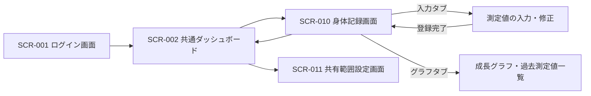
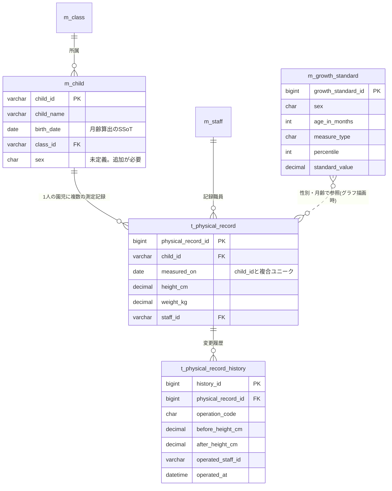

# すくすくシステム 基本設計書 — 身体記録

関係者外秘

| 項目 | 内容 |
| :-: | :-- |
| 対象システム | 保育士支援システム(すくすくシステム) |
| 対象範囲 | 身体記録(身体測定の記録・成長グラフ表示・保護者ポータルへのデータ連携) |
| 版数 | 第 2.0 版 |
| 作成日 | 2026 年 7 月 27 日 |
| 作成区分 | チーム開発演習 基本設計 |
| 担当 | いっせい(身体記録) |

> 本書は、チームのマスタ文書「すくすくシステム 基本設計書」(Google ドキュメント、Hive-Five Developers 作成)の**身体記録パートの詳細版**である。マスタ文書には概要レベル(3-2-5 身体記録／5-1 ⑥⑦／6-1 身体記録マトリクス)が反映済みであり、本書はその根拠と処理詳細を保持する。マスタ文書と食い違いが生じた場合は、**マスタ文書を正**とし本書を追随させる。

## 改訂履歴

| 版 | 日付 | 変更内容 |
| :-: | :-: | :-- |
| 1.0 | 2026/07/21 | 初版作成(いっせい) |
| 1.1 | 2026/07/21 | 学校テンプレートの正式な章番号(1〜6)に合わせて章立てを再構成。機能処理詳細とメッセージ一覧を「4 機能概要」に統合 |
| 2.0 | 2026/07/27 | マスタ文書(2026/07/27 時点)を読み取り、実態に整合させる全面改訂。 ・マスタ文書との章対応表を追加(1-4) ・他パート依存の未充足前提を明示(1-7) ・「システムの利用方法」を追加(2-2) ・画面をマスタ文書の SCR-010 単一画面構成に統一(3-1) ・記録の修正・削除を新設(4-2) ・DB定義をマスタ文書の書式(VARCHAR(20)/BIGINT/staff_id)に統一。削除フラグ・登録日時の記述を実態に合わせて訂正(5) ・設定マスタ・更新履歴テーブルを追加提案(5-3, 5-4) ・保留中だった設計値を【暫定確定】として明記 |

---

# 1 はじめに

## 1-1 本書の目的

本書は「発達チェック機能 要件定義書(第1.0版)」に基づき、身体記録機能の画面・処理・データ構造・権限・外部連携を規定する基本設計書である。すくすくシステム全体の基本設計書のうち、担当割にもとづく「身体記録」パートを構成する。

## 1-2 対象読者

- チームメンバー(Hive-Five Developers)
- 先生(発注者役)

## 1-3 参照元ドキュメント

| 文書名 | 参照内容 |
| :-- | :-- |
| すくすくシステム 基本設計書(Google ドキュメント、マスタ文書) | 全体の章構成・共通テーブル定義・画面ID体系・機能ID体系 |
| 発達チェック機能_要件定義書.md(第1.0版) | 身体測定の記録・成長グラフ表示・保護者ポータル連携の要件 |
| HFD_要件定義書02_レビュー編集済み.md | システム全体像・利用イメージ・テーマカラー |
| 基本設計書_作成必要要素まとめ.md | 学校テンプレート準拠の章構成・記載ルール |
| モックアップ評価_身体記録.md | 実装検証で確定した仕様(しきい値・バリデーション分岐) |

## 1-4 マスタ文書との対応

マスタ文書は学校テンプレートと章の並びが異なる(テンプレートの「3 UI設計／4 機能概要」に対し、マスタ文書は「3 概要＋機能概要／4 UI設計」)。本書はテンプレートの章立てを維持し、対応関係を以下に示す。

| 本書 | マスタ文書の該当箇所 | 反映状況 |
| :-- | :-- | :-- |
| 2 システムの概要 | 3-1 すくすくシステムの利用方法 | 一部反映済み(業務フロー表は未反映) |
| 3 ユーザインターフェイス設計 | 4-2 画面体系図／4-3 画面遷移図・画面一覧(SCR-010) | 反映済み(画面詳細 4-5 は空) |
| 4 機能概要 | 3-2-2 機能一覧(FUN-010／FUN-011)／3-2-5 身体記録 | 概要のみ反映済み。処理詳細は本書が保持 |
| 5 データベース設計 | 5-1 ⑥身体測定記録／⑦成長曲線基準値マスタ | 反映済み(ER図 5-2 は空) |
| 6 セキュリティ設計 | 6-1 権限と利用可能機能 | 反映済み |

## 1-5 表記ルール

- 本書は機能・画面を**機能名・画面名(固有名)で記述する**。ただしマスタ文書は機能共通ID(FUN-xxx)・画面ID(SCR-xxx)を正式採用しているため、統合時の対応が取れるよう下表を置く。**本書で新たな番号を採番することはしない**。

| 本書の名称 | マスタ文書のID |
| :-- | :-- |
| 身体測定の記録／成長グラフ表示 | FUN-010(身体測定・成長グラフ) |
| 保護者ポータルへの記録連携 | FUN-011(保護者ポータルデータ連携) |
| 身体記録画面 | SCR-010(身体測定・成長グラフ画面) |
| 共有範囲設定画面 | SCR-011(共有範囲設定画面。管理者向け、発達チェックと共通) |

- 未確定の設計値は【要決定】、担当判断で仮に確定させた値は【暫定確定】と明示する。【暫定確定】はチームまたは園の合意が得られ次第、正式確定へ切り替える。

## 1-6 スコープ

| 区分 | 内容 |
| :-- | :-- |
| 対象(含む) | ・身体測定(測定日・身長・体重)の記録 ・記録の修正・削除 ・過去測定値の一覧表示 ・成長曲線(パーセンタイル基準値)と重ねた成長グラフ表示 ・共有範囲設定に従った、保護者ポータルへの記録データ連携(共有フラグ付与) |
| 対象外(含まない) | ・発達チェックリスト本体(発達チェックのパートで設計) ・保護者向けの閲覧画面・お知らせ配信(保護者ポータルの責務) ・発育の良否の判定・肥満/やせ等の医療的判定(設計原則として実装しない) ・測定器具の管理・計測手順(システム外の運用) |

【前提】身体記録は園児マスタ(m_child)に依存する。生年月日を月齢計算の単一の根拠(Single Source of Truth)とし、成長グラフの横軸(月齢)は生年月日と測定日から算出する。

## 1-7 前提条件(マスタ文書側で未充足の項目)

**本機能は、以下3点がマスタ文書側で手当てされない限り成立しない。** いずれも身体記録パート単独では解決できない、共通テーブルの欠落である。マスタ文書(2026/07/27 時点)の 5-1 データベース定義を確認した結果として記載する。

| # | 欠落内容 | 影響 | 必要な対応 |
| :-: | :-- | :-- | :-- |
| 1 | **園児マスタ(m_child)に性別の列が無い** | 成長曲線基準値マスタ(m_growth_standard)は性別をキーに基準値を引くため、**成長グラフを描画できない**。本機能の中核が成立しない | m_child に `sex`(CHAR(1)、1:男 2:女)を追加 |
| 2 | **共有範囲設定(m_share_setting)が発達チェック項目専用** | `item_id` が m_development_item 参照と定義されており、**身長・体重の共有可否を保持する場所が無い**。マスタ文書 3-2-5／FUN-011 の「身体測定の記録にフラグを付与して連携」という記述とテーブル定義が矛盾 | 対象項目IDの体系を発達チェック項目に限定せず、身体測定を含む共通の共有対象項目として扱えるよう拡張 |
| 3 | **設定マスタが未定義** | マスタ文書 ⑥ の備考に「範囲チェックは設定マスタ参照」とあるが、**5-1 に設定マスタのテーブルが存在しない**。しきい値の保存先が無く、「ハードコードを避けマスタで運用」という設計原則の受け皿が欠けている | 5-3 に定義案を示す。全機能共通のため、全体で1テーブル設ける |

これらが手当てされるまでの本書の扱いは以下とする。

- 1 が未解決の間は、成長グラフは**基準値の帯を描画せず、測定値の折れ線のみ**を表示する縮退動作とする(誤った性別で基準値を引くことは絶対に行わない)。
- 2 が未解決の間は、保護者ポータルへの連携は**実装対象外**とし、記録・グラフ表示のみを提供する。
- 3 が未解決の間は、しきい値を定数として実装してよいが、**設定マスタ化を前提としたインタフェース**(値の取得箇所を1か所に集約する)で実装する。

---

# 2 システムの概要

## 2-1 身体測定の記録〜成長グラフ確認の流れ

| # | 保育士(一般) | 園長・主任(管理者) | すくすくシステム |
| :-: | :-- | :-- | :-- |
| 1 | 園で定めた測定日に、担当クラスの園児の身長・体重を測定する | — | — |
| 2 | 身体記録画面を開き、クラスを選択する | — | 担当クラスの園児一覧を表示する |
| 3 | 園児を選び、測定日・身長・体重を入力し、登録する | — | 入力値を検証(必須・形式・範囲)し、身体測定記録として保存する |
| 4 | 次の園児を選択し、3 を繰り返す | — | 登録済みの園児に入力済みマークを表示する |
| 5 | 成長グラフで園児の発育経過を確認する | 全園児の記録・グラフを確認できる | 測定値の時系列と成長曲線基準値を重ねてグラフ描画する |
| 6 | 誤入力に気づいた場合、記録を修正する | 必要に応じて記録を削除する | 変更前後の値を更新履歴に記録する |
| 7 | — | 共有範囲設定を確認・変更する | 共有範囲設定に従い、共有可の項目に共有フラグを付与して保護者ポータルへデータを引き渡す |

**※業務での注意点※**

- 成長グラフは発育把握の目安であり、システムは発育の良否・肥満/やせの判定・医療的診断を一切行わない。気になる点があれば保育士・園の判断で保護者・専門機関と相談する。
- 測定そのもの(計測方法・器具の管理)はシステム外の運用である。
- 測定の実施頻度は園が定める。システムは頻度を固定しない(マスタ設定)。
- 身長・体重は機微情報である。画面を保護者や他園児の前で開いたままにしない等、運用面の配慮を園の規程に定める。

## 2-2 システムの利用方法

マスタ文書 3-1 の定義に従う。身体記録に関わる範囲を以下に整理する。

| 利用者 | デバイス | 身体記録での操作 |
| :-- | :-- | :-- |
| 園長・主任(管理者モード) | タブレット／PC | 全クラスの測定記録・成長グラフの閲覧、記録の削除、範囲チェックしきい値の設定、共有範囲設定 |
| 保育士(一般モード) | タブレット／PC | 担当園児の測定値の入力・修正、自クラスの記録・成長グラフの閲覧 |
| 保護者 | スマートフォン | 本システム側の画面は持たない。共有可とされた自児の測定記録は、外部の保護者ポータルで閲覧する |

- アクセス方法：ブラウザから所定のURLにアクセスし、ログイン画面(SCR-001)から認証する。
- 【要決定】開発環境・本番環境のURL、および対応ブラウザ・OSバージョン。全体で共通の決定事項のため、マスタ文書側で確定させる。

---

# 3 ユーザインターフェイス設計

## 3-1 画面一覧

マスタ文書 4-3 の画面一覧に合わせ、**身体記録の画面は SCR-010 の1画面**とする(第1.1版では入力画面とグラフ画面を分けていたが、マスタ文書およびモックアップの実装に合わせて統合した)。1画面内をタブで切り替える構成とする。

| 画面名 | 画面ID | 概要 | 利用者 |
| :-- | :-: | :-- | :-- |
| 身体記録画面 | SCR-010 | 測定値の登録・修正と、成長グラフ・過去測定値の閲覧をタブで切り替える | 保育士・管理者 |
| 共有範囲設定画面 | SCR-011 | 保護者ポータルへの共有可否を項目単位で設定する(発達チェックと共通の画面) | 管理者 |

> **マスタ文書との差異(要修正)**：マスタ文書 4-3 の画面一覧では SCR-010 の対象ユーザーが「全ユーザー」と記載されているが、3-2-5 および 6-1 の記述(保護者は本システム側画面を持たない)と矛盾する。**対象ユーザーは「管理者、保育士」が正**である。マスタ文書側の修正が必要。

## 3-2 画面基本構成

- 共通レイアウト(ヘッダ／サイドナビゲーション／メインコンテンツ)はマスタ文書 4-4 に従う。テーマカラーは「優しい黄色」。
- 想定デバイスは保育士・管理者のタブレット／PC。12カラムグリッドを採用する。
- タブレット操作を前提とし、ボタンのタップ領域は 44×44px 以上を確保する(マスタ文書 4-4 の共通規定)。
- 成長グラフ表示領域には「本グラフは発育把握の目安であり、発育の判定・診断を行うものではありません」の免責表示を**常時**表示する。スクロールしても視界から外れない位置に固定する。

## 3-3 画面遷移

- クラス単位の連続入力を想定し、入力タブでは**測定日をクラス単位で固定**したうえで、園児ごとに身長・体重のみを入力していく構成とする(測定日は全園児同日が実態のため)。園児の切り替えで画面遷移は発生させない。

## 3-4 入出力情報

### 身体記録画面(SCR-010)

| 分類 | 項目 |
| :-- | :-- |
| 入力 | クラス選択、測定日(初期値：サーバ日付の当日)、園児選択、身長(cm)、体重(kg)、表示切替(身長／体重)、表示期間 |
| 出力 | クラス別園児一覧(氏名・月齢・入力済みマーク)、選択中園児の前回測定値(前回測定日・身長・体重)、成長グラフ(測定値の折れ線＋成長曲線基準値の帯)、過去測定値一覧(測定日・身長・体重・記録者)、免責表示 |
| 操作 | 登録、修正、削除(管理者のみ)、タブ切替、表示切替、戻る |

- 測定日の初期値・「本日」判定は**サーバ日付**を基準とする。クライアント端末の日付設定に依存させない(モックアップ改修時に確定)。

## 3-5 一覧表示とページング

- クラス別園児一覧：1クラスの在籍人数(最大30名程度)を想定し、**ページングは行わず全件表示**する。連続入力の作業性を優先する。
- 過去測定値一覧：**直近12件を既定表示**とし、それ以前は「さらに表示」で追加読み込みする。年2〜4回の測定頻度であれば3〜6年分に相当し、在園期間を十分にカバーする。

---

# 4 機能概要

記載ルール：機能名は要件定義書の名称と一致させ、処理内容は「画面表示→利用者の操作→システム内処理→画面表示」の順で記述する。

## 4-1 身体測定の記録

**＜利用タイミング＞** 園で定めた測定日に、保育士が担当クラスの園児の測定値を登録するとき。

**＜処理内容＞**

1. 【画面表示】身体記録画面の入力タブを表示する。ログイン中の保育士の担当クラスの園児一覧を表示し、選択中の測定日に登録済みの園児には入力済みマークを付す。
2. 【操作】保育士が園児を選択し、測定日・身長・体重を入力して「登録」を押下する。
3. 【システム内処理】
   - 入力値を検証する(必須・数値形式・未来日・範囲。4-5 メッセージ一覧参照)。
   - 検証エラー時は該当項目にエラーメッセージを表示し、登録しない。
   - 範囲外警告に該当する値は警告を表示し、保育士が確認・承諾した場合のみ登録する(誤入力防止。実測として正しい場合は登録できる)。
   - 同一園児・同一測定日の既存記録がある場合は、上書き確認を表示し、承諾された場合のみ更新する。
   - **確認フラグは、サーバが返した確認種別に対応するものだけを立てて再送信する。** 範囲外警告と上書き確認を一括で承諾扱いにしてはならない(上書き確認がスキップされる不具合となる。モックアップ評価の HIGH 指摘に対応)。
   - 身体測定記録テーブルへ登録する(園児・測定日・身長・体重・記録職員)。
   - 更新となる場合は、変更前後の値を更新履歴へ記録する(5-4)。
4. 【画面表示】登録完了を表示し、園児一覧の入力済みマークを更新する。

## 4-2 記録の修正・削除

**＜利用タイミング＞** 登録済みの測定値に誤記が判明したとき。

**＜処理内容＞**

1. 【画面表示】過去測定値一覧から対象の記録を選択する。
2. 【操作】保育士または管理者が値を修正して「更新」、または管理者が「削除」を押下する。
3. 【システム内処理】
   - 権限を判定する。修正は**記録した本人および管理者**が、削除は**管理者のみ**が実行できる。
   - 対象期間を判定する。**当該年度内の記録のみ**修正・削除できる。年度を跨いだ記録は画面上で読み取り専用とする。
   - 修正時は 4-1 と同じ検証を行う。
   - 変更前後の値と操作者・操作日時を更新履歴へ記録する(5-4)。削除の場合も削除前の値を履歴に残す。
4. 【画面表示】更新／削除完了を表示し、一覧とグラフを再描画する。

【暫定確定】上記の権限・期間の条件は担当判断による設定である。園の運用実態(誰が訂正責任を持つか、過年度の訂正をどう扱うか)に応じて見直す。

## 4-3 成長グラフ表示

**＜利用タイミング＞** 保育士・管理者が園児の発育経過を確認するとき。

**＜処理内容＞**

1. 【画面表示】身体記録画面のグラフタブを表示する。
2. 【操作】利用者が園児・表示切替(身長／体重)・表示期間を選択する。
3. 【システム内処理】
   - 園児の生年月日と各測定日から測定時月齢を算出する。
   - 身体測定記録を時系列で取得する。
   - 成長曲線基準値マスタから、性別・月齢に応じたパーセンタイル基準値を取得する。
   - 測定値の折れ線と基準値の帯を重ねたグラフを生成する。
   - **生年月日が未登録の場合**：月齢を算出できないため、グラフを描画せず「生年月日が未登録のためグラフを表示できません」を表示する。過去測定値の一覧表示は可能とする。
   - **性別が未登録の場合**：基準値を引けないため、**基準値の帯を描画せず測定値の折れ線のみ**を表示し、「性別が未登録のため成長曲線を表示できません」を併記する。誤った性別で基準値を引くことは行わない。
4. 【画面表示】グラフ・過去測定値一覧・免責表示を表示する。基準値との比較による判定・警告は行わない。

## 4-4 保護者ポータルへの記録連携

**＜利用タイミング＞** 身体測定記録が登録・更新・削除されたとき。

**＜処理内容＞**

1. 【システム内処理】共有範囲設定を参照し、身体測定値の共有可否を判定する。
2. 共有可の場合、記録データに項目単位の共有フラグ(1:園内限定／2:共有可)を付与して保護者ポータルへ引き渡す。データ形式は JSON とする(マスタ文書 4-6 出力情報の規定に従う)。
3. **連携タイミングは登録・更新・削除の都度(即時)** とする。測定は年数回・1回あたり数十件と件数が少なく、日次バッチを設ける必要性が乏しいためである。
4. 共有範囲設定が「共有可」から「園内限定」へ変更された場合、**連携済みデータの取消を保護者ポータルへ通知する**。ポータル側での非表示化を前提とする。
5. 保護者の認証・閲覧画面は保護者ポータル側で担保する。本機能は保護者向け画面を持たない。

【暫定確定】3・4 は担当判断による設定である。保護者ポータルの要件定義が未着手のため、連携インタフェースの詳細(エンドポイント、認証方式、リトライ方針)は同要件定義と同時に確定させる。なお 1-7 の欠落2が未解決の間、本機能は実装対象外である。

## 4-5 メッセージ一覧

| 画面 | 契機 | 種別 | メッセージ |
| :-- | :-- | :-: | :-- |
| SCR-010 | 測定日未入力 | エラー | 測定日は必須項目です。 |
| SCR-010 | 測定日が未来日 | エラー | 測定日に未来の日付は指定できません。 |
| SCR-010 | 身長・体重が未入力 | エラー | 身長・体重は必須項目です。 |
| SCR-010 | 数値以外の入力 | エラー | 身長・体重は数値で入力してください。 |
| SCR-010 | 範囲外の値 | 警告 | 入力値が通常の範囲外です。測定値に誤りがないか確認してください。(確認のうえ登録可能) |
| SCR-010 | 同一測定日の既存記録あり | 確認 | この測定日の記録は登録済みです。上書きしますか。 |
| SCR-010 | 登録完了 | 通知 | 身体測定記録を登録しました。 |
| SCR-010 | 削除確認 | 確認 | この測定記録を削除します。よろしいですか。 |
| SCR-010 | 過年度記録の編集操作 | エラー | 過年度の記録は修正・削除できません。 |
| SCR-010 | 権限のない操作 | エラー | この操作を行う権限がありません。 |
| SCR-010 | グラフ表示時・常時 | 免責 | 本グラフは発育把握の目安であり、発育の判定・診断を行うものではありません。 |
| SCR-010 | 生年月日未登録 | エラー | 生年月日が未登録のためグラフを表示できません。 |
| SCR-010 | 性別未登録 | 警告 | 性別が未登録のため成長曲線を表示できません。測定値のみ表示しています。 |

【暫定確定】範囲外警告のしきい値は **身長 30.0〜150.0cm、体重 1.0〜40.0kg、小数第1位まで**とする。モックアップで実装・動作検証済みの値である。誤入力検知が目的であり、発育の判定基準ではないため、実測が入りうる範囲より広めに設定している。しきい値はハードコードせず設定マスタ(5-3)で保持する。

---

# 5 データベース設計

型表記はマスタ文書 5-1 の書式に統一する(ID は BIGINT 自動採番、園児ID・職員ID は VARCHAR(20))。

> **第1.1版からの訂正**：第1.1版には「全テーブル共通で削除フラグ・登録日時・更新日時を持つ」と記載していたが、**マスタ文書のテーブル定義にはいずれの列も存在しない**。実態に合わせて当該記述を削除した。監査上必要な変更履歴は、5-4 の更新履歴テーブルで担保する。共通列を設けるか否かは全体方針として別途決定が必要(7章 要決定事項)。

## 5-1 身体測定記録(t_physical_record)

マスタ文書 5-1 ⑥ と同一。

| 物理名 | 論理名 | 型 | 制約 | 備考 |
| :-- | :-- | :-- | :-- | :-- |
| physical_record_id | 身体測定記録ID | BIGINT | PRIMARY KEY | 自動採番 |
| child_id | 園児ID | VARCHAR(20) | NOT NULL | 園児マスタ(m_child)を参照 |
| measured_on | 測定日 | DATE | NOT NULL | 未来日不可。child_id + measured_on でユニーク |
| height_cm | 身長 | DECIMAL(4,1) | NOT NULL | cm。範囲チェックは設定マスタ参照 |
| weight_kg | 体重 | DECIMAL(4,1) | NOT NULL | kg。範囲チェックは設定マスタ参照 |
| staff_id | 記録職員ID | VARCHAR(20) | NOT NULL | 操作ログ用(④午睡記録データと同様の用途) |

## 5-2 成長曲線基準値マスタ(m_growth_standard)

マスタ文書 5-1 ⑦ と同一。厚労省の乳幼児身体発育調査に基づくパーセンタイル基準値を保持する。出典データの改定にコード変更なしで追従できるようマスタ化する。

| 物理名 | 論理名 | 型 | 制約 | 備考 |
| :-- | :-- | :-- | :-- | :-- |
| growth_standard_id | 基準値ID | BIGINT | PRIMARY KEY | 自動採番 |
| sex | 性別 | CHAR(1) | NOT NULL | 1:男 2:女 |
| age_in_months | 月齢 | INT | NOT NULL | 0〜72 |
| measure_type | 測定種別 | CHAR(1) | NOT NULL | 1:身長 2:体重 |
| percentile | パーセンタイル | INT | NOT NULL | 3/10/25/50/75/90/97 |
| standard_value | 基準値 | DECIMAL(5,2) | NOT NULL | |
| source_version | 出典版 | VARCHAR(20) | NOT NULL | 例：厚労省2010年調査 |

**初期データの規模**：7パーセンタイル × 73月齢(0〜72) × 2性別 × 2測定種別 = **2,044 行**。厚労省「乳幼児身体発育調査」の公表値からの転記作業が必要となる。

【要決定】初期データの作成担当と手順。作業量が大きいため、以下の縮退案を選択肢として示す。
- 案A：7パーセンタイル全件(2,044行)。設計書どおりだが転記コストが最大
- 案B：3/50/97 の3本に絞る(876行)。モックアップの実装と同じ。グラフの可読性は実用上十分
- 案C：月齢を 0〜36 に限定する。0〜2歳児クラスのみ先行提供する場合に有効

## 5-3 設定マスタ(m_setting)【マスタ文書に未反映・追加提案】

マスタ文書 5-1 に設定マスタが存在しないため、定義案を示す。身体記録専用ではなく**全機能共通**のテーブルとして設ける。午睡チェックの年齢別チェック間隔、発達チェックの推奨頻度も同テーブルで保持できる。

| 物理名 | 論理名 | 型 | 制約 | 備考 |
| :-- | :-- | :-- | :-- | :-- |
| setting_key | 設定キー | VARCHAR(50) | PRIMARY KEY | 例：physical.height_min |
| setting_value | 設定値 | VARCHAR(100) | NOT NULL | 文字列で保持し、利用側で型変換する |
| description | 説明 | VARCHAR(200) | | 設定画面での表示用 |
| updated_staff_id | 更新職員ID | VARCHAR(20) | NOT NULL | 操作ログ用 |

身体記録が使用するキー：

| 設定キー | 初期値 | 説明 |
| :-- | :-: | :-- |
| physical.height_min | 30.0 | 身長の範囲外警告 下限(cm) |
| physical.height_max | 150.0 | 身長の範囲外警告 上限(cm) |
| physical.weight_min | 1.0 | 体重の範囲外警告 下限(kg) |
| physical.weight_max | 40.0 | 体重の範囲外警告 上限(kg) |

- 設定値が数値として解釈できない場合は、既定値へフォールバックしたうえで**警告ログを出力**する。異常を黙殺しない(モックアップ評価の指摘に対応)。

## 5-4 身体測定記録更新履歴(t_physical_record_history)【マスタ文書に未反映・追加提案】

同一園児・同一測定日の記録は上書き更新するため、**更新前の値が残らない**。要件定義の監査・改ざん防止の考え方に対して弱いため、変更履歴を別テーブルで保持する。

| 物理名 | 論理名 | 型 | 制約 | 備考 |
| :-- | :-- | :-- | :-- | :-- |
| history_id | 履歴ID | BIGINT | PRIMARY KEY | 自動採番 |
| physical_record_id | 身体測定記録ID | BIGINT | NOT NULL | 対象の記録 |
| operation_code | 操作区分 | CHAR(2) | NOT NULL | 01:登録 02:更新 03:削除 |
| before_height_cm | 変更前 身長 | DECIMAL(4,1) | | 更新・削除時に設定 |
| before_weight_kg | 変更前 体重 | DECIMAL(4,1) | | 更新・削除時に設定 |
| after_height_cm | 変更後 身長 | DECIMAL(4,1) | | 登録・更新時に設定 |
| after_weight_kg | 変更後 体重 | DECIMAL(4,1) | | 登録・更新時に設定 |
| operated_staff_id | 操作職員ID | VARCHAR(20) | NOT NULL | |
| operated_at | 操作日時 | DATETIME | NOT NULL | |

【要決定】全体で共通の操作ログテーブルを設ける方針であれば、本テーブルはそちらへ統合する。マスタ文書に操作ログテーブルの定義が無いため、現時点では身体記録固有の履歴として定義している。

## 5-5 関連テーブル(他パートで定義)

| テーブル | 定義箇所 | 本機能との関係 |
| :-- | :-- | :-- |
| 園児マスタ(m_child) | マスタ文書 5-1 ② | 生年月日＝月齢算出のSSoT。身体測定記録の親。**性別の列が未定義(1-7 欠落1)** |
| 職員マスタ(m_staff) | マスタ文書 5-1 ① | 記録職員の識別 |
| クラスマスタ(m_class) | マスタ文書 5-1 ⑧ | 園児一覧のクラス絞り込み |
| 共有範囲設定(m_share_setting) | マスタ文書 5-1 ⑪ | 保護者共有可否。**身体測定を対象にできない(1-7 欠落2)** |

## 5-6 データ関係図(ER図)

---

# 6 セキュリティ設計

## 6-1 権限と利用可能機能

マスタ文書 6-1 に反映済みの内容と同一。

| 機能 | 未ログイン | 保育士(一般) | 園長・主任(管理者) | 保護者 |
| :-- | :-: | :-: | :-: | :-: |
| 身体測定の記録(登録) | × | ○ ※1 | ○ | × |
| 記録の修正 | × | ○ ※1 ※3 | ○ | × |
| 記録の削除 | × | × | ○ | × |
| 過去測定値の閲覧 | × | ○ ※1 | ○ | × ※2 |
| 成長グラフ表示 | × | ○ ※1 | ○ | × ※2 |
| 更新履歴の閲覧 | × | × | ○ | × |
| 範囲チェックしきい値の設定 | × | × | ○ | × |
| 共有範囲設定の変更 | × | × | ○ | × |

- ※1 保育士は自クラスの園児のみ。
- ※2 保護者は保護者ポータル側で、共有範囲設定で共有可とされた自児の情報のみ閲覧する(本システム側画面は持たない)。
- ※3 修正は当該記録を登録した本人に限る。当該年度内のみ。

## 6-2 データ保護と監査

- 身長・体重は機微情報として扱い、通信・保存時の暗号化は全体方針(マスタ文書)に従う。
- 権限判定は**すべてサーバ側で行う**。画面上のボタン非表示のみで制御しない。
- 記録の登録・修正・削除は、操作職員・操作日時・変更前後の値を更新履歴(5-4)に保持する。
- 一覧・グラフの取得時は、ログイン中の職員の担当クラスに基づき、取得できる園児を**サーバ側で絞り込む**。園児IDを直接指定した不正な取得を許さない。
- 【要決定】CSRF対策。モックアップでは SameSite=Lax Cookie による緩和にとどめている。本実装ではトークン方式の導入を推奨する。全機能共通の決定事項。

---

# 7 要決定事項まとめ

## 7-1 マスタ文書側の対応が必要(他パート依存)

| # | 事項 | 関連章 | 緊急度 |
| :-: | :-- | :-: | :-: |
| 1 | 園児マスタ(m_child)への性別の追加 | 1-7, 5-5 | **高**(未対応では成長グラフが成立しない) |
| 2 | 共有範囲設定の対象項目を身体測定へ拡張 | 1-7, 4-4 | **高**(未対応ではポータル連携が成立しない) |
| 3 | 設定マスタの新設 | 1-7, 5-3 | **高**(未対応ではしきい値のマスタ化が成立しない) |
| 4 | SCR-010 の対象ユーザーを「管理者、保育士」へ訂正 | 3-1 | 中(文書内の矛盾) |
| 5 | 更新履歴テーブルの扱い(共通操作ログへ統合するか) | 5-4 | 中 |
| 6 | 全テーブル共通列(削除フラグ・登録日時)を設けるか | 5 | 中 |
| 7 | DBMS の選定 | 5 | 中 |
| 8 | 対応ブラウザ・環境URL | 2-2 | 低 |
| 9 | CSRF対策方式 | 6-2 | 中 |

## 7-2 身体記録パート内で確定させるもの

| # | 事項 | 関連章 | 状態 |
| :-: | :-- | :-: | :-- |
| 10 | 範囲外警告のしきい値 | 4-5, 5-3 | 【暫定確定】身長30.0〜150.0cm、体重1.0〜40.0kg。モックアップで検証済み |
| 11 | 記録の修正・削除の権限と期間 | 4-2 | 【暫定確定】修正＝本人と管理者、削除＝管理者のみ、当該年度内。園の運用確認待ち |
| 12 | ポータル連携のタイミング | 4-4 | 【暫定確定】登録・更新・削除の都度(即時)。保護者ポータル要件定義と同時に正式確定 |
| 13 | 成長曲線基準値の初期データ(2,044行) | 5-2 | 【要決定】案A(全件)／案B(3本・876行)／案C(0〜36月齢)から選択。作成担当も未定 |
| 14 | 測定頻度の管理方法 | 2-1 | 【要決定】発達チェックの推奨スケジュールマスタと共通管理とするか、設定マスタで別管理とするか |
