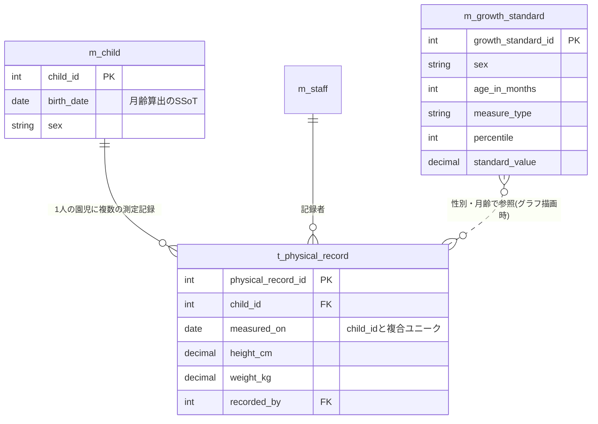

# すくすくシステム 基本設計書 — 身体記録

関係者外秘

| 項目 | 内容 |
| :-: | :-- |
| 対象システム | 保育士支援システム(すくすくシステム) |
| 対象範囲 | 身体記録(身体測定の記録・成長グラフ表示・保護者ポータルへのデータ連携) |
| 版数 | 第 1.1 版 |
| 作成日 | 2026 年 7 月 21 日 |
| 作成区分 | チーム開発演習 基本設計 |
| 担当 | いっせい(身体記録) |

> 本書は `基本設計_身体記録設計書.md`（第1.0版、いっせい作成）をレビューし、学校テンプレート「【テンプレート】3_基本設計書.docx」の正式な章番号（1 はじめに／2 システムの概要／3 UI設計／4 機能概要／5 DB設計／6 セキュリティ設計）に合わせて章立てを整理したものである。業務フロー・画面設計・機能処理詳細・データベース設計・セキュリティ設計の記載内容は第1.0版の事実確認（要件定義書との照合）を行った結果、誤りは見つからなかったため実質的に維持している。変更は章番号の整理と、要決定事項の追加のみ。

## 改訂履歴

| 版 | 日付 | 変更内容 |
| :-: | :-: | :-- |
| 1.0 | 2026/07/21 | 初版作成(いっせい) |
| 1.1 | 2026/07/21 | 学校テンプレートの正式な章番号(1〜6)に合わせて章立てを再構成。機能処理詳細とメッセージ一覧を「4 機能概要」に統合。要決定事項に他パートとの章番号統合リスクを追加 |

---

# 1 はじめに

## 1-1 本書の目的

本書は「発達チェック機能 要件定義書(第1.0版)」に基づき、身体記録機能の画面・処理・データ構造・権限・外部連携を規定する基本設計書である。すくすくシステム全体の基本設計書のうち、担当割にもとづく「身体記録」パートを構成する。

## 1-2 対象読者

- チームメンバー(HIGH-FIVE DEVELOPERS)
- 先生(発注者役)

## 1-3 参照元ドキュメント

| 文書名 | 参照内容 |
| :-- | :-- |
| 発達チェック機能_要件定義書.md(第1.0版) | 身体測定の記録・成長グラフ表示・保護者ポータル連携の要件 |
| HFD_要件定義書02_レビュー編集済み.md | システム全体像・利用イメージ・テーマカラー |
| 基本設計書_作成必要要素まとめ.md | 学校テンプレート準拠の章構成・記載ルール |

## 1-4 表記ルール

- 機能・画面は**機能番号を用いず、機能名・画面名(固有名)で表記する**。過去資料に残る旧番号との対応が必要な場合は claude.md の対応表を参照すること。
- 他メンバーの担当パートが番号体系(SCR-xxx 等)で記述されている場合、統合時に本書の機能名表記へ合わせる整合確認が必要である。
- 未確定の設計値は【要決定】と明示する。

## 1-5 スコープ

| 区分 | 内容 |
| :-- | :-- |
| 対象(含む) | ・身体測定(測定日・身長・体重)の記録 ・過去測定値の一覧表示 ・成長曲線(パーセンタイル基準値)と重ねた成長グラフ表示 ・共有範囲設定に従った、保護者ポータルへの記録データ連携(共有フラグ付与) |
| 対象外(含まない) | ・発達チェックリスト本体(発達チェックのパートで設計) ・保護者向けの閲覧画面・お知らせ配信(保護者ポータルの責務) ・発育の良否の判定・肥満/やせ等の医療的判定(設計原則として実装しない) |

【前提】身体記録は園児マスタ(在籍管理)に依存する。生年月日を月齢計算の単一の根拠(Single Source of Truth)とし、成長グラフの横軸(月齢)は生年月日と測定日から算出する。

---

# 2 システムの概要

## 2-1 身体測定の記録〜成長グラフ確認の流れ

| # | 保育士(一般) | 園長・主任(管理者) | すくすくシステム |
| :-: | :-- | :-- | :-- |
| 1 | 園で定めた測定日に、担当クラスの園児の身長・体重を測定する | — | — |
| 2 | 身体測定入力画面を開き、園児を選択する | — | 担当クラスの園児一覧を表示する |
| 3 | 測定日・身長・体重を入力し、登録する | — | 入力値を検証(必須・形式・範囲)し、身体測定記録として保存する |
| 4 | 次の園児を選択し、3 を繰り返す | — | 登録済みの園児に入力済みマークを表示する |
| 5 | 成長グラフ画面で園児の発育経過を確認する | 全園児の記録・グラフを確認できる | 測定値の時系列と成長曲線基準値を重ねてグラフ描画する |
| 6 | — | 共有範囲設定を確認・変更する | 共有範囲設定に従い、共有可の項目に共有フラグを付与して保護者ポータルへデータを引き渡す |

**※業務での注意点※**

- 成長グラフは発育把握の目安であり、システムは発育の良否・肥満/やせの判定・医療的診断を一切行わない。気になる点があれば保育士・園の判断で保護者・専門機関と相談する。
- 測定そのもの(計測方法・器具の管理)はシステム外の運用である。
- 測定の実施頻度は園が定める。システムは頻度を固定しない(マスタ設定)。

---

# 3 ユーザインターフェイス設計

## 3-1 画面一覧

| 画面名 | 概要 | 利用者 |
| :-- | :-- | :-- |
| 身体測定入力画面 | 園児を選択し、測定日・身長・体重を登録する | 保育士・管理者 |
| 成長グラフ画面 | 測定値の時系列を成長曲線基準値と重ねて表示する | 保育士・管理者 |

保護者は本システム側の画面を持たない(閲覧は保護者ポータル側の責務)。

## 3-2 画面基本構成

- 共通レイアウト(ヘッダ/ナビゲーション/メイン/フッタ)は全体基本設計書の「画面基本構成」に従う。テーマカラーは「優しい黄色」。
- 想定デバイス:保育士・管理者=タブレット/PC(12カラムグリッド)。
- 成長グラフ画面には「本グラフは発育把握の目安であり、発育の判定・診断を行うものではありません」の免責表示を常時表示する。

## 3-3 入出力情報

### 身体測定入力画面

| 分類 | 項目 |
| :-- | :-- |
| 入力 | 測定日(初期値:当日)、身長(cm)、体重(kg) |
| 出力 | クラス別園児一覧(氏名・月齢・入力済みマーク)、選択中園児の前回測定値(前回測定日・身長・体重) |
| 操作 | 登録、修正(当日分の再編集)、戻る |

### 成長グラフ画面

| 分類 | 項目 |
| :-- | :-- |
| 入力 | 園児選択、表示切替(身長/体重)、表示期間 |
| 出力 | 成長グラフ(測定値の折れ線+成長曲線基準値の帯)、過去測定値一覧(測定日・身長・体重・記録者)、免責表示 |
| 操作 | 表示切替、身体測定入力画面へ、戻る |

【要決定】クラス単位の連続入力(一覧から順に入力していく操作)の画面遷移詳細。測定日は全園児一括で同日入力が実態のため、測定日をクラス単位で固定して園児ごとに身長・体重のみ入力する構成を推奨する。

---

# 4 機能概要

記載ルール:機能名は要件定義書の名称と一致させ、処理内容は「画面表示→利用者の操作→システム内処理→画面表示」の順で記述する。

## 4-1 身体測定の記録

**＜利用タイミング＞** 園で定めた測定日に、保育士が担当クラスの園児の測定値を登録するとき。

**＜処理内容＞**

1. 【画面表示】身体測定入力画面を表示する。ログイン中の保育士の担当クラスの園児一覧を表示し、当日分が登録済みの園児には入力済みマークを付す。
2. 【操作】保育士が園児を選択し、測定日・身長・体重を入力して「登録」を押下する。
3. 【システム内処理】
   - 入力値を検証する(必須・数値形式・範囲。4-4 メッセージ一覧参照)。
   - 検証エラー時は該当項目にエラーメッセージを表示し、登録しない。
   - 範囲外警告に該当する値は警告を表示し、保育士が確認・承諾した場合のみ登録する(誤入力防止。実測として正しい場合は登録できる)。
   - 身体測定記録テーブルへ登録する(園児・測定日・身長・体重・記録者・登録日時)。同一園児・同一測定日の既存記録がある場合は上書き確認のうえ更新する。
4. 【画面表示】登録完了を表示し、園児一覧の入力済みマークを更新する。

## 4-2 成長グラフ表示

**＜利用タイミング＞** 保育士・管理者が園児の発育経過を確認するとき。

**＜処理内容＞**

1. 【画面表示】成長グラフ画面を表示する。
2. 【操作】利用者が園児・表示切替(身長/体重)・表示期間を選択する。
3. 【システム内処理】
   - 園児の生年月日と各測定日から測定時月齢を算出する。
   - 身体測定記録を時系列で取得する。
   - 成長曲線基準値マスタから、性別・月齢に応じたパーセンタイル基準値(3・10・25・50・75・90・97 パーセンタイル)を取得する。
   - 測定値の折れ線と基準値の帯を重ねたグラフを生成する。
4. 【画面表示】グラフ・過去測定値一覧・免責表示を表示する。基準値との比較による判定・警告は行わない。

【要決定】生年月日が未登録の園児の挙動。月齢が算出できないためグラフの横軸が成立しない。園児マスタ側で生年月日を必須とする前提だが、欠損時は「生年月日が未登録のため表示できません」を表示する方針を推奨。

## 4-3 保護者ポータルへの記録連携

**＜利用タイミング＞** 身体測定記録が登録・更新されたとき。

**＜処理内容＞**

1. 【システム内処理】共有範囲設定マスタを参照し、身体測定値の共有可否を判定する。
2. 共有可の場合、記録データに項目単位の共有フラグ(園内限定/共有可)を付与して保護者ポータルへ引き渡す(データ形式は全体基本設計書の「外部連携設計」に従う。JSON 想定)。
3. 保護者の認証・閲覧画面は保護者ポータル側で担保する。本機能は保護者向け画面を持たない。

【要決定】連携のタイミング(登録即時か、日次バッチか)。共有範囲設定を後から「園内限定」へ変更した場合の、連携済みデータの取扱い(ポータル側で非表示化する仕様の要否)。

## 4-4 メッセージ一覧

| 画面 | 契機 | 種別 | メッセージ |
| :-- | :-- | :-: | :-- |
| 身体測定入力 | 測定日未入力 | エラー | 測定日は必須項目です。 |
| 身体測定入力 | 測定日が未来日 | エラー | 測定日に未来の日付は指定できません。 |
| 身体測定入力 | 身長・体重が未入力 | エラー | 身長・体重は必須項目です。 |
| 身体測定入力 | 数値以外の入力 | エラー | 身長・体重は数値で入力してください。 |
| 身体測定入力 | 範囲外の値 | 警告 | 入力値が通常の範囲外です。測定値に誤りがないか確認してください。(確認のうえ登録可能) |
| 身体測定入力 | 同一測定日の既存記録あり | 確認 | この測定日の記録は登録済みです。上書きしますか。 |
| 身体測定入力 | 登録完了 | 通知 | 身体測定記録を登録しました。 |
| 成長グラフ | 常時 | 免責 | 本グラフは発育把握の目安であり、発育の判定・診断を行うものではありません。 |
| 成長グラフ | 生年月日未登録 | エラー | 生年月日が未登録のためグラフを表示できません。 |

【要決定】範囲外警告のしきい値。仮値として身長 30.0〜150.0 cm、体重 1.0〜40.0 kg、小数第 1 位までを置くが、確定値は要検討。しきい値はハードコードせず設定マスタで保持する(誤入力検知が目的であり、発育の判定基準ではない)。

---

# 5 データベース設計

型表記は汎用表記とする(DBMS 未定のため。【要決定】DBMS 確定後に型を読み替える)。全テーブル共通で削除フラグ・登録日時・更新日時を持つ(全体基本設計書の共通ルールに従う)。

## 5-1 身体測定記録テーブル(t_physical_record)

| 論理名 | 物理名 | データ型 | 桁数 | 制約 | 備考 |
| :-- | :-- | :-- | :-: | :-- | :-- |
| 身体測定記録ID | physical_record_id | 整数(連番) | — | PK | |
| 園児ID | child_id | 整数 | — | FK(園児マスタ)・必須 | |
| 測定日 | measured_on | 日付 | — | 必須 | 未来日不可。園児ID+測定日でユニーク |
| 身長 | height_cm | 小数 | 4,1 | 必須 | cm。範囲チェックは設定マスタ参照 |
| 体重 | weight_kg | 小数 | 4,1 | 必須 | kg。範囲チェックは設定マスタ参照 |
| 記録者ID | recorded_by | 整数 | — | FK(職員マスタ)・必須 | |
| 削除フラグ | is_deleted | 真偽値 | — | 必須・初期値false | |
| 登録日時 | created_at | 日時 | — | 必須 | |
| 更新日時 | updated_at | 日時 | — | 必須 | |

## 5-2 成長曲線基準値マスタ(m_growth_standard)

厚労省の乳幵児身体発育調査に基づくパーセンタイル基準値を保持する。出典データの改定にコード変更なしで追従できるようマスタ化する。

| 論理名 | 物理名 | データ型 | 桁数 | 制約 | 備考 |
| :-- | :-- | :-- | :-: | :-- | :-- |
| 基準値ID | growth_standard_id | 整数(連番) | — | PK | |
| 性別 | sex | コード | 1 | 必須 | 1:男 2:女 |
| 月齢 | age_in_months | 整数 | — | 必須 | 0〜72 想定 |
| 測定種別 | measure_type | コード | 1 | 必須 | 1:身長 2:体重 |
| パーセンタイル | percentile | 整数 | — | 必須 | 3/10/25/50/75/90/97 |
| 基準値 | standard_value | 小数 | 5,2 | 必須 | |
| 出典版 | source_version | 文字列 | 20 | 必須 | 例:厚労省2010年調査 |
| 削除フラグ | is_deleted | 真偽値 | — | 必須・初期値false | |
| 登録日時 | created_at | 日時 | — | 必須 | |
| 更新日時 | updated_at | 日時 | — | 必須 | |

【要決定】基準値データの入手・投入方法(厚労省公表値からの初期データ作成の担当・手順)。

## 5-3 関連テーブル(他パートで定義)

| テーブル | 定義箇所 | 本機能との関係 |
| :-- | :-- | :-- |
| 園児マスタ(m_child) | 全体基本設計書 | 生年月日=月齢算出のSSoT。身体測定記録の親 |
| 職員マスタ(m_staff) | 全体基本設計書 | 記録者の識別 |
| 共有範囲設定マスタ | 発達チェックのパート | 身体測定値の保護者共有可否を項目単位で保持 |
| 設定マスタ | 全体基本設計書 | 入力範囲チェックのしきい値等 |

## 5-4 データ関係図(ER図)

---

# 6 セキュリティ設計(権限と利用可能機能)

| 機能 | 未ログイン | 保育士(一般) | 園長・主任(管理者) | 保護者 |
| :-- | :-: | :-: | :-: | :-: |
| 身体測定の記録(登録・修正) | × | ○ ※1 | ○ | × |
| 過去測定値の閲覧 | × | ○ ※1 | ○ | × ※2 |
| 成長グラフ表示 | × | ○ ※1 | ○ | × ※2 |
| 範囲チェックしきい値の設定 | × | × | ○ | × |
| 共有範囲設定の変更 | × | × | ○ | × |

- ※1 保育士は自クラスの園児のみ。
- ※2 保護者は保護者ポータル側で、共有範囲設定で共有可とされた自児の情報のみ閲覧する(本システム側画面は持たない)。
- 身長・体重は機微情報として扱い、通信・保存時の暗号化は全体基本設計書の「データ保護」の方針に従う。
- 記録の登録・修正は記録者・日時を保持し、監査ログの対象とする(全体基本設計書の監査ログ方針に従う)。

---

# 7 要決定事項まとめ

| # | 事項 | 関連章 | 備考 |
| :-: | :-- | :-: | :-- |
| 1 | 身長・体重の範囲チェックしきい値の確定 | 4-4 | 仮値:身長30.0〜150.0cm、体重1.0〜40.0kg。設定マスタで保持 |
| 2 | DBMS の選定と型表記の確定 | 5 | 全体基本設計書と共通の決定事項 |
| 3 | 成長曲線基準値データの入手・投入手順 | 5-2 | 厚労省公表値からの初期データ作成 |
| 4 | 測定頻度の管理方法 | 2 | 発達チェックの推奨スケジュールマスタと共通管理か別管理か |
| 5 | ポータル連携のタイミングと共有設定変更時の連携済みデータの取扱い | 4-3 | 保護者ポータルの要件定義と同時に確定 |
| 6 | クラス単位の連続入力の画面遷移詳細 | 3-3 | ワイヤーフレーム作成時に確定 |
| 7 | 他パート(番号体系で記述された画面・機能一覧)との表記整合 | 1-4 | 統合時に機能名表記へ統一 |
| 8 | 他パートとの章番号統合リスク | 全体 | 本書は学校テンプレートの正式な章番号(1〜6)に整理済みだが、日誌・チャット・午睡チェック・発達チェックの各パートが独自の章番号で作成された場合、最終統合時に全パートの番号ふり直しが必要になる。各パート作成時点でテンプレートの正式な章番号を共通ルールとして先に合意しておくことを推奨する |
