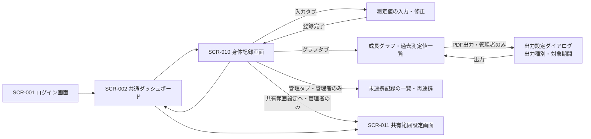
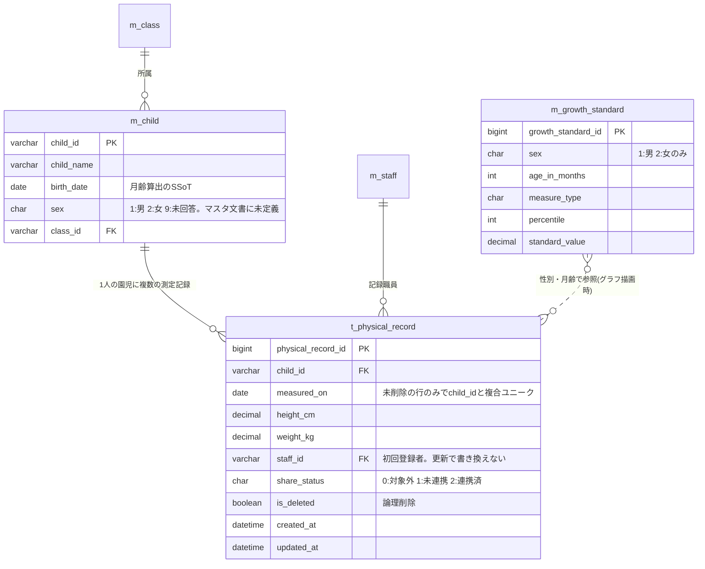

# すくすくシステム 基本設計書 — 身体記録

関係者外秘

| 項目 | 内容 |
| :-: | :-- |
| 対象システム | 保育士支援システム(すくすくシステム) |
| 対象範囲 | 身体記録(身体測定の記録・成長グラフ表示・チャットツールへのデータ連携) |
| 版数 | 第 5.1 版 |
| 作成日 | 2026 年 7 月 21 日(初版) |
| 改訂日 | 2026 年 8 月 11 日 |
| 作成区分 | チーム開発演習 基本設計 |
| 担当 | いっせい(身体記録) |

> 本書は、チームのマスタ文書「すくすくシステム 基本設計書」(Google ドキュメント、Hive-Five Developers 作成)の**身体記録パートの詳細版**である。マスタ文書には概要レベル(3-2-5 身体記録／5-1 ⑥⑦／6-1 身体記録マトリクス)が反映済みであり、本書はその根拠と処理詳細を保持する。マスタ文書と食い違いが生じた場合は、**マスタ文書を正**とし本書を追随させる。
>
> ただし要件については、**要件定義書 `要件定義書.md`(第1.8版)を最上位の正**とする。マスタ文書が要件定義書に追随していない箇所は、本書の 1-7 に「マスタ文書側で未充足の項目」として明示する。

## 改訂履歴

| 版 | 日付 | 変更内容 |
| :-: | :-: | :-- |
| 5.1 | 2026/08/11 | 要件定義書 第1.9版への追随改訂。本文中の要件定義書への相互参照を**名称主体の表記へ統一**した(19か所)。「要件定義書 4-1-3」のような番号だけの参照をやめ、`要件定義書「園児マスターの管理」(4-1-3)` のように**項目名を主・番号をカッコ併記**する形へ改めた。本書は自書の番号(1〜7章)と要件定義書の番号が重なるため、名称併記により参照先の文書が判別できるようになる。設計内容そのものに変更はない |
| 1.0 | 2026/07/21 | 初版作成(いっせい) |
| 1.1 | 2026/07/21 | 学校テンプレートの正式な章番号(1〜6)に合わせて章立てを再構成。機能処理詳細とメッセージ一覧を「4 機能概要」に統合 |
| 2.0 | 2026/07/27 | マスタ文書(2026/07/27 時点)を読み取り、実態に整合させる全面改訂。 ・マスタ文書との章対応表を追加(1-4) ・他パート依存の未充足前提を明示(1-7) ・「システムの利用方法」を追加(2-2) ・画面をマスタ文書の SCR-010 単一画面構成に統一(3-1) ・記録の修正・削除を新設(4-2) ・DB定義をマスタ文書の書式(VARCHAR(20)/BIGINT/staff_id)に統一。削除フラグ・登録日時の記述を実態に合わせて訂正(5) ・設定マスタ・更新履歴テーブルを追加提案(5-3, 5-4) ・保留中だった設計値を【暫定確定】として明記 |
| 3.0 | 2026/08/03 | 要件定義書 第1.6版・発達チェック機能要件定義書 第2.2版への整合改訂(GitHub Issue #21・#22・#23・#24・#26・#27 に対応)。 ・**連携先を「保護者ポータル」から「チャットツールの個人チャット」へ全面変更**(#21)。保護者の認証先・連携の性質・保護者の権限・表示可否の最終判定の4点を改めた ・参照元ドキュメントの版数を更新し、廃止済みの「管理者モード／一般モード」表記を解消(#22) ・**園児マスターの性別が要件化された**ことを受け、1-7 欠落1 を要件定義側の解決済みとして更新。未回答時の縮退動作を恒久仕様として 4-3 に明記(#23 の設計側) ・**削除方式を論理削除に確定**し、データ保持と削除の節(6-3)を新設(#24) ・更新履歴テーブルを**共通操作ログへ統合する方針**へ変更(#26) ・年度の定義を要件定義書 「アカウントの管理」(4-1-2) へ参照付けし、過年度記録の訂正経路を定義(#27) ・記録の出力(PDF)を 4-5 として新設(要件定義書 第1.6版で2種類の出力が要件化されたため) ・一般の参照範囲を、第1.6版の「参照範囲の判定単位(園児単位)」へ整合(6-1) |
| 5.0 | 2026/08/04 | 積み残していた GitHub Issue #43・#44・#47 への対応。いずれも要件定義書側の確定を要していたもので、要件定義書 第1.8版で確定したことを受けて本書を追随させた。 ・**測定回の単位を「年月」として定義**し、入力済み判定を測定日単位から年月単位へ変更(#47。4-1)。クラスの実施状況(対象人数・記録済み人数・未実施の園児名)の表示を追加。**測定回を表すテーブルは新設せず**、設定マスタに `physical.measurement_months` を追加(5-3) ・**月齢の算出規則が全機能共通の規則として確定**したことを反映(#44。4-3、7-1 No.6 を解決済みへ) ・**共通操作ログの保持対象に出力が追加された**ことを反映(#43。5-4、7-1 No.7 を解決済みへ)。PDF 出力時は出力種別・対象期間も記録する ・7-2 No.24・No.25 を【要決定】から確定へ ・**旧版2ファイル(`基本設計_身体記録設計書.md` 第1.0版、`基本設計書_身体記録_挿入用.md`)を削除**し、マスタ文書への適用は `修正箇所/04_マスタ文書_身体記録_修正指示.md` の差分指示に一本化(#25)。中間ファイルを作る運用を廃止 |
| 4.0 | 2026/08/04 | 第3.0版のレビュー(GitHub Issue #41〜#51)で検出した不整合・未定義点への対応。 ・**一意制約を「未削除の行のみを対象とする部分一意インデックス」へ変更**(#41)。論理削除した測定日に再登録できない不具合を解消。入力済みマークの判定にも未削除条件を明記 ・6-1 の「操作ログの閲覧」行を削除し、共通の操作ログ参照画面への参照へ置換(#42) ・**月齢の算出規則を応当日基準として定義**(#44 の設計側。4-3) ・**連携状態(`share_status`)を追加し、未連携記録の一覧と再連携の操作を定義**(#45) ・共有範囲の取消方式を「参照時に現在の共有範囲を判定する」方式へ変更し、取消通知を不要とした(#46 の設計側。4-4) ・`created_at`／`updated_at` を追加。成長曲線基準値マスタに複合一意制約と初期データの検証手順を追加(#48) ・**`staff_id` を初回登録者に固定**し、更新時に書き換えないことを明記(#49) ・入出力情報に出力種別・出力対象期間を追加。画面遷移図に PDF 出力と共有範囲設定への導線を追加(#50) ・**成長グラフは常に園児マスターの現在の性別で描画し、測定記録側に性別を保持しない**ことを明記(#51) ・7-1 No.4 に、共通操作ログの操作区分へ「出力」を含める要求を追記(#43 の設計側) |

---

# 1 はじめに

## 1-1 本書の目的

本書は「要件定義書 「発達チェック」(4-2 (4)) 発達チェック」および「発達チェック機能 要件定義書(第2.4版)」に基づき、身体記録機能の画面・処理・データ構造・権限・機能間連携を規定する基本設計書である。すくすくシステム全体の基本設計書のうち、担当割にもとづく「身体記録」パートを構成する。

## 1-2 対象読者

- チームメンバー(Hive-Five Developers)
- 先生(発注者役)

## 1-3 参照元ドキュメント

| 文書名 | 版 | 参照内容 |
| :-- | :-: | :-- |
| `要件定義書.md`(要件定義書) | 第1.8版 | システム全体像・権限規定・園児マスターの管理・チャットツール連携・データ保持 |
| `要件定義書.md`「発達チェック」(4-5) | 第2.4版 | 身体測定の記録・成長グラフ表示・個人チャットへの記録連携の受け入れ条件 |
| すくすくシステム 基本設計書(Google ドキュメント、マスタ文書) | 2026/07/27 時点 | 全体の章構成・共通テーブル定義・画面ID体系・機能ID体系 |
| `基本設計書_作成必要要素まとめ.md` | 2026/07/14 | 学校テンプレート準拠の章構成・記載ルール |
| `モックアップ評価_身体記録.md` | 2026/07/21 | 実装検証で確定した仕様(しきい値・バリデーション分岐) |

> マスタ文書の読み取りは 2026/07/27 時点のものである。要件定義書はその後 第1.5版〜第1.8版へ改訂されており、**マスタ文書が追随していない可能性がある**。本書 1-7 の各項目は、マスタ文書側の再確認をもって最終確定とする。

## 1-4 マスタ文書との対応

マスタ文書は学校テンプレートと章の並びが異なる(テンプレートの「3 UI設計／4 機能概要」に対し、マスタ文書は「3 概要＋機能概要／4 UI設計」)。本書はテンプレートの章立てを維持し、対応関係を以下に示す。

| 本書 | マスタ文書の該当箇所 | 反映状況 |
| :-- | :-- | :-- |
| 2 システムの概要 | 3-1 すくすくシステムの利用方法 | 一部反映済み(業務フロー表は未反映) |
| 3 ユーザインターフェイス設計 | 4-2 画面体系図／4-3 画面遷移図・画面一覧(SCR-010) | 反映済み(画面詳細 4-5 は空。対象ユーザーの訂正が必要) |
| 4 機能概要 | 3-2-2 機能一覧(FUN-010／FUN-011)／3-2-5 身体記録 | 概要のみ反映済み。処理詳細は本書が保持。**連携先の旧前提が残存している可能性あり** |
| 5 データベース設計 | 5-1 ⑥身体測定記録／⑦成長曲線基準値マスタ | 反映済み(ER図 5-2 は空) |
| 6 セキュリティ設計 | 6-1 権限と利用可能機能 | 反映済み(保護者列の訂正が必要。1-7 参照) |

## 1-5 表記ルール

- 本書は機能・画面を**機能名・画面名(固有名)で記述する**。ただしマスタ文書は機能共通ID(FUN-xxx)・画面ID(SCR-xxx)を正式採用しているため、統合時の対応が取れるよう下表を置く。**本書で新たな番号を採番することはしない**。

| 本書の名称 | マスタ文書のID | 備考 |
| :-- | :-- | :-- |
| 身体測定の記録／成長グラフ表示 | FUN-010(身体測定・成長グラフ) | |
| チャットツールへの記録連携 | FUN-011(保護者ポータルデータ連携) | **マスタ文書側の名称が旧称。「個人チャットへの記録連携」への改称が必要**(1-7 欠落4) |
| 身体記録画面 | SCR-010(身体測定・成長グラフ画面) | |
| 共有範囲設定画面 | SCR-011(共有範囲設定画面。管理者向け、発達チェックと共通) | |

- 未確定の設計値は【要決定】、担当判断で仮に確定させた値は【暫定確定】と明示する。【暫定確定】はチームまたは園の合意が得られ次第、正式確定へ切り替える。
- 利用者の区分は要件定義書の3ロール(**管理者(園長・主任)／一般(保育士)／保護者**)で記述する。第1.3版で廃止された「管理者モード／一般モード」の呼称は用いない。

## 1-6 スコープ

| 区分 | 内容 |
| :-- | :-- |
| 対象(含む) | ・身体測定(測定日・身長・体重)の記録 ・記録の修正・削除 ・過去測定値の一覧表示 ・成長曲線(パーセンタイル基準値)と重ねた成長グラフ表示 ・共有範囲設定に従った、チャットツールの個人チャットへの記録データ連携(共有フラグ付与) ・身体測定の記録と成長グラフの PDF 出力(2種類。4-5) |
| 対象外(含まない) | ・発達チェックリスト本体(発達チェックのパートで設計) ・保護者への表示・お知らせ配信・連絡受信(チャットツールの責務) ・園児情報の登録・編集(園児マスターの管理の責務。要件定義書 「園児マスターの管理」(4-1-3)) ・発育の良否の判定・肥満/やせ等の医療的判定(設計原則として実装しない) ・測定器具の管理・計測手順(システム外の運用) |

【前提】身体記録は園児マスタ(m_child)に依存する。**生年月日**を月齢計算の単一の根拠(Single Source of Truth)とし、成長グラフの横軸(月齢)は生年月日と測定日から算出する。また**性別**を成長曲線基準値の参照キーとして用いる。

## 1-7 前提条件(マスタ文書側で未充足の項目)

**本機能は、以下4点がマスタ文書側で手当てされない限り成立しない。** いずれも身体記録パート単独では解決できない、共通定義の欠落である。

| # | 欠落内容 | 影響 | 必要な対応 |
| :-: | :-- | :-- | :-- |
| 1 | **園児マスタ(m_child)に性別の列が無い** | 成長曲線基準値マスタ(m_growth_standard)は性別をキーに基準値を引くため、**成長曲線の帯を描画できない** ※**要件定義側は解決済み**。要件定義書 第1.8版 4-1-3「性別の登録」で要件化された | m_child に `sex`(CHAR(1)、1:男 2:女 9:未回答)を追加する。マスタ文書 5-1 ② への反映が未対応。**適用手順は `修正箇所/04_マスタ文書_身体記録_修正指示.md` 2-1 に記載済み** |
| 2 | **共有範囲設定(m_share_setting)が発達チェック項目専用** | `item_id` が m_development_item 参照と定義されており、**身長・体重の共有可否を保持する場所が無い**。マスタ文書 3-2-5／FUN-011 の「記録にフラグを付与して連携」という記述とテーブル定義が矛盾する | 対象項目IDの体系を発達チェック項目に限定せず、身体測定を含む共通の共有対象項目として扱えるよう拡張する |
| 3 | **設定マスタが未定義** | マスタ文書 ⑥ の備考に「範囲チェックは設定マスタ参照」とあるが、**5-1 に設定マスタのテーブルが存在しない**。しきい値・保持年数の保存先が無く、「ハードコードを避けマスタで運用」という設計原則の受け皿が欠けている | 5-3 に定義案を示す。全機能共通のため、全体で1テーブル設ける |
| 4 | **チャットツール側の受け口が未定義** | 連携先が外部の保護者ポータルからシステム内のチャットツールへ変わったため、**個人チャットへ記録データを引き渡すインタフェースをチャットツールのパートが定義している必要がある**。マスタ文書に該当の定義が無い | チャットツール担当と、引き渡すデータの形・共有フラグの解釈・表示形式を突き合わせる(発達チェック機能要件定義書 3-2 No.3 と同一論点)。あわせて FUN-011 の名称を旧称から改める |

**マスタ文書への適用手順は `修正箇所/04_マスタ文書_身体記録_修正指示.md` にまとめた**（2026/08/04 時点のマスタ文書の実物を確認したうえで作成した差分指示。上表の 1〜4 のうち 1・2 を含む）。マスタ文書は Claude Code からは読み取り専用のため、適用は編集権限を持つメンバーが行う。

> **中間ファイルを作る運用は廃止した。** 従来は `基本設計書_身体記録_挿入用.md` に本文を用意してマスタ文書へコピーしていたが、中間ファイル自体が旧版のまま残り、**マスタ文書に旧呼称・旧前提が入る原因になった**（GitHub Issue #25）。以後は差分指示のみを残す。

これらが手当てされるまでの本書の扱いは以下とする。

- 1 が未解決の間、および園児の性別が「未回答」の間は、成長グラフは**基準値の帯を描画せず、測定値の折れ線のみ**を表示する縮退動作とする(誤った性別で基準値を引くことは絶対に行わない)。この縮退動作は、未回答を認める要件(要件定義書 4-1-3「性別の登録」)により**恒久の仕様**となった。
- 2 および 4 が未解決の間は、チャットツールへの記録連携は**実装対象外**とし、記録・グラフ表示・PDF出力のみを提供する。
- 3 が未解決の間は、しきい値を定数として実装してよいが、**設定マスタ化を前提としたインタフェース**(値の取得箇所を1か所に集約する)で実装する。

---

# 2 システムの概要

## 2-1 身体測定の記録〜成長グラフ確認の流れ

| # | 一般(保育士) | 管理者(園長・主任) | すくすくシステム |
| :-: | :-- | :-- | :-- |
| 1 | 園で定めた測定日に、担当クラスの園児の身長・体重を測定する | — | — |
| 2 | 身体記録画面を開き、クラスを選択する | — | 担当クラスの園児一覧を表示する |
| 3 | 園児を選び、測定日・身長・体重を入力し、登録する | — | 入力値を検証(必須・形式・範囲)し、身体測定記録として保存する |
| 4 | 次の園児を選択し、3 を繰り返す | — | 登録済みの園児に入力済みマークを表示する |
| 5 | 成長グラフで園児の発育経過を確認する | 全園児の記録・グラフを確認できる | 測定値の時系列と成長曲線基準値を重ねてグラフ描画する |
| 6 | 誤入力に気づいた場合、記録を修正する | 必要に応じて記録を削除する。過年度の記録も訂正できる | 変更前後の値を操作ログに記録する |
| 7 | — | 共有範囲設定を確認・変更する | 共有範囲設定に従い、共有可の項目に共有フラグを付与して**チャットツールの個人チャット**へデータを引き渡す |
| 8 | — | 会議・監査・卒園時の引き渡しのため、記録を PDF 出力する | 目的に応じた範囲(全項目／共有可のみ)で PDF を生成する |

**※業務での注意点※**

- 成長グラフは発育把握の目安であり、システムは発育の良否・肥満/やせの判定・医療的診断を一切行わない。気になる点があれば保育士・園の判断で保護者・専門機関と相談する。
- 測定そのもの(計測方法・器具の管理)はシステム外の運用である。
- 測定の実施頻度は園が定める。システムは頻度を固定しない(マスタ設定)。
- 身長・体重は機微情報である。画面を保護者や他園児の前で開いたままにしない等、運用面の配慮を園の規程に定める。

## 2-2 システムの利用方法

マスタ文書 3-1 および要件定義書 「システム形式・想定利用者」(3-3) の定義に従う。身体記録に関わる範囲を以下に整理する。

| 利用者 | デバイス | 身体記録での操作 |
| :-- | :-- | :-- |
| 管理者(園長・主任) | タブレット／PC | 全クラスの測定記録・成長グラフの閲覧、記録の修正・削除、範囲チェックしきい値の設定、共有範囲設定、PDF 出力 |
| 一般(保育士) | タブレット／PC | 担当園児の測定値の入力・修正、自クラスの記録・成長グラフの閲覧 |
| 保護者 | スマートフォン | **本システムにログインし、チャットツールの個人チャット画面で**、共有可とされた自児の測定記録・成長グラフを閲覧する。身体記録機能としての専用画面は持たない |

- アクセス方法：ブラウザから所定のURLにアクセスし、ログイン画面(SCR-001)から認証する。**保護者の認証も本システムのログイン機能で担保する**(招待コードによる自己登録。要件定義書 「アカウントの管理」(4-1-2))。
- 職員が利用する全画面のヘッダには、ログイン中の職員名を常時表示する(要件定義書 「端末の利用形態と本人確認」(4-1-4 (4)))。共有端末での記録者の取り違えを防ぐため。
- 【要決定】開発環境・本番環境のURL、および対応ブラウザ・OSバージョン。全体で共通の決定事項のため、マスタ文書側で確定させる。

---

# 3 ユーザインターフェイス設計

## 3-1 画面一覧

マスタ文書 4-3 の画面一覧に合わせ、**身体記録の画面は SCR-010 の1画面**とする(第1.1版では入力画面とグラフ画面を分けていたが、マスタ文書およびモックアップの実装に合わせて統合した)。1画面内をタブで切り替える構成とする。

| 画面名 | 画面ID | 概要 | 利用者 |
| :-- | :-: | :-- | :-- |
| 身体記録画面 | SCR-010 | 測定値の登録・修正、成長グラフ・過去測定値の閲覧、未連携記録の確認・再連携(管理タブ。管理者のみ)をタブで切り替える | 管理者・一般 |
| 共有範囲設定画面 | SCR-011 | チャットツールへの共有可否を項目単位で設定する(発達チェックと共通の画面) | 管理者 |

> **マスタ文書との差異(要修正)**：マスタ文書 4-3 の画面一覧では SCR-010 の対象ユーザーが「全ユーザー」と記載されているが、3-2-5 および 6-1 の記述と矛盾する。**対象ユーザーは「管理者、一般」が正**である。保護者は SCR-010 を開かず、チャットツールの画面で共有された記録を閲覧する。マスタ文書側の修正が必要。

## 3-2 画面基本構成

- 共通レイアウト(ヘッダ／サイドナビゲーション／メインコンテンツ)はマスタ文書 4-4 に従う。テーマカラーは「優しい黄色」。
- 想定デバイスは職員(管理者・一般)のタブレット／PC。12カラムグリッドを採用する。
- タブレット操作を前提とし、ボタンのタップ領域は 44×44px 以上を確保する(マスタ文書 4-4 の共通規定)。
- 成長グラフ表示領域には「本グラフは発育把握の目安であり、発育の判定・診断を行うものではありません」の免責表示を**常時**表示する。スクロールしても視界から外れない位置に固定する。
- 職員向け画面は無操作が一定時間続くと自動ログアウトする(要件定義書 「端末の利用形態と本人確認」(4-1-4 (4)))。身体記録画面は、午睡チェック画面のような「開いたままの運用」を前提としないため、**自動ログアウトの対象に含める**。

## 3-3 画面遷移

- クラス単位の連続入力を想定し、入力タブでは**測定日をクラス単位で固定**したうえで、園児ごとに身長・体重のみを入力していく構成とする(測定日は全園児同日が実態のため)。園児の切り替えで画面遷移は発生させない。
- **PDF 出力は独立した画面を設けず、SCR-010 内のダイアログとする。** 新規の画面IDを起こさずに済み、マスタ文書 4-3 の画面一覧への追加も不要となるため。
- **管理タブは管理者にのみ表示する。** 未連携記録の一覧と再連携の操作を置く(4-4)。

## 3-4 入出力情報

### 身体記録画面(SCR-010)

| 分類 | 項目 |
| :-- | :-- |
| 入力(記録) | クラス選択、測定日(初期値：サーバ日付の当日)、園児選択、身長(cm)、体重(kg) |
| 入力(表示) | 表示切替(身長／体重)、表示期間 |
| 入力(PDF出力ダイアログ。管理者のみ) | **出力種別**(1:園内利用／2:保護者引き渡し)、**出力対象期間**(既定は在園全期間。園内利用では任意の期間を指定できる) |
| 出力 | クラス別園児一覧(氏名・月齢・入力済みマーク)、**クラスの実施状況(対象人数・記録済み人数・未実施の園児名)**、選択中園児の前回測定値(前回測定日・身長・体重)、成長グラフ(測定値の折れ線＋成長曲線基準値の帯)、過去測定値一覧(測定日・身長・体重・記録職員)、免責表示、未連携記録の一覧(管理タブ。管理者のみ) |
| 操作 | 登録、修正、削除(管理者のみ)、タブ切替、表示切替、PDF出力(管理者のみ)、再連携(管理者のみ)、共有範囲設定へ(管理者のみ)、戻る |

- 測定日の初期値・「本日」判定は**サーバ日付**を基準とする。クライアント端末の日付設定に依存させない(モックアップ改修時に確定)。
- **出力種別は、PDF に含める範囲(全項目／共有可のみ)を決める最重要の入力である**(4-5)。既定値を設けず、管理者に毎回選択させる。取り違えると園内限定の情報が保護者へ渡るため、既定値による無自覚な出力を避ける。

## 3-5 一覧表示とページング

- クラス別園児一覧：1クラスの在籍人数(最大30名程度)を想定し、**ページングは行わず全件表示**する。連続入力の作業性を優先する。
- 過去測定値一覧：**直近12件を既定表示**とし、それ以前は「さらに表示」で追加読み込みする。年2〜4回の測定頻度であれば3〜6年分に相当し、在園期間を十分にカバーする。

---

# 4 機能概要

記載ルール：機能名は要件定義書の名称と一致させ、処理内容は「画面表示→利用者の操作→システム内処理→画面表示」の順で記述する。

## 4-1 身体測定の記録

**＜利用タイミング＞** 園で定めた測定日に、保育士が担当クラスの園児の測定値を登録するとき。

**＜処理内容＞**

1. 【画面表示】身体記録画面の入力タブを表示する。ログイン中の職員が参照できる園児の一覧を表示し(参照範囲は 6-1 に従う)、**選択中の測定日と同一の年月**に登録済みの園児には入力済みマークを付す。**入力済みの判定は未削除の記録(`is_deleted = false`)のみを対象とする**。削除された記録を入力済みと数えると、削除後に未入力であることへ気づけないため。判定を測定日そのものではなく年月で行う理由は下記「測定回の単位」を参照。
2. 【操作】保育士が園児を選択し、測定日・身長・体重を入力して「登録」を押下する。
3. 【システム内処理】
   - 入力値を検証する(必須・数値形式・未来日・範囲。4-6 メッセージ一覧参照)。
   - 検証エラー時は該当項目にエラーメッセージを表示し、登録しない。
   - 範囲外警告に該当する値は警告を表示し、保育士が確認・承諾した場合のみ登録する(誤入力防止。実測として正しい場合は登録できる)。
   - 同一園児・同一測定日に**未削除の**既存記録がある場合は、上書き確認を表示し、承諾された場合のみ更新する。削除済みの記録しかない場合は、新規の記録として登録する(5-1 の部分一意インデックス)。
   - **確認フラグは、サーバが返した確認種別に対応するものだけを立てて再送信する。** 範囲外警告と上書き確認を一括で承諾扱いにしてはならない(上書き確認がスキップされる不具合となる。モックアップ評価の HIGH 指摘に対応)。
   - 身体測定記録テーブルへ登録する(園児・測定日・身長・体重・記録職員)。**新規登録時は `staff_id` に登録者を記録する。更新時は `staff_id` を書き換えない**(5-1／4-2 の権限判定を安定させるため)。
   - 連携状態(`share_status`)を「未連携」として保存したうえで、チャットツールへの引き渡しを行う(4-4)。
   - 登録・更新の操作を、変更前後の値とともに共通操作ログへ記録する(5-4／6-2)。
4. 【画面表示】登録完了を表示し、園児一覧の入力済みマークを更新する。

**測定回の単位と実施状況の確認**

> **第4.0版からの変更**：第4.0版まで、入力済みマークの判定は「選択中の**測定日**に登録済みか」であった。しかし測定日は園児ごとに数日ずれる(欠席・後日測定)ため、同じ回の測定が別の回として扱われ、誰が未実施かを追えなかった。**測定回の単位を年月とする方式へ改める**(GitHub Issue #47)。

要件定義書 第1.8版 4-2 (4)「測定回の単位」に従い、次のとおり扱う。

| 項目 | 内容 |
| :-- | :-- |
| 測定回の単位 | **年月**。同一園児・同一年月に未削除の記録が1件あれば、その回は実施済みと判定する |
| 測定を行う月 | 設定マスタ(5-3)に `physical.measurement_months` として保持する(例：`4,8,12`)。**専用のマスタテーブルは新設しない** |
| 未実施の判定 | 測定を行う月として設定された月について、当該月に未削除の記録がない在籍園児を未実施とする |
| 表示 | 入力タブの園児一覧に入力済みマークを表示する(選択中の測定日と同一年月で判定)。あわせて、**クラス単位の実施状況(対象人数・記録済み人数・未実施の園児名)を一覧の見出しに表示**する |
| 通知 | **行わない。** 発達チェックのような予定日接近・超過の通知は設けない(測定は園全体で日を決めて一斉に行うため、個別の督促を要しない。要件定義書 「発達チェック」(4-2 (4))) |

- **測定回を表すテーブルを新設しない**理由：測定回は「年月」で一意に定まり、記録側の `measured_on` から導出できる。予定日を個別に持つ発達チェック(`t_development_schedule`)と異なり、身体測定は園全体で同一月に実施するため、園児ごとの予定を保持する必要がない。テーブルを増やさずに実施状況の判定・未実施の抽出・進捗の表示がすべて成立する。
- 月をまたいで測定した場合(例：4月の測定を5月2日に実施)は、**記録された測定日の年月が属する回**として扱う。園の運用で測定日を実測日どおりに入力する前提のため、システム側で回を付け替えることはしない。

## 4-2 記録の修正・削除

**＜利用タイミング＞** 登録済みの測定値に誤記が判明したとき。

**＜処理内容＞**

1. 【画面表示】過去測定値一覧から対象の記録を選択する。
2. 【操作】保育士または管理者が値を修正して「更新」、または管理者が「削除」を押下する。
3. 【システム内処理】
   - 権限を判定する。修正は**記録した本人および管理者**が、削除は**管理者のみ**が実行できる。「記録した本人」は `staff_id`(初回登録者。更新で書き換わらない)で判定する。
   - 対象期間を判定する。**一般(保育士)は当該年度内の記録のみ**修正できる。**管理者は年度を問わず修正・削除できる**。
   - **年度は 4月1日から翌年3月31日まで**とする(要件定義書 4-1-2「クラスと担任の紐づけ」で定義済み)。
   - 一般が過年度の記録を開いた場合は読み取り専用とし、訂正が必要な旨を管理者へ依頼する導線を示す。
   - 修正時は 4-1 と同じ検証を行う。
   - 削除は**論理削除**とする(6-3)。物理削除は行わない。
   - 変更前後の値と操作者・操作日時を共通操作ログへ記録する(5-4)。削除の場合も削除前の値を残す。
4. 【画面表示】更新／削除完了を表示し、一覧とグラフを再描画する。

【暫定確定】権限と期間の条件は担当判断による設定である。**管理者に限り過年度も訂正できる**としたのは、年度切り替え直後(4月)に3月の測定値の誤記が判明する場面が現場で必ず生じ、システム上の訂正経路が無いと紙の運用に戻ってしまうためである。訂正の事実は操作ログに残るため追跡できる。園の運用実態(誰が訂正責任を持つか)に応じて見直す。

## 4-3 成長グラフ表示

**＜利用タイミング＞** 保育士・管理者が園児の発育経過を確認するとき。

**＜処理内容＞**

1. 【画面表示】身体記録画面のグラフタブを表示する。
2. 【操作】利用者が園児・表示切替(身長／体重)・表示期間を選択する。
3. 【システム内処理】
   - 園児の生年月日と各測定日から測定時月齢を算出する(算出規則は下記)。
   - 身体測定記録を時系列で取得する(論理削除された記録は除外する)。
   - 成長曲線基準値マスタから、性別・月齢に応じたパーセンタイル基準値を取得する。
   - 測定値の折れ線と基準値の帯を重ねたグラフを生成する。
   - **生年月日が未登録の場合**：月齢を算出できないため、グラフを描画せず「生年月日が未登録のためグラフを表示できません」を表示する。過去測定値の一覧表示は可能とする。
   - **性別が「未回答」または未登録の場合**：基準値を引けないため、**基準値の帯を描画せず測定値の折れ線のみ**を表示し、「性別が未回答のため成長曲線を表示できません」を併記する。誤った性別で基準値を引くことは行わない。この扱いは要件定義書 4-1-3「性別の登録」で**恒久の仕様**として確定している。
4. 【画面表示】グラフ・過去測定値一覧・免責表示を表示する。基準値との比較による判定・警告は行わない。

**月齢の算出規則**

月齢は成長曲線基準値マスタを引くキーであり(5-2)、発達チェックが発達過程区分を出し分けるキーでもある。両者で規則が異なると、同じ園児が機能ごとに別の月齢を持つことになり、要件定義書 7-1 No.6「記録の一貫性」を満たせない。規則を次のとおり定める。

| 項目 | 内容 |
| :-- | :-- |
| 算出方法 | **応当日基準**。測定日時点で、生年月日の応当日を何回迎えたかを月齢とする。経過日数を 30 や 30.4375 で割る方式は採らない(境界日で1ヶ月ずれるため) |
| 月末生まれの扱い | 応当日が存在しない月(1月31日生まれの2月など)は、**その月の末日を応当日とみなす** |
| 算出の基準日 | 各測定記録の測定日。現在日ではない(過去の測定値は測定時点の月齢で描画する) |
| 実装 | **共通関数として1か所に置き、身体記録・発達チェックの両機能が同じ関数を呼ぶ**。機能ごとに実装しない |

**上記は要件定義書 第1.8版 7-1 No.6「月齢の算出規則」として全機能共通の規則に格上げされ、確定した**(GitHub Issue #44)。発達チェック機能要件定義書 第2.4版 3-1「完全性」も同じ規則を参照しており、両機能は同一の共通関数を呼ぶ。

**性別の扱い**

- 性別は成長曲線基準値の参照と帳票の出力にのみ用いる。画面の出し分け・機能の制限など、他の目的には使用しない(要件定義書 4-1-3「性別の登録」の利用範囲)。
- **成長グラフは常に園児マスターの現在の性別で描画する。測定記録側に性別を複製して保持しない。** 園児マスターを単一の根拠とする考え方(要件定義書 「記録の一貫性」(7-1 No.6))に従うため。
- したがって、性別が「未回答」から「男／女」へ変更されると、**過去の全測定値に対して基準値の帯が遡って表示される**。誤った性別で登録されていた場合も、訂正した時点で正しい基準値に切り替わる。
- 出力済みの PDF(4-5)は出力時点の内容を保持したままとなり、再出力すると帯の有無が変わりうる。PDF は出力時点のスナップショットとして扱い、遡って書き換えることはしない。

## 4-4 チャットツールへの記録連携

> **第2.0版からの変更**：本節の連携先は第2.0版まで「保護者ポータル」であったが、保護者ポータルは要件定義書 第1.3版で**廃止済み**である。保護者向けの記録閲覧はチャットツールが担う。本改訂で前提を全面的に置き換えた(GitHub Issue #21)。

**＜利用タイミング＞** 身体測定記録が登録・更新・削除されたとき。

**＜処理内容＞**

1. 【システム内処理】共有範囲設定(SCR-011 で管理者が定義)を参照し、身体測定値の共有可否を判定する。
2. 記録データに項目単位の共有フラグ(1:園内限定／2:共有可)を付与し、**対象園児に紐づく保護者アカウントとの個人チャットへ引き渡す**。引き渡し先は同一システム内のチャットツール機能であり、外部システムへの送信ではない。
3. **保護者への実際の表示可否は、本機能が付与した共有フラグに従ってチャットツール側が最終判定する。** 本機能はデータの提供までを担う(発達チェック機能要件定義書 3-2 No.3)。
4. **保護者の認証は本システムのログイン機能で担保する**(招待コードによる自己登録。要件定義書 「アカウントの管理」(4-1-2))。本機能は保護者向けの専用画面を持たない。
5. **連携タイミングは登録・更新・削除の都度(即時)** とする。測定は年数回・1回あたり数十件と件数が少なく、日次バッチを設ける必要性が乏しいためである。
6. 引き渡しの結果に応じて、記録の連携状態(`share_status`)を更新する。

**共有範囲を変更したときの扱い**

> **第3.0版からの変更**：第3.0版は「共有可から園内限定へ変更された場合、連携済みデータの取消をチャットツールへ通知する」としていた。しかしこの方式では、取消の対象範囲(過去の全記録か変更後のみか)・実行の契機・他パートの画面(SCR-011 は発達チェックと共通)で行われた変更をどう検知するか、の3点が決まらない(GitHub Issue #46)。方式を改める。

- **共有フラグを記録データに焼き付けず、チャットツールが表示のたびに現在の共有範囲設定を参照する方式とする。**
- 本機能は記録データと**対象項目の識別子**を引き渡し、共有可否の判定はチャットツール側が表示時点で行う。
- これにより、共有範囲を「園内限定」へ戻した時点で、**過去に引き渡した記録も自動的に表示されなくなる**。取消の通知処理・対象範囲の特定・設定変更の検知がいずれも不要になる。
- 【暫定確定】本方式はチャットツール側に「表示のたびに共有範囲を引く」実装を求めるため、**チャットツール担当との合意を要する**(1-7 欠落4)。合意が得られない場合は、第3.0版の取消通知方式へ戻したうえで、上記3点を別途定義する。

**連携インタフェースの扱い**

連携先が外部システムからシステム内のモジュールへ変わったため、第2.0版で【暫定確定】としていた外部連携の論点(エンドポイント、認証方式、リトライ方針)は**不要となった**。代わりに、機能間の内部インタフェースとして次を定める。

| 項目 | 内容 |
| :-- | :-- |
| 呼び出し方式 | アプリケーション内の関数呼び出し(HTTP を介さない)。障害時のリトライはトランザクションの扱いで解決する |
| 引き渡す内容 | 園児ID、測定日、身長、体重、記録職員、対象項目の識別子(共有可否の判定はチャットツール側が表示時に行う) |
| 失敗時の扱い | 引き渡しに失敗した場合も**身体測定記録の保存は成立させる**(記録の保存が連携の失敗で巻き戻ると、測定値そのものが失われるため)。連携状態を「未連携」のまま残し、警告ログを出力する |

**未連携記録の回復(再連携)**

> **第3.0版からの変更**：第3.0版は「管理者が再連携できる手段を設ける」とのみ記していたが、その手段が画面にも機能にも存在せず、未連携の記録を特定する列も無かった(GitHub Issue #45)。本改訂で定義する。

連携失敗時に記録の保存を優先する以上、「保存済みだが未連携の記録」は必ず発生する。これを放置すると、保護者に共有されたはずの記録が届かないまま気づかれない。次のとおり回復手段を設ける。

| 項目 | 内容 |
| :-- | :-- |
| 連携状態の保持 | `t_physical_record.share_status` に保持する(5-1)。0:対象外(共有範囲設定が園内限定) 1:未連携 2:連携済 |
| 未連携記録の把握 | SCR-010 の**管理タブ**(管理者のみ表示)に、連携状態が「未連携」かつ**未削除**の記録を、園児名・測定日・登録日時とともに一覧表示する |
| 再連携の実行 | 管理者が一覧から対象を選択して「再連携」を実行する。全件をまとめて再連携することもできる |
| 再連携の記録 | 再連携の実行を共通操作ログへ記録する(5-4) |
| 通知 | 未連携の記録が存在する間、管理タブに件数を表示する。通知の実現方式は要件定義書 「通知」(4-1-4 (1)) の共通規定(ログイン後の画面内表示)に従い、通知音は伴わない |

【要決定】引き渡すデータの具体的な形と、チャットツール側での見せ方(記録カードとして表示するか、テキストとして流すか)。チャットツールのパートと突き合わせて確定する(1-7 欠落4)。なお 1-7 の欠落2・欠落4 が未解決の間、本機能は実装対象外である。

## 4-5 記録の出力(PDF)

要件定義書 第1.6版で、目的の異なる2種類の PDF 出力が要件化された。身体記録は**両方に測定値と成長グラフを提供する**ため、含める範囲を取り違えないよう区別して定める。

| 出力 | 定義箇所 | 目的 | 含める範囲 | 対象権限 |
| :-- | :-- | :-- | :-- | :-: |
| 発達記録のPDF出力 | 要件定義書 「発達チェック」(4-2 (4)) | 会議資料・監査対応・保育要録の下書き(**園内利用**) | 共有範囲設定にかかわらず**全項目**を含む | 管理者 |
| 卒園・退園時の記録の引き渡し | 要件定義書 「園児マスターの管理」(4-1-3) | 卒園・退園する園児の保護者へ渡す | **共有可に設定された項目のみ**。園内限定の項目は含めない | 管理者 |

**＜処理内容＞**

1. 【操作】管理者が「PDF出力」を押下し、出力設定ダイアログで**出力種別と対象期間**を選択する(3-4)。**出力種別に既定値は設けず、毎回選択させる**(無自覚な出力を避けるため)。対象期間の既定は在園全期間とし、園内利用では任意の期間を指定できる。
2. 【システム内処理】
   - 出力種別に応じて、共有範囲設定を適用するかどうかを切り替える。**この分岐を誤ると、園内限定の情報が保護者へ渡る事故になる**ため、出力種別は画面上で明示し、生成した PDF のヘッダにも用途を印字する。
   - 指定期間の身体測定記録と成長グラフを描画して PDF を生成する。論理削除された記録は含めない。
   - 出力の操作を共通操作ログへ記録する。
3. 【画面表示】生成した PDF をダウンロードさせる。

【要決定】PDF 生成の実現方式(サーバ側でのレンダリングか、ブラウザの印刷機能を用いるか)。成長グラフの描画方式に依存するため、全体で共通の決定事項としてマスタ文書側で確定させる。

## 4-6 メッセージ一覧

| 画面 | 契機 | 種別 | メッセージ |
| :-- | :-- | :-: | :-- |
| SCR-010 | 測定日未入力 | エラー | 測定日は必須項目です。 |
| SCR-010 | 測定日が未来日 | エラー | 測定日に未来の日付は指定できません。 |
| SCR-010 | 身長・体重が未入力 | エラー | 身長・体重は必須項目です。 |
| SCR-010 | 数値以外の入力 | エラー | 身長・体重は数値で入力してください。 |
| SCR-010 | 範囲外の値 | 警告 | 入力値が通常の範囲外です。測定値に誤りがないか確認してください。(確認のうえ登録可能) |
| SCR-010 | 同一測定日の既存記録あり | 確認 | この測定日の記録は登録済みです。上書きしますか。 |
| SCR-010 | 登録完了 | 通知 | 身体測定記録を登録しました。 |
| SCR-010 | 削除確認 | 確認 | この測定記録を削除します。よろしいですか。 |
| SCR-010 | 一般が過年度記録を編集しようとした | エラー | 過年度の記録は修正できません。訂正が必要な場合は管理者に依頼してください。 |
| SCR-010 | 権限のない操作 | エラー | この操作を行う権限がありません。 |
| SCR-010 | グラフ表示時・常時 | 免責 | 本グラフは発育把握の目安であり、発育の判定・診断を行うものではありません。 |
| SCR-010 | 生年月日未登録 | エラー | 生年月日が未登録のためグラフを表示できません。 |
| SCR-010 | 性別が未回答・未登録 | 警告 | 性別が未回答のため成長曲線を表示できません。測定値のみ表示しています。 |
| SCR-010 | チャットツールへの連携失敗 | 警告 | 記録は保存しましたが、保護者への共有に失敗しました。管理者に連絡してください。 |
| SCR-010（管理タブ） | 未連携の記録あり | 通知 | 保護者へ共有できていない記録が N 件あります。 |
| SCR-010（管理タブ） | 再連携の完了 | 通知 | N 件の記録を保護者へ共有しました。 |
| SCR-010（管理タブ） | 再連携の失敗 | エラー | 再連携に失敗しました。時間をおいて再度実行してください。解消しない場合は開発担当へ連絡してください。 |
| SCR-010 | PDF出力時・出力種別が未選択 | エラー | 出力種別を選択してください。 |
| SCR-010 | 保護者向けPDFの出力確認 | 確認 | 保護者への引き渡し用として出力します。共有可に設定された項目のみが含まれます。よろしいですか。 |

【暫定確定】範囲外警告のしきい値は **身長 30.0〜150.0cm、体重 1.0〜40.0kg、小数第1位まで**とする。モックアップで実装・動作検証済みの値である。誤入力検知が目的であり、発育の判定基準ではないため、実測が入りうる範囲より広めに設定している。しきい値はハードコードせず設定マスタ(5-3)で保持する。

---

# 5 データベース設計

型表記はマスタ文書 5-1 の書式に統一する(ID は BIGINT 自動採番、園児ID・職員ID は VARCHAR(20))。

## 5-1 身体測定記録(t_physical_record)

マスタ文書 5-1 ⑥ に、削除フラグを追加する。

| 物理名 | 論理名 | 型 | 制約 | 備考 |
| :-- | :-- | :-- | :-- | :-- |
| physical_record_id | 身体測定記録ID | BIGINT | PRIMARY KEY | 自動採番 |
| child_id | 園児ID | VARCHAR(20) | NOT NULL | 園児マスタ(m_child)を参照 |
| measured_on | 測定日 | DATE | NOT NULL | 未来日不可。一意制約は下記「一意制約と論理削除」を参照 |
| height_cm | 身長 | DECIMAL(4,1) | NOT NULL | cm。範囲チェックは設定マスタ参照 |
| weight_kg | 体重 | DECIMAL(4,1) | NOT NULL | kg。範囲チェックは設定マスタ参照 |
| staff_id | 記録職員ID | VARCHAR(20) | NOT NULL | **初回登録者。更新時に書き換えない**(4-2 の「記録した本人」の判定基準。最終更新者は共通操作ログ側で追う) |
| share_status | 連携状態 | CHAR(1) | NOT NULL、初期値 1 | **【マスタ文書に未反映・追加提案】** 0:対象外 1:未連携 2:連携済。未連携記録の抽出と再連携に用いる(4-4) |
| is_deleted | 削除フラグ | BOOLEAN | NOT NULL、初期値 false | **【マスタ文書に未反映・追加提案】** 論理削除。要件定義書 7-3 No.6 が記録の削除を論理削除と定めているため(6-3) |
| created_at | 登録日時 | DATETIME | NOT NULL | **【マスタ文書に未反映・追加提案】** レコードの作成時刻 |
| updated_at | 更新日時 | DATETIME | NOT NULL | **【マスタ文書に未反映・追加提案】** レコードの最終更新時刻 |

**一意制約と論理削除**

> **第3.0版からの変更**：第3.0版は削除方式を論理削除に確定しながら、一意制約を第2.0版のまま「child_id + measured_on でユニーク」としていた。論理削除ではレコードが残るため、**削除した測定日に登録し直そうとすると一意制約違反になる**(GitHub Issue #41)。誤登録の訂正は削除の主な用途であり、この経路は日常的に踏まれる。

- 一意制約は **`child_id + measured_on` を、`is_deleted = false` の行のみを対象とする部分一意インデックス**として定義する。削除済みの行は制約の対象外となり、同じ測定日に登録し直せる。
- 部分一意インデックスは SQLite・PostgreSQL が対応する。**MySQL は非対応**であるため、DBMS の選定にあたっては本制約を満たせることを条件とする(7-1 No.9)。
- 選定した DBMS が部分一意インデックスを持たない場合の代替案：削除時に `measured_on` を退避して無効値に置き換える、または一意キーに削除連番を含める。いずれも実装が煩雑になるため、部分一意インデックスを使える DBMS を選ぶことを推奨する。

> **共通列の追加について**：第2.0版では「マスタ文書のテーブル定義に共通列が存在しない」ことを理由に削除フラグ・登録日時・更新日時の記述を削除した。しかし要件定義書 7-3 No.6 が論理削除を明示しており、削除フラグ無しでは要件を満たせない。登録日時・更新日時についても、共通操作ログのテーブル定義が未確定である以上(7-1 No.4)、レコード単体から時系列を追えないのは障害調査・復旧時に不利であるため、本テーブルに持たせる。削除者・削除日時は共通操作ログ側で保持し、本テーブルには持たない。共通列として全テーブルに設けるかは全体方針として別途決定を要する(7-1 No.8)。

## 5-2 成長曲線基準値マスタ(m_growth_standard)

マスタ文書 5-1 ⑦ と同一。厚労省の乳幼児身体発育調査に基づくパーセンタイル基準値を保持する。出典データの改定にコード変更なしで追従できるようマスタ化する。

| 物理名 | 論理名 | 型 | 制約 | 備考 |
| :-- | :-- | :-- | :-- | :-- |
| growth_standard_id | 基準値ID | BIGINT | PRIMARY KEY | 自動採番 |
| sex | 性別 | CHAR(1) | NOT NULL | 1:男 2:女。**基準値は男女のみ**。園児側の「9:未回答」に対応する基準値は持たない(帯を描画しないため) |
| age_in_months | 月齢 | INT | NOT NULL | 0〜72 |
| measure_type | 測定種別 | CHAR(1) | NOT NULL | 1:身長 2:体重 |
| percentile | パーセンタイル | INT | NOT NULL | 3/10/25/50/75/90/97 |
| standard_value | 基準値 | DECIMAL(5,2) | NOT NULL | |
| source_version | 出典版 | VARCHAR(20) | NOT NULL | 例：厚労省2010年調査 |

**一意制約**：`sex + age_in_months + measure_type + percentile` **に複合一意制約を設ける**。本テーブルは手作業の転記で投入するため重複が起こりやすく、重複すると同じ月齢・同じパーセンタイルに複数の基準値が入り、成長グラフの帯が二重に描画されるか、取得順によって値が変わる(GitHub Issue #48)。

**初期データの規模**：7パーセンタイル × 73月齢(0〜72) × 2性別 × 2測定種別 = **2,044 行**。厚労省「乳幼児身体発育調査」の公表値からの転記作業が必要となる。

**初期データ投入後の検証手順**

転記の誤りは、グラフに現れるまで気づかれない。投入後に次を確認する。

| 確認項目 | 内容 |
| :-- | :-- |
| 件数 | 総件数が期待値(採用案に応じて 2,044／876 等)と一致すること |
| 欠損 | 性別×測定種別×パーセンタイルの各組み合わせについて、月齢 0〜72 が連続して揃っていること(欠損月齢を抽出する) |
| 単調性 | 同一の性別・測定種別・パーセンタイルにおいて、月齢の増加に対して基準値が単調に増加すること(転記ミスの検出。乳幼児期の身長・体重は減少しない) |
| 順序 | 同一の性別・測定種別・月齢において、パーセンタイルの昇順と基準値の昇順が一致すること(3 パーセンタイルの値が 97 パーセンタイルより大きい等の入れ違いを検出) |

【要決定】初期データの作成担当と手順。作業量が大きいため、以下の縮退案を選択肢として示す。
- 案A：7パーセンタイル全件(2,044行)。設計書どおりだが転記コストが最大
- 案B：3/50/97 の3本に絞る(876行)。モックアップの実装と同じ。グラフの可読性は実用上十分
- 案C：月齢を 0〜36 に限定する。0〜2歳児クラスのみ先行提供する場合に有効

## 5-3 設定マスタ(m_setting)【マスタ文書に未反映・追加提案】

マスタ文書 5-1 に設定マスタが存在しないため、定義案を示す。身体記録専用ではなく**全機能共通**のテーブルとして設ける。午睡チェックの年齢別チェック間隔、発達チェックの推奨頻度、第1.6版で新たに要決定となった各種の時間値(編集ロックの無操作時間、自動ログアウト時間、一時パスワードの有効期限)も同テーブルで保持できる。

| 物理名 | 論理名 | 型 | 制約 | 備考 |
| :-- | :-- | :-- | :-- | :-- |
| setting_key | 設定キー | VARCHAR(50) | PRIMARY KEY | 例：physical.height_min |
| setting_value | 設定値 | VARCHAR(100) | NOT NULL | 文字列で保持し、利用側で型変換する |
| description | 説明 | VARCHAR(200) | | 設定画面での表示用 |
| updated_staff_id | 更新職員ID | VARCHAR(20) | NOT NULL | 操作ログ用 |

身体記録が使用するキー：

| 設定キー | 初期値 | 説明 |
| :-- | :-: | :-- |
| physical.height_min | 30.0 | 身長の範囲外警告 下限(cm) |
| physical.height_max | 150.0 | 身長の範囲外警告 上限(cm) |
| physical.weight_min | 1.0 | 体重の範囲外警告 下限(kg) |
| physical.weight_max | 40.0 | 体重の範囲外警告 上限(kg) |
| physical.measurement_months | 【要決定】 | **測定を行う月**。カンマ区切りの月番号で保持する(例：`4,8,12`)。実施状況の判定に用いる(4-1)。要件定義書 第1.8版 4-2 (4)「測定回の単位」。既定値は園の運用に合わせて確定する(同書「残る要決定事項」(10) の「身体測定を行う月の既定値」) |
| retention.record_years | 【要決定】 | 記録の保持年数。全機能共通(6-3)。要件定義書 7-3 No.1 が園の設定によるとしているため未確定 |

- 設定値が数値として解釈できない場合は、既定値へフォールバックしたうえで**警告ログを出力**する。異常を黙殺しない(モックアップ評価の指摘に対応)。

## 5-4 変更履歴の保持方針(共通操作ログへ統合)

> **第2.0版からの変更**：第2.0版は身体記録固有の更新履歴テーブル(t_physical_record_history)を追加提案していた。しかし要件定義書 「操作ログの参照」(4-1-4 (2)) の操作ログは、保持対象に**身体測定の作成・変更・承認・削除を明示的に含んでいる**。機能ごとに履歴テーブルを持つと監査時に複数テーブルを横断することになるため、**共通操作ログへ統合する方針へ改める**(GitHub Issue #26)。

本機能が共通操作ログへ記録する内容は次のとおり。

| 項目 | 内容 |
| :-- | :-- |
| 対象操作 | 身体測定記録の登録・更新・削除、共有範囲設定の変更、**再連携の実行**、PDF出力 |
| 記録する値 | 操作区分、対象の身体測定記録ID、対象園児ID、**変更前の身長・体重**、**変更後の身長・体重**、操作職員ID、操作日時 |
| 参照権限 | 管理者のみ(要件定義書 「操作ログの参照」(4-1-4 (2))) |
| 改変の禁止 | 追記のみ。画面からの編集・削除の手段を設けない |

【要決定】**共通操作ログのテーブル定義がマスタ文書に存在しない。** 全体基本設計で定義するにあたり、次の2点を満たす構造とする必要がある。

1. 上表の「**変更前後の値**」を保持できること。操作の事実(誰が・いつ・何を)だけを持つ設計では、身体測定値の訂正内容を追えず、監査・改ざん防止の要求(要件定義書 「操作ログ」(8 No.7))を満たせない。
2. 操作区分に「**出力**」を含められること。**要件定義書 第1.8版で、4-1-4 (2) の保持対象と 8 No.7 に「記録の出力（PDF・帳票）」が追加され、確定した**(GitHub Issue #43)。出力は**目的（園内利用／保護者への引き渡し）を問わず記録する**。本機能は 4-5 の PDF 出力について、出力した職員・日時・対象園児・**出力種別**・**対象期間**を共通操作ログへ記録する。

- 共通操作ログが変更前後の値を保持できる場合：本機能は固有の履歴テーブルを持たない。
- 保持できない構造で確定した場合に限り：身体記録固有の更新履歴テーブルを設ける(第2.0版 5-4 の定義案を復活させる)。

## 5-5 関連テーブル(他パートで定義)

| テーブル | 定義箇所 | 本機能との関係 |
| :-- | :-- | :-- |
| 園児マスタ(m_child) | マスタ文書 5-1 ② | 生年月日＝月齢算出のSSoT。性別＝成長曲線基準値の参照キー。身体測定記録の親。**性別の列が未定義(1-7 欠落1)** |
| 職員マスタ(m_staff) | マスタ文書 5-1 ① | 記録職員の識別 |
| クラスマスタ(m_class) | マスタ文書 5-1 ⑧ | 園児一覧のクラス絞り込み、参照範囲の判定 |
| 共有範囲設定(m_share_setting) | マスタ文書 5-1 ⑪ | 保護者共有可否。**身体測定を対象にできない(1-7 欠落2)** |
| 共通操作ログ | **未定義** | 変更履歴の保持先(5-4) |

## 5-6 データ関係図(ER図)

> 変更履歴は共通操作ログ(未定義)が保持するため、本図には含めない(5-4)。

---

# 6 セキュリティ設計

## 6-1 権限と利用可能機能

| 機能 | 未ログイン | 一般(保育士) | 管理者(園長・主任) | 保護者 |
| :-- | :-: | :-: | :-: | :-: |
| 身体測定の記録(登録) | × | ○ ※1 | ○ | × |
| 記録の修正 | × | ○ ※1 ※3 | ○ ※4 | × |
| 記録の削除 | × | × | ○ ※4 | × |
| 過去測定値の閲覧 | × | ○ ※1 | ○ | △ ※2 |
| 成長グラフ表示 | × | ○ ※1 | ○ | △ ※2 |
| 未連携記録の確認・再連携 | × | × | ○ | × |
| 範囲チェックしきい値の設定 | × | × | ○ | × |
| 共有範囲設定の変更 | × | × | ○ | × |
| PDF出力(園内利用・保護者引き渡し) | × | × | ○ | × |

> **変更履歴の閲覧は本機能の画面では行わない。** 要件定義書 「操作ログの参照」(4-1-4 (2)) の共通の操作ログ参照画面から、管理者が対象機能・対象園児で絞り込んで閲覧する。第3.0版の権限表には「操作ログ(変更履歴)の閲覧」の行があったが、5-4 で共通操作ログへ統合する方針に改めた結果、身体記録パートには対応する画面が存在しない(3-1)。実装時に履歴閲覧画面が重複して作られることを避けるため、当該行を削除した(GitHub Issue #42)。

- ※1 一般は自クラスの園児のみ。**判定は園児単位で行う**。現在の担任クラスに在籍する園児であれば、**その園児の過年度の記録も参照できる**(要件定義書 4-1-2「参照範囲の判定単位」)。担任でなくなった園児・卒園児の記録は参照できない。
- ※2 保護者は、**共有範囲設定で共有可とされた自児の記録のみ**を、チャットツールの個人チャット画面で閲覧する(要件定義書 4-2 (4)「成長グラフ表示」の対象権限)。身体記録機能の画面(SCR-010)は開かない。表示可否の最終判定はチャットツール側が行う(4-4)。
- ※3 一般の修正は、当該記録を登録した本人に限り、当該年度内のみ。
- ※4 管理者は年度を問わず修正・削除できる(4-2)。

> **第2.0版からの変更**：第2.0版は保護者の閲覧を全機能「×」としていたが、これは保護者ポータルが外部システムであった前提に基づく。保護者は本システムにログインして自児の記録を閲覧するため、「△(共有可の範囲に限りチャットツール経由で閲覧)」が正しい(GitHub Issue #21)。

## 6-2 データ保護と監査

- 身長・体重は要配慮個人情報に準じて扱う。通信の暗号化は、想定運用環境(要件定義書 「想定運用環境」(6-1))において HTTPS を必須とする。本演習の検証環境(同 6-2)は `localhost` に閉じるため適用しない。保存時の暗号化の要否は【要決定】(同 8 No.5)。
- 権限判定は**すべてサーバ側で行う**。画面上のボタン非表示のみで制御しない。
- 一覧・グラフの取得時は、ログイン中の職員が参照できる園児をサーバ側で絞り込む。園児IDを直接指定した不正な取得を許さない。
- 記録の登録・修正・削除、共有範囲設定の変更、PDF出力は共通操作ログへ記録する(5-4)。
- 【要決定】CSRF対策。モックアップでは SameSite=Lax Cookie による緩和にとどめている。本実装ではトークン方式の導入を推奨する。全機能共通の決定事項。

## 6-3 データ保持と削除

要件定義書 「データ保持とバックアップ」(7-3) の規定を身体測定記録に適用する。

| 項目 | 内容 |
| :-- | :-- |
| 保持期間 | 園児の卒園後も一定期間保持する。**保持年数はマスタ(設定マスタ `retention.record_years`)として園が設定する**(要件定義書 7-3 No.1)。具体的な年数は園の規程に合わせて確定するため【要決定】 |
| 削除の方式 | **論理削除**とする(同 7-3 No.6)。`is_deleted` を立て、実データは残す。削除者・削除日時は共通操作ログに残す |
| 論理削除された記録の扱い | 一覧・グラフ・PDF出力・チャットツールへの連携のいずれからも除外する。管理者は操作ログから削除の事実と削除前の値を追える |
| 退園・卒園児のデータ | 在籍状態を変更して保持し、削除はしない(同 7-3 No.2)。保護者の参照は紐づけの終了により停止する。卒園時の引き渡しは 4-5 の PDF 出力で行う |
| 保持期間経過後 | **自動削除は行わない**(同 7-3 No.2)。物理削除が必要な場合は管理者の明示的な操作を要するものとし、実行は操作ログに記録する |
| バックアップ | データベースのバックアップは全体方針(同 7-3 No.4・No.5)に従う。身体記録固有の取り決めは設けない |

> **第2.0版からの変更**：第2.0版は削除方式・保持期間のいずれも記述していなかった。5章で共通の削除フラグの記述を削除した結果、4-2 の「削除」が論理削除か物理削除か判別できない状態になっていた(GitHub Issue #24)。本改訂で論理削除に確定し、本節を新設した。

---

# 7 要決定事項まとめ

## 7-1 マスタ文書側の対応が必要(他パート依存)

| # | 事項 | 関連章 | 緊急度 |
| :-: | :-- | :-: | :-: |
| 1 | 園児マスタ(m_child)への性別の追加。要件定義側は要件定義書 第1.6版で解決済み | 1-7, 5-5 | **高**(未対応では成長曲線の帯を描画できない) |
| 2 | 共有範囲設定の対象項目を身体測定へ拡張 | 1-7, 4-4 | **高**(未対応ではチャットツール連携が成立しない) |
| 3 | 設定マスタの新設 | 1-7, 5-3 | **高**(未対応ではしきい値・保持年数のマスタ化が成立しない) |
| 4 | 共通操作ログのテーブル定義。**①変更前後の値を保持できること、②操作区分に「出力」を含められること**の2点を満たす構造とする。②は要件定義書 第1.8版で保持対象に出力が追加され、要件側は確定済み | 5-4 | **高**(未対応では変更履歴を追えず監査要求を満たせない) |
| 5 | チャットツール側の受け口(個人チャットへの記録引き渡し)の定義。あわせて**共有可否をチャットツールが表示時に判定する方式**への合意 | 1-7, 4-4 | **高**(未対応では連携先が存在しない) |
| 6 | ~~月齢の算出規則を全体で共通に確定する~~ | 4-3 | **解決済み**(要件定義書 第1.8版 7-1 No.6「月齢の算出規則」として応当日基準で確定。#44) |
| 7 | ~~共通操作ログの保持対象に「保護者への引き渡しを目的とした出力」を加えるか~~ | 5-4, 4-5 | **解決済み**(要件定義書 第1.8版 4-1-4 (2)・8 No.7 に「記録の出力」を追加。目的を問わず記録する。#43) |
| 8 | FUN-011 の名称を「保護者ポータルデータ連携」から「個人チャットへの記録連携」へ改称 | 1-5 | 中(廃止済み機能の名称が残存) |
| 9 | SCR-010 の対象ユーザーを「管理者、一般」へ訂正 | 3-1 | 中(文書内の矛盾) |
| 10 | 全テーブル共通列(削除フラグ・登録日時・更新日時)を全テーブルへ設けるか | 5-1 | 中(身体記録では本書で追加済み) |
| 11 | DBMS の選定。**部分一意インデックスを利用できることを条件とする**(SQLite・PostgreSQL は対応、MySQL は非対応) | 5-1 | 中 |
| 12 | PDF 生成の実現方式 | 4-5 | 中 |
| 13 | CSRF対策方式 | 6-2 | 中 |
| 14 | 対応ブラウザ・環境URL | 2-2 | 低 |

## 7-2 身体記録パート内で確定させるもの

| # | 事項 | 関連章 | 状態 |
| :-: | :-- | :-: | :-- |
| 15 | 範囲外警告のしきい値 | 4-6, 5-3 | 【暫定確定】身長30.0〜150.0cm、体重1.0〜40.0kg。モックアップで検証済み |
| 16 | 記録の修正・削除の権限と期間 | 4-2 | 【暫定確定】修正＝本人と管理者、削除＝管理者のみ。一般は当該年度内、管理者は年度を問わない。園の運用確認待ち |
| 17 | 「記録した本人」の判定基準 | 4-2, 5-1 | 【暫定確定】`staff_id` を初回登録者に固定し、更新で書き換えない。複数担任の運用実態によっては「自クラスの担任なら誰でも修正可」へ緩める余地がある |
| 18 | チャットツール連携のタイミング | 4-4 | 【暫定確定】登録・更新・削除の都度(即時)。チャットツールのパートと突き合わせて正式確定 |
| 19 | 連携失敗時に記録の保存を成立させる扱い | 4-4 | 【暫定確定】測定値そのものが失われることを避けるため保存を優先。未連携記録の一覧と再連携の操作を管理タブに設ける |
| 20 | 共有範囲を変更したときの取消方式 | 4-4 | 【暫定確定】取消通知を持たず、チャットツールが表示時に現在の共有範囲を判定する方式とする。チャットツール担当との合意待ち(7-1 No.5) |
| 21 | PDF 出力の対象期間の既定値 | 3-4, 4-5 | 【暫定確定】在園全期間。園内利用では任意指定可。出力種別に既定値は設けない |
| 22 | 成長曲線基準値の初期データ(2,044行) | 5-2 | 【要決定】案A(全件)／案B(3本・876行)／案C(0〜36月齢)から選択。作成担当も未定 |
| 23 | 記録の保持年数 | 5-3, 6-3 | 【要決定】園の規程に合わせて確定。全機能共通の値 |
| 24 | 測定回(園が定めた測定日)の扱い | 2-1, 4-1 | **確定**：測定回の単位を**年月**とし、専用テーブルを新設しない。入力済み判定・未実施の抽出・クラスの実施状況表示を年月単位で行う(4-1「測定回の単位と実施状況の確認」。要件定義書 第1.8版 4-2 (4)。GitHub Issue #47) |
| 25 | 測定頻度の管理方法 | 2-1, 5-3 | **確定**：発達チェックの推奨スケジュールマスタとは**共通管理としない**。設定マスタの `physical.measurement_months` に測定を行う月を保持する。発達チェックは園児ごとに予定日が異なるが、身体測定は園全体で同一月に実施するため、園児単位の予定を持つ必要がない。**月の既定値は要決定**(要件定義書「残る要決定事項」(10) の「身体測定を行う月の既定値」) |
