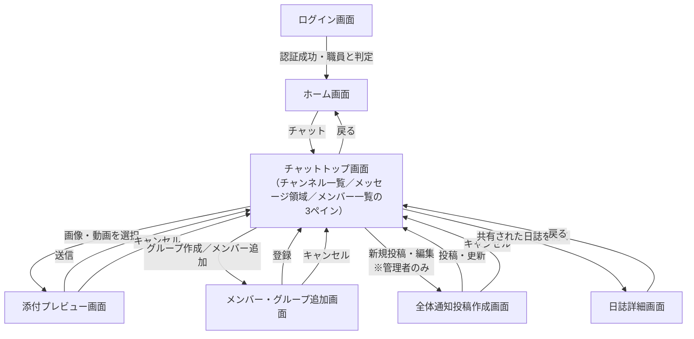
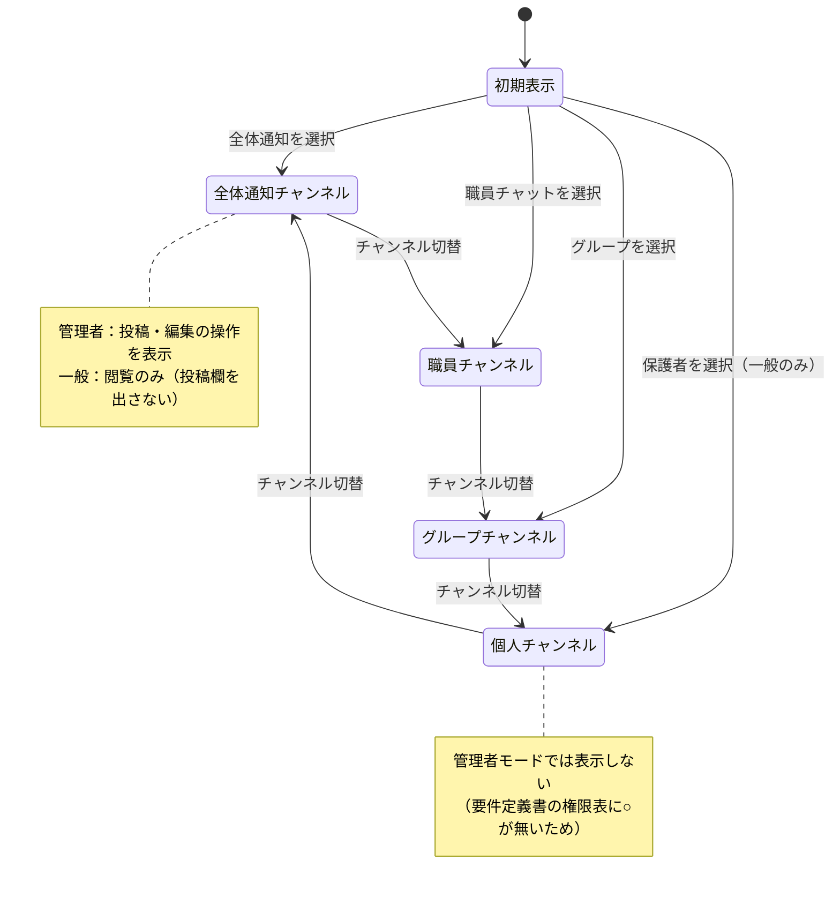
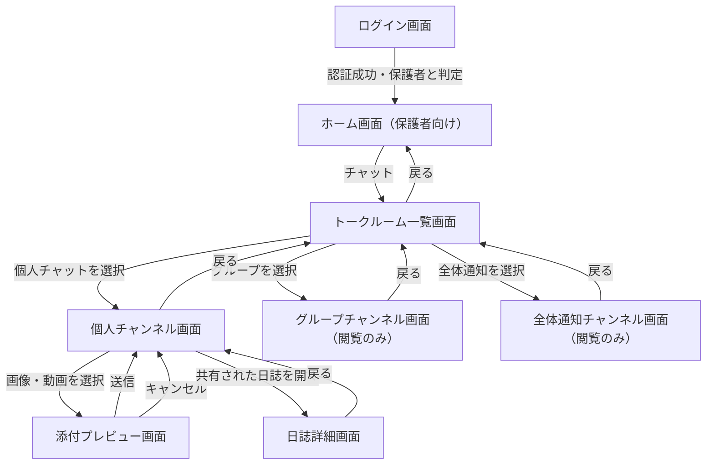

# すくすくシステム 基本設計書 — チャットツール 画面遷移図（ドラフト）

| 項目 | 内容 |
| :-: | :-- |
| 対象システム | 保育士支援システム（すくすくシステム） |
| 対象範囲 | チャットツール（全体通知チャット／グループチャット／個人チャット／画像アップロード／メンバー一覧／メンバー・グループ追加） |
| 版数 | 第 0.2 版（ドラフト） |
| 作成日 | 2026 年 7 月 27 日 |
| 位置づけ | 基本設計書「3 ユーザインターフェイス設計」の「画面遷移図」に相当 |

## 改訂履歴

| 版 | 日付 | 変更内容 |
| :-: | :-: | :-- |
| 0.1 | 2026/07/27 | 要件定義書のチャットツール権限表のみを根拠に初版作成 |
| 0.2 | 2026/07/27 | 依頼された画面種別（Discord 風トップ画面）を反映。**常時表示サイドバー方式**を前提とした構成に作図しなおし、デバイス別（職員＝多ペイン／保護者＝単一カラム）に分離 |

---

## 1 レイアウト方針（先に決めるべき論点）

「Discord のようなトップ画面」という指定は、**画面遷移図の描き方そのものを変える**ため先に整理する。

Discord の UI は、サーバー一覧・チャンネル一覧・メッセージ領域・メンバー一覧が**同一画面に常時並んでいる**。チャンネルを切り替えても画面遷移は起きず、メッセージ領域の中身が入れ替わるだけである。つまり従来型の「一覧画面 → 詳細画面 → 戻る」という遷移が、ほとんど**画面内の状態変化**に置き換わる。

一方で本システムの想定デバイスは、**職員＝タブレット/PC、保護者＝スマートフォン**で分かれている（要件定義書 3-2）。スマートフォンでは3ペインを並べられないため、保護者側は**単一カラム＋実際の画面遷移**になる。

そこで本書は次の前提で作図する。

| 利用者 | デバイス | 構成 | 遷移の性質 |
| :-- | :-- | :-- | :-- |
| 職員（管理者・一般） | タブレット/PC | 3ペイン常時表示（チャンネル一覧／メッセージ領域／メンバー一覧） | チャンネル切替は**画面内状態変化**。独立画面はモーダル系のみ |
| 保護者 | スマートフォン | 単一カラム | トークルーム一覧 ⇄ 各チャット画面の**実遷移** |

【要決定】この前提でよいか。「職員側もスマホで使う」場合は、職員側にも単一カラム版の遷移が必要になり、画面数が増える。

---

## 2 画面一覧

依頼の画面種別と、要件定義書の機能名の対応を示す。

| 依頼された画面 | 本書での画面名 | 要件定義書での機能名 | 利用者 |
| :-- | :-- | :-- | :-- |
| トップ画面 | チャットトップ画面 | （記載なし・新規） | 全員 |
| 全体への通知（チャット） | 全体通知チャンネル | 園チャット | 管理者（投稿・編集）／一般・保護者（閲覧のみ） |
| グループチャット | グループチャンネル | グループチャット | 管理者・一般（送受信）／保護者（閲覧のみ） |
| 個人チャット | 個人チャンネル | 個人チャット | 一般・保護者（送受信） |
| 画像のアップロード | 添付プレビュー画面 | 画像・動画のアップロード | 送信権限のある利用者 |
| メンバー一覧表示 | メンバー一覧ペイン | メンバー一覧表示 | 管理者・一般 |
| メンバー・グループ追加画面 | メンバー・グループ追加画面 | メンバー・グループ追加 | 管理者・一般 |
| （指定なし） | 職員チャンネル | **職員チャット** | 管理者・一般 |
| （指定なし） | 全体通知投稿作成画面 | 園チャットの投稿・編集 | 管理者 |
| （指定なし） | 日誌詳細画面 | 日誌の個人チャット共有 | 全員 |

> **要件定義書には有るが依頼の一覧に無い画面**：職員チャット。要件定義書 4-2(2) の権限表に「職員チャット：管理者=送受信／一般=送受信」と明記されているため、本書では残した。グループチャットに吸収するなら要件定義書の改訂が必要。

**共通レイアウト**：ヘッダ／ナビゲーション／メイン／フッタとテーマカラー「優しい黄色」は全体基本設計書の「画面基本構成」に従う。

---

## 3 画面遷移図

### 3-1 職員（管理者・一般）— タブレット/PC・3ペイン構成

チャットトップ画面が常時表示され、チャンネルの切替は画面内で完結する。独立画面として遷移するのはモーダル系のみ。

**チャットトップ画面の内部状態遷移**（画面遷移ではなくメッセージ領域の切替）

### 3-2 保護者 — スマートフォン・単一カラム構成

3ペインを並べられないため、トークルーム一覧と各チャンネルは実際の画面遷移になる。保護者は**個人チャットのみ送受信可**、グループ・全体通知は閲覧のみ、添付も個人チャットに限られる。メンバー一覧・グループ追加の画面は持たない。

---

## 4 画面遷移表

| 遷移元 | 契機（操作） | 遷移先 | 条件・備考 |
| :-- | :-- | :-- | :-- |
| ログイン画面 | ログイン | ホーム画面 | 利用者種別（管理者／一般／保護者）で表示内容とレイアウトを切り替える |
| ホーム画面 | 「チャット」を選択 | チャットトップ画面（職員）／トークルーム一覧画面（保護者） | デバイス・利用者で分岐 |
| チャットトップ画面 | チャンネルを選択 | **遷移しない** | メッセージ領域の内容が入れ替わるのみ |
| トークルーム一覧画面 | チャンネルを選択 | 各チャンネル画面 | 保護者のみ。権限のない区分は一覧に表示しない |
| 各チャンネル | 画像・動画を選択 | 添付プレビュー画面 | 保護者は個人チャンネルのみ |
| 添付プレビュー画面 | 送信／キャンセル | 遷移元のチャンネル | — |
| チャットトップ画面 | メンバー一覧を開閉 | **遷移しない** | 右ペインの表示／非表示 |
| チャットトップ画面 | グループ作成・メンバー追加 | メンバー・グループ追加画面 | 職員のみ |
| 全体通知チャンネル | 新規投稿・編集 | 全体通知投稿作成画面 | **管理者のみ**。一般・保護者には操作を表示しない |
| 個人チャンネル | 共有された日誌を開く | 日誌詳細画面 | 承認済み日誌が個人チャットへ自動送信（またはリンク共有）される要件に対応 |

---

## 5 要確認事項

| # | 事項 | 状況 |
| :-: | :-- | :-- |
| 1 | **既読表示・既読管理** | 6/9議事録では現場の最優先ニーズとされる一方、**要件定義書の機能一覧に存在しない**。入れるなら要件定義書の改訂が先。既読者一覧を別画面（モーダル）にするなら遷移が1本増える |
| 2 | **職員チャットの扱い** | 依頼の画面一覧に無いが要件定義書には有る。残すか、グループチャットに統合するか |
| 3 | **動画アップロード** | 依頼は「画像のアップロード」だが、要件定義書は「画像・**動画**のアップロード」。動画を含むならファイルサイズ上限・形式の決定が必要 |
| 4 | メッセージ検索 | 要件定義書に記載なし。日誌には絞り込み検索があるがチャットには無い |
| 5 | 通知（プッシュ／アプリ内） | 要件定義書に記載なし。通知タップからチャンネルへ直接飛ぶ導線を持つかで遷移図が変わる |
| 6 | リアクション機能 | 権限表に「利用可」とあるが、メッセージ領域内の操作であり独立画面は不要と判断した |
| 7 | グループチャットと全体通知の使い分け | 要件定義書の「検討中の論点」のまま未確定。組単位＝グループ、園全体＝全体通知と仮置きした |
| 8 | 職員側のスマートフォン利用 | 想定外とした（要件定義書 3-2 では職員＝タブレット/PC）。使うなら単一カラム版の遷移図が別途必要 |
| 9 | 保護者のホーム画面 | 保護者ポータルとの責務境界が未確定。本システム側にホームを持つ前提で作図した |
